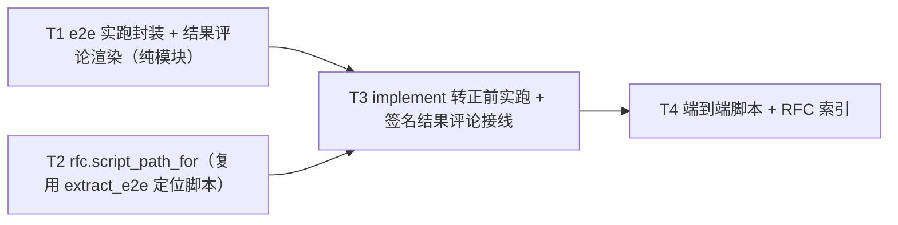

# 0013 实跑端到端脚本并把「合否 + 日志」作为 PR 评论（RFC-0008 指路牌 → 实跑结果延伸）

> 本文件由 `spec render` 自动生成，请勿手工编辑。
> 内容来源：本组 `metadata.yaml` 与 `tasks/T*.yaml`（关联 issue #31）。

## 任务编排

| 任务 | 标题 | 优先级 | 状态 | 依赖 |
|----|----|----|----|----|
| T1 | e2e 实跑封装 + 结果评论渲染（纯模块） | P1 | done | — |
| T2 | rfc.script_path_for（复用 extract_e2e 定位脚本） | P1 | done | — |
| T3 | implement 转正前实跑 + 签名结果评论接线 | P1 | done | T1, T2 |
| T4 | 端到端脚本 + RFC 索引 | P1 | done | T3 |

## 各任务方案

### T1 · e2e 实跑封装 + 结果评论渲染（纯模块）（P1 / done）

**涉及文件**

- `openagents/e2e.py`
- `tests/test_e2e.py`

**范围**

新建 `openagents/e2e.py`，实现 `E2EResult`、`run_e2e_script`、`render_result` 及 `DEFAULT_TIMEOUT_SECONDS` / `DEFAULT_TAIL_LINES`（见接口契约）。在 worktree 内 `bash <script_path>` 跑离线段、捕获退出码与合并输出、施加超时、截尾部 N 行；脚本缺失 / 非常规文件 / 超时 / 非零退出 各自映射成结构化结果，**绝不抛错**。模块 docstring 与公开函数 引用 `RFC-0013`。

**验收标准**

单测覆盖——退出码 0 → `passed`；非零 → `failed` 且退出码正确；超时 → `failed` 且 `timed_out=True`；`script_path=None` / 文件不存在 → `skipped` 不起子进程；`render_result` 对四种 outcome 各渲染对应「结果」行与日志块且不抛错。ruff + pytest 通过。

### T2 · rfc.script_path_for（复用 extract_e2e 定位脚本）（P1 / done）

**涉及文件**

- `openagents/rfc.py`
- `tests/test_rfc.py`

**范围**

在 `openagents/rfc.py` 新增 `script_path_for(*, rfc_path) -> str | None`：读文件 → `extract_e2e` → 返回 `hints.script_path`，文件不可读返回 `None`（不抛错），与既有 `signpost_for` 对称。docstring 引用 `RFC-0013`（复用 RFC-0008 的 `extract_e2e`）。

**验收标准**

单测——含 `集成测试` 脚本的 RFC 抽出该脚本相对路径；无脚本段时返回 `None`； 文件不可读返回 `None` 不抛错。不破坏既有 `extract_e2e` / `signpost_for` 用例。ruff + pytest 通过。

### T3 · implement 转正前实跑 + 签名结果评论接线（P1 / done）

**涉及文件**

- `openagents/orchestrator.py`
- `tests/test_orchestrator.py`

**范围**

改 `orchestrator.implement`：`import e2e`；在 `commit_and_push` 之后、`mark_ready` 之前定位脚本（`changed_rfc_path` + `rfc.script_path_for`，`base=DEFAULT_BASE`）→ `e2e.run_e2e_script` 实跑 → `e2e.render_result` 渲染 → `identity.post_signed_comment` 盖章发评论 → `github.mark_ready` 照常转正。结果 ❌ 不阻断转正；发评论失败仅记进度并吞掉、不崩溃流程。 新增/改动处注释引用 `RFC-0013`。

**验收标准**

单测（假 backend + 假 Workspace + monkeypatch `e2e.*` / `identity.post_signed_comment` / `github.mark_ready`）——`implement` 在 `mark_ready` 前调用 `run_e2e_script`、把渲染结果经 `post_signed_comment`（带本实例 `agent_id`）发出；e2e `failed` 时仍调用 `mark_ready`； `changed_rfc_path` 返回 `None` 时走 `script_path=None`（skipped）仍发评论且不抛错； 发评论抛错时 `mark_ready` 仍被调用。ruff + pytest 通过。

### T4 · 端到端脚本 + RFC 索引（P1 / done）

**涉及文件**

- `scripts/e2e-rfc-0013-implement-e2e-comment.sh`
- `docs/rfcs/README.md`

**范围**

新增 `scripts/e2e-rfc-0013-implement-e2e-comment.sh`（沿用两段式：默认离线 `ruff check` / `ruff format --check` / `pytest`；`OPENAGENTS_E2E_REAL=1` 时人工 opt-in 演练 「implement 实跑 + 结果评论」路径）。在 `docs/rfcs/README.md` 的 RFC 列表追加 RFC-0013 行。

**验收标准**

离线段在干净仓库通过；脚本可执行（`set -euo pipefail`、`chmod +x`）； README 列表含 RFC-0013 条目。
