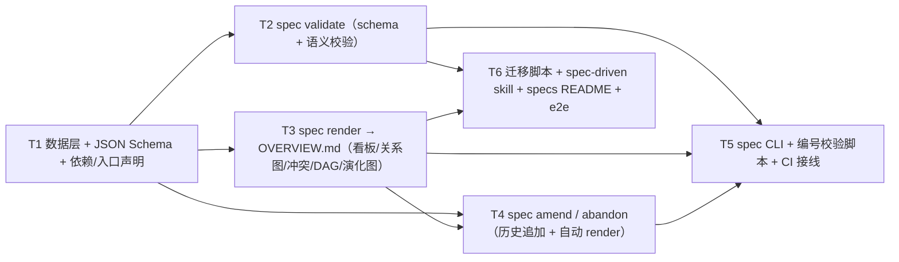

# 0014 用「Spec 活快照 + 演化历史」取代 RFC —— Spec 永远与代码一一对应，legacy 沉淀到历史

> 本文件由 `spec render` 自动生成，请勿手工编辑。
> 内容来源：本组 `metadata.yaml` 与 `tasks/T*.yaml`（关联 issue #35）。

## 任务编排

| 任务 | 标题 | 优先级 | 状态 | 依赖 |
|----|----|----|----|----|
| T1 | 数据层 + JSON Schema + 依赖/入口声明 | P1 | done | — |
| T2 | spec validate（schema + 语义校验） | P1 | done | T1 |
| T3 | spec render → OVERVIEW.md（看板/关系图/冲突/DAG/演化图） | P1 | done | T1 |
| T4 | spec amend / abandon（历史追加 + 自动 render） | P1 | done | T1, T3 |
| T5 | spec CLI + 编号校验脚本 + CI 接线 | P1 | done | T2, T3, T4 |
| T6 | 迁移脚本 + spec-driven skill + specs README + e2e | P1 | done | T2, T3 |

## 各任务方案

### T1 · 数据层 + JSON Schema + 依赖/入口声明（P1 / done）

**涉及文件**

- `openagents/spec/__init__.py`
- `openagents/spec/model.py`
- `openagents/spec/schema.py`
- `pyproject.toml`
- `tests/test_spec_model.py`

**范围**

新建 `openagents/spec/` 包；`model.py` 定义 `RelatesTo`/`Task`/`Metadata`/`Group` 与 `load_group`/`load_all`/`dump_task`/`qualified_id`（用 `ruamel.yaml` round-trip 读写，保留块标量与键序）；`schema.py` 定义 `TASK_SCHEMA`/`METADATA_SCHEMA`/`HISTORY_SCHEMA`（JSON Schema draft 2020-12，覆盖 Task 全字段 + 枚举）。`pyproject.toml`：`dependencies` 增 `ruamel.yaml`、`jsonschema`；`[project.scripts]` 增 `spec = "openagents.spec.cli:main"`。

**验收标准**

单测覆盖：往返 load→dump→load 保真（块标量、键序、`relates-to` 列表）；缺省可选字段（tags/tests/open-questions 等）有合理默认；`load_all` 聚合多组；`qualified_id` 拼出 `NNNN/T*`；`schema.py` 三个 schema 本身是合法 JSON Schema（`jsonschema` 可编译）。`pip install -e .` 后 `spec` 入口可解析（即便 cli 由 T5 落地，入口声明先就位）。

### T2 · spec validate（schema + 语义校验）（P1 / done）

**涉及文件**

- `openagents/spec/validate.py`
- `tests/test_spec_validate.py`

**范围**

`validate.py`：`ValidationIssue`/`ValidationReport` + `validate()`，依序跑 JSON Schema 校验 → status 合法且与 history 末态自洽 → 同组 files 不重叠(error) → 全局（含跨组）depends-on DAG 无环(error) → 血缘/跨组引用存在(error) → 跨组 files 重叠(warning)。

**验收标准**

单测用临时 specs 树覆盖每条规则的正反例：schema 不合规→error；同组 files 重叠→error；构造环→检测到环 error；跨组 depends-on 指向不存在 Task→error；跨组 files 重叠→仅 warning 且 `ok=True`；全合规→`ok=True` 无 issue。

### T3 · spec render → OVERVIEW.md（看板/关系图/冲突/DAG/演化图）（P1 / done）

**涉及文件**

- `openagents/spec/render.py`
- `tests/test_spec_render.py`

**范围**

`render.py`：`render()`（纯函数返回全文，幂等）+ `write_overview()`。生成四块：全局看板表、跨 feature 关系图（Mermaid subgraph，depends-on 实线 / relates-to 虚线标 type）、文件冲突报告（跨组 files 重叠）、每 feature 段（组内看板 + 依赖 DAG + 演化图：节点=Task版本、按 status 着色、血缘字段连边）。

**验收标准**

单测：固定输入两次 render 字节级一致（幂等）；输出含四块标题；看板行数 = 全部当前版 Task 数；关系图含跨组虚线边；演化图含某 Task 的 v1→v2 边与 abandoned 节点着色；空仓库不报错。

### T4 · spec amend / abandon（历史追加 + 自动 render）（P1 / done）

**涉及文件**

- `openagents/spec/mutate.py`
- `tests/test_spec_mutate.py`

**范围**

`mutate.py`：`amend()`（当前版 append 进 history/T*.yaml → 覆盖 tasks/T*.yaml 为新版 version+1/updated=今天/change_reason → 调 render）；`abandon()`（当前 task append 进 history 末态 abandoned → 从 tasks/ 删除 → render）。

**验收标准**

单测：amend 后 history 长度 +1 且含旧版完整快照、tasks 为新版且 version 自增、OVERVIEW.md 被重写；连续 amend 版本号单调；abandon 后 tasks/ 无该文件、history 末项 status=abandoned；amend 不存在的 task→报错不破坏文件。

### T5 · spec CLI + 编号校验脚本 + CI 接线（P1 / done）

**涉及文件**

- `openagents/spec/cli.py`
- `scripts/check-spec-number-conflicts.py`
- `.github/workflows/ci.yml`
- `tests/test_spec_cli.py`

**范围**

`cli.py`：`main()` 路由 `render`/`amend`/`abandon`/`validate`（validate 有 error → 退出码非 0）。`scripts/check-spec-number-conflicts.py`：移植 `check-rfc-number-conflicts.py`，路径正则改为 `docs/specs/(NNNN)-slug/`，本地 + open PR 并集查冲突。`.github/workflows/ci.yml`：`rfc-conflicts` job → `spec-conflicts`（调新脚本）；新增 `spec validate` 步与 OVERVIEW drift-check（`spec render` 后 `git diff --exit-code`）；更新 `gate` job 的 `needs`/汇总。

**验收标准**

单测打桩文件系统：`spec render` 写出 OVERVIEW；`spec validate` 在有 error 时退出码非 0、仅 warning 时为 0；`spec amend/abandon` 路由到 mutate。`check-spec-number-conflicts.py` 对 `docs/specs/` 重复编号报冲突、唯一编号通过（打桩 `gh`）。ci.yml YAML 合法、含 spec-conflicts + validate + drift 步。

### T6 · 迁移脚本 + spec-driven skill + specs README + e2e（P1 / done）

**涉及文件**

- `scripts/migrate-rfc-to-spec.py`
- `tests/test_migrate_rfc_to_spec.py`
- `.claude/skills/spec-driven-development/SKILL.md`
- `.claude/skills/spec-driven-development/references/`
- `docs/specs/README.md`
- `scripts/e2e-spec-0014-spec-driven.sh`

**范围**

`scripts/migrate-rfc-to-spec.py`：每份 `docs/rfcs/NNNN-*.md` → 一个 spec 组（metadata.yaml + tasks/ + origin.md）；RFC 头部（优先级/标签/issue）+ 子任务表每行 → `tasks/T*.yaml`（status 映射 `implemented`→`done`、`blocked`→`pending`；files/depends-on 解析，**整 RFC 级依赖 `RFC-NNNN` 形态不构成 Task 依赖故丢弃**；每行的 `范围`/`验收标准` 从「子任务定义」块抽进 `scope`/`acceptance`）；设计/动机/接口契约/权衡/参考资料等组级正文整体留组内 `origin.md`（只读，render 不读取）。**迁移产出 `version: 1` 的当前版 Task，history 目录初始为空——首次 `amend` 才落 v1（与 amend「先 append 当前版再 bump」语义自洽，避免 history 出现重复 v1，见 D6）。** 改写 skill：`.claude/skills/spec-driven-development/`（SKILL.md + references，含 Task JSON Schema 说明、`# Spec-NNNN/T*` 注释约定、三阶段工作流：clarify→设计→实施验证）。`docs/specs/README.md`（目录说明 + 编号规则）。`scripts/e2e-spec-0014-spec-driven.sh`（端到端：迁移→validate→render→amend→再 validate/render 幂等）。

**验收标准**

单测：用 1~2 份真实 RFC 跑迁移，断言产出通过 `spec validate`、Task 数 = 原子任务行数、`implemented` 映射为 `done`、`blocked` 映射为 `pending`、产出 `version: 1` 且 history 初始为空；全 13 份 RFC 迁移后 `spec validate` 全绿（仅跨组文件 warning）且 `spec render` 幂等（两次无 diff）。skill SKILL.md 含三阶段 + Task schema + 新注释约定；`docs/specs/README.md` 含编号规则。e2e 脚本可独立运行（见测试方案）。
