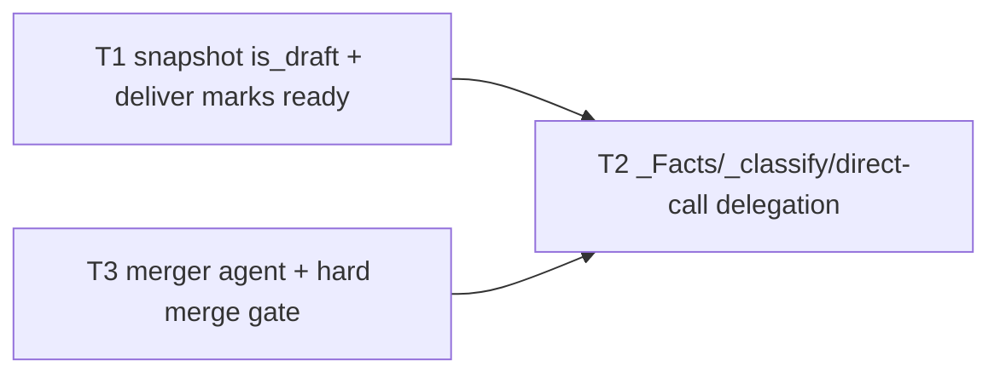

# 0017 · Delegate the PR lifecycle (create/ready/merge) to agents: make draft a first-class fact, level-triggered self-healing promotion to ready + a hard merge gate as a safeguard

<!-- This file is maintained by the spec tool: frontmatter is the structured source data (including the tasks DAG); the body is a group-level overview in the nine-section rust-RFC format. -->

## Summary

Under the division of responsibilities in Spec-0064, “recipes contain only control flow / agents contain zero logic,” Vigil (`recipes.vigil`) has already delegated all work **requiring judgment** (writing RFCs, writing code, resolving conflicts, responding to comments, reviewing) to agents. But **three PR lifecycle actions are still called directly by deterministic code**, and they are “one-shot” operations—a single attempt at the moment a PR is opened, with no second chance if it misses:

- `create_pr(draft=True)` (`vigil.py` `_do_solve`)
- `github.mark_ready(...)` (`_do_solve`, a single attempt immediately after the deliver agent, which takes several minutes)
- `github.merge_pr(...)` (`stages.merge`, via `_do_merge`)

This spec **delegates mark_ready / merge to agents** and makes **draft a first-class fact in `_Facts`**, so that level-triggered reconcile rechecks it on every tick—naturally idempotent and self-healing, eliminating dead ends where “a missed one-shot action leaves things permanently stuck with no way to reset.” Because `merge` is irreversible, a deterministic hard gate (all green + `review-approved:<head sha7>`@head) still guards the boundary after delegation: the agent can perform the merge only after the gate allows it.

`create_pr` **is not being delegated**—it already self-heals (`_classify` branch ④, “no PR → solve,” retries creation on every tick), so it is not a dead end; see Rationale.

## Motivation

### Triggering scenario (restated here to keep this spec self-contained)

PR #168 (the result of issue #163) had its code DONE, all six CI checks green, `mergeable=CLEAN`, and no `needs-human` label, yet it could never merge—because it remained a **draft**. Unless a human manually ran `gh pr ready`, it stayed stuck forever, and Vigil would not resolve it itself. This is not an isolated case, but another instance of “one-shot deterministic actions creating dead ends with no way to reset” (similar cases: the stage bottleneck in #157 and the gap in git responsibility in #140).

### Root cause: lifecycle actions were left in deterministic code, as “one-shot” operations

The problem is not just **ownership**, but also **form**. `mark_ready` is a one-shot action in the `_do_solve` vertical slice, attempted at the moment the PR is opened, immediately after the deliver agent, which takes several minutes. Once that attempt misses (the process is interrupted during delivery / an old CLI snapshot is running / any exception occurs), the PR stays in draft forever because **neither side handles it**:

- **The agent does not make up for it**—the deliver agent’s prompt stops at `git push` and says nothing about marking the PR ready; marking it ready is outside its responsibilities.
- **Steady-state reconciliation does not check it either**—the `_classify` branch table has no draft dimension, and the dozen-plus fields in `_Facts` do not include `is_draft` at all. Every subsequent tick therefore “cannot see” that the PR is still a draft, and never rechecks it to mark it ready.

Adding draft to `_Facts` (rechecked every tick) + making promotion to ready the responsibility of “an agent dispatched to run on every round” turns a missed attempt into simply “try again next round,” naturally eliminating the dead end. This is precisely the core benefit of level-triggered reconcile (Spec-0065): **promote a state variable to a first-class fact, and correction becomes a pure-function result of that fact**.

### Why merge must retain a deterministic hard gate

Of the three actions, `create_pr` and `mark_ready` are low-risk (reversible/idempotent) and can be handled directly. Only `merge_pr` is **irreversible**—it was originally kept in the deterministic layer to prevent an LLM from merging unreviewed code simply because it “thinks it is ready to merge.” After delegation to agents, “judgment (whether this version can merge)” is already the reviewer agent’s job (it applies the `review-approved:<sha7>` label), while “action (performing the merge)” is delegated to the merger agent. But **the irreversible boundary of “whether merging is allowed” remains guarded by a deterministic hard gate**: the agent is dispatched to perform the merge only after the gate allows it, and the gate is bound to the head sha, so any head change automatically invalidates the decision.

## Guide-level explanation

After the change, the PR’s draft/ready/merge state progresses as follows from solving an issue through merging:

1. **Open a PR (unchanged, deterministic)**: `_do_solve` still opens a draft PR with `create_pr(draft=True)`—this already self-heals (missed attempt → branch ④ retries creation next round), so delegation is unnecessary.
2. **Mark ready (delegated to the deliver agent + a level-triggered safety net)**: after pushing the code, the deliver agent **also runs `gh pr ready`**. Its completion criteria expand from “pushed to head” to “pushed to head **and the PR is not a draft**.” `_do_solve` no longer directly calls `mark_ready` deterministically. If the deliver attempt misses and the PR remains a draft, `_Facts.is_draft` is now a first-class fact: `_classify` rechecks it every tick, with a self-healing branch inserted before merge to mark it ready.
3. **Review, CI, e2e (unchanged)**: these gates run as usual on draft PRs (`gh pr checks` / our reviewer agent do not check draft status).
4. **Self-healing ready branch (new, ordered before merge)**: when a PR is already “all green + `review-approved`@head” but is still `is_draft`, `_classify` returns `ACTIONABLE: ready` instead of merge → mark ready → merge only on the next tick. **Placing this before merge** guarantees two things: no PR is merged while in draft state; with `merge: human`, the human receives a PR that is already ready and can be merged in one click (directly resolving #168, where the human was blocked by the draft barrier).
5. **Merge (delegated to the merger agent + a deterministic hard gate)**: when `_classify` returns `merge`, `_do_merge` first passes through deterministic `gates.assert_merge_allowed(pr_number, head_sha)`, which rereads CI + labels in real time as a safeguard (throws if permission is denied; the agent is never dispatched), then dispatches the merger agent to run `gh pr merge`. The merger also has a first-class `needs-human` exit.

For agent authors: deliver gains one additional completion criterion, “not a draft”; a very small merger agent is added (the gate has already allowed the operation; perform the merge). For reconcile: `_Facts` gains an `is_draft` field, and `_classify` gains a ready branch.

## Reference-level explanation

### Technical approach (broken down by Task)

#### T1 — Promote draft to a PR snapshot fact + assign responsibility for marking ready to the deliver agent

- `openagents/utils/github.py`: append `isDraft` to the `gh pr view --json` fields in `pr_snapshot`; add `is_draft: bool` to `PRSnapshot`, **as the last field, defaulting to `False`**—existing `pr_snapshot` construction sites and test fakes therefore need no individual changes (avoiding fake breakage of the kind seen in Spec-0031), and it is read **from the same source in a single `gh pr view` round trip** as the other current-state fields. Note: the repository already has a standalone `github.is_draft(pr_number)` (Spec-0042, a separate `gh pr view`)—`_sense` must not reuse it, as that would add one network round trip per tick (at scale, the 5000 req/h quota is a concern); draft and state/head/mergeable are current-state facts from the same source for the same head and must be read together in one call.
- `openagents/agents/deliver.py`: append `gh pr ready $pr_number` after the `git push` step in `PROMPT` (idempotent: when the PR is already non-draft, `gh` exits nonzero; treat this as having no side effects), and expand the completion criteria to “pushed to head and the PR is not a draft.” `OUTPUT_SCHEMA` remains unchanged.

#### T3 — Delegate the merge action to the merger agent + retain a deterministic hard merge gate as a safeguard

- `openagents/agents/merger.py` (new): a zero-logic `string.Template`—state that “the hard gate has allowed the operation,” execute `gh pr merge $pr_number --merge`, and provide a first-class `needs-human` exit; `OUTPUT_SCHEMA = {"merged": bool, "summary": str}`.
- `openagents/runtime/gates.py`: add `assert_merge_allowed(*, pr_number, head_sha)`—reread CI (`check_snapshot`) + labels (`pr_snapshot`) in real time, and throw `GateError` unless “all green ∧ `review-approved:<head sha7>` exists and its sha matches the current head.” This is the deterministic safeguard for the irreversible boundary: it protects both against TOCTOU when head advances between `_sense→_act` and against a mistakenly dispatched merger agent merging unreviewed code. It only reads objective facts, with zero business judgment (following the gates layering anchor).
- `openagents/recipes/stages.py`: change the `merge` stage from deterministic `github.merge_pr` to “first obtain permission from `gates.assert_merge_allowed`, then perform the merge with `engine.run_agent(merger)`,” explicitly accepting `backend / pr_number / head_sha / work_dir / context_text` (keyword-only, no positional arguments, no defaults for private parameters, in accordance with CLAUDE.md conventions).

#### T2 — Promote draft to a first-class fact in `_Facts` + add a self-healing `_classify` branch + delegate direct lifecycle calls

- `openagents/recipes/vigil.py`:
  - Add `is_draft` to `_Facts` (last field, defaulting to `False`, automatically included in the full-field `_fingerprint` hash—marking ready changes `True→False`, changing fp and counting as real progress, so guardrail one does not trigger incorrectly); `_sense` reads it from `snapshot.is_draft`.
  - Insert a branch before merge in `_classify`: `is_draft` and everything else ready (all green + `review-approved`@head) → `ACTIONABLE: ready` (new `_ACT_READY`); select `merge` only for non-draft PRs.
  - Add `_ACT_READY` → `_do_ready` in `_act`: deterministic `github.mark_ready` (level-triggered; see Rationale for why this branch remains deterministic).
  - Remove the one-shot direct call to `github.mark_ready` from `_do_solve`.
  - Change `_do_merge` to call `stages.merge(backend=…, pr_number=…, head_sha=facts.head_sha, work_dir=…, context_text=_NEEDS_HUMAN_CONTRACT)`.

### Branch table changes (`_classify` order is a hard dependency)

```
① merged / closed / needs-human ............... TERMINAL
② Latest comment is from a human .............. ACTIONABLE: reply
③ Dependencies are not all closed ............. QUIET(awaiting-blockers)
④ No PR yet ................................... ACTIONABLE: solve        (create_pr already self-heals here)
⑤ mergeable = UNKNOWN / null .................. QUIET(awaiting-mergeability)
⑥ Conflicts (dirty) ............................ ACTIONABLE: rebase
⑦ CI = pending / zero checks .................. QUIET(awaiting-ci)
⑧ CI = failure ................................ ACTIONABLE: fix-ci
⑨ e2e evidence missing / stale ................. ACTIONABLE: e2e
⑩ No review-approved@head / changes-requested .. ACTIONABLE: review-or-fix
⑪ All green + approved@head + **is_draft** ..... ACTIONABLE: ready   ← New (self-healing promotion to ready, ordered before merge)
⑫ All green + approved@head + **non-draft** ..... ACTIONABLE: merge   (delegated to merger agent + hard gate)
```

**⑪ must precede ⑫** is a correctness dependency: draft PRs cannot merge (GitHub refuses to merge drafts), and with `merge: human`, the human is also blocked by the draft barrier—so marking ready must happen before the merge action (whether performed by an agent or a human).

### DAG + File allocation

| Task | depends-on | Files (pairwise disjoint) |
|---|---|---|
| **T1** | — | `openagents/utils/github.py`, `openagents/agents/deliver.py`, `tests/test_utils_github_vigil.py`, `tests/test_agents_deliver.py` |
| **T3** | — | `openagents/runtime/gates.py`, `openagents/agents/merger.py`, `openagents/recipes/stages.py`, `tests/test_runtime_gates.py`, `tests/test_recipe_stages.py`, `tests/test_agents_merger.py` |
| **T2** | T1, T3 | `openagents/recipes/vigil.py`, `tests/test_recipe_vigil.py`, `tests/test_recipe_vigil_act.py`, `scripts/e2e-spec-0017-pr-lifecycle-delegated-to-agent.sh` |



T1 (`PRSnapshot.is_draft`) and T3 (new `stages.merge` signature + merger + hard gate) are independent and can run in parallel; T2 consumes the outputs of both (reading `is_draft` and calling the new `stages.merge`), so it depends-on both.

### e2e script path

`scripts/e2e-spec-0017-pr-lifecycle-delegated-to-agent.sh` (offline and deterministic; see frontmatter `e2e.method`), collected by the PR e2e signpost.

## Drawbacks

- **One more field in `_Facts`**: every added fact must pass the self-destruction test: “Will the worker happen to change it as it finishes its work?” `is_draft` is changed by marking ready (`True→False`), but that is **exactly the intended progress** (the same kind as a push changing `head_sha`), not guardrail one destroying itself—if marking ready fails, `is_draft` remains unchanged, fp remains unchanged, and the attempt stamp provides its fallback as usual.
- **Two places share responsibility for marking ready** (the deliver agent happy path + the `_do_ready` deterministic safety net), which appears redundant: but this redundancy is the standard form of “a first-class exit + a fallback” (structurally identical to Spec-0065)—the agent handles it along the happy path, and the level-triggered fallback catches missed actions. Removing either reopens a blind spot.
- **The merger agent is an LLM call requiring “almost zero judgment”**: once the gate allows it through, it essentially runs just one `gh pr merge` command. That cost buys architectural consistency (all actions belong to the agent layer) + a last-minute `needs-human` exit. See the alternatives under Rationale.

## Rationale and alternatives

### Why `create_pr` is not delegated

The issue expects all three actions to be delegated, but **the acceptance criteria pin down only mark_ready and merge**, and explicitly state that create_pr is low risk. By Occam’s razor (principle 1): `create_pr` is not a blind spot at all—`_classify` branch ④, “`pr_number is None` → solve,” already rechecks on every tick, so a missed create_pr action is automatically retried on the next cycle. Delegating it would instead require the deliver agent to create the PR and the recipe to read the PR number back (`pr_for_branch`), complicating the vertical slice without any gain in self-healing. Therefore, retain deterministic `create_pr` and simply state in the main text that it already self-heals.

### Why the mark-ready self-healing branch (⑪) retains deterministic `github.mark_ready` instead of dispatching an agent

The self-healing mechanism described in the issue is “the agent marks it ready as part of its work on the next cycle.” But in the reconcile model, for a remaining draft PR that is “already delivered, with no pending code work,” no natural branch will dispatch the deliver agent again (deliver’s `assert_head_advanced` hard gate would fail because there are no new commits). Having it “marked ready by an agent” would require either creating a new promoter agent or relaxing deliver’s hard gate, both of which are far heavier than a single line of `github.mark_ready`.

The key insight: **the issue seeks to eliminate “one-shot” behavior, not “deterministic” behavior**. Once `is_draft` is elevated to a first-class fact rechecked on every tick, the mark-ready branch is already level-triggered (idempotent and self-healing); whether its action is an LLM call has no bearing on whether the blind spot recurs. And “marking an already delivered draft PR ready” is a **mechanical action requiring zero judgment** (the objective pair `delivered ∧ draft` fully determines what to do), so under the boundary established by Spec-0064 (mechanical segments → deterministic), it should remain deterministic anyway. Thus, happy-path marking ready belongs to the deliver **agent** (satisfying acceptance criterion ①), while the self-healing safety net retains deterministic `mark_ready` (satisfying acceptance criterion ②, “steady-state routing can self-heal”), closing the blind spot without spending an LLM call on a single line of `gh pr ready`.

- **Alternative A (dispatch a new promoter agent to mark ready)**: fully matches the literal wording “marked ready by an agent,” but adds an agent module + one LLM call per self-healing attempt for a single idempotent shell command, violating principle 1; this can be changed when this spec is adopted. Retained as a refinement option.

### Why merge is delegated to an agent instead of retaining deterministic `merge_pr`

- **Alternative B (retain deterministic `merge_pr`, relying only on the `_classify`⑫ gate)**: `_classify`⑫ is already a deterministic gate bound to a sha, and the merge action itself requires zero remaining judgment, so retaining determinism is the most economical option. However, issue acceptance criterion ③ explicitly requires “delegating the merge action to an agent,” and after delegation, merger can provide a last-minute `needs-human` exit (when it detects anomalies the gate does not cover). This spec adopts “delegation + deterministic `assert_merge_allowed` fallback” to meet the acceptance criteria; alternative B is recorded here for reference. What actually enforces “do not merge unreviewed code” is that deterministic hard gate, not the agent—both approaches agree on this point.

### Where state belongs (following the division of responsibilities in Spec-0065)

Draft status is **GitHub’s own fact**, so read it natively (into `pr_snapshot`) rather than copying it into a label—copying it would create a second source of truth that needs reconciliation. This is consistent with Spec-0065: “Record our decisions as labels; read GitHub’s facts natively.”

## Prior art

- **Spec-0065 (Graph-driven parallel Vigil)**: establishes level-triggered reconcile + the invariant “`_Facts` field set ≡ branch-table input set ≡ fp hash input set,” along with the first-class `needs-human` exit + two guardrails. This spec adds `is_draft` to `_Facts` within precisely that invariant.
- **Spec-0064 (Declarative stages convergence)**: establishes the division of responsibilities “recipe: pure control flow / agent: zero logic” and the boundary “mechanical segments → deterministic, judgment segments → agent”—this spec’s choices to “keep the mark-ready safety net deterministic, delegate the merge action to an agent + retain a deterministic hard gate” both follow that boundary.
- **Spec-0060 (agents/recipes core)**: the minimal hard-gate pattern in `runtime.gates` (`assert_head_advanced` / `assert_evidence_stamp`)—`assert_merge_allowed` is a new member of the same pattern (checking only objective facts, without judging right or wrong).
- **#140 (git responsibility vacuum) / #157 (stage bottleneck)**: precedents of the same kind, where “one-shot deterministic actions create blind spots that cannot be reset”; this spec closes out the third instance.
- [rust-lang/rfcs](https://github.com/rust-lang/rfcs): the source of this overview’s nine-section structure.

## Unresolved questions

- **The form of the action in the mark-ready self-healing branch**: deterministic `mark_ready` (this spec) vs a new promoter agent (alternative A)—left for human review to decide. The two are equivalent in “eliminating the blind spot”; the only disagreement is whether to spend another agent + one LLM call each time to satisfy the literal wording “the agent marks ready.”
- **Trigger prerequisites for the ⑪ self-healing branch**: this spec places it after “all green + approved@head” (the same prerequisites as merge, for minimal disruption). Should marking ready happen earlier (as soon as the PR is delivered, so people/GitHub treat it as a ready PR and request a reviewer sooner)? Earlier marking ready would compete with the CI/review branches for dispatch order, and happy-path deliver already marks ready early, so this spec chooses a “fallback before merge.” If practice reveals that “review is delayed during the draft phase,” it can be moved earlier.

## Future possibilities

- **Proactively request a reviewer during the draft phase**: after marking ready, also run `gh pr edit --add-reviewer` to involve human reviewers earlier (currently this relies on people proactively looking at PRs).
- **Configurable merge method**: merger currently uses a fixed `--merge`; in the future, squash/rebase could be declared in `openagents.yml` (following the `method` parameter of `github.merge_pr` and its Unresolved questions).
- **Unify lifecycle actions in a single lifecycle agent**: if more PR lifecycle actions arise later (such as auto-close stale draft), consider consolidating them into a single lifecycle agent to avoid creating a separate agent module for each action.
