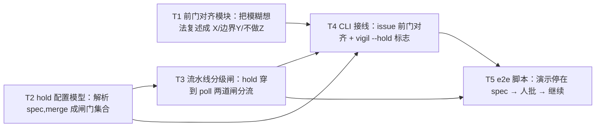
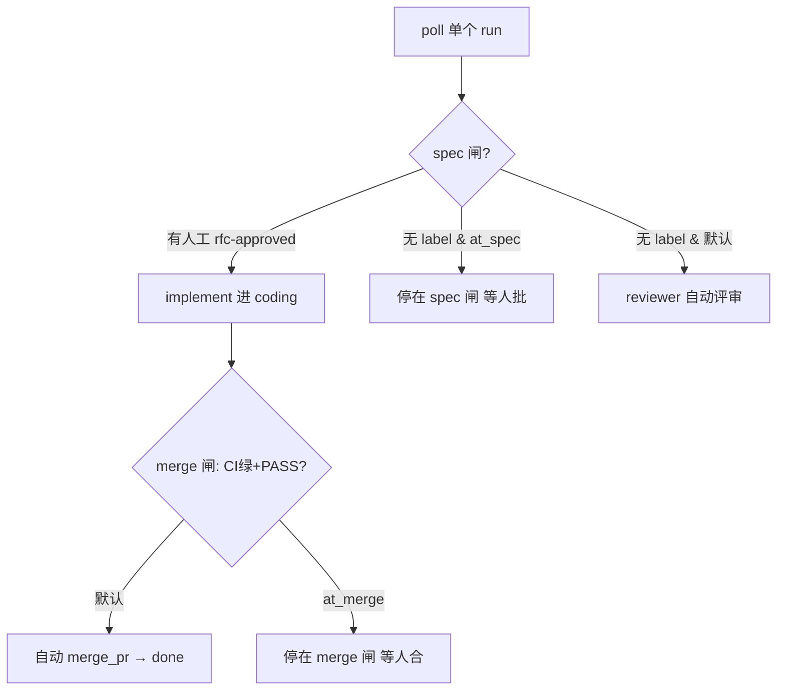

# 0020 人类监督闸门：提 issue 前需求对齐 + vigil 分级 --hold 闸控

> 本文件由 `spec render` 自动生成，请勿手工编辑。
> 内容来源：本组 `metadata.yaml` 与 `tasks/T*.yaml`（关联 issue #59）。

## 任务编排

| 任务 | 标题 | 优先级 | 状态 | 依赖 |
|----|----|----|----|----|
| T1 | 前门对齐模块：把模糊想法复述成 X/边界Y/不做Z | P1 | pending | — |
| T2 | hold 配置模型：解析 spec,merge 成闸门集合 | P1 | pending | — |
| T3 | 流水线分级闸：hold 穿到 poll 两道闸分流 | P0 | pending | T2 |
| T4 | CLI 接线：issue 前门对齐 + vigil --hold 标志 | P0 | pending | T1, T2, T3 |
| T5 | e2e 脚本：演示停在 spec → 人批 → 继续 | P2 | pending | T3, T4 |

## 各任务方案

### T1 · 前门对齐模块：把模糊想法复述成 X/边界Y/不做Z（P1 / pending）

**涉及文件**

- `openagents/align.py`
- `tests/test_align.py`

**做什么**

提 issue 前先让 agent 用大白话把你的模糊想法复述成「我理解你要 **X**，边界是 **Y**，**不做 Z**」，你点头了才正式建 issue。这是 issue #59 两道意图层闸门里的「前门对齐」，本 Task 只做那段可复用的复述逻辑，不碰 CLI / GitHub。

**为什么**

当前流程里人唯一的真实检查点是**审 PR**——也就是代码全写完之后才暴露理解偏差，这是最贵的纠错点。CLAUDE.md 理念 5「人负责宏观把控、不管细节」缺一个**意图层**的闸门：在想法落成正式 issue 之前，先用人能读懂的话把范围对齐一次。把这段复述逻辑独立成纯模块，是为了让它能被单测覆盖、且与 CLI 参数解析、GitHub 调用解耦（CLAUDE.md 设计理念 1/10）。

**范围**

新建纯模块 openagents/align.py：给定 issue 草稿（title/body），调注入的 backend 用大白话复述成结构化「我理解你要 X，边界是 Y，不做 Z」三段，供调用方拿去给人确认。仅做复述渲染 + 确认判定，不碰 GitHub、不碰 CLI argparse。模块 docstring 引用 Spec-0020。

**整体设计**

**职责边界**：align 是一段纯逻辑——「草稿进，复述出」+「确认判定」，不持有 I/O。它复用既有 backend（与 Orchestrator 同一个 ClaudeCodeBackend 抽象，依赖注入而非 import 具体实现），把草稿喂给 backend、要求它回出三段式复述（要做 X / 边界 Y / 不做 Z）。复述文本由本模块组织成稳定结构，调用方（T4 的 cli）负责把它打印给人、读人的 y/n。

**为什么复述用 LLM 而非模板**：issue #59 原文要求 agent「用大白话复述」——价值正是把人脑子里模糊的话**重新组织**成边界清晰的三段，模板做不到「理解并归纳」。代价是给 `openagents issue` 这条线引入 backend 依赖；用注入而非硬编码缓解，测试以打桩 backend 保持 hermetic。

**确认判定与生成分离**：复述生成（要 backend）与「人是否确认」的判定（纯比较）是两个函数，便于分别测试，也让 T4 能在 `--yes` 自动化路径上**跳过复述、直接放行**而不必构造 backend。

**接口**

契约（描述而非代码）：
- `restate(*, draft, backend) -> Alignment`：输入 issue 草稿与注入的 backend，返回含 want（X）/ boundary（Y）/ non_goals（Z）三段的结构化复述对象；不做任何打印或输入读取。
- `Alignment` 带一个稳定的人类可读渲染（供 T4 打印）。
- 确认判定是独立的纯函数/谓词，输入人的应答、输出是否放行——不在本模块读 stdin。
- backend 以参数注入（禁止位置参数，遵 CLAUDE.md Python 参数规范）；私有函数参数不设默认值。

**取舍**

- **LLM 复述 vs 确定性模板**（选 LLM）：模板零依赖、可离线，但只能机械回显 title/body，给不出「归纳出的边界与非目标」，违背 issue 原意。选 LLM 复用既有 backend；用注入 + 打桩控制依赖与可测性。
- **复述生成与确认判定合并 vs 拆分**（选拆分）：拆分多一个函数，但让 `--yes` 自动化路径无需 backend、让两条逻辑各自可测。

**验收标准**

- `restate(*, draft, backend)` 给定 issue 草稿，调注入的 backend 返回含 want（X）/ boundary（Y）/ non_goals（Z）三段的 Alignment；其人类可读渲染含三段标识。
- 确认判定是独立纯谓词：肯定应答 → 放行，否定/空应答 → 不放行；与复述生成解耦（判定不调 backend）。
- 模块不含任何 GitHub / argparse / stdin 读取；backend 以关键字参数注入。
- tests/test_align.py 以打桩 backend 全绿、hermetic（不触达真实 LLM）；ruff check + ruff format --check 通过；模块 docstring 引用 Spec-0020。

**测试**

单元（tests/test_align.py，打桩 backend，不触达真实 LLM）：
- 给定草稿 → restate 产出含 X/Y/Z 三段的 Alignment；渲染文本包含三段标识。
- backend 被以关键字参数注入、被调用一次；返回值被正确拆成三段。
- 确认判定：肯定应答 → 放行；否定/空应答 → 不放行。

**参考**

- issue #59「feat: 人类监督闸门」正文「前门对齐（issue 创建前）」。
- CLAUDE.md 设计理念 1（奥卡姆）、5（人宏观把控）、10（模块解耦）。

### T2 · hold 配置模型：解析 spec,merge 成闸门集合（P1 / pending）

**涉及文件**

- `openagents/hold.py`
- `tests/test_hold.py`

**做什么**

给 `vigil` 加 `--hold` 标志的「数据底座」：把命令行里写的 `spec` / `merge` / `spec,merge` 解析成一个不可变的 Hold 配置对象，告诉流水线在哪几道闸门停下等人。这是一段纯解析逻辑，被 CLI（解析输入）和流水线（消费判定）共享。

**为什么**

issue #59 要的是**分级监督**：默认全自动不变，但人可以选择让流水线停在 spec 闸或 merge 闸。把「字符串 → 闸门集合」这步独立成纯模型，是为了让 `--hold` 解析能被单测精确覆盖（验收明确要求），也让 CLI 与 messages 两端共用同一份解析、避免「同一字符串散落多处」的漂移（与既有、互不相关的 RFC-0015「流程标签单一来源」属同构思路——仅借鉴其单点定义模式，与本组 Spec-0020 无编号或范围关联）。

**范围**

新建纯模块 openagents/hold.py：把 --hold 的逗号分隔字符串（'spec' / 'merge' / 'spec,merge' / 空）解析成一个不可变的 Hold 配置（含 at_spec / at_merge 谓词）。非法 token 报清晰错误。无任何 I/O、无 argparse、无 GitHub。模块 docstring 引用 Spec-0020。

**整体设计**

**数据形状**：Hold 是一个不可变值对象（frozen），只携带两个布尔意图——在 spec 闸停、在 merge 闸停。这两个意图对应 issue #59 列出的两道闸门，没有第三种，刻意不做成开放枚举集合以保持最小（奥卡姆）。

**解析契约**：把逗号分隔串切分、去空白、归一化大小写，逐 token 映射到 spec / merge；空串/None → 全不停（即默认 vigil 行为）；出现未知 token 立即抛出携带可读信息的错误（让 CLI 把它转成干净的一行提示，而非吞掉得到一个静默无效的 Hold）。

**为什么是独立模块而非 argparse 内联**：解析既要在 CLI 入口用，也要在测试里直接喂字符串断言；放进 argparse 的 type= 回调会和参数解析耦合、难以单测。独立纯函数让 T4 的 CLI 只管把原始字符串透传进来。

**接口**

契约（描述而非代码）：
- `Hold`：不可变值对象，暴露 `at_spec` / `at_merge` 两个布尔谓词；提供一个「全不停」的默认实例（供无 --hold 时使用）。
- `parse_hold(*, raw) -> Hold`：把原始字符串/None 解析成 Hold；空/None → 默认（全不停）；未知 token → 抛 ValueError 类错误并列出合法取值。
- 仅关键字参数（遵 CLAUDE.md Python 参数规范）。

**取舍**

- **布尔字段 vs 开放枚举 set**（选两个布尔）：set 更「可扩展」，但当前只有两道闸、issue 未要求更多，开放集合是过度设计；两个具名谓词读起来更直白、消费方分支更清晰。若将来闸门增多再重构。
- **解析时严格报错 vs 静默忽略未知 token**（选严格）：静默忽略会让 `--hold spc`（拼错）被当成「全不停」从而悄悄丢掉监督，违背安全默认；严格报错让人立刻看到。

**验收标准**

- `parse_hold(*, raw)`：''/None → 默认 Hold（at_spec=at_merge=False，即现状全自动）；'spec' → 仅 at_spec；'merge' → 仅 at_merge；'spec,merge' 与 'merge,spec' → 两者皆 True。
- 未知 token（如 'foo'）→ 抛 ValueError 类错误，信息列出合法取值（spec / merge）。
- 容错：多余空格、大小写（如 ' Spec , Merge '）按设计归一化后正确解析。
- `Hold` 为不可变值对象，仅暴露 at_spec / at_merge 谓词；模块无 I/O、无 argparse、无 GitHub。
- tests/test_hold.py 全绿（纯函数）；ruff check + ruff format --check 通过；模块 docstring 引用 Spec-0020。

**测试**

单元（tests/test_hold.py，纯函数无 I/O）：
- 空串 / None → at_spec=at_merge=False（默认全不停）。
- 'spec' → 仅 at_spec；'merge' → 仅 at_merge；'spec,merge' 与 'merge,spec' → 两者皆 True。
- 未知 token（如 'foo'）→ 抛错且信息列出合法值。
- 容错：多余空格 / 大小写（如 ' Spec , Merge '）按设计归一化。

**参考**

- issue #59 正文「vigil 分级监督（issue 已存在后）」与 `--hold` 取值表。
- RFC-0015「流程标签单一来源」（openagents/github.py，另一既有、与本组无关的设计）：仅作同构思路引用——借鉴其「单点定义、多处引用」模式，**不**与本组 Spec-0020 同号或同范围。

### T3 · 流水线分级闸：hold 穿到 poll 两道闸分流（P0 / pending）

**涉及文件**

- `openagents/vigil.py`
- `openagents/messages.py`
- `tests/test_vigil.py`
- `tests/test_messages.py`

**做什么**

这是 `--hold` 的「执行端」：把人选的闸门真正落到流水线上。`vigil --hold spec` 让流水线写完 spec、动代码前停住，只认人工打的 `rfc-approved` label 才放行；`vigil --hold merge` 一路自动到 PR，把最后 merge 留给人。不带 --hold 时一切照旧、全自动。

**为什么**

现有 poll 状态机（RFC-0012）已经把人的触点收敛到「提 issue」与「promote」——spec 闸由 agent reviewer 自动评审、自动打 rfc-approved，merge 闸 CI 绿 + reviewer PASS 后自动合。issue #59 要在这两个**意图节点**上重新插回人的把关，但必须是**可选的分级**：默认行为一个字节都不能变，只有人显式 `--hold` 时才在对应闸门停下。这是整个 issue 的核心执行点，故定 P0。

**范围**

vigil.run 接收 Hold 并透传到 messages.poll；messages 在 spec 闸（_process_rfc_review）与 merge 闸（_process_coding）按 Hold 分流：hold.at_spec → 停掉自动 reviewer、只认人工 rfc-approved label；hold.at_merge → CI 绿 + review PASS 后不自动 merge_pr，留给人。默认 Hold（全不停）行为与现状逐字节一致。改动处引用 Spec-0020。

**整体设计**

**hold 怎么流到闸门**：Hold 在 CLI 处解析（T4），传给 `vigil.run(hold=...)`，vigil 再透传给 `messages.poll(hold=...)`。vigil 自身不消费 Hold——它仍是薄调度循环（RFC-0004），只负责把人的意图带到真正分流的 messages 层。Messages 是注入构造的，故 hold 走方法参数（poll）而非构造参数，避免改动 cli 的 `_messages_for` 工厂签名、保持 T3/T4 文件边界干净。

**spec 闸（_process_rfc_review）分流**：
- 默认（not at_spec）→ 现状：先看人工/历史 rfc-approved label（2a），否则调 reviewer 自动评审（2b）。
- at_spec → **跳过 2b 自动 reviewer**，只保留 2a：带人工 rfc-approved label 才 implement，否则本轮**什么都不做、停在 spec 闸等人**（不 refine、不 block、不进 coding）。复用现有 label 门控正是 issue 要求的「复用 rfc-approved label」。

**merge 闸（_process_coding）分流**：
- 默认（not at_merge）→ 现状：CI 绿 + reviewer PASS → 自动 merge_pr → done。
- at_merge → CI / iterate / reviewer 评审照跑，但 reviewer PASS 后**不调 merge_pr**，停在「待人 merge」（PR 保持 open，本轮不动状态），把最后一下留给人。人手动 merge 后，下一轮 poll 的 is_merged 分支照常 reconcile 成 done（已有逻辑，无需新增）。

**默认零回归**：分流是在既有路径上「加一个 if hold.at_xxx 提前 return」，默认分支走原代码不变。既有 test_messages.py 用例（默认 Hold）必须全绿，作为回归护栏。

**接口**

契约（描述而非代码）：
- `Vigil.run(*, interval, labels, base, once, hold)`：新增关键字参数 hold（Hold），默认取「全不停」实例以保持现有调用与行为；run 把 hold 透传给每轮 `messages.poll`。
- `Messages.poll(*, hold)`：新增关键字参数 hold，默认「全不停」；poll 内部把 hold 下传给 `_process_rfc_review` / `_process_coding`。
- 两道闸的私有处理函数据 hold.at_spec / hold.at_merge 选择「停」或「现状」分支。
- 仅关键字参数；默认值仅给 hold 这一公共入口（向后兼容现有测试夹具），私有函数显式传 hold。

**取舍**

- **hold 走 poll 方法参数 vs Messages 构造参数**（选方法参数）：构造参数更「一次注入」，但要改 cli 的 `_messages_for` 工厂、把 cli.py 卷进 T3 的文件边界；方法参数让 hold 顺着 vigil→poll 的调用链走，文件归属干净、也更贴合「hold 是本次运行的意图、非实例固有属性」。
- **spec 闸 hold 时停掉 reviewer vs 保留 reviewer 仅不自动批**（选停掉）：保留 reviewer 能给人预审意见，但会持续消耗 backend、且与「等人批」语义混淆（人和 agent 谁说了算？）。停掉最简、最省、语义最干净——「hold spec 就是把这道闸完全交给人」。预审能力可由独立命令另行提供，不塞进本闸。
- **merge 闸 hold 时不 merge 而保持 open**（vs 新增一种暂停状态）：复用「PR open + 本轮不动」已是软等待，无需引入新 State 状态；人 merge 后既有 is_merged reconcile 自然收口。

**验收标准**

- `vigil.run` 接收 hold 并逐轮透传给 `messages.poll`；可断言 poll 收到的 hold 即传入值。
- spec 闸 `hold.at_spec`：无 rfc-approved label → 不调自动 reviewer、不打 label、不 implement（停在 rfc-review）；带人工 rfc-approved label → 照常 implement 进 coding。
- merge 闸 `hold.at_merge`：CI 绿 + reviewer PASS → 不调 merge_pr、状态不变（停在待人 merge）；人手动 merge 后下一轮 is_merged 分支照常 reconcile 成 done。
- `spec,merge` 组合：两道闸都按各自规则停。
- **零回归**：默认 Hold（全不停）下既有 spec 闸自动评审 / merge 闸自动合并的 test_messages.py 用例全绿、行为逐字节不变。
- tests/test_vigil.py + tests/test_messages.py 全绿；ruff check + ruff format --check 通过；改动处引用 Spec-0020。

**测试**

单元（tests/test_vigil.py + tests/test_messages.py，monkeypatch github.* / orchestrator）：
- vigil.run 把传入 hold 透传给 messages.poll（断言 poll 收到的 hold）。
- spec 闸 at_spec：无 label → 不调 review_rfc、不调 add_label、不 implement（停住）；有人工 rfc-approved label → 照常 implement。
- merge 闸 at_merge：CI 绿 + reviewer PASS → 不调 merge_pr、状态不变（停住）；人 merge 后 is_merged 分支照常 done。
- spec,merge：两道都停的组合路径。
- **回归**：默认 Hold 下既有 spec 闸自动评审 / merge 闸自动合并用例全绿，行为不变。

**参考**

- issue #59 正文「vigil 分级监督」与 `--hold spec/merge/spec,merge` 取值表。
- openagents/messages.py 现状两道闸：`_process_rfc_review`（RFC-0012 决策 1/3）、`_process_coding`（决策 1）。
- openagents/vigil.py：薄调度循环定位（RFC-0004）。

**待解问题**

- 「看 spec 批准」依赖 #58 的人类可读 summary：人对着一坨技术 task YAML 没法点头。本 Task 只做闸控机制，**不**实现 summary；spec 闸停下时人看到的批准依据（OVERVIEW summary）由 #58 / Spec-0014 体系提供。若 #58 未就绪，hold spec 仍能停/放行，只是人的阅读体验降级——需在 T5 e2e 与上线说明里点明这条软依赖。

### T4 · CLI 接线：issue 前门对齐 + vigil --hold 标志（P0 / pending）

**涉及文件**

- `openagents/cli.py`
- `tests/test_cli.py`

**做什么**

把两道闸门接到命令行上：`openagents issue` 建 issue 前先让你确认 agent 的复述（`--yes` 可跳过供自动化）；`vigil` 多一个 `--hold spec,merge` 标志。cli.py 仍只做参数解析与分发，复述/解析/闸控逻辑分别下沉到 align（T1）/ hold（T2）/ vigil（T3）。

**为什么**

cli.py 的既定职责是「唯一命令入口，仅做参数解析与分发，业务逻辑下沉到各模块」。两道闸门的用户可见入口都在这里：issue 命令的对齐确认、vigil 的 --hold 标志。因为它们都改 cli.py 这一个文件，按 spec 协同模式「每个 Task 文件清单不重叠」的约束，二者必须合在同一个 Task（cli.py 是单一接线点）。本 Task 把 issue #59 的验收条款（issue 前对齐可被 --yes 跳过、--hold 各闸分流）落到真实命令行行为，故 P0。

**范围**

在 cli.py 这一处接线层：(1) openagents issue 在调 create_issue 前插一轮对齐确认——用 T1 align 复述、人确认才落 issue；加 --yes 跳过供自动化。(2) vigil 子命令加 --hold 标志，用 T2 hold 解析成 Hold，传给 T3 的 vigil.run(hold=...)。仅做参数解析与分发，业务逻辑下沉到 align/hold/vigil。改动处引用 Spec-0020。

**整体设计**

**issue 前门对齐**：`_cmd_issue` 在调 `github.create_issue` 之前插一步——构造 backend、调 T1 `align.restate` 拿到复述、打印给人、读 y/n；确认才建 issue，否则干净中止（非零退出、不建）。新增 `--yes` 开关：置位时**跳过复述与确认**直接建（供 vigil/CI 等自动化路径，对齐 issue 验收「可被 --yes 之类跳过」）。复述生成是 align 的事，cli 只管「打印 + 读输入 + 决定建不建」，符合「业务下沉、cli 只编排」。

**vigil --hold 标志**：给 vigil 子命令加 `--hold`（接收逗号分隔串，默认 None），在 handler 里用 T2 `parse_hold` 解析成 Hold（None → 默认全不停），传给 `vigil.run(hold=...)`。解析报错由既有 `_run` 的异常→一行提示通道兜（parse_hold 抛的错落进 ValueError/RuntimeError 类，转干净提示而非 traceback）。

**延迟 import 惯例**：align / hold 与其余业务模块一样在命令体内延迟 import，保持 cli 顶层轻、测试可对工厂打桩。

**接口**

契约（描述而非代码）：
- `openagents issue <title> [--body] [--label ...] [--yes]`：默认先复述对齐、人确认才建；`--yes` 跳过确认直接建。其余参数与现状一致（仍自动附 DISCOVERY_LABEL）。
- `openagents vigil [... 现有参数] [--hold spec,merge]`：--hold 默认 None（全不停）；handler 用 parse_hold 解析后传 vigil.run(hold=...)。
- 新增/改动的私有 handler 参数遵 CLAUDE.md 规范（仅关键字、私有函数不设默认值）。

**取舍**

- **issue 对齐默认开 vs 默认关**（选默认开、--yes 关）：issue #59 验收要求「创建前有一轮对齐确认（可被 --yes 跳过）」，故默认开、自动化显式跳过——把安全默认留给人、把跳过权交给脚本。
- **issue 对齐 + vigil --hold 合一 Task vs 拆两 Task**（被迫合一）：二者都改 cli.py，spec 协同模式要求 Task 间文件不重叠，故必须同 Task。代价是本 Task 跨了两个特性；以「cli 是纯接线、逻辑都在被依赖模块」缓解耦合。

**验收标准**

- `openagents issue` 默认路径：建 issue 前调 T1 `align.restate` 复述并请人确认；确认（y）才 `create_issue`，否定（n）则不建且非零退出。
- `openagents issue --yes`：跳过复述与确认，直接 `create_issue`（供 vigil/CI 自动化）。
- `openagents vigil --hold spec|merge|spec,merge`：用 T2 `parse_hold` 解析后以该 Hold 调 `vigil.run(hold=...)`；无 `--hold` → 默认全不停 Hold。
- `--hold` 非法值 → 干净一行错误 + 非零退出（不 traceback）。
- cli.py 仅做参数解析/分发，业务逻辑在 align/hold/vigil；align/hold 延迟 import。
- tests/test_cli.py 全绿、hermetic（打桩 align/github/vigil，不触达真实 gh/LLM）；ruff check + ruff format --check 通过；改动处引用 Spec-0020。

**测试**

单元（tests/test_cli.py，打桩 align/github/vigil，hermetic 不触达真实 gh/LLM）：
- issue 默认路径：调 align.restate 复述、确认（打桩 y）后才 create_issue；打桩 n 则不建且非零退出。
- issue --yes：跳过 align、直接 create_issue。
- vigil --hold spec/merge/spec,merge：parse 出正确 Hold 并以该 Hold 调 vigil.run；无 --hold → 默认全不停 Hold。
- --hold 非法值 → 干净一行错误 + 非零退出（不 traceback）。

**参考**

- issue #59 验收条款：「openagents issue 在创建前有一轮对齐确认（可被 --yes 之类跳过）」「vigil --hold ... 按预期停在对应闸门」。
- openagents/cli.py：现有 `_cmd_issue` / `_cmd_vigil` / `build_parser` 与「延迟 import、cli 只分发」惯例。

### T5 · e2e 脚本：演示停在 spec → 人批 → 继续（P2 / pending）

**涉及文件**

- `scripts/e2e-spec-0020-hold-gate.sh`

**做什么**

一个可在离线环境跑通的演示脚本：跑 `vigil --hold spec`，看流水线写完 spec 后**停在 spec 闸**；再模拟人工打上 `rfc-approved` label，下一轮 poll 流水线就**继续进入 coding**。把 issue #59 的「停在 spec → 人批 → 继续」用一条命令演给人看。

**为什么**

CLAUDE.md 总则要求每个 RFC/spec 做完给出端到端测试启动脚本；issue #59 验收明确要求「e2e 脚本演示一次『停在 spec → 人批 → 继续』」。单测证明各闸分流正确，但人需要一个**面向成果**的可视证据（CLAUDE.md 设计理念 8）看到「停—批—继续」这条完整时间线。

**范围**

新增离线 e2e 脚本（沿用现有 scripts/e2e-*.sh 风格，打桩/本地 state 模拟 GitHub，CI 可跑）：演示 vigil --hold spec 在 spec 写完后停住等人；模拟人工打 rfc-approved label 后再 poll 一轮，流水线继续进入 coding。脚本顶部注释引用 Spec-0020。

**整体设计**

**沿用既有 e2e 范式**：参照 scripts/e2e-rfc-0012-gated-flow.sh 等——用打桩/本地 State 模拟 GitHub 远端，离线驱动 vigil/poll，断言可观测信号（State 状态、是否调用 implement/merge）。不触达真实 gh，保证 CI 可跑、可重复。

**演示时间线**：
1. 准备一个处于 spec/rfc-review 阶段的 run（已开 draft PR、无 rfc-approved label）。
2. 以 `--hold spec` 跑一轮 vigil/poll → 断言**停在 spec 闸**：未自动评审、未自动打 label、未进 implement，状态仍 rfc-review。
3. 模拟人工给 PR 打上 rfc-approved label。
4. 再跑一轮 → 断言**继续推进**：走 implement、进入 coding 阶段。
5. 打印人类可读的「停 → 批 → 继续」轨迹，退出码 0。

**软依赖标注**：脚本注释点明「真实场景里人批 spec 看的是 OVERVIEW 的人类可读 summary（#58）」——本脚本聚焦闸控时间线，summary 由 #58 提供。

**接口**

契约（描述而非代码）：
- 可执行 shell 脚本 scripts/e2e-spec-0020-hold-gate.sh，与其余 e2e 脚本同目录、同命名规约（e2e-spec-NNNN-<slug>.sh），可被 CI/人直接 bash 运行。
- 自洽：自带准备/打桩/断言/清理，无需外部凭证；任一断言失败即非零退出。

**取舍**

- **离线 mock vs 真实 GitHub 往返**（选离线）：真实往返最贴近生产，但需凭证、不可在 CI 重复跑、慢且脆。既有全部 e2e 脚本均为离线打桩；沿用同范式保证可发现、可复跑、可纳入 CI。真实往返作为人工冒烟另行手动执行。
- **只演 spec 闸 vs 同时演 merge 闸**（聚焦 spec）：issue 验收只点名「停在 spec → 人批 → 继续」，故主线演 spec 闸；merge 闸分流由 T3 单测覆盖，脚本可附带一行注释指向，不铺开以保持脚本聚焦。

**验收标准**

- scripts/e2e-spec-0020-hold-gate.sh 离线可独立 bash 运行（打桩/本地 State 模拟 GitHub，无需凭证、CI 可跑、可重复）。
- 演示时间线：以 `--hold spec` 跑一轮 → 断言停在 spec 闸（未自动评审、未自动打 label、未 implement，状态仍 rfc-review）；模拟人工打 rfc-approved label 后再跑一轮 → 断言继续推进（走 implement、进入 coding）。
- 打印人类可读的「停 → 批 → 继续」轨迹；全部断言通过则退出码 0，任一失败即非零退出。
- 与既有 e2e 脚本同目录、同命名规约（e2e-spec-NNNN-<slug>.sh）可被发现/调用；脚本顶部注释引用 Spec-0020，并点明 spec 批准依据（OVERVIEW summary）的 #58 软依赖。

**测试**

- 脚本本身即测试：离线跑通、各断言通过、退出码 0。
- 与既有 e2e 脚本一致地可被发现/调用（同目录同命名）。

**参考**

- issue #59 验收：「e2e 脚本演示一次『停在 spec → 人批 → 继续』」。
- CLAUDE.md 总则（交付须给端到端启动脚本）、设计理念 8（面向成果）。
- 既有范式：scripts/e2e-rfc-0012-gated-flow.sh、scripts/e2e-rfc-0004-vigil.sh。
