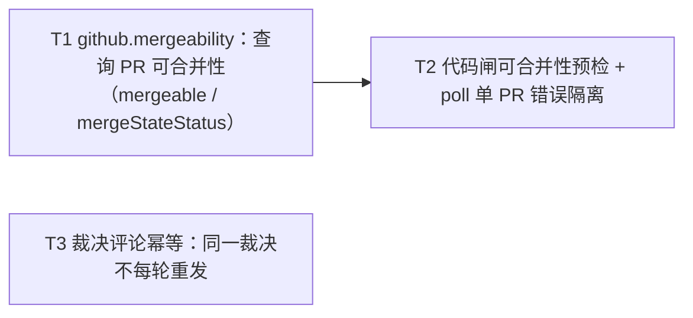
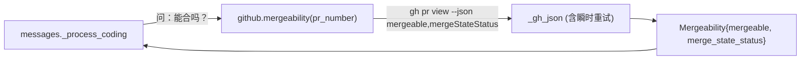
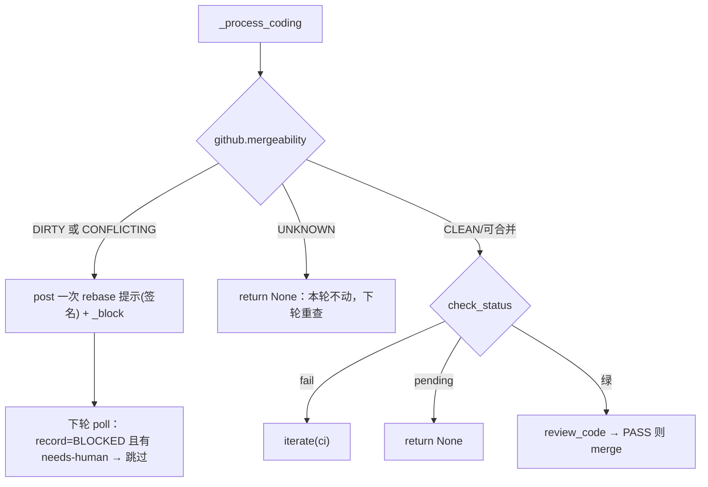
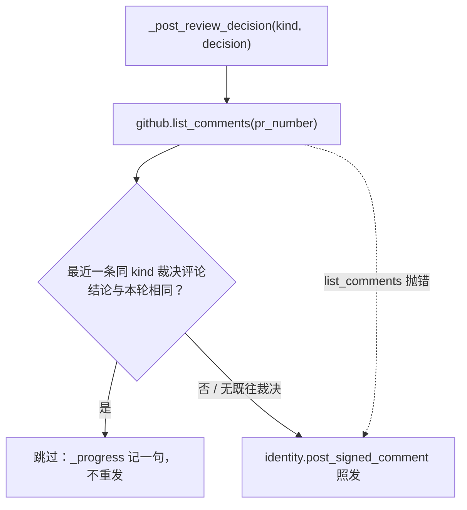

# 0022 代码闸可合并性预检 + poll 错误隔离 + 裁决评论幂等

> 本文件由 `spec render` 自动生成，请勿手工编辑。
> 内容来源：本组 `metadata.yaml` 与 `tasks/T*.yaml`（关联 issue #62）。

## 任务编排



| 任务 | 标题 | 优先级 | 状态 | 依赖 |
|----|----|----|----|----|
| T1 | github.mergeability：查询 PR 可合并性（mergeable / mergeStateStatus） | P1 | pending | — |
| T2 | 代码闸可合并性预检 + poll 单 PR 错误隔离 | P0 | pending | T1 |
| T3 | 裁决评论幂等：同一裁决不每轮重发 | P1 | pending | — |

## 各任务方案

### T1 · github.mergeability：查询 PR 可合并性（mergeable / mergeStateStatus）（P1 / pending）

**涉及文件**

- `openagents/github.py`
- `tests/test_github.py`

**做什么**

在 github.py 新增一个只读查询函数，返回 PR 的可合并性（`mergeable` + `mergeStateStatus`），
供代码闸（T2）在跑 reviewer 前判断 PR 是否与 base 真冲突。这是叶子能力，不含任何决策语义。

**为什么**

当前代码闸（messages._process_coding）进闸前**完全不看 PR 可合并性**：CI 绿 + reviewer
PASS 就直接 `github.merge_pr`。当 PR 与 base 真冲突（实例 PR #61：14 个
`docs/specs/*/metadata.yaml` 内容冲突，`mergeStateStatus: DIRTY`）时，merge 必败，但闸不
自知，每个 interval 重跑一遍 reviewer、再判 PASS、再 merge 失败，原地空转。要打破这个循环，
第一步是给 messages 一个「能问 GitHub：这个 PR 现在能不能合」的只读能力。

GitHub 把可合并性拆成两个字段：`mergeable`（MERGEABLE / CONFLICTING / UNKNOWN）与
`mergeStateStatus`（CLEAN / DIRTY / BLOCKED / BEHIND / UNKNOWN / …）。冲突场景表现为
`mergeable=CONFLICTING` 且 `mergeStateStatus=DIRTY`。本 Task 只负责**如实取回这两个字段**，
把「哪种组合算不可合并」的判定留给调用方（理念 10 解耦：github 是薄 gh 封装、不含业务）。

**整体设计**

在 `openagents/github.py` 新增只读查询，结构上**镜像既有 `is_merged` / `is_closed`
/`check_status`**：经唯一收口点 `_gh_json` 跑 `gh pr view <n> --json mergeable,mergeStateStatus`，
自带 RFC-0010 的瞬时错误重试，零额外依赖、零新外部数据源（理念 1 奥卡姆）。

返回值用一个小的 frozen dataclass（仿 `CheckStatus` 的轻量结构体）承载两个原始字段，
而**不**回退成裸 tuple——让调用方按字段名读、避免位置歧义。字段保持 GitHub 原值大写
字符串（如 `"DIRTY"` / `"CONFLICTING"` / `"UNKNOWN"`），不在本层做任何归一化或布尔判定。



错误处理沿用既有风格：`_gh_json` 返回非 dict、或缺字段 → 抛 `GithubError("gh pr view
返回了非预期的结构")`（与 `is_merged` / `is_closed` 逐字一致）。`UNKNOWN`（GitHub 异步尚未
算完）是**合法返回值**，照实回传、本层不视为错误——是否等待由 T2 决策。

**接口**

新增（命名待实现层定稿，建议）：

```python
@dataclass(frozen=True)
class Mergeability:
    mergeable: str            # GitHub 原值：MERGEABLE / CONFLICTING / UNKNOWN
    merge_state_status: str   # GitHub 原值：CLEAN / DIRTY / BLOCKED / BEHIND / UNKNOWN / ...

def mergeability(*, pr_number: int) -> Mergeability: ...
```

全部关键字参数（CLAUDE.md：禁止位置参数）。纯读、无副作用、不改 state。

**取舍**

- **小 dataclass vs 裸 tuple/dict**：选 dataclass。tuple 位置易错、dict 键名散落；dataclass
  与 `CheckStatus` 同构，调用方读字段名最清晰，代价仅一个轻量类型（理念 1 可接受）。
- **只取回原值 vs 在本层直接给 `is_unmergeable() -> bool`**：选只取回原值。把「DIRTY/CONFLICTING
  才算冲突、UNKNOWN 算未知」的判定放到 T2，github 层保持「薄 gh 封装、零业务」（理念 10）；
  否则布尔阈值逻辑会渗进叶子模块，未来调参要改两处。
- **一次查两字段 vs 分两次查**：一次 `--json mergeable,mergeStateStatus`，省一次 gh 往返，
  且两字段同源快照、避免读到不一致的中间态。

**测试**

`tests/test_github.py`（monkeypatch `_run_gh` / `_gh_json`，hermetic，不触真实 gh）：
- 解析 `{mergeable: CONFLICTING, mergeStateStatus: DIRTY}` → 字段如实回传。
- 解析 `{mergeable: MERGEABLE, mergeStateStatus: CLEAN}` → 字段如实回传。
- 解析 `{mergeable: UNKNOWN, mergeStateStatus: UNKNOWN}` → 如实回传、不抛错（异步未就绪）。
- `_gh_json` 返回非 dict / 缺字段 → 抛 `GithubError`（与 is_merged 同断言风格）。
- 断言传给 gh 的参数恰为 `pr view <n> --json mergeable,mergeStateStatus`。

**参考**

- 镜像对象：`openagents/github.py` `is_merged`（512）、`is_closed`（540）、`check_status`（492）。
- GitHub PR `mergeable` / `mergeStateStatus` 字段语义见 `gh pr view --json` 文档与
  GitHub GraphQL `mergeable`（MERGEABLE/CONFLICTING/UNKNOWN）、`mergeStateStatus`
  （CLEAN/DIRTY/BLOCKED/BEHIND/DRAFT/HAS_HOOKS/UNKNOWN/UNSTABLE）枚举。
- 实例：issue #62 根因复现 PR #61 / issue #58（DIRTY/CONFLICTING）。

### T2 · 代码闸可合并性预检 + poll 单 PR 错误隔离（P0 / pending）

**涉及文件**

- `openagents/messages.py`
- `tests/test_messages.py`

**依赖**：T1

**做什么**

让 poll 在不可合并的 PR 上不再空转、不再崩。两件事：(1) 进代码闸前先用 T1 的
`github.mergeability` 做可合并性预检，真冲突直接判 blocked + needs-human + 留一次
rebase 提示，不再反复跑 reviewer；(2) 给 poll 逐 record 处理加错误隔离，单个 PR 失败
（含 merge_pr 抛错）只记一条错误事件并继续，不拖垮整轮。

**为什么**

根因（issue #62）：`_process_coding` 在 CI 绿 + reviewer PASS 后直接 `github.merge_pr`
（messages.py:230），而 `merge_pr` 遇冲突由 `_run_gh` 抛 `GithubError`；该调用**无 try/except**，
`poll()` 逐 record（messages.py:117-124）也不兜异常 → 一旦某个 PR 不可合并，**整轮 poll 崩**。
又因进闸前不查可合并性，每个 interval 重跑一遍 reviewer（白烧一次 agent 运行）→ 又判
PASS → 又 merge 失败 → 又崩。实例 PR #61 由此重复判 PASS 33 次、刷 33 条相同 PASS 评论、
永远合不进去（自动 rebase 救不回来：`update-branch` 非真 rebase，14 个 metadata.yaml 是内容
冲突，heal 自愈只重渲 OVERVIEW.md、动不了 metadata）。

本 Task 对症两处：**预检**让真冲突的 PR 一次性进 blocked、停止空转；**错误隔离**把「单
PR 失败」从「整轮崩」降级为「跳过这一个、其余照跑」，符合 issue 验收第二条。

**整体设计**

改 `openagents/messages.py` 两处，均不新增模块、不改状态机定义（理念 1）。

**(1) 代码闸可合并性预检（`_process_coding`）**——在跑 reviewer **之前**插入预检。位置选在
方法最前（甚至先于 CI 状态判断）：冲突 PR 连 CI 都不必等，越早短路越省。



- **判定**：`mergeStateStatus == "DIRTY"` 或 `mergeable == "CONFLICTING"` 视为真冲突
  （二者在冲突场景同时出现，取或更稳）。
- **冲突动作**：先 `identity.post_signed_comment` 发一次 rebase 提示（**复用
  `rebase.CONFLICT_COMMENT` 文案**，避免文案散落漂移；agent_id 用 `self._agent_id`），
  再走既有 `self._block(record=record, gate="merge")`（置 STATUS_BLOCKED + 打 needs-human）。
  返回新事件 `{"reason": "unmergeable"}`。
- **「恰一条评论」如何保证**：`_block` 后 record 变 STATUS_BLOCKED；下一轮 poll 经
  `_process_run` 的 blocked 分支（messages.py:168）——仍有 needs-human 标签即 `return None`
  跳过，**永不再次进入 `_process_coding`**。故 rebase 提示天然只发一次，无需额外去重状态
  （与 T3 的裁决去重正交：这里靠状态机短路，T3 靠评论比对）。
- **UNKNOWN 处理**（GitHub 异步未算完，刚 push 常见）：`return None`，本轮不评审也不 block，
  下个 interval 重查——避免「未就绪→误 block 正常 PR」与「白跑 reviewer」两头错。

**(2) poll 单 record 错误隔离（`poll`）**——把 `self._process_run(record=...)` 包进
try/except（沿用 RFC-0004 决策 8 / `rebase.rebase_open_prs` 的错误隔离风格）：捕获后
追加一条 `{"pr_number": ..., "reason": "error", "error": <摘要>}` 事件并 `continue`，绝不
让单个 record 的异常冒泡掀翻整轮。**不改 state**（不擅自 block——失败原因可能是瞬时 gh
错误；据 issue 决策保持「记录可观测、不升级」，下一轮自然重试）。包裹粒度选「整个
`_process_run`」而非「仅 merge_pr」：覆盖面最大，任何 record 处理路径上的意外都被隔离。

**接口**

- 行为新增，无对外签名变更。`poll` / `_process_coding` 返回的事件列表新增两类 reason：
  `"unmergeable"`（预检判冲突→blocked）、`"error"`（单 record 处理被隔离）。
- 复用既有：`self._block`、`identity.post_signed_comment`、`rebase.CONFLICT_COMMENT`、
  `self._agent_id`，以及 T1 的 `github.mergeability`。
- `_block` 的 `gate` 取值扩展一个 `"merge"`（现有为 "rfc" / "code"），仅用于事件标注。

**取舍**

- **预检放 _process_coding 最前 vs CI 之后**：选最前。冲突 PR 等 CI 无意义，越早短路越省
  （连 CI 轮询都免了）。
- **错误隔离粒度：整个 `_process_run` vs 仅 `merge_pr`**：选包整个 `_process_run`。issue 只点了
  merge_pr，但崩点本质是「逐 record 不兜异常」；包到 record 级一次性覆盖所有路径，符合
  rebase.py 的「单 PR 失败不拖垮整轮」整体风格，未来新增的 gh 调用也自动受保护。
- **错误隔离是否改 state（升级 needs-human）**：选不改、只记事件。失败常是瞬时（gh 限流/网络），
  贸然 block 会把可自愈的 PR 焊死；保持下一轮自然重试，可观测性由 error 事件 + watch 日志承担。
  （累计 N 轮升级是更主动方案，但要引入计数状态、增实体，本组从简不做。）
- **rebase 提示复用 rebase.CONFLICT_COMMENT vs 新写文案**：复用。同一「请手动 rebase」语义只
  应有一处文案来源，避免 RFC-0009 与本组各写一句、日后漂移。
- **「恰一条评论」靠状态机短路 vs 靠评论去重**：靠状态机（blocked 后 poll 跳过）。零新状态、
  天然幂等；比每轮查评论再比对更省、更不易错。

**测试**

`tests/test_messages.py`（monkeypatch `github.*` / `identity.*` / orchestrator，hermetic）：
- **预检冲突**：`mergeability` 返回 DIRTY/CONFLICTING → 不调 `review_code`、不调 `merge_pr`；
  `post_signed_comment` 恰调 1 次且 body 为 `rebase.CONFLICT_COMMENT`；record 置 STATUS_BLOCKED
  且打 needs-human；事件 reason == "unmergeable"。
- **「恰一条」回归**：第一轮 block 后，第二轮 poll 对该 record `return None`（不再发评论、不评审）。
- **UNKNOWN**：返回 None、不评审不 block、不发评论；下一轮若变 CLEAN 则照常进 reviewer。
- **可合并放行**：CLEAN/MERGEABLE → 走既有 CI→reviewer→merge 路径，行为零回归。
- **错误隔离**：构造两个 open record，第一个 `merge_pr`（或 `_process_run` 任一步）抛
  `GithubError` → poll 不抛、第一个产出 reason=="error" 事件、第二个 record 照常处理产出其事件。
- 全程不触真实 gh。

**参考**

- 崩点：`openagents/messages.py` `_process_coding`（210）`github.merge_pr`（230，无 try/except）、
  `poll` 逐 record 循环（117-124，不兜异常）、blocked 跳过分支 `_process_run`（168）、
  兜底 `_block`（243）。
- 错误隔离范式：`openagents/rebase.py` `rebase_open_prs`（55-76，单 PR 失败 continue），
  RFC-0004 决策 8。
- 文案来源：`openagents/rebase.py` `CONFLICT_COMMENT`（22）。
- 依赖：本组 T1 `github.mergeability`。
- 实例：issue #62 / PR #61（33 次重复 PASS、整轮 poll 崩）。

### T3 · 裁决评论幂等：同一裁决不每轮重发（P1 / pending）

**涉及文件**

- `openagents/orchestrator.py`
- `tests/test_orchestrator.py`

**做什么**

让裁决评论幂等：reviewer 闸每轮都回贴一条「## 评审闸裁决」评论，同一裁决连发会刷屏
（实例：33 条相同 PASS）。`_post_review_decision` 发评论前先查既有评论，若同类裁决结论
与上次相同则跳过重发，作为 T2 之外的兜底纵深防御。

**为什么**

RFC-0018 让 reviewer 闸把裁决回贴 PR（恢复人对评审闸的可观测性）。但回贴是**无条件每轮发**：
只要 record 仍在 coding/rfc-review 阶段、每个 interval 重跑一次 reviewer，就重发一条裁决评论。
实例 PR #61 因 merge 反复失败、PR 长期 open，刷出 33 条一模一样的 `## 评审闸裁决 ✅ PASS`。

T2 的可合并性预检会让 PR #61 这类真冲突 PR 一次性进 blocked、不再重跑 reviewer——直接消灭该
实例的刷屏源头。本 Task 是**正交的纵深防御**：任何「PR 长期 open 且裁决不变」的场景（不限于
冲突）都不该把同一裁决刷成几十条。对应 issue 期望第 3 条「裁决评论去重 / 幂等」。

**整体设计**

只改 `openagents/orchestrator.py` 的 `_post_review_decision`（裁决产生即回贴的单点收口）。
发评论前先查 PR 既有评论，按裁决结论去重：



- **识别裁决评论**：靠 `reviewer.render_decision` 输出的稳定抬头 `## 评审闸裁决`（已存在，
  不改 reviewer），并结合 kind（rfc / code）区分两道闸——抬头/正文里已带 kind 语义即可，
  必要时按渲染文本特征筛选。只读 `github.list_comments`（已存在），不改 github。
- **去重粒度 = 裁决结论（PASS / 非 PASS）**：比对「最近一条同 kind 裁决评论的结论」与本轮
  `decision.passed`。相同 → 跳过；不同（PASS↔非 PASS 翻转）或此前无裁决评论 → 照发。
  **不按正文逐字节比对**：票数渲染（「N 中 X 票 PASS」）或反馈措辞每轮可能微变，逐字节会
  判「不同」而继续刷屏，违背意图；按结论去重才真正止血。
- **尽力而为，绝不阻断**（沿用 RFC-0018 决策 2）：`list_comments` 或比对中任何异常都
  `except` 后**降级为照常发送**，仅 `_progress` 记一句——评审闸与下游 refine/iterate/merge
  不得被去重逻辑拖崩或拦住。整个 `_post_review_decision` 本就是 best-effort 旁路。
- 与 T2 的关系：T2 用状态机短路（blocked 后不再进闸）止住冲突 PR 的源头；T3 用评论比对兜
  所有其它「裁决不变仍重发」场景。两者正交、可独立验证、文件不相交。

**接口**

- 无对外签名变更：`_post_review_decision(*, pr_number, kind, decision)` 行为内收敛为「同结论
  跳过、否则照发」。
- 复用既有：`github.list_comments`（只读）、`reviewer.render_decision` 的稳定抬头、
  `identity.post_signed_comment`、`self._agent_id`、`self._progress`。不新增模块/数据类型。

**取舍**

- **按裁决结论去重 vs 正文逐字节去重**：选结论。票数/措辞每轮微变会让逐字节比对失效、继续
  刷屏；按 PASS/非 PASS 结论去重才命中「同一裁决不重发」的真实意图。代价：同结论但反馈正文
  更新的那一版不会重贴——可接受（人需要的是「结论变了」的信号，细节在 worktree/日志可查）。
- **每轮多查一次 list_comments 的开销**：可接受。reviewer 闸本就每轮跑 N 个 agent（重得多），
  一次只读 gh 查询微不足道，换来不刷屏的可观测性。
- **去重放 orchestrator vs reviewer**：放 orchestrator。回贴本就收口在 `_post_review_decision`；
  reviewer 保持「输入 diff → 输出裁决」的纯函数，不沾 PR 评论状态（理念 10 解耦）。
- **去重失败时默认照发 vs 默认跳过**：默认照发（fail-open）。宁可偶尔多一条评论，也不能因查询
  抖动而漏发裁决、损害可观测性；与 best-effort 旁路语义一致。

**测试**

`tests/test_orchestrator.py`（monkeypatch `github.list_comments` / `identity.post_signed_comment`
/ reviewer，hermetic）：
- **同结论跳过**：既有评论已含一条同 kind PASS 裁决 → 本轮 PASS 不再调 `post_signed_comment`。
- **结论翻转照发**：既有为 PASS、本轮非 PASS（或反之）→ 正常发新评论。
- **首次照发**：无既往裁决评论 → 正常发。
- **kind 隔离**：既有 rfc 裁决不抑制 code 裁决（反之亦然）。
- **降级**：`list_comments` 抛错 → 不抛出、降级为照发，且评审闸/返回的 ReviewDecision 不受影响。

**参考**

- 改动点：`openagents/orchestrator.py` `_post_review_decision`（239-253）、`_review`（219-237）。
- 复用：`openagents/github.py` `list_comments`（304）；`openagents/reviewer.py` `render_decision`
  （裁决抬头 `## 评审闸裁决`）；`openagents/identity.py` `post_signed_comment`（79）。
- 背景：RFC-0018（裁决回贴 PR、best-effort 旁路）。
- 实例：issue #62 / PR #61（33 条相同 PASS 评论）。
