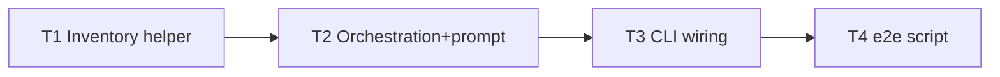

# 0025 · Brownfield RFC backfill: scan existing code to generate a nine-section RFC draft

<!-- This file is maintained by the spec tool: frontmatter is the structured source data (including the tasks DAG), and the body is a group-level overview in the nine-section rust-RFC format. -->

## Summary

Add an RFC backfill capability to OpenAgents: introduce the subcommand `openagents backfill-rfc <path>`, which scans existing code at the specified path → assigns a coding agent (Claude Code or another backend) to read the code and reverse-engineer a nine-section rust-RFC spec draft (accurately documenting the implemented parts and explicitly marking sections that are difficult to infer as “Requires manual completion”) → opens a **draft PR** for human review after passing the `spec validate` gate with 0 errors. This lets brownfield (partially completed) repositories without an RFC/spec join OpenAgents' RFC-driven feedback loop without having to rewrite from scratch.

## Motivation

OpenAgents currently follows an “RFC first” approach: `openagents rfc <issue>` drafts a spec from a GitHub issue, while `spec new <slug>` generates only an empty nine-section skeleton—both **assume the code has not yet been written**, with design preceding implementation. In practice, however, **partially completed brownfield repositories** are common: code already exists, but there is no corresponding RFC/spec, so it cannot be brought into the “change the spec first, then change the code” alignment mechanism (CLAUDE.md design principle 4).

The current gap is specific: **no command can “scan existing code → generate the missing RFC through reverse engineering.”** One potentially confusing point needs clarification: this repository's historical commit `7415ac6`, “Backfill 19 existing specs,” was a one-off **manual documentation task**—rewriting existing specs into the new rust-RFC format, **not a feature for generating specs from code**. It was discarded after use and is not reusable. Checking the existing subcommand list `init / rfc / refine-rfc / implement / iterate / issue / poll / watch / sync-prs / board / vigil / release` one by one confirms that none covers the “code → spec” direction: `rfc` takes an issue number as input (retrieved from GitHub) and outputs a design drafted from scratch; no command takes a **code path** as input.

As a result, brownfield repositories currently have only two poor options: write specs manually (time-consuming and prone to drifting from the actual code), or simply stay outside the RFC feedback loop (losing the foundation for alignment across multiple agents). This feature fills the gap with a path-driven command and is a natural dogfooding opportunity: OpenAgents itself is a product that iterates on itself using its MVP, and RFC backfill directly serves the goal of “bringing more existing repositories into the workflow.”

## Guide-level explanation

In a brownfield repository, the user runs the following against a module/directory that does not yet have a spec:

```
openagents backfill-rfc openagents/release.py
# Or for a directory: openagents backfill-rfc openagents/backends/
```

What happens:

1. **Inventory**: the command first performs a lightweight inventory of the existing code under `<path>` (file list, module/file-level docstrings, public symbols), both validating that the path exists and defining the agent's reading scope, while establishing the granularity of “one invocation = one spec.”
2. **Reverse engineering**: a coding agent is assigned in an isolated worktree to read this code and produce a nine-section rust-RFC spec draft according to Phase 2 of spec-driven-development—**accurately documenting** the implemented parts: Summary/Motivation restate “what this code currently does and why it exists,” while Reference-level describes the actual technical structure + file allocation + e2e script paths. Sections that are difficult to infer from existing code (typically Drawbacks, alternatives in Rationale, and Prior art) may explicitly use `> Requires manual completion (difficult to infer from brownfield code)` as a placeholder, but **the four required sections (Summary/Motivation/Reference-level/Rationale and alternatives) must be fully populated with factual content**, or the draft will fail the quality gate.
3. **Validation + PR creation**: the draft first passes `spec validate` (only 0 errors allows it through), then a **draft PR** is opened—maintaining the feedback loop in which “humans handle high-level oversight and agents handle the details” (principle 5), with **no automatic merge**. Humans review the PR and complete the sections the agent marked “To be completed”; the PR is marked ready only after it meets the requirements.

The difference from `rfc <issue>` in one sentence: `rfc` is **issue-driven, with design first** (the code does not yet exist); `backfill-rfc` is **path-driven, with implementation first** (the code already exists, and the design is inferred from it). Both ultimately reach the same endpoint: “one spec + one draft PR for human review.”

## Reference-level explanation

**Technical approach**—maximize reuse of the existing orchestration skeleton for `rfc <issue>` (`Orchestrator.start_rfc`: fetch → worktree → backend drafting → commit and push → open draft PR), replacing only the input and task: on the input side, replace “fetch issue” with “inventory code path”; on the task side, replace “draft from issue” with “reverse-engineer from code.”

- **Code inventory helper `openagents/backfill.py`** (new module): takes `<path>`, validates its existence (reports an error for a nonexistent path/empty directory), and produces a structured inventory—a file list, module/file-level docstring summaries, and a list of public symbols—and determines the scope of “one spec” for this invocation based on the path's form (single file / directory). A pure function with no side effects, making it easy to unit-test.
- **Orchestration method `Orchestrator.backfill_rfc(path, base)`** + reverse-engineering task prompt template `_BACKFILL_RFC_TASK` (both in `openagents/orchestrator.py`): inventory (call `backfill`) → `workspace.ensure/prepare` an isolated worktree → `backend.run` the reverse-engineering prompt (instruct the agent to read `<path>`, infer the nine sections, mark sections that are difficult to infer as “To be completed,” and fully populate the four required sections) → **`spec validate` gate** (do not open a PR on a nonzero result) → `workspace.commit_and_push` → `signpost.signpost_for_group` extract the e2e signpost → `github.create_pr(..., draft=True)`. Reuse the existing `draft=True` parameter of `github.create_pr` (already implemented at `openagents/github.py:280`), without adding new GitHub capabilities.
- **CLI wiring `backfill-rfc <path>`** (`openagents/cli.py`): add a subparser + `_cmd_backfill_rfc`, parse `path` (positional argument) and `--base` (defaults to main), and forward them to `Orchestrator.backfill_rfc`; a thin routing layer containing no business logic (principle 1, Occam's razor).

**Alignment with the existing spec data model / validate**: this feature **adds no validate rules and makes no changes to the spec data model**, fully reusing the existing quality gate—`spec validate` already reports errors for “an empty required section among the four (Summary/Motivation/Reference-level/Rationale and alternatives), missing acceptance/files, and overlapping files within the same group.” Backfill treats `spec validate` as a hard gate before opening a PR: the draft inferred by the agent must pass this gate before a draft PR can be opened. Using `> Requires manual completion` as a placeholder for sections that are difficult to infer is safe precisely because these are **optional sections** (Drawbacks/Prior art/Unresolved/Future) and do not trigger errors; the four required sections must be fully populated with factual content.

**Task breakdown (mutually exclusive files, a single writer per Task—principle 6)**:

| Task | Scope | owns files | Dependencies |
|---|---|---|---|
| T1 | Code inventory helper | `openagents/backfill.py`, `tests/test_backfill.py` | — |
| T2 | Orchestration method + reverse-engineering prompt | `openagents/orchestrator.py`, `tests/test_orchestrator.py` | T1 |
| T3 | CLI subcommand wiring | `openagents/cli.py`, `tests/test_cli.py` | T2 |
| T4 | e2e script | `scripts/e2e-spec-0025-backfill-rfc.sh` | T3 |



**End-to-end validation**: `bash scripts/e2e-spec-0025-backfill-rfc.sh` (ruff + pytest + run `backfill-rfc` against a sample path without a spec, asserting that it produces a nine-section draft and that `spec validate` reports 0 errors).

## Drawbacks

- **Reverse engineering may be inaccurate**: the “design intent” an agent infers from code may not be the original intent; Drawbacks and alternatives in Rationale are especially prone to fabrication, requiring human review as a backstop—this is also why draft PRs and no automatic merge are mandatory.
- **Cognitive cost of an additional entry point**: `rfc` (issue-driven) and `backfill-rfc` (path-driven) coexist, so users must distinguish when to use each.
- **Risk of overusing “To be completed” placeholders**: if the agent also marks sections that could have been inferred as “To be completed,” draft quality will suffer; the prompt must strictly require that “the four required sections must be fully populated with factual content.”

## Rationale and alternatives

The choice of “a standalone `backfill-rfc <path>` subcommand + reuse of the start_rfc skeleton” is based on fundamentally different input modalities (code path vs issue number). Separate verbs give each command a single responsibility and make it easy to read and test (principle 1); meanwhile, the parts that have exactly the same structure as `rfc`, such as PR creation/worktrees/backend dispatch, are reused without reinventing the wheel.

- **Alternative A: `rfc --from-code <path>` (add a flag to the existing rfc command)**—saves one subcommand, but makes `rfc` accept two mutually exclusive inputs, “issue number” and “code path,” splitting parameter semantics and making the help text awkward, in violation of single responsibility; rejected.
- **Alternative B: add validate rules specifically for “backfilled specs” (such as allowing required sections to be marked for completion)**—would intrude on the spec data model and create a special exception for one source, weakening the consistency of the quality gate; rejected. Instead, **leave the data model unchanged** and achieve the goal through the prompt convention “fully populate the four required sections with factual content; the rest may be left for completion” + the existing validate gate, keeping a single model.
- **Alternative C: purely static generation (fill in a template without assigning an agent)**—can infer file structure, but cannot write prose such as Motivation/Guide-level that requires semantic understanding; reverse-engineering quality would be poor, so this is rejected. Assigning a coding agent to read the code is necessary to “accurately backfill the semantics.”

## Prior art

- **rust-lang/rfcs** (<https://github.com/rust-lang/rfcs>): the source of this repository's nine-section spec format (see `docs/specs/2026-06-25-spec-rfc-form-design.md`), but Rust RFCs are strictly design-first and have no equivalent for “reverse-engineering an RFC from code”—this feature applies the same nine-section template in the opposite direction.
- **The documentation-generator lineage** (Doxygen / Sphinx autodoc / godoc): all “extract API documentation from code,” demonstrating that the “code → documentation” direction is feasible and common; however, they only extract interface signatures and do not produce design intent (Motivation/Rationale), so their granularity and goals differ. This feature borrows their “scan code” approach but uses an agent to supply the semantic layer.
- Within OpenAgents: the `start_rfc` orchestration for `rfc <issue>` (`openagents/orchestrator.py`) is the skeleton precedent directly reused by this feature.

## Unresolved questions

- **Granularity limit**: Currently defined as “one invocation = one path = one spec/one PR.” For very large directories, a single spec may exceed the “≤6 Task” decomposition constraint. Whether to automatically suggest splitting during inventory is left to be decided during implementation based on real examples.
- **Closing the loop on filling in “To be completed” sections**: After a human completes the “To be completed” sections in a PR, should a command assist with a second validation pass? This spec does not cover that for now.
- Whether to add a sentence to the skill (`.claude/skills/spec-driven-development/`) documentation describing the backfill entry point—this group **must not touch anything in `.claude/`** (a hard constraint), so this alignment is left for the skill maintainers to handle separately and is not included in this spec’s Tasks.

## Future possibilities

- **Batch reverse completion**: `backfill-rfc <dir> --per-module` generates one spec and opens one PR for each module under the subdirectories in a single invocation, supporting large-scale brownfield adoption.
- **Integration with vigil**: When Vigil discovers “live code without a spec” in a repository, it automatically assigns a backfill task, incorporating reverse completion into the autonomous feedback loop.
- **Drift inspection**: For modules that already have specs, repeat the reverse inventory and compare it with the existing specs to report drift where “the code has changed, but the spec has not been updated” (complementing the ARCHITECTURE mapping in `spec graph`).
