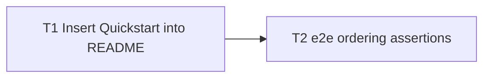

# 0026 · README Minimal Usage: Add a Quickstart Section Immediately After the Installation Instructions

<!-- This file is maintained by the spec tool: frontmatter is the structured source data (including the tasks DAG), and the body is a group-level overview in the nine-section rust-RFC format. -->

## Summary

Add a short "Minimal Usage / Quickstart" section to `README.md` after "Installation" and before "Getting Started: Taking an Issue from Zero to Completion." This section puts the **shortest usable path** in a prominent place in the README: `openagents init` → `openagents issue "Your requirement"` → `openagents vigil`. It also explains the division of responsibilities in one or two sentences: everyday use requires only `issue` + `vigil`; `poll` / `watch` / `rfc` and similar commands are tools for debugging individual steps and **do not discover new issues**; creating issues directly through the GitHub web interface also works, but they must carry the `openagents` label and a local `vigil` process must be running. This group **changes only the README structure and the text of this section**, without touching the behavior or division of responsibilities of any CLI command.

## Motivation

When new users (including the project author) follow the current README, they can easily mistake `issue` / `watch` / `poll` for a sequence to follow in everyday use and run into problems. The current command responsibilities (as defined by the "Command Reference" table in `README.md` and each command's implementation) are:

- **`openagents issue <title>`** only creates an issue on GitHub and automatically attaches the `openagents` discovery label—it **does not write local state**, dispatch work, or open a PR.
- **`openagents poll`** scans all **open PRs** (PRs for which work has already been dispatched and a run already exists) once and routes them by stage; **`openagents watch`** simply repeats `poll` at intervals. Both **only handle existing local open runs and do not discover new issues**.
- Consequently, "create an issue, then run `poll` directly" produces "Processed 0 events," while `watch` exits immediately because there are no open PRs, leading users to think the tool is broken.

The actual all-in-one entry point is **`openagents vigil`** (Vigil: autonomously discover issues → dispatch work → open PRs → monitor iterations). Commands such as `poll` / `watch` / `rfc` / `implement` are merely tools for debugging individual steps of that complete loop. This division of responsibilities—"`vigil` is the everyday entry point; the rest are individual debugging components"—is not prominent enough in the current README. The "Getting Started" section immediately presents a manual sequence of six steps, `rfc → refine-rfc → implement → iterate → poll → watch`, putting the debugging components into the introductory tutorial. The first thing newcomers see is the longest path with the most pitfalls, rather than the shortest usable path.

The gap is specific: **the README lacks an opening section that puts the shortest path first**, telling readers immediately after installation, "For everyday use, you need just two commands: `issue` to record the requirement and `vigil` to oversee the entire process," and explicitly clarifying that `poll`/`watch` do not discover new issues. Adding this text is all this group needs to do; it is a documentation-only change.

## Guide-level explanation

After installing OpenAgents (finishing the "Installation" section), readers scroll down and immediately see "Minimal Usage / Quickstart":

```bash
openagents init                 # Bind the current directory to the repository
openagents issue "Your requirement"      # Create an issue (automatically apply the openagents discovery label)
openagents vigil                # Vigil: discover → dispatch work → open PRs → monitor iterations
```

Follow this immediately with one or two sentences explaining the usage boundaries:

- **Everyday use requires only `issue` + `vigil`**: `issue` records a requirement as a GitHub issue with the `openagents` label; the single `vigil` command handles the entire "discover → dispatch work → open PRs → monitor" process.
- **`poll` / `watch` / `rfc` and similar commands are tools for debugging individual steps and do not discover new issues**: they only handle existing local open PRs/runs. Running `poll` directly after creating an issue produces "Processed 0 events," and `watch` exits immediately. This does not mean they are broken; discovery is simply not their responsibility. Use `vigil` to take a new requirement through the process.
- **You can also create issues directly through the GitHub web interface**, but you must manually apply the `openagents` label, and a local `vigil` process must be running for them to be discovered and dispatched.

When readers want to see the process broken down into steps (the sequence of `rfc` / `refine-rfc` / `implement` / `iterate`), the immediately following "Getting Started: Taking an Issue from Zero to Completion" remains in place as "the detailed version to read when you want to understand the loop manually, step by step." Quickstart and Getting Started thus form a progression from "shortest path → detailed breakdown," rather than two parallel options that leave readers unsure which to read first.

## Reference-level explanation

**Technical approach**—pure Markdown documentation editing, with zero code changes and zero CLI behavior changes.

- **Insertion point**: the existing structure of `README.md` is `… → ## Installation (L111) → ## Getting Started: Taking an Issue from Zero to Completion (L127) → …`, with a `---` horizontal rule between the two sections. Insert the new `## Minimal Usage / Quickstart` section after the separator at the end of "Installation" and before the "Getting Started" heading, and separate it from "Getting Started" with its own `---`. The final order is: **Installation → Minimal Usage / Quickstart → Getting Started**. Leave both the "Installation" section itself and the body of "Getting Started" unchanged (boundary: do not rewrite the other README sections or change the installation instructions themselves).
- **New section content**: a three-line `bash` code block (`init` / `issue` / `vigil`, each with an inline comment, matching Guide-level above), plus three explanatory bullet points (everyday use requires only `issue`+`vigil`; `poll`/`watch`/`rfc` are debugging tools that do not discover new issues; issues created through the web interface need the `openagents` label and a running local `vigil` process). Command names, label names, and descriptions of responsibilities must use terminology consistent with the existing "Command Reference" table, "Workflow Labels Overview" table, and "Vigil Mode (vigil)" section, without introducing statements that conflict with the body text.
- **Items left unchanged**: do not add/delete/reorder any sections other than "Getting Started"; do not change content other than the anchor structure of the "Table of Contents" (if adding a level-two heading requires one more link in the `## Table of Contents` list, add that line as well; this is structural consistency maintenance within the same file and still changes only `README.md`).

**Task breakdown (mutually exclusive files, a single writer per Task—principle 6)**:

| Task | Scope | owns files | Dependencies |
|---|---|---|---|
| T1 | Insert "Minimal Usage / Quickstart" after Installation and before Getting Started in the README, and update the table-of-contents anchor accordingly | `README.md` | — |
| T2 | e2e script: assert that the Quickstart section exists and appears between Installation and Getting Started | `scripts/e2e-spec-0026-readme-quickstart.sh` | T1 |



**End-to-end validation**: `bash scripts/e2e-spec-0026-readme-quickstart.sh`—documentation-only validation, without invoking any real CLI / GitHub operations. The script asserts that: (1) `README.md` contains the `## Minimal Usage / Quickstart` heading; (2) this heading appears in the file after `## Installation` and before `## Getting Started` (in line-number order); (3) the new section's code block contains all three lines: `openagents init` / `openagents issue` / `openagents vigil`. There are no external dependencies, so CI can rerun it reliably.

## Drawbacks

- **One more README section makes the initial content longer**: inserting a section between Installation and Getting Started means readers must scroll an extra screen. This is the cost of putting the shortest path first, and the new section is deliberately short (three command lines + three bullet points).
- **The two usage explanations overlap**: Quickstart and "Getting Started" both explain "how to take an issue through the process," so some information is repeated. Distinguish them through their positioning and wording as "shortest path vs. detailed breakdown," accepting this redundancy to make the README more approachable for newcomers.
- **Risk of documentation drifting from command behavior**: if the responsibilities of `vigil` / `issue` / `poll` change later, this text must be updated accordingly or it will mislead readers. This is an inherent maintenance cost of all usage documentation, rather than something unique to this section.

## Rationale and alternatives

The choice to **add** a separate, short Quickstart section "after Installation and before Getting Started" provides the shortest usable path in the most prominent location (visible immediately after installation) while **leaving the existing detailed "Getting Started" tutorial entirely untouched**. It minimizes risk, fully matches the boundaries of issue #75 (change only the structure and this section's text, do not rewrite other sections, and do not change installation itself), and creates a natural progression from "shortest path → detailed breakdown."

- **Alternative A: directly rewrite the existing "Getting Started" section, putting the `vigil` path at the beginning and moving the debugging commands to the end**—this would eliminate an extra section and avoid repetition, but would substantially rewrite an existing section, increasing both the scope of changes and regression risk. The issue also explicitly says "do not rewrite the other README sections"; rejected.
- **Alternative B: only add a note saying "this is the everyday entry point" for `vigil` in the "Command Reference" table, without adding a Quickstart section**—this would be a smaller change, but readers would have to scroll far down to the command reference to see it. It would not address the core problem of "following issue→poll→watch into pitfalls immediately after installation." Its placement would not meet the issue's requirement of "after the installation instructions, right at the beginning"; rejected.
- **Alternative C: put Quickstart at the very top of the README (before the title/introduction)**—this would make it more prominent, but readers would see executable commands before installing, which is an illogical order (the issue explicitly requires "immediately after the installation instructions"); rejected.

## Prior art

- **"Quickstart / Getting Started immediately after Installation" is a common structure in open-source READMEs**: the vast majority of CLI tool READMEs follow "Install → Quickstart (the shortest usable commands) → detailed documentation." Putting the shortest path first is an established convention. This group applies that convention to this repository's README.
- **Precedent within this repository**: the existing "Getting Started: Taking an Issue from Zero to Completion" section in `README.md` already follows the tutorial pattern of "taking an issue through the process." Adding a shorter "Minimal Usage" section before it puts an ultra-short version first within the same pattern, rather than inventing a new one.
- The factual basis for the division of command responsibilities is in the existing "Command Reference," "Orchestration and Automation," and "Vigil Mode (vigil)" sections of `README.md`. This group's text restates those responsibilities consistently without introducing new definitions.

## Unresolved questions

- **Whether the new section should have a bilingual Chinese/English title**: the tentative title is "Minimal Usage / Quickstart," with Chinese and English side by side in the original, which differs slightly from the Chinese title style of "Getting Started." Leave the final title wording to implementation, based on the README's overall style.
- **Whether the table of contents (`## Table of Contents`) needs an additional anchor link**: this depends on whether the existing table of contents lists every section. If an entry is needed, handle it within T1 (still changing only `README.md`); use the README's table-of-contents structure at implementation time to determine the specifics.

## Future possibilities

- **English README / i18n**: if an English README is added in the future, this minimal-usage section is the entry section that most deserves translation priority and is most likely to be referenced.
- **Coordinate Quickstart with the output of `openagents init`**: after `init` succeeds, it could print these three minimal-usage command lines directly in the terminal, providing consistent guidance across documentation and terminal output (this would be a CLI change, outside this group's documentation scope, and is left for future work).
