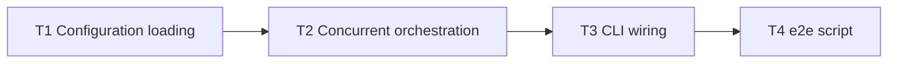

# 0027 · Multi-repository management: run Vigil concurrently across a configured set of repositories from a single process

<!-- This file is maintained by the spec tool: frontmatter is the structured source data (including the tasks DAG), and the body is a group-level overview in the nine-section rust-RFC format. -->

## Summary

Add a “multi-repository management” capability to OpenAgents: a new subcommand, `openagents vigil-all` (provisional name; see Unresolved questions), starts a **single process** that reads a **YAML configuration file** listing a set of repositories to manage (local paths), a set of global defaults, and optional per-repository overrides for `interval` / `labels` / `base` / `hold`. It then **starts an isolated subprocess for each repository**, reusing the **existing `Vigil`** within each subprocess to run its own Vigil loop (discover issues → dispatch work → watch PRs). Repositories do not block one another, each reads and writes **its own** `.openagents/state.json`, and all logs are aggregated in one place with a “repository name prefix.” This is equivalent to “starting multiple `vigil` instances at once and managing them centrally,” but requires only one command, one configuration file, and one overview entry point. The signature of the single-repository `openagents vigil` command and its underlying discovery/dispatch/watching logic receive **zero changes**.

## Motivation

Currently, `openagents vigil` operates **one repository at a time**. To make the current situation explicit (so this spec is self-contained rather than relying on bare references): the constructor of `Vigil` (`openagents/vigil.py`) is `Vigil(*, orchestrator, messages, state, work_dir)`, where `work_dir` is bound to the root of **that one** repo—it uses `git -C <work_dir> ls-remote ...` to check remote branches in the discovery-stage deduplication gate (`vigil.py:141-148`); state is stored in **each repository's own** `work_dir/.openagents/state.json` (the CLI factory `_state_for` derives it using `repo_root / ".openagents" / "state.json"`, `cli.py:140-143`); discovery-stage `github.list_issues` ultimately invokes `gh issue list`, and all `gh` calls in the `github` module use `subprocess.run(["gh", *args], ...)` **without passing `cwd`** (`github.py:140-156`)—meaning that `gh` always operates on the repository containing the **current process working directory**. All CLI wiring (`_vigil_for` / `_orchestrator_for` / `_messages_for`, `cli.py:163-197`) derives from a single `ctx.repo_root` obtained through `resolve_project()` (which reads the git root of cwd, `config.py:36-44`).

Conclusion: **a vigil process is structurally limited to managing the one repository in which it was started**. To run Vigil on N repositories simultaneously today, users must start N vigil processes, `cd` into the corresponding directory for each, run them in the background, and inspect their logs separately. As the number of repositories grows, both operational cost (N commands for starting/restarting/checking logs) and cognitive burden (no unified overview and no way to tell what each repository is doing at the moment) grow linearly, and there is no entry point for “centralized management.”

This is precisely the gap exposed by actual use: “one process per repository” is inconvenient in multi-repository scenarios, which need a **single-process + configuration-file** management entry point. This feature fills that gap with one orchestration command and is naturally dogfooding—OpenAgents itself is a product that uses its MVP to iterate on itself, and managing multiple repositories it serves is the next step in scaling Vigil capabilities.

## Guide-level explanation

Users write a configuration file (default: `.openagents/fleet.yml`) listing the repositories to manage:

```yaml
# Global defaults: used whenever a repository does not explicitly override them
defaults:
  interval: 60          # Polling interval (seconds)
  labels: [openagents]  # Label gate for issue discovery
  base: main            # Base branch for drafting dispatched changes
  hold: null            # Gates (spec / merge / spec,merge); null = fully automatic, no stops

# List of repositories to manage (local paths); each entry may override any default above
repos:
  - path: /Users/me/work/repo-a          # Use all defaults
  - path: ../repo-b
    interval: 120                        # Poll this repository a little less frequently
    labels: [openagents, urgent]
    base: develop
  - path: ~/work/repo-c
    name: c                              # Optional: display name for the log prefix; defaults to the path basename
    hold: spec,merge                     # Pause at the spec/merge gates for human input in this repository
```

Then start centralized management with one command:

```
openagents vigil-all                       # Read the default .openagents/fleet.yml
openagents vigil-all --config fleet.yml    # Specify a configuration file
openagents vigil-all --once                # Run one iteration per repository, then exit (for cron/CI/e2e)
```

The output is **aggregated logs with repository prefixes**, making the source repository of each event immediately apparent:

```
[repo-a] ▶ issue #12: Fix login bug → dispatch RFC drafting
[repo-b] … Vigil running, next scan in 120s
[c]      ✗ This Vigil iteration failed; skipping, next scan in 60s: gh timed out
[repo-a] … Vigil running, next scan in 60s
```

Mental model: `vigil-all` means “**start N `vigil` instances at once and view their logs centrally**.” Behind each repository is the original `openagents vigil`—the same discovery → dispatch → watching flow, the same `.openagents/state.json`, and the same error isolation behavior, without having to open N terminals and `cd` into each repository manually. If one repository gets stuck or encounters an error, it affects only its own log line; the other repositories continue as usual. Pressing `Ctrl-C` stops them all at once.

## Reference-level explanation

**Technical approach overview**—`vigil-all` is a **thin orchestration** layer (Principle 1, Occam): `read configuration → start an isolated execution unit for each repo and reuse the existing Vigil within it → schedule concurrently → aggregate logs`. It **does not rewrite** any discovery/dispatch/watching logic, nor does it **touch** the existing signatures or behavior of `vigil` / `Vigil` / `github` / `Orchestrator`.

**Core decision: process-level isolation (one subprocess per repository), not threads.** The reason follows directly from the current constraints in Motivation: the `github` module's `gh` calls are bound to the **process working directory** (`subprocess.run(["gh", ...])` does not pass `cwd`), while `os.chdir` changes the **process-global** cwd—multiple threads within the same process cannot each have a different cwd. Under a threading model, `gh issue list` calls for two repositories would therefore interfere with one another, making that model fundamentally unworkable. Giving each repository an **independent subprocess** solves this in one step: after startup, the subprocess calls `os.chdir(repo_path)`, so its cwd, the `Vigil`/`State` it constructs, and its `gh` calls are all bound to its own repository. Subprocesses provide memory isolation (state naturally stays separate), crash isolation (one crashing does not affect the others), and true parallelism (their respective blocking `time.sleep(interval)` calls and `gh`/`git` subprocess calls do not affect one another).

Components:

- **Configuration loading, `openagents/fleet_config.py`** (new module): read YAML using the project's existing `ruamel.yaml` (already a dependency, `pyproject.toml:9-12`), validate it declaratively against a **minimal schema** using the existing `jsonschema` (same location), and then **merge** `defaults` with each repo's overrides into a set of `RepoPlan` entries (each containing an absolute `path`, a display `name`, and `interval`/`labels`/`base`/`hold`). Pure parsing with no side effects, making it easy to unit-test. Follow existing project conventions: YAML format (`lefthook.yml` / `.commitlintrc.yml` / spec frontmatter all use YAML), and `ruamel.yaml` + `jsonschema` validation (the same combination used in `openagents/spec/`), introducing no new dependencies or formats (Principle 1).
- **Concurrent orchestration, `openagents/fleet.py`** (new module): entry point `Fleet.run(*, plans, once)`—start a `multiprocessing.Process` for each `RepoPlan`, with target function `_run_repo(plan, log_queue)`: `os.chdir(plan.path)` → `resolve_project()` → reuse the existing CLI factory `_vigil_for(ctx=...)` to construct `Vigil` (with a deferred import, following this repository's convention of “deferred imports inside command bodies” to avoid a top-level circular dependency with `cli`) → call `vigil.run(interval=plan.interval, labels=plan.labels, base=plan.base, once=once, hold=parse_hold(plan.hold))`. The subprocess's Vigil logs (`Vigil._log` writes to stderr) are sent back to the parent process through a `multiprocessing.Queue`; the parent adds a `[name] ` prefix and writes them to stderr (observability: a unified view with distinguishable sources). The parent supervises subprocess lifecycles: if a subprocess exits abnormally → log one line, `[name] Vigil process exited (code N)`, but **do not bring down the others** (consistent with `Vigil`'s existing error isolation: RFC-0004 Decision 8 skips an individual issue, and RFC-0010 Decisions 5/6 proceed to the next iteration after an iteration fails—here, the same isolation philosophy is extended to “one repository's failure must not bring down the fleet”); if the parent receives `KeyboardInterrupt` → call `terminate()`+`join()` on every subprocess in turn, then exit cleanly.
- **CLI wiring, `vigil-all`** (`openagents/cli.py`): add a subparser (`--config` defaults to `.openagents/fleet.yml`, plus `--once`) + `_cmd_vigil_all` + a `_fleet_for` factory; parse → `load_fleet_config` → `Fleet.run`. Thin routing with no business logic, coexisting with the existing `vigil` subcommand without mutual interference (`vigil`'s subparser and handler at `cli.py:104-123` / `_cmd_vigil` remain byte-for-byte unchanged).

**Configuration schema (the minimum needed)**: two top-level keys, `defaults` (object, optional, global defaults) + `repos` (array, required, at least 1 entry). `defaults` and each `repos[]` entry share the same optional keys: `interval` (int)/`labels` (array of strings)/`base` (string)/`hold` (string or null); `repos[]` entries additionally have a required `path` (string, local path, supporting `~`/relative paths and converted to an absolute path during parsing) and an optional `name` (string, log prefix name, defaulting to `basename(path)`). Unrecognized keys produce validation errors to catch typos.

**Task breakdown (mutually exclusive files, one writer per Task—Principle 6)**:

| Task | Scope | owns files | Dependencies |
|---|---|---|---|
| T1 | Configuration loading: YAML parsing + jsonschema validation + default merging → `RepoPlan` list | `openagents/fleet_config.py`, `tests/test_fleet_config.py` | — |
| T2 | Concurrent orchestration: one subprocess per repository running the existing Vigil + log aggregation + crash/Ctrl-C isolation | `openagents/fleet.py`, `tests/test_fleet.py` | T1 |
| T3 | CLI wiring for `vigil-all` (`--config`/`--once`) + `_cmd_vigil_all` + `_fleet_for` | `openagents/cli.py`, `tests/test_cli_fleet.py` | T2 |
| T4 | e2e script demonstrating the complete multi-repository management loop | `scripts/e2e-spec-0027-vigil-all.sh` | T3 |



**End-to-end validation**: `bash scripts/e2e-spec-0027-vigil-all.sh` (ruff + pytest offline phase; optional `OPENAGENTS_E2E_REAL=1` real smoke test: run `openagents vigil-all --once` with a `fleet.yml` pointing to two local temporary repositories, asserting that each repository receives one Vigil iteration, logs carry their respective prefixes, and their respective `.openagents/state.json` files are written independently).

## Drawbacks

- **Operational complexity of multiple processes**: The `vigil-all` parent process must correctly manage the lifecycles of N child processes (reaping zombies, forwarding stop signals, aggregating output). Compared with “manually starting N vigil instances,” this increases concurrency/IPC complexity in the code, and the parent process itself becomes a new single point of failure (if it crashes, everything stops).
- **Process count grows linearly with repository count**: There is one child process per repository, and dispatching tasks within each vigil also starts additional worktree/backend child processes. With many repositories, this puts pressure on machine resources (memory, file handles, `gh` rate limits); the MVP imposes no concurrency limit (see Future possibilities).
- **Cognitive cost of an additional entry point**: `vigil` (single repository, run inside the repository) and `vigil-all` (multiple repositories, reads configuration) coexist, so users must distinguish when to use each.
- **The configuration file becomes another source of drift**: Incorrect paths and repositories that have been moved/deleted are only discovered at runtime; clear validation errors are needed as a safeguard.

## Rationale and alternatives

The choice of “**a single process + one `multiprocessing` child process per repository, reusing the existing `Vigil` inside each child process**” satisfies all hard constraints simultaneously: reuse rather than rewriting (each child process follows the existing `_vigil_for` → `Vigil.run` path), zero changes to single-repository logic, state isolation (each child process has its own cwd → its own `state.json`), error isolation (process-level crashes do not propagate), true concurrency (avoiding the global nature of cwd and blocking by `time.sleep`), and an extremely thin orchestration layer.

- **Alternative A: A thread pool (`ThreadPoolExecutor`), with one `Vigil` per thread**—This repository already has a threading precedent (`reviewer.py` uses `ThreadPoolExecutor` to run reviewers concurrently). But this is **fundamentally infeasible**: `github` calls to `gh` are tied to the process cwd, and `os.chdir` is process-global. Multiple threads cannot each maintain a different cwd, so `gh issue list` calls for two repositories would interfere with each other; furthermore, the `time.sleep` calls and numerous synchronous subcalls in `Vigil.run` are not naturally suited to threading. Rejected—this is the direct reason for choosing processes.
- **Alternative B: The parent process supervises N CLI child processes using `subprocess.Popen(["openagents", "vigil", ...], cwd=repo)`**—This provides looser coupling (depending only on the public `vigil` command, with zero import coupling), and cwd/state/crash isolation likewise comes for free. However, reliably invoking this package's entry point as a child process (`python -m openagents` requires `__main__.py` / alternatively, it relies on the console_script being on PATH) is somewhat fragile across tests and different installation forms; serializing orchestration parameters into command-line flags and parsing them again is also less convenient than passing `RepoPlan` objects directly. Retained as a reasonable close alternative, but `multiprocessing` is chosen because “constructing `Vigil` objects directly within processes” better matches the original intent of “constructing one Vigil for each repo” and is easier to unit test (a fake vigil factory can be injected into `Fleet`).
- **Alternative C: Serial polling in a single process (`chdir` to A in one thread and run one round, then `chdir` to B and run one round, …)**—The simplest option, with no concurrency, but if task dispatching/waiting in any repository gets stuck (for example, a long-running backend or `gh` retry backoff), it blocks all repositories, violating the hard requirement that “one stuck repository must not bring down the others.” Rejected.
- **Configuration format alternatives: TOML / JSON**—The project has no TOML dependency; JSON is inconvenient to write by hand (no comments). YAML is an existing project convention (`lefthook.yml`/`.commitlintrc.yml`/spec frontmatter), and `ruamel.yaml` is already a dependency, so choosing YAML introduces no new entities (principle 1).

## Prior art

- **The process-level supervisor lineage** (`supervisord`, `foreman`/Procfile, `pm2`, `tmuxinator`): All follow the pattern of “a declarative configuration lists a set of processes to run, and one supervisor starts them concurrently, aggregates output, and manages restarts.” `vigil-all` is a minimal specialization of this pattern for the OpenAgents Vigil scenario—the configuration entries are simply “repositories + their respective Vigil parameters,” and the supervised processes are vigil instances. This demonstrates that “configuration file + single supervisor + multiple child processes + log aggregation” is a mature, viable approach.
- **Internal OpenAgents precedents**: `Vigil`'s own error-isolation decisions (RFC-0004 decision 8, “skip a failed individual issue,” and RFC-0010 decisions 5/6, “proceed to the next round after a single-round failure; continue propagating exceptions in once mode,” all in `openagents/vigil.py`) extend to the structurally equivalent higher-level rule in this group of changes: “a single repository's failure must not bring down the fleet”; the `ThreadPoolExecutor` in `reviewer.py` is a concurrency precedent (but does not apply here because cwd is global; see Alternative A).
- **Common CLI conventions for orchestrating multiple targets** (such as `kubectl --context`, `git -C <dir>`, and `--parallel` in the monorepo task runners `turbo`/`nx`): These demonstrate that “one command acts concurrently on multiple targets according to configuration + aggregated output with target prefixes” is an interaction pattern familiar to users.

## Unresolved questions

- **Final command name**: `vigil-all` vs `fleet` vs something else (marked “name TBD” in the issue). This spec uses `vigil-all` by default (the most self-explanatory and discoverable option for `vigil` users); if reviewers prefer `fleet` (shorter, with a “fleet” metaphor), it can be renamed in one place during implementation. **Awaiting human confirmation**.
- **Default configuration path**: Whether the default `.openagents/fleet.yml` (in the same directory as `.openagents/state.json`, consistent with existing conventions) is appropriate, or whether only an explicit `--config` should be accepted. The preference is to retain the default to save one flag. **Awaiting human confirmation**.
- **Whether to automatically restart child processes after abnormal exits**: The MVP only “logs one line and keeps the others running,” without automatic restarts (aligned with the philosophy of “code is the checkpoint; rerunning resumes”—a person can simply rerun `vigil-all` to recover). Whether to add `--restart`/restarts with backoff is left until a real need arises.
- **`multiprocessing` start method**: macOS/Win default to `spawn` (child processes import modules again, requiring the target function and `RepoPlan` to be pickleable); Linux defaults to `fork`. Implementation must ensure that the target is a module-level function and `RepoPlan` is a pickleable dataclass; whether to explicitly fix the start method is left to implementation, based on test results.

## Future possibilities

- **Concurrency limit control**: With many repositories, use `--max-parallel N` (or a configuration entry) to limit the number of simultaneously active child processes and queue the rest, reducing resource pressure.
- **Direct management of remote repositories**: Configuration entries support `remote` (rather than only a local `path`), with `vigil-all` first cloning/updating repositories into a local workspace according to convention, then running Vigil, saving manual cloning (this group of changes **does not implement this**; the issue explicitly limits scope to local paths).
- **Unified overview board**: Aggregate each repository's `state.json` into a cross-repository `board` (reusing the results board from `openagents board`), providing a visual overview of “what all repositories are doing right now” (principle 8: focus on outcomes).
- **Integration with a persistent service/Web console**: Upgrade `vigil-all` to a persistent service with an HTTP status endpoint (the issue explicitly lists this as a follow-up topic; this group of changes does not implement it).
- **Daemonization**: Run `vigil-all --daemon` in the background + write logs to disk + health checks, further reducing long-term operational costs.
