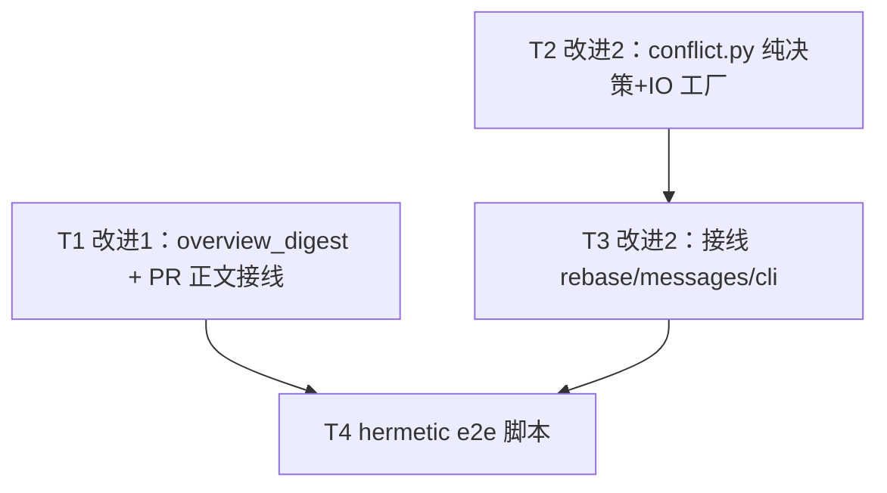

# 0028 · PR 自动化两处改进：spec 草稿 PR 内嵌 9 段总览摘要 + merge 冲突派 agent 语义解冲突

<!-- 本文件由 spec 工具维护：frontmatter 为结构化源数据（含 tasks DAG），正文为组级 rust-RFC 9 段总览。 -->

## Summary

源自实跑 PR #76 的两个相互独立的观察，合并为一组、分 Task 落地：

1. **spec 草稿 PR 正文内嵌总览摘要** —— 开 draft PR 时，把本分支新增 spec 组 9 段总览里信息
   密度最高的三段（Summary / Motivation / Reference-level explanation）摘要内嵌进 PR 正文，
   评审者无需点开 Files changed 即可在 PR 页读到核心设计。
2. **merge 冲突派 agent 语义解冲突** —— 自动合并扇出撞到真冲突时，不再一律「请人工 rebase」，
   而是派一个 coding 后端 agent 到该 PR 分支临时 worktree 里读冲突标记、语义解决、跑 ruff+pytest
   自测、续 commit、push；解不了才回落人工。形成分层降级：**indexheal（确定性，仅 OVERVIEW）→
   agent（通用，啃真冲突）→ 人工兜底**。

两处都是「把人当前在做的机械活交给 agent」（理念 2/5：人负责宏观把控、细节交给 agent），且都
**严格零回归**：任何新路径失败都回落到现状行为。

## Motivation

**背景（就地复述，不靠裸引用承载）**：OpenAgents 是 RFC/spec 驱动的多 agent 框架，从 issue
自动起草 spec → 开 draft PR → 评审 → 实现 → 合并。两个痛点都在 PR 自动化链路上：

### 问题 1：spec 草稿 PR 的正文读不到设计

`orchestrator.start_rfc`（issue 驱动）与 `orchestrator.backfill_rfc`（brownfield 反向补全）
开 draft PR 时，正文由 `_pr_body` / `_backfill_pr_body` 拼出，当前只含：
`Closes #N` + 一句「spec 草稿待评审。」+ 一个 `## 端到端验证` 指路牌（由
`spec/signpost.py:signpost_for_group` 渲染，指向 e2e 脚本与组文件）。

而 spec 的实际设计——组级 rust-RFC 9 段总览——全在 `docs/specs/NNNN-slug.md` 里。评审者要读
设计，必须点开 PR 的 Files changed 标签页、找到那个 markdown、再滚动阅读。**PR 页本身读不到
任何设计内容**，这抬高了评审摩擦，与「PR/comment 即 agent 协作界面」的定位相悖。

### 问题 2：merge 冲突一律甩给人工

合并扇出 `rebase.rebase_open_prs`（一个 PR 合并进 main 后，把最新 main 并入其余 open PR）与
代码闸的可合并性预检 `messages.Messages._process_coding`（reviewer 评审前先查 PR 是否冲突）
撞冲突时，目前只有一种自动消解：`indexheal`（issue #48）——它**只能确定性消解**
`docs/specs/OVERVIEW.md` 这一个由 `spec render` 整表重渲的生成式索引文件的冲突（按合并后的
spec 源重渲该文件即得并集）。其余**任何真冲突**一律贴 `rebase.CONFLICT_COMMENT`（「请手动
rebase / 解决冲突后重新 push」）甩给人。

**整条链路目前没有任何 agent 参与冲突解决**——这与目标「人负责宏观把控、细节交给 agent」
（理念 2/5）相悖。实例：PR #76 与 PR #78 各加一个 spec，两边都重渲整张 OVERVIEW.md → 冲突
（这种 OVERVIEW 冲突 indexheal 能消解）；更早还出现 spec **撞号**，PR #78 是靠人**手动改 spec
编号**避让 PR #76 的——这类机械的、语义可判定的冲突，正该交给 agent 啃。

## Guide-level explanation

### 改进 1 落地后的体验

agent 解决一个 issue、开出 spec 草稿 draft PR 后，PR 正文长这样（示意）：

```markdown
Closes #79

spec 草稿待评审。

## spec 总览（摘自 docs/specs/0028-pr-digest-and-conflict-agent.md）

### Summary
源自实跑 PR #76 的两个相互独立的观察……

### Motivation
…（前 N 行）…
…（完整见 spec 文件）

### Reference-level explanation
…（前 N 行）…
…（完整见 spec 文件）

## 端到端验证
- 跑：`bash scripts/e2e-spec-0028-pr-digest-and-conflict.sh`
- 详细手动步骤见 docs/specs/0028-pr-digest-and-conflict-agent.md 的组级总览 + 各 Task 的 `acceptance`
```

总览摘要块**夹在 summary 之后、`## 端到端验证` 之前**。只取三段（不是全 9 段），每段超过行数
上限就截断并附「…（完整见 spec 文件）」，避免正文膨胀淹没 `Closes #N` 与指路牌。spec 不可读
时该块整体缺省（回退现状），PR 照开。

### 改进 2 落地后的体验

自动 poll 扇出时，某 open PR 与新合并的 main 撞冲突：

1. 先试 `indexheal`：若冲突**仅**落在 `docs/specs/OVERVIEW.md` → 重渲消解、push，完事
   （`RESULT_HEALED`）。
2. indexheal 不适用（含其它文件的真冲突）→ 试新的 **agent 语义解冲突**：在该 PR 分支临时
   worktree 里 `git merge origin/main`，把冲突文件清单喂给 coding 后端 agent，让它读
   `<<<<<<<`/`>>>>>>>` 标记、语义解决、跑 ruff+pytest 自测、`git add`+`commit`，成功则 push
   （新增 `RESULT_RESOLVED`）。
3. agent 也解不了（自测失败 / 仍有残留冲突标记 / 任何异常）→ `merge --abort`，回落到现有
   人工留言路径（`RESULT_CONFLICT`，贴 `CONFLICT_COMMENT`）。

人手动触发的 `openagents sync-prs` **不启用**第 2 层（不在人手动命令里偷烧 token）；只在自动
poll 扇出里启用。

## Reference-level explanation

### 改进 1：`overview_digest_for_group` + 接线 `_pr_body`

**新增** `openagents/spec/signpost.py:overview_digest_for_group(*, group_path) -> str | None`，
与既有 `signpost_for_group` 并列同质（同样「只懂 spec 文档结构、为 PR 正文抽取、缺失返 None」，
不感知 git/GitHub/orchestrator，理念 10 解耦）：

- `model.load_group(path=group_path)` 取 `overview.summary` / `overview.motivation` /
  `overview.reference_level` 三段（字段已存在于 `model.Overview`）。
- 每段按**行数上限**（模块常量，如 `_DIGEST_MAX_LINES`）截断；超出则保留前 N 行并追加一行
  「…（完整见 spec 文件）」。
- 渲染 `## spec 总览（摘自 docs/specs/<name>）` 块，三段各以 `### <段名>` 小标题分隔。
- `group_path` 不是文件 / `load_group` 抛 `OSError|ValueError` → 返回 `None`（零回归）。

**接线** `openagents/orchestrator.py`：`_pr_body` / `_backfill_pr_body` 各新增一个必填关键字参数
`digest_section: str | None`，**位置在 summary 之后、`e2e_section` 之前**追加（`None` 即跳过）。
`start_rfc` / `backfill_rfc` 已各算出 `spec_group`（`workspace.changed_spec_group`）并据此调
`signpost.signpost_for_group`；复用同一 `spec_group` 调
`signpost.overview_digest_for_group(group_path=spec_group)`，把结果透传进 `_pr_body` /
`_backfill_pr_body`。

### 改进 2：`openagents/conflict.py` + 接线 rebase / messages / cli

**新增模块** `openagents/conflict.py`，作为 `indexheal.py` 的**语义化兄弟**（照搬其骨架：任意
PR 分支临时 detached worktree + 注入 `run`/callable 解耦 IO + 全程异常吞成 `False` 安全降级）：

- 纯决策 `resolve_branch(*, worktree, base, backend, run) -> bool`：
  - `run(args=["merge", f"origin/{base}", "--no-edit"], cwd=worktree, check=False)`；
    returncode 0（干净合并）→ `True`。
  - 冲突 → 取冲突文件清单（`git diff --name-only --diff-filter=U`），喂给
    `backend.run(work_dir=worktree, task=<语义解冲突+自测指令>, context=<冲突文件清单>)` 让
    agent 语义解决 + 跑 ruff+pytest 自测。
  - agent 跑完后校验**无残留冲突标记**（再查 `--diff-filter=U` 为空 / grep 无 `<<<<<<<`）→
    `git add -A` + `git commit --no-edit` → `True`。
  - 仍有冲突 / 自测失败 / 任何异常 → `run(args=["merge", "--abort"], …)` → `False`。
- IO 工厂 `make_resolver(*, work_dir, base, backend, agent_id) -> Callable[..., bool]`，与
  `indexheal.make_healer` 同构：取 PR head 分支 → 建临时 detached worktree（`.openagents/`
  下、按分支名隔离，已 gitignore）→ `resolve_branch` → 成功则 push 回该分支 → `finally`
  幂等清理 worktree。返回的回调签名 `(*, pr_number: int) -> bool`。

**接线**：

- `openagents/rebase.py`：`rebase_open_prs` 新增可选注入 `resolve: Callable[..., bool] | None`，
  冲突处理顺序改为 **heal → resolve → 留言**：`heal` 命中返回 `RESULT_HEALED`；否则
  `resolve` 命中返回**新增常量** `RESULT_RESOLVED`；都没命中才 `post_signed_comment` +
  `RESULT_CONFLICT`。`resolve=None`（如手动 sync-prs）即跳过该层，行为同今天。
- `openagents/messages.py`：`Messages.__init__` 新增 `backend` 参数；新增 `_make_resolver()`
  （与 `_make_heal` 同款门控：`work_dir` + `base` + `backend` 齐备才构造，缺一返 `None`）。
  poll 的合并扇出（`_process_run` 里调 `rebase_open_prs` 处）透传 `resolve=self._make_resolver()`；
  `_process_coding` 的可合并性预检撞冲突时，先试 `resolve`（成功则本轮不 block、等下一轮 CI），
  失败才走现有 `CONFLICT_COMMENT` + `_block`。
- `openagents/cli.py`：`_messages_for` 注入 `backend=_backend_for()`（复用既有 backend 工厂）；
  `_cmd_sync_prs` 的 `rebase_open_prs` 调用**不**注入 `resolve`（保持手动命令不烧 token）。

**为什么 merge 而非 rebase**：复用 indexheal 的 `git merge origin/<base>` 路径，避免 force-push
改写已推送历史（多 agent 并发下 force-push 易相撞）。用户口语「rebase」= 同步到最新 main 并解
冲突，merge 达成同一目的且更安全。

### DAG + 文件分配

两处改进互相独立（不同文件、无依赖），可并行实现。



| Task | 标题 | files | 依赖 |
|---|---|---|---|
| T1 | 改进1：总览摘要 digest + PR 正文接线 | `openagents/spec/signpost.py`, `openagents/orchestrator.py`, `tests/test_signpost_digest.py`, `tests/test_orchestrator_pr_body.py` | — |
| T2 | 改进2：`conflict.py` 语义解冲突（纯决策 + IO 工厂） | `openagents/conflict.py`, `tests/test_conflict.py` | — |
| T3 | 改进2：接线 rebase / messages / cli（分层降级 + 门控） | `openagents/rebase.py`, `openagents/messages.py`, `openagents/cli.py`, `tests/test_rebase_resolve.py`, `tests/test_messages_resolve.py` | T2 |
| T4 | hermetic e2e 脚本（无网络、不触真实 LLM） | `scripts/e2e-spec-0028-pr-digest-and-conflict.sh` | T1, T3 |

`files` 同组互斥（单一 writer 所有权，理念 6）。注：现有 `tests/` 里既有 `test_signpost.py` /
`test_rebase.py` / `test_messages.py` 等不被本组任何 Task 占有——本组只新增上表所列新测试文件，
不改既有测试文件，从而保持组内 `files` 与既有所有权双重不重叠。

**e2e 脚本路径**：`scripts/e2e-spec-0028-pr-digest-and-conflict.sh`（hermetic，两段：① ruff +
pytest 离线确定性验证；② 用 fake backend / fake run 闭环演练 digest 抽取与 `resolve_branch`
分层降级，全程不触网、不调真实 LLM、不碰真实 gh）。

### 严格零回归不变式

- 改进 1：digest 为 `None` 时 PR 正文逐字节同今天。
- 改进 2：`resolve` 未注入（手动 sync-prs / 老测试夹具）或返回 `False` 时，冲突处理逐字节
  回落到既有 `CONFLICT_COMMENT` + `_block` / 留言路径。

每层新代码注释按代码注释规范标注本组 spec id（0028）+ 对应 Task 号。

## Drawbacks

- **token 成本**：改进 2 的 agent 解冲突要真起一个 coding 后端，比确定性 indexheal 贵得多；
  故严格限定「只在自动 poll 扇出启用、手动 sync-prs 不启用」，且仅在 indexheal 不适用时才触发。
- **正确性风险**：agent 语义解冲突可能解错。缓解：强制 ruff+pytest 自测门控，自测不过即
  `merge --abort` 回落人工——宁可不解，不可解错后静默 push。
- **PR 正文变长**：改进 1 让正文变长，可能稀释 `Closes`/指路牌。缓解：只取三段 + 行数上限截断。
- **新增并发临时 worktree**：改进 2 与 indexheal 共用 `.openagents/` 下临时 worktree 区域，
  多 agent 并发时需注意路径隔离（按分支名）与幂等清理——照搬 indexheal 已验证的骨架。

## Rationale and alternatives

**改进 1 为何只取三段而非全 9 段**：Summary/Motivation/Reference-level 是信息密度最高的三段
（是什么 / 为什么 / 怎么做），覆盖评审者在 PR 页的第一需求；全 9 段会把正文撑爆、淹没
`Closes`/指路牌。备选：① 内嵌全文——否决（正文膨胀）；② 只放一个「点开看设计」链接——否决
（等于现状，没解决「PR 页读不到设计」）。

**改进 2 为何 merge 而非 rebase**：见 Reference-level——避免 force-push 改写已推送历史。备选：
① rebase + force-push——否决（多 agent 并发易相撞、且改写他人可见历史）；② 直接扩展
`indexheal` 让它处理通用冲突——否决（indexheal 是「确定性、零 LLM」的纯函数消解，混入 agent
调用会污染其语义边界；新建语义化兄弟 `conflict.py` 各司其职，理念 10 解耦）；③ 在主 worktree
里解冲突——否决（会污染当前工作区，临时 detached worktree 才能隔离）。

**为何分层降级而非直接上 agent**：indexheal 对 OVERVIEW 冲突是确定性、零成本、零风险的，应
优先；agent 是通用但贵且有风险的兜底；人工是最终安全网。三层从「便宜确定」到「贵但通用」到
「人」逐级降级，是成本/风险的最优排序。

## Prior art

- **`indexheal.py`（issue #48）**：本组改进 2 的直接蓝本——同样的「临时 worktree + 注入 IO +
  异常吞成 False 安全降级」骨架，`conflict.py` 是它的语义化兄弟。
- **`signpost.py`（issue #53）**：本组改进 1 的直接蓝本——`overview_digest_for_group` 与
  `signpost_for_group` 并列同质（只懂文档结构、为 PR 正文抽取、缺失返 None）。
- **rust-lang/rfcs**（https://github.com/rust-lang/rfcs）：9 段总览形态的来源；本组复用其
  Summary/Motivation/Reference-level 作为 PR 摘要的三段。
- 业界 AI 解 merge 冲突先例：GitHub Copilot / Mergify 等提供冲突辅助；本组走「派 coding agent
  到隔离 worktree 自测后再 push」的自托管路径，强调自测门控与安全降级。

## Unresolved questions

- 行数上限 `_DIGEST_MAX_LINES` 取多少最合适（初定一个保守值，可后续按实际 PR 观感调）。
- agent 解冲突的自测范围：跑全量 pytest 还是仅受影响子集？（初定全量 ruff+pytest，保守优先
  正确性；若太慢再议。）
- agent 解冲突失败后，是否在留言里附上 agent 的尝试摘要帮助人工？（初定不附，保持与现状一致；
  列为 Future。）

## Future possibilities

- spec **撞号**自动避让：把「PR #78 手动改编号避让 #76」这类机械操作也纳入 agent 解冲突
  （或前移到 `spec new` 时按 open PR 探测占用号）。
- digest 三段可配置：让 `overview_digest_for_group` 支持自定义抽取哪几段 / 行数上限。
- agent 解冲突的尝试摘要回贴到 PR，提升人工兜底时的可观测性。
- 把分层降级抽象成统一的「冲突消解责任链」，未来插入更多确定性消解器（如 lockfile、生成代码）。

