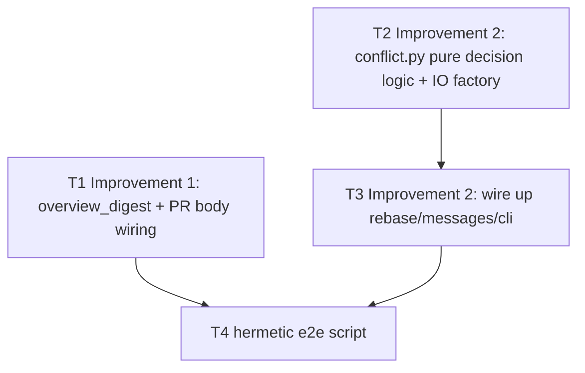

# 0028 · Two PR automation improvements: embed a digest of the nine-section overview in spec draft PRs + dispatch an agent to resolve merge conflicts semantically

<!-- This file is maintained by the spec tool: frontmatter is the structured source data (including the tasks DAG), and the body is the group-level nine-section rust-RFC overview. -->

## Summary

Two independent observations from the actual run of PR #76 are combined into one group and implemented as separate Tasks:

1. **Embed an overview digest in the body of spec draft PRs** — When opening a draft PR, embed a digest of the three most information-dense sections (Summary / Motivation / Reference-level explanation) from the nine-section overview of the spec group added on this branch into the PR body, so reviewers can read the core design on the PR page without opening Files changed.
2. **Dispatch an agent to resolve merge conflicts semantically** — When automatic merge fan-out encounters a real conflict, instead of invariably asking a human to rebase, dispatch a coding backend agent to a temporary worktree for that PR branch to read conflict markers, resolve the conflict semantically, run ruff+pytest self-tests, create the follow-up commit, and push; fall back to a human only if it cannot resolve the conflict. This creates a layered fallback: **indexheal (deterministic, OVERVIEW only) → agent (general-purpose, handles real conflicts) → human fallback**.

Both changes “hand mechanical work currently done by humans to agents” (principles 2/5: humans handle high-level oversight; agents handle the details), and both enforce **strictly zero regressions**: any failure in a new path falls back to the current behavior.

## Motivation

**Background (restated here rather than relying on bare references)**: OpenAgents is an RFC/spec-driven multi-agent framework that automatically drafts a spec from an issue → opens a draft PR → reviews → implements → merges. Both pain points occur in the PR automation pipeline:

### Problem 1: the body of a spec draft PR does not show the design

When `orchestrator.start_rfc` (issue-driven) and `orchestrator.backfill_rfc` (brownfield reverse backfill) open draft PRs, the body is assembled by `_pr_body` / `_backfill_pr_body` and currently contains only:
`Closes #N` + one sentence, “Spec draft awaiting review.” + a `## End-to-end verification` signpost (rendered by `spec/signpost.py:signpost_for_group`, pointing to the e2e script and group file).

The actual spec design—the group-level nine-section rust-RFC overview—is entirely in `docs/specs/NNNN-slug.md`. To read the design, a reviewer must open the PR’s Files changed tab, find that Markdown file, and scroll through it. **The PR page itself shows no design content**, which increases review friction and runs counter to the positioning of “PRs/comments as the agent collaboration interface.”

### Problem 2: merge conflicts are invariably handed off to humans

When merge fan-out via `rebase.rebase_open_prs` (after one PR merges into main, merge the latest main into the remaining open PRs) or the code gate’s mergeability precheck via `messages.Messages._process_coding` (check whether the PR has conflicts before reviewer review) encounters a conflict, there is currently only one automatic resolution mechanism: `indexheal` (issue #48). It **can only deterministically resolve** conflicts in the single generated index file `docs/specs/OVERVIEW.md`, whose entire table is rerendered by `spec render` (rerendering that file from the merged spec sources produces the union). **Any other real conflict** invariably results in posting `rebase.CONFLICT_COMMENT` (“Please rebase manually / resolve the conflicts and push again”) and handing it off to a human.

**No agent currently participates in conflict resolution anywhere in the pipeline**—this runs counter to the goal of “humans handle high-level oversight; agents handle the details” (principles 2/5). Example: PR #76 and PR #78 each added a spec, and both rerendered the entire OVERVIEW.md → conflict (indexheal can resolve this kind of OVERVIEW conflict); earlier, there was also a spec **number collision**, and PR #78 relied on a human **manually changing the spec number** to avoid PR #76—this kind of mechanical conflict, whose resolution can be determined semantically, is exactly what an agent should handle.

## Guide-level explanation

### Experience after improvement 1 is implemented

After an agent handles an issue and opens a spec draft PR, the PR body looks like this (illustrative):

```markdown
Closes #79

Spec draft awaiting review.

## Spec overview (excerpted from docs/specs/0028-pr-digest-and-conflict-agent.md)

### Summary
Two independent observations from the actual run of PR #76…

### Motivation
…(first N lines)…
…(see the spec file for the full text)

### Reference-level explanation
…(first N lines)…
…(see the spec file for the full text)

## End-to-end verification
- Run: `bash scripts/e2e-spec-0028-pr-digest-and-conflict.sh`
- For detailed manual steps, see the group-level overview in docs/specs/0028-pr-digest-and-conflict-agent.md + each Task’s `acceptance`
```

The overview digest block is **inserted after the summary and before `## End-to-end verification`**. Only three sections are included (not all nine); any section exceeding the line limit is truncated and followed by “…(see the spec file for the full text)” to prevent the body from growing so large that it buries `Closes #N` and the signpost. If the spec cannot be read, the entire block is omitted (falling back to the current behavior), and the PR is still opened.

### Experience after improvement 2 is implemented

During automatic poll fan-out, an open PR conflicts with the newly merged main:

1. Try `indexheal` first: if conflicts occur **only** in `docs/specs/OVERVIEW.md` → rerender to resolve them, push, and finish (`RESULT_HEALED`).
2. If indexheal is not applicable (real conflicts involving other files) → try the new **agent-based semantic conflict resolution**: run `git merge origin/main` in a temporary worktree for that PR branch, feed the list of conflicted files to the coding backend agent, and have it read the `<<<<<<<`/`>>>>>>>` markers, resolve the conflicts semantically, run ruff+pytest self-tests, and perform `git add`+`commit`; push on success (new `RESULT_RESOLVED`).
3. If the agent also cannot resolve the conflicts (self-tests fail / conflict markers remain / any exception) → `merge --abort`, then fall back to the existing human-facing comment path (`RESULT_CONFLICT`, posting `CONFLICT_COMMENT`).

The manually invoked `openagents sync-prs` **does not enable** layer 2 (do not silently spend tokens in a manual command); it is enabled only in automatic poll fan-out.

## Reference-level explanation

### Improvement 1: `overview_digest_for_group` + wiring into `_pr_body`

**Add** `openagents/spec/signpost.py:overview_digest_for_group(*, group_path) -> str | None`, alongside and of the same kind as the existing `signpost_for_group` (likewise, “understands only the spec document structure, extracts content for the PR body, and returns None when missing”; has no awareness of git/GitHub/orchestrator, decoupling per principle 10):

- Use `model.load_group(path=group_path)` to obtain the three sections `overview.summary` / `overview.motivation` / `overview.reference_level` (the fields already exist in `model.Overview`).
- Truncate each section by a **line limit** (a module constant, such as `_DIGEST_MAX_LINES`); if exceeded, retain the first N lines and append a line reading “…(see the spec file for the full text)”.
- Render a `## Spec overview (excerpted from docs/specs/<name>)` block, with the three sections separated by `### <section name>` subheadings.
- If `group_path` is not a file / `load_group` raises `OSError|ValueError` → return `None` (zero regressions).

**Wire into** `openagents/orchestrator.py`: add a required keyword parameter `digest_section: str | None` to each of `_pr_body` / `_backfill_pr_body`, appending it **after the summary and before `e2e_section`** (skip it when `None`). `start_rfc` / `backfill_rfc` already each compute `spec_group` (`workspace.changed_spec_group`) and use it to call `signpost.signpost_for_group`; reuse the same `spec_group` to call `signpost.overview_digest_for_group(group_path=spec_group)`, and pass the result through to `_pr_body` / `_backfill_pr_body`.

### Improvement 2: `openagents/conflict.py` + wiring into rebase / messages / cli

**Add the module** `openagents/conflict.py` as a **semantic counterpart** to `indexheal.py` (copy its skeleton: a temporary detached worktree for an arbitrary PR branch + injected `run`/callable to decouple IO + swallow exceptions throughout, returning `False` for safe fallback):

- Pure decision function `resolve_branch(*, worktree, base, backend, run) -> bool`:
  - `run(args=["merge", f"origin/{base}", "--no-edit"], cwd=worktree, check=False)`;
    returncode 0 (clean merge) → `True`.
  - Conflict → obtain the list of conflicted files (`git diff --name-only --diff-filter=U`), feed it to `backend.run(work_dir=worktree, task=<semantic conflict resolution + self-test instructions>, context=<list of conflicted files>)`, and have the agent resolve the conflicts semantically + run ruff+pytest self-tests.
  - After the agent finishes, verify that **no conflict markers remain** (check again that `--diff-filter=U` is empty / grep finds no `<<<<<<<`) → `git add -A` + `git commit --no-edit` → `True`.
  - Conflicts remain / self-tests fail / any exception → `run(args=["merge", "--abort"], …)` → `False`.
- IO factory `make_resolver(*, work_dir, base, backend, agent_id) -> Callable[..., bool]`, structurally identical to `indexheal.make_healer`: obtain the PR head branch → create a temporary detached worktree (under `.openagents/`, isolated by branch name, already gitignored) → `resolve_branch` → push back to that branch on success → idempotently clean up the worktree in `finally`. The returned callback has the signature `(*, pr_number: int) -> bool`.

**Wiring**:

- `openagents/rebase.py`: add optional injection `resolve: Callable[..., bool] | None` to `rebase_open_prs`, and change the conflict-handling order to **heal → resolve → comment**: if `heal` succeeds, return `RESULT_HEALED`; otherwise, if `resolve` succeeds, return the **new constant** `RESULT_RESOLVED`; only if neither succeeds, call `post_signed_comment` + return `RESULT_CONFLICT`. `resolve=None` (as with manual sync-prs) skips this layer and behaves as it does today.
- `openagents/messages.py`: add a `backend` parameter to `Messages.__init__`; add `_make_resolver()` (with the same gating as `_make_heal`: construct it only when `work_dir` + `base` + `backend` are all present; return `None` if any is missing). Pass `resolve=self._make_resolver()` through in poll’s merge fan-out (where `_process_run` calls `rebase_open_prs`); when the mergeability precheck in `_process_coding` encounters conflicts, try `resolve` first (on success, do not block this round; wait for CI in the next round), and follow the existing `CONFLICT_COMMENT` + `_block` path only on failure.
- `openagents/cli.py`: inject `backend=_backend_for()` in `_messages_for` (reuse the existing backend factory); do **not** inject `resolve` into the `rebase_open_prs` call in `_cmd_sync_prs` (keep manual commands from spending tokens).

**Why merge rather than rebase**: reuse indexheal’s `git merge origin/<base>` path to avoid rewriting pushed history with force-push (force-pushes can easily collide when multiple agents run concurrently). The user’s colloquial “rebase” = sync to the latest main and resolve conflicts; merge achieves the same goal more safely.

### DAG + File allocation

The two improvements are independent (different files, no dependencies) and can be implemented in parallel.



| Task | Title | files | Dependencies |
|---|---|---|---|
| T1 | Improvement 1: overview digest + PR body wiring | `openagents/spec/signpost.py`, `openagents/orchestrator.py`, `tests/test_signpost_digest.py`, `tests/test_orchestrator_pr_body.py` | — |
| T2 | Improvement 2: semantic conflict resolution in `conflict.py` (pure decision logic + IO factory) | `openagents/conflict.py`, `tests/test_conflict.py` | — |
| T3 | Improvement 2: wire up rebase / messages / cli (tiered fallback + gating) | `openagents/rebase.py`, `openagents/messages.py`, `openagents/cli.py`, `tests/test_rebase_resolve.py`, `tests/test_messages_resolve.py` | T2 |
| T4 | hermetic e2e script (no network access, no calls to real LLMs) | `scripts/e2e-spec-0028-pr-digest-and-conflict.sh` | T1, T3 |

`files` are mutually exclusive within the group (single-writer ownership, principle 6). Note: existing files in `tests/`, such as `test_signpost.py` /
`test_rebase.py` / `test_messages.py`, are not owned by any Task in this group—this group only adds the new test files listed in the table above
and does not modify existing test files, ensuring that both the group's `files` and existing ownership remain non-overlapping.

**e2e script path**: `scripts/e2e-spec-0028-pr-digest-and-conflict.sh` (hermetic, in two parts: ① offline, deterministic verification with ruff +
pytest; ② an end-to-end exercise of digest extraction and tiered fallback in `resolve_branch` using a fake backend / fake run,
with no network access, no calls to real LLMs, and no interaction with real gh throughout).

### Strict zero-regression invariants

- Improvement 1: when digest is `None`, the PR body is byte-for-byte identical to today's output.
- Improvement 2: when `resolve` is not injected (manual sync-prs / old test fixtures) or returns `False`, conflict handling falls back byte-for-byte
  to the existing `CONFLICT_COMMENT` + `_block` / comment path.

Comments in new code at every layer must include this group's spec id (0028) + the corresponding Task number, following the code comment conventions.

## Drawbacks

- **Token cost**: agent-based conflict resolution in improvement 2 must actually start a coding backend, which is much more expensive than deterministic indexheal;
  it is therefore strictly limited to automatic poll fan-out, disabled for manual sync-prs, and triggered only when indexheal is not applicable.
- **Correctness risk**: agent-based semantic conflict resolution may produce incorrect resolutions. Mitigation: mandatory ruff+pytest self-test gates; if self-tests fail,
  run `merge --abort` and fall back to manual handling—leaving a conflict unresolved is preferable to silently pushing an incorrect resolution.
- **Longer PR bodies**: improvement 1 lengthens the body, potentially diluting `Closes`/signposts. Mitigation: extract only three sections + truncate at a line limit.
- **Additional concurrent temporary worktrees**: improvement 2 shares the temporary worktree area under `.openagents/` with indexheal;
  concurrent agents require care with path isolation (by branch name) and idempotent cleanup—reuse indexheal's proven skeleton as-is.

## Rationale and alternatives

**Why improvement 1 extracts only three sections rather than all 9**: Summary/Motivation/Reference-level are the three sections with the highest information density
(what / why / how), covering reviewers' primary needs on the PR page; all 9 sections would bloat the body and bury
`Closes`/signposts. Alternatives: ① embed the full text—rejected (body bloat); ② provide only a “click to view the design” link—rejected
(equivalent to the status quo; does not solve the problem of being unable to read the design on the PR page).

**Why improvement 2 uses merge rather than rebase**: see Reference-level—to avoid rewriting pushed history through force-push. Alternatives:
① rebase + force-push—rejected (prone to collisions with multiple concurrent agents, and rewrites history visible to others); ② directly extend
`indexheal` to handle general conflicts—rejected (indexheal performs pure-function resolution that is “deterministic, zero LLM”; mixing in agent
calls would compromise its semantic boundary; create its semantic sibling `conflict.py` so each has its own responsibility, following principle 10 on decoupling); ③ resolve conflicts in the main worktree—rejected
(would contaminate the current workspace; a temporary detached worktree is needed for isolation).

**Why use tiered fallback rather than going straight to an agent**: indexheal is deterministic, zero-cost, and zero-risk for OVERVIEW conflicts, so it should
take priority; the agent is a general-purpose but expensive and risky fallback; manual handling is the final safety net. The three tiers fall back progressively from “cheap and deterministic” to “expensive but general-purpose” to
“human,” providing the optimal ordering for cost/risk.

## Prior art

- **`indexheal.py` (issue #48)**: the direct template for this group's improvement 2—the same skeleton of “temporary worktree + injected IO +
  exceptions swallowed into False for safe fallback”; `conflict.py` is its semantic sibling.
- **`signpost.py` (issue #53)**: the direct template for this group's improvement 1—`overview_digest_for_group` sits alongside
  `signpost_for_group` with the same characteristics (understands only document structure, extracts content for the PR body, returns None when missing).
- **rust-lang/rfcs** (https://github.com/rust-lang/rfcs): the source of the 9-section overview structure; this group reuses its
  Summary/Motivation/Reference-level as the three sections of the PR digest.
- Industry precedents for AI merge conflict resolution: GitHub Copilot / Mergify and others provide conflict assistance; this group takes the self-hosted approach of “dispatch a coding agent
  to an isolated worktree, run self-tests, then push,” emphasizing self-test gates and safe fallback.

## Unresolved questions

- What is the most suitable line limit for `_DIGEST_MAX_LINES`? (Initially choose a conservative value; adjust later based on how actual PRs read.)
- Scope of self-tests for agent-based conflict resolution: run the full pytest suite or only the affected subset? (Initially use full ruff+pytest, conservatively prioritizing
  correctness; revisit if it is too slow.)
- After agent-based conflict resolution fails, should the comment include a summary of the agent's attempt to help with manual handling? (Initially omit it to remain consistent with current behavior;
  list under Future.)

## Future possibilities

- Automatic avoidance of spec **number collisions**: include mechanical operations such as “manually renumber PR #78 to avoid a collision with #76” in agent-based conflict resolution
  (or move the check earlier, to `spec new`, by detecting occupied numbers from open PRs).
- Configurable three-section digest: allow `overview_digest_for_group` to support custom section selection / line limits.
- Post a summary of the agent's conflict-resolution attempt back to the PR to improve observability when falling back to manual handling.
- Abstract tiered fallback into a unified “chain of responsibility for conflict resolution,” allowing more deterministic resolvers to be inserted in the future (such as for lockfiles and generated code).
