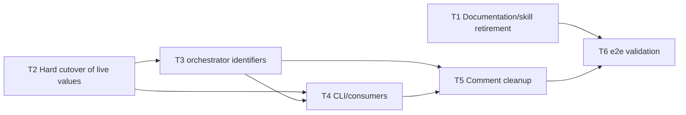

# 0029 · Hard cutover from rfc to spec naming throughout, and retirement of the rfc-driven-development skill

<!-- This file is maintained by the spec tool: frontmatter is the structured source data (including the tasks DAG), and the body is the group-level overview in the nine-section rust-RFC format. -->

## Summary

Perform a **complete, hard cutover** from all remaining `rfc` naming in the repository to `spec`, and delete the superseded `rfc-driven-development` skill directory. The scope covers four areas: (1) skills and documentation—delete `.claude/skills/rfc-driven-development/`, redirect the code-comment conventions pointer in `CLAUDE.md` to the spec skill, and refresh the prose in `README.md` and `docs/specs/README.md`; (2) code identifiers—function names (`start_rfc`/`refine_rfc`/`backfill_rfc`), constants (`STATUS_RFC_REVIEW`, `_DRAFT_RFC_TASK`), and `# RFC-NNNN` code comments in `openagents/` + `tests/`; (3) CLI subcommands—`rfc` / `refine-rfc` / `backfill-rfc`; (4) **external/persisted production values**—the GitHub label `rfc-approved`→`spec-approved`, the local status string `rfc-review`→`spec-review`, and the internal reviewer kind value `'rfc'`→`'spec'`. **No compatibility shims** (hard cutover). The only occurrences of `RFC` retained are **`RFC-NNNN` references in the bodies of historical specs / design documents**—these are frozen design records and will remain untouched.

## Motivation

**Current state: naming has diverged, and rfc is historical debt.** OpenAgents' design units were once called “RFCs” and driven by the `rfc-driven-development` skill. That workflow was later formally superseded by the `spec-driven-development` skill (spec 0014, issue #35)—the design unit was renamed “spec,” its on-disk form changed from an RFC document to `docs/specs/<NNNN-slug>.md`, and the CLI gained a standalone `spec` tool (`spec new` / `add-task` / `validate` / `render` / `graph`). However, that replacement **only changed the upper-level skill and spec toolchain; it did not clean up the remnants of the old rfc naming**. As a result, the repository is now in a divergent state where “the concept is already spec, but the naming is still rfc.” Specific remnants (verified by an inventory for this group):

- **The skill directory has not been deleted**: `.claude/skills/rfc-driven-development/` (including `SKILL.md`, `references/code-comment-conventions.md`, `rfc-template.md`, `rfc-readme-template.md`, and `verification-checklist.md`) still exists alongside `spec-driven-development`, giving agents two conflicting entry points.
- **The pointer in `CLAUDE.md` points to the wrong place**: the code conventions section says “For code comments…see `.claude/skills/rfc-driven-development/references/code-comment-conventions.md`,” pointing to the directory that is about to be deleted.
- **Prose still says RFC**: `README.md` (approximately 30+ occurrences: the “issue → RFC → PR” mental model, `rfc <issue>` and `refine-rfc <pr>` in the command reference table, the `rfc-approved` label, the `rfc-review` status, etc.) and `docs/specs/README.md` (descriptions of the rust-RFC format, etc.).
- **Code identifiers and comments**: almost every module in `openagents/` contains `# RFC-NNNN` comments; functions `start_rfc()`/`refine_rfc()`/`backfill_rfc()` (`orchestrator.py`), prompt constant `_DRAFT_RFC_TASK` (`orchestrator.py:54`), and status constant `STATUS_RFC_REVIEW` (`state.py:31`). `tests/` mirrors the same identifiers. Two live remnants **without the `# RFC-` prefix that are easy to miss**: the package-level tagline docstring `"""OpenAgents — an RFC-driven multi-agent framework."""` at `openagents/__init__.py:1` (the entire package still calls itself “RFC-driven”), and the live template text `Generated at … · RFC-0001 Decision 9` at `openagents/templates/board.html:41`, which is rendered in the board UI.
- **Live template**: `openagents/templates/board.html` is a live template rendered on the board (not a frozen body in `docs/specs/*.md`), and contains a live `RFC-0001` reference that must be cleaned up along with the live code.
- **CLI subcommands**: `openagents rfc` / `refine-rfc` / `backfill-rfc` (the parser and dispatch table in `cli.py`).
- **External/persisted production values (the most critical hard-cutover surface)**:
  - GitHub label `APPROVAL_LABEL = "rfc-approved"` (`github.py:65`)—the approval signal for unanimous PASS votes, written to GitHub, pre-created idempotently by bootstrap, and read by the messaging layer to allow entry into the implement phase.
  - Local status string `STATUS_RFC_REVIEW = "rfc-review"` (`state.py:31`)—written to local `state.json`, meaning “the draft PR is open and the spec is awaiting human review,” polled by `messages.py`, and read by routing logic in `vigil.py`.
  - Internal reviewer kind value `"rfc"` (`reviewer.py:153/194/198`, `kind="rfc"` at `orchestrator.py:340`, and `gate="rfc"` at `messages.py:250`)—selects the task template for “reviewing a spec document vs. reviewing a code diff.” Note that issue #53 already changed its **display name** to “Spec document,” but **the internal value is still `"rfc"`**; this group aligns the internal value as well.

**Why change it now, and why a hard cutover.** Divergent naming imposes a cognitive tax: when new agents / new users see `rfc` and `spec` coexist, they cannot tell which represents the current truth, and the documentation and code contradict each other. This repository is itself the product and iterates on itself using itself (the general principle in CLAUDE.md); naming consistency directly determines whether agents can align correctly. The choice of a **hard cutover without compatibility shims** over a gradual dual-track transition is because maintaining both tracks means maintaining two sets of aliases/labels/statuses, `rfc-*` and `spec-*`, which increases rather than reduces the divergence. The project is still at an early stage, with very little production data (see “Migration notes” below), so the migration cost of a one-time hard cutover is far lower than the long-term cost of maintaining shims. **Occam's razor** (CLAUDE.md design philosophy 1): do not multiply entities beyond necessity—shims are unnecessary entities.

**Two migration costs of the hard cutover (known and acceptable):**
- GitHub label `rfc-approved`→`spec-approved`: bootstrap will idempotently create the new `spec-approved` label; however, **existing open PRs already labeled `rfc-approved`** require a one-time rename/migration using `gh` (an operational step; see “One-time migration” under Reference-level).
- **In-progress `rfc-review` runs** in local `state.json` will no longer be recognized after the hard cutover (the status string changes)—this is acceptable; such runs can be recreated (by dispatching them again).

## Guide-level explanation

After the changes, the entire repository will have just one design term: **spec**. Changes visible to each role:

- **New agents / readers**: opening `CLAUDE.md`, `README.md`, or `docs/specs/README.md`, they see only `spec`; the only design skill is `spec-driven-development`, and the `rfc-driven-development` directory no longer exists, eliminating ambiguity about “which one to trust.”
- **CLI users**: subcommands such as `openagents rfc <issue>` are renamed to the `spec` family (proposed: `spec` / `refine-spec` / `backfill-spec`; see Unresolved for final names). A hard cutover means the old names disappear outright, with no aliases retained—entering an old subcommand produces “unknown command,” which is expected behavior.
- **People viewing GitHub**: the workflow label changes from `rfc-approved` to `spec-approved`; the draft PR review phase is called `spec-review` in local state (formerly `rfc-review`). The complete spec approval loop remains unchanged—unanimous PASS → automatically apply `spec-approved` → move into coding—only the label name changes.
- **Agents reading code**: design references in code comments are standardized as `# Spec-NNNN/Tn` (formerly `# RFC-NNNN`). Note that spec group numbers and old RFC numbers have a 1:1 correspondence (spec NNNN ≡ old RFC NNNN), so the numbers in comments remain unchanged; only the prefix word changes.

**RFC occurrences retained unchanged (frozen / prior-art allowlist):** Three categories of `RFC` occurrences remain as they are; changing them would distort the record—
- **Frozen design records**: `RFC-NNNN` references **in the bodies** of historical spec files (`docs/specs/0001-…0028`) and dated design documents (`docs/specs/YYYY-MM-DD-*-design.md`) record the historical fact that “it was called RFC at the time”;
- **Prior-art format name**: `rust-RFC` (the name of the nine-section format from rust-lang/rfcs, which the spec toolchain uses as its reference), concentrated in `openagents/spec/` (`model.py`/`__init__.py`/`signpost.py`) and `tests/test_spec_*`;
- **Historical symbol/file-name references**: comments recording a past rename, such as “replaces `rfc.py` from RFC-0008/RFC-0013” in `signpost.py` and “replaces `changed_rfc_path` from RFC-0008” in `tests/test_workspace.py`—these `rfc.py`/`changed_rfc_path` references are names of old files/symbols that actually existed; renaming them would rewrite history.

This group only cleans up rfc used as the **current design term** in **live code, live documentation, live templates, and production values**, leaving the three categories above untouched. This boundary between “clean up vs. retain” is **mechanically enforced** by T6's e2e allowlist (rather than relying on individual judgment); see Reference-level.

## Reference-level explanation

### Technical approach (by change surface)

**A. Documentation and skill retirement (no code behavior changes).** Delete the entire `.claude/skills/rfc-driven-development/` directory; change the pointer on the code-comment conventions line in `CLAUDE.md` from the rfc skill's `code-comment-conventions.md` to the file of the same name under the `spec-driven-development` skill; replace `RFC` with `spec` in the prose of `README.md` / `docs/specs/README.md` (mental model, command reference, label/status names, flowcharts; for command/label/status names, coordinate with the final values in B/C/D).

> **Scope statement (consistent with this group's hard constraints)**: deletion of `.claude/skills/rfc-driven-development/` is **performed during implementation**; the session drafting this spec is subject to the constraint “do not write to/modify `.claude/`,” so that directory is not touched during drafting. This spec **records the deletion action** here for an implementation Task to carry out.

**B. Hard cutover of production/persisted values (externally visible; requires coordination).** Change three values at their **definitions**, and align consumers accordingly:
- `github.py:65`: `APPROVAL_LABEL: str = "rfc-approved"` → `"spec-approved"`. The constant name `APPROVAL_LABEL` remains unchanged; `messages.py` reuses it through `messages.APPROVAL_LABEL = github.APPROVAL_LABEL`, so changing the value on **this one line alone** takes effect globally. Bootstrap's `PROCESS_LABELS` (which includes `APPROVAL_LABEL`) will idempotently create `spec-approved` through `ensure_label`.
- `state.py:31`: `STATUS_RFC_REVIEW = "rfc-review"` → rename the constant to `STATUS_SPEC_REVIEW`, with the value `"spec-review"`. This **constant name** is imported by `orchestrator.py` and `messages.py`, so the name change propagates to those two consumer files (each file's owner Task changes its import line—see file allocation; coordination relies on dependency ordering).
- Canonical reviewer kind value: in `reviewer.py`, change matching against `kind == "rfc"` to `"spec"`, and update error messages and `_KIND_LABELS` accordingly; the respective owners align the consumers, changing `kind="rfc"`→`"spec"` at `orchestrator.py:340` and `gate="rfc"`→`"spec"` at `messages.py:250`.

**C. Internal identifier renaming.** In `orchestrator.py`: `start_rfc`→`start_spec`, `refine_rfc`→`refine_spec`, `backfill_rfc`→`backfill_spec`, `_DRAFT_RFC_TASK`→`_DRAFT_SPEC_TASK`; align internal rfc identifiers in `backfill.py` as well. All callers (`cli.py`, `messages.py`, `vigil.py`, and the corresponding tests) switch to the new names.

**D. CLI subcommand renaming.** In `cli.py`: change the parser's `add_parser("rfc"|"refine-rfc"|"backfill-rfc")`, dispatch table keys, and handler function names `_cmd_rfc`/`_cmd_refine_rfc`/`_cmd_backfill_rfc` together to the spec family (see Unresolved for final subcommand names; defaults are `spec`/`refine-spec`/`backfill-spec`).

**E. Remaining rfc cleanup (live source + live templates, areas not covered by A–D).** Change `# RFC-NNNN` code comments and design docstrings/prose containing rfc to `Spec-NNNN` (keeping the numbers unchanged). Two previously missed locations are explicitly included in this group:
- The package-level tagline docstring `"""OpenAgents — an RFC-driven multi-agent framework."""` at `openagents/__init__.py:1` → `spec-driven…` (the second line's `Spec-0001` is already correct). This is the entire package's own tagline; without cleaning it up, the framework would still call itself “RFC-driven” after the hard cutover, directly contradicting the Summary's statement that “the entire repository has just one design term: spec.”
- The live template text `Generated at … · RFC-0001 Decision 9` rendered in the board UI at `openagents/templates/board.html:41` → `· Spec-0001 Decision 9`. It is rendered by `results.py` (`_TEMPLATE_PATH = templates/board.html`), so it belongs to T5 along with `results.py`, with no file-ownership overlap with other groups.

**Retained unchanged** (excluded from E's cleanup; covered by T6's allowlist): the entire `openagents/spec/` directory (the `rust-RFC` format name + issue #53/#69 history and references to the old `rfc.py`) and `tests/test_spec_*`; also historical symbol/file-name comments scattered throughout this group's files (such as “replaces `changed_rfc_path` from RFC-0008” in `tests/test_workspace.py`)—see the three retained categories under Guide-level. Inspection confirmed that `openagents/spec/signpost.py` contains only such prior-art/historical references and no live identifiers requiring renaming, so it is **not included in any Task's owns files**.

**One-time migration (operational step, not a file change):** After the hard cutover goes live, perform a one-time label migration for **existing open PRs already labeled `rfc-approved`**—run `gh label create spec-approved` (if bootstrap has not already created it), then `gh pr edit <n> --add-label spec-approved --remove-label rfc-approved` for each affected PR, followed by `gh label delete rfc-approved`. Discard and recreate in-progress local `rfc-review` runs when they can no longer be recognized. Document this step in the PR description / end-to-end script instructions, for a person to perform once at merge time.

### Task DAG and file allocation (mutually exclusive files, single writer—Principle 6)

| Task | Scope | owns files | Dependencies |
|---|---|---|---|
| T1 | Documentation and skill retirement: delete the rfc skill directory, update the pointer in `CLAUDE.md`, refresh prose in two READMEs | `CLAUDE.md`, `README.md`, `docs/specs/README.md`, `.claude/skills/rfc-driven-development/` (delete) | — |
| T2 | Hard cutover of live/persisted values: `spec-approved` label, `spec-review` status constant, reviewer kind `'spec'`, idempotent creation of the new label during bootstrap | `openagents/state.py`, `openagents/github.py`, `openagents/reviewer.py`, `tests/test_state.py`, `tests/test_github.py`, `tests/test_reviewer.py`, `tests/test_ensure_prerequisites.py` | — |
| T3 | Rename internal orchestrator/backfill identifiers + consume the new constants/kind from T2 | `openagents/orchestrator.py`, `openagents/backfill.py`, `tests/test_orchestrator.py`, `tests/test_orchestrator_pr_body.py`, `tests/test_backfill.py` | T2 |
| T4 | Rename CLI subcommands + align messages/vigil consumers (status/label/kind literals, calls to the new function names from T3) | `openagents/cli.py`, `openagents/messages.py`, `openagents/vigil.py`, `tests/test_cli.py`, `tests/test_messages.py`, `tests/test_messages_resolve.py`, `tests/test_vigil.py` | T2, T3 |
| T5 | Clean up residual rfc references (active source + active templates not covered by A–D): includes the package tagline in `__init__.py` and RFC-0001 in `board.html`; retain historical symbol comments | `openagents/__init__.py`, `openagents/e2e.py`, `openagents/workspace.py`, `openagents/rebase.py`, `openagents/results.py`, `openagents/templates/board.html`, `openagents/release.py`, `openagents/config.py`, `openagents/fleet.py`, `openagents/identity.py`, `openagents/backends/__init__.py`, `openagents/backends/base.py`, `openagents/backends/claude_code.py`, `tests/test_e2e.py`, `tests/test_workspace.py`, `tests/test_rebase.py`, `tests/test_results.py`, `tests/test_release.py`, `tests/test_config.py`, `tests/test_fleet.py`, `tests/test_identity.py`, `tests/test_base.py`, `tests/test_backend_claude_code.py` | T3, T4 |
| T6 | End-to-end validation script: grep across the repository to assert zero residual rfc references (excluding the frozen bodies of historical specs/design documents and historical e2e script filenames) | `scripts/e2e-spec-0029-rfc-to-spec.sh` | T1, T5 (T2/T3/T4 are transitive through T5; T1 requires an explicit incoming edge because it is outside the T5 chain—see below) |

> **Explanation of T6's incoming edges (transitive reduction)**: T6 directly depends on **T1 and T5**. T2/T3/T4 are transitively reachable through the `T5 → {T3,T4} → T2` chain, so they are not repeated in T6's `depends-on`. However, **T1 is outside that chain** (no Task depends on T1), and T6's acceptance criteria (1) (the rfc skill directory has been deleted) and (4) (no rfc prose in the three documentation files) directly assert T1's deliverables—if the frontmatter lists only T5, the executor may schedule T6 before T1 finishes, causing the static e2e checks to fail at (1)/(4). T1 must therefore be included as an explicit incoming edge in the frontmatter: `depends-on: [T1, T5]`.

**End-to-end validation**: `bash scripts/e2e-spec-0029-rfc-to-spec.sh`—purely static validation, with no calls to the real GitHub service. The script asserts:

1. `.claude/skills/rfc-driven-development/` does not exist;
2. `grep` finds none of the identifiers `start_rfc`/`refine_rfc`/`backfill_rfc`/`_DRAFT_RFC_TASK`/`STATUS_RFC_REVIEW` in `openagents/` + `tests/`, nor any `# RFC-` comment prefixes;
3. No live-value literals `rfc-approved` / `rfc-review` / reviewer `kind="rfc"` are found;
4. `CLAUDE.md`/`README.md`/`docs/specs/README.md` contain no pointers to the rfc skill or prose about rfc commands/labels;
5. **Broad banned-word check (a backstop, essential to consistency with “zero residual references”)**: for active `*.py`/`*.html` files in `openagents/` + `tests/`, after applying the allowlist below, a case-insensitive, word-boundary grep for `rfc` must return no matches. This specifically catches residual references **missed by** the specific identifier sets in (2)/(3)—especially `RFC-0001` in `board.html` (without a `# ` prefix) and “RFC-driven” in `__init__.py` (docstring prose). Without this check, the script would pass a repository that still describes itself as RFC-driven, making the assertion set inconsistent with the goal.

**Allowlist (preventing both false positives and missed matches; include in script comments + this section):** The following are legitimate prior art / frozen history and are excluded from assertion (5):

- The path `openagents/spec/` (the entire directory: the `rust-RFC` format name + historical accounts of issue #53/#69 + references to the old `rfc.py`);
- Files `tests/test_spec_*.py` (which mirror the same rust-RFC/historical references);
- Any line containing `rust-RFC` (defensively, in case it appears outside `spec/`);
- Historical comments recording old symbols/filenames, with the patterns `replaces …RFC-NNNN…` (legacy “replaces …RFC-NNNN…” wording) / `old rfc.py` (legacy “old rfc.py” wording) / `changed_rfc_path` (e.g. `tests/test_workspace.py:146`).

**Repository-wide exclusions** (also not counted as residual references): `RFC-NNNN` in the frozen bodies of `docs/specs/*.md`, and historical script filenames matching `scripts/e2e-rfc-*.sh` (see Unresolved; this group leaves them unchanged by default).

### File mutual-exclusivity validation

Each source/test file **requiring changes** belongs to exactly one Task, and the `files` sets are pairwise disjoint (including `openagents/__init__.py` and `openagents/templates/board.html`, newly included in this round, neither of which is owned by another Task). Inspection confirmed that `openagents/spec/signpost.py` contains only prior-art/historical references and requires no changes, so it belongs to no Task—no writer means no conflict. Cross-file symbol renames (such as the ripple effect of renaming `STATUS_RFC_REVIEW` on import lines in orchestrator/messages) are coordinated through **dependency-edge** ordering (the consuming Task `depends-on` the defining Task), rather than shared file ownership—satisfying “single writer” and remaining conflict-free in collaboration mode.

## Drawbacks

- **Extremely broad scope, touching almost the entire repository**: rfc naming permeates every module. This group is a large-scale mechanical rename, with high review costs and a high likelihood of conflicts with other in-flight PRs (it needs to be merged promptly, ahead of major changes).
- **The hard cutover breaks in-flight state**: ongoing local runs in `rfc-review` and PRs already labeled `rfc-approved` become mismatched at the moment of cutover, requiring a one-time operational migration + possible reconstruction; if migration steps are missed, a temporary failure can occur in which “the PR is stuck on the old label and the messaging layer cannot recognize it.”
- **The boundary between frozen/prior-art references and active naming requires human judgment, but a mechanical backstop now enforces it**: deciding “which `RFC-NNNN`/`rfc` occurrences are frozen body text, the `rust-RFC` format name, or historical references to old symbols/filenames that should be retained, and which are active comments/taglines/template copy that should change” inherently requires the person doing the cleanup to inspect each occurrence; a mechanical global replacement would damage frozen records. To turn this soft convention into an enforced rule (a principle), T6's broad assertion includes an **explicit allowlist** (`openagents/spec/`, `tests/test_spec_*`, `rust-RFC` lines, historical symbol comments), turning the boundary into a repeatable CI rule rather than relying solely on human judgment—both catching residual references (such as `board.html`/`__init__.py`) and protecting prior art. The allowlist itself still needs maintenance when new prior-art files are added; this remains a manual cost.
- **The rfc in e2e script filenames is outside this group's cleanup scope**: `scripts/e2e-rfc-NNNN-*.sh` still contain rfc (see Unresolved), leaving a visual inconsistency.

## Rationale and alternatives

**Why this approach (change values at their definitions + coordinate symbol ripple effects through dependency ordering + divide into 6 Tasks with mutually exclusive files).** Live values change only once, at their constant definitions; consumers reuse constants (labels) or are aligned through dependency ordering (status/kind), minimizing the drift risk from “the same string scattered across multiple places.” The 6 Tasks are partitioned by mutually exclusive files, allowing even a broad rename to proceed in parallel/sequence without conflicts in collaboration mode, with each Task having an independently verifiable acceptance boundary. Finally, the e2e grep script turns “zero residual references” from a verbal commitment **into repeatable CI assertions** (enforcing soft conventions, a principle).

**Alternative A: gradual dual-track transition + compatibility shims (retain `rfc-*` aliases/dual labels for a while).** The advantage is that it does not break in-flight state and requires no one-time migration. Reason for rejection: dual tracks require maintaining two sets of subcommands, two GitHub labels, two status strings, and their mappings simultaneously, **increasing rather than reducing naming divergence**, contrary to Occam's razor (do not multiply entities unnecessarily); moreover, this project has very little live data, so the one-time cost of a hard cutover is far below the long-term cost of maintaining shims. The issue also explicitly requires a “hard cutover without compatibility shims.”

**Alternative B: replace everything across the repository in a single Task (one writer changes all files).** The advantage is that symbol ripple effects require no coordination. Reason for rejection: this violates the design of “independently verifiable Tasks + parallel work through mutually exclusive files” (Principle 6); one enormous diff cannot be reviewed in segments or worked on in parallel, and rollback granularity is coarse. A decomposition into ≤6 Tasks already provides full coverage with clear acceptance boundaries for each part.

**Alternative C: make live values configurable (move them from constants into config, read from env/configuration files).** The advantage is that future renames would require no code changes. Reason for rejection: this group's goal is “unified naming,” not “configurable naming”; introducing a configuration layer expands scope and adds unnecessary entities. Naming is a project-level constant, and hardcoded constants + a one-time hard cutover are sufficient.

## Prior art

- **rust-lang/rfcs naming of “RFC = design unit”** is precisely where this repository's early rfc concept originated; this group does not reject that paradigm, but unifies the repository's implementation vocabulary around the already adopted `spec` (the spec toolchain already follows the rust-RFC nine-section format; this is simply naming convergence).
- **Handling large renames/terminology unification through “a single change at the definition + automated assertions as a backstop” is common engineering practice**: centralizing externally visible values in constants and using lint/grep scripts in CI to prevent old names from returning is equivalent to the “banned-words / deprecation lint” practices used in many codebases. This group's e2e grep script implements that pattern in this repository.
- **Precedent within this repository**: spec 0014 (issue #35) already completed the higher-level replacement of “rfc workflow → spec workflow”; this group **finishes cleaning up the naming remnants left by that replacement**, continuing in the same direction without introducing a new paradigm.

## Unresolved questions

- **What should the `openagents rfc` subcommands be renamed to?** Default proposal: `spec` / `refine-spec` / `backfill-spec`. Risk: `openagents spec` is semantically close to the existing standalone `spec` tool (`spec new`, etc., a separate console-script), which may confuse users about “drafting with `openagents spec` vs. managing spec groups with `spec`.” Alternative names: `draft-spec` / `refine-spec` / `backfill-spec`, or `spec-draft`. **The user must make the final decision** on the subcommand names (before implementation begins).
- **Should the historical script filenames `scripts/e2e-rfc-NNNN-*.sh` also be renamed?** These filenames embed old RFC numbers and resemble frozen historical records; however, they are active scripts (CI runs them, and PR signpost picks up `scripts/*.sh`). This group **leaves them unchanged by default** (treating them as frozen history and avoiding changes to CI references), but visible traces of rfc remain. Confirmation is needed: keep them frozen, or handle renaming and updating all references in a separate follow-up issue.
- **`# RFC-NNNN` code comments: update each occurrence or retain them as grandfathered?** The spec skill itself states that “existing `# RFC-NNNN` comments are grandfathered (spec NNNN ≡ old RFC NNNN),” but this issue lists code comments as cleanup targets. This group follows the issue's approach: “change comments in active code to `# Spec-NNNN`; freeze the body text of docs.” However, this is in tension with the skill's wording, so user confirmation is needed to adopt the issue's approach.

## Future possibilities

- **Permanently prevent rfc from returning through CI**: Promote T6's grep assertion from a one-time e2e check to a permanent CI lint check (a banned-word rule), preventing subsequent PRs from reintroducing `rfc-*` naming and making consistent naming maintainable over the long term.
- **Normalize e2e script filenames**: If the decision under Unresolved questions above is to rename `scripts/e2e-rfc-*.sh`, a separate issue can standardize script naming and update CI/signpost references.
- **Versioning/migration tools for live values**: This one-time `gh label` migration is a manual operational task; if live values need to be renamed again in the future, a small, general-purpose “label/status migration” tool could be developed to script the manual steps.
