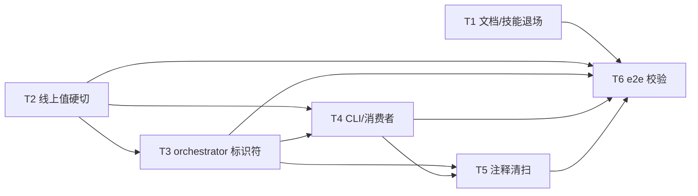

# 0029 · 统一 rfc→spec 命名硬切并退场 rfc-driven-development 技能

<!-- 本文件由 spec 工具维护：frontmatter 为结构化源数据（含 tasks DAG），正文为组级 rust-RFC 9 段总览。 -->

## Summary

把仓库里残留的 `rfc` 命名**全量、硬切**改为 `spec`，并删除已被取代的 `rfc-driven-development` 技能目录。范围覆盖四个面：(1) 技能与文档——删除 `.claude/skills/rfc-driven-development/`、把 `CLAUDE.md` 的代码注释规范指针改指向 spec 技能、刷新 `README.md` 与 `docs/specs/README.md` 散文；(2) 代码标识符——`openagents/` + `tests/` 里的函数名（`start_rfc`/`refine_rfc`/`backfill_rfc`）、常量（`STATUS_RFC_REVIEW`、`_DRAFT_RFC_TASK`）、`# RFC-NNNN` 代码注释；(3) CLI 子命令——`rfc` / `refine-rfc` / `backfill-rfc`；(4) **对外/持久化线上值**——GitHub 标签 `rfc-approved`→`spec-approved`、本地状态字符串 `rfc-review`→`spec-review`、reviewer kind 内部值 `'rfc'`→`'spec'`。**无兼容垫片**（硬切）。唯一保留的 `RFC` 字样是**历史 spec / 设计文档正文里的 `RFC-NNNN`**——它们是冻结的设计记录，不动。

## Motivation

**现状：命名已分叉，rfc 是历史负债。** OpenAgents 的设计单元曾叫「RFC」，由 `rfc-driven-development` 技能驱动；后来该流程被 `spec-driven-development` 技能（spec 0014，issue #35）正式取代——设计单元改名为「spec」，落盘形态从 RFC 文档变成 `docs/specs/<NNNN-slug>.md`，CLI 也长出了独立的 `spec` 工具（`spec new` / `add-task` / `validate` / `render` / `graph`）。但那次替换**只换了上层 skill 与 spec 工具链，没有清扫旧 rfc 命名的尾巴**。于是今天仓库处于「概念已是 spec、命名仍是 rfc」的分叉状态，具体残留（本组实测清点）：

- **技能目录未删**：`.claude/skills/rfc-driven-development/`（含 `SKILL.md`、`references/code-comment-conventions.md`、`rfc-template.md`、`rfc-readme-template.md`、`verification-checklist.md`）仍在，与 `spec-driven-development` 并存，给 agent 两套互相矛盾的入口。
- **`CLAUDE.md` 指针指错**：代码规范一节写「代码注释……详见 `.claude/skills/rfc-driven-development/references/code-comment-conventions.md`」，指向即将删除的目录。
- **散文仍说 RFC**：`README.md`（约 30+ 处：「issue → RFC → PR」心智模型、命令参考表里的 `rfc <issue>`、`refine-rfc <pr>`、`rfc-approved` 标签、`rfc-review` 状态等）与 `docs/specs/README.md`（rust-RFC 形态描述等）。
- **代码标识符与注释**：`openagents/` 几乎每个模块都带 `# RFC-NNNN` 注释；函数 `start_rfc()`/`refine_rfc()`/`backfill_rfc()`（`orchestrator.py`）、prompt 常量 `_DRAFT_RFC_TASK`（`orchestrator.py:54`）、状态常量 `STATUS_RFC_REVIEW`（`state.py:31`）。`tests/` 镜像同样的标识符。
- **CLI 子命令**：`openagents rfc` / `refine-rfc` / `backfill-rfc`（`cli.py` 的 parser 与 dispatch 表）。
- **对外/持久化线上值（最关键，硬切面）**：
  - GitHub 标签 `APPROVAL_LABEL = "rfc-approved"`（`github.py:65`）——全票 PASS 的批准信号，写到 GitHub 上、由 bootstrap 幂等预建、被消息层读取以放行 implement 阶段。
  - 本地状态字符串 `STATUS_RFC_REVIEW = "rfc-review"`（`state.py:31`）——写入本地 `state.json`、表示「draft PR 已开、spec 等人评审」，被 `messages.py` 轮询、被 `vigil.py` 分流逻辑读取。
  - reviewer kind 内部值 `"rfc"`（`reviewer.py:153/194/198`、`orchestrator.py:340` 的 `kind="rfc"`、`messages.py:250` 的 `gate="rfc"`）——选择「评 spec 文档 vs 评代码 diff」的任务模板。注意 issue #53 已把它的**展示名**改成「Spec 文档」，但**内部值仍是 `"rfc"`**，本组把内部值也对齐。

**为什么现在改、为什么硬切。** 命名分叉是认知税：新 agent / 新用户读到 `rfc`、`spec` 并存时无法判断哪个是当前真相，文档与代码互相打架。本仓库自身就是产品、靠自己迭代自己（CLAUDE.md 总体原则），命名一致性直接决定 agent 能否正确对齐。选择**硬切、无兼容垫片**而非渐进双轨，是因为：双轨意味着同时维护 `rfc-*` 与 `spec-*` 两套别名/标签/状态，恰恰加重而非减轻分叉；而本项目仍在早期、线上数据量极小（见下「迁移注意」），一次性硬切的迁移成本远低于长期维护垫片。**奥卡姆剃刀**（CLAUDE.md 设计理念 1）：如无必要，勿增实体——垫片就是不必要的实体。

**硬切的两处迁移代价（已知、可接受）：**
- GitHub 标签 `rfc-approved`→`spec-approved`：bootstrap 会幂等创建 `spec-approved` 新标签；但**现存已打 `rfc-approved` 的 open PR** 需要一次性 `gh` 重命名/迁移（运维步骤，见 Reference-level「一次性迁移」）。
- 本地 `state.json` 里**进行中的 `rfc-review` run**，硬切后读不出（状态字符串变了）——可接受，这类 run 可重建（重新派单）。

## Guide-level explanation

改完之后，整个仓库只有一个设计词汇：**spec**。各角色看到的变化：

- **新 agent / 读者**：打开 `CLAUDE.md`、`README.md`、`docs/specs/README.md`，只见 `spec`；唯一的设计技能是 `spec-driven-development`，`rfc-driven-development` 目录已不存在，不再有「该信哪个」的歧义。
- **用 CLI 的人**：`openagents rfc <issue>` 等子命令更名为 `spec` 系（拟：`spec` / `refine-spec` / `backfill-spec`，最终名见 Unresolved）。硬切意味着旧名直接消失、不保留别名——敲旧子命令会得到「未知命令」，这是预期行为。
- **看 GitHub 的人**：流程标签从 `rfc-approved` 变成 `spec-approved`；draft PR 评审阶段在本地状态里叫 `spec-review`（原 `rfc-review`）。一条 spec 评审通过的闭环不变——全票 PASS → 自动打 `spec-approved` → 转入 coding——只是标签名换了。
- **读代码的 agent**：代码注释里的设计引用统一成 `# Spec-NNNN/Tn`（原 `# RFC-NNNN`）。注意 spec 组号与旧 RFC 号 1:1 兼容（spec NNNN ≡ 旧 RFC NNNN），所以注释里的数字不变、只换前缀词。

**唯一不变的 RFC：** 历史 spec 文件（`docs/specs/0001-…0028`）和 dated 设计文档（`docs/specs/YYYY-MM-DD-*-design.md`）**正文里**的 `RFC-NNNN` 是写完即冻结的设计记录，照旧保留——它们记录的是「当时叫 RFC」的历史事实，改了反而失真。本组只清扫**活代码、活文档、线上值**里的 rfc，不动冻结历史。

## Reference-level explanation

### 技术方案（按改动面）

**A. 文档与技能退场（无代码行为变化）。** 删除 `.claude/skills/rfc-driven-development/` 整个目录；把 `CLAUDE.md` 代码注释规范一行的指针从 rfc 技能的 `code-comment-conventions.md` 改指向 `spec-driven-development` 技能下的同名文件；把 `README.md` / `docs/specs/README.md` 散文里的 `RFC`（心智模型、命令参考、标签/状态名、流程图）替换为 `spec`（涉及命令名/标签名/状态名的同步参照 B/C/D 的最终值）。

> **边界声明（与本组硬约束一致）**：删除 `.claude/skills/rfc-driven-development/` 由**实现期执行**；起草本 spec 的会话受「禁止写入/改动 `.claude/`」约束，故不在起草阶段触碰该目录。spec 在此**记录该删除动作**，由实现 Task 落地。

**B. 线上/持久化值硬切（外部可见、需协调）。** 三个值在其**定义处**改掉，消费处随之对齐：
- `github.py:65`：`APPROVAL_LABEL: str = "rfc-approved"` → `"spec-approved"`。常量名 `APPROVAL_LABEL` 不变；`messages.py` 经 `messages.APPROVAL_LABEL = github.APPROVAL_LABEL` 复用，故值改动**仅此一行**即全局生效。bootstrap 的 `PROCESS_LABELS`（含 `APPROVAL_LABEL`）会幂等 `ensure_label` 创建 `spec-approved`。
- `state.py:31`：`STATUS_RFC_REVIEW = "rfc-review"` → 重命名常量为 `STATUS_SPEC_REVIEW`、值为 `"spec-review"`。该**常量名**被 `orchestrator.py`、`messages.py` import，故名字变更会涟漪到这两个消费文件（由各自 owner Task 改 import 行——见文件分配，靠依赖排序协调）。
- reviewer kind 规范值：`reviewer.py` 把匹配 `kind == "rfc"` 改成 `"spec"`、错误信息与 `_KIND_LABELS` 同步；消费处 `orchestrator.py:340` 的 `kind="rfc"`→`"spec"`、`messages.py:250` 的 `gate="rfc"`→`"spec"` 由各自 owner 对齐。

**C. 内部标识符重命名。** `orchestrator.py`：`start_rfc`→`start_spec`、`refine_rfc`→`refine_spec`、`backfill_rfc`→`backfill_spec`、`_DRAFT_RFC_TASK`→`_DRAFT_SPEC_TASK`；`backfill.py` 内部 rfc 标识符同步。所有调用方（`cli.py`、`messages.py`、`vigil.py`、对应 tests）改用新名。

**D. CLI 子命令重命名。** `cli.py`：parser `add_parser("rfc"|"refine-rfc"|"backfill-rfc")` 与 dispatch 表 key、`_cmd_rfc`/`_cmd_refine_rfc`/`_cmd_backfill_rfc` 处理函数名一并改 spec 系（最终子命令名见 Unresolved，默认 `spec`/`refine-spec`/`backfill-spec`）。

**E. 残余 `# RFC-NNNN` 注释清扫。** 上述 A–D 未覆盖的文件里，把 `# RFC-NNNN` 代码注释与 rfc 字样 docstring 改成 `# Spec-NNNN`（数字不变）。

**一次性迁移（运维步骤，非文件改动）：** 硬切上线后，对**现存已打 `rfc-approved` 的 open PR** 执行一次性标签迁移——`gh label create spec-approved`（若 bootstrap 未先建）后，对每个受影响 PR `gh pr edit <n> --add-label spec-approved --remove-label rfc-approved`，再 `gh label delete rfc-approved`。进行中的 `rfc-review` 本地 run 读不出即丢弃重建。此步写进 PR 描述 / 端到端脚本的说明，由人在合并时执行一次。

### Task DAG 与文件分配（files 互斥，单一 writer——理念 6）

| Task | 范围 | owns files | 依赖 |
|---|---|---|---|
| T1 | 文档与技能退场：删 rfc 技能目录、改 `CLAUDE.md` 指针、刷新两处 README 散文 | `CLAUDE.md`, `README.md`, `docs/specs/README.md`, `.claude/skills/rfc-driven-development/`(删) | — |
| T2 | 线上/持久化值硬切：`spec-approved` 标签、`spec-review` 状态常量、reviewer kind `'spec'`、bootstrap 幂等建新标签 | `openagents/state.py`, `openagents/github.py`, `openagents/reviewer.py`, `tests/test_state.py`, `tests/test_github.py`, `tests/test_reviewer.py`, `tests/test_ensure_prerequisites.py` | — |
| T3 | orchestrator/backfill 内部标识符重命名 + 消费 T2 的新常量/kind | `openagents/orchestrator.py`, `openagents/backfill.py`, `tests/test_orchestrator.py`, `tests/test_orchestrator_pr_body.py`, `tests/test_backfill.py` | T2 |
| T4 | CLI 子命令重命名 + messages/vigil 消费者对齐（状态/标签/kind 字面量、调用 T3 新函数名） | `openagents/cli.py`, `openagents/messages.py`, `openagents/vigil.py`, `tests/test_cli.py`, `tests/test_messages.py`, `tests/test_messages_resolve.py`, `tests/test_vigil.py` | T2, T3 |
| T5 | 残余 `# RFC-NNNN` 注释/docstring 清扫（A–D 未覆盖的文件） | `openagents/e2e.py`, `openagents/workspace.py`, `openagents/rebase.py`, `openagents/results.py`, `openagents/release.py`, `openagents/config.py`, `openagents/fleet.py`, `openagents/identity.py`, `openagents/spec/signpost.py`, `openagents/backends/__init__.py`, `openagents/backends/base.py`, `openagents/backends/claude_code.py`, `tests/test_e2e.py`, `tests/test_workspace.py`, `tests/test_rebase.py`, `tests/test_results.py`, `tests/test_release.py`, `tests/test_config.py`, `tests/test_fleet.py`, `tests/test_identity.py`, `tests/test_base.py`, `tests/test_backend_claude_code.py` | T3, T4 |
| T6 | 端到端校验脚本：grep 全仓断言零残余 rfc（排除冻结历史 spec/设计文档正文与历史 e2e 脚本文件名） | `scripts/e2e-spec-0029-rfc-to-spec.sh` | T1, T2, T3, T4, T5 |

**端到端验证**：`bash scripts/e2e-spec-0029-rfc-to-spec.sh`——纯静态校验，不调真实 GitHub。脚本断言：(1) `.claude/skills/rfc-driven-development/` 不存在；(2) `grep` 在 `openagents/` + `tests/` 找不到 `start_rfc`/`refine_rfc`/`backfill_rfc`/`_DRAFT_RFC_TASK`/`STATUS_RFC_REVIEW` 标识符，也找不到 `# RFC-` 注释前缀；(3) 找不到线上值字面量 `rfc-approved` / `rfc-review` / reviewer `kind="rfc"`；(4) `CLAUDE.md`/`README.md`/`docs/specs/README.md` 不含指向 rfc 技能的指针或 rfc 命令/标签散文；(5) **排除项**：`docs/specs/*.md` 正文里的 `RFC-NNNN` 与 `scripts/e2e-rfc-*.sh` 历史文件名不计入残余。

### files 互斥校验

每个源文件/测试文件恰好归属一个 Task；跨文件的符号重命名（如 `STATUS_RFC_REVIEW` 改名涟漪到 orchestrator/messages 的 import 行）由**依赖边**排序协调（消费 Task `depends-on` 定义 Task），而非共享文件所有权——满足「单一 writer」与协同模式无冲突。

## Drawbacks

- **改动面极大、几乎触全仓**：rfc 命名渗透到每个模块，本组是一次大范围机械重命名，review 成本高、与其它在途 PR 冲突概率大（需尽快合并、抢在大改动前）。
- **硬切破坏在途状态**：进行中的 `rfc-review` 本地 run 与已打 `rfc-approved` 的 PR 在切换瞬间失配，需要一次性运维迁移 + 可能的重建；若迁移步骤漏执行，会出现「PR 卡在旧标签、消息层认不出」的短暂故障。
- **冻结历史与活命名的边界要人判断**：「哪些 `RFC-NNNN` 是冻结历史正文、哪些是该改的活注释」需要清扫者逐处分辨（docs/specs 正文 = 冻结；openagents/tests 代码注释 = 改），机械全局替换会误伤冻结记录。
- **e2e 脚本文件名的 rfc 不在本组清扫**：`scripts/e2e-rfc-NNNN-*.sh` 仍带 rfc（见 Unresolved），留下视觉上的不一致。

## Rationale and alternatives

**为什么这个方案（按定义处改值 + 依赖排序协调符号涟漪 + 6 Task 文件互斥分解）。** 线上值只在常量定义处改一次、消费处经常量复用（标签）或经依赖排序对齐（状态/kind），把「同一字符串散落多处」的漂移风险降到最低；6 个 Task 按文件互斥切分，让大范围重命名仍能在协同模式下无冲突并行/串行，且每个 Task 有独立可验收的边界；末尾用 e2e grep 脚本把「零残余」从口头承诺**硬化成可复跑的 CI 断言**（软约定硬化，理念）。

**备选 A：渐进双轨 + 兼容垫片（保留 `rfc-*` 别名/双标签一段时间）。** 优点是不破坏在途状态、无需一次性迁移。否决理由：双轨要同时维护两套子命令、两个 GitHub 标签、两个状态字符串及其相互映射，**加重而非减轻命名分叉**，与奥卡姆剃刀（如无必要勿增实体）相悖；且本项目线上数据量极小，硬切的一次性成本远低于长期垫片维护成本。issue 也明确要求「硬切无兼容垫片」。

**备选 B：单 Task 一把梭全仓替换（一个 writer 改所有文件）。** 优点是无需协调符号涟漪。否决理由：违反「Task 独立可验收 + 文件互斥并行」的设计（理念 6），单个巨型 diff 不可分段 review、不可并行、失败回滚粒度粗；且 ≤6 Task 的分解已能覆盖且每段清晰可验收。

**备选 C：把线上值改成可配置（从常量提到 config，读 env/配置文件）。** 优点是未来再改名无需动代码。否决理由：本组目标是「统一命名」而非「让命名可配置」，引入配置层是范围蔓延、增加不必要的实体；命名是项目级常量，硬编码常量 + 一次性硬切已足够。

## Prior art

- **rust-lang/rfcs 的「RFC = 设计单元」命名**正是本仓库早期 rfc 概念的来源；本组不是否定该范式，而是把本仓库的落地词汇统一到已采用的 `spec`（spec 工具链已对标 rust-RFC 9 段形态，只是命名收敛）。
- **大型重命名/术语统一靠「定义处单点改 + 自动化断言兜底」是工程通行做法**：把外部可见值集中到常量、用 lint/grep 脚本在 CI 里禁止旧名复活，等价于很多代码库的「banned-words / deprecation lint」实践。本组的 e2e grep 脚本即此模式在本仓库的落地。
- **本仓库内部先例**：spec 0014（issue #35）已完成「rfc 流程 → spec 流程」的上层替换；本组是那次替换**未清扫的命名尾巴的收尾**，沿用同一方向，不引入新范式。

## Unresolved questions

- **`openagents rfc` 子命令更名为什么？** 默认提案 `spec` / `refine-spec` / `backfill-spec`。风险：`openagents spec` 与已存在的独立 `spec` 工具（`spec new` 等，另一个 console-script）在语义上相邻，可能让用户混淆「`openagents spec` 起草 vs `spec` 管理 spec 组」。备选名：`draft-spec` / `refine-spec` / `backfill-spec`，或 `spec-draft`。**需用户拍板**最终子命令名（实现期之前确定）。
- **`scripts/e2e-rfc-NNNN-*.sh` 历史脚本文件名是否一并改名？** 这些文件名嵌入了旧 RFC 编号，类似冻结历史记录；但它们是活脚本（CI 会跑、PR signpost 会拾取 `scripts/*.sh`）。本组**默认不改**（计入冻结历史、避免动 CI 引用），但视觉上残留 rfc。需确认：保持冻结，还是单独后续 issue 处理改名 + 更新所有引用。
- **`# RFC-NNNN` 代码注释：逐处改 vs 保留 grandfathered？** spec 技能本身写「现有 `# RFC-NNNN` 注释 grandfathered（spec NNNN ≡ 旧 RFC NNNN）」，但本 issue 把代码注释列为清扫目标。本组按 issue 取「活代码注释改为 `# Spec-NNNN`、docs 正文冻结」，但此点与 skill 措辞存在张力，需用户确认采纳 issue 口径。

## Future possibilities

- **CI 永久禁止 rfc 复活**：把 T6 的 grep 断言从一次性 e2e 提升为常驻 CI lint（banned-word 规则），防止后续 PR 再引入 `rfc-*` 命名，让「统一命名」长期可维护。
- **e2e 脚本文件名规范化**：若上面 Unresolved 拍板要改 `scripts/e2e-rfc-*.sh`，可起单独 issue 统一脚本命名 + 更新 CI/signpost 引用。
- **线上值版本化/迁移工具**：本次的一次性 `gh label` 迁移是手工运维；未来若再有线上值改名，可沉淀一个通用的「标签/状态迁移」小工具，把手工步骤脚本化。

