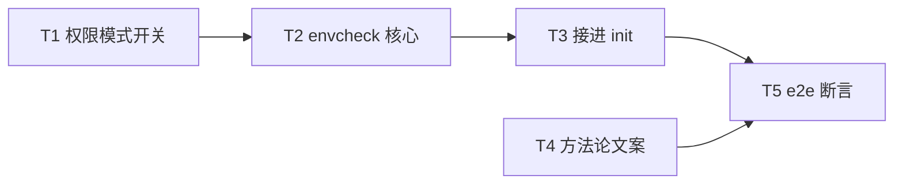

# 0030 · init 环境体检：检测 browser MCP 与权限放行（非阻塞）+ 前端 e2e 方法论引导

<!-- 本文件由 spec 工具维护：frontmatter 为结构化源数据（含 tasks DAG），正文为组级 rust-RFC 9 段总览。 -->

## Summary

理念 8「以成果为中心、模型替人做端到端测试」要求前端类 issue 的真正验证落到浏览器自动化（Playwright / Chrome DevTools MCP）。但「装了 MCP 插件」≠「守夜派出的 agent 真能用上浏览器」——经核对 OpenAgents 调 claude 的方式（`openagents/backends/claude_code.py`）存在两道关卡，默认只过第一道。本组在 `openagents init` 的 preflight 里加一段**非阻塞的环境能力体检**：(1) 读 `~/.claude.json` 检测 browser MCP（`playwright` / `chrome-devtools`）是否已注册；(2) 读 OpenAgents 派 claude 时的**有效权限模式**是否为全放行（`bypassPermissions`）。任一缺失只**打印警告 + 安装/设置方式**，绝不阻断 init（后端类项目本就用不上浏览器）。同时——按理念 10 解耦、不让编排核心耦合 MCP——把「**具备浏览器工具就优先设计前端浏览器 e2e**」的**条件式方法论引导**写进 OpenAgents 自己的 **in-code 方法论面**（起草 spec 的 prompt 模板 `orchestrator.py:_DRAFT_RFC_TASK` + reviewer rubric `reviewer.py`），由 agent 自检自己的工具决定是否适用。**只检测 + 提示 + 方法论文案**：不自动改 MCP 配置、不自动改权限、不在后端适配器注入「你有浏览器能力」、不在本组驱动浏览器跑断言（后者留作后续单独 issue）。

## Motivation

**现状两道关卡（就地复述，来源：`openagents/backends/claude_code.py`）。** OpenAgents 的 vigil/orchestrator 派单时，通过 `ClaudeCodeBackend._run_claude_streaming` 以子进程非交互（headless / `-p`）方式调 claude，命令行恒为：

```
claude -p <prompt> --permission-mode acceptEdits --output-format stream-json --verbose
```

其中权限模式硬编码为模块级常量 `_PERMISSION_MODE = "acceptEdits"`，且**未传** `--mcp-config` / `--strict-mcp-config`、**未传** `--allowedTools`。由此推出两道关卡：

1. **工具可见（默认✅通过）**：未传 `--mcp-config` / `--strict-mcp-config`，claude 会**继承用户级** `~/.claude.json` 里注册的 MCP server。所以只要用户在自己机器上 `claude mcp add` 过 playwright / chrome-devtools，派出去的 agent 的工具列表里就有 `browser_*` 工具。
2. **权限放行（默认❌不通过）**：`acceptEdits` 只自动放行**文件编辑**类工具；而 `-p` 非交互模式下，未被显式允许的工具调用会被**直接拒绝**（headless 不弹窗确认）。于是 agent 真去调 `browser_*` / `mcp__playwright__*` 大概率被 **deny**。

**后果与排查成本。** 用户以为「装了 MCP 就能在守夜里跑前端 e2e」，实际跑起来才发现要么根本没装 MCP（工具不可见），要么工具调用被静默拒（权限没放行）。两种失败都发生在派单数分钟之后、且无显式报错指向根因，排查成本高。

**为什么放在 init。** init 是用户绑定项目、做 preflight 的唯一入口（`openagents/cli.py:_cmd_init` → `openagents/config.py:ensure_project` / `_bootstrap` 的交互体检模式已是既有范式）。在这里**提前**把「缺工具 / 缺放行」体检出来并给出设置方式，是把踩坑从「跑了几分钟才发现」前移到「init 的几秒内告知」，成本最低。

**为什么「前端优先浏览器 e2e」是方法论、不是编排逻辑。** 真正的诉求是「让 agent 在设计成果测试时优先用浏览器验前端」。这是**方法论**，不该塞进编排核心：(1) 派出去的 `claude -p` agent **本来就知道自己有哪些工具**（browser MCP 工具就在它的工具列表里），OpenAgents 再往 prompt 里宣告一遍「你有浏览器能力」是**冗余**，且越界替 agent 管理它自己的工具认知，与「agent 去中心化、OpenAgents 只编排」相悖；(2) 把「检测 MCP→改 prompt」塞进编排核心，会让与后端无关的编排层**耦合到具体 MCP 生态**，违背理念 10。所以引导应是**条件式、由 agent 自检**的方法论文案（「如果你具备浏览器工具，就优先……」），落在方法论层而非后端适配器。

## Guide-level explanation

**体检在 init 里长这样（非阻塞）。** 用户在一个项目目录里跑 `openagents init`，既有的 preflight 跑完、打印 `✓ 项目已就绪：…` 之后，紧接着多出一段环境体检输出。全部通过时安静收尾（一行 OK 或无额外噪音）；有缺失时打印对应警告与设置方式，**但 init 仍正常返回 0**：

```text
✓ 项目已就绪：/path/to/repo（远端：git@github.com:owner/repo.git）

▶ 前端 e2e 环境体检（非阻塞，仅 claude-code 后端）
  ⚠ 未检测到 browser MCP（playwright / chrome-devtools 均未在 ~/.claude.json 注册）
    前端浏览器 e2e 需要浏览器自动化工具。安装方式：
      claude mcp add playwright -s user -- npx @playwright/mcp@latest
      claude mcp add chrome-devtools -s user -- npx chrome-devtools-mcp@latest
      npx playwright install chromium
  ⚠ 当前权限模式为 acceptEdits（非全放行 bypassPermissions）
    headless 非交互下 browser MCP 工具调用会被直接拒绝 → 前端浏览器 e2e 将无法运行。
    要可靠跑起来需全放行（移除无人值守安全栏杆，请知悉取舍后再开）：
      export OPENAGENTS_PERMISSION_MODE=bypassPermissions
  提示：以上为非阻塞告知；后端类项目无需浏览器，可忽略。
```

两项都满足时：

```text
▶ 前端 e2e 环境体检（非阻塞，仅 claude-code 后端）
  ✓ browser MCP 已注册：playwright, chrome-devtools
  ✓ 权限模式 bypassPermissions（全放行）：browser MCP 工具调用可被放行
```

**用户的选择权。** 体检只「告知」，不替用户做激进决定：它不自动 `claude mcp add`、不自动写 `~/.claude.json`、不自动把权限改成全放行。是否安装 MCP、是否开全放行（`export OPENAGENTS_PERMISSION_MODE=bypassPermissions`，本组新增的最小开关，默认仍 `acceptEdits`）都由用户读完取舍后自己决定。

**方法论引导在 agent 那侧长这样。** 当 OpenAgents 派 agent 起草 spec（`rfc` / vigil 起草段）或派 reviewer 评审 PR 时，注入的任务 prompt 里多出一条**条件式**指引（措辞示例）：

> 如果你具备浏览器工具（如 Playwright / Chrome DevTools MCP），就**优先设计基于浏览器的前端 e2e**（导航 / 交互 / 截图 / 断言 / console·network 检查），而不是仅声明 shell 脚本或跳过；是否具备由你自检自己的工具列表决定。

reviewer 侧同理：评成果测试时，若被评 PR 是前端改动且作者具备浏览器工具，rubric 要求它检查「是否优先设计了浏览器 e2e 而非仅声明脚本」。**OpenAgents 不检测 MCP、不替 agent 宣告能力**——条件成立与否由 agent 自检，天然后端无关。

## Reference-level explanation

### 技术方案

**(A) 体检核心模块 `openagents/envcheck.py`（新增，纯函数、无副作用、read-only）。** 解耦设计（理念 10）：本模块只读文件 / 读环境变量并返回结构化结果，不碰 git/github/state，便于单测打桩。三个能力：

- `detect_browser_mcp()` → 读 `~/.claude.json`（用户家目录，`Path.home() / ".claude.json"`），解析顶层 `mcpServers` 的 key 集合，返回 `playwright` / `chrome-devtools` 各自是否在册。文件不存在 / 非法 JSON / 无 `mcpServers` 键 → 视为「均未注册」（不抛）。**只读不写**——绝不修改 `~/.claude.json`（也呼应全局硬约束「不写 .claude」，本模块连读都只读家目录的 `~/.claude.json`，不碰仓库 `.claude/`）。
  - 备选数据源 `claude mcp list`（子进程）：更权威但慢、依赖 claude 在 PATH、难 hermetic 测；故**默认走读 `~/.claude.json`**，`claude mcp list` 不在本组实现（见 Unresolved questions）。
- `effective_permission_mode()` → 复用 **(B)** 在 `claude_code.py` 暴露的同名访问器（单一真相源：体检报告的权限模式必须等于派单实际用的模式，否则告知会撒谎）。
- `render_report(*, mcp, permission_mode)` → 把上面两项结果渲染成上文 Guide-level 展示的那段文本（含缺失项的安装命令 / `export` 设置方式 / 取舍提示）。**纯函数返回字符串**，由调用方（init）打印；本模块不直接 print，便于测断言文本。

体检是**非阻塞**的：`envcheck` 只返回报告文本与「是否全通过」布尔，**从不抛异常、从不返回非零**，init 拿到后只 `print`，不据此改变退出码。

**(B) 最小权限模式开关 `openagents/backends/claude_code.py`。** 把硬编码常量 `_PERMISSION_MODE = "acceptEdits"` 改为从环境变量解析的小函数 `effective_permission_mode()`：读 `OPENAGENTS_PERMISSION_MODE`，缺省回退 `"acceptEdits"`（**默认行为不变**——非侵入），`_run_claude_streaming` 改用它拼 `--permission-mode`。这是让体检的「设置方式」**真正可操作**的最小开关（理念 8 风险/取舍里「(a) 用户按提示开全放行」必须有处可设，否则告知是空头支票），也是 envcheck 权限检测的单一真相源。**不**引入配置文件、不引入第二个旋钮（奥卡姆）；env 旋钮与既有 `OPENAGENTS_REVIEWERS`（`reviewer.py`）同款最小可配集风格。

**(C) 把体检接进 init `openagents/cli.py:_cmd_init`。** 在既有 `github.ensure_prerequisites()` + `print("✓ 项目已就绪…")` 之后，追加调用 `envcheck` 渲染并 `print` 报告。体检不改变 `_cmd_init` 返回值（恒 `return 0`，除非既有 preflight 自身失败）。仅此一处接线，编排核心（vigil/orchestrator）不感知体检。

**(D) 条件式方法论文案落 in-code 方法论面。** 两处 prompt 模板各加一条**条件式、由 agent 自检**的引导句（不检测 MCP、不在后端适配器 `claude_code.py` 注入）：

- 起草侧 `openagents/orchestrator.py`：`_DRAFT_RFC_TASK`（据 issue 起草 spec）与 `_BACKFILL_RFC_TASK`（反推 spec）追加一句「设计成果测试时，若具备浏览器工具，优先设计浏览器前端 e2e」。这是**起草 spec 的方法论注入点**——本仓库里它是 in-repo 可编辑面，承担 issue 所说「写进 spec/RFC 起草 skill」的等价职责（见下「关于 `.claude/` 边界」）。
- 评审侧 `openagents/reviewer.py`：`_CODE_REVIEW_TASK` / `_RUBRIC_TAIL` 追加一句「若被评为前端改动且作者具备浏览器工具，检查是否优先设计了浏览器 e2e 而非仅声明脚本」。这正是 issue 所说「reviewer rubric」，且 rubric 就在代码里（`reviewer.py`），可直接编辑。

> **关于 `.claude/` 边界（重要）。** issue 原文把方法论落点写作「spec/RFC 起草的 **skill**」与「reviewer rubric」。本仓库存在**全局硬约束：禁止写入 / 改动 `.claude/` 目录下任何内容**，而 spec 起草 skill 的文档恰在 `.claude/skills/spec-driven-development/`。故本组**不写 `.claude/`**，改把同等的条件式引导落到 OpenAgents 自己的 **in-code 方法论面**：`orchestrator.py` 的起草 prompt 模板（驱动起草 agent 的方法论注入点）+ `reviewer.py` 的 rubric。二者都是 in-repo 可编辑、后端无关、且正是「方法论层」而非后端适配器拼接——既守住硬约束，又达成 issue 的真实诉求。`.claude/` 下 skill 文档的同步留作仓库维护者人工处理（见 Unresolved questions）。

### Task DAG 与文件分配（files 互斥，单一 writer——理念 6）

| Task | 范围 | owns files | 依赖 |
|---|---|---|---|
| T1 | 权限模式最小开关：`_PERMISSION_MODE` 常量 → `effective_permission_mode()`（读 `OPENAGENTS_PERMISSION_MODE`，默认 acceptEdits 不变） | `openagents/backends/claude_code.py`, `tests/test_backend_claude_code.py` | — |
| T2 | 体检核心模块：`detect_browser_mcp` / `effective_permission_mode`（转调 T1）/ `render_report`，纯函数 read-only 不抛 | `openagents/envcheck.py`, `tests/test_envcheck.py` | T1 |
| T3 | 把体检接进 init：`_cmd_init` 末尾渲染并打印报告，不改退出码 | `openagents/cli.py`, `tests/test_cli.py` | T2 |
| T4 | 条件式 browser-e2e 方法论文案：起草 prompt 模板 + reviewer rubric | `openagents/orchestrator.py`, `openagents/reviewer.py`, `tests/test_orchestrator.py`, `tests/test_reviewer.py` | — |
| T5 | e2e 脚本：断言体检在缺失/满足两态下的输出，与方法论文案已注入两处模板 | `scripts/e2e-spec-0030-init-env-check.sh` | T3, T4 |



T1↔T4 互不依赖，可并行起步；T4 与 T1/T2/T3 文件完全不相交（`orchestrator.py` / `reviewer.py` vs `claude_code.py` / `envcheck.py` / `cli.py`）。

### 端到端验证

`bash scripts/e2e-spec-0030-init-env-check.sh`——hermetic、不调真实 claude / GitHub。脚本断言：

1. **体检渲染**：以打桩的 `~/.claude.json`（无 mcpServers）+ 默认权限，调 `envcheck.render_report`（或经临时 `HOME` 跑 `openagents init` 的体检段），输出含 `playwright` 安装命令、含「非全放行」警告与 `export OPENAGENTS_PERMISSION_MODE=bypassPermissions`；
2. **满足态**：打桩 `~/.claude.json` 含 `playwright` + `chrome-devtools`、`OPENAGENTS_PERMISSION_MODE=bypassPermissions`，输出含两条 `✓`、不含安装命令；
3. **非阻塞**：缺失态下 init 段不致使整体非零退出（断言退出码 0 / 体检不抛）；
4. **方法论文案**：grep `openagents/orchestrator.py` 与 `openagents/reviewer.py`，确认两处模板均含条件式「具备浏览器工具 → 优先浏览器前端 e2e」字样。

脚本路径写进本段，供 PR 的 e2e 指路牌（`signpost`）抽取贴进 PR 正文（理念 8）。

## Drawbacks

- **claude-code 专属、非后端无关**：体检读 `~/.claude.json` 与 claude 的权限模式语义，绑定 claude-code 后端；codex / nexau 有各自的工具可见性 / 权限机制，本组不强绑（保持理念 10 的「针对 claude-code 后端」边界，其它后端另行处理）。体检文案显式标注「仅 claude-code 后端」以免误导。
- **推荐全放行移除安全栏杆**：体检把 `bypassPermissions` 作为「让 browser MCP 在 headless 下确实能跑」的推荐路径，代价是移除无人值守的安全栏杆，且与默认自动 merge 叠加后风险更大（全放行的 agent 半夜自动改、自动合）。本组只能「把取舍讲清、把选择权留给用户」，无法在告知层面消除该风险。
- **体检只告知、不闭环**：真正让前端 e2e 跑起来还需配套——(a) 用户按提示开全放行、安装 MCP；(b) 守夜成果测试环节实际驱动浏览器跑断言（**单独 issue**，不在本组）。本组交付「告知 + 方法论引导」，不交付「跑」，存在「体检全绿但 e2e 仍未真正被驱动」的预期落差。
- **方法论文案与 `.claude/` skill 文档可能漂移**：本组把引导落到 in-code 模板，`.claude/skills/` 下 skill 文档因硬约束不在本组同步；二者措辞可能短期不一致，需仓库维护者人工对齐。
- **`~/.claude.json` 结构假设**：检测依赖 claude 当前以顶层 `mcpServers` 存 MCP 注册；若 claude 改了配置 schema，检测会失准（退化为「均未注册」误报）。属外部依赖的固有成本。

## Rationale and alternatives

**选「init 非阻塞体检 + in-code 方法论文案 + 最小权限 env 开关」**，是因为它在最早入口（init 数秒内）把两道关卡讲清、不阻断后端类项目、不替用户做激进决定，同时用一个与既有 `OPENAGENTS_REVIEWERS` 同款的最小 env 开关让「设置方式」真正可操作；方法论引导落 in-code 模板既守住 `.claude/` 硬约束、又避免编排核心耦合 MCP（理念 10）。

- **备选 A：阻塞式体检（缺工具 / 缺放行就让 init 失败或强制确认）**——能逼用户当场处理，但后端类项目根本用不上浏览器，阻断纯属误伤；与 issue「非阻塞、不阻断 init」明确冲突。否决。
- **备选 B：OpenAgents 检测到 MCP 后，往派单 agent 的 prompt 里注入「你有浏览器能力，请用浏览器测」**——看似直接，但 (1) agent 本就知道自己有哪些工具，宣告冗余且越界替 agent 管认知；(2) 把「检测 MCP→改 prompt」塞进编排/后端适配器，使编排层耦合具体 MCP 生态，违背理念 10。改用「条件式、由 agent 自检」的方法论文案规避。否决。
- **备选 C：本组直接自动开全放行（把默认权限模式改成 `bypassPermissions`）**——能让 browser MCP 开箱即跑，但单方面移除安全栏杆是激进决定，且与自动 merge 叠加风险大；issue 明确「不自动改权限，改不改由用户决定」。故只提供默认 `acceptEdits` 的 opt-in 开关 + 告知。否决。
- **备选 D：不加权限 env 开关，体检只打印一段「如何手动改」的说明**——更省代码，但「设置方式」无处落地（用户无法真正开全放行，除非改 OpenAgents 源码），告知沦为空头支票；最小 env 开关是让告知可操作的最小代价。否决。
- **备选 E：检测数据源用 `claude mcp list` 子进程而非读 `~/.claude.json`**——更权威，但慢、依赖 claude 在 PATH、难 hermetic 测；读 `~/.claude.json` 已足够判断「是否注册」，故默认读文件，`claude mcp list` 留作后续增强。否决（默认）。

## Prior art

- **「装好后做环境体检 / doctor」是 CLI 工具通行做法**：`flutter doctor`、`brew doctor`、`npx playwright install`（安装后校验浏览器二进制）等都在「安装 / 初始化后给一段能力体检 + 缺啥提示啥」，且多为非阻塞告知。本组把该惯例落到 `openagents init`。
- **本仓库内部先例**：`openagents/config.py` 的 `ensure_project` / `_bootstrap` 已是「init 时交互体检缺失项（缺 git / 缺 remote）并给补齐方式」的范式；本组的环境体检是同一范式在「缺 browser MCP / 缺放行」维度的延伸。`reviewer.py` 的 `OPENAGENTS_REVIEWERS` 是「最小 env 旋钮、缺省取默认」的内部先例，本组权限开关沿用同款。
- **Playwright / Chrome DevTools MCP 的安装命令**来源于其官方注册方式（`claude mcp add <name> -s user -- npx <pkg>@latest`），体检原样复述给用户，不自创命令。
- 两道关卡的事实依据见 `openagents/backends/claude_code.py` 现有实现（`_PERMISSION_MODE = "acceptEdits"`、未传 `--mcp-config` / `--allowedTools`、headless `-p` 调用）——本组据实复述，不引入新行为假设。

## Unresolved questions

- **检测数据源是否要补 `claude mcp list`**：默认读 `~/.claude.json` 足以判断注册与否；是否再加 `claude mcp list` 子进程做交叉校验（覆盖「在 project / local scope 注册」的情形）留待实现期或后续 issue 按需求决定。
- **`.claude/` skill 文档的同步**：本组因全局硬约束不写 `.claude/`，spec 起草 skill 文档里的同款条件式引导由仓库维护者人工补齐（或另起一个不受本约束限制的流程）；本组只保证 in-code 方法论面（`orchestrator.py` / `reviewer.py`）落地。
- **权限模式取值校验范围**：`OPENAGENTS_PERMISSION_MODE` 是否限定枚举（acceptEdits / bypassPermissions / …）并对非法值告警，还是原样透传给 claude 由其报错，留待实现期定（倾向最小：透传，仅在体检里识别 `bypassPermissions` 为「全放行」）。
- **体检默认是否对纯后端项目静默**：当前设计是「全通过则一两行 OK」；是否进一步在检测到项目无前端迹象时整段跳过，留作后续优化（本组先做无条件非阻塞告知）。

## Future possibilities

- **守夜成果测试实际驱动浏览器**（单独 issue）：体检告知 + 方法论引导就位后，下一步让 `e2e.py` / reviewer 在成果测试环节真正调浏览器跑导航 / 断言 / 截图——这是「以成果为中心」闭环的运行时一侧，本组只做前置告知。
- **后端无关的能力体检框架**：把「browser MCP 体检」抽象成「后端能力探针」接口，让 codex / nexau 各自实现自己的工具可见性 / 权限探针，体检层只编排、不绑某一后端。
- **init 体检联动自动安装**（需用户显式同意）：在保持非侵入前提下，提供一个 opt-in 的 `--fix` 让 init 在用户确认后代跑 `claude mcp add` / 改权限，把「告知」升级为「一键就绪」。
- **体检结果进成果看板**：把「browser MCP / 权限就绪度」作为一项展示进 `results.py` 的本地看板，让「这个项目能不能跑前端 e2e」一眼可见。

