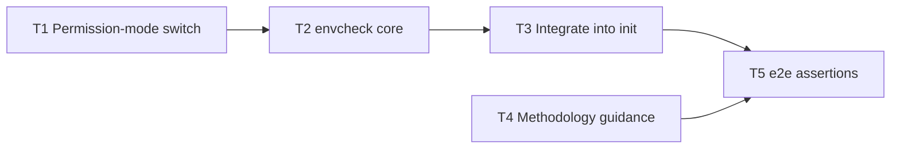

# 0030 · init environment health check: detect browser MCP and permission approval (non-blocking) + guidance on frontend e2e methodology

<!-- This file is maintained by the spec tool: frontmatter is the structured source data (including the tasks DAG), and the body is a group-level overview in the nine-section rust-RFC format. -->

## Summary

Principle 8, “Focus on outcomes; have the model perform end-to-end testing for the user,” requires actual verification of frontend issues through browser automation (Playwright / Chrome DevTools MCP). But “the MCP plugin is installed” ≠ “an agent dispatched by Vigil can actually use the browser”—inspection of how OpenAgents invokes claude (`openagents/backends/claude_code.py`) reveals two gates, only the first of which is passed by default. This group adds a **non-blocking environment capability health check** to the `openagents init` preflight: (1) read `~/.claude.json` to detect whether browser MCP (`playwright` / `chrome-devtools`) is registered; (2) read the **effective permission mode** used when OpenAgents dispatches claude to determine whether it allows everything (`bypassPermissions`). If either is missing, **only print a warning + installation/setup instructions**, never block init (backend projects have no need for a browser in the first place). At the same time—in accordance with Principle 10 on decoupling, keeping the orchestration core independent of MCP—add **conditional methodological guidance** to “**prioritize designing frontend browser e2e tests when browser tools are available**” to OpenAgents’ own **in-code methodology surfaces** (the spec-drafting prompt template `orchestrator.py:_DRAFT_RFC_TASK` + the reviewer rubric in `reviewer.py`), with the agent inspecting its own tools to decide whether it applies. **Detection + guidance + methodology text only**: do not automatically change MCP configuration, do not automatically change permissions, do not inject “you have browser capabilities” into the backend adapter, and do not drive a browser to run assertions in this group (the latter is reserved for a separate follow-up issue).

## Motivation

**The two current gates (restated here; source: `openagents/backends/claude_code.py`).** When OpenAgents’ vigil/orchestrator dispatches tasks, it invokes claude through `ClaudeCodeBackend._run_claude_streaming` as a non-interactive subprocess (headless / `-p`), always with this command line:

```
claude -p <prompt> --permission-mode acceptEdits --output-format stream-json --verbose
```

The permission mode is hardcoded as the module-level constant `_PERMISSION_MODE = "acceptEdits"`, and **neither** `--mcp-config` / `--strict-mcp-config` **nor** `--allowedTools` is passed. This yields two gates:

1. **Tool visibility (passes by default ✅)**: because `--mcp-config` / `--strict-mcp-config` is not passed, claude **inherits user-level** MCP servers registered in `~/.claude.json`. Thus, as long as the user has run `claude mcp add` for playwright / chrome-devtools on their machine, the dispatched agent’s tool list includes `browser_*` tools.
2. **Permission approval (fails by default ❌)**: `acceptEdits` automatically approves only **file-editing** tools; in `-p` non-interactive mode, tool calls that have not been explicitly allowed are **rejected outright** (headless mode does not display a confirmation prompt). As a result, when the agent actually calls `browser_*` / `mcp__playwright__*`, it will very likely receive a **deny**.

**Consequences and troubleshooting cost.** Users assume that “installing MCP lets frontend e2e run in Vigil,” only to discover during an actual run that either MCP was never installed (tools are invisible) or tool calls are silently rejected (permissions were not approved). Both failures occur several minutes after dispatch, with no explicit error pointing to the root cause, making troubleshooting costly.

**Why this belongs in init.** init is the sole entry point for users to associate a project and run preflight checks (the interactive health-check mode in `openagents/cli.py:_cmd_init` → `openagents/config.py:ensure_project` / `_bootstrap` is already an established pattern). Detecting “missing tools / missing approval” **in advance** here and providing setup instructions moves discovery from “after running for several minutes” to “notification within the few seconds of init,” at the lowest cost.

**Why “prioritize browser e2e for frontend work” is methodology, not orchestration logic.** The actual need is to “have agents prioritize browser-based frontend verification when designing outcome tests.” This is **methodology** and should not be inserted into the orchestration core: (1) a dispatched `claude -p` agent **already knows which tools it has** (the browser MCP tools are in its tool list); having OpenAgents announce “you have browser capabilities” again in the prompt is **redundant** and oversteps by managing the agent’s awareness of its own tools, contrary to “decentralized agents; OpenAgents only orchestrates”; (2) inserting “detect MCP → modify prompt” into the orchestration core would **couple the backend-independent orchestration layer to a specific MCP ecosystem**, violating Principle 10. The guidance should therefore be **conditional methodology text, with the agent checking for itself** (“If you have browser tools, prioritize…”), placed in the methodology layer rather than the backend adapter.

## Guide-level explanation

**What the health check looks like in init (non-blocking).** A user runs `openagents init` in a project directory. After the existing preflight finishes and prints `✓ Project ready: …`, an additional environment health-check section immediately follows. If all checks pass, it finishes quietly (one OK line or no additional noise); if anything is missing, it prints the corresponding warning and setup instructions, **but init still returns 0 normally**:

```text
✓ Project ready: /path/to/repo (remote: git@github.com:owner/repo.git)

▶ Frontend e2e environment health check (non-blocking, claude-code backend only)
  ⚠ No browser MCP detected (neither playwright nor chrome-devtools is registered in ~/.claude.json)
    Frontend browser e2e requires browser automation tools. To install:
      claude mcp add playwright -s user -- npx @playwright/mcp@latest
      claude mcp add chrome-devtools -s user -- npx chrome-devtools-mcp@latest
      npx playwright install chromium
  ⚠ Current permission mode is acceptEdits (not unrestricted bypassPermissions)
    In headless non-interactive mode, browser MCP tool calls are rejected outright → frontend browser e2e cannot run.
    Reliable execution requires unrestricted permissions (this removes unattended-operation safety guardrails; understand the tradeoff before enabling):
      export OPENAGENTS_PERMISSION_MODE=bypassPermissions
  Note: the above is a non-blocking notice; backend projects do not need a browser and may ignore it.
```

When both conditions are met:

```text
▶ Frontend e2e environment health check (non-blocking, claude-code backend only)
  ✓ Browser MCP registered: playwright, chrome-devtools
  ✓ Permission mode bypassPermissions (unrestricted): browser MCP tool calls can be approved
```

**User choice.** The health check only “informs”; it does not make aggressive decisions on the user’s behalf: it does not automatically run `claude mcp add`, write `~/.claude.json`, or change permissions to unrestricted. Whether to install MCP and whether to enable unrestricted permissions (`export OPENAGENTS_PERMISSION_MODE=bypassPermissions`, the minimal switch introduced by this group, with `acceptEdits` remaining the default) are decisions users make themselves after reading the tradeoffs.

**What the methodological guidance looks like on the agent side.** When OpenAgents dispatches an agent to draft a spec (`rfc` / the Vigil drafting stage) or dispatches a reviewer to review a PR, the injected task prompt includes an additional **conditional** instruction (example wording):

> If you have browser tools (such as Playwright / Chrome DevTools MCP), **prioritize designing browser-based frontend e2e tests** (navigation / interaction / screenshots / assertions / console·network checks), rather than merely declaring shell scripts or skipping them; determine availability yourself by inspecting your own tool list.

The reviewer side follows the same approach: when reviewing outcome tests, if the PR under review contains frontend changes and the author has browser tools, the rubric requires checking “whether browser e2e was prioritized in the design rather than merely declaring scripts.” **OpenAgents does not detect MCP or declare capabilities on the agent’s behalf**—the agent checks whether the condition holds, making this inherently backend-independent.

## Reference-level explanation

### Technical approach

**(A) Core health-check module `openagents/envcheck.py` (new, pure functions, no side effects, read-only).** Decoupled design (Principle 10): this module only reads files / environment variables and returns structured results; it does not touch git/github/state, making it easy to stub in unit tests. Three capabilities:

- `detect_browser_mcp()` → read `~/.claude.json` (the user’s home directory, `Path.home() / ".claude.json"`), parse the set of keys in the top-level `mcpServers`, and return whether `playwright` / `chrome-devtools` is registered individually. Missing file / invalid JSON / missing `mcpServers` key → treat as “neither registered” (do not raise). **Read only, never write**—never modify `~/.claude.json` (also consistent with the global hard constraint “do not write .claude”; even reads in this module are limited to `~/.claude.json` in the home directory, without touching the repository’s `.claude/`).
  - Alternative data source: `claude mcp list` (subprocess). More authoritative, but slow, dependent on claude being on PATH, and difficult to test hermetically; therefore **read `~/.claude.json` by default**. `claude mcp list` is not implemented in this group (see Unresolved questions).
- `effective_permission_mode()` → reuse the accessor with the same name exposed in `claude_code.py` by **(B)** (single source of truth: the permission mode reported by the health check must equal the mode actually used for dispatch; otherwise the notice would be misleading).
- `render_report(*, mcp, permission_mode)` → render the two results above into the text shown in Guide-level explanation (including installation commands for missing items / `export` setup instructions / tradeoff notices). **A pure function returning a string**, printed by the caller (init); this module does not print directly, making text assertions easy to test.

The health check is **non-blocking**: `envcheck` only returns report text and an “all checks passed” boolean, **never raises exceptions, and never returns a nonzero status**; init only calls `print` on the result and does not change its exit code based on it.

**(B) Minimal permission-mode switch in `openagents/backends/claude_code.py`.** Replace the hardcoded constant `_PERMISSION_MODE = "acceptEdits"` with a small environment-variable parsing function, `effective_permission_mode()`: read `OPENAGENTS_PERMISSION_MODE`, falling back to `"acceptEdits"` when unset (**default behavior remains unchanged**—non-intrusive), and change `_run_claude_streaming` to use it when constructing `--permission-mode`. This is the minimal switch that makes the health check’s “setup instructions” **actually actionable** (Principle 8’s risks/tradeoffs item “(a) users enable unrestricted permissions as instructed” must have somewhere to configure it, or the notice would be an empty promise), and it is also the single source of truth for envcheck’s permission detection. Introduce **no** configuration file and no second knob (Occam’s razor); the environment-variable knob follows the same minimally configurable style as the existing `OPENAGENTS_REVIEWERS` (`reviewer.py`).

**(C) Wire the health check into init at `openagents/cli.py:_cmd_init`.** After the existing `github.ensure_prerequisites()` + `print("✓ Project ready…")`, append a call to `envcheck` to render and `print` the report. The health check does not change `_cmd_init`’s return value (always `return 0`, unless the existing preflight itself fails). This is the only integration point; the orchestration core (vigil/orchestrator) is unaware of the health check.

**(D) Place conditional methodology text in the in-code methodology surfaces.** Add **conditional guidance, with the agent checking for itself**, to the prompt templates in two places (do not detect MCP; do not inject it into the backend adapter `claude_code.py`):

- Drafting side, `openagents/orchestrator.py`: append to `_DRAFT_RFC_TASK` (draft a spec from an issue) and `_BACKFILL_RFC_TASK` (derive a spec retrospectively) a sentence saying, “When designing outcome tests, if browser tools are available, prioritize designing browser-based frontend e2e tests.” This is the **methodology injection point for drafting specs**—in this repository, it is an editable in-repo surface that fulfills the equivalent role of the issue’s “write it into the spec/RFC drafting skill” (see “About the `.claude/` boundary” below).
- Review side, `openagents/reviewer.py`: append to `_CODE_REVIEW_TASK` / `_RUBRIC_TAIL` a sentence saying, “If the change under review is classified as a frontend change and the author has browser tools, check whether browser e2e was prioritized in the design rather than merely declaring scripts.” This is precisely the “reviewer rubric” described in the issue, and the rubric lives in code (`reviewer.py`), where it can be edited directly.

> **About the `.claude/` boundary (important).** The original issue specifies the methodology destinations as the “spec/RFC drafting **skill**” and “reviewer rubric.” This repository has a **global hard constraint: writing or modifying anything under `.claude/` is prohibited**, while the spec-drafting skill documentation happens to reside in `.claude/skills/spec-driven-development/`. Therefore, this group **does not write to `.claude/`**, instead placing equivalent conditional guidance in OpenAgents’ own **in-code methodology surfaces**: the drafting prompt templates in `orchestrator.py` (the methodology injection point driving the drafting agent) + the rubric in `reviewer.py`. Both are editable in-repo, backend-independent, and precisely in the “methodology layer” rather than assembled in the backend adapter—upholding the hard constraint while meeting the issue’s actual need. Synchronizing the skill documentation under `.claude/` is left for repository maintainers to handle manually (see Unresolved questions).

### Task DAG and file assignment (mutually exclusive files, single writer—Principle 6)

| Task | Scope | owns files | Dependencies |
|---|---|---|---|
| T1 | Minimal permission-mode switch: `_PERMISSION_MODE` constant → `effective_permission_mode()` (reads `OPENAGENTS_PERMISSION_MODE`; the default remains acceptEdits) | `openagents/backends/claude_code.py`, `tests/test_backend_claude_code.py` | — |
| T2 | Core environment-check module: `detect_browser_mcp` / `effective_permission_mode` (delegates to T1) / `render_report`; pure functions, read-only, no exceptions raised | `openagents/envcheck.py`, `tests/test_envcheck.py` | T1 |
| T3 | Integrate the environment check into init: render and print the report at the end of `_cmd_init`, without changing the exit code | `openagents/cli.py`, `tests/test_cli.py` | T2 |
| T4 | Conditional browser-e2e methodology guidance: drafting prompt template + reviewer rubric | `openagents/orchestrator.py`, `openagents/reviewer.py`, `tests/test_orchestrator.py`, `tests/test_reviewer.py` | — |
| T5 | e2e script: assert the environment-check output in both the missing-prerequisites and satisfied-prerequisites states, and verify that the methodology guidance has been injected into both templates | `scripts/e2e-spec-0030-init-env-check.sh` | T3, T4 |



T1↔T4 have no dependencies on each other and can start in parallel; T4's files are entirely disjoint from those of T1/T2/T3 (`orchestrator.py` / `reviewer.py` vs `claude_code.py` / `envcheck.py` / `cli.py`).

### End-to-end validation

`bash scripts/e2e-spec-0030-init-env-check.sh`—hermetic, with no calls to real claude / GitHub. The script asserts:

1. **Environment-check rendering**: with a stubbed `~/.claude.json` (no mcpServers) + default permissions, call `envcheck.render_report` (or run the environment-check portion of `openagents init` with a temporary `HOME`); the output contains the `playwright` installation command, a “permissions are not fully unrestricted” warning, and `export OPENAGENTS_PERMISSION_MODE=bypassPermissions`;
2. **Satisfied state**: with a stubbed `~/.claude.json` containing `playwright` + `chrome-devtools` and `OPENAGENTS_PERMISSION_MODE=bypassPermissions`, the output contains two `✓` marks and no installation commands;
3. **Non-blocking behavior**: in the missing-prerequisites state, the init portion does not cause an overall nonzero exit (assert exit code 0 / no exception raised by the environment check);
4. **Methodology guidance**: grep `openagents/orchestrator.py` and `openagents/reviewer.py` to confirm that both templates contain conditional wording to the effect of “browser tools available → prioritize browser-based frontend e2e.”

The script path is included in this section so that the PR's e2e signpost (`signpost`) can extract it and insert it into the PR body (Principle 8).

## Drawbacks

- **Specific to claude-code, not backend-agnostic**: the environment check reads `~/.claude.json` and uses claude's permission-mode semantics, tying it to the claude-code backend; codex / nexau have their own tool-visibility / permission mechanisms, which this work does not force into the same model (preserving Principle 10's boundary of “for the claude-code backend”; other backends will be handled separately). The environment-check messages explicitly state “claude-code backend only” to avoid misleading users.
- **Recommending unrestricted permissions removes safety guardrails**: the environment check recommends `bypassPermissions` as the way to “ensure browser MCP can actually run in headless mode.” The cost is removing safety guardrails for unattended operation, with greater risk when combined with automatic merge by default (an agent with unrestricted permissions automatically makes changes and merges them overnight). This work can only “explain the tradeoff clearly and leave the choice to the user”; informing users cannot eliminate this risk.
- **The environment check only informs; it does not close the loop**: actually getting frontend e2e running also requires (a) the user to enable unrestricted permissions and install MCP as prompted; (b) the Vigil result-testing stage to actually drive a browser and run assertions (**a separate issue**, outside this work). This work delivers “notification + methodology guidance,” not “execution,” leaving a potential expectation gap where “all environment checks are green, but e2e is still not actually being driven.”
- **Methodology guidance may drift from `.claude/` skill documents**: this work places the guidance in in-code templates; because of a hard constraint, synchronizing skill documents under `.claude/skills/` is outside its scope. Their wording may differ temporarily, requiring repository maintainers to align them manually.
- **Assumption about the structure of `~/.claude.json`**: detection relies on claude currently storing MCP registrations in the top-level `mcpServers` field; if claude changes its configuration schema, detection will become inaccurate (degrading into false reports that “none are registered”). This is an inherent cost of an external dependency.

## Rationale and alternatives

**The choice of “non-blocking environment check during init + in-code methodology guidance + minimal permission environment-variable switch”** explains both gates at the earliest entry point (within seconds during init), avoids blocking backend-oriented projects, and avoids making aggressive decisions on the user's behalf. At the same time, a minimal environment-variable switch patterned after the existing `OPENAGENTS_REVIEWERS` makes the “configuration method” actionable. Placing methodology guidance in in-code templates both respects the hard constraint on `.claude/` and avoids coupling the orchestration core to MCP (Principle 10).

- **Alternative A: a blocking environment check (fail init or require confirmation when tools / unrestricted permissions are missing)**—this could force users to address the issue immediately, but backend-oriented projects have no use for a browser, so blocking them would cause needless collateral damage; it directly conflicts with the issue's explicit requirement for “non-blocking behavior that does not block init.” Rejected.
- **Alternative B: after detecting MCP, OpenAgents injects “you have browser capabilities; please test using a browser” into the prompt of the agent receiving the task**—this seems direct, but (1) the agent already knows which tools it has, making the declaration redundant and overstepping into managing the agent's awareness; (2) placing “detect MCP → modify prompt” in the orchestration / backend adapter couples the orchestration layer to a specific MCP ecosystem, violating Principle 10. Conditional methodology guidance that leaves the agent to check its own capabilities avoids this instead. Rejected.
- **Alternative C: automatically enable unrestricted permissions as part of this work (change the default permission mode to `bypassPermissions`)**—this would let browser MCP run out of the box, but unilaterally removing safety guardrails is an aggressive decision, with substantial risk when combined with automatic merge; the issue explicitly states “do not change permissions automatically; the user decides whether to change them.” Therefore, provide only an opt-in switch with `acceptEdits` as the default, plus notification. Rejected.
- **Alternative D: add no permission environment-variable switch, and have the environment check print only instructions for “how to change it manually”**—this saves more code, but leaves no actionable way to apply the setting (users cannot actually enable unrestricted permissions unless they modify the OpenAgents source), reducing the notification to an empty promise; the minimal environment-variable switch is the smallest cost of making the notification actionable. Rejected.
- **Alternative E: use a `claude mcp list` subprocess as the detection data source instead of reading `~/.claude.json`**—more authoritative, but slow, dependent on claude being in PATH, and difficult to test hermetically; reading `~/.claude.json` is sufficient to determine “whether registered,” so file reading is the default, with `claude mcp list` left as a future enhancement. Rejected (as the default).

## Prior art

- **“Run an environment check / doctor after installation” is common practice for CLI tools**: `flutter doctor`, `brew doctor`, `npx playwright install` (validating browser binaries after installation), and others all provide “a capability check after installation / initialization, with prompts for whatever is missing,” and most provide non-blocking notifications. This work applies that convention to `openagents init`.
- **Precedents within this repository**: `ensure_project` / `_bootstrap` in `openagents/config.py` already follow the pattern of “interactively checking for missing prerequisites during init (missing git / missing remote) and explaining how to supply them”; this work's environment check extends the same pattern to “missing browser MCP / missing unrestricted permissions.” `OPENAGENTS_REVIEWERS` in `reviewer.py` is an internal precedent for a “minimal environment-variable knob that uses the default when unset”; this work's permission switch follows the same pattern.
- **The Playwright / Chrome DevTools MCP installation commands** come from their official registration method (`claude mcp add <name> -s user -- npx <pkg>@latest`); the environment check repeats them verbatim for users rather than inventing commands.
- The factual basis for the two gates is the existing implementation in `openagents/backends/claude_code.py` (`_PERMISSION_MODE = "acceptEdits"`, no `--mcp-config` / `--allowedTools` passed, headless `-p` invocation)—this work restates those facts without introducing assumptions about new behavior.

## Unresolved questions

- **Whether to supplement the detection data source with `claude mcp list`**: reading `~/.claude.json` by default is sufficient to determine whether registration exists; whether to add a `claude mcp list` subprocess for cross-checking (covering registration at project / local scope) remains to be decided during implementation or in a subsequent issue, according to need.
- **Synchronizing `.claude/` skill documents**: because of a global hard constraint, this work does not write to `.claude/`; repository maintainers must manually add the equivalent conditional guidance to the spec-drafting skill documents (or initiate a separate process not subject to this constraint). This work guarantees only that the in-code methodology guidance (`orchestrator.py` / `reviewer.py`) is implemented.
- **Scope of permission-mode value validation**: whether `OPENAGENTS_PERMISSION_MODE` should be restricted to an enumeration (acceptEdits / bypassPermissions / …) with warnings for invalid values, or passed through unchanged to claude to report errors, remains to be decided during implementation (the preference is minimal: pass it through, and recognize only `bypassPermissions` as “unrestricted permissions” in the environment check).
- **Whether the environment check should be silent by default for backend-only projects**: the current design is “one or two OK lines if all checks pass”; whether to go further and skip the entire section when no signs of a frontend are detected is left as a future optimization (this work starts with unconditional, non-blocking notification).

## Future possibilities

- **Actually driving a browser during Vigil result testing** (separate issue): once environment-check notifications + methodology guidance are in place, the next step is for `e2e.py` / the reviewer to actually invoke a browser during result testing to perform navigation / assertions / screenshots—this is the runtime side of closing the “results-centered” loop; this work provides only advance notification.
- **A backend-agnostic capability-check framework**: abstract the “browser MCP environment check” into a “backend capability probe” interface, letting codex / nexau each implement their own tool-visibility / permission probes, while the environment-check layer only orchestrates and is not tied to a particular backend.
- **Automatic installation linked to the init environment check** (requires explicit user consent): while remaining nonintrusive, provide an opt-in `--fix` that lets init run `claude mcp add` / change permissions on the user's behalf after confirmation, upgrading “notification” to “one-click readiness.”
- **Environment-check results in the results dashboard**: display “browser MCP / permission readiness” as an item in the local dashboard in `results.py`, making it clear at a glance “whether this project can run frontend e2e.”
