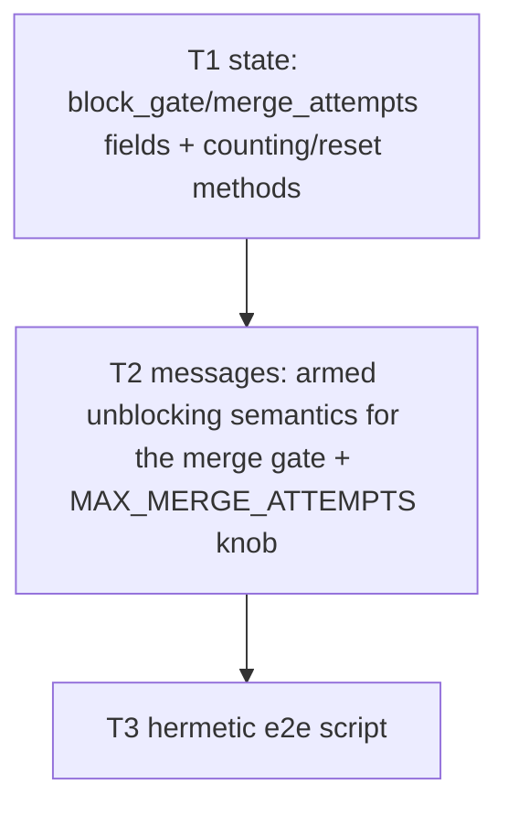

# 0031 · Redesigning merge gate resumption semantics: dispatch an agent to actively resolve conflicts after human resumption, with bounded retries before suspending again

<!-- This file is maintained by the spec tool: the frontmatter is the structured source data (including the tasks DAG), and the body is a nine-section group-level rust-RFC overview. -->

## Summary

Redesign the “resumption” semantics of the merge gate (`gate=merge`, where the PR has actual conflicts with base). Today, when a person removes the `needs-human`
label to let the agent retry, the next poll returns to the code gate, where the **passive mergeability precheck** again reports `CONFLICTING` and **immediately
calls `_block` again to restore `needs-human`**—“remove label → resume → immediately suspend again.” This is effectively a no-op and creates an endless loop.

This group separates “a person actively resumes a merge conflict” from “the system first discovers a conflict” into two entry paths: **first discovery** retains the current behavior
(try agent conflict resolution once; if it fails, post a notice and suspend, leaving human intervention as the fallback); **after human resumption**, enter **armed mode**
—give the agent a **bounded retry budget** (a new knob, `OPENAGENTS_MAX_MERGE_ATTEMPTS`, default 3), and dispatch the agent once per poll
to actively resolve conflicts (rebase/semantic conflict resolution/push, reusing Spec-0028’s `conflict.make_resolver`).
Call `_block` again only when the budget is exhausted and conflicts remain. This makes “removing the label” actually mean “let the agent try to resolve it,” instead of “reset
the counters, passively recheck, and lock it back down in the same round.” Changes are confined to the messages routing layer and the state counter layer: **do not rewrite Git conflict resolution logic,
do not change the `needs-human` literal, and strictly preserve the human fallback**.

## Motivation

**Background (restated here rather than carried by a bare reference)**: OpenAgents is an RFC/spec-driven multi-agent framework. The watcher
(`messages.Messages.poll`) periodically scans all runs with open statuses and routes GitHub events by phase:
reconcile merges/closures first, then proceed through either the **rfc review gate** (a draft PR carries the RFC) or the **code gate**
(the `coding` phase), depending on the run’s phase. Both review gates share `_block` as their fallback for stalled runs: after several rounds without passing → set `STATUS_BLOCKED`
+ apply the `needs-human` label (`= BLOCKED_LABEL`, literal `"needs-human"`, with its single source in `github.py`)
+ **leave the PR open**. `STATUS_BLOCKED` is not in `_OPEN_STATUSES`, so the next poll skips that run (soft suspension), waiting for a person
to intervene based on the label.

**Resumption is already supported**: blocked runs are still included in each scan (issue #49). In the blocked branch of `_process_run`,
if the PR is still open but a person has removed `needs-human` (meaning “I’ve handled it; continue”), `reset_rounds`
resets the counters to zero, and the run resumes processing in the `pr-open` / `rfc-review` phase depending on whether it has passed the RFC gate (returning the event `"resumed"`);
if the label remains, the run stays suspended.

**The problem is in the merge gate path**. Before running the reviewer, the code gate’s `_process_coding` performs a **mergeability precheck**
(Spec-0022): if `github.mergeability` returns `DIRTY` or `CONFLICTING`, it is treated as an actual conflict. Spec-0028 added a layer of
**agent semantic conflict resolution** here: on a conflict, first try the injected `resolve = self._make_resolver()` (on success, do not
block in this round; wait for CI to be rescheduled in the next round), **trying only once**; only if `resolve=None` or resolution fails, post `rebase.CONFLICT_COMMENT`
+ `_block(gate="merge")`.

The resulting endless loop looks like this: a person removes `needs-human` → this poll’s blocked branch calls `reset_rounds` and restores
`pr-open` (returning `"resumed"`) → **the next poll** returns to `_process_coding`, whose **first step is again the passive mergeability
precheck** → nobody has resolved the conflict, so it is still `CONFLICTING` → `resolve` tries once (cannot resolve it / was not injected) → **immediately
call `_block` to reapply `needs-human`**. To the person, it feels like “I just removed it, and it put itself right back.”

**Why this is specific to the merge gate**: rfc / code review rejections suspend a run only after **accumulating `MAX_ROUNDS` (default 3) rounds**—after removing
the label, `reset_rounds` resets the counters, allowing several more rounds. Merge conflicts, however, **suspend immediately and suspend again immediately**—they do not consume
the `rounds` budget at all; `resolve` is tried only once before `_block`. Thus, for the merge gate, “remove label → reset_rounds” is
**a no-op** (the merge path does not read rounds), making resumption semantics ineffective.

**Expected behavior**: removing `needs-human` for a merge conflict should mean “**let the agent actively try to resolve it**,” rather than merely “reset
the counters and passively recheck.” After resumption, **dispatch the agent to actively attempt conflict resolution** (rebase onto the latest target, semantically resolve conflicts
that can be resolved, and push), then return to the normal gate. Suspend again to wait for a person only after the agent itself has tried **several times**
and still cannot resolve the conflict.

**Source example**: in an actual run, three parallel spec PRs conflicted with each other because they shared `docs/specs/OVERVIEW.md` (the
aggregate index whose entire table is rerendered by `spec render`). After `needs-human` was applied, removing the label caused it to be immediately reapplied, preventing the agent from retrying on its own—this
was the direct trigger for this issue.

## Guide-level explanation

After implementation, when a person removes the `needs-human` label from a PR suspended because of merge conflicts, the experience becomes:

1. **This poll**: the blocked branch detects that the label has been removed and that the run was suspended because of merge conflicts (`block_gate == "merge"`)
   → resume and **arm** it: reset the merge conflict resolution budget `merge_attempts` to zero, restore `pr-open`, and **retain
   `block_gate="merge"` as the armed marker**. Return the event `"resumed"`. This round performs **no** passive precheck and does **not** suspend again.
2. **Next poll**: return to the code gate’s `_process_coding`, where the precheck still reports `CONFLICTING`. Because `block_gate == "merge"`
   and the status is now `pr-open` (this combination can only result from “merge resumption”; see the state-machine argument in Reference-level explanation),
   → enter **armed mode**: dispatch the agent once to resolve conflicts (reusing Spec-0028’s `resolve`).
   - **Resolved** → push, return `"resolved"` for this round, and clear armed state (`block_gate=""`, `merge_attempts=0`);
     in the next round, CI is rescheduled because of `synchronize`, and the PR proceeds naturally.
   - **Not resolved** → `merge_attempts += 1`; if **below** `MAX_MERGE_ATTEMPTS` (default 3) → return the nonblocking
     event `"merge-retry"`, **keep `pr-open`, and do not suspend again**; wait for the next poll to dispatch another attempt (bounded retries across rounds, giving
     the agent “several” opportunities to actually act). If **the limit has been reached** → only then post `CONFLICT_COMMENT` + `_block(gate="merge")`
     to suspend again and wait for a person (the human fallback is retained).

Compare this with today: the first round after resumption performs a passive precheck → immediately suspends again. Under the new behavior, resumption actually hands the agent “**several attempts
at active conflict resolution**,” returning to a person only after the agent repeatedly fails to resolve the conflict.

The experience on **first discovering a conflict** (that is, the run has never previously been suspended by the merge gate, `block_gate != "merge"`) **remains unchanged**: try
`resolve` once; if it fails, post a notice and suspend—quickly hand the initial situation back to a person to decide (who can then choose to “remove the label and let the agent try
several more times,” using the armed entry path above).

The environment knob `OPENAGENTS_MAX_MERGE_ATTEMPTS` (default 3) controls the conflict resolution retry limit in armed mode. It sits alongside
`OPENAGENTS_MAX_ROUNDS` (review rounds) and `OPENAGENTS_MAX_REVIEW_RETRIES` (invalid-review retries);
the three budgets are independent.

## Reference-level explanation

### Core mechanism: use `block_gate` to distinguish entry paths and `merge_attempts` for bounded retries

Introduce two `RunRecord` fields (both with defaults, for backward compatibility with old `state.json` files missing these keys):

| Field | Type | Meaning |
|---|---|---|
| `block_gate` | `str = ""` | Which gate caused the most recent `_block` suspension (`"rfc"`/`"code"`/`"merge"`/`*-unparseable`). The merge gate uses this to determine “armed” state; it also provides observability. |
| `merge_attempts` | `int = 0` | Number of agent conflict resolution retries consumed within the armed window (analogous to `rounds`/`review_invalid`, with an independent budget). |

**Key invariant (no additional Boolean flag needed)**: the combination of `block_gate == "merge"` and `status == pr-open` **can only
result from “a person resuming a run suspended because of merge conflicts.”** Argument:

- When an ordinary new run enters `pr-open`, `block_gate == ""` (it has never been blocked).
- `_block(gate="merge")` sets `block_gate` to `"merge"` **and simultaneously** sets status to `blocked`—blocked is not in
  `_OPEN_STATUSES`, so poll never routes it into `_process_coding`. Therefore, the state “`block_gate=="merge"` and still blocked”
  can never trigger the armed logic.
- The only path that can return a run with `block_gate=="merge"` to `pr-open` is “person removes label →
  resume” in the blocked branch.

Therefore, within the merge gate, `record.block_gate == "merge"` (where the status must be `pr-open`) means “armed.” **The state machine itself guarantees
that this is unambiguous; no additional `armed` Boolean field is needed** (principle 1, Occam).

### Changes (by file)

**`openagents/state.py`** (T1):

- Add `block_gate: str = ""` and `merge_attempts: int = 0` to `RunRecord` (the defaults ensure that constructing `RunRecord` with `**` unpacking of
  an old record does not raise an error).
- Add `set_block_gate(*, issue_number, gate)`: persist a run’s `block_gate` (used by `_block` for bookkeeping and by the resumption
  branch to determine the entry path); `gate=""` clears it (used when clearing armed state).
- Add `increment_merge_attempts(*, issue_number) -> int`: mirror `increment_rounds`, persisting
  `merge_attempts += 1` and returning the new value (`record.get("merge_attempts", 0)` provides a fallback for old records).
- Have `reset_rounds` reset `merge_attempts` to zero at the same point (the same lifecycle as `rounds`/`review_invalid`: cleared on resumption /
  implement; all three budgets are independent). **Note: `reset_rounds` does not touch `block_gate`**—`block_gate` is
  the armed marker, explicitly managed by the resumption branch and the merge gate through `set_block_gate` (see below).

**`openagents/messages.py`** (T2):

- **New knob**: `OPENAGENTS_MAX_MERGE_ATTEMPTS` (default 3); add `_configured_max_merge_attempts()`
  + the module constant `MAX_MERGE_ATTEMPTS`, mirroring the existing `_configured_max_rounds` conventions for reading, fallbacks, and
  monkeypatching exactly.
- **`_block`**: while applying the label and setting blocked status, call `state.set_block_gate(gate=gate)` to persist the entry path (follow
  issue #47’s “GitHub side effects first, state afterward”: `add_label` → `update_status(blocked)` →
  `set_block_gate`).
- **`_process_run` blocked branch** (resumption): after a person removes the label, read `record.block_gate`—
  - `== "merge"`: **arm**. Call `reset_rounds` (also clearing `merge_attempts` to provide the full budget), restore
    `pr-open`, and **retain `block_gate="merge"`**. Return `"resumed"`.
  - `!= "merge"`: retain the current behavior (`reset_rounds` + restore `pr-open`/`rfc-review` according to APPROVAL_LABEL),
    and call `set_block_gate(gate="")` to clear any residual value (preventing `"rfc"`/`"code"` from causing the wrong determination of a subsequent merge entry path). Return `"resumed"`.
- **`_process_coding` mergeability precheck conflict branch**: check `block_gate == "merge"` (armed) and split into two branches—
  - **armed**: first try `resolve` (when injected). On success → `set_block_gate(gate="")` + `reset` the budget → return
    `"resolved"`. On failure / `resolve is None`:
    - If `resolve is None` (no backend, so retries are pointless) → directly post `CONFLICT_COMMENT` + `_block(gate="merge")`
      (fall back to a person without spinning).
    - Otherwise, `n = increment_merge_attempts()`; `n < MAX_MERGE_ATTEMPTS` → return `"merge-retry"`, keep
      `pr-open`, and **do not suspend again** (retry across rounds); `n >= MAX_MERGE_ATTEMPTS` → `CONFLICT_COMMENT` +
      `_block(gate="merge")` (suspend again, setting `block_gate` to "merge" again so that the next human resumption can arm it again).
  - **not armed (first discovery)**: **preserve Spec-0028’s current behavior byte for byte**—try `resolve` once; on success, `"resolved"`;
    on failure, `CONFLICT_COMMENT` + `_block(gate="merge")` (this `_block` sets `block_gate` to "merge", preparing the armed entry path
    for future human resumption).

Add a new poll event `reason` value: `"merge-retry"` (this round retried in armed mode, did not suspend, and is waiting for the next round). The semantics of `"resolved"`
(already present in Spec-0028), `"resumed"`, and `"unmergeable"`/`"blocked"` remain unchanged.

### Strict zero-regression invariants

- A fresh run whose `block_gate` has always been `""` (never suspended by the merge gate) → takes the “non-armed / first discovery” branch, with behavior
  **byte-for-byte identical to Spec-0028 today**.
- `MAX_MERGE_ATTEMPTS` does not affect `MAX_ROUNDS` or the invalid-review retry logic for the rfc/code gates (independent budgets, independent knobs).
- The `needs-human` literal, its gating meaning in release prechecks, and `_block` semantics of “keep the PR open + soft suspension” all remain unchanged.
- `resolve is None` (manual `sync-prs` without backend injection, old test fixtures) → armed mode falls back directly to `_block`,
  just as on first discovery, without pointlessly retrying.

### DAG + file allocation

| Task | Title | files | Dependencies |
|---|---|---|---|
| T1 | state: `block_gate`/`merge_attempts` fields + counting/reset methods | `openagents/state.py`, `tests/test_state_merge_unblock.py` | — |
| T2 | messages: armed unblocking semantics for the merge gate + `MAX_MERGE_ATTEMPTS` knob | `openagents/messages.py`, `tests/test_messages_merge_unblock.py` | T1 |
| T3 | hermetic e2e script (no network, no real LLM/gh access) | `scripts/e2e-spec-0031-merge-unblock-agent-resolve.sh` | T1, T2 |

`files` are mutually exclusive within the group (single-writer ownership, principle 6). **Only dedicated test files are deliberately added** (`test_state_merge_unblock.py`
/ `test_messages_merge_unblock.py`), leaving the existing `tests/test_state.py` / `tests/test_messages.py` /
`tests/test_messages_resolve.py` unchanged—both preserving mutually exclusive `files` within the group and minimizing the scope for shared-file conflicts
across parallel PRs (this issue was itself triggered by shared-file conflicts, so we should practice what we preach). `openagents/conflict.py` (Spec-0028) is **reused unchanged**
—this group does not rewrite Git conflict-resolution logic at the messages layer (boundary, principle 10: decoupling).

**e2e script path**: `scripts/e2e-spec-0031-merge-unblock-agent-resolve.sh` (hermetic, in two parts: ① ruff
check + format --check + pytest for deterministic offline verification; ② fake `github.has_label`/`mergeability` +
fake `resolve` for a closed-loop exercise of the entire state trajectory, “first discovery → suspension → human unblocking arms the run → bounded armed retries → exhaustion and resuspension,” with
no network access, no real LLM calls, and no real gh access throughout).

New code comments at every layer must identify this group’s spec id (`Spec-0031/Tn`) according to the code-comment conventions.

## Drawbacks

- **One more knob and two state fields**: increases the state and configuration surface. Mitigation: fields have defaults for backward compatibility; the knob mirrors
  the two existing `_configured_*` knobs with exactly the same structure, keeping cognitive overhead low; using one `block_gate` field + state-machine invariants instead of “adding
  another armed boolean” already reduces the number of new entities to a minimum (principle 1).
- **Armed mode consumes more tokens**: each poll dispatches a coding agent to resolve conflicts, up to `MAX_MERGE_ATTEMPTS` times.
  Mitigation: ① bounded (default 3); ② triggered only after **explicit human unblocking** (the human actively expresses “let the agent try”), rather than the system initiating
  unlimited retries on its own; ③ no pointless retrying when `resolve is None` (manual sync-prs without backend injection).
- **Risk of the agent repeatedly resolving conflicts incorrectly**: conflict resolution may be wrong. Mitigation: reuse the existing Spec-0028 `conflict.resolve_branch`
  safeguards: “ruff+pytest self-test gating + double-checking for remaining conflict markers; if resolution fails, fall back with `merge --abort`”—better to leave a conflict unresolved than to resolve it incorrectly
  and silently push; this group does not relax that gate.
- **Retries across polling cycles increase the wall-clock time from “unblocking → actual progress”**: armed retries span cycles at the poll interval; in the worst case, it takes
  `MAX_MERGE_ATTEMPTS` intervals before handing the run back to a human. Mitigation: this is a tradeoff between “giving the agent a real chance” and “returning to a human quickly”;
  the first-discovery path still suspends quickly, and only explicit human unblocking enters slower retries, matching the human’s intent.

## Rationale and alternatives

**Why use `block_gate == "merge"` as the armed marker instead of adding an `armed` boolean field**: the state-machine invariants already guarantee
that “`block_gate=="merge"` and a return to `pr-open`” can only result from unblocking the merge gate (see the Reference-level reasoning); adding
a boolean would be a redundant entity (principle 1). Also, `block_gate` recording “which gate suspended the run” has observability value in its own right (readable in logs/dashboards),
so one field serves two purposes.

**Why use an independent `MAX_MERGE_ATTEMPTS` knob instead of reusing `MAX_ROUNDS`**: the issue explicitly says “reuse/**follow the example of** MAX_ROUNDS.”
The reason for choosing “follow the example” (an independent knob) over “reuse” (the same counter): merge conflict-resolution retries and review rounds are budgets of **different kinds**
(one counts the agent’s attempts to resolve Git conflicts; the other counts iterations requested by a reviewer). Combining them would let each consume the other’s budget and prevent
separate tuning. The codebase already has a precedent of two independent knobs, `MAX_ROUNDS` + `MAX_REVIEW_RETRIES`; a third knob with the same structure
is a consistent, minimal extension. **Alternatives**: ① reuse the `rounds` counter—rejected (the merge path currently consumes no rounds; reusing it would entangle it with review rounds,
and muddy the semantics of `reset_rounds` when the label is removed); ② hardcode a constant without a knob—rejected (inconsistent with the two existing configurable knobs,
and conflict complexity varies across repositories, requiring configurability).

**Why still suspend immediately on first discovery, with armed retries only after human unblocking** (alternative: enter bounded armed retries directly on first discovery as well)—
reasons for rejecting immediate arming: the issue explicitly requires “distinguishing the two entry points” and “preserving human fallback,” and on first discovery a human may **want to know immediately
and decide for themselves** (which file conflicted, whether to change the design); making “try a few more times” an **explicit human opt-in** (removing the label)
better matches “humans handle high-level oversight” (principle 2). Also, preserving current behavior on first discovery = strict zero regression, with the lowest risk.

**Why retry across cycles (once per poll) instead of looping within one cycle**: a same-cycle `for` loop dispatching the agent repeatedly would occupy a single poll cycle
for a long time, while the base remains unchanged during that cycle, making retries less valuable; retries across cycles give the base/CI an opportunity to change between attempts and naturally avoid blocking other runs’
processing in the current cycle—consistent with the existing `review-invalid` cadence of “return in this cycle, review again in the next.”

## Prior art

- **Spec-0028 (issue #79) `openagents/conflict.py`**: this group directly reuses its `make_resolver` / `resolve_branch`
  agent-based semantic conflict-resolution capability (temporary worktree + injected IO + self-test gating + exceptions caught and converted to False for safe fallback); this group only
  adds “distinguishing unblocking entry points + a bounded retry budget” at the messages routing layer, leaving conflict resolution itself untouched (principle 10: decoupling).
- **issue #49 unblocking mechanism**: blocked runs are included in scans, and removing `needs-human` triggers `reset_rounds` to resume processing—this group
  builds on that mechanism to add “armed active conflict resolution” semantics for the merge gate.
- **Spec-0021/T2 `MAX_REVIEW_RETRIES` + `review_invalid`**: this group’s `MAX_MERGE_ATTEMPTS` +
  `merge_attempts` mirrors verbatim its established pattern of “independent knob + independent counter + same lifecycle as rounds but an independent budget.”
- **Spec-0022 mergeability precheck**: this group modifies precisely its conflict branch in `_process_coding`.
- **rust-lang/rfcs** (https://github.com/rust-lang/rfcs): source of the nine-section overview structure.

## Unresolved questions

- Whether a default of 3 for `MAX_MERGE_ATTEMPTS` (aligned with `MAX_ROUNDS`) is appropriate needs to be assessed by observing the agent’s
  success rate on OVERVIEW index conflicts in actual runs, then adjusting.
- If the base advances again during armed retries (another PR is merged), should the latest base be explicitly `fetch`ed before each retry?
  (Initial decision: reuse the existing `fetch origin base branch` inside `make_resolver`; each retry already retrieves the latest base, so no
  additional handling is needed. Recorded here for verification during implementation.)

## Future possibilities

- Post a summary of the agent’s attempts back to the PR when “several armed retries still fail,” improving observability for human fallback (converging with the identically named
  Future item in Spec-0028).
- Make first discovery configurable with an “arm directly” switch (off by default, preserving current behavior), allowing repositories that trust the agent to avoid one manual
  unblocking round trip.
- Generalize `block_gate` into a unified, structured “suspension reason” field, allowing dashboards/release prechecks to display and handle runs by reason.
