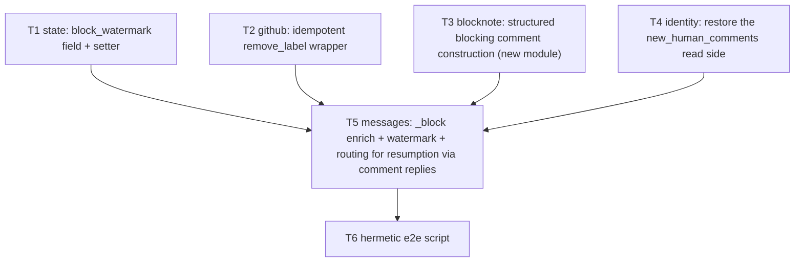

# 0032 · Close the entire needs-human loop on GitHub: provide sufficient information when blocking + automatically resume and retry with the content of a new human comment

<!-- This file is maintained by the spec tool: frontmatter is the structured source data (including the tasks DAG), and the body is a group-level, nine-section rust-RFC overview. -->

## Summary

Close the entire loop of suspending and resuming `needs-human` (the fallback label for blocked runs) within GitHub PR comments, across **all
gates** (rfc / code / merge / `*-unparseable`):

1. **Provide sufficient information upon suspension**—when `_block` runs, organize **one structured, signed comment** around the gate that caused the suspension
   (why it is suspended, what the agent has tried, exactly where it is stuck, and what a human can do), replacing today's incomplete
   experience in which “only the merge gate leaves a sentence, while the other gates merely attach a label.”
2. **A new human comment = a resume signal**—on every poll, the framework reads PR comments and accepts only **human comments without an OpenAgents signature
   that are later than the suspension watermark**. A match **automatically removes `needs-human`** + **feeds the comment body as `detail`
   to the agent for the corresponding gate** (rfc→`refine_rfc`, code→`iterate`, merge→handled by the armed conflict-resolution path), restoring
   the workflow.

The changes reside in the messages routing layer + two leaf primitives (one watermark field in state and a `remove_label`
wrapper in github) + two small, decoupled modules (structured comment construction in `blocknote`, and revival of the `identity` read side to read new human comments).
**Do not change the `needs-human` literal or its gating meaning in release prechecks**, **do not remove the human fallback** (if the agent still
cannot resolve the problem after receiving guidance, it can apply `needs-human` again and attach a new, sufficiently informative comment), and **do not introduce any communication channel outside GitHub**.

## Motivation

**Background (restated here, without relying on bare references to convey necessary information)**: OpenAgents is an RFC/spec-driven multi-agent framework. The watcher,
`messages.Messages.poll`, periodically scans all runs with an open status and routes GitHub events according to their stage: merge/close
reconciliation takes priority, followed by either the **rfc review gate** (a draft PR carries the RFC) or the **code gate** (the `coding`
stage, which performs a mergeability precheck before running the reviewer), depending on the run's stage. The two review gates share the private method `_block` as their fallback when stuck: after several rounds
without passing → set `STATUS_BLOCKED` + apply the `needs-human` label to the PR (`= BLOCKED_LABEL`, literal
`"needs-human"`, with its single source in `github.py`) + **leave the PR open**. `STATUS_BLOCKED` is not in `_OPEN_STATUSES`,
so the next poll skips the run (a soft suspension), waiting for a human to intervene based on the label. The suspension reason (gate) is already persisted in the `RunRecord.block_gate`
field (value ∈ `""`/`"rfc"`/`"code"`/`"merge"`/`"rfc-unparseable"`/`"code-unparseable"`, written to disk by `_block`
through `set_block_gate`—this capability is already implemented; this group **reuses it directly** rather than creating another one).

**Today, `needs-human` communicates only half the story, with two problems:**

- **Suspension information is too thin**: only `gate=merge` (when the mergeability precheck identifies a real conflict) posts a comment before `_block`, and even that is just
  the one-sentence `rebase.CONFLICT_COMMENT` (“There are conflicts that cannot be resolved automatically. Please rebase manually.”). `_block` for `gate=rfc` / `code` /
  `rfc-unparseable` / `code-unparseable` **leaves no explanatory comment at all**—a human opening the PR sees only
  a `needs-human` label, with no idea why it is suspended, what the agent has tried, or what they should do to let it continue.
- **The resume mechanism is disconnected from “communicating on GitHub”**: today, the only way to resume is for **a human to manually remove the `needs-human` label**
  —only when the blocked branch of `_process_run` discovers that the label has been removed does it call `reset_rounds` + resume according to the gate (returning the event
  `"resumed"`). **Comments play no part in resuming**. Thus, when a human wants to say “I've looked at where you're stuck; continue along these lines,” they must first
  write a comment and then **remember to remove the label manually**. This takes two steps, is easy to miss, and the guidance in the comment **is not fed to the agent** (after
  resuming, the agent merely resets its counters and reruns, without receiving the human's judgment).

**Why comments do not participate in resuming—the historical constraint from RFC-0019**: RFC-0011 originally designed a “read side” (poll reads PR comments → filters
out its own comments by signature → triggers `refine_rfc`/`iterate`), but RFC-0019 deliberately made automatic progression
**not read comments** out of concern about **self-triggering loops** (an agent might read its own comments and trigger endless self-iteration), switching automatic progression to reviewer-gate-driven behavior;
`identity.parse_agent_id` (signature parsing) therefore became a “write-only” auditing tool. This issue aims to **lift that restriction in a targeted way**:
**read only new comments “after the block” + accept only human comments (without an OpenAgents signature)**—these two hard constraints precisely
address RFC-0019's concern about self-triggering loops (the agent's own signed comments are filtered out, and historical comments are filtered out by the watermark, making self-triggering impossible).

**Expectations (aligned with the issue)**:

- **Provide sufficient information upon suspension (all gates)**: the comment contains ① the suspension reason/gate type; ② what the agent has tried (for example, iterating for N rounds based on reviewer
  feedback but still receiving REWORK / dispatching an agent to resolve conflicts but failing); ③ the specific blocker (verbatim reviewer feedback / conflict message /
  CI failure log summary); ④ what a human can do (reply with guidance in a comment to continue, without manually removing the label).
- **A new human comment = a resume signal (all needs-human types)**: the framework detects a new human comment after the block → automatically removes
  `needs-human` + feeds the comment content as `detail` to the agent for the corresponding gate → resumes the corresponding gate's workflow.

**Source of the examples**: in real runs, multiple spec PRs were labeled `needs-human` because reviews repeatedly returned REWORK / shared index files conflicted. Operators saw only
the label and had to dig through reviewer logs to understand why, and every intervention required the two steps of “comment + manually remove the label”—these are precisely
the scenarios that directly triggered this issue.

## Guide-level explanation

After implementation, for a PR suspended by any gate, the human experience becomes “**entirely within PR comments**”:

**① Suspension—the agent automatically leaves a sufficiently informative comment.** When any gate reaches its cumulative fallback threshold and suspends the run, a structured, signed
comment automatically appears on the PR (template; details in Reference-level):

```markdown
🤖 OpenAgents is stuck and needs your judgment

**Reason**: <gate=code / Code review still returns REWORK in round 3>
**What I tried**: <Iterated for 3 rounds based on reviewer feedback, but still have not passed>
**Where I am stuck**:
> <Verbatim reviewer feedback / conflict message / CI failure log summary>

**What you can do**: **Reply with a comment** directly on this PR to provide guidance, and I will continue based on it; no need to remove the label manually.

<!-- openagents:agent=<id> -->
```

A human can see at a glance: which gate, how many rounds have been tried, where it is stuck, and how to continue.

**② Resuming—the human simply replies with a comment.** A human replies on the PR (for example, “Don't change messages here; add a
field to state instead”). On the next poll:

- The framework reads this human comment, which is **later than the suspension watermark and has no OpenAgents signature** → treats it as a resume signal.
- **Automatically removes the `needs-human` label** + calls `reset_rounds` (clears the round budget).
- **Feeds the comment body as `detail` to the agent for the corresponding gate**, routing according to the persisted `block_gate`:
  - `rfc` / `rfc-unparseable` → `orchestrator.refine_rfc(detail=<comment body>)`, restoring the status to `rfc-review`;
  - `code` / `code-unparseable` → `orchestrator.iterate(reason="human", detail=<comment body>)`, restoring the status to `pr-open`;
  - `merge` → does not feed it directly to the conflict resolver; resumes according to the existing **armed** semantics (status `pr-open`, retaining `block_gate="merge"`,
    clearing `merge_attempts`), handing “the human has responded; try resolving the conflicts” to the merge gate's armed conflict-resolution path (issue #84).
- Returns the event `"resumed"`. On the following poll, the agent continues through the corresponding gate with the human's guidance; if it still cannot resolve the problem, it will **apply**
  `needs-human` **again** and attach **a new**, sufficiently informative comment (the human fallback remains).

**Coexists with manual label removal**: if a human still prefers the old approach—manually removing the `needs-human` label—it remains supported (using the existing resumed
path, simply without `detail` injection). The new “resume by replying with a comment” mechanism is **the more convenient primary path**, and does not replace the manual fallback.

**Two hard constraints against self-triggering loops (addressing RFC-0019's concern)**:

- **Read only new comments after the block**: record a **watermark** upon suspension (the `createdAt` of the latest comment at the time of the block),
  and consider only comments whose `createdAt` is strictly later than it—historical comments and comments from before the previous resumption cannot trigger it accidentally.
- **Accept only human comments**: distinguish them using `identity`'s hidden signature (`<!-- openagents:agent=<id> -->`)—**any comment bearing
  an OpenAgents signature (including the suspension comment just posted by this instance, reviewer replies, and conflict-resolution replies) is always ignored**;
  only unsigned human comments count as resume signals. Together, these two constraints → the agent cannot read its own comments and trigger itself.

## Reference-level explanation

### Core mechanism

Reuse the already implemented `RunRecord.block_gate` (Spec-0031 has already persisted the suspension gate), and **add two things**:

1. **watermark**: add `block_watermark: str = ""` to `RunRecord` (the default is backward compatible with old `state.json` files lacking the key).
   Before `_block` persists the state, set it to “the `createdAt` of the latest comment on the PR at the time of suspension” (an ISO 8601 string, whose lexicographic order is chronological order;
   it includes the suspension comment just posted by this instance, so subsequent reads naturally start after that comment). Resume detection accepts only comments whose `createdAt`
   is **strictly greater than** the watermark. If there are no comments, use `""` (any real `createdAt` is greater than the empty string → the first subsequent
   human comment can trigger resumption, as intended).
2. **Reading new human comments**: revive the “read side” in `identity`—add the pure function
   `identity.new_human_comments(*, pr_number, since) -> list[Comment]`: call `github.list_comments`,
   and return comments with `created_at > since` **and** `parse_agent_id(body) is None` (no OpenAgents signature), in
   ascending chronological order. This is precisely the implementation that selectively lifts RFC-0019's restriction through “new comments only + human-only signature filtering.”

### Changes (by file / Task)

**`openagents/state.py` (T1)**:
- Add `block_watermark: str = ""` to `RunRecord` (the default ensures that `RunRecord(**old_record)` does not raise an error).
- Add `set_block_watermark(*, issue_number, watermark)`: persist a run's `block_watermark`
  (mirroring the existing implementation of `set_block_gate`).

**`openagents/github.py` (T2)**:
- Add `remove_label(*, pr_number, name)`: a thin wrapper around `gh pr edit <n> --remove-label <name>` (symmetric with the existing
  `add_label`). **Idempotent error tolerance**: when the label is already absent, gh reports something like “not found / does not have label”—
  swallow this and treat it as a successful no-op (the same error-tolerance style as `ensure_label` swallowing "already exists" and `close_issue` swallowing "already closed"),
  so “the human has already removed the label manually, and the framework removes it again” does not produce an error.

**`openagents/blocknote.py` (T3, new module—decoupling principle 10)**:
- Pure function `build(*, gate, tried, blocker) -> str`: assemble the four sections “Reason / What I tried / Where I am stuck / What you can do”
  into the markdown body of the template above according to the gate (**without** a signature—the caller applies the signature through `identity.post_signed_comment`).
- Map `gate` → a human-readable “Reason” phrase (for example, `code`→“Code review did not pass”, `merge`→“Conflicts with the target branch”,
  `rfc-unparseable`→“Review output could not be parsed”); `tried` / `blocker` are assembled by the messages layer from the context and passed in
  (`blocker` wraps verbatim reviewer feedback / conflict messages / CI log summaries in a markdown blockquote).
- Centralize “what the structured comment looks like” in a unit-testable pure function; messages is responsible only for fetching data + calling it + applying the signature and posting it.

**`openagents/identity.py` (T4)**:
- Add `new_human_comments(*, pr_number, since) -> list[Comment]` (revival of the read side; see above). Reuse the existing
  `parse_agent_id` for signature filtering; `since` is the watermark string, and `""` means “every comment counts as new.”

**`openagents/messages.py` (T5, integration)**:
- **Enrich `_block`**: extend the signature to `_block(*, record, gate, blocker="")`—alongside applying the label + setting blocked +
  `set_block_gate`: ① use `blocknote.build(gate=gate, tried=<assembled from gate+rounds>, blocker=blocker)`
  to construct the body, and post one structured, signed comment through `identity.post_signed_comment` (**replacing** the merge gate's current practice of
  separately posting `CONFLICT_COMMENT` in `_process_coding`/`_process_armed_conflict`, centralizing gate-specific comments in `_block`);
  ② after posting, use `list_comments` to obtain the current latest `createdAt` and persist it with `set_block_watermark`.
  Callers pass `blocker` according to the gate: rfc/code gates pass `decision.feedback`; the merge gate passes the conflict message text.
- **Blocked branch of `_process_run` (resuming)**: **retain** the existing path for human label removal as a fallback; **before** it, add
  the primary “resume by replying with a comment” path—
  - `news = identity.new_human_comments(pr_number=…, since=record.block_watermark)`;
  - If `news` is nonempty (there are new human comments) → **resume**: `github.remove_label(needs-human)` (idempotent), `reset_rounds`,
    take the body of the last human comment as `detail`, route it to the agent according to `record.block_gate` + restore the status (see the table below),
    and return `"resumed"`;
  - If `news` is empty → fall back to the existing logic: label removed → current resumed behavior (without detail injection); label still present → `return None`
    (remain suspended).
- **Resume routing table** (according to the persisted `block_gate`):

  | `block_gate` | Action for feeding detail | Restored status | Notes |
  |---|---|---|---|
  | `rfc` / `rfc-unparseable` | `orchestrator.refine_rfc(detail=comment_body)` | `rfc-review` | Also call `set_block_gate("")` to clear the residual value |
  | `code` / `code-unparseable` | `orchestrator.iterate(reason="human", detail=comment_body)` | `pr-open` (iterate internally sets iterating) | Also call `set_block_gate("")` to clear the residual value |
  | `merge` | Do not feed directly (hand off to the armed path) | `pr-open` | Retain `block_gate="merge"` as the armed marker (issue #84) |
  | `""` (theoretical fallback) | Do not feed | Determine `pr-open`/`rfc-review` according to `APPROVAL_LABEL` | Degrade to the existing resumed behavior |

- The `reason` parameter of `orchestrator.iterate` previously accepted `{"ci","review","comment"}`; this group adds the value `"human"`
  (affecting only the prefix of the task text fed to the agent, with no structural changes).

### Invariants preventing self-loops (addressing RFC-0019)

- **Historical comments do not trigger resumption**: watermark = the latest comment's `createdAt` at the time of suspension; the suspension comment just posted by this instance is also within the watermark,
  so only comments added **after suspension** are considered.
- **Machine comments do not trigger resumption**: `new_human_comments` filters out all comments bearing an OpenAgents signature (suspension comments, reviewer
  replies, refine/iterate replies, and conflict-resolution replies all carry signatures) → the agent can never read its own comments → no self-loops.
- The two constraints **combine**: resumption can only be triggered by “an unsigned comment newly written by a human after suspension,” precisely reproducing the safe
  subset of RFC-0011's read side, with an even narrower scope than at the time (then, all comments were read; now, only those after the block are read).

### DAG + file allocation



| Task | Title | files | Dependencies |
|---|---|---|---|
| T1 | state: `block_watermark` field + setter | `openagents/state.py`, `tests/test_state_needs_human_unblock.py` | — |
| T2 | github: idempotent `remove_label` wrapper | `openagents/github.py`, `tests/test_github_remove_label.py` | — |
| T3 | blocknote: structured blocking comment construction (new module) | `openagents/blocknote.py`, `tests/test_blocknote.py` | — |
| T4 | identity: restore the `new_human_comments` read side | `openagents/identity.py`, `tests/test_identity_new_human_comments.py` | — |
| T5 | messages: `_block` enrich + watermark + routing for resumption via comment replies | `openagents/messages.py`, `tests/test_messages_needs_human_unblock.py` | T1, T2, T3, T4 |
| T6 | hermetic e2e script (no network access, no real LLM/gh use) | `scripts/e2e-spec-0032-needs-human-comment-unblock.sh` | T5 |

`files` are mutually exclusive within this group (single-writer ownership, Principle 6). T1–T4 have no dependencies on one another and can run in parallel (four leaf changes); T5 integrates them,
and T6 verifies them. **A dedicated new test file is deliberately added for each modified module** (without modifying existing files such as `tests/test_state.py` / `tests/test_messages.py`),
both to preserve mutual exclusivity of `files` within the group and to minimize the potential for shared test file conflicts across parallel PRs (this issue is specifically about closing the comment loop;
it should not create shared file conflicts itself). `openagents/conflict.py`, `openagents/orchestrator.py`, and `openagents/rebase.py`
are **reused without modification**—this group does not reimplement conflict-resolution/iteration/comment capabilities outside messages (scope boundary, Principle 10: decoupling).

**e2e script path**: `scripts/e2e-spec-0032-needs-human-comment-unblock.sh` (hermetic, in two parts: ① ruff
check + format --check + pytest for offline deterministic verification; ② fake `github.list_comments` / `has_label` /
`remove_label` + a fake orchestrator to exercise the entire closed-loop sequence: “suspend at any gate → post a structured comment + record the watermark → a human writes a new comment →
automatically remove the label in the next round + pass in detail + restore state,” with no network access, real LLM calls, or real gh use throughout).

Comments in new code at each layer must identify this group's spec id (`Spec-0032/Tn`) according to the code comment conventions.

## Drawbacks

- **Targeted lifting of RFC-0019's “do not read comments” restriction**: reintroducing comment reads during polling theoretically reintroduces exposure to self-loop risk.
  Mitigation: the combination of two hard constraints (only after the block + only unsigned human comments) makes it impossible for the agent to read its own comments; comment reads occur only in the
  **blocked branch** (not in every round of every run), keeping the scope minimal.
- **One additional state field + one additional gh round trip**: one extra `list_comments` call at suspension (to obtain the watermark) + one extra `list_comments` call when determining whether to resume
  (only for blocked runs). Mitigation: blocked runs are usually a minority; `list_comments` is already an existing
  thin wrapper with RFC-0010 retries for transient failures built in; the field has a default value, so migration costs nothing.
- **One additional round of token consumption after resumption**: resumption via a comment reply directly triggers one `refine_rfc`/`iterate` call (passing in the human's guidance). Mitigation: this
  is precisely the human's **explicit intent to “continue with this guidance,”** rather than a spontaneous system action; the merge gate continues to use the armed bounded retry budget and does not run indefinitely.
- **An accidental, unrelated chat comment from a human also triggers resumption**: any human comment after the block is treated as a resumption signal. Mitigation:
  the suspension comment explicitly states “reply to continue,” aligning the semantics with human expectations; if the agent cannot resolve the issue, it suspends again with a new comment. At worst,
  this adds one round trip without losing state. Listed under Unresolved for calibration through actual runs (whether “only a specific command prefix triggers resumption” is needed).

## Rationale and alternatives

**Why reuse `block_gate` instead of storing a new gate**: Spec-0031 already persists the suspended gate in `RunRecord.block_gate`
(values include rfc/code/merge/`*-unparseable`), so the issue's request to “persist the gate” **has already been satisfied**—this group consumes it directly
to route resumption (Spec-0031 uses it only to determine merge-armed status; this group extends its use to “determine which path receives the input”), without adding a redundant
field (Principle 1: Occam's razor).

**Why store “the latest comment's createdAt” as the watermark instead of “a wall-clock timestamp”**: script/test environments lack a stable wall clock, and
`Comment.created_at` is already GitHub's authoritative source of chronological order (ISO 8601 lexicographic order is chronological order, and the existing state cursor also uses it);
“the latest comment's createdAt at the time of suspension” can be obtained entirely from `list_comments`, without reading the system clock, making it hermetically testable.
**Alternative**: reuse the existing `state.cursors` (the dormant cursors left by RFC-0005, storing createdAt by pr_number).
Rejected—cursors mean “comments processed up to this point,” which differs from the concept of a “suspension watermark”; cursors are also a top-level dict decoupled from the run
lifecycle, making their semantics ambiguous after repeated suspensions and resumptions. A new run-level `block_watermark` field has a single meaning and lives alongside `block_gate`
/`merge_attempts` in `RunRecord`, making it consistent and self-explanatory.

**Why isolate comment construction in a `blocknote` module**: the issue explicitly defines the boundary as “reuse existing `identity` signatures to distinguish humans from machines; do not
reimplement this in the messages layer.” Extracting “what the structured comment looks like” into a pure-function module leaves messages responsible only for obtaining data + calling the function + applying the signature. This follows Principle 10:
decoupling, and allows independent unit tests for the comment template (asserting that all four sections are present and that the gate→reason phrase mapping is correct). **Alternative**: put the template string directly in
messages. Rejected—this would mix presentation logic into the messages routing layer, make the template difficult to test independently, and make template changes and routing changes prone to affecting one another.

**Why “call refine_rfc/iterate directly to pass in detail” on resumption instead of “store detail for the gate to retrieve in the next round”**: calling directly most closely matches
the issue's wording, “pass the comment content to the agent as detail → resume progression through the corresponding gate,” and reuses the orchestrator's existing atomic operations
(refine_rfc already accepts detail, and iterate already accepts reason+detail), requiring no new interfaces. **Alternative**: store a
`pending_detail` in state and have `_process_rfc_review`/`_process_coding` retrieve it in the next round and append it to reviewer feedback. Rejected—
this requires adding a “check for pending_detail first” branch to both gates, pollutes the main path, and adds another state field that requires cleanup, increasing complexity.

**Why resumption via comment replies coexists with resumption via manual label removal instead of replacing it**: the issue explicitly says “do not remove the manual fallback.” Manual label removal is
an existing, zero-cost escape hatch; replying to a comment is the more convenient primary path. The two naturally diverge within the blocked branch according to “whether there are new human comments,” without
conflict.

## Prior art

- **Spec-0031 (issue #84), armed resumption at the merge gate**: this group directly reuses its persisted `block_gate` field and the semantics of “a human resumes a run blocked by
  merge conflicts → armed bounded retries for conflict resolution”; this group handles **the trigger and information channel for resumption** (across all gates), while #84 handles
  **conflict-resolution behavior after resumption at the merge gate** (merge only). The two are orthogonal and can be merged independently: this group provides “resumed + the human's guidance,”
  while #84 determines “how the merge gate acts on this to resolve conflicts.”
- **RFC-0011 `identity` comment signatures**: this group reuses `post_signed_comment` (signing and posting comments) and `parse_agent_id`
  (signature parsing), and **restores the read side that RFC-0019 froze at the time**, within a safe subset (only after the block + only humans).
- **RFC-0019 decision not to read comments**: this group **lifts that restriction in a targeted way** through two hard constraints, “only new comments + filtering signatures to admit only humans.” This is a
  direct, deliberate reversal of that decision (not an overturning—the main path for automatic progression remains driven by reviewer gates, and comment reads are used only to resume blocked runs).
- **Spec-0021/T2 `*-unparseable` escalation semantics**: this group's resumption routing sends `rfc-unparseable`/`code-unparseable`
  through the same detail-input paths as rfc/code, consistent with their gate naming.
- **rust-lang/rfcs** (https://github.com/rust-lang/rfcs): source of the nine-section overview structure.

## Unresolved questions

- **Whether resumption triggers need command-prefix filtering**: currently, “any human comment after the block” triggers resumption; should resumption trigger only when a comment contains
  a specific prefix (such as `@openagents` / `/continue`), to prevent accidental resumption through casual human conversation? The initial decision is **not to add this** (keeping things simplest
  and honoring the promise that “replying continues the run”); this is listed here for a later decision after observing accidental trigger rates in actual runs.
- **Which comment to pass in when there are multiple human comments**: currently, the body of the **last** human comment is used as detail. Should multiple
  human comments after the watermark be **concatenated** and passed to the agent? The initial decision is to use the last one (closest to the human's latest intent), with this question recorded for later calibration.
- **Whether the merge gate should also pass the human comment body to the conflict resolver**: currently, resumption at merge only arms the gate and does not pass in detail (conflict resolution is performed by #84's
  resolver, whose interface does not accept human guidance). If the resolver supports receiving “human guidance for conflict resolution” in the future, the comment body can also
  be passed through to it (evolving in coordination with #84).

## Future possibilities

- **Include “a list of conflicting files / a link to the full CI failure log” in suspension comments**: currently, the blocker section at the merge gate uses conflict diagnostic text;
  in the future, when work_dir is available, the conflict resolver could list the actual conflicting files and populate `blocker`, further ensuring that “enough information is provided.”
- **Feed `block_watermark` + resumption events into the results dashboard**: let the dashboard categorize PRs awaiting human action by “reason for suspension / time spent waiting / whether a human has replied,”
  turning “humans provide high-level oversight” (Principle 2) into a visual dashboard.
- **Extend “resumption via comment replies” to human–agent dialogue in non-blocked scenarios**: once the safety constraints (only humans + only new comments) mature, cautiously
  evaluate allowing humans to add guidance to a running agent through comments at any time, rather than only during suspension—this requires reassessing RFC-0019's self-loop boundaries.
