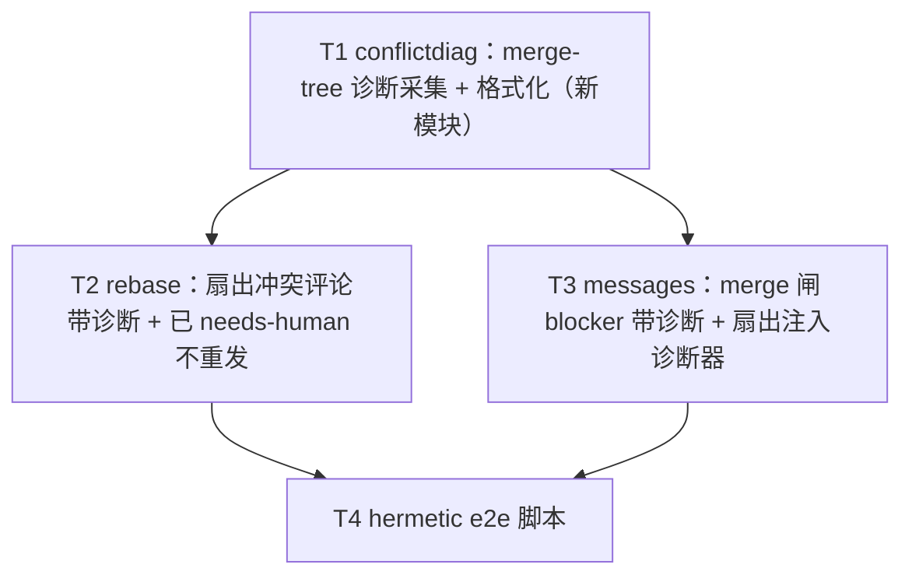

# 0033 · 冲突/挂起通知带可定位诊断 + 合并扇出重发收敛——让「具体什么 conflict」结构上答得出

<!-- 本文件由 spec 工具维护：frontmatter 为结构化源数据（含 tasks DAG），正文为组级 rust-RFC 9 段总览。 -->

## Summary

让所有「合并冲突」通知从**无诊断的静态罐头**变成**可定位的诊断**，并堵住唯一还在**机械重发**
罐头的通道：

1. **冲突诊断采集（新解耦模块 `conflictdiag`）**——用 **worktree-free 的 `git merge-tree
   --write-tree`**（git 2.38+，不 checkout、不动工作区）算出某 PR 分支并入目标分支会撞哪些文件、
   每个冲突文件的**关键 hunk 摘要**，产出一段结构化 markdown（冲突文件清单 + 关键 hunk 摘要 + 卡在
   哪一步）。纯函数 + 注入 `run` / 安全降级：拿不到诊断（老 git / 任何异常）就退回今天的泛化一句话。
2. **诊断喂进两类冲突通知的「卡在哪」段**——① merge 闸挂起评论（`messages._block(gate="merge")`，
   今天 `blocker=rebase.CONFLICT_COMMENT` 静态串）；② 合并扇出冲突评论（`rebase.rebase_open_prs`
   冲突回落，今天 `post_signed_comment(CONFLICT_COMMENT)` 静态串）。两处都换成带诊断的正文。
3. **扇出不再机械重发**——合并扇出对**已打 `needs-human` 标签**的 PR 跳过冲突评论：这类 PR 的人机
   沟通已由 issue #89（Spec-0032）的 **blocked 读侧闭环**接管（人回评论即解挂喂 detail），扇出再贴
   同一句只会**淹没**人的追问。把「同一处问三次得到字字不差的罐头」从根上消除。

**明确不做**（边界，理念 10 解耦）：不重写 #89 已落地的「blocked 读侧」（poll 读人类评论解挂），不在
非 blocked 场景新引入读评论，不改 reviewer/e2e 产出格式——本组只补**冲突通知的诊断字段**与**扇出的
重发收敛**。

## Motivation

**背景（就地复述，不靠裸引用承载必要信息）**：OpenAgents 是 RFC/spec 驱动的多 agent 框架，守夜人
`messages.Messages.poll` 周期扫描所有 open run，按阶段路由 GitHub 事件。代码闸 `_process_coding`
跑 reviewer 前先做**可合并性预检**（`github.mergeability` 返回 `merge_state_status` / `mergeable`，
`DIRTY` 或 `CONFLICTING` 即判冲突）；冲突时：①若注入了 coding 后端就先派 agent 语义解冲突
（`conflict.make_resolver` 在临时 worktree 里 `git merge origin/<base>`、撞冲突喂文件清单给 agent 解、
自测、push），解成功本轮不挂；②解不了 → `_block(record, gate="merge", blocker=...)`：贴一条评论 +
打 `needs-human` 标签（`github.BLOCKED_LABEL = "needs-human"`）+ 置 `STATUS_BLOCKED`（不在
`_OPEN_STATUSES`，下轮 poll 软跳过）+ 落 `block_gate="merge"` / `block_watermark`。另有一条**独立**的
冲突通道：一个 PR 合并进 main 后，`rebase.rebase_open_prs` 扇出对**其余每个 open PR** 跑
`github.update_branch`（把最新 main 并入、触发 CI 重跑）；撞冲突（`GithubError`）时按
`indexheal → conflict.resolve → 人工留言` 分层降级，最末一层 `identity.post_signed_comment(pr,
body=rebase.CONFLICT_COMMENT, agent_id=…)` 留言并继续下一个（无状态、错误隔离，理念 10）。

**`rebase.CONFLICT_COMMENT` 是一句永不带诊断的静态串**（`openagents/rebase.py`）：

> 🤖 OpenAgents 在 main 更新后尝试自动同步本 PR 分支，但存在无法自动解决的冲突，请手动 rebase /
> 解决冲突后重新 push。

它**结构上**就不含「哪个文件、哪段 hunk 冲突」。两类冲突通知今天都拿它当正文：merge 闸 `_block` 把它
当 `blocker` 喂进结构化挂起评论的「卡在哪」段（`_process_coding` 首次发现冲突、`_process_armed_conflict`
无后端/达上限三处），扇出冲突回落也直接贴它。

**真实案例（issue #92 来源，ccKanBan PR `pcj-sudo/wind-palace-of-cc#11`）**：人在同一处追问/指令三次，
每次都收到**字字不差**的上面那句：

| 时间 | 谁 | 内容 |
|------|----|----|
| 03:43 | 👤 人 | rebase 解冲突 + e2e 结果截图传 commit |
| 03:45 | 🤖 | 「存在无法自动解决的冲突，请手动 rebase…」 |
| 09:26 | 👤 人 | **具体什么 conflict 无法自动解决？** |
| 09:37 | 🤖 | 「存在无法自动解决的冲突…」（一模一样） |
| 10:02 | 👤 人 | 解冲突更新 PR，解不了要在评论详细说明原因 |
| 10:03 | 🤖 | 「存在无法自动解决的冲突…」（还是一模一样） |

三个不同的问题/指令，得到同一句与之无关的话——**问了等于没问**。本案真实冲突是**三个并行 spec PR 共改
`docs/specs/OVERVIEW.md` 聚合索引**导致的 content conflict，但消息从没说。

**两个毛病，分别对应 issue 的 A / B：**

- **B：通知无诊断。**「具体什么 conflict」这类问题，现有机制**结构上答不出**——`CONFLICT_COMMENT`
  永远不含文件/hunk。需要让通知携带**冲突文件清单 + 关键 hunk 摘要**（以及 gate 类型、卡在哪一步）。
- **A：评论只出不进 / 机械重发。** 三句一模一样并非偶然：**合并扇出 `rebase_open_prs` 无状态、不感知
  PR 是否已被人接管**——每当**别的** PR 合并进 main，扇出就对这个仍冲突的 PR **再贴一次**同一句。
  issue #89（Spec-0032，已合入本仓库 base）已把 **blocked 读侧**复活：blocked 的 PR 上，poll 会读
  「挂起水位线之后、无 OpenAgents 签名」的人类评论，命中即自动摘 `needs-human` + 把评论正文当 detail
  喂给对应闸 agent（merge 闸走 armed 解冲突）——**人回评论就能解挂**。但 #89 的读侧**只在 blocked 分支
  生效**，**管不到无状态的扇出通道**：扇出照旧对已 `needs-human` 的 PR 机械重发，把人的追问淹没在罐头里。

**为什么历史上「不读评论」——RFC-0019**：RFC-0011 原设计有读侧（poll 读评论→按签名剔自评论→触发
`refine_rfc`/`iterate`），RFC-0019 出于**防自循环**顾虑让自动流转**不读评论**（怕 agent 读到自己发的
评论无限自迭代），`identity.parse_agent_id` 退化为只写不读的审计工具。#89 已用「仅 block 之后 + 仅无
签名人类」两道硬约束**定向解禁**读侧（仅用于解挂）。**本组不再碰读侧**——A 的残留不是「再读一次评论」，
而是「让那条**不读评论、机械重发**的扇出通道，对已被 #89 读侧接管的 PR 闭嘴 + 让它真正首发时带诊断」。

**期望（与 issue 对齐）**：
- **A**：合并扇出对已 `needs-human`（人已介入、#89 读侧在管）的 PR **不再重发**冲突评论；首发时也带诊断。
- **B**：merge 闸挂起评论 + 扇出冲突评论都携带**冲突文件清单 + 关键 hunk 摘要 + gate/卡在哪一步**，
  让人不必再追问「具体是什么」。

## Guide-level explanation

落地后，一个撞了合并冲突的 PR，人看到的不再是泛化罐头，而是**能直接定位**的诊断；而且**同一句不再
反复刷屏**。

**① 冲突挂起——挂起评论带诊断。** merge 闸解不掉冲突挂起时（`_block(gate="merge")`），PR 上的结构化
签名评论「卡在哪」段不再是一句话，而是（模板，细节见 Reference-level）：

```markdown
🤖 OpenAgents 卡住了，需要你的判断

**原因**：与目标分支存在无法自动解决的冲突（gate=merge）
**我试过**：已派 agent 尝试语义解冲突 N 次仍失败
**卡在哪**：自动合并 `origin/main` 时以下文件冲突，需人工裁断——
> **冲突文件清单（2）**
> - `docs/specs/OVERVIEW.md`
> - `openagents/messages.py`
>
> **关键 hunk 摘要 · docs/specs/OVERVIEW.md**
> ```
> <<<<<<< (ours)
> | 0031 | merge 解挂 |
> =======
> | 0032 | 评论闭环 |
> >>>>>>> (origin/main)
> ```

**你可以怎么做**：直接在本 PR **回复一条评论**给出指导，我会据此继续；无需手动摘标签。

<!-- openagents:agent=<id> -->
```

人一眼看清：撞了哪些文件、关键冲突长什么样、卡在 merge 闸——「具体什么 conflict」**当场答出**。之后
人回一条评论，就由 #89 的 blocked 读侧闭环接管（自动摘 `needs-human` + 喂 detail），本组不改这条路径。

**② 合并扇出——首发带诊断、不再机械重发。** 当**别的** PR 合并进 main 触发扇出：

- 对一个仍冲突、但**尚未** `needs-human` 的 PR：扇出留一条**带诊断**的签名评论（同样的冲突文件清单 +
  关键 hunk 摘要），告诉人「main 更新后本 PR 撞了这些文件」。
- 对一个**已经** `needs-human` 的 PR（人已介入、#89 读侧正在管它的评论对话）：扇出**跳过**冲突评论
  ——不再贴第二、第三句罐头去淹没人的追问。这类 PR 的沟通完全交回 blocked 读侧闭环。

于是案例里「09:37 / 10:03 两次重发」从根上消失：第一次（PR 刚冲突）留一条带诊断的评论，之后 PR 进入
`needs-human`，后续每次扇出都对它闭嘴，人在评论里的三次追问也由 #89 读侧逐一响应。

**③ 诊断拿不到时安全降级。** 若运行环境 git < 2.38（无 `merge-tree --write-tree`）、或 refs 取不到、
或任何异常——诊断采集**吞异常返回空**，通知**退回今天的泛化一句话**（`CONFLICT_COMMENT` 语义不变），
绝不因为「想给诊断」而让挂起/扇出本身失败。

## Reference-level explanation

### 核心机制：worktree-free 的 `git merge-tree` 诊断

冲突文件清单今天其实**已可本地算出**——`conflict.py` 的 `_conflicted`（`git diff --name-only
--diff-filter=U`）就是，但它埋在解冲突 worktree 流程里、只返回 bool，且建/清 worktree 成本高。本组改用
**`git merge-tree --write-tree origin/<base> origin/<head>`**（git 2.38+）：**不 checkout、不动工作区、
不建 worktree**，直接在对象库里算出合并结果，stdout 含冲突文件清单 + 带 `<<<<<<< / ======= / >>>>>>>`
标记的冲突内容。这正是「冲突文件清单 + 关键 hunk 摘要」的权威、廉价来源。

### 新模块 `openagents/conflictdiag.py`（T1，解耦——理念 10）

- 纯/可注入，三件事，全部**安全降级**（任何异常吞成「空诊断」，绝不上抛）：
  - `collect(*, base, head, run) -> ConflictDiag`：经注入的 `run`（默认包一层 `git`）跑
    `merge-tree --write-tree origin/<base> origin/<head>`，解析输出为 `ConflictDiag(files: list[str],
    hunks: dict[str, str])`——`files` 为冲突文件清单，`hunks` 为每个冲突文件的**关键 hunk 摘要**（取
    首个/最具代表性的冲突块，按字符数**截断**避免评论过长）。git 报「无冲突 / 命令不存在 / 非 0」或任何
    异常 → 返回**空** `ConflictDiag`。
  - `format_blocker(*, diag, step) -> str`：纯函数，把 `ConflictDiag` 渲成「卡在哪」段 markdown
    （冲突文件清单 + 关键 hunk 摘要 + `step` 描述「卡在哪一步」）；`diag` 为空 → 返回泛化兜底文案
    （等价今天 `CONFLICT_COMMENT` 的语义），使下游无需自己判空。
  - `make_diagnoser(*, work_dir, base) -> Callable[..., str]`：IO 工厂（与 `conflict.make_resolver`
    同构），返回 `diagnose(*, pr_number) -> str` 闭包——取 PR head 分支、`git fetch` base/head、调
    `collect` + `format_blocker`，整体 best-effort（任何环节失败 → 返回空诊断对应的兜底文案）。供
    `rebase_open_prs` 注入；`work_dir` 缺省时调用方传 `None`、下游退回静态文案。
- 把「冲突诊断长什么样 + 怎么算」收敛进一个可单测纯模块；`messages` / `rebase` 只调它、不混入 git 细节。

### 改动点（按文件 / Task）

**`openagents/rebase.py`（T2）**：
- `rebase_open_prs` 新增可选形参 `diagnose: Callable[..., str] | None = None`（与既有 `heal` /
  `resolve` 注入同构，保持无状态：rebase 不持有 work_dir，诊断能力由 messages/CLI 透传）。
- 冲突回落分支（`heal`/`resolve` 都没命中后）：
  - **重发收敛**：先 `github.has_label(pr_number=pr.number, name=github.BLOCKED_LABEL)`——已
    `needs-human`（人已介入、#89 读侧在管）→ **跳过留言**，记一个区分用的结果分类（如
    `RESULT_CONFLICT_SUPPRESSED`，供日志/测试断言），继续下一个 PR。
  - 否则留言：正文取 `diagnose(pr_number=pr.number)`（注入了诊断器）带诊断；`diagnose is None` 或返回
    兜底文案时退回静态 `CONFLICT_COMMENT`。仍 `identity.post_signed_comment` 盖签名（含义不变：盖签名
    使 #89 读侧按签名把它当机器评论滤掉，不会误触发解挂）、记 `RESULT_CONFLICT`。
- `CONFLICT_COMMENT` 常量**保留**为「空诊断兜底文案」，不删（向后兼容 + 手动 sync-prs 无 work_dir 路径）。

**`openagents/messages.py`（T3，整合）**：
- 新增 `_make_diagnoser() -> Callable[..., str] | None`（镜像既有 `_make_resolver`：`work_dir` /
  `base` 齐备才返回 `conflictdiag.make_diagnoser(...)`，否则 `None`）。
- 新增小私有助手 `_conflict_blocker(*, pr_number) -> str`：有诊断器就调它产出带诊断的「卡在哪」正文，
  否则退回 `rebase.CONFLICT_COMMENT`——供 merge 闸三处 `_block` 统一取 `blocker`。
- merge 闸三处 `_block(gate="merge", blocker=rebase.CONFLICT_COMMENT)` 改为
  `blocker=self._conflict_blocker(pr_number=pr_number)`：`_process_coding` 首次发现冲突、
  `_process_armed_conflict` 无后端、`_process_armed_conflict` 达上限。
- 合并扇出调用 `rebase.rebase_open_prs(...)` 处补传 `diagnose=self._make_diagnoser()`（让扇出冲突评论
  带诊断 + 触发 T2 的重发收敛）。`_block` 自身的评论/标签/水位线次序与语义（含 #89 的 watermark 落盘）
  **完全不变**——本组只换 `blocker` 的内容来源。

**e2e 脚本（T4）**：`scripts/e2e-spec-0033-conflict-diagnostics.sh`（hermetic，见下）。

### DAG + 文件分配



| Task | 标题 | files | 依赖 |
|---|---|---|---|
| T1 | conflictdiag：`merge-tree` 诊断采集 + 格式化（新模块） | `openagents/conflictdiag.py`, `tests/test_conflictdiag.py` | — |
| T2 | rebase：扇出冲突评论带诊断 + 已 `needs-human` 不重发 | `openagents/rebase.py`, `tests/test_rebase_conflict_diag.py` | T1 |
| T3 | messages：merge 闸 `blocker` 带诊断 + 扇出注入诊断器 | `openagents/messages.py`, `tests/test_messages_conflict_diag.py` | T1 |
| T4 | hermetic e2e 脚本（无网络、不触真实 LLM/gh/git 远端） | `scripts/e2e-spec-0033-conflict-diagnostics.sh` | T2, T3 |

`files` 同组互斥（单一 writer 所有权，理念 6）。T2、T3 互不依赖、可并行（分别改 rebase / messages 两个
解耦通道，各带专属新测试文件，**不改既有 `tests/test_rebase*.py` / `tests/test_messages*.py`**，把跨
并行 PR 的共享测试文件冲突面降到最小——本组谈的正是冲突通知，不该自己制造共享文件冲突）。
`openagents/conflict.py`（worktree 解冲突）、`openagents/identity.py`（#89 读侧）、`openagents/state.py`、
`openagents/blocknote.py`（#89 四段模板）**复用不改**——本组只补诊断字段与扇出收敛，不重写解冲突/读侧/
评论模板能力（边界，理念 10 解耦）。

**e2e 脚本路径**：`scripts/e2e-spec-0033-conflict-diagnostics.sh`（hermetic，两段：① `ruff check` +
`ruff format --check` + `pytest -q` 离线确定性验证；② 用 fake `run`（喂固定的 `git merge-tree` 输出）
+ fake `github.has_label` / `post_signed_comment` 闭环演练「冲突→采集诊断→带文件清单+hunk 摘要的评论；
对已 needs-human 的 PR 扇出→跳过不重发；诊断为空→退回泛化文案」整条轨迹，全程不触网、不调真实 LLM、不
碰真实 gh、不连真实 git 远端）。

每层新代码注释按代码注释规范标注本组 spec id（`Spec-0033/Tn`）。

### 防自循环 / 安全不变式

- **不重新引入读侧风险**：本组**不读评论**，只**写**通知；A 的残留靠「扇出对 `needs-human` PR 闭嘴」
  解决，把对话权交回 #89 已审过安全边界的 blocked 读侧（仅 block 之后 + 仅无签名人类）。无新自循环面。
- **诊断绝不致挂起/扇出失败**：`collect` / `make_diagnoser` 全程吞异常返回空诊断 → 兜底文案，最坏退化
  为今天行为；通知本身的标签/状态/水位线副作用一律不受诊断成败影响。
- **签名语义不变**：扇出与挂起评论仍盖本实例签名，#89 读侧按签名滤掉机器评论，不会把诊断评论误当人类
  解挂信号。

## Drawbacks

- **依赖 git 2.38+ 的 `merge-tree --write-tree`**：更老的 git 拿不到诊断。缓解：安全降级到今天的泛化
  文案（功能不回退、只是少了诊断）；CI/运行环境普遍已满足。列入 Unresolved 供按部署环境核定。
- **多一次 git 往返**：挂起/扇出时多一次 `fetch` + `merge-tree`（只读、不动工作区，比建 worktree 轻）。
  缓解：仅在**确已冲突**的 PR 上触发（非每轮每 PR）；失败即兜底，不重试空转。
- **「关键 hunk 摘要」可能截断信息**：为控评论长度只取代表性冲突块并截断，复杂冲突看不全。缓解：清单
  列全部冲突文件，hunk 仅作「一眼定位」用；人可据清单本地 `git diff` 看全。截断阈值列入 Unresolved。
- **扇出对 `needs-human` PR 完全静默**：若该 PR 的 base 在人介入期间又变（新冲突），扇出不再提示。缓解：
  人介入期间对话由 #89 读侧承载，PR 解挂回到流转后下一轮预检会重新发现并带诊断挂起；最坏延迟一轮，不丢
  状态。是否应「刷新/更新已有诊断评论」而非完全静默，列入 Unresolved。

## Rationale and alternatives

**为何用 `git merge-tree --write-tree` 而非复用 `conflict.py` 的 worktree 路径**：`conflict._conflicted`
要先建 detached worktree + `git merge`，成本高且为「解冲突」而设；诊断只需**读**冲突、不需工作区。
`merge-tree --write-tree` 不 checkout 即得冲突文件清单 + 内容，廉价且无副作用，正合诊断用途。**备选**：
扩展 `conflict.resolve_branch` 让它在失败时**返回**冲突诊断（而非 bool）。否决——会改动已稳定的解冲突
契约（`resolve` 回调 `(*, pr_number) -> bool` 被 `rebase_open_prs` 依赖）、把「解冲突」与「诊断」两个
关注点耦死，且诊断只在「跑过 resolve」时才有（merge 闸首次预检挂起、手动 sync-prs 都没跑 resolve）。
独立 `conflictdiag` 模块两个场景都能用，解耦更干净（理念 10）。

**为何 A 的残留用「扇出对 needs-human PR 闭嘴」而非「再加一条读侧」**：issue #89（Spec-0032，已合入）
已把 blocked 读侧复活并审过安全边界（仅 block 之后 + 仅无签名人类，防自循环）。案例里反复重发的根因**不是
「没有读侧」**，而是**「无状态扇出通道绕过了读侧、对已被接管的 PR 机械重发」**。最小且对齐 #89 的修法是
让扇出感知 `needs-human` 标签即收手，把对话权交回读侧——而非再造一条平行读侧（会与 #89 重复、重新打开
RFC-0019 自循环面）。**备选**：在扇出里也接 `new_human_comments` 做读侧响应。否决——重复 #89、扩大读侧
作用面、违背理念 1（如无必要勿增实体）。

**为何保留 `rebase.CONFLICT_COMMENT` 常量而非删除**：它退化为「空诊断兜底文案」，被诊断降级路径与无
work_dir 的手动 `sync-prs` 复用；删了反而要在多处重写兜底串。保留 = 最小改动 + 向后兼容（理念 1）。

**为何把诊断器以 `diagnose` 注入 `rebase_open_prs` 而非让 rebase 自己持有 work_dir**：`rebase.py` 是
RFC-0009 刻意设计的**无状态**扇出模块（不读 state、不持 work_dir，便于被 poll 与手动 `sync-prs` 同时
复用）。沿用既有 `heal` / `resolve` 的注入风格，由 messages/CLI 透传诊断能力，既保无状态又复用注入骨架。

## Prior art

- **issue #89 / Spec-0032（needs-human 评论闭环）**：本组的**直接上游与边界**。#89 复活了 blocked 读侧
  （`identity.new_human_comments` 按签名 + 水位线只读「block 之后的无签名人类评论」→ 自动摘 `needs-human`
  + 把评论当 detail 喂给对应闸 agent）并统一了**结构化挂起评论**（`blocknote.build` 的四段模板，merge
  闸 `blocker` 即「卡在哪」段）。本组**复用** `blocknote` 模板与 `_block` 流程，只把 merge 闸的 `blocker`
  从静态串换成诊断；并堵上 #89 未覆盖的**无状态扇出重发**。二者正交、可独立合入。
- **RFC-0009 `rebase_open_prs` 扇出**：本组沿用其无状态 + `heal`/`resolve` 注入骨架，新增 `diagnose`
  注入与 `needs-human` 收敛，保持「错误隔离、单 PR 失败不拖垮整轮」的风格。
- **Spec-0028 `conflict.py` 语义解冲突**：本组诊断与其解冲突正交——它**解**冲突（worktree + agent），
  本组**说清**冲突（worktree-free merge-tree）；`_conflicted` 的 `--diff-filter=U` 思路印证「本地可定位
  冲突文件」可行，本组改用更轻的 merge-tree。
- **RFC-0011 / RFC-0019 评论签名与读侧冻结**：本组复用 `post_signed_comment`（盖签名）；不解冻读侧
  （读侧由 #89 在安全子集内承担），A 残留用「扇出感知标签收手」绕开读侧，无自循环回归。
- **git `merge-tree --write-tree`**（https://git-scm.com/docs/git-merge-tree，git 2.38+「Cleanly merging
  / conflict reporting」）：worktree-free 计算合并结果与冲突的官方机制——诊断采集的技术来源。
- **rust-lang/rfcs**（https://github.com/rust-lang/rfcs）：9 段总览形态来源。

## Unresolved questions

- **`merge-tree --write-tree` 的最低 git 版本兜底**：目标运行/CI 环境是否都 ≥ 2.38？若需兼容更老 git，
  是否提供基于临时 worktree `git merge` 的退化诊断采集（更重）作为第二降级层？初定**只做 merge-tree +
  空诊断兜底**，待部署环境核定后再议。
- **关键 hunk 摘要的截断阈值**：每文件取几个 hunk、每 hunk 截多少字符，才能「一眼定位」又不刷屏？初定
  「每冲突文件取首个冲突块、整体诊断按一个保守字符上限截断」，留实跑校准。
- **扇出对 `needs-human` PR 是否应「更新」而非「完全静默」**：当前完全跳过。是否应在 base 变化导致**新**
  冲突时刷新已有诊断评论（而非沉默）？初定**完全静默**（最简、把对话权干净交给 #89 读侧），列此待实跑
  观察是否漏报。
- **诊断是否也喂给 #89 的解挂 detail / armed 解冲突器**：当前诊断只进**通知正文**；未来可把冲突文件清单
  也透传给 #89 解挂路由或 `conflict.resolve` 的 agent 任务，让解冲突 agent 少算一遍。本组不做，列为协同点。

## Future possibilities

- **诊断升级为「gate 通用」**：当前只做 merge 冲突诊断；同一 `conflictdiag` 思路可扩展到 CI 失败
  （失败 job + 关键日志摘要）、reviewer 无法解析（裁决原文摘要）等其它 gate 的「卡在哪」段，让所有
  `needs-human` 通知都可定位。
- **诊断汇入成果看板**：把「冲突文件清单 / 卡在哪一步 / 已等待时长」结构化进看板，让人按「待处置 PR +
  具体卡点」一屏纵览（理念 2 人负责宏观把控）。
- **与 #84 / Spec-0031 armed 解冲突协同**：把本组诊断（冲突文件清单 + hunk）透传给 armed 解冲突器，
  缩短其「先自己探一遍冲突」的开销，并在解冲突 agent 的任务里直接附上人对该冲突的评论指导。

