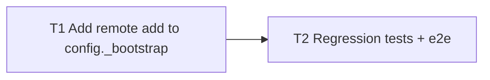

# 0033 · Automatically run git remote add origin after openagents init creates a remote

<!-- This file is maintained by the spec tool: the frontmatter is the structured source data (including the tasks DAG), and the body is a group-level overview in the nine rust-RFC sections. -->

## Summary

After `openagents init` creates a GitHub remote repository for the user during the interactive cold-start flow, it **fails to write the remote back to the local git
config**: `create_repo` successfully obtains the remote URL, but `git remote add origin <url>` is never executed. As a result, the local
repository has no remotes, and subsequent commands such as `gh label create` cannot determine the target repository. They exit with a nonzero status and `✗ no git remotes
found`, causing the entire `init` cold start to fail. This spec adds `git remote add
origin <url>` to `config._bootstrap`, synchronizing the local git config with the newly created remote so that all subsequent `gh` commands can resolve the target repository correctly.

## Motivation

**Current behavior (restated here for completeness).** The cold-start preflight for `openagents init` is handled by
`openagents/config.py` (Decision 10, “Use the current working directory as the target project”):

- `resolve_project()` resolves the git root and `remote.origin.url` from cwd; it returns `None` for a non-git repository,
  and `ProjectContext.remote` is `None` when there is no remote.
- `ensure_project(interactive=...)` is the preflight for each command: if the repository is ready (it has git + an origin
  remote), it returns immediately; in non-interactive mode (CI), either missing component causes it to raise `ProjectNotReady`, and it never creates anything on its own; in interactive mode,
  it calls `_bootstrap` to fill in the missing components step by step.
- `_bootstrap(ctx)` fills in the missing components in two steps: ① If `ctx is None`, prompt the user and run `git init -b main`; ② If there is no
  origin remote, prompt the user for `owner/repo` and visibility, then call `github.create_repo(name=, private=)`,
  which uses `gh repo create` to create the remote and returns the remote URL.

**Root cause of the bug.** After step ② of `_bootstrap` obtains `remote = create_repo(...)`, it merely uses that URL to construct a
new `ProjectContext(repo_root=..., remote=remote)` and return it to the caller—**this is only an in-memory object within the process;
the local git config still has no remotes**. In other words, `create_repo` has created the repository on GitHub, but the local
`.git/config` remains in a “no remotes” state.

**Why it fails.** After `_bootstrap` returns, the call chain `_cmd_init → github.ensure_prerequisites →
ensure_label(name="openagents")` executes `gh label create`. `gh` resolves the target repository using **the remotes of the current
git repository under the process cwd** (see [[gh-resolves-repo-by-process-cwd]]); at this point, there is no local remote, so `gh` cannot determine
which repository to create the label in. It prints `no git remotes found` to stderr and exits with a nonzero status, causing the entire `init` cold start to fail.

**Scope of impact.** `openagents/config.py:_bootstrap` (the cold-start path); this affects all users who interactively **create**
a GitHub repository through `openagents init` (users who already have an origin remote do not reach this branch and are unaffected).

**Expected behavior.** After `create_repo` successfully returns a URL, immediately run `git remote add origin <url>` to synchronize the local
git config with the remote, allowing subsequent commands such as `gh label create` to resolve the target repository correctly and `init` to complete successfully.

## Guide-level explanation

From the user's perspective, the fixed `openagents init` cold start is a smooth sequence:

```
$ cd ~/my-fresh-project        # Non-git directory
$ openagents init
The current directory is not a git repository. Run git init? [y/N] y
The current repository has no origin remote. Create a GitHub repository? [y/N] y
Remote repository name (owner/repo): acme/widget
Make the repository private? [y/N] y
✓ Created remote https://github.com/acme/widget.git
✓ Label openagents is ready          # ← gh can now find the target repository
✓ init complete
```

The key difference comes after line 5: before this spec, the local repository still had no remote after `create_repo` created the remote, so the next step,
`gh label create`, immediately failed with `✗ no git remotes found` and interrupted the flow; after the fix, `_bootstrap` performs
the equivalent of `git remote add origin <url>` as soon as it obtains the URL, bringing the local git config into alignment with the remote so that all subsequent
`gh` commands can resolve `acme/widget`. For users, this is behavior that “should have been there all along”—creating a remote should also
connect it to the local repository.

## Reference-level explanation

### Technical approach

In the remote-creation branch of `openagents/config.py:_bootstrap`, **after** `create_repo` successfully returns the remote URL
and **before** constructing the new `ProjectContext`, add a git subprocess call **with exit-status checking** to write this URL
back to the local git config as the `origin` remote: reuse the same `check=True` subprocess pattern as `git init -b main` in
the same function (git failures propagate immediately rather than being silently swallowed) to execute `git remote add origin <url>`, then use the same URL
to construct the returned `ProjectContext`. At the change site, include an RFC reference comment for Spec-0033/T1 in accordance with the code-comment conventions, explaining:
“Write the newly created remote back to the local git config; otherwise, subsequent gh commands cannot find the target repository.”

Design points:

- **Reuse the existing `subprocess.run(..., check=True, capture_output=True)` style**, consistent with
  `git init -b main` in the same function—`check=True` causes git failures to propagate immediately (for example, if origin already exists), rather than silently swallowing them.
  Do not introduce a new git wrapper layer (Principle 1, Occam's razor); do not reuse `_git_output`, which ignores failures (its semantics are “read,
  returning None on failure,” whereas this operation requires “write, reporting an error on failure”).
- **Ordering contract**: `git remote add` must run **after** `create_repo` succeeds—there is no point connecting a
  remote that does not exist; it must also run before returning `ctx`, ensuring that `_bootstrap` satisfies the postcondition “the
  remote corresponding to the returned ProjectContext has actually been written to the local git config.”
- **Keep the scope narrow**: change only this one location in the remote branch of `_bootstrap`; leave the signatures and semantics of `resolve_project` / `ensure_project` /
  `create_repo` unchanged.

### DAG and file allocation

| Task | Title | Files (exclusive single-writer ownership) | Dependencies |
|---|---|---|---|
| T1 | `git remote add origin` after `_bootstrap` creates a remote | `openagents/config.py` | — |
| T2 | Regression tests + e2e coverage for the remote-add path | `tests/test_config.py`, `scripts/e2e-spec-0033-init-remote-add.sh` | T1 |



T1 changes production code, while T2 adds tests and an end-to-end script; their file sets are disjoint (Principle 6, single writer). T2 depends on T1: the tests must
assert the fixed behavior.

### e2e script path

`scripts/e2e-spec-0033-init-remote-add.sh` (created by T2): drive an `ensure_project(interactive=True)` cold start in a temporary
non-git directory with a stubbed `create_repo` (or a `gh` fake), and assert that, upon completion,
`git config --get remote.origin.url` returns the newly created remote URL, demonstrating that the local git config has been synchronized with the remote.

## Drawbacks

- One additional git subprocess call adds another potential failure point to the remote branch of `_bootstrap` (for example, it will
  raise an error if the name origin is already taken). But this is precisely the intended behavior—origin should not already exist during a cold start, and `check=True` explicitly exposes the abnormal state, which is preferable to
  the current behavior of “silently leaving the remote disconnected and passing the problem downstream to gh, which reports a confusing error.”
- This path depends on real git/gh, so unit tests need to stub `create_repo` to verify it without network access, adding a little test boilerplate.

## Rationale and alternatives

**Selected approach: run `git remote add origin` directly after `create_repo` within `_bootstrap`.** The fix is located
near the same line as the root cause, has minimal scope, and establishes the `_bootstrap` postcondition that “the remote of the returned ctx has been written to the local config.”

**Alternative 1: put `git remote add` inside `github.create_repo`.** Make “create the remote” also “connect it locally.” Rejected:
the semantics of `create_repo` are “create a repository on GitHub and return its URL,” which is separate from “modify the local git config”;
combining them would make this purely GitHub wrapper implicitly depend on cwd being a git repository, violating module decoupling (Principle 10). Local wiring
is the responsibility of `config._bootstrap` (project binding).

**Alternative 2: use `gh repo create --source=. --remote=origin --push`** to have gh create the remote and automatically connect
the local remote in one step. Rejected: this would change the command form and return contract of `create_repo` (the `--source` mode behaves differently), with a
larger scope of change than “add one remote add line”; it would also transfer the decision of “whether and how to connect the remote” from
the config layer, which we can control precisely, to a combination of gh flags, reducing control. This can be reconsidered if simplification is desired later (see Future possibilities).

## Prior art

- The official `git` workflow: `git remote add origin <url>` is the standard operation for associating a local repository with a remote (see
  the [git-remote documentation](https://git-scm.com/docs/git-remote)); this spec simply restores a step that should already have been
  part of the cold-start flow.
- The existing `git init -b main` in `_bootstrap` in this repository (a subprocess call with `check=True` exit-status checking) is a precedent of the same kind. This
  `git remote add` reuses the same style for consistency.

## Unresolved questions

- None at present. In the cold-start scenario, origin necessarily does not exist, so there is no need to consider merge semantics for “overwrite origin if it already exists”; revisit this if
  users are later found to enter this path mistakenly in repositories that already have origin.

## Future possibilities

- If the entire cold-start flow later moves to the one-step `gh repo create --source=. --remote=origin --push` approach, the explicit
  `git remote add` here can be removed (see Alternative 2 in Rationale); this spec fixes the bug with a minimal change first, without introducing that coupling in advance.
- Consider reusing `resolve_project()` at the end of `_bootstrap` to resolve the project again, as a
  self-check assertion that “the remote has actually been written,” further strengthening the postcondition.
