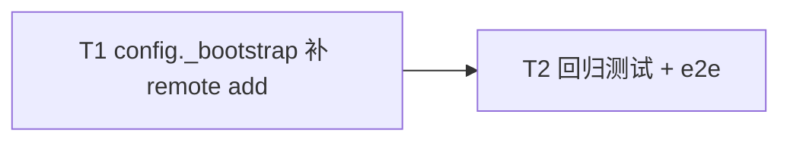

# 0033 · openagents init 新建远端后自动 git remote add origin

<!-- 本文件由 spec 工具维护：frontmatter 为结构化源数据（含 tasks DAG），正文为组级 rust-RFC 9 段总览。 -->

## Summary

`openagents init` 在冷启动交互流程里替用户新建 GitHub 远端仓库后，**漏了把远端写回本地 git
config**：`create_repo` 成功拿到 remote url，却从未执行 `git remote add origin <url>`。结果本地
仓库没有任何 remote，紧接着的 `gh label create` 等命令无法确定目标仓库，以 `✗ no git remotes
found` 非零退出，整个 `init` 冷启动失败。本 spec 在 `config._bootstrap` 里补上 `git remote add
origin <url>`，让本地 git config 与刚建好的远端同步，使后续所有 `gh` 命令能正常解析目标仓库。

## Motivation

**现状（就地复述，便于自包含）。** `openagents init` 的冷启动 preflight 由
`openagents/config.py` 承担（决策 10「以当前工作目录为目标项目」）：

- `resolve_project()` 从 cwd 解析 git root 与 `remote.origin.url`；非 git 仓库返回 `None`，
  无远端时 `ProjectContext.remote` 为 `None`。
- `ensure_project(interactive=...)` 是各命令的 preflight：仓库已就绪（有 git + 有 origin
  远端）直接返回；非交互模式（CI）下缺任一即抛 `ProjectNotReady`，绝不擅自创建；交互模式下
  调用 `_bootstrap` 逐步补齐。
- `_bootstrap(ctx)` 的两步补齐：① 若 `ctx is None`，提示并 `git init -b main`；② 若没有
  origin 远端，提示用户输入 `owner/repo` 与可见性，调用 `github.create_repo(name=, private=)`，
  后者用 `gh repo create` 新建远端并返回 remote url。

**bug 根因。** `_bootstrap` 第 ② 步拿到 `remote = create_repo(...)` 后，只是用这个 url 构造了一个
新的 `ProjectContext(repo_root=..., remote=remote)` 返回给调用方——**这只是进程内的内存对象，
本地 git config 里依旧没有任何 remote**。换句话说，`create_repo` 在 GitHub 侧建好了仓库，本地
`.git/config` 却仍是「无 remote」状态。

**为什么会炸。** `_bootstrap` 返回后，调用链 `_cmd_init → github.ensure_prerequisites →
ensure_label(name="openagents")` 执行 `gh label create`。`gh` 解析目标仓库依赖**进程 cwd 下当前
git 仓库的 remote**（见 [[gh-resolves-repo-by-process-cwd]]）；此刻本地无 remote，`gh` 无从确定
对哪个仓库建标签，stderr 打印 `no git remotes found` 并非零退出，`init` 冷启动整体失败。

**影响面。** `openagents/config.py:_bootstrap`（冷启动路径）；命中所有通过 `openagents init`
交互式**新建** GitHub 仓库的用户（已有 origin 远端的用户走不到这条分支，不受影响）。

**期望行为。** `create_repo` 成功返回 url 后，立即 `git remote add origin <url>`，让本地
git config 与远端同步，后续 `gh label create` 等命令能正确解析目标仓库，`init` 一路走通。

## Guide-level explanation

从用户视角，修复后的 `openagents init` 冷启动是一条顺滑的链路：

```
$ cd ~/my-fresh-project        # 非 git 目录
$ openagents init
当前目录不是 git 仓库，是否执行 git init？ [y/N] y
当前仓库没有 origin 远端，是否新建 GitHub 仓库？ [y/N] y
远端仓库名（owner/repo）：acme/widget
设为私有仓库？ [y/N] y
✓ 已新建远端 https://github.com/acme/widget.git
✓ 标签 openagents 就绪          # ← gh 现在能找到目标仓库了
✓ init 完成
```

关键差异在第 5 行之后：在本 spec 之前，`create_repo` 建好远端后本地仍无 remote，下一步
`gh label create` 立刻报 `✗ no git remotes found` 而中断；修复后，`_bootstrap` 在拿到 url 的
当下就执行了等价于 `git remote add origin <url>` 的操作，本地 git config 与远端对齐，后续所有
`gh` 命令都能解析到 `acme/widget`。对用户而言这是「本该如此」的行为——新建远端就应该顺带把它
接到本地仓库上。

## Reference-level explanation

### 技术方案

在 `openagents/config.py:_bootstrap` 的远端新建分支里，于 `create_repo` 成功返回后、构造新
`ProjectContext` 之前，插入一次**校验式**的 git 子进程调用，把远端写入本地 config：

```python
remote = create_repo(name=name, private=private)
# Spec-0033/T1: 把新建的远端写回本地 git config，否则后续 gh 命令找不到目标仓库
subprocess.run(["git", "remote", "add", "origin", remote], check=True, capture_output=True)
ctx = ProjectContext(repo_root=ctx.repo_root, remote=remote)
```

设计要点：

- **复用既有 `subprocess.run(..., check=True, capture_output=True)` 风格**，与同函数内
  `git init -b main` 一致——`check=True` 让 git 失败立即冒泡（如 origin 已存在），不静默吞错。
  不新造 git 包装层（理念 1 奥卡姆剃刀）；不复用忽略失败的 `_git_output`（那个语义是「读取，
  失败返回 None」，这里需要「写入，失败必须报错」）。
- **顺序契约**：`git remote add` 必须在 `create_repo` 成功**之后**——远端不存在时把它接上去无
  意义；且必须在返回 `ctx` 之前，保证 `_bootstrap` 的后置条件「返回的 ProjectContext 对应的
  remote 确实已落到本地 git config」成立。
- **作用域收敛**：只改 `_bootstrap` 远端分支这一处；`resolve_project` / `ensure_project` /
  `create_repo` 的签名与语义不动。

### DAG 与文件分配

| Task | 标题 | 文件（单一 writer 所有权，互斥） | 依赖 |
|---|---|---|---|
| T1 | `_bootstrap` 新建远端后 `git remote add origin` | `openagents/config.py` | — |
| T2 | 回归测试 + e2e 覆盖 remote-add 路径 | `tests/test_config.py`、`scripts/e2e-spec-0033-init-remote-add.sh` | T1 |



T1 改生产代码、T2 加测试与端到端脚本，文件集互斥（理念 6 单一 writer）。T2 依赖 T1：测试要对
着修好的行为断言。

### e2e 脚本路径

`scripts/e2e-spec-0033-init-remote-add.sh`（由 T2 创建）：在临时非 git 目录里以 stub 掉的
`create_repo`（或 `gh` fake）驱动 `ensure_project(interactive=True)` 冷启动，断言收尾时
`git config --get remote.origin.url` 返回新建的远端 url，证明本地 git config 已与远端同步。

## Drawbacks

- 多一次 git 子进程调用，让 `_bootstrap` 的远端分支多一个潜在失败点（如 origin 名已被占用会
  抛错）。但这正是期望的——冷启动里 origin 不该已存在，`check=True` 把异常状态显式暴露，好过
  当前「悄悄不接 remote、把锅甩给下游 gh 报费解错误」。
- 该路径依赖真实 git/gh，单元测试需 stub `create_repo` 才能在无网环境验证，略增测试样板。

## Rationale and alternatives

**选定方案：在 `_bootstrap` 内 `create_repo` 之后直接 `git remote add origin`。** 修复点与根因
同处一行附近，作用域最小，且让 `_bootstrap`「返回的 ctx 的 remote 已落到本地 config」这一后置
条件成立。

**备选 1：把 `git remote add` 塞进 `github.create_repo`。** 让「建远端」顺带「接本地」。否决：
`create_repo` 的语义是「在 GitHub 侧创建仓库并返回 url」，与「操作本地 git config」是两件事；
混在一起会让这个纯 GitHub 封装隐式依赖 cwd 是个 git 仓库，违反模块解耦（理念 10）。本地 wiring
属于 `config._bootstrap`（项目绑定）的职责。

**备选 2：用 `gh repo create --source=. --remote=origin --push`** 让 gh 一步新建远端并自动接上
本地 remote。否决：会改动 `create_repo` 的命令形态与返回约定（`--source` 模式行为不同），改动面
比「补一行 remote add」大；且把「是否、如何接 remote」的决策从我们能精确控制的 config 层移交给
gh 的标志组合，可控性下降。后续若要简化可再评估（见 Future possibilities）。

## Prior art

- `git` 官方流程：`git remote add origin <url>` 正是把本地仓库与远端关联的标准动作（见
  [git-remote 文档](https://git-scm.com/docs/git-remote)）；本 spec 只是把这个本该有的步骤补回
  冷启动链路。
- 同仓内 `_bootstrap` 已有的 `git init -b main`（`check=True` 校验式子进程）即同类先例，本次
  `git remote add` 复用同一风格，保持一致。

## Unresolved questions

- 暂无。冷启动场景下 origin 必然不存在，无需考虑「origin 已存在则覆盖」的合并语义；若未来发现
  有用户在已有 origin 的仓库误入此路径再议。

## Future possibilities

- 若后续把冷启动整体迁到 `gh repo create --source=. --remote=origin --push` 一步式，可移除这里
  的显式 `git remote add`（见 Rationale 备选 2）；本 spec 先以最小改动修 bug，不预先引入该耦合。
- 可考虑在 `_bootstrap` 收尾处复用 `resolve_project()` 重新解析一次，作为「remote 确已写入」的
  自校验断言，进一步硬化后置条件。

