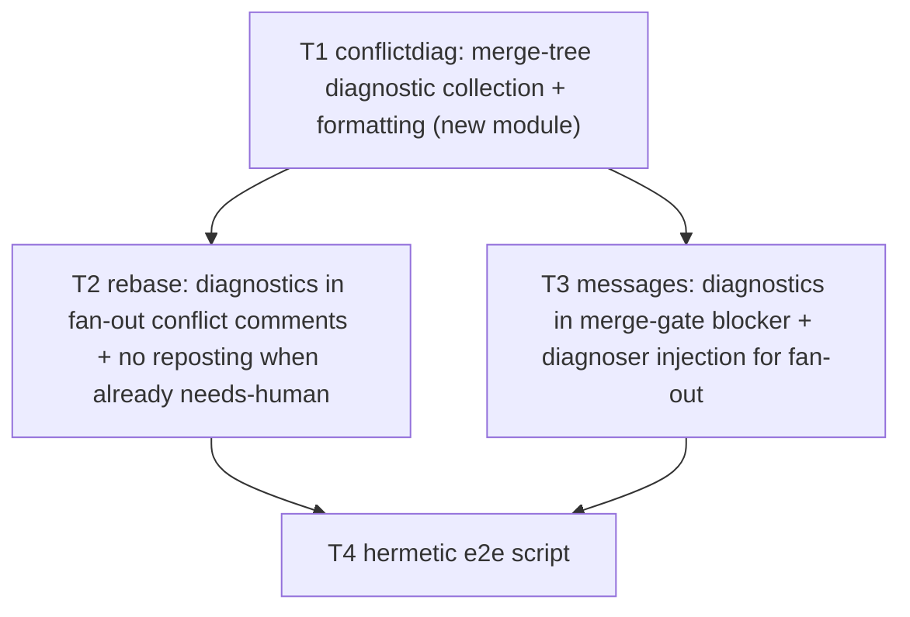

# 0034 · Locatable diagnostics in conflict/blocked notifications + curbing repeated merge fan-out notifications—making “what exactly is the conflict?” structurally answerable

<!-- This file is maintained by the spec tool: frontmatter is the structured source data (including the tasks DAG); the body is a group-level overview in the nine rust-RFC sections. -->

## Summary

Turn all “merge conflict” notifications from **static canned messages without diagnostics** into **locatable diagnostics**, and close the only channel that still **mechanically reposts**
canned messages:

1. **Conflict diagnostic collection (new decoupled module `conflictdiag`)**—use **worktree-free `git merge-tree
   --write-tree`** (git 2.38+, no checkout, no changes to the working directory) to calculate which files would conflict when a PR branch is merged into its target branch,
   along with **key hunk summaries** for each conflicting file, producing structured markdown (conflicting file list + key hunk summaries + the step
   where progress is blocked). Pure function + injected `run` / safe fallback: if diagnostics are unavailable (old git / any exception), fall back to today’s generic sentence.
2. **Feed diagnostics into the “Where I’m stuck” section of both types of conflict notification**—① merge gate blocked comments (`messages._block(gate="merge")`,
   currently the static string `blocker=rebase.CONFLICT_COMMENT`); ② merge fan-out conflict comments (the conflict fallback in `rebase.rebase_open_prs`,
   currently the static string `post_signed_comment(CONFLICT_COMMENT)`). Replace the body in both places with one containing diagnostics.
3. **Stop mechanical reposting in fan-out**—merge fan-out skips conflict comments for PRs **already labeled `needs-human`**: communication between humans and agents
   on these PRs is already handled by the **blocked read-side feedback loop** from issue #89 (Spec-0032) (a human reply unblocks the PR and is passed in as detail). Posting
   the same sentence again during fan-out only **drowns out** the human’s follow-up questions. Eliminate “asking three times in the same place and receiving the exact same canned response” at its source.

**Explicitly out of scope** (boundaries, principle 10: decoupling): do not rewrite the “blocked read side” already implemented in #89 (poll reads human comments to unblock); do not
introduce comment reading in non-blocked scenarios; do not change reviewer/e2e output formats—this group only adds **diagnostic fields to conflict notifications** and **curbs
reposting in fan-out**.

## Motivation

**Background (restated here so that essential information does not depend on bare references)**: OpenAgents is an RFC/spec-driven multi-agent framework. The watcher,
`messages.Messages.poll`, periodically scans all open runs and routes GitHub events according to their stage. Before running the reviewer, the coding gate `_process_coding`
performs a **mergeability precheck** (`github.mergeability` returns `merge_state_status` / `mergeable`;
`DIRTY` or `CONFLICTING` indicates a conflict). On conflict: ① if a coding backend has been injected, first dispatch an agent to resolve the conflict semantically
(`conflict.make_resolver` runs `git merge origin/<base>` in a temporary worktree, feeds the conflicting file list to the agent if conflicts occur, has it resolve them,
run self-tests, and push); if resolution succeeds, do not block in this cycle; ② if resolution fails → `_block(record, gate="merge", blocker=...)`: post a comment +
apply the `needs-human` label (`github.BLOCKED_LABEL = "needs-human"`) + set `STATUS_BLOCKED` (outside
`_OPEN_STATUSES`, so the next poll cycle softly skips it) + persist `block_gate="merge"` / `block_watermark`. There is also an **independent**
conflict channel: after a PR is merged into main, `rebase.rebase_open_prs` fans out to run
`github.update_branch` on **every other open PR** (merging in the latest main and triggering a CI rerun). On conflict (`GithubError`), it falls back in layers through
`indexheal → conflict.resolve → manual-intervention comment`. The final layer posts a comment with `identity.post_signed_comment(pr,
body=rebase.CONFLICT_COMMENT, agent_id=…)` and continues to the next PR (stateless, with error isolation; principle 10).

**`rebase.CONFLICT_COMMENT` is a static string that never contains diagnostics** (`openagents/rebase.py`):

> 🤖 OpenAgents tried to automatically sync this PR branch after main was updated, but there are conflicts that cannot be resolved automatically. Please manually rebase /
> resolve the conflicts, then push again.

**By construction**, it contains no information about “which file or which hunk conflicts.” Both types of conflict notification currently use it as their body: the merge gate’s `_block` passes it
as `blocker` into the “Where I’m stuck” section of the structured blocked comment (three sites: initial conflict detection in `_process_coding`, and no backend / attempt limit reached in `_process_armed_conflict`); the fan-out conflict fallback also posts it directly.

**Real case (source of issue #92, ccKanBan PR `pcj-sudo/wind-palace-of-cc#11`)**: a human asked follow-up questions / gave instructions three times in the same place,
and each time received the sentence above **word for word**:

| Time | Who | Content |
|------|----|----|
| 03:43 | 👤 Human | Rebase to resolve the conflicts + upload screenshots of the e2e results to the commit |
| 03:45 | 🤖 | “There are conflicts that cannot be resolved automatically. Please manually rebase…” |
| 09:26 | 👤 Human | **What exactly is the conflict that cannot be resolved automatically?** |
| 09:37 | 🤖 | “There are conflicts that cannot be resolved automatically…” (exactly the same) |
| 10:02 | 👤 Human | Resolve the conflicts and update the PR; if you cannot resolve them, explain the reason in detail in a comment |
| 10:03 | 🤖 | “There are conflicts that cannot be resolved automatically…” (still exactly the same) |

Three different questions/instructions received the same unrelated sentence—**asking made no difference**. The actual conflict in this case was a content conflict caused by **three parallel spec PRs all editing
the aggregate index `docs/specs/OVERVIEW.md`**, but the messages never said so.

**Two problems, corresponding to A / B in the issue:**

- **B: Notifications lack diagnostics.** Questions such as “what exactly is the conflict?” are **structurally unanswerable** with the existing mechanism—`CONFLICT_COMMENT`
  never contains files/hunks. Notifications need to include a **conflicting file list + key hunk summaries** (as well as the gate type and the step where progress is blocked).
- **A: Comments go out but are not read / mechanical reposting.** The three identical sentences are no coincidence: **merge fan-out `rebase_open_prs` is stateless and does not know
  whether a human has already taken over the PR**—whenever **another** PR is merged into main, fan-out **posts the same sentence again** on this still-conflicting PR.
  Issue #89 (Spec-0032, already merged into this repository’s base) restored the **blocked read side**: on blocked PRs, poll reads
  human comments “after the blocking watermark and without an OpenAgents signature.” When it finds one, it automatically removes `needs-human` + passes the comment body as detail
  to the agent for the corresponding gate (the merge gate takes the armed conflict-resolution path)—**a human reply can unblock the PR**. But #89’s read side **only applies in the blocked branch**
  and **does not cover the stateless fan-out channel**: fan-out continues mechanically reposting on PRs already labeled `needs-human`, drowning out human follow-up questions in canned messages.

**Why comments historically were not read—RFC-0019**: RFC-0011’s original design had a read side (poll reads comments → filters out self-comments by signature → triggers
`refine_rfc`/`iterate`). RFC-0019 made automatic transitions **not read comments** out of concern about **self-loops** (an agent might read its own
comments and iterate indefinitely), reducing `identity.parse_agent_id` to a write-only audit tool. #89 **selectively re-enabled** the read side with two hard constraints:
“only after blocking + only unsigned human comments” (solely for unblocking). **This group does not touch the read side again**—the remaining part of A is not “read comments again,”
but “make the fan-out channel that **does not read comments and mechanically reposts** stay quiet for PRs already handled by #89’s read side + include diagnostics when it actually posts for the first time.”

**Expected outcomes (aligned with the issue)**:
- **A**: Merge fan-out **stops reposting** conflict comments on PRs already labeled `needs-human` (a human has intervened and #89’s read side is handling them); the first comment also includes diagnostics.
- **B**: Both merge gate blocked comments and fan-out conflict comments include a **conflicting file list + key hunk summaries + gate / step where progress is blocked**,
  so humans no longer need to ask “what exactly is it?”

## Guide-level explanation

After implementation, when a PR hits a merge conflict, humans see **diagnostics that directly locate the problem** instead of a generic canned message; and **the same sentence no longer
floods the thread repeatedly**.

**① Conflict blocking—the blocked comment includes diagnostics.** When the merge gate cannot resolve a conflict and blocks (`_block(gate="merge")`), the “Where I’m stuck” section
of the structured signed comment on the PR is no longer a single sentence, but the following (template; see Reference-level for details):

```markdown
🤖 OpenAgents is stuck and needs your judgment

**Reason**: There are conflicts with the target branch that cannot be resolved automatically (gate=merge)
**What I tried**: Dispatched an agent to attempt semantic conflict resolution N times, but it still failed
**Where I’m stuck**: The following files conflict when automatically merging `origin/main` and require human judgment—
> **Conflicting files (2)**
> - `docs/specs/OVERVIEW.md`
> - `openagents/messages.py`
>
> **Key hunk summary · docs/specs/OVERVIEW.md**
> ```
> <<<<<<< (ours)
> | 0031 | Merge unblocking |
> =======
> | 0032 | Comment feedback loop |
> >>>>>>> (origin/main)
> ```

**What you can do**: **Reply with a comment** directly on this PR to provide guidance, and I will continue based on it; you do not need to remove the label manually.

<!-- openagents:agent=<id> -->
```

Humans can immediately see which files conflict, what the key conflicts look like, and that progress is blocked at the merge gate—“what exactly is the conflict?” is **answered on the spot**. After that,
a human reply is handled by #89’s blocked read-side feedback loop (automatically removing `needs-human` + passing in detail); this group does not change that path.

**② Merge fan-out—diagnostics on the first post, no more mechanical reposting.** When **another** PR is merged into main and triggers fan-out:

- For a PR that still has conflicts but is **not yet** labeled `needs-human`: fan-out posts a signed comment **with diagnostics** (the same conflicting file list +
  key hunk summaries), telling the human “these files in this PR conflict after main was updated.”
- For a PR **already** labeled `needs-human` (a human has intervened and #89’s read side is handling its comment conversation): fan-out **skips** the conflict comment
  —it no longer posts a second or third canned sentence to drown out human follow-up questions. Communication for these PRs is handed back entirely to the blocked read-side feedback loop.

This eliminates the case’s “two reposts at 09:37 / 10:03” at their source: the first time (when the PR initially develops conflicts), a comment with diagnostics is posted; the PR then enters
`needs-human`, and every subsequent fan-out stays quiet for it. The human’s three follow-up comments are also answered individually by #89’s read side.

**③ Safe fallback when diagnostics are unavailable.** If the runtime environment has git < 2.38 (no `merge-tree --write-tree`), refs cannot be obtained,
or any exception occurs—diagnostic collection **swallows the exception and returns empty**, and the notification **falls back to today’s generic sentence** (the semantics of `CONFLICT_COMMENT` remain unchanged).
Attempting to provide diagnostics must never cause blocking / fan-out itself to fail.

## Reference-level explanation

### Core mechanism: worktree-free `git merge-tree` diagnostics

The conflicting file list **can already be calculated locally** today—`_conflicted` in `conflict.py` (`git diff --name-only
--diff-filter=U`) does this, but it is buried in the conflict-resolution worktree flow, returns only a bool, and incurs the high cost of creating/cleaning up a worktree. This group instead uses
**`git merge-tree --write-tree origin/<base> origin/<head>`** (git 2.38+): **no checkout, no changes to the working directory,
no worktree creation**; it calculates the merge result directly in the object database, with stdout containing the conflicting file list + conflict content marked with `<<<<<<< / ======= / >>>>>>>`.
This is precisely the authoritative, inexpensive source for the “conflicting file list + key hunk summaries.”

### New module `openagents/conflictdiag.py` (T1, decoupling—principle 10)

- Pure/injectable, with three responsibilities, all of which **degrade safely** (swallow any exception as an “empty diagnosis”; never propagate it):
  - `collect(*, base, head, run) -> ConflictDiag`: use the injected `run` (which wraps `git` by default) to run
    `merge-tree --write-tree origin/<base> origin/<head>` and parse the output into `ConflictDiag(files: list[str],
    hunks: dict[str, str])`—`files` is the list of conflicting files, and `hunks` contains a **key hunk summary** for each conflicting file (take
    the first/most representative conflict block and **truncate** it by character count to keep comments from becoming too long). If git reports “no conflicts / command not found / nonzero exit status,” or any
    exception occurs → return an **empty** `ConflictDiag`.
  - `format_blocker(*, diag, step) -> str`: a pure function that renders `ConflictDiag` as a “where it is blocked” Markdown section
    (list of conflicting files + key hunk summaries + `step` describing “which step is blocked”); if `diag` is empty → return generic fallback text
    (equivalent in meaning to today's `CONFLICT_COMMENT`), so downstream callers do not need to check for emptiness themselves.
  - `make_diagnoser(*, work_dir, base) -> Callable[..., str]`: an IO factory (structured like `conflict.make_resolver`)
    that returns a `diagnose(*, pr_number) -> str` closure—retrieve the PR's head branch, `git fetch` base/head, and call
    `collect` + `format_blocker`, on an overall best-effort basis (failure at any stage → return the fallback text for an empty diagnosis). For injection into
    `rebase_open_prs`; when `work_dir` is unavailable, the caller passes `None`, and downstream code falls back to static text.
- Consolidate “what conflict diagnostics look like + how they are computed” into one pure module that can be unit-tested; `messages` / `rebase` only call it, without incorporating git details.

### Changes (by file / Task)

**`openagents/rebase.py` (T2)**:
- Add the optional parameter `diagnose: Callable[..., str] | None = None` to `rebase_open_prs` (structured like the existing `heal` /
  `resolve` injection, preserving statelessness: rebase does not hold work_dir; messages/CLI pass the diagnostic capability through).
- In the conflict fallback branch (after neither `heal` nor `resolve` succeeds):
  - **Suppress repeated posting**: first call `github.has_label(pr_number=pr.number, name=github.BLOCKED_LABEL)`—if already
    `needs-human` (a human has intervened, and the #89 read side is handling it) → **skip the comment**, record a distinct result category (such as
    `RESULT_CONFLICT_SUPPRESSED`, for logs/test assertions), and continue to the next PR.
  - Otherwise, post a comment: use `diagnose(pr_number=pr.number)` for the body (when a diagnoser is injected) to include diagnostics; if `diagnose is None` or it returns
    fallback text, fall back to the static `CONFLICT_COMMENT`. Continue signing via `identity.post_signed_comment` (the meaning is unchanged: signing
    lets the #89 read side filter it out as a machine comment based on the signature, so it does not accidentally trigger unblocking), and record `RESULT_CONFLICT`.
- **Retain** the `CONFLICT_COMMENT` constant as the “empty-diagnosis fallback text”; do not delete it (backward compatibility + the manual sync-prs path without work_dir).

**`openagents/messages.py` (T3, integration)**:
- Add `_make_diagnoser() -> Callable[..., str] | None` (mirroring the existing `_make_resolver`: return `conflictdiag.make_diagnoser(...)` only when both `work_dir` /
  `base` are available; otherwise return `None`).
- Add a small private helper `_conflict_blocker(*, pr_number) -> str`: if a diagnoser is available, call it to produce the “where it is blocked” body with diagnostics;
  otherwise fall back to `rebase.CONFLICT_COMMENT`—provide a uniform source of `blocker` for the three `_block` calls at the merge gate.
- Change the three merge-gate calls to `_block(gate="merge", blocker=rebase.CONFLICT_COMMENT)` to use
  `blocker=self._conflict_blocker(pr_number=pr_number)`: when `_process_coding` first detects a conflict,
  when `_process_armed_conflict` has no backend, and when `_process_armed_conflict` reaches its limit.
- Pass `diagnose=self._make_diagnoser()` at the merge fan-out call to `rebase.rebase_open_prs(...)` (so fan-out conflict comments
  include diagnostics + trigger T2's repeated-post suppression). The order and semantics of `_block`'s own comments/labels/watermarks (including #89's watermark persistence)
  remain **completely unchanged**—this group only changes the source of the `blocker` content.

**e2e script (T4)**: `scripts/e2e-spec-0034-conflict-diagnostics.sh` (hermetic; see below).

### DAG + file allocation



| Task | Title | files | Dependencies |
|---|---|---|---|
| T1 | conflictdiag: `merge-tree` diagnostic collection + formatting (new module) | `openagents/conflictdiag.py`, `tests/test_conflictdiag.py` | — |
| T2 | rebase: diagnostics in fan-out conflict comments + no reposting when already `needs-human` | `openagents/rebase.py`, `tests/test_rebase_conflict_diag.py` | T1 |
| T3 | messages: diagnostics in merge-gate `blocker` + diagnoser injection for fan-out | `openagents/messages.py`, `tests/test_messages_conflict_diag.py` | T1 |
| T4 | Hermetic e2e script (no network, no real LLM/gh/git remotes) | `scripts/e2e-spec-0034-conflict-diagnostics.sh` | T2, T3 |

The `files` allocations within this group are mutually exclusive (single-writer ownership, principle 6). T2 and T3 do not depend on each other and can run in parallel (they modify the two
decoupled rebase / messages channels respectively, each with its own dedicated new test file, **without modifying existing `tests/test_rebase*.py` / `tests/test_messages*.py`**, minimizing
the potential for shared-test-file conflicts across parallel PRs—this group is specifically about conflict notifications and should not itself create shared-file conflicts).
`openagents/conflict.py` (worktree conflict resolution), `openagents/identity.py` (#89 read side), `openagents/state.py`,
and `openagents/blocknote.py` (#89 four-section template) are **reused without modification**—this group only adds diagnostic fields and fan-out suppression; it does not rewrite conflict resolution/read-side/
comment-template capabilities (boundary, principle 10: decoupling).

**e2e script path**: `scripts/e2e-spec-0034-conflict-diagnostics.sh` (hermetic, in two parts: ① `ruff check` +
`ruff format --check` + `pytest -q` for offline, deterministic verification; ② use a fake `run` (fed fixed `git merge-tree` output)
+ fake `github.has_label` / `post_signed_comment` to exercise the complete flow of “conflict → collect diagnostics → comment with a file list + hunk summaries;
fan-out to an already needs-human PR → skip without reposting; empty diagnosis → fall back to generic text,” without any network access, real LLM calls,
real gh use, or connections to real git remotes).

Comments in new code at each layer must include this group's spec ID (`Spec-0034/Tn`) in accordance with the code-comment conventions.

### Self-loop prevention / safety invariants

- **Do not reintroduce read-side risks**: this group **does not read comments**; it only **writes** notifications. The remaining issue in A is
  addressed by “keeping fan-out silent for `needs-human` PRs,” returning control of the conversation to #89's blocked read side, whose safety boundaries have already been reviewed (only after blocking + only unsigned human comments). No new self-loop exposure.
- **Diagnostics must never cause blocking/fan-out to fail**: `collect` / `make_diagnoser` swallow exceptions throughout and return an empty diagnosis → fallback text; at worst, behavior degrades
  to today's behavior. The notification's own label/state/watermark side effects must remain unaffected by diagnostic success or failure.
- **Signature semantics remain unchanged**: fan-out and blocking comments still carry this instance's signature; the #89 read side filters out machine comments based on the signature and will not mistake a diagnostic comment for a human
  unblocking signal.

## Drawbacks

- **Depends on `merge-tree --write-tree` from git 2.38+**: older git versions cannot provide diagnostics. Mitigation: degrade safely to today's generic
  text (no functional regression, only missing diagnostics); CI/runtime environments generally already meet this requirement. Include in Unresolved for verification against deployment environments.
- **One additional git round trip**: blocking/fan-out adds a `fetch` + `merge-tree` (read-only, without touching the working directory, lighter than creating a worktree).
  Mitigation: trigger only for PRs that **are confirmed to have conflicts** (not every PR on every iteration); fall back immediately on failure, without pointless retries.
- **“Key hunk summaries” may truncate information**: to control comment length, take only representative conflict blocks and truncate them, so complex conflicts cannot be seen in full. Mitigation: the list
  includes all conflicting files, while hunks serve only to “locate the problem at a glance”; humans can use the list to inspect the full local `git diff`. Include the truncation threshold in Unresolved.
- **Fan-out is completely silent for `needs-human` PRs**: if such a PR's base changes again while a human is intervening (new conflicts), fan-out provides no further notification. Mitigation:
  during human intervention, the #89 read side handles the conversation; after the PR is unblocked and resumes processing, the next preflight check will rediscover the conflict and block it with diagnostics. At worst, there is a one-iteration delay, with no
  loss of state. Whether to “refresh/update the existing diagnostic comment” instead of remaining completely silent is included in Unresolved.

## Rationale and alternatives

**Why use `git merge-tree --write-tree` instead of reusing the worktree path in `conflict.py`**: `conflict._conflicted`
requires creating a detached worktree + running `git merge` first, which is expensive and designed for “conflict resolution”; diagnostics only need to **read** conflicts, without a working directory.
`merge-tree --write-tree` obtains the conflicting-file list + content without a checkout; it is inexpensive and has no side effects, making it well suited to diagnostics. **Alternative**:
extend `conflict.resolve_branch` to **return** conflict diagnostics on failure (instead of bool). Rejected—it would change the stable conflict-resolution
contract (the `resolve` callback `(*, pr_number) -> bool` is relied on by `rebase_open_prs`), tightly couple the two
concerns of “conflict resolution” and “diagnostics,” and make diagnostics available only “after resolve has run” (neither blocking at the merge gate's first preflight check nor manual sync-prs runs resolve).
An independent `conflictdiag` module can serve both scenarios, with cleaner decoupling (principle 10).

**Why address the remaining issue in A by “keeping fan-out silent for needs-human PRs” instead of “adding another read side”**: issue #89 (Spec-0032, already merged)
has already restored the blocked read side and reviewed its safety boundaries (only after blocking + only unsigned human comments, to prevent self-loops). The root cause of repeated reposting in the example is **not
“the absence of a read side”**, but **“the stateless fan-out channel bypassing the read side and mechanically reposting to PRs that have already been taken over.”** The smallest fix aligned with #89 is
to have fan-out stop when it detects the `needs-human` label and return control of the conversation to the read side—instead of creating a parallel read side (which would duplicate #89 and reopen
RFC-0019's self-loop exposure). **Alternative**: also connect `new_human_comments` within fan-out to handle read-side responses. Rejected—it duplicates #89, broadens the read side's
scope, and violates principle 1 (do not add entities unless necessary).

**Why retain the `rebase.CONFLICT_COMMENT` constant instead of deleting it**: it becomes the “empty-diagnosis fallback text,” reused by the diagnostic degradation path and manual
`sync-prs` without work_dir; deleting it would instead require rewriting fallback strings in multiple places. Keeping it = minimal change + backward compatibility (principle 1).

**Why inject the diagnoser into `rebase_open_prs` as `diagnose` instead of having rebase hold work_dir itself**: `rebase.py` is
a **stateless** fan-out module deliberately designed in RFC-0009 (it does not read state or hold work_dir, making it easy for both poll and manual `sync-prs` to
reuse). Following the existing `heal` / `resolve` injection style, messages/CLI pass the diagnostic capability through, preserving statelessness while reusing the injection structure.


## Prior art

- **issue #89 / Spec-0032 (`needs-human` comment feedback loop)**: The **direct predecessor and scope boundary** for this work. #89 restored the blocked read side
  (`identity.new_human_comments` uses signatures + a watermark to read only “unsigned human comments posted after blocking” → automatically removes `needs-human`
  + feeds the comments as detail to the corresponding gate agent) and standardized **structured suspension comments** (the four-part template in `blocknote.build`; the merge
  gate's `blocker` is the “where it is stuck” section). This work **reuses** the `blocknote` template and `_block` flow, replacing only the merge gate's `blocker`
  static string with diagnostics; it also closes the gap of **repeated sends from stateless fan-out**, which #89 did not cover. The two are orthogonal and can be merged independently.
- **RFC-0009 `rebase_open_prs` fan-out**: This work retains its stateless skeleton with `heal`/`resolve` injection, adds `diagnose`
  injection and convergence on `needs-human`, and preserves the approach of “isolating errors so that a single PR failure does not bring down the entire round.”
- **Spec-0028 `conflict.py` semantic conflict resolution**: This work's diagnostics are orthogonal to its conflict resolution—it **resolves** conflicts (worktree + agent),
  while this work **explains** conflicts (worktree-free merge-tree); the `--diff-filter=U` approach in `_conflicted` confirms that “locally identifying
  conflicted files” is feasible. This work uses the lighter merge-tree instead.
- **RFC-0011 / RFC-0019 comment signatures and read-side freeze**: This work reuses `post_signed_comment` (to apply signatures); it does not unfreeze the read side
  (#89 handles the read side within a safe subset). The remaining issue A bypasses the read side by “making fan-out aware of labels so it stops,” without reintroducing self-loops.
- **git `merge-tree --write-tree`** (https://git-scm.com/docs/git-merge-tree, git 2.38+ “Cleanly merging
  / conflict reporting”): The official mechanism for computing merge results and conflicts without a worktree—the technical basis for collecting diagnostics.
- **rust-lang/rfcs** (https://github.com/rust-lang/rfcs): The source of the nine-section overview structure.

## Unresolved questions

- **Fallback for the minimum git version required by `merge-tree --write-tree`**: Do all target runtime/CI environments have git ≥ 2.38? If older git versions must be supported,
  should degraded diagnostic collection based on `git merge` in a temporary worktree (which is heavier) be provided as a second fallback layer? The initial decision is to **use only merge-tree +
  an empty-diagnostics fallback**, and revisit this once the deployment environments are confirmed.
- **Truncation thresholds for key hunk summaries**: How many hunks per file and how many characters per hunk allow readers to “locate the problem at a glance” without flooding the screen? The initial decision is
  “take the first conflict block from each conflicted file and truncate the overall diagnostics at a conservative character limit,” with calibration left to actual runs.
- **Whether fan-out should “update” `needs-human` PRs rather than “remain completely silent”**: Currently, it skips them entirely. Should it refresh the existing diagnostic comment when base changes cause **new**
  conflicts, rather than remain silent? The initial decision is to **remain completely silent** (the simplest approach, cleanly handing control of the conversation to #89's read side). This is listed here so actual runs
  can reveal whether any conflicts go unreported.
- **Whether diagnostics should also be fed into #89's detail for resuming suspended work / the armed conflict resolver**: Currently, diagnostics appear only in the **notification body**; in the future, the list of conflicted files
  could also be passed through to #89's routing for resuming suspended work or to the agent task in `conflict.resolve`, saving the conflict resolution agent from computing it again. This work does not do so; it is listed as a coordination point.

## Future possibilities

- **Extend diagnostics to be “gate-generic”**: Currently, only merge conflict diagnostics are covered; the same `conflictdiag` approach could extend to the “where it is stuck” sections of other gates, such as CI failures
  (failed job + key log summary) and reviewer output that cannot be parsed (summary of the original verdict), so that all
  `needs-human` notifications identify the problem.
- **Integrate diagnostics into the results dashboard**: Structure “conflicted file list / step where it is stuck / time spent waiting” in the dashboard, giving people a single-screen overview of “PRs awaiting action +
  specific blockers” (Principle 2: humans are responsible for high-level oversight).
- **Coordinate with #84 / Spec-0031 armed conflict resolution**: Pass this work's diagnostics (conflicted file list + hunks) through to the armed conflict resolver,
  reducing the overhead of “first investigating the conflicts itself,” and directly include human comments guiding resolution of the conflict in the conflict resolution agent's task.
