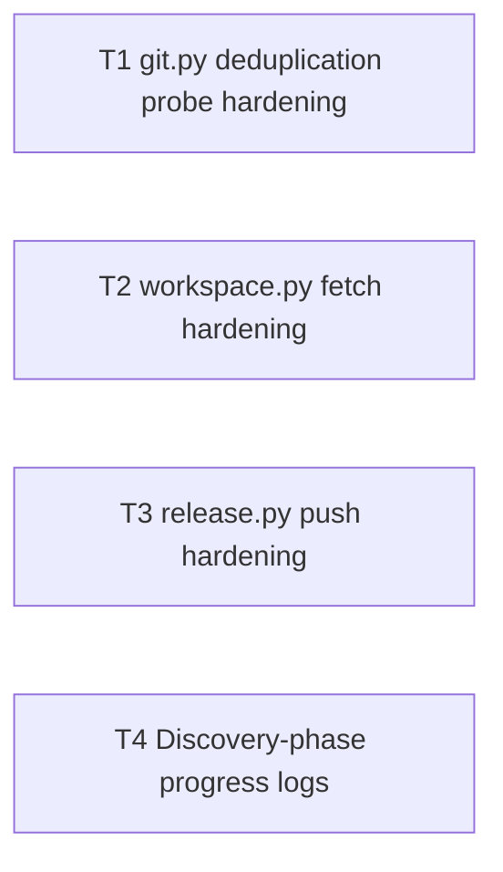

# 0035 · Uniform hard timeouts for bare git network calls (fail-open) + progress logging for slow discovery-stage checks

<!-- This file is maintained by the spec tool: the frontmatter is the structured source data (including the tasks DAG), and the body is a group-level overview in the nine rust-RFC sections. -->

## Summary

Add a uniform subprocess hard timeout to all **bare `git` subprocess calls that access the network**, with **fail-open** handling, so that Vigil always “stays alive and proceeds to the next round” under an isolated network disruption instead of blocking the entire round indefinitely. Also add stderr progress logs for slow discovery-stage checks so that, when any check gets stuck, the output clearly stops at its corresponding line. Align the approach with the existing `_GH_TIMEOUT_SECONDS` pattern in the repository’s `github.py`: give each of the three modules that still run network git operations (`utils/git.py` / `utils/workspace.py` / `utils/release.py`) a module-level constant, `_GIT_NET_TIMEOUT_SECONDS`; centralize passing `timeout=` in each module’s `_git` helper; then handle `subprocess.TimeoutExpired` at each network call boundary—deduplication probes **conservatively return True** on timeout (treat as “possibly in flight” → skip this round and retry next round), while fetch/push timeouts **raise the existing `WorkspaceError` / `RuntimeError`** (isolated by the existing per-issue / per-round `try/except`). Behavior on the default path (normal network conditions) remains byte-for-byte unchanged; timeouts trigger only when a call actually gets stuck. Introduce no network libraries / retry frameworks.

## Motivation

**Current behavior: `openagents vigil` can hang completely without any output.** The process remains alive, but an entire round produces no logs and makes no further progress. The root cause is that a **bare `git` subprocess call that accesses the network has no timeout** in the discovery stage—after a network disruption (network switching / waking from sleep / a half-open socket left by a VPN flap) stalls the underlying TLS connection, git **waits indefinitely** in `poll()`. This call runs synchronously in the Vigil main loop, freezing the entire round; moreover, this check **logs nothing while running**, so there is no indication of where it is stuck.

Investigation confirmed that this is not an isolated case—**none of the bare `git` subprocess calls that access the network pass `timeout=`**, and any of them can hang vigil / the CLI in the same way. By comparison, only the `gh` wrapper sets a timeout: `utils/github.py` has a module-level `_GH_TIMEOUT_SECONDS = 30`, and its sole central execution point, `_run_gh`, passes `timeout=` to `subprocess.run` and normalizes handling with `except subprocess.TimeoutExpired` (see decision 4 in that file / RFC-0010). This is precisely the layer missing from bare git.

**Evidence (network git call sites in this repository that currently lack timeouts).** The original line-number references in issue #147 refer to the **flat layer before consolidation** (`openagents/vigil.py` / `workspace.py` / `conflict.py` / `conflictdiag.py` / `release.py`); the consolidation work across Spec-0062–0065 (recipes 6→3, graph-driven parallel vigil, removal of the flat layer) has moved/deleted these. The following table lists the call sites that still run network git operations in the **actual current code after consolidation** (evidence-driven, principles 7/8—each verified individually with `grep`):

| # | Current location | git operation | Accesses the network | Owning helper |
|---|---|---|---|---|
| 1 | `utils/git.py::remote_branch_exists` (`git.py:55`) | `ls-remote --heads origin <branch>` | Yes (deduplication probe; the hang site explicitly named in the original issue) | `git.py::_git` |
| 2 | `utils/workspace.py::Workspace.remote_branch_exists` (`workspace.py:138`) | `ls-remote --heads origin <branch>` | Yes (deduplication probe) | `Workspace._git` |
| 3 | `utils/workspace.py::Workspace.prepare` (`workspace.py:55`) | `fetch origin <base>` | Yes | `Workspace._git` |
| 4 | `utils/workspace.py::Workspace.ensure` (`workspace.py:75`) | `fetch origin <branch>` | Yes | `Workspace._git` |
| 5 | `utils/workspace.py::Workspace.assert_delivered` (`workspace.py:95`) | `fetch origin <branch>` (`check=False`) | Yes | `Workspace._git` |
| 6 | `utils/release.py::_materialize_release` (`release.py:151`) | `push origin <source>:refs/heads/release/<version>` | Yes | `release.py::_git` |
| 7 | `utils/release.py::_materialize_release` (`release.py:155`) | `push origin <version>` (tag) | Yes | `release.py::_git` |

**Reconciliation with the original issue’s 10-row table (an honest mapping, without fabrication):** Original #1, `vigil.py:249` ls-remote → #1 in this table (moved to `git.remote_branch_exists` after consolidation, still a function exported through `__all__` on the stable git import surface); original #2 → #2 in this table; original #3/#4 workspace fetch → #3/#4/#5 in this table; the call sites for original #5 `workspace push -u`, original #6/#7 `conflict.py`, and original #8 `conflictdiag.py` **were deleted during consolidation** (`commit_and_push` was deleted in Spec-0056/T4, and the entire `conflict.py` / `conflictdiag.py` files were deleted during the 0062–0065 consolidation; the harness no longer pushes on the agent’s behalf); original #9/#10 release push → #6/#7 in this table. **Local git operations not listed here** (no network access): `git.py::head_sha` (rev-parse) / `porcelain` (status), workspace worktree add / rev-parse / diff / branch -D, `release._list_version_tags` (tag --list), `config.py` rev-parse / init / remote add, and `backends/claude_code.py` status --porcelain—local operations do not hang, so no timeout handling is added for them (they merely receive a harmless time limit through the shared `_git`).

**Current state of deduplication probes after consolidation (an important fact to avoid misleading readers):** Per-tick dispatch deduplication in graph-driven parallel vigil (Spec-0065) has switched to a **SQLite claim queue + `ready`/claim label**. `remote_branch_exists` currently has **no active callers** in recipes (`grep` matches only its definitions and `__all__`). However, it remains the hang site named in the issue, is still exported on the stable git import surface, and would hang in the same way if reconnected to the hot path. It is therefore hardened as well (timeout + fail-open + progress breadcrumbs). This is a tradeoff of “reasoning backward from the facts + minimal hardening for future use,” not an invented call.

**Observability gap.** The discovery stage currently logs only when **results** become available; network / LLM operations are entirely silent (`_intake` fetching labeled issues and `_admit` calling the triager LLM for triage both lack “Checking…” progress messages). When any check gets stuck, the last log line remains the previous step’s **result**, giving no indication of which step is currently stuck.

## Guide-level explanation

From the perspective of someone running `openagents vigil`, this change affects “what happens when it gets stuck” and “what you can see when it gets stuck.”

**Before the change.** A single network disruption can silently freeze an entire Vigil round: the terminal’s last line might be the previous round’s “Keeping vigil; scanning again in Ns,” followed by no further output. The process stays alive but never advances, leaving `Ctrl-C` as the only option.

**After the change.**

1. **Timeout fallback (reliability).** Any network git call that remains stuck for `_GIT_NET_TIMEOUT_SECONDS` (30s, the same as gh) is interrupted by a subprocess timeout and never waits indefinitely:
   - If the stuck call is a **deduplication probe** (`remote_branch_exists`), the timeout conservatively returns `True` to mean “possibly in flight”—**skip** this subject this round and retry next round, never incorrectly conclude that “the remote branch does not exist” and dispatch it twice.
   - If the stuck call is **fetch / push**, the timeout raises the existing `WorkspaceError` / `RuntimeError`, caught by the existing per-issue / per-round `try/except`—**skip + retry next round**, while the entire Vigil process stays alive and proceeds to the next round as usual.
2. **Progress logs (observability).** Slow discovery-stage checks now first write a “Checking…” line to stderr. When a check gets stuck, output clearly stops at the corresponding line, making the location immediately apparent. A typical round:

   ```
   ▶ Discovery stage: fetching labeled issues…
   … issue #147 self-checking triage direction (LLM)…
   ✓ issue #147: passed the admission gate, applied openagents:ready
   ```

   If fetching issues gets stuck, output stops at the first line; if LLM triage gets stuck, it stops at the second—no longer leaving “the previous step’s result as the last line.”

**The byte-for-byte unchanged promise.** Under normal network conditions, `timeout=` never triggers, and return values / exit codes remain entirely unchanged. The only additions are a few stderr progress breadcrumbs; no business return values change.

## Reference-level explanation

### 1. Timeout constants (one in each of three modules, aligned with github.py)

Add a module-level constant to each module that still runs network git operations, immediately next to its `_git` helper:

```python
# Subprocess network git timeout in seconds (aligned with github._GH_TIMEOUT_SECONDS = 30; triggers only when actually stuck).
_GIT_NET_TIMEOUT_SECONDS = 30
```

**Why not extract a single shared constant:** `utils/git.py` already has `from openagents.utils.workspace import Workspace,
WorkspaceError` (`git.py:23`); placing the constant in `git.py` and having `workspace.py` import it in the reverse direction would create a **circular dependency**. Placing it in `workspace.py` would require `release.py`, which has nothing to do with worktrees, to import it, which is semantically awkward. Duplicating `= 30` three times is the smallest cost under Occam’s razor (consistent in style with `github._GH_TIMEOUT_SECONDS`, also a module-local constant), in exchange for zero import coupling and zero new modules (see Rationale for alternatives).

### 2. Central execution points + fail-open matrix

**Central execution points:** Each module’s `_git` helper passes one additional argument, `timeout=_GIT_NET_TIMEOUT_SECONDS`, to `subprocess.run(...)`—this is the **only** place in each module that adds a timeout (meeting the issue’s requirement to “centralize in helpers and avoid setting it separately at each call site”). Local git also goes through the same helper, receiving only a harmless limit that never triggers.

**Fail-open actions differ by call category (the actions inherently differ, so they must reside at the respective call boundaries; this does not count as “scattering timeout values”):**

| Category | Call sites | Timeout action | Basis |
|---|---|---|---|
| Deduplication probe | `git.remote_branch_exists` / `Workspace.remote_branch_exists` | `except subprocess.TimeoutExpired: return True` | Incorrectly concluding “no branch” causes duplicate dispatch (unacceptable); conservatively concluding “possibly in flight” → skip this round and retry next round (acceptable) |
| fetch | `Workspace.prepare` / `ensure` / `assert_delivered` | In `Workspace._git`, `except TimeoutExpired: raise WorkspaceError(…timeout)` | Convert to the existing error → isolated by the existing per-issue / per-round `try/except`, without bringing down the entire round |
| push / tag push | `release._materialize_release` | In `release._git`, `except TimeoutExpired: raise RuntimeError(…timeout)` | Convert to the existing error → the CLI layer turns it into a clean one-line message, without bringing down the process |

**Precise workspace handling (the only detail requiring explanation):** `Workspace._git` uses `raise
WorkspaceError` in `except TimeoutExpired`—this covers all three fetch callers, `prepare` (`check=True`) / `ensure` / `assert_delivered` (`check=False`), converting all of them to `WorkspaceError` for the existing isolation handling. However, `Workspace.remote_branch_exists` (`check=False`) needs timeout→`True` rather than an exception, so it **itself** adds a surrounding `try: … except WorkspaceError: return True`: because under `check=False`, **the only source** of `WorkspaceError` from `_git` **is this timeout conversion** (an ordinary nonzero exit under `check=False` returns CompletedProcess normally without raising), this catch is precisely equivalent to “timeout→True” and will not inadvertently swallow real git failures (real failures still follow the existing `bool(stdout)=""` → `False` path). This invariant is a key premise of the design and is included in the acceptance criteria assertions.

`git.remote_branch_exists` (a free function; `git.py::_git` does not perform a `check`) instead directly uses `except
subprocess.TimeoutExpired: return True`.

### 3. Discovery-phase progress logs (stderr, consistent with the existing `_log`)

`recipes/vigil.py` already has `_log(*, message)` (`print(message, file=sys.stderr, flush=True)`, `vigil.py:3081`).
Add one progress line at each of the two slow LIVE checkpoints in the discovery phase:

- Before `_intake` fetches labeled issues (`github.list_issues(labels=config.labels)`, `vigil.py:1605`):
  `▶ Discovery: fetching labeled issues…`
- Before `_admit` calls the triager LLM for triage (`stages.triage(...)`, `vigil.py:1629`):
  `… issue #{issue.number}: self-checking the triage direction (LLM)…`

The third checkpoint, the deduplication probe: after consolidation, the recipe no longer runs ls-remote inline during discovery (see Motivation), so place its “Checking remote branches for deduplication…” breadcrumb
inside `git.remote_branch_exists` (T1, print to stderr before running ls-remote). Once this function is reconnected to the hot path, it announces itself automatically;
if it hangs, output stops at this line. This faithfully implements the issue’s intent of covering “three slow points,” rather than inventing a recipe call that does not exist.

### 4. Task DAG + file allocation

Each of the four Tasks owns a disjoint set of files. They have no dependencies on one another and can run fully in parallel (single-writer ownership in collaborative mode, principle 6):



| Task | Owned files | Work |
|---|---|---|
| T1 | `openagents/utils/git.py`, `tests/test_utils_git.py` | `_GIT_NET_TIMEOUT_SECONDS` + pass `timeout=` in `_git` + `remote_branch_exists` fails open on timeout by returning True + stderr breadcrumb before running ls-remote |
| T2 | `openagents/utils/workspace.py`, `tests/test_workspace.py` | `_GIT_NET_TIMEOUT_SECONDS` + pass `timeout=` in `Workspace._git` and `raise WorkspaceError` on timeout + `remote_branch_exists` fails open on timeout by returning True |
| T3 | `openagents/utils/release.py`, `tests/test_release.py` | `_GIT_NET_TIMEOUT_SECONDS` + pass `timeout=` in `_git` and `raise RuntimeError` on timeout (covering branch push + tag push) |
| T4 | `openagents/recipes/vigil.py`, `tests/test_recipe_vigil_discovery.py` | Two stderr progress lines: before `_intake` fetches issues + before `_admit` calls the LLM (add a focused test file that does not overlap with existing vigil test files) |

### 5. e2e script path

This is a purely internal reliability change (no UI). The e2e is a hermetic offline script, `scripts/e2e-spec-0035-git-net-timeout.sh`: stub
`subprocess.run` to raise `TimeoutExpired`, run targeted pytest subsets for T1–T4, and assert that the three categories of fail-open branches work and that the two progress
log lines go to stderr, without invoking real git or accessing the network (the frontmatter `e2e:` block declares intent + method).

## Drawbacks

- **The constant is duplicated three times.** `_GIT_NET_TIMEOUT_SECONDS = 30` is defined once in each of three modules (a small DRY cost in exchange for zero import coupling).
- **Local git operations receive a harmless upper bound.** Local operations also use the shared `_git` and receive the 30s ceiling. Under normal conditions it never triggers, but a truly hung
  local rev-parse (a corrupted repository) will be interrupted after 30s. Semantically, “local operations do not wait forever either” is treated as a side benefit, not the goal of this issue.
- **Deduplication timeout → True delays dispatch by one round.** If a network fluctuation happens to affect `remote_branch_exists`, even a branch that **really does not exist**
  will be judged “possibly in flight” → that subject is skipped this round and dispatched next round. Trading one round of dispatch latency for the safety of “never dispatching duplicates”
  is a deliberate choice.
- **`git.py` prints a stderr breadcrumb.** A line of stderr progress output in the deterministic layer that “only understands git” is a minor layering concession (the breadcrumb
  is only `print(..., file=sys.stderr)`, unrelated to business decisions, and is acceptable).

## Rationale and alternatives

**Why this approach.** The issue’s constraint is “Occam’s razor: introduce no networking library / retry framework; only add `timeout=` +
`TimeoutExpired` handling to the existing git helpers, using constants in the same style as github.py.” This design follows each point: module-local constants in three modules mirror `_GH_TIMEOUT_SECONDS`,
timeouts are centralized in each `_git`, and fail-open actions are placed at call boundaries according to category. Vigil’s first priority is “staying alive to reach the next round,” so timeouts always become
“skip + retry,” never an indefinite block.

**Alternative 1: extract a shared `_GIT_NET_TIMEOUT_SECONDS` (single source of truth).** More DRY, but `git.py` already imports
`workspace.py`, so importing in the reverse direction creates a circular dependency; adding a new `utils/git_constants.py` creates another entity for a single int (contrary to Occam’s razor).
Tradeoff: accept three copies in exchange for zero coupling and zero new modules. This also matches github.py’s module-local constant style.

**Alternative 2: add exponential-backoff retries like gh (`_GH_RETRY_*`).** Rejected. Blindly
retrying git network operations (a partially completed fetch, push) is unsafe, and the issue explicitly says “do not introduce a retry framework.” The Vigil loop itself provides the natural retry granularity: fail-open “skip + try again
next round” is equivalent to “retry at the vigil tick timescale,” with no need to add another layer in git.

**Alternative 3: implement timeouts with a thread / signal / async watchdog.** Rejected. `subprocess.run(timeout=)` is built into the standard library, has zero dependencies,
and exactly matches the proven approach in github.py; building a custom watchdog adds entities.

**Why the deduplication probe fails open to `True` rather than `False`.** The costs of the two misclassifications are asymmetric: returning `False` (no branch) → duplicate
dispatch, with multiple agents competing for the same issue (unacceptable); returning `True` (possibly in flight) → skip this round and retry next round (only one round of latency is lost).
Vigil would rather be one round slower than do duplicate work.

## Prior art

- **`utils/github.py` in the same repository (RFC-0010 decision 4).** `_GH_TIMEOUT_SECONDS = 30` + `_run_gh`’s
  `subprocess.run(timeout=)` + normalization through `except subprocess.TimeoutExpired`: this spec transfers that proven approach
  from gh to bare git, deliberately matching the constant naming / value / handling style.
- **k8s level-triggered reconcile (already cited in Spec-0065 as the Vigil model).** “If it cannot be read this round, try again next round” is native to the semantics of a reconcile
  loop; fail-open skipping + retrying next round is natural fault tolerance under this model, with no need for edge capture.
- **Python standard-library `subprocess` documentation.** `run(..., timeout=N)` kills the child process when the time limit is reached and raises `TimeoutExpired`. This is the
  only mechanism this design depends on; there are no third-party libraries.

## Unresolved questions

- **Is 30s appropriate for all network git operations?** These operations are shallow fetch / ls-remote / pushing small refs (not full clones), so 30s
  is more than sufficient. However, a large fetch over an extremely slow connection could theoretically hit the limit (in that case, fail open, skip, and retry next round; it is not fatal). Whether this needs
  to be configurable remains to be seen (see Future).
- **The invariant behind `Workspace.remote_branch_exists` catching `WorkspaceError`.** This depends on “when `check=False`, the
  only source of `WorkspaceError` in `_git` is timeout conversion.” This spec enshrines that as an acceptance assertion; if other error-raising
  paths are added for `check=False` in the future, this catch must be reviewed accordingly (the alternative is to catch `subprocess.TimeoutExpired` directly, at the cost of `_git` being unable to
  convert timeouts inside the helper, requiring conversion to move down to each fetch caller).
- **The streaming `Popen` for `claude -p` in `claude_code.py` has no timeout**: the issue’s addendum explicitly places this **outside this spec’s scope**. It is a long-running
  agent invocation and cannot use a hard timeout; it needs an idle/stall timeout (declare it stalled only after a period without output). This is a different mechanism and is left for a separate
  issue (see Future).

## Future possibilities

- **Merge the three `_git` helpers into a single shared deterministic git runner** (cleanup after consolidation): `_GIT_NET_TIMEOUT_SECONDS`
  will then naturally become a single definition, eliminating this spec’s three copies.
- **Add idle/stall timeouts to long-running agent `Popen` calls** (a separate topic in the issue’s addendum): declare the process stalled and kill its process tree only after a period without stdout output,
  complementing this spec’s hard-timeout mechanism.
- **Configurable timeout value** (`.openagents/openagents.yml`): if users with extremely slow connections emerge, move 30s into declarative configuration; for now,
  follow Occam’s razor and hardcode the constant.
