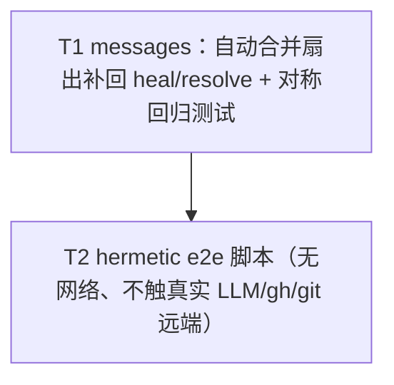

# 0035 · 合并扇出两调用点能力对称：自动合并路径补注入 heal/resolve，确定性自愈的 OVERVIEW.md 冲突不再误升级 needs-human

<!-- 本文件由 spec 工具维护：frontmatter 为结构化源数据（含 tasks DAG），正文为组级 rust-RFC 9 段总览。 -->

## Summary

守夜人 `messages.Messages.poll` 里有**两个**合并扇出调用点（都调 `rebase.rebase_open_prs` 把刚
进 main 的改动并入其余 open PR），但**能力不对称**：

- **「PR 已被合并」reconcile 路径**（`messages.py` 第 230 行附近，下轮 poll 发现 `is_merged`）：注入
  `heal=` + `resolve=` + `diagnose=` ✅
- **「本轮 reviewer PASS → 框架自己 `merge_pr` → 同轮立即扇出」路径**（`messages.py` 第 409 行附近）：
  **只注入 `diagnose=`，漏了 `heal=` / `resolve=`** ❌

本组只做一件事：给第二个调用点补回 `heal=self._make_heal()` + `resolve=self._make_resolver()`，让两个
扇出调用点**逐字节能力对称**；并加一条**回归测试**断言两个调用点都注入 `heal` / `resolve` / `diagnose`，
把「补一处忘补另一处」从靠人自觉变成测试会失败。改动面 = `messages.py` 两行 + 一个新测试文件 + 一个
hermetic e2e 脚本，不碰 `rebase` / `indexheal` / `conflict` 的任何能力（理念 1 奥卡姆、理念 10 解耦）。

## Motivation

**背景（就地复述，不靠裸引用承载必要信息）**：OpenAgents 是 RFC/spec 驱动的多 agent 框架，守夜人
`messages.Messages.poll` 周期扫描所有 open run，按阶段路由 GitHub 事件。一个 PR 合并进 main 是个**信号**
——`rebase.rebase_open_prs` 会**扇出**对其余每个 open PR 跑 `github.update_branch`（把最新 main 并入、
触发 CI 重跑）。扇出撞冲突时按**分层降级**处理，三层注入式能力（与 RFC-0009 无状态扇出骨架同构，由
`messages` 透传，`rebase` 自身不持 work_dir）：

1. `heal=`（issue #48 / `indexheal.make_healer`）：对**确定性可机器消解**的冲突——典型就是多个并行
   spec PR 同改 `docs/specs/OVERVIEW.md` 这类**聚合索引**——在临时区重渲/重建索引后 `git add` 消解，
   冲突标记归零、clean commit，**无需人介入**。
2. `resolve=`（Spec-0028 / `conflict.make_resolver`）：对 indexheal 不适用的**语义**冲突，派 coding
   agent 在临时 worktree 里 `git merge` + 解冲突 + 自测 + push（要 backend，故仅自动 poll 注入）。
3. `diagnose=`（Spec-0034 / `conflictdiag.make_diagnoser`）：前两层都没解掉 → 留一条**带诊断**（冲突
   文件清单 + 关键 hunk 摘要）的签名评论，并对**已 `needs-human`** 的 PR 收敛不重发。

这三层都由 `messages` 侧的工厂方法按门控构造：`_make_heal()`（`work_dir`+`base` 齐备才返回，否则
`None`）、`_make_resolver()`（再加 `backend`）、`_make_diagnoser()`（`work_dir`+`base`，不要 backend）。
缺一层就降级到下一层，最末退回静态留言——每层都安全。

**两个扇出调用点本应一字不差，但第二处是残缺的。** 两条路径都通向**同一个**扇出动作（合并→把 main 并入
其余 open PR），唯一区别只是「谁触发的合并」：

- **第一处 · reconcile 合并**：合并由**别处**发生（人工 merge，或上一轮框架已 merge），下一轮 poll 在
  reconcile 段发现 `is_merged` 才扇出。这里三层齐全（`heal=`+`resolve=`+`diagnose=`）。
- **第二处 · 自动合并**：本轮 reviewer 判 PASS，且 `hold.at_merge` 为假（即 `--hold` 未在 merge 闸
  停手——**默认就是不停**），框架当场 `github.merge_pr` 自己合并，**同一轮内立即扇出**。这里**只传了
  `diagnose=`**。

**为什么历史上漏了**：自动合并扇出是 Spec-0020（merge 闸 hold）引入「reviewer PASS 后框架自动 merge」
时新增的扇出点；当时 `heal` 注入（issue #48）尚未在这条新路径上对齐。随后 Spec-0034 同时给**两个**调用点
补 `diagnose=`（修的是「冲突评论无诊断 / 机械重发」那件正交的事），却**没顺手**把第二处缺的
`heal=` / `resolve=` 一并补齐——于是不对称被**带进**了 0034，至今潜伏。

**为什么至今没炸（latent，被默认人工把关掩盖）**：CLAUDE.md 设计理念 5「pr 需要人来审核」与 Spec-0020 的
merge 闸 hold，使**实践中合并多由人工**完成（本仓库 #95 即人工合并）。人工合并后，扇出走的是**第一处**
reconcile 路径——有 `heal`，OVERVIEW.md 这类冲突被 indexheal 当场消解，一切正常。第二处缺陷只在**框架
自动合并**时才被走到：一旦运行时不用 `--hold` 卡住 merge（默认即不卡），reviewer PASS → 框架自合 → 走
**第二处**扇出——此时**没有 `heal`**，一个**本可被 indexheal 确定性消解的纯 `docs/specs/OVERVIEW.md`
冲突**会直接跳过自愈、穿透到 `diagnose` 留人工言，并被打 `needs-human`——**误升级**：把一个机器一秒能
解的冲突，升级成「等人来」。

**与 PR #94 的关系（划清边界，避免误判动机）**：本 issue 的灵感来自 PR #94（spec 0033，E2E 通过、
reviewer PASS）却因 `docs/specs/OVERVIEW.md` 冲突被打 `needs-human` + 两条裸「请手动 rebase」评论。但
**经核查，#94 的直接原因是另一回事、不在本组范围**：当时运行中的 vigil 实例是**陈旧 uv-tool 快照**
（`openagents v0.1.0`，缺 indexheal/诊断代码）——0034 于 11:23:33 人工合并后，11:23:40 仍发旧裸罐头
评论、第二条（11:28:50）也未被 0034「已 needs-human 不重发」抑制，heal 全程没生效。那是**运行环境问题**
（解决靠重装 + 把 pinned dir 切到最新 main），**不是本组要修的代码缺陷**。本组修的是 #94 排查中**顺带
发现的、独立潜伏的代码不对称**——即便运行最新代码，只要框架走自动合并扇出，这个缺陷依然会让确定性可愈的
OVERVIEW.md 冲突误升级。

**证据（证据驱动，理念 7）**：本地复现 indexheal 对该类冲突的确定性：`git merge origin/main` → **仅**
`docs/specs/OVERVIEW.md` 冲突 → `spec_render.write_overview()` 重渲该聚合索引 → 冲突标记归零 → clean
commit 通过。即「多 PR 同改 OVERVIEW.md 聚合索引」是 indexheal **确定性可自愈**的，**只要 `heal` 被
注入到扇出**。第一处注入了、第二处没有——这正是本组要抹平的不对称。

**期望（与 issue 对齐）**：两个合并扇出调用点能力对称——自动合并路径同样注入
`heal=self._make_heal()` + `resolve=self._make_resolver()`；并加回归测试断言两个调用点都传
`heal` / `resolve` / `diagnose`，防再退化。

## Guide-level explanation

落地后，「框架自动合并触发的扇出」与「reconcile 合并触发的扇出」走**完全相同**的分层降级：先 `heal`
（确定性自愈）→ 再 `resolve`（agent 语义解冲突）→ 最后 `diagnose`（带诊断留言 + needs-human 收敛）。

**典型时间线（修复后）**：reviewer 判某 PR PASS，框架自动 `merge_pr` 进 main，同轮立即扇出到其余每个
open PR。其中 PR #X 仅在 `docs/specs/OVERVIEW.md` 上与新 main 冲突（多 spec 并行共改聚合索引的常见情形）：

1. 扇出对 #X 跑 `update_branch` 撞冲突 → **`heal` 命中**：indexheal 重渲 OVERVIEW.md、冲突标记归零、
   clean commit，#X 分支自动同步成功。
2. #X **既不留人工言、也不被打 `needs-human`**——机器一秒解掉，人完全无感。

而在**修复前**，同样的 #X 走自动合并扇出会因**没有 `heal`** 直接跳到 `diagnose`：留一条「OVERVIEW.md
冲突」的人工言 + 打 `needs-human`，把一个确定性可愈的冲突误升级成「等人」。两条扇出路径从此**不再看
合并是谁触发的而有不同命运**。

**防再退化是结构性的，不是靠注释提醒。** 新增回归测试 `tests/test_messages_merge_fanout_symmetry.py`
分别驱动 poll 走两条扇出路径（reconcile `is_merged` 路径、reviewer-PASS 自动合并路径），**捕获**两次
`rebase.rebase_open_prs` 调用的 kwargs，断言两处都注入了非 `None` 的 `heal` / `resolve` / `diagnose`
（在 `work_dir`+`base`+`backend` 齐备的夹具下）。将来谁再给一处加注入却忘了另一处，这条测试会**红**。

## Reference-level explanation

### 核心改动：第二个扇出调用点补回 `heal` / `resolve`（T1）

`openagents/messages.py` 第 409 行附近的自动合并扇出，从

```python
# Spec-0034/T3：合并扇出补传 diagnose（带诊断 + 触发 T2 重发收敛），与上方已合并分支同款。
synced = rebase.rebase_open_prs(
    merged_pr_number=pr_number,
    agent_id=self._agent_id,
    diagnose=self._make_diagnoser(),
)
```

补成与第 230 行附近 reconcile 路径**逐字节对称**：

```python
# Spec-0035/T1：自动合并扇出补回 heal/resolve，与 reconcile（is_merged）扇出能力对称——
# 一个确定性可愈的 OVERVIEW.md 聚合索引冲突不再因走自动合并路径而跳过 indexheal、误升级 needs-human。
synced = rebase.rebase_open_prs(
    merged_pr_number=pr_number,
    agent_id=self._agent_id,
    heal=self._make_heal(),
    resolve=self._make_resolver(),
    diagnose=self._make_diagnoser(),
)
```

**为何安全 / 无新行为风险**：

- 注入的是**已存在**的工厂方法，三者都**自带门控**：`_make_heal()` 在 `work_dir`/`base` 缺省时返回
  `None`、`_make_resolver()` 在 `work_dir`/`base`/`backend` 任一缺省时返回 `None`。门控为 `None` 时
  `rebase_open_prs` 的分层降级原样退到下一层——**与今天第二处只有 `diagnose` 的最坏情形完全一致**。即
  本改动只可能让自动合并扇出**多解掉**冲突，绝不会让它比今天更差。
- 自动合并扇出发生在 `_process_coding` 的 reviewer-PASS 分支，此处 `self._backend` 与第一处 reconcile
  路径**同一实例**、同样齐备，故 `resolve` 注入与第一处等价。
- `rebase.rebase_open_prs` 的签名（`heal=` / `resolve=` / `diagnose=` 三个 `Callable|None=None` 可选
  形参）**已经支持**这三个注入——本组**不改 rebase**，只是把第二处调用点的实参补齐。

### 回归测试：断言两个扇出调用点能力对称（T1，同 Task 内）

新文件 `tests/test_messages_merge_fanout_symmetry.py`（hermetic，新增不改既有
`tests/test_messages*.py`，把跨并行 PR 的共享测试文件冲突面降到最小）：

- 用 monkeypatch 把 `rebase.rebase_open_prs` 换成**捕获器**（记录每次调用的 kwargs，返回 `[]`）。
- 在 `work_dir` + `base` + `backend` 齐备的 `Messages` 夹具下，分别驱动 poll 走两条扇出路径：
  - **reconcile 路径**：构造一个 `is_merged` 的 PR run，调 poll → 命中第 230 行附近扇出。
  - **自动合并路径**：构造一个 CI 全绿、reviewer PASS、`hold.at_merge` 为假的 PR run，调 poll →
    框架 `merge_pr` → 命中第 409 行附近扇出。
- 断言**两次**捕获到的 kwargs 中 `heal` / `resolve` / `diagnose` **均为非 `None` 的 callable**——这是
  防「补一处忘补另一处」再退化的结构性闸（把软约定硬化成测试，理念「软约定硬化」）。

### 不做什么（边界，理念 10 解耦）

- **不改** `openagents/rebase.py`（扇出无状态骨架与分层降级）、`openagents/indexheal.py`（heal 能力）、
  `openagents/conflict.py`（resolve 能力）、`openagents/conflictdiag.py`（diagnose 能力）——它们都已就绪，
  本组只把**第二个调用点**的实参补对称。
- **不碰** Spec-0034 的诊断/重发收敛语义、#89 的 blocked 读侧、merge 闸 `_block` 流程——均不变。
- **不重渲** OVERVIEW.md 的渲染逻辑（`spec_render.write_overview` 等）——indexheal 已复用它，本组不动。

### DAG + 文件分配



| Task | 标题 | files | 依赖 |
|---|---|---|---|
| T1 | messages：自动合并扇出补回 `heal`/`resolve` + 两调用点对称回归测试 | `openagents/messages.py`, `tests/test_messages_merge_fanout_symmetry.py` | — |
| T2 | hermetic e2e 脚本（无网络、不触真实 LLM/gh/git 远端） | `scripts/e2e-spec-0035-merge-fanout-symmetry.sh` | T1 |

`files` 同组互斥（单一 writer 所有权，理念 6）。T1 同时拥有产品改动文件与其专属新测试文件（与 0034 的
T1 同款：prod + 其 test 归一个 Task）；T2 仅拥有 e2e 脚本，依赖 T1 完成。每层新代码/注释按代码注释规范
标注本组 spec id（`Spec-0035/Tn`）。

**e2e 脚本路径**：`scripts/e2e-spec-0035-merge-fanout-symmetry.sh`（hermetic，两段：① `ruff check` +
`ruff format --check` + `pytest -q` 离线确定性验证；② 以捕获式 `rebase.rebase_open_prs` + 齐备
`work_dir`/`base`/`backend` 夹具，闭环演练「reviewer PASS → 自动合并 → 扇出**注入了 heal/resolve/
diagnose**」与「reconcile is_merged → 扇出同样三层齐全」两条轨迹的对称，全程不触网、不调真实 LLM、不碰
真实 gh、不连真实 git 远端）。

## Drawbacks

- **改动极小但触及热路径**：自动合并扇出在每个 reviewer-PASS 自合后同轮执行；补注入 `heal`/`resolve`
  会让该路径在**确已冲突**的 PR 上多跑一次 indexheal（廉价、仅冲突时触发）/ 可能起一次解冲突 agent
  （`resolve`，与 reconcile 路径同等成本）。缓解：两层都仅在冲突 PR 上触发、且门控为 `None` 时零成本；
  这正是 reconcile 路径今天已承担的成本，本组只是让两处一致。
- **`resolve` 在自动合并扇出会烧 token**：补 `resolve=` 后，自动合并扇出遇语义冲突也可能派 coding agent
  解冲突（与第一处同）。缓解：这正是期望行为（对称）；`resolve` 仍受 `backend` 门控，手动 `sync-prs`
  无 backend 路径恒为 `None` 不烧 token。是否要为「自动合并扇出」单独限流 `resolve`，列入 Unresolved。
- **回归测试与内部调用形态耦合**：断言「两个调用点都传 heal/resolve/diagnose」是对 `rebase_open_prs`
  调用 kwargs 的白盒断言；若将来重构注入方式（如收进一个 `policy` 对象），测试需同步改。缓解：这是该
  测试的**本意**——它就是要在注入契约变动时报警，提醒同步两处；属可接受的有意耦合。

## Rationale and alternatives

**为何「补对称」而非「抽公因子消灭重复调用点」**：两个 `rebase_open_prs` 调用点确实近乎重复，诱人抽成
一个 `self._fanout_after_merge(pr_number=…)` 私有方法，从根上杜绝「两处不一致」。**本组否决该重构**
（留作 Future possibilities）：① 奥卡姆——本 issue 是修一个潜伏不对称，抽方法是更大重构、扩大 diff 与
回归面，违背「最小化改动」；② 两个调用点**上下文不同**（reconcile 路径在 `_process_record` 顶部、自动
合并路径在 `_process_coding` reviewer-PASS 分支深处，各自前后还有 `close_issue`/状态更新的不同副作用），
贸然合并易引入耦合；③ 回归测试已把「两处必须对称」变成**结构性的红线**，即使保留两个调用点也不会再悄悄
分叉。先用「补齐 + 测试锁定」解决真问题，重构留给后续独立 PR。

**备选：只补 `heal`，不补 `resolve`**。issue 证据只演示了 `heal`（OVERVIEW.md 确定性自愈）的价值，
`resolve`（语义解冲突）不是本案触发的。**否决**：issue 的期望明确要求两处「能力对称」并点名同时注入
`heal=self._make_heal()` + `resolve=self._make_resolver()`；只补一半仍是不对称，且 `resolve` 在第一处
本就有、第二处缺它同样是 latent 缺陷。一次补齐到对称，避免留第二个潜伏点。

**备选：在 `rebase_open_prs` 内部默认构造 heal/resolve（让调用点无需显式传）**。**否决**：`rebase.py` 是
RFC-0009 刻意设计的**无状态**扇出模块（不持 `work_dir`/`backend`，便于被自动 poll 与手动 `sync-prs`
复用）；把能力构造塞进 rebase 会破坏无状态、且手动路径不该自动起 backend。沿用既有「由 `messages` 透传
注入」骨架，只补实参，是与现有架构一致的最小修法。

## Prior art

- **issue #48 / indexheal（`openagents/indexheal.py`，`make_healer`）**：扇出第一层降级——对确定性可机器
  消解的索引类冲突（多 PR 同改 `docs/specs/OVERVIEW.md` 聚合索引）重渲/重建后 `git add` 消解。本组让
  自动合并扇出也注入它，即把这条**已存在**的自愈能力对齐到第二个调用点。
- **RFC-0009 `rebase.rebase_open_prs` 扇出**：合并即信号、对其余 open PR `update_branch` 触发 CI 重跑的
  无状态扇出骨架，提供 `heal=` / `resolve=` / `diagnose=` 三个可选注入形参。本组沿用其注入风格，不改其
  无状态契约，仅补第二处调用点实参。
- **Spec-0020 / merge 闸 hold（`hold.at_merge`）**：引入「reviewer PASS 后框架自动 `merge_pr`」并由此
  新增了**自动合并扇出**这第二个调用点——本组要修对称的那一处正源于此。`--hold` 默认不在 merge 闸停手，
  故自动合并是默认会走到的路径。
- **Spec-0028 / `conflict.make_resolver`**：扇出第二层降级（agent 语义解冲突，要 backend）。本组让自动
  合并扇出也注入它，与 reconcile 路径对称。
- **Spec-0034 / 冲突诊断 + 重发收敛（`conflictdiag` / `diagnose=`）**：给**两个**调用点都补了 `diagnose=`
  （修正交的「通知无诊断 / 机械重发」），但**未**补第二处缺的 `heal=`/`resolve=`——本组正是补上 0034
  漏下的这半边对称，并加测试锁定，防再有人补一处忘另一处。
- **CLAUDE.md 设计理念 1（奥卡姆）/ 6（单一 writer files 互斥）/ 7（证据驱动）/ 10（解耦）**：本组的最小
  改动面、files 互斥分配、indexheal 本地复现证据、不碰邻接模块，均据此。

## Unresolved questions

- **是否为「自动合并扇出」的 `resolve` 单独限流**：补 `resolve=` 后，自动合并同轮可能对多个冲突 PR 各
  派一次解冲突 agent（烧 token）。是否需要每轮上限 / 仅 heal 不 resolve 的更保守档位？初定**与 reconcile
  路径完全对称（都注入）**，留实跑观察 token 成本后再议。
- **回归测试驱动两条 poll 路径的夹具复杂度**：reviewer-PASS 自动合并路径需要 CI 全绿 + reviewer PASS +
  `hold.at_merge` 为假的较深夹具。若搭建过重，是否退化为**更窄的单元断言**（直接断言两个调用点源码/调用
  形态对称，例如对 `rebase_open_prs` 打补丁后只跑到扇出语句即可）？初定优先「驱动真 poll 两路径捕获
  kwargs」（最贴近真实退化场景），夹具过重则降级为窄断言，T1 验收以「两处都注入」可被测到为准。
- **是否顺手把两个调用点抽成单一私有方法**：见 Rationale，本组**不做**（奥卡姆 + 控制回归面），仅靠回归
  测试锁对称。若后续证明两处还会持续同步演化，再开独立 PR 抽公因子。

## Future possibilities

- **抽出 `_fanout_after_merge(pr_number=…)` 单一扇出入口**：把两个 `rebase_open_prs` 调用点合并为一个
  私有方法，从结构上**根除**「两处不一致」的可能（比测试锁定更强）。本组刻意不做（最小化），列为自然
  后续重构。
- **扇出注入能力的统一门控对象**：把 `heal`/`resolve`/`diagnose` 三个工厂收进一个 `FanoutPolicy`
  值对象，由 `messages` 一次构造、两处共用，既消重又让「能力集」成为可单测的单一来源。
- **门控可观测性**：当某次扇出因 `work_dir`/`base`/`backend` 缺省导致 `heal`/`resolve` 退化为 `None`
  时记一条结构化日志，让运行环境（如本案陈旧 uv-tool 快照那类问题）能在看板上一眼看出「自愈能力为何
  没生效」，呼应理念 2 人负责宏观把控。

