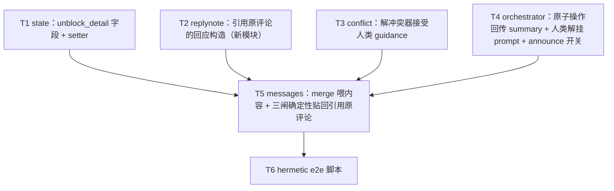

# 0035 · 解挂后 agent 读取并正面回应人的评论：merge 闸也喂评论内容 + 编排层确定性贴回引用原评论

<!-- 本文件由 spec 工具维护：frontmatter 为结构化源数据（含 tasks DAG），正文为组级 rust-RFC 9 段总览。 -->

## Summary

让 OpenAgents 的「评论驱动协作」在**解挂（unblock）这一交互点上真正双向**，补齐两块缺口：

1. **A — 所有闸解挂都把人类评论喂给 agent**：rfc / code 闸今天已把评论原文当 `detail` 喂给
   `refine_rfc` / `iterate`，但 **merge 闸把评论内容整条丢弃**——只拿「有新评论」当解挂触发，人在
   merge 冲突 PR 下写的指令（如「先解 X 再动 Y」）根本进不了解冲突 agent。本组把人类评论作为
   **解冲突指引（guidance）**透传进 merge 闸的解冲突器，三道闸一视同仁。
2. **B — agent 完成本轮动作后，对触发它的那条人类评论做一次正面回应**：答追问 / 说明做了什么 /
   解不了讲清原因，**由编排层确定性地贴回一条引用原评论的签名评论**（不靠 agent 自己记得回、不给
   agent 新增 headless 发帖权限）。回应文本来自 agent（「写什么」交给 agent），「贴不贴 / 贴哪」
   交给确定性流程（复用既有 `identity.post_signed_comment` 出口）。

改动落在 messages 路由层 + 一个新增纯展示模块（回应评论构造 `replynote`，与既有 `blocknote` 对称）
+ 三个叶子原语（state 加一个把人类评论从「arming」带到「下一轮 armed 解冲突」的字段、conflict 解冲突
器接受人类 guidance、orchestrator 原子操作回传 agent 回应文本并在「人类解挂」语义下调整任务 prompt）。
**只覆盖 blocked 解挂这一交互点**，不实现「任意时刻随便聊」；自动流转主路径仍由 reviewer 闸驱动。
回应评论仍带签名、被解挂读侧按签名滤除，**不自触发**（沿用既有防自激约束）。

## Motivation

**背景（就地复述，不靠裸引用承载必要信息）**：OpenAgents 是 RFC/spec 驱动的多 agent 框架，守夜人
`messages.Messages.poll` 每隔一段时间扫描所有 open 状态的 run，按阶段路由 GitHub 事件。当某道闸累计
若干轮仍不过，私有方法 `_block` 把 run 置 `STATUS_BLOCKED` + 给 PR 打 `needs-human` 标签 + 贴一条
结构化签名挂起评论（由 `blocknote.build` 造正文、`identity.post_signed_comment` 盖签名贴出），并把
挂起原因持久化进 `RunRecord.block_gate`（值 ∈ `""`/`rfc`/`code`/`merge`/`rfc-unparseable`/
`code-unparseable`）。`STATUS_BLOCKED` 不在 `_OPEN_STATUSES`，故软挂起、下一轮 poll 跳过该 run。

**解挂已支持「读评论 + 续做」（issue #89 落地）**：blocked run 仍被纳入每轮扫描，`_process_blocked`
经 `identity.new_human_comments(pr_number, since=record.block_watermark)` 读取「挂起水位线之后、无
OpenAgents 签名」的人类新评论——命中即视为解挂信号（两道硬约束：仅 block 之后 + 仅人类签名，精确
化解历史 RFC-0019「怕 agent 读到自己的评论自循环」的顾虑）。`_unblock_with_comment` 据持久化的
`block_gate` 分流，把评论正文当 `detail` 喂给对应闸 agent。

**但拆成三层看，「正面回应人」这一半始终没做**（已逐行核对 `messages.py` / `identity.py` /
`orchestrator.py` / `conflict.py`）：

1. **看到了** ✅——`_process_blocked` 经 `new_human_comments` 读到人类新评论作为解挂触发。
2. **内容只在部分闸被用** ⚠️——`_unblock_with_comment` 按 `block_gate` 分流：
   - `rfc` / `rfc-unparseable` → 评论原文当 `detail` 喂 `orchestrator.refine_rfc(detail)`；
   - `code` / `code-unparseable` → 评论原文当 `detail` 喂 `orchestrator.iterate(reason="human", detail)`；
   - **`merge` 闸 → 只 `update_status(pr-open)` 保留 `block_gate="merge"` 作 armed 标记，评论正文被
     整条丢弃**。下一轮 poll 的 `_process_armed_conflict` 派 agent 解冲突时调
     `resolve(pr_number=...)`，而 `conflict.resolve_branch` 只把**冲突文件清单**喂给 backend
     （`_RESOLVE_TASK.format(files=...)`），**接口里根本没有人类指导这一路**。→ 人在 merge 冲突 PR 下
     的提问 / 指令**根本没进 agent**。
3. **从不回复** ❌——解挂 / 解冲突链路里**没有任何「针对触发它的那条人类评论发回应」的动作**。
   `messages.py` 里唯一的 `post_signed_comment` 是 `_block` 那条**单向广播**的挂起通知；
   `orchestrator.refine_rfc` 末尾虽会贴一条 `_REFINE_COMMENT`（「🤖 已根据评审意见更新 spec：…」），
   但那是**泛化的「我改了什么」广播**，既不引用、也不 @ 触发它的人类评论，更不回答其追问；
   `iterate` / 解冲突路径则**完全不贴任何回应**。

这正是 issue #92 漏掉的那一半：#92 的 A 项要求「读评论 **+ 据内容正面响应（回答追问）**」，实际落地
的 #89 只做了「读 + 解挂续做」，**回应没做**，故 #92 实为提前关闭。

**期望（与 issue #97 对齐）**：

- **A**：所有闸解挂都把评论内容喂给 agent——**补齐 merge 闸**，让解冲突 agent 也能看到人说了什么。
- **B**：agent 完成本轮动作后，对触发它的那条人类评论做**一次正面回应**（答追问 / 说明做了什么 /
  解不了讲清原因），以**可追溯方式**（引用原评论）贴回该 PR。

**实例来源**：PR `pcj-sudo/wind-palace-of-cc#10` 实测——人留评论后 agent 自动续做（解冲突），但全程
不正面回应评论；merge 闸连评论内容都没读。正是本 issue 的直接触发场景。

## Guide-level explanation

落地后，人在一个被任意闸挂起的 PR 下回一条评论，体验变成「**有来有回的对话**」：

**① merge 闸也听人话（A）。** 人在一个被 merge 冲突挂起的 PR 下回复「先把 `OVERVIEW.md` 的冲突按
保留两边处理，再动 `state.py`」。下一轮 poll 解挂进 armed 模式；再下一轮派 agent 解冲突时，**这段
指导会作为 guidance 一并喂给解冲突 agent**（拼进解冲突任务 prompt 的「人类对本次解冲突的指导」段），
而不再像今天那样被丢弃。rfc / code 闸的「喂内容」保持现状（本就已喂）。

**② agent 完成本轮动作后，正面回应那条评论（B）。** agent 跑完本轮（精炼 RFC / 迭代代码 / 尝试
解冲突）后，PR 上自动出现**一条引用了原评论的签名回应**（模板，细节见 Reference-level）：

```markdown
> （引用）@alice 写道：
> 先解 OVERVIEW.md 的冲突，再动 state.py

🤖 收到。我已按你的指导先处理 `OVERVIEW.md` 的冲突（保留两边索引行），再 rebase `state.py`；
本轮已成功解冲突并 push，PR 将重新跑 CI。<余下为 agent 的回应正文：答追问 / 说明做了什么 /
解不了时讲清原因>

<!-- openagents:agent=<id> -->
```

人一眼看到：自己的话被读到了、agent 据此做了什么、结果如何。

**谁来回、怎么提示（采用 issue 倾向的选项 2）：**

- **谁来回 = OpenAgents 编排层**：agent **只产出回应文本**（其本轮动作的 summary），由 OpenAgents
  像现有挂起 / refine 通知那样**确定性地 `post_signed_comment` 贴回**，并**引用原评论**形成对话。
  好处：复用既有发帖出口，**无需给 headless agent 新的发帖能力 / 权限放行**（对齐 issue #85 的权限
  讨论），且**不依赖 agent 记得回、不会贴错位置**（「贴不贴 / 贴哪」由确定性流程决定）。
- **提示落点 = 方法论层（任务 prompt 模板）**：「请正面回应人类的这条评论」这类提示放进
  **orchestrator / conflict 的任务 prompt 模板**（`iterate(reason="human")` 的 task 文案、
  `_RESOLVE_TASK` 的 guidance 段），**不**硬编码进 messages 路由核心（对齐 #85：agent 自治、编排
  不耦合具体生态）。messages 只负责「取回应文本 + 引用原评论 + 盖签名贴出」。

**只回一次、只在解挂点回。** 每个「人类解挂」交互**恰回一条**（不对每条评论长篇回应，无意义评论本就
不会触发解挂故不回）；不实现「任意时刻随便聊」——自动流转主路径（CI / reviewer 闸）仍不读评论。

**防自激不变（沿用既有约束）。** 回应评论带 OpenAgents 签名 → 解挂读侧 `new_human_comments` 按签名
把它滤掉 → 不会被当成新的人类评论自触发；且回应贴出时 run 已离开 blocked 态，下一轮 poll 不走
`_process_blocked`，双重保证不自循环。

## Reference-level explanation

### 核心机制

issue 的两半各有一条主线：

- **A（喂内容到 merge 闸）**：人类评论正文需要从「解挂 arming 这一轮」带到「下一轮 armed 解冲突」
  （二者跨 poll），故在 `RunRecord` 存一个 **`unblock_detail`** 字段承载它；`_process_armed_conflict`
  取出它当 **guidance** 透传给解冲突器，conflict 把 guidance 拼进解冲突任务 prompt。
- **B（确定性回应）**：orchestrator 的原子操作（`refine_rfc` / `iterate`）**回传 agent 本轮动作的
  summary** 作回应文本；messages 在「人类解挂」交互点用新模块 **`replynote`** 把「引用原评论 + agent
  回应」拼成正文，经 `identity.post_signed_comment` **恰贴一条**。merge 闸因动作发生在下一轮 armed，
  回应在 `_process_armed_conflict` 消费 `unblock_detail` 时贴出。

### 改动点（按文件 / Task）

**`openagents/state.py`（T1）**：
- `RunRecord` 增 `unblock_detail: str = ""`（默认值向后兼容缺键旧 `state.json`）：承载 merge 闸解挂时
  人类评论正文，供下一轮 armed 解冲突当 guidance + 回应时引用原文。
- 新增 `set_unblock_detail(*, issue_number, detail)`：落盘该字段（镜像既有 `set_block_gate` 写法）；
  `detail=""` 即清除（armed 消费后 / 重新挂起时清，避免陈旧 guidance 渗进后续轮次）。

**`openagents/replynote.py`（T2，新模块——解耦理念 10，与 `blocknote` 对称）**：
- 纯函数 `build(*, original, response) -> str`：把「引用原评论（markdown 引用块包裹人类评论正文）+
  agent 回应正文」拼成回应评论的 markdown 正文（**不含签名**——签名由调用方经
  `identity.post_signed_comment` 盖）。`response` 为空时占位（如「（本轮无更多说明）」）保证结构完整。
- 把「回应评论长什么样」收敛进一个可单测的纯函数，messages 只取数 + 调它 + 盖签名贴出——展示逻辑
  与路由逻辑解耦，模板可独立断言（引用块包裹正确、回应段齐全）。

**`openagents/conflict.py`（T3）**：
- `resolve_branch(*, worktree, base, backend, run, guidance="")` 与 `make_resolver` 返回的
  `resolve(*, pr_number, guidance="")` 新增 **guidance 入参**（`guidance=""` 即不带人类指导，
  **行为逐字节同今天**）；非空时拼进 `_RESOLVE_TASK` 的「人类对本次解冲突的指导」段喂给解冲突 agent
  （A 对 merge 闸的落地，也是「提示落点放方法论层」的落点之一）。
- **`resolve` 的返回类型保持 `bool` 不变**（避免波及 `rebase.rebase_open_prs` 在 `rebase.py:92` 对
  `resolve(...)` 的真值判断）；auto-rebase 场景无人类评论，`rebase.py` **不改**、按默认 `guidance=""`
  调用，行为零回归。

**`openagents/orchestrator.py`（T4）**：
- `refine_rfc(*, pr_number, detail) -> str` / `iterate(*, pr_number, reason, detail) -> str`：**回传
  agent 本轮动作的 `result.summary`**（供 messages 组回应）。返回值是新增信息，既有忽略返回值的调用方
  （CI / reviewer 闸路径）**零影响**。
- `iterate` 的 `reason="human"`（Spec-0032 已引入该取值）走**人类解挂专属任务 prompt 文案**：把
  `detail` 框定为「人类在 PR 上回复了你的挂起评论：<detail>，请据此继续，并在摘要里正面回答其追问 /
  说明你做了什么 / 解不了讲清原因」——这是「提示落点放方法论层」的落点（不在 messages 硬编码）。
- `refine_rfc` 现有的 `_REFINE_COMMENT` 泛化广播在**人类解挂路径上抑制**（新增 `announce: bool = True`
  公有参数，人类解挂调用方传 `announce=False`），使该交互**恰产生一条评论 = 那条引用原评论的回应**
  （奥卡姆：一轮人类解挂 → 一条针对性回应，不再叠加一条泛化广播）。reviewer 驱动的精炼路径仍
  `announce=True` 保持现状。

**`openagents/messages.py`（T5，整合）**：
- **`_unblock_with_comment`（rfc / code 闸）**：捕获 `refine_rfc(announce=False)` / `iterate` 回传的
  summary，经 `replynote.build(original=news[-1].body, response=summary)` 造正文，
  `identity.post_signed_comment` **恰贴一条**引用原评论的签名回应（`news[-1]` 即触发解挂的那条人类
  评论）。
- **`_unblock_with_comment`（merge 闸）**：除既有 arm（`update_status(pr-open)` + 保留
  `block_gate="merge"`）外，新增 `set_unblock_detail(detail=news[-1].body)` 把人类评论存进 state，
  供下一轮 armed 解冲突取用。**本轮不贴回应**（动作尚未发生，下一轮 armed 跑完才回）。
- **`_process_armed_conflict`（merge 闸 armed）**：取 `record.unblock_detail`——
  - **非空（人解挂带了评论）**：把它当 `guidance` 传给 `resolve(pr_number=..., guidance=detail)`；解冲突
    本轮跑完后，经 `replynote.build(original=detail, response=<据 resolve 结果的结论文案>)` 贴**一条**
    引用原评论的签名回应（成功：「已按你的指导解冲突并 push」；未解：「已按你的指导尝试解冲突但本轮
    未解决，将继续重试 / 已重新挂起」），随后 `set_unblock_detail(detail="")` 清空（避免重复回应 /
    陈旧 guidance）。
  - **空（手动摘标签解挂，或已回应过）**：`resolve(pr_number=..., guidance="")`，**不**贴回应——
    逐字节保持 Spec-0031 现状（零回归）。
- messages **不含任何 prompt 文案**（提示在 orchestrator / conflict 模板里）、**不含回应模板字符串**
  （模板在 `replynote` 里）——路由核心只做「取数 + 调原子操作 + 引用原评论盖签名贴出」。
- **同步更新本组改动必然打破的既有 messages 测试**（T5 拥有这两文件的写权，理念 6 单一 writer；它们直接
  对 `messages.py` 的 fake double 建模，故必须随 `messages.py` 的接口/行为变更一起改，否则 pytest 必红）：
  - `tests/test_messages_needs_human_unblock.py`：`_FakeOrchestrator.refine_rfc` 加 `announce` 形参
    （T5 以 `announce=False` 调用，旧签名 → `TypeError`）；`_FakeState` 加 `set_unblock_detail`
    （merge 解挂路径调用，旧 fake → `AttributeError`）；rfc/code 解挂用例桩掉 `post_signed_comment` 并
    新增「恰贴一条引用原评论签名回应」的断言（这些用例原先未桩发帖出口，T5 新增的回应贴帖会落到真实
    `post_signed_comment`）。
  - `tests/test_messages_merge_unblock.py`：`_patch_resolver` 的 fake `resolve` 签名加 `guidance` kwarg
    （T5 `_process_armed_conflict` 以 `resolve(guidance=…)` 调用，空/非空都带该 kwarg，旧 fake →
    `TypeError`）；armed 用例补「`unblock_detail` 空 → `guidance=''` 零回归」「非空 → 评论作 guidance 喂
    `resolve` 且跑完贴一条引用原评论结论回应后清空」两路断言。

### 解挂回应路由表（按持久化 `block_gate`）

| `block_gate` | A：喂内容给 agent | B：回应贴出时机 / 内容 |
|---|---|---|
| `rfc` / `rfc-unparseable` | 现状：`refine_rfc(detail)`（本组 `announce=False`） | `_unblock_with_comment` 内，引用原评论 + `refine_rfc` 回传 summary |
| `code` / `code-unparseable` | 现状：`iterate(reason="human", detail)` | `_unblock_with_comment` 内，引用原评论 + `iterate` 回传 summary |
| `merge` | **本组新增**：`unblock_detail` → 下一轮 `resolve(guidance=…)` | `_process_armed_conflict` 内（armed 跑完），引用原评论 + 解冲突结论文案 |
| `""`（理论兜底） | 不喂 | 不回应（退化为既有 resumed 行为） |

### 防自激不变式（沿用既有约束）

- **回应评论带签名**：经 `identity.post_signed_comment` 盖 `<!-- openagents:agent=<id> -->`；解挂读侧
  `new_human_comments` 按 `parse_agent_id` 滤掉一切带签名评论 → agent 读不到自己的回应 → 不自触发。
- **回应贴出时 run 已离开 blocked**：rfc/code 解挂后状态为 `rfc-review`/`iterating`，merge armed 回应
  时状态为 `pr-open`——均不在 blocked 态，下一轮 poll 不进 `_process_blocked`，不读评论。两道叠加 →
  回应不可能被当成新人类评论自触发。

### DAG + 文件分配



| Task | 标题 | files | 依赖 |
|---|---|---|---|
| T1 | state：`unblock_detail` 字段 + setter | `openagents/state.py`, `tests/test_state_unblock_detail.py` | — |
| T2 | replynote：引用原评论的回应构造（新模块） | `openagents/replynote.py`, `tests/test_replynote.py` | — |
| T3 | conflict：解冲突器接受人类 guidance | `openagents/conflict.py`, `tests/test_conflict_guidance.py` | — |
| T4 | orchestrator：原子操作回传 summary + 人类解挂 prompt + `announce` 开关 | `openagents/orchestrator.py`, `tests/test_orchestrator_comment_reply.py` | — |
| T5 | messages：merge 喂内容 + 三闸确定性贴回引用原评论 | `openagents/messages.py`, `tests/test_messages_comment_reply.py`, `tests/test_messages_needs_human_unblock.py`, `tests/test_messages_merge_unblock.py` | T1, T2, T3, T4 |
| T6 | hermetic e2e 脚本（无网络、不触真实 LLM/gh） | `scripts/e2e-spec-0035-unblock-comment-read-and-reply.sh` | T5 |

`files` 同组互斥（单一 writer 所有权，理念 6）。T1–T4 互不依赖、可并行（四个叶子改动），T5 汇总集成，
T6 验证。**每个被改模块新增专属测试文件**（`test_state_unblock_detail` / `test_replynote` /
`test_conflict_guidance` / `test_orchestrator_comment_reply` / `test_messages_comment_reply`），把跨并行
PR 的共享测试文件冲突面降到最小。

**关于既有测试文件的归属（针对评审「跨 Task 测试归属缺口」的修订）**：T5 对 `messages.py` 的接口/行为
变更会**必然打破两个直接对 `messages.py` 建 fake double 的既有测试文件**——`tests/test_messages_needs_human_unblock.py`
（`_FakeOrchestrator.refine_rfc` 缺 `announce`、`_FakeState` 缺 `set_unblock_detail`、rfc/code 用例未桩
`post_signed_comment`）与 `tests/test_messages_merge_unblock.py`（fake `resolve` 缺 `guidance` kwarg）。
**故撤回此前「不改既有 `tests/test_messages*.py`」的承诺**：这两文件**显式纳入 T5 的 `files`**，由 T5
（`messages.py` 的单一 writer）一并更新 fake 签名与断言（见上「改动点 · T5」逐条）——这样既守住理念 6
单一 writer 所有权（改 `messages.py` 的人同时改它建模的 fake），又让 T5 的 `acceptance「pytest 全绿」`
与 DAG 文件分配**自洽、可独立实现到绿**，不留任何「未被认领却被打破」的测试文件。
**其余既有测试逐字节保持绿、不需认领**：`tests/test_messages_resolve.py`（走首次发现冲突 `_process_coding`
的 `resolve(pr_number=…)`，T5 不给该 callsite 加 `guidance`）、`tests/test_orchestrator*.py`（T4 的
`announce` 默认 `True`、返回值新增且既有用例忽略返回值，行为不变）、`tests/test_conflict*.py`（T3 的
`guidance=""` 缺省即逐字节同今天）——三者均经默认值/未触 callsite 保持零回归，故**不**进任何 Task 的
`files`。

`openagents/identity.py`（`post_signed_comment` / `new_human_comments` / `parse_agent_id`）、
`openagents/blocknote.py`、`openagents/rebase.py` **复用不改**——本组不在路由层之外重写发帖 / 签名 /
读评论 / auto-rebase 能力（边界，理念 10 解耦）。

**e2e 脚本路径**：`scripts/e2e-spec-0035-unblock-comment-read-and-reply.sh`（hermetic，两段：① ruff
check + format --check + pytest 离线确定性验证；② 用 fake `github` + fake orchestrator / resolve 闭环
演练「rfc/code 闸解挂→引用原评论贴回 agent 回应」「merge 闸解挂→评论作 guidance 喂解冲突器→armed
跑完引用原评论贴回结论」整条轨迹，全程不触网、不调真实 LLM、不碰真实 gh）。

每层新代码注释按代码注释规范标注本组 spec id（`Spec-0035/Tn`）。

## Drawbacks

- **每次解挂多一条评论 + 一次 gh 往返**：解挂回应是新增的 `post_signed_comment`。缓解：仅在**人类
  解挂**这一交互点发生（非每轮每 run），且对 rfc 闸是把原有 `_REFINE_COMMENT` 广播**替换**为引用式
  回应（净增量更小）；`post_signed_comment` 已是既有薄封装、自带 RFC-0010 瞬时重试。
- **多一个 state 字段 + conflict / orchestrator 接口各加一个入参**：扩了状态面与接口面。缓解：字段带
  默认值零迁移；conflict/orchestrator 的新参均带默认值、缺省时**行为逐字节同今天**（零回归）；
  `replynote` 与既有 `blocknote` 完全对称，认知成本低。
- **merge 闸回应滞后一轮**：回应在下一轮 armed 解冲突跑完才贴（动作本就发生在下一轮）。缓解：这是
  armed「跨轮解冲突」设计的固有节奏，人对「解冲突要花点时间」有预期；rfc/code 闸是同步回应、无滞后。
- **agent 回应文本质量依赖 agent**：回应正文是 agent 的 summary，可能空泛或答非所问。缓解：「贴不贴 /
  贴哪 / 引用谁」由确定性流程兜底（一定引用原评论、一定可追溯），即便正文空泛也不会贴错位置；prompt
  在方法论层可独立迭代调优而不动编排核心。
- **merge 闸回应不含 agent 自由文本答疑，只有结论文案**：见 Rationale 的取舍说明。

## Rationale and alternatives

**为何采用「选项 2：编排层确定性贴回」而非「选项 1：agent 自己回」**（issue 关键设计选择，本组采纳其
倾向）：选项 1（派单 prompt 提示 agent 自己调 gh 贴回）有两个硬伤——① headless `-p` 下 agent 发评论需
**额外发帖能力 + 权限放行**（与 #85 权限讨论冲突）；② 「请记得回复」是**非确定性**的，agent 可能漏回、
可能贴错位置。选项 2 让 agent**只产出回应文本**、由编排层**确定性贴回并引用原评论**：复用既有
`post_signed_comment` 出口、**不新增 agent 权限**、**不依赖 agent 记性**，「写什么」交给 agent、「贴不贴 /
贴哪」交给确定性流程。**备选（选项 1）**因权限与可靠性两点被否决，但其「prompt 提示放方法论层」的思路
被本组吸收（见下）。

**为何把回应模板独立成 `replynote` 模块、提示文案放 orchestrator/conflict 模板**：对齐 #85「agent 自治、
编排不耦合具体生态」与理念 10 解耦——messages 路由核心**既不含 prompt 文案、也不含回应模板字符串**；
「请正面回应人类评论」的提示落在**方法论层（任务 prompt 模板）**，「回应长什么样」落在可单测的
`replynote` 纯函数。**备选**：把回应模板字符串和「请回复」提示都写进 messages。否决——会让路由层混入
展示逻辑与生态相关 prompt，模板难独立测试、且违背 #85（编排耦合具体 agent 行为约定）。

**为何用 state `unblock_detail` 字段把评论从 arming 带到 armed，而非 armed 时重新读评论**：merge 闸的
动作（解冲突）发生在解挂的**下一轮 poll**，与「读到触发评论」的那一轮不在同一次。若 armed 时重新调
`new_human_comments` 取评论，要再引入一套「读到哪条算这次解挂的触发评论」的水位线判定，复杂且易与
解挂判定打架。直接在解挂当轮把触发评论正文落进 `RunRecord`（与 `block_gate` / `block_watermark` 同住、
同生命周期管理），armed 当轮取出即用、用完即清，语义单一自解释。**备选**：复用 `block_watermark` 反推
评论。否决——watermark 是「时刻」不是「内容」，反推需再查 `list_comments` 且语义含混。

**为何 merge 闸的解冲突回应是「结论文案」而非 agent 的自由文本答疑**：merge 闸的解冲突器
`conflict.resolve` 今天返回 `bool`，且 `rebase.rebase_open_prs`（auto-rebase）也按真值判断消费它；若把
返回类型改成携带 summary 的富对象，会**波及 rebase 路径**（`rebase.py:92`），扩大改动面、增加回归风险。
权衡后保持 `resolve -> bool` 不变，merge 闸回应用**确定性结论文案**（成功 / 仍未解决 + 原因），agent
的「听到人话」体现在**解冲突 task prompt 已吃到 guidance**（A），回应负责「说明做了什么 / 解不了讲清
原因」。**备选**：把 `resolve` 返回类型升级为 `(ok, summary)` 并同步改 rebase。否决（本组奥卡姆，改动面
最小化）；若未来 resolver 需向人解释解法，列入 Future。

**为何只在 blocked 解挂点回应、不做「任意时刻聊天」**：issue 明确「不实现任意时刻随便聊」「自动流转
主路径仍由 reviewer 闸驱动」。把回应严格绑定在「人类解挂」这一已被 #89 安全约束（仅新评论 + 仅人类）
覆盖的交互点，复用其防自激不变式，风险最小。

## Prior art

- **issue #89 / Spec-0032「人回新评论即自动解挂喂内容重试」**：本组直接复用其
  `identity.new_human_comments`（仅 block 之后 + 仅人类签名的读侧）、`block_watermark` 水位线、
  `block_gate` 路由、`_unblock_with_comment` 分流骨架；本组补齐它漏掉的「**回应**」一半（#92 的 A 项），
  并把 merge 闸从「丢弃评论内容」改为「喂 guidance」。二者正交：#89 给「读 + 解挂」，本组给「喂全 +
  正面回应」。
- **issue #84 / Spec-0031「merge 闸 armed 解挂 + 有界重试解冲突」**：本组在其 `_process_armed_conflict`
  里加「消费 `unblock_detail` 作 guidance + 贴回应」；其 Unresolved 已明确预告「merge 闸是否也该把人的
  评论正文传进解冲突器……未来若 resolver 支持接收『人对解冲突的指导』，可把评论正文透传过去」——本组
  即落地该预告。
- **issue #79 / Spec-0028 `openagents/conflict.py`**：本组复用其 `make_resolver` / `resolve_branch`
  解冲突能力，仅新增可选 `guidance` 入参（缺省零回归），不碰解冲突本体（理念 10）。
- **RFC-0011 `identity` 评论签名**：本组复用 `post_signed_comment`（盖章贴评论）与 `parse_agent_id`
  （签名解析做人 / 机区分），不新写发帖 / 签名能力。
- **`openagents/blocknote.py`（Spec-0032/T3）**：本组的 `replynote` 与之**对称**（同为「纯函数造评论
  正文、不含签名、调用方盖签名贴出」），延续同一解耦范式。
- **issue #85 权限 / 自治讨论**：本组「编排确定性贴回（不给 agent 新发帖权限）+ 提示落方法论层（不耦合
  编排核心）」的两点决策直接对齐其结论。
- **rust-lang/rfcs**（https://github.com/rust-lang/rfcs）：9 段总览形态来源。

## Unresolved questions

- **merge 闸回应是否需要 agent 自由文本答疑**：当前为确定性结论文案（避免改 `resolve -> bool` 波及
  rebase）。是否值得未来把 `resolve` 返回升级为携带 agent summary（并同步改 rebase）以让 merge 闸也能
  「回答追问」？初定**不做**（奥卡姆 + 零回归优先），列此待实跑观察 merge 闸答疑需求后再定。
- **多条人类评论时引用 / 回应哪条**：沿用 #89 取 `news[-1]`（最后一条）当触发评论与引用对象。是否应在
  回应里引用 / 汇总 watermark 之后的多条评论？初定取最后一条（最贴近人的最新意图），存档待校准。
- **回应正文是否需要长度 / 结构约束**：当前回应正文 = agent summary 原样，长度由 agent 决定。是否需要在
  方法论层 prompt 里约束「简短、先结论后细节」以免冗长？初定交由 prompt 模板软约束、不在编排层硬截断，
  待实跑观察。
- **rfc 闸抑制 `_REFINE_COMMENT` 广播是否会让 reviewer 驱动路径丢可观测性**：本组只在**人类解挂**路径
  `announce=False`，reviewer 驱动精炼仍 `announce=True`。确认无回归后可考虑统一收敛两类通知格式（列入
  Future）。

## Future possibilities

- **把 `resolve` 升级为携带 agent 解法摘要**，让 merge 闸回应也能「回答追问」（与上方 Unresolved 呼应，
  需同步演进 rebase 消费方）。
- **把解挂回应汇入成果看板**（理念 8）：按「人提了什么 / agent 怎么答 / 是否解决」展示对话流，让「人负责
  宏观把控」（理念 2）落到可视面板。
- **在更强的安全约束成熟后，谨慎把「读 + 回应」推广到非 blocked 场景**（任意时刻人给运行中 agent 追加
  指导），需重新评估 RFC-0019 的自循环边界——本组刻意**不**触碰这条线，仅覆盖解挂交互点。
- **统一 `blocknote` / `replynote` / `_REFINE_COMMENT` 三类通知的格式与签名约定**，收敛成一套可配置的
  PR 通知模板层。

