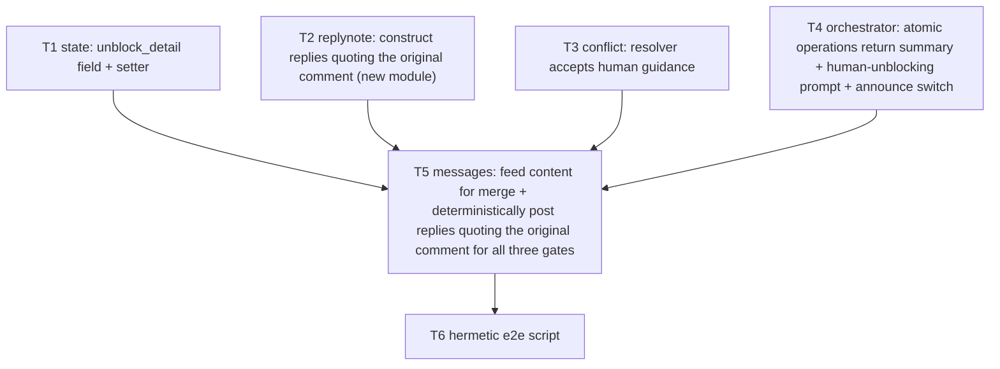

# 0036 · Agents read and directly respond to human comments after unblocking: feed comment content to the merge gate too + have the orchestration layer deterministically post replies quoting the original comment

<!-- This file is maintained by the spec tool: the frontmatter is the structured source data (including the tasks DAG), and the body is a group-level overview in the nine rust-RFC sections. -->

## Summary

Make OpenAgents' “comment-driven collaboration” **truly bidirectional at the unblock interaction point**, filling two gaps:

1. **A — Feed human comments to the agent when unblocking any gate**: the rfc / code gates already feed the original comment text to
   `refine_rfc` / `iterate` as `detail`, but **the merge gate discards the entire comment content**—it uses only “a new comment exists” as the unblock trigger. Instructions a person writes on a
   PR with merge conflicts (such as “resolve X before touching Y”) never reach the conflict-resolution agent. This group passes human comments through to
   the merge gate's conflict resolver as **conflict-resolution guidance**, treating all three gates equally.
2. **B — After the agent completes this round of actions, directly respond to the human comment that triggered it**: answer follow-up questions / explain what was done /
   clearly explain why resolution was not possible, with **the orchestration layer deterministically posting a signed comment quoting the original comment** (without relying on the agent to remember to reply, and without
   granting the agent new headless posting permissions). The response text comes from the agent (“what to write” is left to the agent); “whether / where to post”
   is handled by a deterministic process (reusing the existing `identity.post_signed_comment` posting interface).

The changes are in the messages routing layer + one new presentation-only module (response-comment construction in `replynote`, symmetrical with the existing `blocknote`)
+ three leaf primitives (a state field that carries the human comment from “arming” to “armed conflict resolution in the next round,” acceptance of human guidance by the conflict
resolver, and orchestrator atomic operations returning the agent's response text and adjusting task prompts for the “human-triggered unblock” semantics).
**This covers only the blocked-to-unblocked interaction point**, without implementing “chat freely at any time”; the main automatic progression path remains driven by reviewer gates.
Response comments remain signed and are filtered out by signature on the unblock read side, so they **do not trigger themselves** (preserving the existing constraint against self-triggering).

## Motivation

**Background (restated here, without relying on bare references to convey necessary information)**: OpenAgents is an RFC/spec-driven multi-agent framework. The Vigil
`messages.Messages.poll` periodically scans all runs in an open status and routes GitHub events by stage. When a gate still fails after
several rounds, the private method `_block` sets the run to `STATUS_BLOCKED` + adds the `needs-human` label to the PR + posts a
structured, signed blocking comment (with the body built by `blocknote.build` and signed and posted by `identity.post_signed_comment`), and
persists the reason for blocking in `RunRecord.block_gate` (value ∈ `""`/`rfc`/`code`/`merge`/`rfc-unparseable`/
`code-unparseable`). `STATUS_BLOCKED` is not in `_OPEN_STATUSES`, so this is a soft suspension, and the next poll skips the run.

**Unblocking already supports “read comments + resume work” (implemented in issue #89)**: blocked runs are still included in each scan. `_process_blocked`
uses `identity.new_human_comments(pr_number, since=record.block_watermark)` to read new human comments “after the blocking watermark and without
an OpenAgents signature”—a match is treated as an unblock signal (two hard constraints: only after blocking + only comments with a human signature, precisely
addressing the historical RFC-0019 concern that “an agent might read its own comments and loop”). `_unblock_with_comment` routes according to the persisted
`block_gate`, feeding the comment body to the corresponding gate agent as `detail`.

**But viewed as three layers, the “directly respond to the human” half has never been implemented** (`messages.py` / `identity.py` /
`orchestrator.py` / `conflict.py` have all been checked line by line):

1. **Seen** ✅—`_process_blocked` reads new human comments through `new_human_comments` as unblock triggers.
2. **Content used only at some gates** ⚠️—`_unblock_with_comment` routes by `block_gate`:
   - `rfc` / `rfc-unparseable` → feeds the original comment text to `orchestrator.refine_rfc(detail)` as `detail`;
   - `code` / `code-unparseable` → feeds the original comment text to `orchestrator.iterate(reason="human", detail)` as `detail`;
   - **`merge` gate → only calls `update_status(pr-open)`, retaining `block_gate="merge"` as an armed marker; the entire comment body
     is discarded**. When `_process_armed_conflict` dispatches an agent to resolve conflicts on the next poll, it calls
     `resolve(pr_number=...)`, while `conflict.resolve_branch` feeds only the **list of conflicting files** to the backend
     (`_RESOLVE_TASK.format(files=...)`); **the interface has no channel for human guidance at all**. → Questions / instructions a person leaves on a PR with merge conflicts
     **never reach the agent**.
3. **Never replies** ❌—the unblock / conflict-resolution chain **contains no action that “posts a response to the human comment that triggered it.”**
   The only `post_signed_comment` in `messages.py` is the **one-way broadcast** blocking notification in `_block`;
   although `orchestrator.refine_rfc` posts a `_REFINE_COMMENT` at the end (“🤖 Updated the spec based on review feedback: …”),
   that is a **generic “what I changed” broadcast**: it neither quotes nor @-mentions the human comment that triggered it, much less answers follow-up questions;
   the `iterate` / conflict-resolution paths **post no response at all**.

This is precisely the half omitted from issue #92: item A in #92 required “read comments **+ respond directly based on their content (answer follow-up questions)**,” but the implemented
#89 only delivered “read + unblock and resume work.” **Responses were not implemented**, so #92 was in fact closed prematurely.

**Expected behavior (aligned with issue #97)**:

- **A**: feed comment content to the agent when unblocking every gate—**fill the merge-gate gap**, so the conflict-resolution agent can also see what the human said.
- **B**: after the agent completes this round of actions, **directly respond once** to the human comment that triggered it (answer follow-up questions / explain what was done /
  clearly explain why resolution was not possible), posting back to the PR in a **traceable way** (quoting the original comment).

**Source example**: observed on PR `pcj-sudo/wind-palace-of-cc#10`—after a person left a comment, the agent automatically resumed work (resolving conflicts), but never
directly responded to the comment; the merge gate did not even read the comment content. This was the scenario that directly triggered this issue.

## Guide-level explanation

After implementation, when a person replies on a PR blocked by any gate, the experience becomes a “**two-way conversation**”:

**① The merge gate also listens to human instructions (A).** On a PR blocked by merge conflicts, a person replies, “First resolve the conflicts in `OVERVIEW.md` by
keeping both sides, then touch `state.py`.” The next poll unblocks the run into armed mode; when the following poll dispatches an agent to resolve conflicts, **this
guidance is fed to the conflict-resolution agent as guidance** (inserted into the “Human guidance for this conflict-resolution attempt” section of the conflict-resolution task prompt),
instead of being discarded as it is today. The rfc / code gates retain their current “feed the content” behavior (they already do so).

**② After completing this round of actions, the agent directly responds to that comment (B).** After the agent finishes this round (refining the RFC / iterating on code / attempting
conflict resolution), **a signed response quoting the original comment** automatically appears on the PR (template; see Reference-level for details):

```markdown
> (Quote) @alice wrote:
> Resolve the conflicts in OVERVIEW.md first, then touch state.py

🤖 Understood. Following your guidance, I first resolved the conflicts in `OVERVIEW.md` (keeping the index lines from both sides), then rebased `state.py`;
the conflicts were successfully resolved and pushed this round, and CI will run again on the PR. <The rest is the agent's response body: answer follow-up questions / explain what was done /
clearly explain why resolution was not possible>

<!-- openagents:agent=<id> -->
```

The person can see at a glance that their words were read, what the agent did based on them, and the outcome.

**Who replies, and where the prompting belongs (using option 2 favored by the issue):**

- **Who replies = the OpenAgents orchestration layer**: the agent **only produces the response text** (the summary of its actions this round); OpenAgents
  **deterministically posts it back with `post_signed_comment`**, just as it does existing blocking / refine notifications, **quoting the original comment** to form a conversation.
  Benefits: reuse the existing posting interface, **without giving the headless agent new posting capabilities / permission exemptions** (aligned with the permission
  discussion in issue #85), and **without depending on the agent to remember to reply or risking a post in the wrong place** (“whether / where to post” is determined by the deterministic process).
- **Prompt placement = the methodology layer (task prompt templates)**: prompts such as “Please respond directly to this human comment” belong in
  **the orchestrator / conflict task prompt templates** (the task text for `iterate(reason="human")`,
  the guidance section of `_RESOLVE_TASK`), **not** hardcoded into the messages routing core (aligned with #85: agent autonomy, orchestration
  decoupled from specific ecosystems). messages is responsible only for “obtaining the response text + quoting the original comment + signing and posting.”

**Reply only once, and only at the unblock point.** Each “human-triggered unblock” interaction receives **exactly one reply** (no lengthy response to every comment; meaningless comments
do not trigger unblocking in the first place and therefore receive no reply); this does not implement “chat freely at any time”—the main automatic progression path (CI / reviewer gates) still does not read comments.

**Protection against self-triggering remains unchanged (preserving existing constraints).** The response comment carries an OpenAgents signature → the unblock read side, `new_human_comments`, filters
it out by signature → it cannot be treated as a new human comment and trigger itself; in addition, the run has already left the blocked status when the response is posted, so the next poll does not enter
`_process_blocked`, providing two safeguards against self-looping.

## Reference-level explanation

### Core mechanism

Each half of the issue has one main path:

- **A (feed content to the merge gate)**: the human comment body must be carried from “the unblocking/arming round” to “armed conflict resolution in the next round”
  (across polls), so a **`unblock_detail`** field is stored in `RunRecord` to carry it; `_process_armed_conflict`
  retrieves it and passes it through to the conflict resolver as **guidance**, and conflict inserts the guidance into the conflict-resolution task prompt.
- **B (deterministic response)**: the orchestrator's atomic operations (`refine_rfc` / `iterate`) **return the summary of the agent's actions this round**
  as response text; at the “human-triggered unblock” interaction point, messages uses the new **`replynote`** module to combine “a quote of the original comment + the agent's
  response” into a body, then **posts exactly one comment** through `identity.post_signed_comment`. Since the merge-gate action occurs in the next armed round,
  its response is posted when `_process_armed_conflict` consumes `unblock_detail`.

### Changes (by file / Task)

**`openagents/state.py` (T1)**:
- Add `unblock_detail: str = ""` to `RunRecord` (the default is backward-compatible with old `state.json` files missing the key): it carries the
  human comment body when the merge gate is unblocked, to serve as guidance for armed conflict resolution in the next round + the original text quoted in the response.
- Add `set_unblock_detail(*, issue_number, detail)`: persist this field (mirroring the existing `set_block_gate` implementation);
  `detail=""` clears it (clear after armed consumption / when blocking again, to prevent stale guidance from leaking into later rounds).

**`openagents/replynote.py` (T2, new module—decoupling principle 10, symmetrical with `blocknote`)**:
- Pure function `build(*, original, response) -> str`: combine “a quote of the original comment (the human comment body wrapped in a Markdown blockquote) +
  the agent's response body” into the Markdown body of the response comment (**without a signature**—the caller applies the signature through
  `identity.post_signed_comment`). When `response` is empty, use a placeholder (such as “(No further explanation this round)”) to ensure a complete structure.
- Consolidate “what a response comment looks like” into a unit-testable pure function; messages only obtains the data + calls it + signs and posts—the presentation logic
  is decoupled from the routing logic, and the template can be asserted independently (correct blockquote wrapping and a complete response section).

**`openagents/conflict.py` (T3)**:
- Add a **guidance parameter** to `resolve_branch(*, worktree, base, backend, run, guidance="")` and the
  `resolve(*, pr_number, guidance="")` returned by `make_resolver` (`guidance=""` means no human guidance,
  with **behavior byte-for-byte identical to today**); when nonempty, insert it into the “Human guidance for this conflict-resolution attempt” section of `_RESOLVE_TASK` and feed it to the conflict-resolution agent
  (implementing A for the merge gate, and one of the places where “prompts belong in the methodology layer” is realized).
- **Keep the return type of `resolve` unchanged as `bool`** (to avoid affecting the truth-value check of
  `resolve(...)` by `rebase.rebase_open_prs` at `rebase.py:92`); auto-rebase scenarios have no human comment, so **leave `rebase.py` unchanged**, calling with the default `guidance=""`,
  with zero behavioral regression.

**`openagents/orchestrator.py` (T4)**:
- `refine_rfc(*, pr_number, detail) -> str` / `iterate(*, pr_number, reason, detail) -> str`: **return
  `result.summary` for the agent's actions this round** (for messages to assemble the response). The return value is additional information; existing callers that ignore it
  (CI / reviewer gate paths) are **unaffected**.
- For `iterate`, `reason="human"` (a value already introduced by Spec-0032) uses **task prompt text dedicated to human-triggered unblocking**: frame
  `detail` as “A human replied to your blocking comment on the PR: <detail>. Please continue based on this, and in your summary directly answer their follow-up questions /
  explain what you did / clearly explain why resolution was not possible”—this is where “prompts belong in the methodology layer” is realized (not hardcoded in messages).
- Suppress the existing generic `_REFINE_COMMENT` broadcast from `refine_rfc` **on the human-triggered unblock path** (add a public parameter `announce: bool = True`;
  human-triggered unblock callers pass `announce=False`), so that the interaction **produces exactly one comment = the response quoting the original comment**
  (Occam's razor: one round of human-triggered unblocking → one targeted response, without an additional generic broadcast). The reviewer-driven refinement path retains
  `announce=True` and its current behavior.

**`openagents/messages.py` (T5, integration)**:
- **`_unblock_with_comment` (rfc / code gates)**: capture the summary returned by `refine_rfc(announce=False)` / `iterate`,
  build the body with `replynote.build(original=news[-1].body, response=summary)`, and
  use `identity.post_signed_comment` to **post exactly one** signed response quoting the original comment (`news[-1]` is the human
  comment that triggered unblocking).
- **`_unblock_with_comment` (merge gate)**: in addition to the existing arming (`update_status(pr-open)` + retaining
  `block_gate="merge"`), add `set_unblock_detail(detail=news[-1].body)` to store the human comment in state
  for armed conflict resolution to retrieve in the next round. **Do not post a response this round** (the action has not happened yet; reply only after the next armed round finishes).
- **`_process_armed_conflict` (merge gate armed)**: retrieve `record.unblock_detail`—
  - **Nonempty (a human unblocked it with a comment)**: pass it as `guidance` to `resolve(pr_number=..., guidance=detail)`; after this round of conflict resolution
    finishes, use `replynote.build(original=detail, response=<conclusion text based on the resolve result>)` to post **one**
    signed response quoting the original comment (success: “Resolved the conflicts following your guidance and pushed”; unresolved: “Attempted to resolve the conflicts following your guidance, but they were
    not resolved this round; will keep retrying / have blocked the run again”), then clear it with `set_unblock_detail(detail="")` (to avoid duplicate responses /
    stale guidance).
  - **Empty (unblocked by manually removing the label, or already responded)**: `resolve(pr_number=..., guidance="")`, **without** posting a response—
    preserve the current Spec-0031 behavior byte for byte (zero regression).
- messages **contains no prompt text** (prompts are in the orchestrator / conflict templates) and **no response template strings**
  (the template is in `replynote`)—the routing core only “obtains data + calls atomic operations + quotes the original comment, signs, and posts.”
- **Update the existing messages tests that this group's changes necessarily break at the same time** (T5 owns write access to these two files, following principle 6, single writer; they directly
  model fake doubles for `messages.py`, so they must change alongside the interface/behavior changes in `messages.py`, or pytest is guaranteed to fail):
  - `tests/test_messages_needs_human_unblock.py`: add an `announce` parameter to `_FakeOrchestrator.refine_rfc`
    (T5 calls it with `announce=False`; old signature → `TypeError`); add `set_unblock_detail` to `_FakeState`
    (called by the merge-unblock path; old fake → `AttributeError`); stub out `post_signed_comment` in the rfc/code unblock cases and
    add assertions that “exactly one signed response quoting the original comment is posted” (these cases previously did not stub the posting interface, so the response posting added by T5 would reach the real
    `post_signed_comment`).
  - `tests/test_messages_merge_unblock.py`: add the `guidance` kwarg to the signature of the fake `resolve` in `_patch_resolver`
    (T5's `_process_armed_conflict` calls `resolve(guidance=…)`, passing this kwarg for both empty and nonempty values; old fake →
    `TypeError`); add assertions for both armed paths: “empty `unblock_detail` → `guidance=''`, with zero regression” and “nonempty → feed the comment to
    `resolve` as guidance, then after it finishes post one conclusion response quoting the original comment and clear the field.”

### Unblocking reply routing table (by persisted `block_gate`)

| `block_gate` | A: Feed content to the agent | B: When to post the reply / content |
|---|---|---|
| `rfc` / `rfc-unparseable` | Current behavior: `refine_rfc(detail)` (`announce=False` in this change set) | Inside `_unblock_with_comment`, quote the original comment + summary returned by `refine_rfc` |
| `code` / `code-unparseable` | Current behavior: `iterate(reason="human", detail)` | Inside `_unblock_with_comment`, quote the original comment + summary returned by `iterate` |
| `merge` | **New in this change set**: `unblock_detail` → next round's `resolve(guidance=…)` | Inside `_process_armed_conflict` (after the armed execution finishes), quote the original comment + conflict-resolution outcome text |
| `""` (theoretical fallback) | Do not feed content | Do not reply (fall back to the existing resumed behavior) |

### Invariants preventing self-triggering (retaining existing constraints)

- **Reply comments are signed**: `identity.post_signed_comment` stamps them with `<!-- openagents:agent=<id> -->`; on the unblocking read side,
  `new_human_comments` uses `parse_agent_id` to filter out all signed comments → the agent cannot read its own replies → no self-triggering.
- **The run has already left blocked when the reply is posted**: after rfc/code unblocking, the state is `rfc-review`/`iterating`; when the merge armed reply
  is posted, the state is `pr-open`—none is a blocked state, so the next poll does not enter `_process_blocked` and does not read comments. These two safeguards together →
  a reply cannot be treated as a new human comment and trigger the agent itself.

### DAG + file allocation



| Task | Title | files | Dependencies |
|---|---|---|---|
| T1 | state: `unblock_detail` field + setter | `openagents/state.py`, `tests/test_state_unblock_detail.py` | — |
| T2 | replynote: construct replies quoting the original comment (new module) | `openagents/replynote.py`, `tests/test_replynote.py` | — |
| T3 | conflict: resolver accepts human guidance | `openagents/conflict.py`, `tests/test_conflict_guidance.py` | — |
| T4 | orchestrator: atomic operations return summary + human-unblocking prompt + `announce` switch | `openagents/orchestrator.py`, `tests/test_orchestrator_comment_reply.py` | — |
| T5 | messages: feed content for merge + deterministically post replies quoting the original comment for all three gates | `openagents/messages.py`, `tests/test_messages_comment_reply.py`, `tests/test_messages_needs_human_unblock.py`, `tests/test_messages_merge_unblock.py` | T1, T2, T3, T4 |
| T6 | hermetic e2e script (no network, no real LLM/gh access) | `scripts/e2e-spec-0036-unblock-comment-read-and-reply.sh` | T5 |

The `files` allocations within this change set are mutually exclusive (single-writer ownership, Principle 6). T1–T4 have no dependencies on one another and can run in parallel (four leaf changes); T5 integrates them,
and T6 verifies them. **Add a dedicated test file for each modified module** (`test_state_unblock_detail` / `test_replynote` /
`test_conflict_guidance` / `test_orchestrator_comment_reply` / `test_messages_comment_reply`) to minimize conflicts in shared test files
across parallel PRs.

**Ownership of existing test files (revision addressing the review's “gap in test ownership across Tasks”)**: T5's interface/behavior
changes to `messages.py` will **necessarily break two existing test files that directly create fake doubles for `messages.py`**—`tests/test_messages_needs_human_unblock.py`
(`_FakeOrchestrator.refine_rfc` lacks `announce`, `_FakeState` lacks `set_unblock_detail`, and the rfc/code cases do not stub
`post_signed_comment`) and `tests/test_messages_merge_unblock.py` (the fake `resolve` lacks the `guidance` kwarg).
**The earlier commitment to “leave existing `tests/test_messages*.py` unchanged” is therefore withdrawn**: these two files are **explicitly included in T5's `files`**, and T5
(the single writer for `messages.py`) will update their fake signatures and assertions together (see the itemized “Changes · T5” above). This both upholds Principle 6's
single-writer ownership (the person changing `messages.py` also changes the fakes that model it) and makes T5's `acceptance “pytest all green”`
**consistent with the DAG's file allocation and independently implementable to a passing state**, leaving no test files “broken but unclaimed.”
**All other existing tests remain green, byte for byte unchanged, and need no ownership assignment**: `tests/test_messages_resolve.py` (uses
`resolve(pr_number=…)` in `_process_coding` when a conflict is first discovered; T5 does not add `guidance` to that callsite), `tests/test_orchestrator*.py` (T4's
`announce` defaults to `True`; the return value is new and existing cases ignore it, so behavior is unchanged), and `tests/test_conflict*.py` (T3's
default `guidance=""` produces behavior byte-for-byte identical to today's)—all three retain zero regressions through defaults or untouched callsites, so they are **not** included in any Task's
`files`.

`openagents/identity.py` (`post_signed_comment` / `new_human_comments` / `parse_agent_id`),
`openagents/blocknote.py`, and `openagents/rebase.py` are **reused unchanged**—this change set does not reimplement posting / signing /
comment reading / auto-rebase capabilities outside the routing layer (boundary, Principle 10: decoupling).

**e2e script path**: `scripts/e2e-spec-0036-unblock-comment-read-and-reply.sh` (hermetic, in two parts: ① ruff
check + format --check + pytest for offline, deterministic verification; ② use fake `github` + fake orchestrator / resolve for a closed-loop
exercise of the entire sequence: “rfc/code gate unblocked → post the agent's reply quoting the original comment” and “merge gate unblocked → feed the comment to the resolver as guidance → after armed
execution finishes, post the outcome quoting the original comment,” with no network access, no real LLM calls, and no real gh access throughout).

Comments in new code at each layer must identify this change set's spec id (`Spec-0036/Tn`) in accordance with the code comment conventions.

## Drawbacks

- **One extra comment + one gh round trip per unblocking**: the unblocking reply adds a `post_signed_comment` call. Mitigation: it occurs only at the **human
  unblocking** interaction point (not every round or every run), and for the rfc gate it **replaces** the existing `_REFINE_COMMENT` broadcast with a reply
  quoting the original comment (so the net increase is smaller); `post_signed_comment` is already an existing thin wrapper with built-in RFC-0010 transient retries.
- **One more state field + one additional parameter each on the conflict / orchestrator interfaces**: this expands the state and interface surface. Mitigation: the field has
  a default value and requires no migration; the new conflict/orchestrator parameters both have defaults, and omitting them yields **behavior byte-for-byte identical to today's** (zero regressions);
  `replynote` is fully symmetrical with the existing `blocknote`, so the cognitive cost is low.
- **The merge gate reply lags by one round**: the reply is posted only after armed conflict resolution finishes in the next round (the action already takes place in the next round). Mitigation: this is
  inherent in the armed design for “conflict resolution across rounds”; humans expect conflict resolution to take some time; rfc/code gates reply synchronously, without a delay.
- **The quality of the agent's reply text depends on the agent**: the reply body is the agent's summary and may be vague or fail to address the question. Mitigation: a deterministic flow guarantees “whether to post /
  where to post / whom to quote” (it always quotes the original comment and is always traceable), so even vague content will not be posted in the wrong place; the prompt
  can be iteratively tuned independently at the methodology layer without changing the orchestration core.
- **The merge gate reply contains only outcome text, with no free-form answer from the agent**: see the tradeoff discussion in Rationale.

## Rationale and alternatives

**Why use “Option 2: deterministic posting by the orchestration layer” instead of “Option 1: the agent replies itself”** (a key design choice in the issue; this change set adopts its
preferred direction): Option 1 (instructing the agent in the task-dispatch prompt to call gh itself to post a reply) has two fundamental problems—① under headless `-p`, posting a comment requires the agent to have
**additional posting capabilities + permission approval** (conflicting with the permissions discussion in #85); ② “please remember to reply” is **nondeterministic**: the agent may omit the reply
or post it in the wrong place. Option 2 lets the agent **produce only the reply text**, while the orchestration layer **deterministically posts it and quotes the original comment**: it reuses the existing
`post_signed_comment` output path, **adds no agent permissions**, and **does not rely on the agent remembering**; “what to write” is left to the agent, while “whether to post /
where to post” is handled by a deterministic flow. **Alternative (Option 1)**: rejected on permissions and reliability grounds, but this change set adopts its idea
of “placing prompt instructions in the methodology layer” (see below).

**Why isolate the reply template in a `replynote` module and place prompt text in orchestrator/conflict templates**: this aligns with #85's “agent autonomy,
orchestration decoupled from specific ecosystems” and Principle 10: decoupling—the messages routing core **contains neither prompt text nor reply-template strings**;
the instruction to “directly address the human comment” belongs in the **methodology layer (task prompt templates)**, while “what the reply looks like” belongs in the unit-testable
`replynote` pure functions. **Alternative**: put both the reply-template strings and the “please reply” instruction in messages. Rejected—this would mix
presentation logic and ecosystem-specific prompts into the routing layer, make templates difficult to test independently, and violate #85 (orchestration coupled to specific agent behavior conventions).

**Why use the state field `unblock_detail` to carry the comment from arming to armed instead of rereading comments when armed**: the merge gate's
action (conflict resolution) takes place in the **next poll round** after unblocking, rather than in the same round that reads the triggering comment. Calling
`new_human_comments` again when armed would require another set of watermark rules to determine “which comment read counts as the trigger for this unblocking,” adding complexity and risking conflicts with
the unblocking decision. Instead, persist the triggering comment's body directly in `RunRecord` during the unblocking round (alongside `block_gate` / `block_watermark`,
under the same lifecycle management), retrieve and use it in the armed round, and clear it immediately afterward; the semantics are singular and self-explanatory. **Alternative**: reuse `block_watermark` to infer
the comment. Rejected—a watermark represents a “point in time,” not “content”; inferring the comment requires another `list_comments` query and has ambiguous semantics.

**Why the merge gate's conflict-resolution reply uses “outcome text” instead of a free-form answer from the agent**: the merge gate's resolver,
`conflict.resolve`, currently returns `bool`, and `rebase.rebase_open_prs` (auto-rebase) also consumes it through a truth-value check; changing
the return type to a richer object carrying a summary would **affect the rebase path** (`rebase.py:92`), expanding the scope of changes and increasing regression risk.
The tradeoff is therefore to keep `resolve -> bool` unchanged and use **deterministic outcome text** for the merge gate reply (success / still unresolved + reason); the agent's
“taking the human's input into account” is reflected in the **conflict-resolution task prompt already receiving guidance** (A), while the reply is responsible for “explaining what was done / clearly stating
why resolution was not possible.” **Alternative**: upgrade the return type of `resolve` to `(ok, summary)` and change rebase accordingly. Rejected (Occam's razor for this change set: minimize
the scope of changes); if the resolver needs to explain its solution to humans in the future, include that in Future.

**Why reply only at the blocked unblocking point, rather than support “chat at any time”**: the issue explicitly states “do not implement arbitrary chat at any time” and “the main
automatic progression path remains driven by reviewer gates.” Strictly binding replies to the “human unblocking” interaction point, already covered by #89's safety constraints (new comments only + humans only),
reuses its invariants preventing self-triggering and minimizes risk.

## Prior art

- **issue #89 / Spec-0032 “Automatically unblock, feed in the content, and retry when a human posts a new comment”**: This group of changes directly reuses its
  `identity.new_human_comments` (the read side, restricted to comments after blocking and comments with human signatures), `block_watermark` watermark,
  `block_gate` routing, and `_unblock_with_comment` dispatch skeleton; this group fills in the missing “**response**” half (item A of #92),
  and changes the merge gate from “discard comment content” to “feed it in as guidance.” The two are orthogonal: #89 provides “read + unblock”; this group provides “feed in all content +
  respond explicitly.”
- **issue #84 / Spec-0031 “Unblocking an armed merge gate + bounded retries for conflict resolution”**: This group adds
  “consume `unblock_detail` as guidance + post a response” to its `_process_armed_conflict`; its Unresolved section already explicitly anticipated “whether the merge gate should also pass the human’s
  comment body to the conflict resolver… If the resolver supports receiving ‘human guidance on conflict resolution’ in the future, the comment body can be passed through”—this group
  implements that anticipated capability.
- **issue #79 / Spec-0028 `openagents/conflict.py`**: This group reuses its `make_resolver` / `resolve_branch`
  conflict-resolution capabilities, adding only an optional `guidance` parameter (zero regressions when omitted), without touching conflict resolution itself (principle 10).
- **RFC-0011 `identity` comment signatures**: This group reuses `post_signed_comment` (sign and post a comment) and `parse_agent_id`
  (parse signatures to distinguish humans from machines), without implementing new posting / signing capabilities.
- **`openagents/blocknote.py` (Spec-0032/T3)**: This group’s `replynote` is **symmetric** with it (both use “a pure function to construct the comment
  body, without a signature; the caller signs and posts it”), continuing the same decoupling pattern.
- **issue #85 permissions / autonomy discussion**: This group’s two decisions—“deterministic response posting by the orchestration layer (without granting the agent new posting permissions) + placing prompts in the methodology layer (without coupling them to
  the orchestration core)”—directly align with its conclusions.
- **rust-lang/rfcs** (https://github.com/rust-lang/rfcs): The source of the nine-section overview structure.

## Unresolved questions

- **Whether merge-gate responses need free-form answers from the agent**: Responses currently use deterministic outcome text (to avoid changes to `resolve -> bool` affecting
  rebase). Would it be worthwhile to upgrade the return value of `resolve` in the future to carry an agent summary (and update rebase accordingly), so that the merge gate can also
  “answer follow-up questions”? The preliminary decision is **not to do this** (Occam’s razor + prioritizing zero regressions); it is listed here for a later decision after observing the need for merge-gate answers in actual runs.
- **Which comment to quote / respond to when there are multiple human comments**: Follow #89 in taking `news[-1]` (the last comment) as the triggering comment and the quotation target. Should the
  response quote / summarize multiple comments after the watermark? The preliminary decision is to use the last comment (which most closely reflects the human’s latest intent), recorded for later adjustment.
- **Whether the response body needs length / structure constraints**: Currently, the response body = the agent summary verbatim, with its length determined by the agent. Should the
  methodology-layer prompt impose constraints such as “be brief, state the conclusion before the details” to avoid verbosity? The preliminary decision is to leave this to soft constraints in the prompt template, without hard truncation in the orchestration layer,
  pending observation in actual runs.
- **Whether suppressing `_REFINE_COMMENT` broadcasts at the rfc gate will reduce observability for the reviewer-driven path**: This group sets
  `announce=False` only on the **human-unblocking** path; reviewer-driven refinement still uses `announce=True`. After confirming there are no regressions, consider unifying the two notification formats (listed under
  Future).

## Future possibilities

- **Upgrade `resolve` to carry a summary of the agent’s solution**, so that merge-gate responses can also “answer follow-up questions” (corresponding to Unresolved above;
  the rebase consumer must evolve in tandem).
- **Incorporate unblocking responses into the results dashboard** (principle 8): Display the conversation flow as “what the human asked / how the agent answered / whether it was resolved,” giving “humans are responsible for
  high-level oversight” (principle 2) a visible dashboard.
- **Once stronger safety constraints have matured, cautiously extend “read + respond” to non-blocked scenarios** (humans providing additional guidance to a running agent
  at any time). This requires reassessing RFC-0019’s self-loop boundaries—this group deliberately does **not** cross that boundary and covers only the unblocking interaction point.
- **Unify the formatting and signature conventions of the three notification types, `blocknote` / `replynote` / `_REFINE_COMMENT`**, consolidating them into a configurable
  PR notification template layer.
