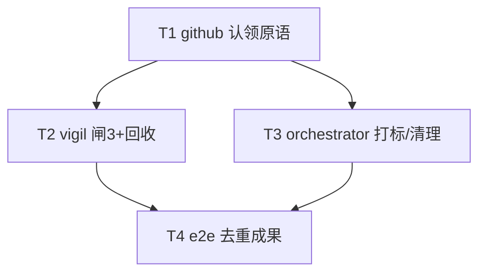

# 0039 · vigil 多后端并发派单去重：引入「已派发」认领标签（第 3 道闸 + 过期回收）

<!-- 本文件由 spec 工具维护：frontmatter 为结构化源数据（含 tasks DAG），正文为组级 rust-RFC 9 段总览。 -->

## Summary

给 vigil **发现段**的去重判定 `_dispatch_kind` 加一道**跨后端可见的 GitHub「已派发」认领标签**闸（第 3 道，标签名 `openagents-dispatching`），作为既有「本地 State 无记录」「远端无分支」两道闸之外的第三道去重信号。某后端判 `fresh` 决定派单时，在**本地 checkpoint（`begin_run`）之后、耗时的后端起草之前**给该 issue 打上认领标签；其它后端在发现段读到该标签即跳过。因为 GitHub 标签不是原子 CAS，本方案只把「同一 issue 被多后端重复派单」的**时间窗从「分钟级」（后端起草 RFC 的时长）压到「秒级」（建 worktree 的时长）**，并用**标签事件时戳做过期回收**兜底「认领后领取方进程死亡导致 issue 永久卡死」的僵尸认领。目标是把重复派单概率压到可接受、且保证不产生永久卡死的认领——**不引入外部锁服务/DB，不做完整分布式一致性**（奥卡姆）。

## Motivation

**现状（就地复述，无需外读）。** OpenAgents 是 RFC 驱动的多 Agent 框架：`vigil`（守夜人，`openagents/vigil.py`）是一个薄调度循环，每轮先「发现+派单」（`discover_and_dispatch`）再 poll 已开 PR。发现段列出带 `openagents` 发现标签的 open issue，对每个 issue 调 `_dispatch_kind` 归类为 `fresh` / `resume` / `None`（跳过），`fresh` 与 `resume` 都进 `orchestrator.start_rfc` 起草 spec、开 draft PR。每个后端把运行状态存在**各自本地**的 `.openagents/state.json`（`openagents/state.py` 的 `State`），彼此互不可见；唯一的**跨后端共享事实源是 GitHub**（issue / 标签 / 分支 / PR）。

**竞态根因（已核对代码）。** `_dispatch_kind` 判 `fresh` 的去重闸当前只有两道：

1. **闸 1——本地 State 无 run 记录**：`self._state.find_by_issue(N) is None`。
2. **闸 2——远端无 issue 分支**：`_remote_branch_exists("openagents/issue-N")`（`git ls-remote`）。

`start_rfc` 的 `fresh` 路径次序是：`workspace.prepare`（建隔离 worktree，秒级）→ `state.begin_run`（落 `solving`/`pr_number=0` 的本地 checkpoint）→ **`backend.run` 起草 spec（分钟级，最慢的一步）** → `commit_and_push`（分支此刻才出现在远端）→ `create_pr`（draft PR 此刻才出现）。也就是说，**远端分支/PR 要到 `start_rfc` 的中后段才出现**。

当两台机器同时对同一仓库跑 vigil、一个新 issue 刚被提出时，两个后端在同一时间窗内都满足「①本地无记录 + ②远端无分支」→ 两边都判 `fresh` → 都进 `start_rfc` → **各自建分支、各自起草、各自开 PR** → 撞车，产生重复分支/PR/重复工作。竞态窗口 ≈ 从「判 `fresh`」到「分支出现在远端」，即 `workspace.prepare` + `backend.run`（分钟级）。

**为什么现在要改。** 这是实际使用中真实发生的事故（两台机器同时对同一仓库跑 vigil，新 issue 被双方同时领取实现而撞车）。既有两道闸都依赖「远端已出现分支」这个**滞后**信号，而分支要到起草完成后才出现，天然堵不住「起草期间」的并发。需要一个**在发现段就能读到、且在派单一开始就能写下**的跨后端共享认领标记，把 check-then-claim 的窗口压到最小。

**既有流程标签机制（就地复述）。** `openagents/github.py` 已有单一来源的流程标签常量 `PROCESS_LABELS = (DISCOVERY_LABEL="openagents", APPROVAL_LABEL="rfc-approved", BLOCKED_LABEL="needs-human")`，分别是「发现门控 / RFC 批准 / 挂起待人」三个结构化信号；`ensure_prerequisites()` 遍历 `PROCESS_LABELS` 调 `ensure_label` 幂等自举（init/release/vigil 三入口统一调用）。已有 `add_label` / `remove_label` / `has_label` 三个标签操作，但它们当前都作用于 **PR**（`gh pr edit/view <n>`），发现段面对的是 **issue**，缺 issue 级标签操作。认领标签作为**第 4 个流程标签**并入 `PROCESS_LABELS` 同源管理，即可被 `ensure_prerequisites` 一并自举。

## Guide-level explanation

引入一个新的流程标签 **`openagents-dispatching`（「已派发/认领中」）**。它对使用者是透明的，只改变多后端并发时的行为：

- **单后端场景**：认领标签是无害冗余——打上、（PR 开出后）摘掉，行为与今天一致；同后端崩溃仍靠本地 `begin_run` + `resume` 捡回孤儿 run。
- **多后端场景**：谁先判 `fresh` 谁先打标签；后判的后端在发现段读到标签即跳过，交给领到的那个后端推进。

一次典型的「两后端抢同一新 issue」时序（引入本方案后）：

1. 后端 A、B 几乎同时在发现段扫到新 issue #N，都读到「①本地无记录 + ②远端无分支 + ③无认领标签」。
2. A 先进 `start_rfc`：建 worktree → `begin_run`（本地 checkpoint）→ **打 `openagents-dispatching` 标签（认领）** → 起草（分钟级）→ 推分支 → 开 draft PR → 摘认领标签。
3. B 稍晚进入发现段（vigil 是逐轮扫描，轮次天然错开）：读到 issue #N **已带认领标签** → 第 3 道闸命中 → 跳过，不派单。
4. 竞态窗口被压到「A 从判 `fresh` 到打上标签」之间的 `workspace.prepare`（秒级），而非原来的整个起草时长（分钟级）。

**僵尸认领的兜底（过期回收）。** 若 A 打了标签后进程被杀且再没起来：认领标签是 GitHub 上的共享状态，但 `begin_run` 是 A 的**本地**状态，B 无法 resume A 的孤儿 run。为避免 issue 因「领了没人干」永久卡死，B 在发现段读到「带认领标签、但远端仍无分支、且认领已超过 T 时间」时，判定为**僵尸认领** → 允许重新认领（视同 `fresh`，重打标签刷新时戳）。认领的「年龄」取该标签在 issue 时间线上最近一次 `labeled` 事件的 `created_at`（GitHub 时间线是跨后端共享的时钟）。

**成果可视化（理念 8）。** OpenAgents 已有本地成果看板：`openagents/results.py` 把各后端本地 `State` 的 `RunRecord` 渲染成单页 `board.html`（`oa board` 命令，用标准库 `webbrowser` 打开）。去重成功的**可见成果**是：抢到的后端 A 的看板对 issue #N 显示**恰好一条** run，而落败的后端 B 的看板对 issue #N **没有** run（它在发现段正确跳过了）——即「一个 issue 只被一个后端领取」在两块看板上直观成立。本 spec 的 e2e 用浏览器导航两块 `board.html` 做断言与截图（详见 Reference-level）。

## Reference-level explanation

### 三道闸后的 `_dispatch_kind`（`openagents/vigil.py`）

在既有两道闸之后插入第 3 道认领闸（伪码，`N = issue.number`，`branch = openagents/issue-N`）：

```
record = state.find_by_issue(N)
if record is None:
    if remote_branch_exists(branch):            # 闸 2：远端已有分支 → 在途，跳过
        return None
    if CLAIM_LABEL in issue.labels:             # 闸 3（新）：已被认领
        if not _claim_expired(issue=issue):     #   且未过期 → 别人在干，跳过
            return None
        # 已过期（僵尸认领）→ 落到下面，视同 fresh 重新认领
    return "fresh"
if record.status == SOLVING and record.pr_number == 0:
    return "resume"                              # 同后端孤儿 run，复用同名分支
return None
```

- `_claim_expired(issue)`：认领标签存在但远端无分支（上一分支闸已确认），取该标签最近 `labeled` 事件时戳，`now - t > T` 即过期。年龄经 GitHub issue 时间线 API 取得（跨后端共享时钟）。
- **`resume` 路径不受认领闸影响**：`resume` 由「本地有 `solving`/`pr=0` 记录」判定，先于认领闸的 `record is None` 分支，语义不变。

### 认领标签的「打」与「摘」（`openagents/orchestrator.py` · `start_rfc`）

认领的**写点**贴近本地 checkpoint（诉求 B 可恢复性）、又在耗时起草**之前**（诉求 A 压窗口）：

- **fresh 路径**：`workspace.prepare` → `state.begin_run` → **认领：`issue_stamp_label(N, CLAIM_LABEL)`** → `backend.run`（起草）→ push → `create_pr` → **清理：`issue_remove_label(N, CLAIM_LABEL)`**。
- **认领 = remove-then-add（`issue_stamp_label`）**：先摘再打，保证每次认领都在时间线上产生一个**全新的 `labeled` 事件**，使「认领年龄」对**重新认领（回收僵尸）**也有良定义（否则对已带标签的 issue 再 `--add-label` 是 no-op、不刷新时戳，回收后会立刻又判过期而抖动）。
- **清理时机（决策 E）**：draft PR 开出后摘掉认领标签——此时**远端分支 + draft PR 本身已是去重信号**（闸 2 接管），摘标签保持 issue 干净。保留标签作可观测性为备选（见 Rationale）。

### github 层新增/改动（`openagents/github.py`）

1. **第 4 个流程标签**：`DISPATCH_LABEL = "openagents-dispatching"`，并入 `PROCESS_LABELS`；`ensure_prerequisites()` 遍历自举，无需改动（新增标签自动被 `ensure_label` 预建）。
2. **issue 级标签操作**（与既有 PR 版对称，走 `gh issue edit/view`）：`issue_add_label` / `issue_remove_label`（幂等吞「标签本不在」，复用既有 `_is_label_absent`）/ `issue_stamp_label`（remove-then-add）。
3. **Issue 携带 labels**：`Issue` dataclass 增 `labels: tuple[str, ...] = ()`（带默认值，既有 `Issue(number,title,body)` 构造零改动）；`list_issues` / `get_issue` 的 `--json` 增 `labels` 字段并解析 `[l["name"] for l in raw.get("labels") or []]`。发现段的闸 3 快检直接读 `issue.labels`，**不额外发一次网络请求**。
4. **认领年龄**：`issue_label_age_seconds(number, name)` —— 走 `gh api repos/{owner}/{repo}/issues/N/timeline`，取该 label 最近 `labeled` 事件 `created_at`，返回距今秒数（无该事件返回 `None`）。仅在「带标签且无分支」时调用（罕见路径），不拖慢常态扫描。

### 过期阈值 T

默认 `T = 3600s`（1 小时），可配。因同后端崩溃已由本地 `begin_run` + `resume` 兜住，过期回收只针对**跨后端的死后端**，误回收（把仍在慢速起草的活后端判过期）代价是重复派单一次——故 T 取「足够大于最坏起草时长」的保守值。取值细节见 Unresolved questions。

### DAG 与文件分配

| Task | 标题 | files（单一 writer 所有权，组内互斥） | depends-on |
|---|---|---|---|
| T1 | github 认领原语层 | `openagents/github.py`, `tests/test_github_claim_label.py` | — |
| T2 | 发现段第 3 道闸 + 过期回收 | `openagents/vigil.py`, `tests/test_vigil_claim.py` | T1 |
| T3 | start_rfc 认领打标与清理 | `openagents/orchestrator.py`, `tests/test_orchestrator_claim.py` | T1 |
| T4 | 端到端去重成果测试（含浏览器看板断言） | `scripts/e2e-spec-0039-vigil-claim-dedup.sh`, `tests/test_claim_dedup_integration.py` | T2, T3 |



T2、T3 只依赖 T1，可并行（协同模式，各持不相交 `files`）。

### e2e 成果脚本（PR 指路牌拾取）

**路径：`scripts/e2e-spec-0039-vigil-claim-dedup.sh`**。该脚本驱动一次真实的「两后端抢同一 issue」并断言去重成果：

1. **准备**：scratch GitHub 仓库 + 一个带 `openagents` 标签的新 issue #N；`ensure_prerequisites` 自举 4 个流程标签（含 `openagents-dispatching`）。
2. **模拟并发**：以两份独立 `state.json`（后端 A / B）对同一 issue 各跑一次 `discover_and_dispatch`，A 先跑（stub 一个慢起草后端把认领窗口做实），B 后跑。
3. **后端断言（证据驱动，理念 7）**：远端 `openagents/issue-N` 分支/draft PR **恰好一个**；派发期间 issue 曾带 `openagents-dispatching` 标签、PR 开出后已摘除；A 的 state 有 issue #N 的 run，B 的 state **无**该 issue 的 run（B 在闸 3 跳过）。
4. **浏览器成果断言（理念 8，用 Playwright / chrome-devtools MCP）**：分别 `oa board` 渲染 A、B 两份 `board.html` 到文件，浏览器 `navigate` 到 `file://.../A/board.html` 与 `file://.../B/board.html`：
   - 在 A 看板 `snapshot` + `take_screenshot`，**断言存在恰好一行 issue #N 的 run**（表格文本含 `#N`，行数 = 1）；
   - 在 B 看板 `snapshot` + `take_screenshot`，**断言不存在 issue #N 的行**（呈现「暂无成果记录」或无 `#N`）；
   - `list_console_messages` / `list_network_requests` 断言无报错、无失败请求（看板为纯本地静态页，不应有网络失败）。
   - 两张截图作为「一个 issue 只被一个后端领取」的可见成果留档。
5. **过期回收子用例**：给 issue 打上一个「人为回拨时戳」的认领标签且不建分支，跑 B 的发现段，断言超 T 后判 `fresh`（回收成功）、未超 T 时判跳过。

> 说明：主竞态是后端内部的（GitHub 标签/分支/State），浏览器步骤覆盖的是**成果呈现层**（看板），二者合起来构成「后端去重正确 + 成果可见」的完整 e2e。若运行环境无浏览器 MCP，步骤 4 降级为对渲染出的 `board.html` 做 HTML 文本断言（grep `#N` 行数），不跳过成果验证。

## Drawbacks

- **非归零竞态（诉求 C）**：GitHub 标签不是原子 CAS，两后端仍可能「都读到无标签 → 都打标签」。窗口从分钟级压到秒级、概率大幅下降但非零；本方案接受这一残余概率，不追求强一致。
- **多两次 gh 调用**：认领（remove+add）与清理各一次 `gh issue edit`，过期路径再加一次时间线 API。相对 vigil 每轮已有的多次 gh 调用，开销可忽略；但确实增加了对 GitHub API 的依赖面。
- **过期阈值是一个魔法数**：T 太小会误回收慢起草的活后端（重复派单），太大则死后端占坑更久。需要一个保守默认 + 可配，本身是运维负担。
- **认领与清理跨越 `start_rfc` 首尾**：若在「打标签后、开 PR 前」崩溃，标签留存，靠同后端 `resume` 或跨后端过期回收清理——引入了一个需要兜底的中间态。

## Rationale and alternatives

**为什么是「标签 + 就地复述的最小机制」。** 认领信号必须**跨后端可见**，而本地 State 不可见，只有 GitHub 标签/分支/PR 共享——标签是最轻的可复用共享信号（已有 `PROCESS_LABELS` / `ensure_prerequisites` / 标签操作骨架，奥卡姆：不引入外部锁服务/DB）。认领**写点选在 `begin_run` 之后、`backend.run` 之前**，是 A（压窗口）与 B（可恢复）的折中：`begin_run` 到起草之间只隔一个秒级的 worktree 准备，既让同后端崩溃可 `resume`（B），又把 check-then-claim 窗口压到秒级（A）。

**备选 1——认领放在 `_dispatch_kind` 判定点/`start_rfc` 最前（`begin_run` 之前）。** 最大化压窗口（A 最优），但认领先于本地 checkpoint：若崩在「认领后、`begin_run` 前」，本后端无本地记录、无法 `resume`，只能等跨后端过期回收——牺牲 B。因 `begin_run` 到起草之间窗口已是秒级，额外收益极小而代价明确，**不取**。

**备选 2——用 issue assignee 代替标签认领。** GitHub assignee 也跨后端可见，语义上更贴「谁在做」。但 assignee 面向人类协作、与「机器认领」语义错位，且仍非原子 CAS（同样有 read-then-write 窗口），并未换来更强保证，却偏离既有 `PROCESS_LABELS` 同源管理——**不取**，留作 Future/Unresolved。

**备选 3——认领后回读校验 / 带序评论锁 / 更强原语。** 可进一步降低残余概率（如打标签后回读确认「只有自己」，或用带单调序的评论做租约）。但这些都在向「完整分布式一致性/租约系统」滑，违背本 issue 的「不做」边界与奥卡姆；当前「轮次天然错开 + 秒级窗口 + 过期回收兜底」已把概率压到可接受，**暂不取**，在 Unresolved 里记为「若实测碰撞率仍偏高再升级」的路径。

**备选 4——清理时机保留标签作可观测性（不摘）。** 好处是 issue 上一直能看到「曾被派发」；坏处是需要额外规则区分「认领中 vs 已开 PR」，且 issue 标签越攒越脏。选**开 PR 后即摘**（分支/PR 已是去重信号，闸 2 接管），保持 issue 干净。

## Prior art

- **Rust RFC 流程标签**（[rust-lang/rfcs](https://github.com/rust-lang/rfcs)）用 GitHub 标签驱动状态机——本项目 `PROCESS_LABELS`（`openagents`/`rfc-approved`/`needs-human`）已是同一范式，本 spec 只是加第 4 个成员。
- **分布式锁的「租约 + 过期」模式**（如 etcd/ZooKeeper 的 lease、Redis `SET NX PX`）：本方案的「认领标签 + 时戳过期回收」是它的**弱化非原子版**——刻意不追求 CAS 原子性，只借「带过期的占用」思路避免死占，符合奥卡姆边界。
- **本仓库既有先例**：`needs-human` 挂起标签的打/摘（`add_label`/`remove_label`，Spec-0032）、`ensure_prerequisites` 的幂等标签自举（Spec-0023）——本 spec 复用同一套骨架，仅从 PR 级扩到 issue 级。

## Unresolved questions

- **过期阈值 T 的取值与可配位置**：默认 3600s 是否够保守（需大于最坏起草时长）？放 CLI flag / 环境变量 / `fleet_config`？初版取保守默认 + 一处可配，实测后再调。
- **认领时戳来源的稳健性**：以 issue 时间线最近 `labeled` 事件的 `created_at` 作年龄——若人工在 GitHub 上手动动过该标签会扰动时戳；是否需要更专用的时戳载体（如认领时附一条带序评论）留待观察，初版接受时间线时戳。
- **残余碰撞率是否需要升级到更强原语**（备选 2/3）：先上最小方案并在真实双后端环境观测碰撞频率，只有实测不可接受时才引入回读校验/租约。
- **e2e 浏览器步骤的环境依赖**：CI 是否常备 Playwright/chrome-devtools MCP？无则降级为 `board.html` 文本断言（已在 Reference-level 写明降级路径）。

## Future possibilities

- 把认领标签的「打/查/过期」抽象成一个通用的**跨后端认领原语**，供未来其它「多后端争抢同一 GitHub 对象」的场景（如争抢同一 PR 的 poll 推进权）复用。
- 若碰撞率实测偏高，按备选 3 升级为「认领后回读校验」或「带序评论租约」，接口对上层 `_dispatch_kind` 不变（仅换底层认领实现）。
- 认领事件可作为**可观测性数据源**：统计「认领 → 开 PR」时长、过期回收次数，反哺 T 的自适应取值。

