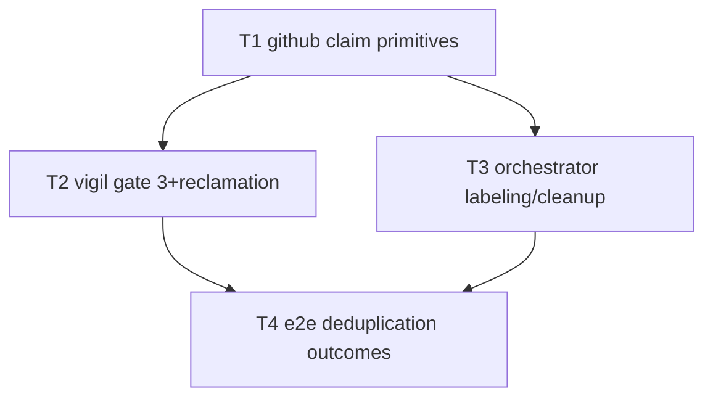

# 0039 · vigil Deduplication of Concurrent Dispatch Across Multiple Backends: Introducing a “Dispatched” Claim Label (Third Gate + Expiration-Based Reclamation)

<!-- This file is maintained by the spec tool: frontmatter is the structured source data (including the tasks DAG), and the body is the group-level nine-section rust-RFC overview. -->

## Summary

Add a **GitHub “dispatched” claim label visible across backends** as an additional gate in `_dispatch_kind`, the deduplication check in vigil’s **discovery phase** (the third gate, with label name `openagents-dispatching`). It serves as a third deduplication signal alongside the existing two gates: “no record in local State” and “no remote branch.” When a backend classifies an issue as `fresh` and decides to dispatch it, it applies the claim label to that issue **after the local checkpoint (`begin_run`) and before the time-consuming backend drafting step**; other backends skip the issue when they read this label during discovery. Because GitHub labels are not an atomic CAS, this proposal only **reduces the time window for “the same issue being dispatched by multiple backends” from “minutes” (the time spent by the backend drafting the RFC) to “seconds” (the time spent creating the worktree)**. It also uses **label event timestamps for expiration-based reclamation** to handle zombie claims where “the claiming process dies after claiming, leaving the issue permanently stuck.” The goal is to reduce the probability of duplicate dispatch to an acceptable level and ensure that claims never become permanently stuck—**without introducing an external lock service/DB or implementing full distributed consistency** (Occam’s razor).

## Motivation

**Current state (restated here; no external reading required).** OpenAgents is an RFC-driven multi-Agent framework: `vigil` (Vigil, `openagents/vigil.py`) is a thin scheduling loop that first performs “discovery + dispatch” (`discover_and_dispatch`) each round, then polls existing PRs. The discovery phase lists open issues bearing the `openagents` discovery label and calls `_dispatch_kind` for each issue to classify it as `fresh` / `resume` / `None` (skip). Both `fresh` and `resume` enter `orchestrator.start_rfc` to draft a spec and open a draft PR. Each backend stores its run state in **its own local** `.openagents/state.json` (`State` in `openagents/state.py`), invisible to the others; the only **shared source of truth across backends is GitHub** (issues / labels / branches / PRs).

**Root cause of the race (verified against the code).** `_dispatch_kind` currently has only two deduplication gates when classifying an issue as `fresh`:

1. **Gate 1—no run record in local State**: `self._state.find_by_issue(N) is None`.
2. **Gate 2—no remote issue branch**: `_remote_branch_exists("openagents/issue-N")` (`git ls-remote`).

The order of the `fresh` path in `start_rfc` is: `workspace.prepare` (create an isolated worktree, taking seconds) → `state.begin_run` (persist a local checkpoint with `solving`/`pr_number=0`) → **`backend.run` drafts the spec (taking minutes, the slowest step)** → `commit_and_push` (only now does the branch appear on the remote) → `create_pr` (only now does the draft PR appear). In other words, **the remote branch/PR does not appear until the middle-to-late stages of `start_rfc`**.

When two machines run vigil against the same repository simultaneously and a new issue has just been filed, both backends satisfy “① no local record + ② no remote branch” within the same time window → both classify it as `fresh` → both enter `start_rfc` → **each creates a branch, drafts a spec, and opens a PR** → they collide, producing duplicate branches/PRs/work. The race window ≈ the interval from “classification as `fresh`” to “the branch appearing on the remote,” namely `workspace.prepare` + `backend.run` (taking minutes).

**Why change this now.** This is an incident that actually occurred in real use (two machines running vigil against the same repository simultaneously both claimed a new issue for implementation and collided). Both existing gates rely on the **lagging** signal that “a branch has appeared on the remote,” but the branch appears only after drafting is complete, so they inherently cannot prevent concurrency “during drafting.” A shared claim marker is needed that **can be read during discovery and written at the very start of dispatch**, minimizing the check-then-claim window.

**Existing workflow label mechanism (restated here).** `openagents/github.py` already has a single source of truth for workflow label constants, `PROCESS_LABELS = (DISCOVERY_LABEL="openagents", APPROVAL_LABEL="rfc-approved", BLOCKED_LABEL="needs-human")`, representing the three structured signals “discovery gate / RFC approval / suspended pending human intervention,” respectively. `ensure_prerequisites()` iterates over `PROCESS_LABELS` and calls `ensure_label` for idempotent bootstrapping (called uniformly by all three entry points: init/release/vigil). The three label operations `add_label` / `remove_label` / `has_label` already exist, but all currently operate on **PRs** (`gh pr edit/view <n>`). Discovery deals with **issues**, and issue-level label operations are missing. Adding the claim label to `PROCESS_LABELS` as the **fourth workflow label**, managed through the same source of truth, lets `ensure_prerequisites` bootstrap it along with the others.

## Guide-level explanation

Introduce a new workflow label, **`openagents-dispatching` (“dispatched/being claimed”)**. It is transparent to users and changes behavior only when multiple backends run concurrently:

- **Single-backend scenario**: the claim label is harmless redundancy—apply it, then remove it (after the PR is opened); behavior remains the same as today. Crashes on the same backend still rely on local `begin_run` + `resume` to recover orphaned runs.
- **Multiple-backend scenario**: whichever backend first classifies the issue as `fresh` applies the label first; backends that evaluate it later read the label during discovery and skip it, leaving the claiming backend to proceed.

A typical sequence in which “two backends compete for the same new issue” (after this proposal is introduced):

1. Backends A and B discover new issue #N almost simultaneously during discovery, and both read “① no local record + ② no remote branch + ③ no claim label.”
2. A enters `start_rfc` first: create worktree → `begin_run` (local checkpoint) → **apply the `openagents-dispatching` label (claim)** → draft (taking minutes) → push branch → open draft PR → remove claim label.
3. B enters discovery slightly later (vigil scans in rounds, which are naturally staggered): it reads that issue #N **already bears the claim label** → the third gate matches → skip, without dispatching.
4. The race window is reduced to `workspace.prepare` (taking seconds), between “A classifies the issue as `fresh`” and “A applies the label,” instead of the entire original drafting duration (taking minutes).

**Fallback for zombie claims (expiration-based reclamation).** If A’s process is killed after applying the label and never restarts: the claim label is shared state on GitHub, but `begin_run` is A’s **local** state, so B cannot resume A’s orphaned run. To prevent the issue from becoming permanently stuck because “someone claimed it but nobody is doing the work,” when B reads during discovery that “the claim label is present, but there is still no remote branch, and the claim is older than T,” it identifies a **zombie claim** → allows the issue to be claimed again (treating it as `fresh` and reapplying the label to refresh the timestamp). The claim’s “age” comes from `created_at` on the most recent `labeled` event for that label in the issue timeline (the GitHub timeline provides a shared clock across backends).

**Visualizing results (Principle 8).** OpenAgents already has a local results board: `openagents/results.py` renders the `RunRecord` entries from each backend’s local `State` into a single-page `board.html` (the `oa board` command, opened using the standard library’s `webbrowser`). The **visible result** of successful deduplication is: the board for backend A, which won the claim, shows **exactly one** run for issue #N, while the board for backend B, which lost, shows **no** run for issue #N (it correctly skipped the issue during discovery)—making “one issue is claimed by only one backend” directly visible across the two boards. This spec’s e2e uses a browser to navigate to both `board.html` pages for assertions and screenshots (see Reference-level for details).

## Reference-level explanation

### `_dispatch_kind` with three gates (`openagents/vigil.py`)

Insert the third claim gate after the existing two gates (pseudocode, `N = issue.number`, `branch = openagents/issue-N`):

```
record = state.find_by_issue(N)
if record is None:
    if remote_branch_exists(branch):            # Gate 2: remote branch already exists → in progress, skip
        return None
    if CLAIM_LABEL in issue.labels:             # Gate 3 (new): already claimed
        if not _claim_expired(issue=issue):     #   and not expired → someone else is working on it, skip
            return None
        # Expired (zombie claim) → fall through below, treat as fresh and claim again
    return "fresh"
if record.status == SOLVING and record.pr_number == 0:
    return "resume"                              # Orphaned run on the same backend; reuse the branch with the same name
return None
```

- `_claim_expired(issue)`: the claim label is present but there is no remote branch (confirmed by the preceding branch gate); obtain the timestamp of the most recent `labeled` event for that label, and consider it expired if `now - t > T`. The age is obtained through the GitHub issue timeline API (a shared clock across backends).
- **The `resume` path is unaffected by the claim gate**: `resume` is determined by “a local `solving`/`pr=0` record exists,” which takes precedence over the claim gate’s `record is None` branch; its semantics remain unchanged.

### Applying and removing the claim label (`openagents/orchestrator.py` · `start_rfc`)

The claim’s **write point** is close to the local checkpoint (requirement B: recoverability), while remaining **before** the time-consuming drafting step (requirement A: reduce the window):

- **fresh path**: `workspace.prepare` → `state.begin_run` → **claim: `issue_stamp_label(N, CLAIM_LABEL)`** → `backend.run` (drafting) → push → `create_pr` → **cleanup: `issue_remove_label(N, CLAIM_LABEL)`**.
- **Claim = remove-then-add (`issue_stamp_label`)**: remove the label first, then apply it, ensuring that every claim produces a **brand-new `labeled` event** in the timeline, so that “claim age” is also well-defined for **reclaiming (recovering zombies)** (otherwise, calling `--add-label` again on an issue that already bears the label is a no-op and does not refresh the timestamp, causing the claim to be considered expired again immediately after reclamation and leading to flapping).
- **Cleanup timing (Decision E)**: remove the claim label after the draft PR is opened—at that point, **the remote branch + draft PR itself already serve as deduplication signals** (gate 2 takes over), and removing the label keeps the issue clean. Retaining the label for observability is an alternative (see Rationale).

### Additions/changes to the github layer (`openagents/github.py`)

1. **Fourth workflow label**: `DISPATCH_LABEL = "openagents-dispatching"`, added to `PROCESS_LABELS`; `ensure_prerequisites()` iterates over it for bootstrapping and needs no changes (the new label is automatically pre-created by `ensure_label`).
2. **Issue-level label operations** (symmetric with the existing PR versions, using `gh issue edit/view`): `issue_add_label` / `issue_remove_label` (idempotently suppress “label was not present,” reusing the existing `_is_label_absent`) / `issue_stamp_label` (remove-then-add).
3. **Issue carries labels**: add `labels: tuple[str, ...] = ()` to the `Issue` dataclass (with a default value, requiring zero changes to existing `Issue(number,title,body)` construction); add the `labels` field to `--json` in `list_issues` / `get_issue` and parse it with `[l["name"] for l in raw.get("labels") or []]`. The quick check at gate 3 in discovery reads `issue.labels` directly, **without an additional network request**.
4. **Claim age**: `issue_label_age_seconds(number, name)` — use `gh api repos/{owner}/{repo}/issues/N/timeline --paginate --slurp`, find `created_at` of the most recent `labeled` event for that label across all pages, and return the number of seconds since then (return `None` if no such event exists). **Pagination is mandatory**: the timeline endpoint always returns events in ascending chronological order and does not support sorting; a single page retrieves only the oldest 100 events, while the claim’s `labeled` event is always at the end of the timeline. For old issues that “had already accumulated >100 events before labeling” (exactly the kind vigil may dispatch), failing to paginate would incorrectly yield `None` → leave zombie claims permanently stuck. Called only when “the label is present and no branch exists” (a rare path), so it does not slow down normal scanning.

### Expiration threshold T

The default is `T = 3600s` (1 hour), configurable. Since crashes within the same backend are already covered by local `begin_run` + `resume`, expiration reclamation targets only **dead backends across backend instances**. The cost of erroneous reclamation (declaring a live backend that is still drafting slowly to have expired) is one duplicate dispatch—so T takes a conservative value “sufficiently greater than the worst-case drafting duration.” See Unresolved questions for details on choosing the value.

### DAG and file allocation

| Task | Title | files (single-writer ownership, mutually exclusive within the group) | depends-on |
|---|---|---|---|
| T1 | github claim primitive layer | `openagents/github.py`, `tests/test_github_claim_label.py` | — |
| T2 | Discovery gate 3 + expiration reclamation | `openagents/vigil.py`, `tests/test_vigil_claim.py` | T1 |
| T3 | start_rfc claim labeling and cleanup | `openagents/orchestrator.py`, `tests/test_orchestrator_claim.py` | T1 |
| T4 | End-to-end deduplication outcome tests (including browser board assertions) | `scripts/e2e-spec-0039-vigil-claim-dedup.sh`, `tests/test_claim_dedup_integration.py` | T2, T3 |



T2 and T3 depend only on T1 and can run in parallel (collaborative mode, each owning disjoint `files`).

### e2e outcome script (PR signpost pickup)

**Path: `scripts/e2e-spec-0039-vigil-claim-dedup.sh`**. This script drives a real “two backends competing for the same issue” scenario and asserts the deduplication outcome:

1. **Preparation**: A scratch GitHub repository + a new issue #N labeled `openagents`; `ensure_prerequisites` bootstraps 4 process labels (including `openagents-dispatching`).
2. **Simulate concurrency**: Using two independent `state.json` files (backend A / B), run `discover_and_dispatch` once for each backend against the same issue. A runs first (stub a slow drafting backend to establish an actual claim window), then B runs.
3. **Backend assertions (evidence-driven, principle 7)**: There is **exactly one** remote `openagents/issue-N` branch/draft PR; the issue carried the `openagents-dispatching` label during dispatch, and the label has been removed after the PR was opened; A’s state contains a run for issue #N, while B’s state contains **no** run for that issue (B skips it at gate 3).
4. **Browser outcome assertions (principle 8, using Playwright / chrome-devtools MCP)**: Use `oa board` to render A’s and B’s respective `board.html` files, then use the browser to `navigate` to `file://.../A/board.html` and `file://.../B/board.html`:
   - On A’s board, use `snapshot` + `take_screenshot`, and **assert that exactly one row exists for the run for issue #N** (the table text contains `#N`, row count = 1);
   - On B’s board, use `snapshot` + `take_screenshot`, and **assert that no row exists for issue #N** (it displays “No outcome records yet” or contains no `#N`);
   - Use `list_console_messages` / `list_network_requests` to assert that there are no errors or failed requests (the board is a purely local static page and should have no network failures).
   - Archive the two screenshots as visible evidence that “an issue is claimed by only one backend.”
5. **Expiration reclamation subcase**: Apply a claim label to the issue with an “artificially backdated timestamp” without creating a branch, run B’s discovery stage, and assert that the issue is classified as `fresh` after T has elapsed (successful reclamation), and skipped when T has not elapsed.

> Note: The main race is internal to the backends (GitHub labels/branches/State), while the browser steps cover the **outcome presentation layer** (the board). Together, they form a complete e2e test of “correct backend deduplication + visible outcomes.” If the runtime environment has no browser MCP, step 4 falls back to HTML text assertions against the rendered `board.html` (grep the number of lines containing `#N`); outcome verification is not skipped.

## Drawbacks

- **The race probability does not drop to zero (requirement C)**: GitHub labels are not atomic CAS; two backends can still “both read no label → both apply the label.” The window shrinks from minutes to seconds, greatly reducing the probability without eliminating it; this proposal accepts that residual probability and does not pursue strong consistency.
- **Two additional gh calls**: Claiming (remove+add) and cleanup each require one `gh issue edit` call, with one additional timeline API call on the expiration path. Compared with the multiple gh calls already made in each vigil cycle, the overhead is negligible; however, it does increase the surface area of the dependency on the GitHub API.
- **The expiration threshold is a magic number**: If T is too small, a live backend drafting slowly may be erroneously reclaimed (duplicate dispatch); if it is too large, a dead backend holds the slot longer. A conservative default + configurability are needed, which is itself an operational burden.
- **Claiming and cleanup span the beginning and end of `start_rfc`**: If a crash occurs “after labeling but before opening the PR,” the label remains, relying on same-backend `resume` or cross-backend expiration reclamation for cleanup—introducing an intermediate state that needs a recovery mechanism.

## Rationale and alternatives

**Why “labels + a minimal mechanism restated in place.”** The claim signal must be **visible across backends**, whereas local State is not; only GitHub labels/branches/PRs are shared. Labels are the lightest reusable shared signal (the existing `PROCESS_LABELS` / `ensure_prerequisites` / label-operation scaffolding; Occam’s razor: do not introduce an external lock service/DB). The **claim write is placed after `begin_run` and before `backend.run`** as a compromise between A (shrinking the window) and B (recoverability): only worktree preparation, taking seconds, separates `begin_run` from drafting. This both allows same-backend crashes to be recovered with `resume` (B) and shrinks the check-then-claim window to seconds (A).

**Alternative 1—Place the claim at the `_dispatch_kind` decision point / the very beginning of `start_rfc` (before `begin_run`).** This minimizes the window (optimal for A), but the claim precedes the local checkpoint: if a crash occurs “after claiming but before `begin_run`,” this backend has no local record and cannot `resume`; it can only wait for cross-backend expiration reclamation—sacrificing B. Since the window between `begin_run` and drafting is already measured in seconds, the additional benefit is tiny and the cost is clear. **Rejected**.

**Alternative 2—Use the issue assignee instead of a label for claiming.** GitHub assignees are also visible across backends and semantically closer to “who is working on this.” However, assignees serve human collaboration, which is semantically misaligned with “machine claiming,” and they still do not provide atomic CAS (the same read-then-write window remains). This yields no stronger guarantees while departing from unified management through the existing `PROCESS_LABELS`—**rejected**, left for Future/Unresolved.

**Alternative 3—Read back and verify after claiming / sequenced-comment locks / stronger primitives.** These could further reduce the residual probability (for example, reading back after labeling to confirm “only I hold it,” or using comments with monotonically increasing sequence numbers as leases). But all of these move toward a “full distributed consistency/lease system,” violating this issue’s out-of-scope boundary and Occam’s razor. The current combination of “naturally staggered cycles + a seconds-long window + expiration reclamation as a fallback” already reduces the probability to an acceptable level. **Not adopted for now**; recorded in Unresolved as an upgrade path “if the measured collision rate remains too high.”

**Alternative 4—Retain the label during cleanup for observability (do not remove it).** The benefit is that the issue always shows that it “was dispatched”; the downside is that extra rules are needed to distinguish “claim in progress vs. PR already opened,” and issue labels accumulate clutter. Choose to **remove it as soon as the PR is opened** (the branch/PR is already a deduplication signal, and gate 2 takes over), keeping the issue clean.

## Prior art

- **Rust RFC process labels** ([rust-lang/rfcs](https://github.com/rust-lang/rfcs)) use GitHub labels to drive a state machine—this project’s `PROCESS_LABELS` (`openagents`/`rfc-approved`/`needs-human`) already follow the same paradigm; this spec merely adds a fourth member.
- **The “lease + expiration” pattern for distributed locks** (such as etcd/ZooKeeper leases and Redis `SET NX PX`): this proposal’s “claim label + timestamp-based expiration reclamation” is a **weaker, non-atomic version**—deliberately avoiding CAS atomicity and borrowing only the idea of “occupancy with expiration” to prevent dead holders from retaining a slot indefinitely, consistent with the Occam’s razor boundary.
- **Existing precedents in this repository**: Applying/removing the `needs-human` suspension label (`add_label`/`remove_label`, Spec-0032), and idempotent label bootstrapping in `ensure_prerequisites` (Spec-0023)—this spec reuses the same scaffolding, merely extending it from the PR level to the issue level.

## Unresolved questions

- **The value of expiration threshold T and where to configure it**: Is the default of 3600s conservative enough (it must exceed the worst-case drafting duration)? Should it be a CLI flag / environment variable / `fleet_config` setting? The initial version uses a conservative default + one configuration point, with adjustments after real-world measurement.
- **Robustness of the claim timestamp source**: Use the `created_at` of the most recent `labeled` event in the issue timeline to determine age—manual changes to that label on GitHub would perturb the timestamp. Whether a more dedicated timestamp carrier is needed (such as adding a sequenced comment when claiming) remains to be observed; the initial version accepts the timeline timestamp.
- **Whether the residual collision rate requires an upgrade to stronger primitives** (alternatives 2/3): Deploy the minimal proposal first and observe collision frequency in a real dual-backend environment; introduce read-back verification/leases only if measurements prove it unacceptable.
- **Environment dependencies of the e2e browser steps**: Will CI routinely provide Playwright/chrome-devtools MCP? If not, fall back to `board.html` text assertions (the fallback path is already specified in Reference-level).

## Future possibilities

- Abstract “applying/checking/expiring” claim labels into a general **cross-backend claim primitive**, reusable in future scenarios where “multiple backends compete for the same GitHub object” (such as competing for the right to advance polling for the same PR).
- If the measured collision rate is too high, upgrade to “read-back verification after claiming” or “sequenced-comment leases” according to alternative 3, keeping the interface to the upper-level `_dispatch_kind` unchanged (replacing only the underlying claim implementation).
- Claim events can serve as an **observability data source**: Measure the duration from “claim → PR opened” and the number of expiration reclamations to inform adaptive selection of T.
