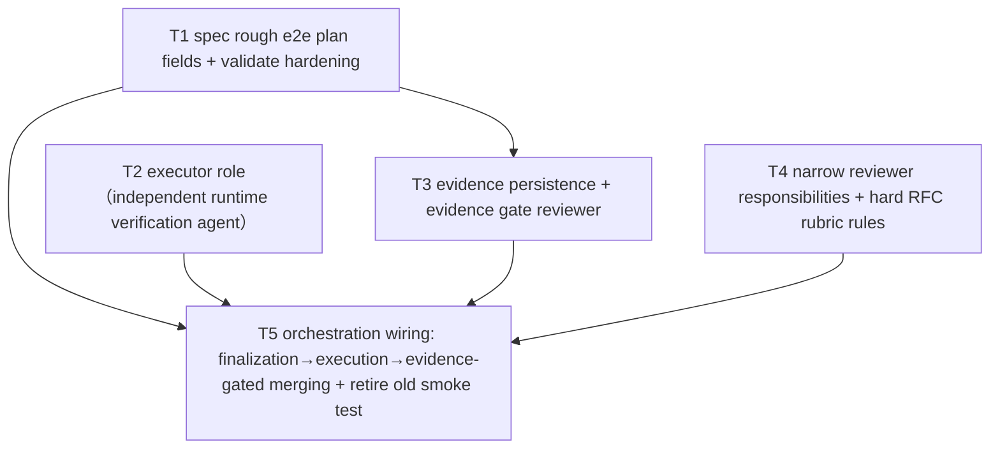

# 0040 · Redesigning e2e: Runbook-Driven + Independent Execution + Evidence Review Gating (Phase 1 Skeleton)

<!-- This file is maintained by the spec tool: frontmatter is the structured source data (including the tasks DAG); the body is a group-level overview in the nine rust-RFC sections. -->

## Summary

Upgrade OpenAgents e2e from the **static, self-validating process that tests an outdated version**—“the implementer writes a script along the way + runs it once in implement + posts a label without gating”—to a **runbook-driven + independent execution + evidence review gating** pipeline:

```
① Spec(RFC)       Write a rough e2e plan (intent + acceptance criteria, declaring the execution mode); the RFC gate reviews “whether to verify, and what to verify”
② implement       Write feature code (unchanged from today)
③ Finalize runbook With code in place, turn the rough plan into a [concrete, executable runbook] (prose, declaring mode A)
④ executor agent  A general-purpose runtime verification agent reads the runbook → selects tools by mode → actually runs the system → interacts + asserts
⑤ Persist evidence Logs / screenshots / structured pass-fail → files (docs/e2e-results/<pr>/) → commit into the PR
⑥ Evidence gate   A reviewer compares “RFC-approved intent” against “actual evidence” to judge whether it was truly achieved → gates merging
```

Two orthogonal axes run through the entire design: **A: execution mode varies** (`ui`/`api`/`cli`/`backend`; e2e does not necessarily start a frontend; the runbook declares the mode, and the executor selects tools accordingly); **B: independent execution is invariant** (regardless of mode, an **independent agent**—the person running it ≠ the person writing the code—actually starts the system, follows real paths, and produces independent evidence). **Phase 1 (this group) implements only the skeleton + non-browser modes** (`cli`/`api`/`backend`), establishing “independent execution + evidence review + upstream enforcement + pre-merge gating”; the `ui` browser mode is left to Phase 2 (see Future possibilities).

## Motivation

**Background (restated here, without relying on bare references to carry necessary information).** OpenAgents is an RFC/spec-driven multi-agent framework: the Vigil process, `messages.Messages.poll`, periodically scans all runs in the open state and routes them by stage. A typical issue lifecycle is:
`solving`→open an RFC draft PR→`rfc-review`→RFC approved→`orchestrator.implement` writes code and marks the draft PR ready→`pr-open`→Vigil's `_process_coding` checks CI/mergeability each round; if all CI checks are green, it calls `review_code` (N independent reviewer agents vote); if all votes are PASS, it calls `merge_pr` (or stops at “awaiting human merge” when `hold.at_merge` is set); otherwise, it calls `iterate` to revise the code / after K rounds, `_block` suspends the run to await a human. e2e is embedded in this chain—**and today it is broken**.
A line-by-line check of (`orchestrator.py` / `e2e.py` / `reviewer.py` / `messages.py` / `spec/signpost.py`) reveals four structural problems in the current e2e process:

1. **It tests an outdated version.** e2e runs **only once**, inside `orchestrator.implement` (`orchestrator.py:349-373`), through `self._post_e2e_result(...)` (`:367`), testing the “first implementation.” Subsequent `iterate` calls in `_process_coding` (`reason="ci"` / `"review"`, `messages.py:419` / `:447`) repeatedly change the code but **never rerun e2e**—the version ultimately merged by `merge_pr` (`messages.py:432`) **has never been tested by e2e**.
2. **It has no teeth.** `_post_e2e_result` (`orchestrator.py:461-487`) posts a signed comment on a best-effort basis and simply swallows exceptions (`:486` `except … ignored`), **gating nothing**; immediately afterward, `github.mark_ready` (`:369`) unconditionally marks the PR ready, and the only merge criterion is unanimous reviewer PASS (`messages.py:426`)—**even if e2e fails, the PR is still marked ready and still merged**.
3. **No one consumes the results.** The code reviewer calls `backend.run(..., context="")` through `reviewer.review` (`reviewer.py:116-118`; context is **always an empty string**). The task template `_CODE_REVIEW_TASK` (`reviewer.py:64-72`) only tells it to “use `git diff` to inspect changes + read the affected files” and **never reads the e2e result comment**—e2e pass/fail enters no decision path.
4. **It does not live up to its name + it is passive.** `e2e.run_e2e_script` (`e2e.py:48`) always runs the script's **offline portion** (without setting `OPENAGENTS_E2E_REAL`), which is effectively hermetic `ruff + mock pytest + grep assertions`—**no real system is started**. `signpost.script_path_for_group` (`spec/signpost.py:32`) extracts the script path from the first `scripts/*.sh` in the spec body; **the implementer writes the script along the way** (writing both the feature and its own tests), and if none is declared, the result is `skipped`.

**The core shift.** “Run scripts + review scripts” (static, self-validating) → “provide a **runbook**, have an **independent agent** follow it to **actually start the system** and verify behavior, **persist the evidence as files**, then have a reviewer **review the evidence** to determine whether it fulfills the RFC intent” (dynamic, independent, gated). These four problems are not four isolated bugs; they share one root cause: **there is no independent actor that actually runs the system on the final version to be merged and feeds the results into the merge criteria**. This group adds that actor (the executor) and that criterion (the evidence gate) to the pre-merge chain.

## Guide-level explanation

Once implemented, the e2e experience for an “interaction/behavior” issue becomes a pipeline with traceable evidence. Consider a CLI behavior change as an example (such as “`openagents init` should exit with an error when origin is missing, rather than remain silent”):

**① At the Spec stage, write only a rough plan (intent + acceptance criteria).** When drafting the spec, declare the e2e **intent** and **acceptance criteria** in the group-level overview, and declare the **execution mode**—but **do not hard-code specific commands/selectors/routes** (those are implementation details that cannot be settled before the code exists). For example:

```
Rough e2e plan (intent): init must fail explicitly and provide actionable guidance when there is no origin remote; it must not silently succeed.
Acceptance criteria: ① Run init in a repository without origin → nonzero exit + stderr contains a message such as “missing origin”;
                     ② Add origin and rerun → succeeds normally.
Execution mode: cli (the executor actually runs commands from the command line; no browser is needed).
```

At this point, the RFC gate reviews “**whether to verify, and what to verify**”: a frontend/interaction change whose spec does not declare a rough e2e plan → REWORK (a hard rule; see Reference-level).

**② implement writes feature code as usual.** Unchanged from today.

**③ With code in place, the implementer finalizes the rough plan into a runbook.** Only now can concrete commands, expected output, and decision points be settled, producing a **prose runbook** at `docs/e2e-results/<pr>/runbook.md`: it declares the `cli` mode and lists “how to start it, what to run, and what observations count as passing.” The **implementer is the preferred finalizer** (it knows the code best), but is subject to the tautology guard—the runbook must stay within the RFC-approved intent and cannot replace “report an error when origin is missing” with “run `--help` and check that it does not crash.”

**④ An independent executor actually runs the system according to the runbook.** An **independent runtime verification agent** (≠ the person writing the code) reads the runbook, selects tools by mode (`cli`→actually execute commands in the worktree, `api`→send HTTP requests, `backend`→run real integrations), **actually starts the system and follows real paths**, and performs interactions + assertions.

**⑤ Evidence is persisted as files and committed into the PR.** The executor writes observations for each step, command output/screenshots, and structured pass-fail results into `docs/e2e-results/<pr>/result.md` (+ attachments), then commits them into the PR—durable, readable by reviewers, and also allowing humans to see the results (principle 8).

**⑥ The evidence gate gates merging.** An evidence reviewer agent compares “**RFC-approved intent**” against “**actual evidence**” to judge whether it was **truly achieved / whether the difficult parts were avoided in favor of easier ones**. PASS → allow merging; FAIL → use the existing `iterate` path (adding `e2e` as a `reason`) to return for changes; after K rounds, use the existing `_block(gate="e2e")` to suspend the run and await a human. **The code reviewers pass first, then the evidence gate runs**: code reviewer PASS (the code looks correct) but evidence gate FAIL (it does not work when actually run) **is not a conflict; it is exactly what this is meant to catch**—FAIL means iterate.

**Key invariant: the runbook has two stages.** The rough plan (intent) is locked into the spec and approved by the RFC gate; the concrete runbook is finalized only after the code exists. This both resolves “implementation details cannot yet be settled” and provides the foundation for the tautology guard—**the intent cannot be substituted during finalization**.

## Reference-level explanation

### Core mechanism: insert “finalize → execute → evidence gate” before merge

The changes center on inserting an evidence gate in `messages._process_coding` **after unanimous reviewer PASS and before `merge_pr`/`hold-merge`** (`messages.py:426-432`), supported by two **one-shot agent roles** (following the structure of the existing `reviewer.review`), one structured spec field, one RFC rubric rule, and one evidence directory convention. The new chain:

```
All CI checks green → unanimous review_code PASS
        → ③ orchestrator.finalize_runbook: dispatch the implementer backend to finalize the spec's rough e2e plan into
             docs/e2e-results/<pr>/runbook.md (declaring the mode), commit into the PR
        → ④ executor.run_executor: independent agent reads the runbook → selects tools by mode → actually runs the system → writes evidence
        → ⑤ Evidence goes into docs/e2e-results/<pr>/{result.md, *.log, *.png}, committed into the PR
        → ⑥ evidence_gate.review_evidence: reviewer compares RFC intent against evidence → PASS / FAIL
             ├─ PASS → merge_pr / hold-merge as usual (existing logic unchanged)
             └─ FAIL → iterate(reason="e2e") to return for changes; after K rounds → _block(gate="e2e") to suspend
```

### tautology guard (preventing “define your own runbook and pass it yourself”)—three lines of defense

1. **Intent is locked at the RFC stage**: the rough e2e plan (intent + acceptance criteria) is a structured spec field, frozen once approved by the RFC gate; the concrete runbook **must stay within the approved intent** and cannot substitute a different intent (the evidence gate is responsible for checking).
2. **The executor is independent** (competitor ≠ referee): the executor is an independent agent that shares no context with the implementer, actually starts the system, and follows real paths, rather than using hermetic stubs to validate its own work.
3. **The evidence reviewer checks independently**: the evidence gate compares “RFC-approved intent” against “actual evidence” to judge whether it was **truly achieved / whether the difficult parts were avoided in favor of easier ones**—even if the implementer writes a lenient runbook, evidence that does not match the intent still receives FAIL.

### Clarifying responsibilities relative to the existing reviewer (avoiding overlap/conflicts)

The code reviewer (static code inspection) and executor/evidence gate (dynamic behavior verification) are fundamentally complementary. Responsibilities are clarified in two places:

- **Move “whether e2e is required” upstream to the RFC gate**: **remove** the conditional browser-e2e rubric currently attached to the code reviewer, `_BROWSER_E2E_RUBRIC` (`reviewer.py:59-63`, appended to the end of `_CODE_REVIEW_TASK`), **from the code reviewer**. Replace it with a **stricter** rule in the RFC gate (`_RFC_REVIEW_TASK`, `reviewer.py:48-54`): a frontend/interaction change whose spec does not declare a rough e2e plan → REWORK.
- **Assign “behavioral acceptance” to the evidence gate**: the code reviewer **explicitly does not judge runtime behavior**, retaining only static code quality/security/structure checks (whether the Task is actually implemented, tautological tests, boundary safety, breaking changes)—state explicitly in `_CODE_REVIEW_TASK`: “The evidence gate is responsible for runtime behavior; you do not judge it.”

### State machine impact (almost unchanged; no new status)

- **No new status**: Evidence gate FAIL uses the existing `iterate` (the `reason` set expands from `{comment,ci,review,human}` to
  include `e2e`) + the existing `STATUS_ITERATING`; after K rounds, it uses the existing `_block(gate="e2e")` + the `needs-human` label.
- **Reuse the round budget**: Retries after evidence gate FAIL count toward the existing `rounds` (`increment_rounds`), sharing K
  (`MAX_ROUNDS`, default 3) with the code gate—there is one total iteration budget, and reaching the limit suspends the work. Add
  one message for `"e2e"` to `blocknote`'s `_TRIED_BY_GATE` (`messages.py:137-143`), so `_block(gate="e2e")` reuses the existing structured suspension comment.
- **Retire the old one-shot smoke test**: Delete `orchestrator._post_e2e_result` and its call in `implement`
  (`:367`), and retire `openagents/e2e.py` (the hermetic offline runner, the root of problem 4)—it tests an outdated version
  and does not gate merging, so the evidence gate before merge completely replaces it. See Unresolved for whether to retain `signpost.script_path_for_group`.

### Evidence persistence conventions

Under `docs/e2e-results/<pr>/`: `runbook.md` (③ finalized instructions), `result.md` (⑤ structured evidence: what was verified,
observations at each step, pass/fail, evidence references), and accompanying `*.log` / `*.png` files (Phase 2 screenshots). **Commit them into the PR** → durable,
readable by the evidence gate, and available for people to see the results (principle 8).

### This group's own rough e2e plan (dogfooding)

- **Intent**: Prove that the framework of “independent execution + persisted evidence + evidence-gated merging + upstream enforcement” has real teeth—evidence FAIL must block
  merging, and only evidence PASS permits it.
- **Acceptance behavior**: ① Create a fixture PR/worktree + a runbook declaring the `cli` form, run the executor → assert that the evidence
  files are written under `docs/e2e-results/<pr>/`; ② feed evidence showing “intent not achieved” to the evidence gate → assert that it returns FAIL and the flow takes
  `iterate(reason="e2e")`, **without calling** `merge_pr`; ③ feed evidence showing “intent achieved” → assert PASS and normal progression.
- **Execution form = `cli`/`backend` (no browser launched)**: This group's deliverable is a purely backend orchestration mechanism, and the repository contains **no frontend/web UI whatsoever**
  (verified: no `.tsx/.jsx/.vue`, no `frontend/web/dashboard/server` directories, and no HTTP service startup code).
  **Decision after checking the available tools**: This session has Playwright / Chrome DevTools MCP browser tools, but **the execution form follows the
  deliverable, rather than the tools**—the deliverable has no frontend to navigate or capture screenshots of, so the `ui` form has no application here. Choosing `cli` is precisely the first
  working example of this spec's decision A (the form can vary; e2e does not necessarily launch a frontend); the browser form will be introduced in Phase 2 only when there is a real frontend to verify.
- **e2e script**: `scripts/e2e-spec-0040-runbook-driven-evidence-gate.sh` (dogfoods the three assertions above in the offline portion,
  and is picked up by the PR signpost).

### DAG and file allocation



| Task | Owned files (mutually exclusive) | depends-on |
|---|---|---|
| T1 | `openagents/spec/schema.py`, `openagents/spec/model.py`, `openagents/spec/validate.py`, `openagents/spec/render.py`, `tests/test_spec_model.py`, `tests/test_spec_validate.py`, `tests/test_spec_render.py` | — |
| T2 | `openagents/executor.py`, `tests/test_executor.py` | — |
| T3 | `openagents/evidence_gate.py`, `tests/test_evidence_gate.py` | T1 |
| T4 | `openagents/reviewer.py`, `tests/test_reviewer.py` | — |
| T5 | `openagents/orchestrator.py`, `openagents/messages.py`, `openagents/e2e.py`, `tests/test_orchestrator.py`, `tests/test_messages.py`, `tests/test_e2e.py` | T1, T2, T3, T4 |

(T1/T2/T4 are parallel leaf tasks; T3 follows T1; T5 integrates everything. T5 deletes and retires `e2e.py`/`test_e2e.py`.)

### Interface contracts (roles modeled on the one-shot agent in `reviewer.review`)

- `executor.run_executor(*, backend, work_dir, runbook_path, evidence_dir, pr_number) -> ExecutorResult`
  —Read the runbook (including the form) → select tools according to the form and actually run the system → write evidence into `evidence_dir` → return structured
  `{outcome: passed|failed, form, notes}`; the contract guarantees that it never raises an exception (exceptions map to `failed`, following `run_e2e_script`).
- `evidence_gate.review_evidence(*, backend, work_dir, intent, evidence_dir, pr_number) -> EvidenceDecision`
  —Read the RFC intent + evidence in `evidence_dir` → decide `{passed, feedback}` (when `passed=False`, feedback summarizes
  “which acceptance behavior was not achieved/where the evidence sidestepped the hard parts,” and is fed to `iterate(reason="e2e")`); its structure mirrors `ReviewDecision`.
- `evidence_gate.evidence_dir_for(*, pr_number) -> Path`—The single source of truth for the `docs/e2e-results/<pr>/` path convention;
  the orchestrator computes it and passes it through to the executor / gate (the two do not import each other, preserving decoupling, principle 10).

## Drawbacks

- **Two more agents run before merge** (finalization + executor + evidence gate), increasing merge latency and token cost; for documentation-only/refactoring
  PRs, this is pure overhead (mitigation: the RFC gate requires rough planning only for “frontend/interaction” work; non-interactive PRs may leave the rough plan empty → the evidence gate passes without checks).
- **The executor may be unstable when actually running the system** (starting services, installing dependencies, environment drift) → false-negative FAIL blocks PRs that could otherwise merge; this group folds
  retries into the existing `rounds`/`MAX_ROUNDS`, switching to needs-human at the limit rather than looping indefinitely, but erroneous suspensions remain possible.
- **Evidence files enter the repo** (`docs/e2e-results/<pr>/`) and accumulate with PRs; screenshots (Phase 2) can be sizable → repository bloat
  (Unresolved: whether to clean up periodically/whether to `.gitignore` large attachments and retain only `result.md`).
- **Having the implementer finalize the runbook** still leaves a residual risk of self-verification; the three lines of defense in the tautology guard provide a backstop, but the evidence gate's judgment that evidence “sidesteps the hard parts”
  itself depends on the reviewer agent's judgment and cannot be mechanically proven.

## Rationale and alternatives

**Why this design.** All four problems share the same root: “no independent actor actually runs the system on the final version and feeds the result into the merge criteria.” Moving e2e from
a one-shot best-effort step inside implement to a **gating stage before merge** simultaneously resolves “testing an outdated version (what is tested now is the integrated state that will be
merged) + no teeth (FAIL immediately triggers `iterate`/`_block`) + no consumer of the results (the evidence gate is the consumer)”; replacing “running a script”
with “an independent agent actually running the system according to a runbook” resolves “not living up to the name/self-verification.” Reusing the existing `iterate`/`_block`/`rounds`/`blocknote`
leaves the state machine almost unchanged (Occam's razor, principle 1).

**Alternative 1: Add gating only to the old offline script (change `_post_e2e_result` to block merging).** The smallest change, but it **does not address the root**—the script
remains hermetic stubbing written by the implementer (self-verification), and still runs only once during implement (an outdated version). Even with teeth, it would bite the wrong
thing. Rejected.

**Alternative 2: Do not add an executor role; have the code reviewer also read the e2e result comment.** Saves one role, but **violates the athlete ≠
referee principle**: the reviewer reads code statically, and reading a comment posted by the implementer does not constitute independent execution; moreover, the reviewer's static role with `context=""`
and “actually starting the system” require two different capabilities, and forcing both into one agent would leave neither well served. Rejected—decoupling the executor (dynamic execution) from
the reviewer (static review) is clearer (principle 10).

**Alternative 3: Introduce an external CI service (GitHub Actions) to run e2e and read back its status.** Mature and well isolated, but **violates the principles** (execution
should take place in an agent dispatched by OpenAgents, without introducing an external CI dependency); external CI also has difficulty expressing semantics such as “select tools according to the runbook form +
compare evidence against RFC intent.” Rejected; recorded in Prior art for reference.

## Prior art

- The nine-section RFC format from **rust-lang/rfcs** (the vehicle for this spec group): <https://github.com/rust-lang/rfcs>.
- The **operations runbook** concept—writing “how to start the system and verify it” as instructions that can be followed, sharing the same origin as this group's ③ finalized instructions.
- **End-to-end testing frameworks** (Playwright / Cypress) make “navigation→interaction→assertion→screenshot” standard actions for behavioral acceptance, serving as references for the tools
  available to the Phase 2 `ui` executor.
- **CI gating** (GitHub Actions required checks): using test results as a hard gate for merging—this group internalizes that gate within agent
  orchestration rather than an external service (see Rationale alternative 3).
- Internal OpenAgents predecessors: `spec 0008` PR signposts (explain how to test), `spec 0013` actual execution and result posting inside implement (replaced
  by this group), `spec 0030` incorporating the browser-e2e rubric into the reviewer (this group moves that rubric upstream to the RFC gate)—all are pointers;
  the key content has already been restated locally in Motivation/Reference-level.

## Unresolved questions

- **Runbook location**: Should the finalized instructions live in `docs/e2e-results/<pr>/runbook.md` (in the repo, diffable) or in a PR comment
  (lightweight, does not clutter the repo)? This group favors a file (durable, readable by the evidence gate and people)—awaiting the user's decision.
- **Evidence attachment bloat**: Should `*.png`/`*.log` under `docs/e2e-results/<pr>/` be cleaned up periodically / retained only for merged PRs / have large attachments
  covered by `.gitignore`, leaving only `result.md`?
- **Whether the round budget should be independent**: Is reusing the code gate's `rounds` for evidence gate FAIL (one shared K) sufficient, or is a separate
  `e2e_rounds` counter needed (to prevent rounds consumed by the code gate from eating into the e2e retry budget)? Reuse it for the MVP, then split it if actual testing warrants it.
- **Whether to retain `signpost.script_path_for_group`**: After `_post_e2e_result` is retired, it loses its sole caller—should it be removed together with
  `e2e.py`, or retained so the executor's `cli` form can optionally run the `scripts/*.sh` offline smoke tests declared by the spec?

## Future possibilities

- **Phase 2: Add a `ui` browser mode.** Connect the executor to browser MCP (Playwright / Chrome DevTools) to support real
  frontend e2e (navigation / interaction / screenshots / console·network inspection / assertions) + screenshot evidence. Hard prerequisite: the permission switch
  `OPENAGENTS_PERMISSION_MODE=bypassPermissions` (see issue #85) becomes a gate for PRs introducing the `ui` mode; the repository must also
  actually have a frontend that can be validated.
- **Enrich the `api` mode**: Have the executor make HTTP assertions directly against a running service (status codes / body / timing), completing headless behavioral acceptance testing.
- **Evidence dashboard**: Render the structured evidence in `docs/e2e-results/<pr>/` into a frontend dashboard so people can conduct “outcome-oriented” reviews
  (principle 8)—naturally converging with the Phase 2 frontend.
- **Automatic runbook generation**: Have the agent draft an initial runbook from the spec's rough plan + the code diff, leaving the implementer only to revise it, reducing the
  manual effort for ③.
