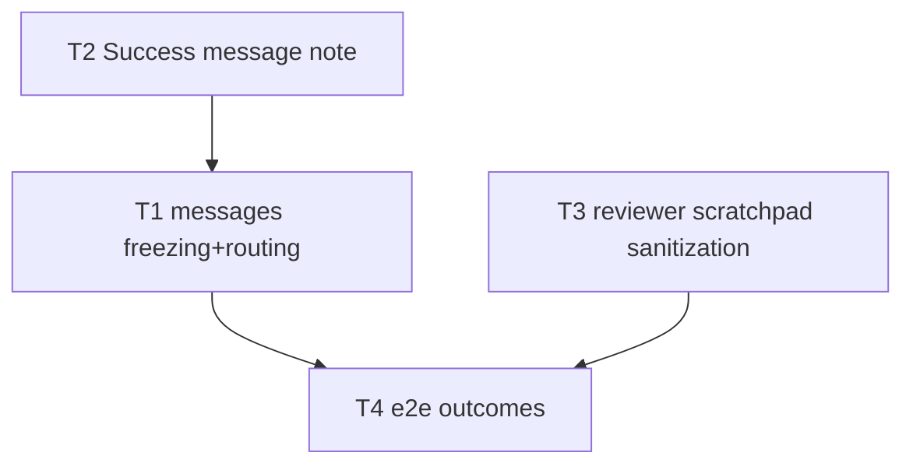

# 0041 · Hold steady after hold-merge PASS while awaiting merge: freeze approved PRs as needs-human to eliminate review oscillation on unchanged code

<!-- This file is maintained by the spec tool: the frontmatter is the structured source data (including the tasks DAG), and the body is the group-level overview in the 9-section rust-RFC format. -->

## Summary

In Vigil's code review gate `_process_coding` (`openagents/messages.py`), when the framework runs with `--hold merge` (`hold.at_merge`) and the reviewer gives a PR a PASS, the current implementation only does `return {"reason": "hold-merge"}`—a one-time no-op that **does not merge, change status, or add a label**. The PR's status remains `pr-open`, and `pr-open` is in `_OPEN_STATUSES`, so the next poll **runs this already-approved PR through the entire code gate again from scratch** (mergeability → CI → reviewer). Because the reviewer is a nondeterministic LLM, the same unchanged code repeatedly receives different review verdicts, oscillating between PASS↔REWORK until it reaches `MAX_ROUNDS` and `_block` labels it `needs-human`—permanently blocking a healthy PR that could have been merged directly.

This spec changes the hold-merge branch from a “no-op” to a “**freeze**”: when the reviewer returns PASS and `hold.at_merge` is true, reuse the existing freeze mechanism to set `STATUS_BLOCKED` + add the `needs-human` label (`STATUS_BLOCKED` is not in `_OPEN_STATUSES`, so polling automatically skips it → **no further reviews**), but post a **success message**, “✅ Review passed, awaiting your merge” (instead of `_block`'s failure message), and set the unblock gate to a value that supports all three exits: “human replies with a comment → iterate; human removes the label → resume; human merges → done.” Also sanitize the reviewer `scratchpad` that is passed verbatim into `_block`'s suspension comment (internal monologue should not be presented as a request for human help).

## Motivation

**Current behavior (restated here; no external reading required).** OpenAgents is an RFC/spec-driven multi-agent framework. `vigil` (Vigil) polls every in-flight run every interval seconds. The entry point for processing a single run is `_process_run` in `messages.py`: it first checks `github.is_merged` (merged → set `STATUS_DONE` + close the issue), `is_closed` (closed → `STATUS_CLOSED`), and `status == STATUS_BLOCKED` (enter unblock handling in `_process_blocked`), then routes the remaining runs by stage to the RFC review gate `_process_rfc_review` or the code review gate `_process_coding` (`messages.py:216-249`).

**The flow of the code review gate `_process_coding` (`messages.py:374-452`)**: mergeability precheck (DIRTY/CONFLICTING → merge gate; UNKNOWN → take no action this round; BEHIND → pull-based synchronization via `update_branch`, then wait for the next round) → CI (fail → `iterate(reason="ci")`; pending → wait) → if all CI checks are green, call `review_code` to obtain a `ReviewDecision`. When the verdict is PASS (`messages.py:426-439`):

```python
if decision.passed:
    if hold.at_merge:
        return {"pr_number": pr_number, "reason": "hold-merge"}   # ← No-op; the bug is here
    github.merge_pr(pr_number=pr_number)
    self._state.update_status(issue_number=record.issue_number, status=STATUS_DONE)
    github.close_issue(number=record.issue_number)
    return {"pr_number": pr_number, "reason": "merged"}
```

The design intent of `hold merge` (`Hold.at_merge` in `openagents/hold.py`) is “run the reviewer as usual, but do not merge automatically after PASS; leave the final step to a human” (the human oversight gate introduced by Spec-0020/T3). But its implementation is merely a **one-time no-op** that says “do not merge this round”—it **does not freeze the run**. It conflates “do not merge automatically” with “continue processing”: the PR's status does not change and remains `pr-open`.

**Why this is a bug—`_OPEN_STATUSES` causes repeated reviews.** `_OPEN_STATUSES = {STATUS_RFC_REVIEW, STATUS_PR_OPEN, STATUS_ITERATING}` (`messages.py:64`). Since `pr-open` is in this set, the next poll still treats the PR as “in flight and needing progress,” enters `_process_coding` again, and calls `review_code` again. Behind `review_code` is a **nondeterministic LLM reviewer** (`openagents/reviewer.py`: `review()` calls `backend.run` several times using task templates and aggregates the verdicts, `reviewer.py:116-158`). The same unchanged code may receive PASS this round and REWORK for newly identified points in the next:

- An actual REWORK (`decision.actionable`) → `rounds++`; if `MAX_ROUNDS` has not been exceeded (default 3, `messages.py:75,90`) → `iterate(reason="review")` makes the coding agent chase the requested changes;
- The next round returns PASS again → another idle hold-merge no-op; the following round returns REWORK again…
- Once `rounds` reaches the limit → `_block(gate="code")` adds `needs-human` (`messages.py:442-446`).

**Hard evidence (PR #103 for issue #106, with verdict timestamps aligned against commit timestamps: the same commit first received PASS, then REWORK)**:

- commit `975e7e1`: 12:37 PASS → no new commits in between → 18:01 REWORK
- commit `6e3d95b`: 18:14 PASS → no new commits → 20:06 REWORK
- commit `a5c954e4`: 20:20 PASS → no new commits → 20:54 REWORK (where it became stuck)

The same code received both PASS and REWORK within 34 minutes, and the reviewer even contradicted itself (one round said “offline e2e is an established convention in this repository and is fine,” while another returned REWORK because “the end-to-end script is entirely offline”). PR #103 itself was `OPEN + MERGEABLE + CLEAN + rfc-approved`, yet it remained at `needs-human`—a healthy PR needing only a human click to merge was permanently blocked. Note: #103's `needs-human` label was applied by `_block` after REWORK oscillation exhausted `rounds`; **the hold-merge path never froze anything at any point**.

**The root cause in one sentence**: `hold-merge` is a no-op that says “do not merge this round” without freezing the run; a healthy PR that has passed review and needs only a human merge click is repeatedly judged again as an active PR, chasing the nondeterministic reviewer's new feedback each round and never converging.

**An additional small mess (fix it at the same time).** The structured suspension comment posted when `_block` adds `needs-human` (`build` in `openagents/blocknote.py`) fills its “Where it is stuck” section with `decision.feedback`—but `decision.feedback` is a **verbatim concatenation** of the non-PASS reviewers' `backend.run(...).summary` values (`reviewer.py:147-155`), without any sanitization (`blocknote.py:40,50-52` only prepends `> ` to each line). As a result, the reviewer's **internal monologue / scratchpad** (such as `All 32 tests pass. I have enough to finalize. Let me capture...`) is posted unchanged as a request for human help, with noise drowning out the actual blocker.

## Guide-level explanation

After this change, running Vigil with `--hold merge` behaves as follows:

- **The reviewer gives a mergeable PR a PASS** → the framework **freezes it**: sets `blocked`, adds the `needs-human` label, and posts a comment saying “✅ Review passed, awaiting your merge.” Because `blocked` is not in `_OPEN_STATUSES`, **polling skips this PR directly starting with the next round, with no further reviews**. This eliminates oscillation at its source.
- **A human merges it** (manually on GitHub) → the next poll's `is_merged` branch (checked **before** the blocked branch, `messages.py:224` vs `:243`) reconciles it to `done` + closes the issue. This exit already exists.
- **A human replies with a comment requesting changes** → the existing “unblock-on-comment loop” (issue #89 / Spec-0032) reads new human comments after the block watermark → feeds them to `iterate(reason="human")` according to the gate so the coding agent iterates based on the comments. This exit already exists.
- **A human manually removes the `needs-human` label** → the existing fallback “unblock on label removal” path (`_unblock_by_label`) → resumes to `pr-open`. This exit already exists.

The key point: **all three exits reuse existing mechanisms; no new ones need to be written** (`is_merged` reconciliation, the Spec-0032 unblock loop, and `_unblock_by_label`). This spec only changes the hold-merge branch from “no-op” to “call the existing freeze primitive + post a success message + set the correct unblock gate.”

A typical sequence (after introducing this approach):

1. The PR is ready (MERGEABLE, CI green), the reviewer returns PASS, and `hold.at_merge` is true.
2. The framework freezes it: `blocked` + `needs-human` + a comment saying “✅ Review passed, awaiting your merge.”
3. Next poll: the run is `blocked`, so it enters `_process_blocked`; there are no new human comments and `needs-human` is still present → `return None`, **without another review**.
4. A human merges → next round's `is_merged` → `done`; or a human comments requesting changes → `iterate`; or a human removes the label → resume.

Before the fix, by comparison: step 2 would be “no-op, status remains `pr-open`,” and step 3 would “review again” → oscillation.

**Visualizing results (Principle 8).** OpenAgents already has a local results board: `board(state)` in `openagents/results.py` renders each `RunRecord` into a single static page, `templates/board.html` (a four-column table: Issue / Status / PR / Summary, with no JS), and the `oa board` command opens it using the standard library's `webbrowser`. The visible result of this spec is that a PR receiving PASS under hold-merge **transitions once from `pr-open` to `blocked` on the board and then stays stable**—after multiple consecutive polls, that row's status/summary no longer changes (before the fix, rounds would climb, status would repeatedly switch between open and blocked, and comments would accumulate). The e2e test uses a browser to navigate to `board.html`, assert “stable after freezing, with no oscillation,” and take a screenshot (see Reference-level for details).

## Reference-level explanation

### Decision A: change the hold-merge PASS branch to “freeze” (`openagents/messages.py`)

Change the hold-merge sub-branch within `_process_coding`'s PASS branch (`messages.py:426-439`) from a no-op to a call to a new private helper, `_hold_merge_freeze`:

```python
if decision.passed:
    if hold.at_merge:
        return self._hold_merge_freeze(record=record)   # Freeze: blocked + needs-human + success message
    github.merge_pr(pr_number=pr_number)
    ...
```

`_hold_merge_freeze(record)` reuses `_block`'s freeze structure (preserving `_block`'s order: post comment → `add_label` → `update_status(BLOCKED)` → `set_block_gate` → `set_block_watermark`, `messages.py:535-553`), with two differences:

1. **Post a success message instead of a failure message**: call the pure function added to `blocknote` by T2 to generate the “✅ Review passed, awaiting your merge” body (instead of `blocknote.build`'s four-part “🤖 Stuck” template), then sign and post it through `identity.post_signed_comment` (adding the signature → the unblock reader's `new_human_comments` filters it out by signature, preventing it from triggering itself, just as with `_block`).
2. **Set a self-describing unblock gate = `"merge-hold"`** (do not reuse `"code"`—see below): `set_block_gate(gate="merge-hold")`, so operators can see from `block_gate` that “this run is blocked because it passed and is awaiting merge, rather than because review failed” (observability under Principle 8, in the same spirit as distinguishing REWORK from invalid review in `reviewer.py:178-183`). `set_block_watermark` records the latest comment's createdAt at the time of suspension (including the success comment just posted), so the unblock loop recognizes only new human comments after the watermark.

### Decision B: Unblocking routes for the `merge-hold` gate (`openagents/messages.py`)

Of the three exit paths, `is_merged` (a human clicks merge) and `_unblock_by_label` (a human removes the label) already handle `merge-hold` correctly **without changes**:

- **A human clicks merge** → the `is_merged` branch in `_process_run` is checked before the blocked branch (`messages.py:224`) → `done` + close the issue. ✅ Already available.
- **A human removes the label** (without commenting) → `_process_blocked` finds no new comments and sees that `needs-human` has been removed → `_unblock_by_label` (`messages.py:320-339`): `block_gate != "merge"` → takes the else branch to resume at `pr-open` (with the `rfc-approved` label) + clears `block_gate`. ✅ Already available (`merge-hold` naturally takes the else branch; no new branch is needed).

The only route that needs to be added: **a human replies with a comment requesting changes** → `_process_blocked` → `_unblock_with_comment` (`messages.py:267-308`). Currently, this function branches by gate: `rfc*`→refine, `code*`→iterate, `merge`→armed, else→resume. To make comment-based unblocking for `merge-hold` feed into `iterate(reason="human")` (a human commenting on a healthy PR means they want the coding agent to make changes based on the comment), add a branch: handle `gate == "merge-hold"` in the same way as `code*` (`iterate(reason="human", detail)` + clear `block_gate` + use `_post_comment_reply` to post a response quoting the original comment).

> **Why not directly reuse `gate="code"` (an alternative; see Rationale)**: Reusing it would require no new routing (`code*` already iterates), but it would make the persisted state of a healthy PR that has passed review show `block_gate="code"` (review failure), misleading operations and future gate-based routing. Principle 8 values observability, so the cost of one `elif` buys self-describing state.

### Decision C: Sanitize reviewer scratchpad content (`openagents/reviewer.py`)

The source of the stray unwanted content is **feedback aggregation** (`reviewer.py:147-155` concatenates each non-PASS reviewer's `.summary` verbatim into `feedback`), rather than presentation (`blocknote` has no way to distinguish which parts are scratchpad content). Add a pure function `_distill_feedback(summary) -> str` in `reviewer.py` and apply it to each summary before concatenating `feedback`: extract the reviewer's human-facing “actionable feedback” section and strip internal monologue / scratchpad content (for example, lines/paragraphs that begin with first-person process narration such as `Let me`, `I have enough`, or `All N tests pass`, and contain no verdict conclusion). If sanitization leaves the result empty, fall back to the existing placeholder “(The reviewer did not provide a parseable verdict; conservatively treated as a failure.)”. Sanitization applies only to **human-facing `feedback`**; `verdicts`/`actionable` determination and the vote rendering in `render_decision` remain unchanged (zero regression). The specific heuristic rules and thresholds are implementation details; acceptance is based on the assertion that “given a sample summary containing scratchpad content, the sanitized `feedback` contains no internal monologue and retains actionable feedback.”

### Decision D: No new state fields are needed

Throughout freezing, reuse the existing `State` methods (`update_status` / `set_block_gate` / `set_block_watermark` / `add_label`); `block_gate` is a free-form string and can accommodate `"merge-hold"` without a migration. **Do not introduce review-cache fields such as `reviewed_sha`** (see alternative 1 in Rationale)—the freezing mechanism already ensures that each commit is reviewed only once on the hold-merge path, so no additional per-sha cache table is needed.

### DAG and file allocation

| Task | Title | files (single-writer ownership, mutually exclusive within the group) | depends-on |
|---|---|---|---|
| T1 | hold-merge freezing + merge-hold unblocking routes | `openagents/messages.py`, `tests/test_messages_hold_merge_freeze.py` | T2 |
| T2 | “✅ Review passed, awaiting your merge” success message | `openagents/blocknote.py`, `tests/test_blocknote_hold_merge.py` | — |
| T3 | Sanitize reviewer scratchpad content | `openagents/reviewer.py`, `tests/test_reviewer_feedback_distill.py` | — |
| T4 | End-to-end outcome tests (including a browser board assertion for “stability after freezing”) | `scripts/e2e-spec-0041-hold-merge-freeze.sh`, `tests/test_hold_merge_freeze_integration.py` | T1, T2, T3 |



T2 and T3 have no mutual dependencies and can run in parallel (collaborative mode, each owning disjoint `files`); T1 depends on T2's pure note function; T4 brings all three together.

### e2e outcome script (picked up from the PR signpost)

**Path: `scripts/e2e-spec-0041-hold-merge-freeze.sh`**, following this repository's two-stage e2e convention (offline deterministic verification by default; an additional real smoke test when `OPENAGENTS_E2E_REAL=1`):

**Stage 1—offline deterministic verification (default, fully mocked)**: ruff lint/format + pytest; core integration cases in `tests/test_hold_merge_freeze_integration.py`:

1. **Anti-oscillation assertion (the core regression test for the bug)**: Construct a `Poller` with `hold.at_merge=True`, a PR stub that is MERGEABLE/CLEAN with green CI, and a reviewer stub that always returns PASS (and counts calls). First `poll()` → assert that the run transitions to `blocked`, the `needs-human` label has been applied, exactly one “✅ Review passed, awaiting your merge” comment has been posted (**without** the “🤖 Stuck” failure message and **without** scratchpad content), and `block_gate == "merge-hold"`. **Second `poll()`** → assert that the reviewer stub's call count **has not increased** (no repeat review), the state remains `blocked`, there are no new comments, and `rounds` has not increased. This is deterministic evidence that “the same code no longer oscillates through repeated reviews.”
2. **Three-exit assertion**: (a) Change the PR stub to `is_merged=True`, poll → `done` + close the issue; (b) inject a new human comment after the watermark, poll → `iterate(reason="human")` is called, and resume; (c) remove the `needs-human` label, poll → resume at `pr-open`.
3. **Scratchpad sanitization assertion**: Given a reviewer summary containing internal monologue, after `_distill_feedback`, `feedback` contains no monologue and retains actionable feedback (T3 unit test, referenced by e2e).

**Stage 1 browser outcome assertions (Principle 8, using Playwright / chrome-devtools MCP)**: Using the `State` constructed above, call `results.render` separately “after the first poll” and “after the second poll” to write two copies of `board.html`, and use the browser to `navigate` to `file://.../board.html`:

- Take a `snapshot` + `take_screenshot` of the board after freezing, and **assert that this PR has exactly one row and its status column is `blocked`** (neither `pr-open` nor absent).
- For the two boards “after the first poll” and “after the second poll,” **assert that the row is exactly identical** (status, summary, and PR number unchanged)—the visible outcome of “stability across rounds after freezing, with no oscillation” (before the fix, the two would differ: rounds/status would change). Retain both screenshots for comparison.
- Use `list_console_messages` / `list_network_requests` to assert that there are no errors and no failed requests (the board is a purely local static page and should have no network failures).
- **Fallback**: If the runtime environment has no browser MCP, fall back to HTML text assertions on the rendered `board.html` (grep the PR row and compare that row in both HTML files for equality); do not skip outcome verification.

**Stage 2—real smoke test (`OPENAGENTS_E2E_REAL=1`, opens a real PR)**: Open a real mergeable PR in a scratch repository, run one round of Vigil with `--hold merge`, and verify that the PR receives the `needs-human` label and that the comment uses the success message; then run two consecutive rounds to verify that duplicate review comments do not accumulate.

## Drawbacks

- **`needs-human` now has two meanings**—both “failed and stuck, help me” and “healthy, waiting for you to click merge”; the two are mixed together and indistinguishable on the board / when filtering by label. To keep things simple, this dilution of the signal is **accepted** (**no new** dedicated `awaiting-merge` label). `block_gate="merge-hold"` distinguishes the two at the state level (Decision B), but GitHub labels do not.
- **A frozen PR will not integrate with main on its own**. This repository currently uses **pull-based synchronization** (Spec-0023/0038: after a merge, pushes are no longer fanned out; each open PR catches up with integration when its turn arrives, through `update_branch` in the BEHIND branch of `_process_coding`, `messages.py:404-414`). `blocked` is not in `_OPEN_STATUSES`, so polling skips it → it **will not** automatically run `update_branch`. If main advances while the PR is frozen, a human clicking merge may encounter an out-of-date branch / conflict at the GitHub merge-button level (the human is present at that point and can manually rebase or reply with a comment to trigger unblocking). This tradeoff needs to be made more explicit under pull-based synchronization than under the eager fan-out assumed in the original issue, so it is recorded here (the original issue describes eager fan-out, which does not match the current code—the code is authoritative, Principle 7).
- **A human removing the label without merging → triggers one repeat review**. Removing the label goes through `_unblock_by_label` to resume at `pr-open` → the next round re-enters `_process_coding` → PASS again → frozen again. This is one **human-triggered** repeat review (not automatic oscillation), bounded and acceptable; however, it means that “removing the label” is not the correct operation for “allowing the merge” (the correct operation is to click merge).
- **Scratchpad sanitization is heuristic** and may mistakenly remove actual actionable feedback or fail to remove some monologue formats. The fallback placeholder ensures that sanitization cannot leave `feedback` empty and the human uninformed; sanitization also affects only presentation, not `actionable`/verdicts, limiting the risk to “the quality of human-facing wording.”

## Rationale and alternatives

**Why “freeze + reuse existing exits.”** The root cause of oscillation is that “a healthy PR that has passed review and only awaits a human merge is still treated as an active PR, pulled back by `_OPEN_STATUSES` for repeated review.” The smallest root-cause fix is to make it **leave `_OPEN_STATUSES`**—and `STATUS_BLOCKED` is already the state that “polling automatically skips,” `needs-human` is already the “help needed / awaiting a human” label, and the three recovery paths—`is_merged`, the unblocking loop, and label removal—are already available. This proposal therefore creates no new state machine, adds no state fields, and writes no new exits; it only replaces a no-op with “call existing freezing primitives + post a success message + set the correct gate” (Occam's razor, Principle 1).

**Alternative 1—cache review verdicts by commit sha (the literal approach in the issue title).** Add `reviewed_sha` to `RunRecord` + cache the verdict for that sha; in the next round, if the HEAD sha has not changed, skip `review_code` and directly reuse the cached verdict to avoid reviewing the same code repeatedly. **Why this is not the primary fix**: (a) It is a heavier mechanism—it requires new persisted fields, a definition of cache invalidation (new commits, rebases, force-pushes, and changes in integration state after the base advances all change “what should be reviewed”), and a decision about “what to do after caching PASS” (if the run remains at `pr-open`, `_OPEN_STATUSES` will still pull it back; it merely avoids repeat reviews without making progress, leaving the root problem unresolved); (b) the issue explicitly identifies “repeatedly reviewing until the verdict flips” as a bug in itself, rather than a feature awaiting optimization; after freezing, **each commit is reviewed only once**, already achieving an effect equivalent to “review only once per sha” without an explicit cache table; (c) freezing directly resolves “remaining open and spinning after PASS,” whereas sha caching resolves only “repeat reviews,” not “spinning.” Thus, sha caching is left for Future work (to be introduced if hold is removed in the future, or if repeated reviews of the same code also arise on non-hold paths). **This spec adopts the “freeze” fix suggested in the issue body and records sha caching as an alternative.**
- **Replaceability without interface changes**: Even if sha caching is introduced in the future, it acts as a short circuit before `_process_coding` calls `review_code`; it is orthogonal to this spec's “freeze after PASS” and can be combined with it.

**Alternative 2—use multiple reviewer sign-offs / secondary reviews to counter nondeterminism.** Have multiple reviewers vote and require a majority PASS to count as PASS, reducing the probability of a verdict reversal in a single review. **Rejected**: The issue explicitly states that “multiple sign-offs and secondary reviews are not recommended as the primary fix for this issue”—after freezing, each commit is reviewed only once (normal review variation can be handled by a human); pursuing “repeated reviews until the verdict flips” is itself this bug and cannot be treated as a feature. Multiple sign-offs only reduce the frequency of oscillation; they do not eliminate the structural root cause of “still spinning and being pulled back after PASS.” (Note: `reviewer.configured_reviewers` already supports n reviewers; this spec does not change its semantics.)

**Alternative 3—after hold-merge PASS, use a new state other than `pr-open` (such as `awaiting-merge`) instead of reusing `blocked`.** This has the cleanest semantics (it does not dilute `needs-human`), but requires adding a state constant, excluding it from `_OPEN_STATUSES`, providing a full set of unblocking/reconcile exits, and adding a new state display to the board—an entire set of new entities. The issue explicitly **accepts** the two meanings of `needs-human` in exchange for simplicity, so this is **rejected**; only `block_gate="merge-hold"` at the state level is used as a lightweight distinction.

**Alternative 4 (within Decision B)—reuse `gate="code"` instead of introducing `merge-hold`.** This requires no new routing, but the persisted state marks a healthy PR as “code review failed,” making observability misleading. One `elif` buys self-describing state; **choose `merge-hold`**.

## Prior art

- **This repository’s existing freeze/unblock framework**: `_block` sets `STATUS_BLOCKED` + `needs-human` (Spec-0032), the comment-reply unblock loop (issue #89 / Spec-0032 `_unblock_with_comment` + Spec-0036 replies referencing the original comment), unblocking by removing a label via `_unblock_by_label` (issue #49 / Spec-0031), and `is_merged` reconciliation (RFC-0017). This spec reuses these existing primitives throughout, adding only a “success message note” and “one iterate route for the `merge-hold` gate.”
- **The human oversight gate `hold`** (Spec-0020/T3): `--hold spec` / `--hold merge` leaves the final step at a particular gate to a human. This spec fixes the defect in the `hold merge` branch where that step is “left to a human” without actually holding execution in place—making it truly “stop and wait for a human.”
- **The CI-system pattern of “caching results for the same commit”** (for example, GitHub Actions/Buildkite not rerunning checks that have already succeeded for the same SHA): the SHA cache in Alternative 1 is an adaptation of this pattern. This spec achieves the equivalent of “review once per commit” by holding execution in place without introducing a cache table, providing a lighter implementation of the same goal.
- **A precedent for distinguishing identically named states through observability**: `reviewer.render_decision` renders “REWORK” separately from “Invalid review (decision could not be parsed)” (`reviewer.py:178-183`)—this spec’s `block_gate="merge-hold"` follows the same principle of “identically named results that remain distinguishable underneath.”

## Unresolved questions

- **Heuristic boundaries for scratchpad sanitization**: What rules determine whether a line or paragraph is “internal monologue” rather than “actionable feedback”? The initial version uses conservative heuristics (first-person narration of the process + no decision conclusion), to be adjusted after testing against real samples. Whether it is worth requiring **structured output** in the reviewer task template (such as a mandatory `## Actionable feedback` section) to eliminate the need for sanitization at the source is left for Future.
- **Whether to suppress the single re-review triggered by a human removing a label**: Removing the label resumes execution → one re-review (bounded; see Drawbacks). Should resume short-circuit re-review when the HEAD SHA has not changed (a lightweight version of Alternative 1), or should this single human-triggered re-review be accepted? The initial version accepts it.
- **Handling frozen PRs that fall behind under pull-based synchronization**: If main advances during the freeze and GitHub reports that the branch is behind or has conflicts when a human clicks merge, should the success message say “A rebase may be needed before merging”? The initial version does not include this notice; the decision will be revisited after observing real usage.
- **Whether `merge-hold` should appear in `render_decision`/board text**: The state layer can already distinguish it, but the board still displays `blocked`. Is it worth adding a small “Awaiting merge” annotation to board rows with `block_gate="merge-hold"` (without adding a GitHub label)? Left for observation; the initial version does not change the board.

## Future possibilities

- **A general review cache keyed by commit SHA** (Alternative 1): If re-reviews of unchanged code occur on paths other than hold-merge in the future, or if re-review after resume needs to be avoided, introduce `reviewed_sha` + a decision cache + invalidation rules. The interface is orthogonal to `_process_coding` and can be layered on top of this spec.
- **Structured reviewer output**: Require the review task template to output separate “Decision + Actionable feedback” sections, eliminating scratchpad leakage at the source and reducing `_distill_feedback` to directly extracting the structured section.
- **A dedicated `awaiting-merge` signal**: If the two meanings of `needs-human` cause significant confusion in actual board usage, introduce a dedicated label/state to make `block_gate="merge-hold"` a first-class concept (including board display and filtering by label).
- **Automatic integration updates for frozen PRs**: Under pull-based synchronization, give PRs that are `blocked` (`merge-hold`) a lightweight path that “only runs `update_branch`, without re-review,” allowing them to integrate with main during the freeze and reducing the likelihood that they are behind when a human clicks merge.
