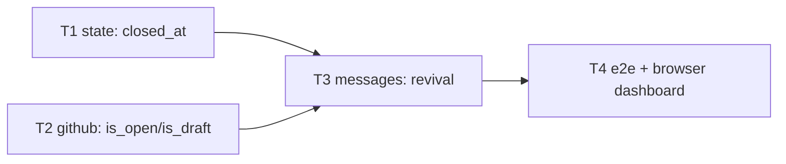

# 0042 · Revive runs frozen by PR close→reopen: closed is not a true terminal state

<!-- This file is maintained by the spec tool: the frontmatter is the structured source data (including the tasks DAG), and the body is the group-level overview in the nine-section rust-RFC format. -->

## Summary

In Vigil's (`vigil`) poll loop, closing a PR puts the local run into `STATUS_CLOSED`, a **one-way terminal state**—at the start of each iteration, poll directly skips runs that are neither open nor blocked with `continue`, and never checks their GitHub status or comments again. But closing a GitHub PR **is not irreversible**: it can be reopened and return to `OPEN`. The current implementation has no reverse path for “reopen → revive the run,” so subsequent human comments / CI / stage transitions on a PR that was closed and then reopened all go nowhere.

This spec adds **“revival on reopen”** for local `closed` runs: when poll discovers that the PR associated with a `closed` run has returned to `OPEN` (reopened) on GitHub, it infers the stage from the PR's current state and revives the run—**draft PR → `rfc-review`; ready for review / carrying `rfc-approved` → `pr-open` (through the code gate)**—clearing `closed` and resuming the existing workflow. Cost is bounded by a **`closed_at` revival window**: only runs “closed recently” incur one `gh` query per poll cycle to check for reopening; old `closed` runs outside the window **harden into true terminal states** and are never queried again (avoiding unbounded growth in `gh` calls across all historical `closed` runs). `is_merged` remains an irreversible true terminal state and **does not participate in revival**.

## Motivation

**Current behavior (restated here; no external reading required).** OpenAgents is an RFC/spec-driven multi-agent framework. Every interval seconds, `vigil` (Vigil) polls each in-flight run (`Messages.poll` in `openagents/messages.py`, `messages.py:172`). poll iterates over `state.all_runs()`, with a **skip guard** at the loop entrance (`messages.py:189`):

```python
for record in self._state.all_runs():
    # issue #49: include blocked runs in the scan (for unblocking/reconcile); skip other non-open states as usual.
    if record.status not in _OPEN_STATUSES and record.status != STATUS_BLOCKED:
        continue
    ...
    event = self._process_run(record=record, hold=hold)
```

Here, `_OPEN_STATUSES = {STATUS_RFC_REVIEW, STATUS_PR_OPEN, STATUS_ITERATING}` (`messages.py:64`). Runs that pass the guard enter `_process_run` (`messages.py:216`), which reconciles in priority order:

```python
# 1. Merged takes precedence over everything: set done and close the issue (decision 8).
if github.is_merged(pr_number=pr_number):
    self._state.update_status(issue_number=record.issue_number, status=STATUS_DONE)
    github.close_issue(number=record.issue_number)
    return {"pr_number": pr_number, "reason": "merged"}
# 1b. RFC-0006: a human explicitly closing the PR (without merging) is also a termination signal → set closed and skip.
if github.is_closed(pr_number=pr_number):
    self._state.update_status(issue_number=record.issue_number, status=STATUS_CLOSED)
    return {"pr_number": pr_number, "reason": "closed"}
# 1c. blocked → two-layer unblocking (replying with a comment / removing the label).
if record.status == STATUS_BLOCKED:
    return self._process_blocked(record=record)
# 2. Route everything else by stage: rfc-review / coding.
```

The comment on `STATUS_CLOSED` (`state.py:37`) is explicit: “Terminal state for a PR that was closed without being merged (a human explicitly abandoned it); not included in `messages._OPEN_STATUSES`, so once set to closed, the run is no longer polled or processed by Vigil.” `github.is_closed` (`github.py:689`) simply runs `gh pr view <n> --json state` and checks `state == "CLOSED"`; `is_merged` (`github.py:634`) checks `state == "MERGED"`; a GitHub PR's `state` has three mutually exclusive values: `OPEN / CLOSED / MERGED`.

**Root cause—`closed` is treated as an irreversible terminal state, but it is reversible.** Once `_process_run` takes the `is_closed` branch and sets a run to `STATUS_CLOSED`, that run **permanently drops out of poll's processing scope**: on the next poll cycle, the entrance guard immediately executes `continue`, so `_process_run` is never called again, its GitHub `state` is never queried again, and its comments are never read again. The problem is that **a closed PR on GitHub can be reopened and return to `OPEN`**, but the framework has no reverse recovery path for “`is_reopened` → revive the run”—both `is_merged` and `is_closed` are handled as one-time terminal transitions. The local run therefore remains `closed` forever → poll skips it forever → comments / CI / stage transitions after reopening can never reach it.

**Concrete evidence (affected PR #105)**: at 19:01, `needs-human` was applied → on 07-02 at 06:22, the PR was closed (Vigil set the local run to `closed`) → it was subsequently reopened (currently `state=OPEN`) → on 07-02 at 08:00, a human left a new comment, “Resolve the conflicts” (an unsigned human comment). Vigil **did not pick up this comment and was spinning without progress**—because the run had been frozen in `closed` and had left poll's processing scope.

**Why the existing unblocking loop cannot rescue it.** issue #89 / Spec-0032 introduced an unblocking loop in which “a human posts a new comment after a block → automatically remove `needs-human` + feed the comment to the corresponding gate.” But this only takes effect inside `_process_blocked` (`messages.py:251`), and `_process_blocked` is only triggered for **`blocked` runs that are still scanned by poll** (`status == STATUS_BLOCKED`, having passed the entrance guard). PR #105's run is already `closed`, rather than `blocked`—it is skipped with `continue` at the entrance guard, so the read side never gets to it, and Spec-0032's unblocking logic has no opportunity to execute.

**Why `closed` is reversible while `merged` is irreversible.** A merge on GitHub is irreversible (after merging, `state` remains `MERGED`; it cannot be “un-merged”), so `is_merged → done` is entirely reasonable as a terminal transition and **does not participate in revival**. But `close` only means “this PR is currently inactive”; it can be reopened to `OPEN` at any time—treating it as the same permanent terminal state as `merged` mistakes “temporarily inactive” for “permanently abandoned.” This is **another state-machine defect, related to but independent of** #106 (Spec-0041, oscillation caused by repeatedly re-reviewing a PR that has already PASSed): #106 concerns “an active run that cannot converge,” while this issue concerns “a frozen run that cannot be revived.”

**Cost constraint (must be addressed in the design).** Simply “include all `closed` runs in the poll scan and issue one `gh` query for each on every cycle to check for reopening” would cause **unbounded growth**: as the project accumulates historical `closed` runs (abandoned experiments, duplicate PRs, etc.), the number of `gh` calls per poll cycle would grow linearly, even though the vast majority will never be reopened. Revival must therefore be **bounded**—incur `gh` costs only for runs “closed recently,” and allow old `closed` runs to harden into true terminal states.

## Guide-level explanation

After this change, Vigil's behavior for PRs that are closed and then reopened becomes:

- **The PR is closed (without being merged)** → as today: the local run is set to `closed`, and subsequent poll cycles skip it. **Additionally**, the moment reconciliation sets it to `closed`, it **records the close timestamp `closed_at`** (the start of the revival window).
- **The PR is reopened (returns to `OPEN` after `closed`)** → as long as it is still within the **revival window** (by default, within 7 days after closing), poll includes it in the scan, issues one `gh pr view`, discovers that it is `OPEN` → and **revives it**:
  - The PR is still **draft** (the RFC has not yet been approved, and the code is not yet complete) → revive to `rfc-review` and continue through the spec review gate;
  - The PR is **ready for review / carries the `rfc-approved` label** (the RFC has been approved; this is a code PR) → revive to `pr-open` and continue through the code gate (mergeability precheck → CI → reviewer).
  - Revival clears the local `closed` status and `closed_at`, and the run reenters the existing workflow. **Starting with the next poll cycle**, this run is a normal open run: in PR #105's “Resolve the conflicts” scenario, after revival to `pr-open`, the code gate's mergeability precheck detects `DIRTY / CONFLICTING` and naturally enters the existing conflict-resolution / merge gate path; the existing mechanism also starts reading comments again. **No more spinning without progress**.
- **The PR is never reopened**, and the time since closing exceeds the revival window (7 days by default) → this `closed` run **hardens into a true terminal state**, and poll stops issuing any `gh` queries for it (bounded cost).
- **The PR is merged** → follow the existing `is_merged → done` branch and **never revive it** (merging is irreversible).

From a human's perspective: **the natural GitHub action of “reopening a PR” is itself the signal for Vigil to return and continue working**—no additional comment or manual label change is needed.

## Reference-level explanation

### Technical approach

Three coordinated changes, each exclusively owning its file (single writer, principle 6):

1. **`openagents/state.py` (T1)—`closed_at` field + setter.** Add `closed_at: str = ""` to `RunRecord` (an ISO8601 string; the default provides backward compatibility for older `state.json` files missing the key, mirroring the addition of `block_watermark` in Spec-0032). Add `set_closed_at(*, issue_number, when)`: locate the run by issue, modify only the `closed_at` field, and persist the entire state (mirroring the existing `set_block_watermark` / `set_block_gate` implementation). `when=""` means clear it (used during revival). Leave constants such as `STATUS_CLOSED` / `_OPEN_STATUSES` unchanged.

2. **`openagents/github.py` (T2)—thin read-only wrappers `is_open` + `is_draft`.** Symmetric with the existing `is_closed` / `is_merged`:
   - `is_open(*, pr_number) -> bool`: `gh pr view <n> --json state`, checking `state == "OPEN"` (detect reopening).
   - `is_draft(*, pr_number) -> bool`: `gh pr view <n> --json isDraft`, checking whether `isDraft` is true (distinguish “draft→rfc-review” from “ready for review→pr-open”).
   - Reuse the existing `has_label(pr_number=..., name=APPROVAL_LABEL)` (`github.py:395`, `APPROVAL_LABEL="rfc-approved"`) as supporting evidence that the PR is “ready for review.” Do not modify existing functions (zero regressions).

3. **`openagents/messages.py` (T3)—revival-window guard + revival reconciliation.** Introduce the module constant `REOPEN_REVIVE_WINDOW_SECONDS` (default `7 * 24 * 3600`, with a comment marking it as adjustable).
   - **Allow “revival candidates” through the entrance guard (`messages.py:189`)**: also scan runs that are `closed` and whose `closed_at` falls within the window. Change it to:
     ```python
     if (record.status not in _OPEN_STATUSES
             and record.status != STATUS_BLOCKED
             and not self._revive_eligible(record=record)):
         continue
     ```
     `_revive_eligible(*, record)`: `status == STATUS_CLOSED`, `closed_at` is nonempty, and `now - closed_at <= REOPEN_REVIVE_WINDOW_SECONDS` (obtain `now` from `datetime.now(timezone.utc)`; keep time logic centralized in messages). Outside the window / no `closed_at` → `False` (true terminal state; continue skipping).
   - **Timestamp reconciliation to `closed`**: in `_process_run`'s `is_closed` branch (`messages.py:236`), call `set_closed_at(when=<now iso>)` when setting `STATUS_CLOSED`. **Timestamp only this single open→closed transition**; for runs that are “already closed and still closed when rechecked this cycle,” **never timestamp them again** (otherwise the window would refresh forever → degenerate into unbounded behavior, invalidating the cost constraint).
   - **Revival branch**: in `_process_run`, after `is_merged` and before `is_closed`, insert handling dedicated to locally `closed` runs (only revival candidates can reach this point):
     ```python
     if record.status == STATUS_CLOSED:
         return self._revive_if_reopened(record=record)
     ```
     `_revive_if_reopened(*, record)`:
     - `not github.is_open(pr_number)` → still closed (or already merged, handled by the preceding branch) → `return None` (continue skipping; **do not timestamp again**).
     - Already `OPEN` (reopened) → infer the stage: if `github.is_draft(pr_number)` is true → `STATUS_RFC_REVIEW`; otherwise (ready for review / `has_label(APPROVAL_LABEL)`) → `STATUS_PR_OPEN`. Use `update_status(status=<stage>)` + `set_closed_at(when="")` to clear the timestamp, and `return {"pr_number", "reason": "reopened", "stage": <stage>}`.
   - Revival only “restores the appropriate state”: **return a `reopened` event in the current cycle without immediately resuming gate logic**; on the next poll cycle, the run is already a normal open run and follows the existing rfc-review / coding path (comments / CI / conflicts are all handled by existing mechanisms, with zero new read-side logic). Add `"reopened"` to the reason set in `poll`'s docstring.

**State-machine invariants**: `merged` is always terminal (does not participate in revival); `closed` is reversible within the revival window and hardens into a true terminal state outside it; revival only transitions `closed → {rfc-review | pr-open}` and never invents any other state.

**Scope boundary—why change only `messages.py` and leave `vigil.py` untouched.** Vigil's dispatch-discovery logic (`_dispatch_kind` in `vigil.py`) returns `None` for “an issue with an existing run (including `closed`)” and **does not dispatch it again**—this is correct: revival in this spec is **restoring the appropriate state of an existing run (poll-side reconciliation)**, rather than “dispatching another agent to solve the issue from scratch.” Once poll revives the run to `pr-open`/`rfc-review`, existing stage routing takes over and advances it; Vigil's “do not dispatch duplicates” semantics are precisely what we want to preserve (revival ≠ starting a new solving workflow). Thus, `vigil.py` needs no changes, and the change surface is confined to poll in `messages.py` (principle 1, Occam + principle 10, decoupling).

### DAG + file allocation

| Task | Title | files (exclusive) | depends-on |
|---|---|---|---|
| T1 | state: `closed_at` field + `set_closed_at` setter | `openagents/state.py`, `tests/test_state_closed_at.py` | — |
| T2 | github: thin read-only wrappers for `is_open` / `is_draft` | `openagents/github.py`, `tests/test_github_is_open_draft.py` | — |
| T3 | messages: revival window guard + revival reconciliation on reopen | `openagents/messages.py`, `tests/test_messages_reopen_revive.py` | T1, T2 |
| T4 | End-to-end outcome tests (including browser dashboard assertions for “close→reopen revival”) | `scripts/e2e-spec-0042-reopen-revive-closed-run.sh`, `tests/test_reopen_revive_integration.py` | T1, T2, T3 |



T1 and T2 have no dependencies on each other and can run in parallel; the `files` sets are pairwise disjoint (no conflicts in collaborative mode, Principle 6).

### e2e script path

`scripts/e2e-spec-0042-reopen-revive-closed-run.sh` (picked up by the PR signpost, Spec-0008). Follow this repository’s established two-part structure (deterministic offline tests by default + optional real smoke tests with `OPENAGENTS_E2E_REAL=1`), and use a real `State` + an in-memory GitHub world in the offline part to drive `Messages.poll` through the complete timeline: **first poll: close→set closed and timestamp → second poll: still closed, skip (do not timestamp again or revive) → third poll: reopen (GitHub state changes to OPEN)→revive to pr-open/rfc-review → fourth poll: normal processing**; also assert that “closed runs outside the window issue no gh calls and are not revived.”

**Browser outcome tests (Principle 8; this repository already has Playwright + chrome-devtools MCP; follow the Spec-0041/T4 dashboard pattern)**: After each poll, use `openagents/results.render(runs=...)` to render `board.html` to a temporary file. The agent uses browser MCP to `navigate` to `file://…/board.html`, perform `snapshot` + `take_screenshot`, assert that the PR row’s status changes correctly along the timeline (`closed` → `pr-open`/`rfc-review` after revival), and check that there are no console / network errors; when browser MCP is unavailable, **fall back to HTML text assertions against `board.html`; do not skip outcome verification**.

## Drawbacks

- **Additional `gh` calls on every poll**: For each `closed` run within the revival window, each poll makes one additional `gh pr view --json state` call (plus `isDraft` / `labels` after reopen). Although bounded by the window, this adds a fixed overhead compared with “always skip closed.” Mitigation: the window defaults to 7 days, with zero cost enforced outside the window; close→reopen is also an infrequent human action.
- **One new tunable parameter** (`REOPEN_REVIVE_WINDOW_SECONDS`) and one persisted field (`closed_at`): These add entities to the state machine and the `state.json` schema (a small departure from Principle 1, Occam’s razor), but they are the minimum additions necessary to **enforce** the soft constraint of “bounded cost” through a mechanism.
- **The window uses “wall-clock” time**: It depends on the local machine’s time and the `closed_at` timestamp; a large backward clock adjustment could cause the window to be evaluated incorrectly. This is acceptable (a common assumption for similar daemons), and a misjudgment affects only “whether to spend another gh query,” without affecting the upper bound on correctness.
- **Gate processing does not resume during the revival poll**: After reopen, phase progression actually resumes on the **next poll** (one extra interval of waiting). In exchange, the revival path is extremely simple and has zero coupling with existing gate logic (reconcile only restores the state).

## Rationale and alternatives

**Why use a `closed_at` revival window.** It **enforces through a mechanism** the cost constraint explicitly identified in the issue’s “Points to note / tradeoffs” (do not issue `gh` calls for all historical `closed` runs on every poll): incur cost only within the window, enforce a true terminal state outside the window, and bound cost by time so that it naturally falls to zero over time. In comparison, it requires minimal additions (one field + one constant), and follows the same field-addition pattern as the existing `block_watermark`, which the team already knows.

**Alternative 1: Track a “maximum number of revival rechecks” per run (cap at N checks), without introducing a timestamp.** Recheck each `closed` run for at most N polls, then give up. Advantages: no dependency on wall-clock time, no need for `closed_at`. Disadvantages: poll intervals can be long or short, so the actual duration represented by “N polls” is unstable (with interval=5min, N=100 covers only 8 hours, so PR #105 being reopened overnight would be missed); and once the N checks are exhausted, reopen still cannot rescue the run, making the semantics harder to explain to people than a “7-day window.” **Not adopted**—a time window better matches the human intuition of “only handle recently closed runs.”

**Alternative 2: Event-driven—recheck only “closed runs with new events (new comments / reopen webhooks).”** Uses the fewest `gh` calls. Disadvantages: this repository’s Vigil uses a **pure polling architecture** (no webhook integration, no event bus), so introducing a new event source would be a major change, contrary to Principle 1’s minimalism; and “checking whether there are new events” itself also requires `gh` calls, so it does not save calls. **Not adopted**—left for Future possibilities.

**Alternative 3: Simply include all `closed` runs unconditionally in every poll’s scan (without a bound).** The simplest implementation (just remove one condition from the guard). But this is precisely the “unbounded growth” explicitly rejected by the issue: as historical `closed` runs accumulate, the number of `gh` calls per poll would become unsustainable. **Not adopted**.

**Why gate processing does not resume during the revival poll, and instead returns `reopened` for the next poll to handle.** This is consistent with the existing `is_merged → done` / `blocked → _process_blocked` style of “each reconcile branch returns separately, with no fall-through”; revival is responsible only for restoring the state, leaving “how to advance” entirely to the existing phase routing, with the least new logic and the smallest regression surface.

## Prior art

- **This repository’s Spec-0006 (issue-termination)**: First recognized `is_closed` as a termination signal and set `STATUS_CLOSED`—this spec supplies its missing “reversible” half.
- **This repository’s Spec-0032 (needs-human-comment-unblock-loop, issue #89)**: Changed `blocked` runs from a “dead end” to “included in scans + unblocked by a reply comment,” and introduced the persisted `block_watermark` field. This spec’s `closed_at` field and its approach of “bringing a class of terminal runs back into polling scans” draw directly from it.
- **This repository’s Spec-0041 (hold-merge-freeze, issue #106)**: Also fixes a polling state machine defect and uses the same outcome-testing pattern of “render `board.html` + use browser MCP to assert correct state across polls” (Spec-0041/T4). This spec’s T4 reuses its dashboard assertion structure.
- **GitHub PR lifecycle**: A PR’s `state` has three possible values, `OPEN / CLOSED / MERGED`; `closed` can be reopened, while `merged` is irreversible—`gh pr view --json state,isDraft,labels` ([gh pr view documentation](https://cli.github.com/manual/gh_pr_view)).

## Unresolved questions

- **How long should the revival window be by default?** Tentatively 7 days (`7 * 24 * 3600`). Is that enough to cover real scenarios where someone “only remembers to reopen after a few days,” or should it be shortened (to save `gh` calls) / extended (to cover more cases)? Start with the default and adjust based on actual observations; defer exposing CLI/env configuration until needed.
- **After revival to `pr-open`, should `rounds` be proactively reset / residual `block_gate` cleared?** If the run had accumulated `rounds` while `blocked` or carried a `block_gate` before reopen, should revival count as a “fresh start” and reset them? The inclination is to reset them (reopen = start over), but we need to confirm that this does not conflict with the existing armed (`block_gate=="merge"`) semantics—to be pinned down with tests during T3 implementation.
- Does **repeated close→reopen flapping on the same PR** need debouncing / a cap on revivals? Not for now (an infrequent human action); add it if abuse is observed.

## Future possibilities

- **Event-driven rechecks**: If GitHub webhooks / an event bus are introduced in the future, “blind checks on every poll within the window” can be upgraded to “rechecks triggered only by reopen events,” reducing `gh` costs to nearly zero (Alternative 2 in this spec).
- **A unified “reversible terminal state” abstraction**: Currently, the reversibility of `closed` and irreversibility of `merged` are handled in separate hardcoded branches; if more “temporary terminal states” appear in the future, a `RevivableTerminal` concept could be extracted to centralize management of revival windows and recheck strategies.
- **Revival observability**: Record “which run was revived, and from closed to which phase” in the dashboard / log event stream, so people can see that “Vigil picked up a mistakenly closed PR again.”
