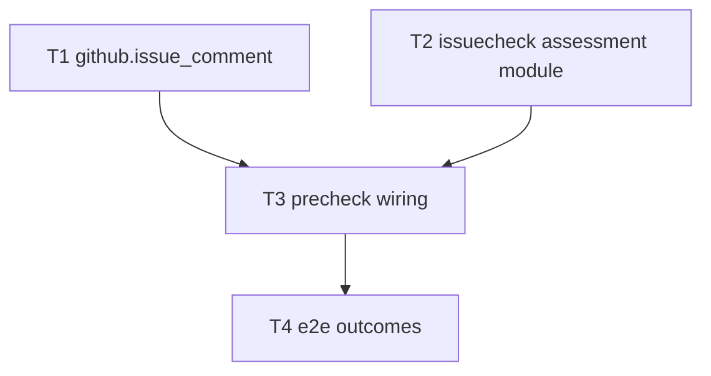

# 0043 · Check whether an issue's title/body affects the fix approach before it enters RFC: flag conflicts with needs-human for alignment first; do not generate a spec directly

<!-- This file is maintained by the spec tool: frontmatter is the structured source data (including the tasks DAG), and the body is a group-level overview in nine rust-RFC sections. -->

## Summary

In the **discovery phase** of vigil, the Vigil agent (`discover_and_dispatch` in `openagents/vigil.py`), when an issue is classified as `fresh` (no run record, no remote branch, and no claim), insert a **lightweight self-check, `issuecheck`**, before dispatching `orchestrator.start_rfc` to draft a spec: use the injected `backend` to judge whether the issue's **title and body** contain internal logical conflicts that **would directly affect the direction of the fix**—five typical categories: ① the fix advocated by the title ≠ the fix advocated by the body; ② root-cause analysis ≠ proposed fix; ③ two mutually exclusive fixes with no choice made in the issue; ④ “the problem is A, but the fix addresses B”; ⑤ a known tradeoff exists, but the issue does not state whether it is accepted.

- **Conflict detected** → **do not draft a spec**: instead, add the `needs-human` label to the issue and post a signed “alignment comment” (listing the conflicts + candidate fixes and asking a human to choose); skip dispatch for this round. The `needs-human` label becomes a **persistent freeze signal** for this issue: `_dispatch_kind` returns `None` upon seeing it, and subsequent rounds **do not rerun this nondeterministic judgment** (judge the same issue only once, avoiding oscillation from repeated review), until a human resolves the ambiguity and removes the label.
- **No conflict detected** → dispatch `start_rfc` as usual, with behavior unchanged byte for byte.

Add a pure-logic module, `openagents/issuecheck.py` (judgment + structured verdict + alignment-comment rendering, no IO, backend injection, testable with stubs), an issue-level comment interface, `github.issue_comment` (allowing comments on issues without PRs as well), an orchestrator preflight method, `precheck_issue`, and two integration points in vigil's discovery phase (call precheck before dispatch; have `_dispatch_kind` skip issues labeled `needs-human`).

## Motivation

**Current state (restated here; no external reading required).** OpenAgents is an RFC/spec-driven multi-Agent framework. `vigil` (the Vigil agent, `openagents/vigil.py`) is a thin scheduling loop: each round, `_run_one_round` first runs the **discovery phase**, `discover_and_dispatch`, then calls `messages.poll` to advance already-open PRs. The discovery phase (`vigil.py:105-130`) calls `_dispatch_kind` to classify each open issue carrying the agreed label:

- `"fresh"` → `orchestrator.start_rfc(resume=False)`: no run record, no remote branch, and no claim → create a new isolated worktree, call `begin_run`, claim and label the issue, then **directly call `backend.run` to draft a spec**, commit and push, and open a draft PR.
- `"resume"` → `start_rfc(resume=True)`: an orphaned run with solving/pr=0; reuse the remaining worktree to resume.
- `None` → skip (already in progress / completed / claimed by another backend with an unexpired claim), leaving poll to advance it.

The spec-drafting prompt (`_DRAFT_RFC_TASK` in `orchestrator.py`) says: “Draft a spec for issue #{number}, ‘{title}’…”—**it uses the issue title as the seed for the spec title and feeds the body to the backend as the complete requirements**. In other words, once an issue reaches the `fresh` branch, it is treated as **a clear requirement that has already been clarified**, proceeding directly to spec drafting and implementation without any check of “whether this issue is internally consistent.”

**Why this must change—an issue can contain internal conflicts, and drafting directly can lock in the wrong direction.** Issue #111 was motivated by a real incident (issue #106 → PR #107; see “Hard evidence” below): **the issue's title and body advocated two semantically different fixes**. If the agent drafted according to the title, it would produce a spec that diverged completely from the body (and the eventual implementation). This is not editorial fastidiousness—it would **directly** contaminate the entire downstream chain: spec title → task breakdown → implementation files → acceptance criteria → subsequent reviewers' understanding of the PR. The only real human checkpoint in the entire automated pipeline is **PR review** (discovering that the direction is wrong only after all the code has been written is the most expensive correction point); if an issue starts out in the wrong direction, the cost of correction is pushed to the farthest end.

**Hard evidence (issue #106, a retrospective on Spec-0041 already implemented in this repository; principle 7: evidence-driven).** For #106:

- **Title**: `PRs that have already PASSed are repeatedly reviewed: review conclusions should be cached by commit sha to avoid PASS/REWORK oscillation for the same code`
- **Primary fix in the body**: `PRs that have already PASSed are still repeatedly reviewed after hold-merge; freeze them as needs-human to avoid continuing to rerun the reviewer`

These are two fixes that can alleviate the same symptom but have **different** implementation semantics:

1. **Cache review conclusions by commit sha** (title): keep the PR in the active poll loop, but reuse PASS once the same commit has already PASSed, avoiding repeated reviewer calls. This requires a new persistent field, `reviewed_sha`, and a definition of cache invalidation (new commit / rebase / force-push / base advancement).
2. **Freeze the PR on hold-merge** (body): when the reviewer returns PASS and `--hold merge` is set, remove the PR from the active poll loop (set `blocked` + `needs-human`) and wait for a human to merge it; poll automatically skips it and does not review it again.

Ultimately, PR #107 took **the second direction** (`keep the PR frozen pending merge after hold-merge PASS`, namely the merged Spec-0041)—**not** the sha caching described in the title. If the agent had faithfully drafted a spec according to the title, “cache review conclusions by commit sha,” it would have produced an RFC whose title, tasks, files, and acceptance criteria all pointed toward a cache table, completely misaligned with the body's intent and the eventual implementation. #106 narrowly avoided failure because a human (the body author) clearly stated the actual intent in the body—but that depends on luck, not a mechanism.

**Root cause in one sentence**: upon receiving an issue, the agent treats it as a clear requirement by default and proceeds directly to spec generation; if the issue itself contains internal conflicts that **directly affect the direction of the fix**, such as “title vs. body conflict / root cause vs. fix mismatch / mutually exclusive fixes without a choice,” it locks the wrong direction into the spec and implementation. What is missing is a lightweight gate: “before entering RFC, check whether the issue is internally consistent; if it is not, align with a human first.”

**Scope (explicitly defined by issue #111 and strictly followed by this spec).** This gate **only catches conflicts that directly affect implementation direction** (the kind that could cause the agent to generate the wrong spec / wrong implementation without prior alignment). **Do not nitpick**: occasional inconsistent wording, slightly verbose nonessential background, minor ambiguities that do not affect the fix—all pass without disturbing a human. Excessive triggering (false positives) would block healthy issues and force humans to provide pointless confirmations, violating the design intent more than missed conflicts would (principle 5: humans handle high-level oversight and should not be drowned in noise).

**Why it must “judge only once”—this issue's self-referential lesson.** Judgment uses a **nondeterministic LLM** (the same text may receive different conclusions in two rounds), precisely the same risk seen in #106/Spec-0041: “a nondeterministic reviewer repeatedly reverses its judgment on the same code → PASS/REWORK oscillation.” Rerunning judgment on the same unchanged issue in every poll round would create issue-level review oscillation (conflict in one round, no conflict in the next, with comments accumulating). Therefore, this spec requires by design: **once judged and frozen, pin the conclusion with the `needs-human` label and do not judge again in subsequent rounds**—building the lesson from Spec-0041, “judge the same code only once,” directly into this gate.

## Guide-level explanation

After the change, the experience when Vigil receives a new issue becomes:

- **The issue title/body is consistent about the direction of the fix** → exactly the same as today: dispatch `start_rfc` to draft a spec and open a draft PR. No perceptible change, no regressions.
- **The issue title/body contains a conflict that directly affects the fix** (such as #106, where title=sha caching and body=hold-merge freezing) → Vigil **does not draft a spec**, and instead:
  1. Adds the `needs-human` label to the issue;
  2. Posts a signed comment along these lines:

     > 🔀 **This issue may contain an internal conflict about the direction of the fix; please align before entering RFC**
     >
     > Conflicts detected:
     > - Fix advocated by the title: cache review conclusions by commit sha; fix advocated by the body: freeze PRs that have already PASSed as needs-human after hold-merge. These have different semantics (one keeps the PR in active polling and reuses the cache; the other removes the PR from active polling to wait for a human to merge it).
     >
     > Candidate fixes (please choose one or explain how to combine them):
     > - A. Cache review conclusions by commit sha;
     > - B. Freeze the PR on hold-merge.
     >
     > I have added `needs-human` to pause automatic drafting. Please confirm the choice in the issue (or provide clarification and then remove `needs-human`), and I will proceed to RFC/spec.

  3. Skips dispatch for this round. **Starting with the next round**, `_dispatch_kind` directly skips the issue when it sees `needs-human`—**without rerunning judgment**, until a human handles it.
- **After a human resolves the ambiguity** (clarifies the choice in the issue body, then removes the `needs-human` label) → the issue becomes `fresh` again in the next round → judgment runs once more: if it is now consistent, drafting proceeds normally; if the conflict remains, it is frozen again (this is a reassessment **actively triggered** by a human, bounded and acceptable).

The key: this gate is a **thin preflight predicate** in vigil's discovery phase—it blocks only on a match and is completely transparent otherwise. It reuses the existing “issue-level labeling / commenting” primitives, and freezing relies on the existing semantics of the `needs-human` label (originally used for PRs stuck waiting for human intervention), requiring no new state machine or persistent fields.

**Division of responsibility with “front-door alignment,” `align.py` (Spec-0020).** `align.py` takes a vague draft from a person's mind **before an issue is filed** and restates it in three parts—“do X / boundary Y / do not do Z”—creating the issue only after human confirmation (preventing “requirements becoming an issue before they have been thought through”). This spec checks whether an issue is internally consistent **after it exists but before it enters RFC** (preventing “the title and body within an issue contradicting each other”). They are two adjacent gates at the intent level: align handles entry quality; issuecheck handles consistency before RFC.

**Making outcomes visible (principle 8).** The human-visible outcomes of this gate are **the alignment comment posted on the issue + the `needs-human` label** (on GitHub), along with the negative fact that “this issue **has not** had a spec generated / has not had a draft PR opened.” The e2e test uses a browser to render this alignment comment (the actual text output by the product) as a static page, navigate to it, take a screenshot, and assert that it lists the two conflicting directions from #106 and recommends alignment first (see the e2e subsection in Reference-level for details).

## Reference-level explanation

### Decision A: Add a pure-logic judgment module, `openagents/issuecheck.py`

Create `issuecheck.py`, mirroring the “draft in, structured output + pure predicate” pattern of `align.py` (Spec-0020) and the “backend judge → structured verdict” pattern of `reviewer.py` (RFC-0012). **Pure logic, with no IO** (no interaction with GitHub / argparse / stdin), backend dependency injection, testable with stubs (principles 1/10: decoupling):

- Input: `IssueDraft(title, body)` (a frozen dataclass with the same structure as `align.Draft`).
- Judgment: `check(*, draft, backend) -> ConflictVerdict`—call `backend.run` with a judgment instruction, `_CHECK_TASK`, in a stable format. The instruction requires the backend to output **strictly in the marker format** (following the `_MARK_*` parsing pattern in `align.py`) and **embeds the five conflict categories defined by issue #111 + the “do not nitpick” boundary**, focusing judgment on conflicts that “directly affect the direction of the fix.”
- Verdict, `ConflictVerdict` (a frozen dataclass): `has_conflict: bool`, `conflicts: tuple[str, ...]` (each entry = a plain-language description of one conflict), `candidate_fixes: tuple[str, ...]` (mutually exclusive candidate fixes for a human to choose between).
- Rendering: `build_alignment_comment(*, verdict) -> str`—render the verdict as a structured Markdown alignment-comment body (mirroring the “structured suspension comment for humans” pattern of `blocknote.build`: heading sentence + conflict list + candidate-fix list + instructions saying “needs-human has been added; please resolve the ambiguity and then remove the label”), **without a signature or IO**; the caller supplies the signature.
- **Parsing tolerance and safe default (fail-open)**: when a clear “conflict present” signal cannot be parsed from the backend output (missing markers / empty string / format deviation), `_parse_verdict` falls back to `has_conflict=False` (**allow through**, draft as usual). Choosing “give the benefit of the doubt” rather than the reviewer's “err on the side of rejection” is justified because issue #111 explicitly warns that the cost of excessive triggering (blocking healthy issues and forcing pointless human confirmation) violates the intent more than missed conflicts do; moreover, this gate is **advisory**—even if a conflict is missed, human PR review remains a backstop (see alternative 3 in Rationale and Unresolved). Judgment blocks only when it **explicitly outputs “Conflict: yes” + at least one conflict point**.

### Decision B: Add an issue-level comment interface `github.issue_comment`

`github.post_comment` uses `gh pr comment <n>` (PR-only, `github.py:379-384`), whereas the blocked issue **does not yet have a PR**. Add a symmetrical issue-level interface, `issue_comment(*, number, body)`, using `gh issue comment <number> --body <body>` (alongside the existing family of issue-level operations `issue_add_label` / `issue_remove_label` / `issue_stamp_label`, which use `gh issue edit/view`, `github.py:444-492`). Reuse the existing `identity.sign` for signing (`post_signed_comment` already uses it, `identity.py:104-109`)—the calling orchestrator posts a signed comment using `github.issue_comment(number=..., body=identity.sign(body=..., agent_id=self._agent_id))` (the signature supports traceability/auditing, RFC-0011/0019).

### Decision C: Orchestrator preflight method `precheck_issue`

The orchestrator holds `backend` / `agent_id` and is the only place that can simultaneously “invoke assessment + apply a label + post a signed comment.” Add:

```python
def precheck_issue(self, *, issue_number: int) -> bool:
    """Assess whether the issue has internal conflicts that directly affect the fix approach; if so, freeze it
    (apply needs-human + post an alignment comment) and return True (blocked; the caller must not dispatch it),
    otherwise return False (allow dispatch)."""
    issue = github.get_issue(number=issue_number)
    verdict = issuecheck.check(
        draft=issuecheck.IssueDraft(title=issue.title, body=issue.body), backend=self._backend
    )
    if not verdict.has_conflict:
        return False
    body = issuecheck.build_alignment_comment(verdict=verdict)
    github.issue_comment(number=issue_number, body=identity.sign(body=body, agent_id=self._agent_id))
    github.issue_add_label(number=issue_number, name=github.BLOCKED_LABEL)  # needs-human
    return True
```

- Assessment happens **before creating a worktree / begin_run / claiming the issue**—a blocked issue leaves no local or remote drafting artifacts at any point (no worktree, no run record, no spec, no draft PR), keeping the process clean and traceable.
- Apply the label using the existing `github.BLOCKED_LABEL` (whose value is `"needs-human"`, `github.py:67`); do not add a new label constant (see the tradeoff concerning “multiple meanings for one term” in Drawbacks and alternative 4 in Rationale).

### Decision D: Wire into the Vigil discovery stage (two places)

Make two minimal wiring changes in the discovery stage of `openagents/vigil.py`:

1. **Call precheck before dispatch** (in `discover_and_dispatch`, when `kind == "fresh"` and just before calling `start_rfc`):

   ```python
   if not resume and self._orchestrator.precheck_issue(issue_number=issue.number):
       self._log(message=f"⏸ issue #{issue.number}: conflicting fix directions detected; labeled needs-human pending alignment; skipping drafting")
       continue  # Freeze; do not dispatch
   self._orchestrator.start_rfc(issue_number=issue.number, base=base, resume=resume)
   ```

   Assess only `fresh` issues (`resume` refers to an orphaned run that has already been dispatched and prechecked; simply resume it without reassessment). Include precheck exceptions in the existing per-issue `except (OrchestratorError, GithubError)` isolation—an assessment/comment-posting failure skips only that issue, to be retried in the next round, and must never bring down the entire discovery round (Decision 8).

2. **Have `_dispatch_kind` skip frozen issues** (`vigil.py:132-159`, add a gate inside the `record is None` branch, before returning `"fresh"`):

   ```python
   if github.BLOCKED_LABEL in issue.labels:
       return None  # Frozen due to conflicting fix approaches, awaiting human alignment—do not rerun nondeterministic assessment (prevents issue-level reassessment oscillation)
   ```

   This structurally guarantees that “each issue is assessed only once”: skip whenever `needs-human` is present; assessment **does not run again**. Only after a human removes the label does the issue become `fresh` again and trigger reassessment. Placing this inside the `record is None` branch is safe—`needs-human` on issues with run records (which already have PRs) is handled by `messages.poll`, and `_dispatch_kind` already returns `None` for them.

### Decision E: Introduce no new state fields and leave the drafting prompt unchanged

Freezing reuses existing primitives throughout: assessment (backend), posting comments (`github.issue_comment` + `identity.sign`), applying labels (`github.issue_add_label`), and skipping (`_dispatch_kind` reads `issue.labels`). The `needs-human` label itself is the persistent signal, and GitHub is the source of truth (Vigil derives the outcome anew from GitHub + State each round, with no in-memory state)—**no new state fields and no migration are needed**. Leave the `_DRAFT_RFC_TASK` drafting prompt unchanged (this spec only adds a gate **before** dispatch; it does not change dispatch itself).

### DAG and file allocation

| Task | Title | files (single-writer ownership, mutually exclusive within the group) | depends-on |
|---|---|---|---|
| T1 | Issue-level comment interface `github.issue_comment` | `openagents/github.py`, `tests/test_github_issue_comment.py` | — |
| T2 | issuecheck assessment module (verdict + alignment comment rendering) | `openagents/issuecheck.py`, `tests/test_issuecheck.py` | — |
| T3 | precheck wiring (orchestrator preflight + Vigil discovery-stage gate) | `openagents/orchestrator.py`, `openagents/vigil.py`, `tests/test_orchestrator_precheck.py`, `tests/test_vigil_precheck_gate.py` | T1, T2 |
| T4 | End-to-end outcome tests (#106 regression + browser assertions for the alignment comment) | `scripts/e2e-spec-0043-issue-conflict-precheck.sh`, `tests/test_issue_precheck_integration.py` | T3 |



T1 and T2 have no dependencies on each other and can run in parallel (collaborative mode, each owning disjoint `files`); T3 brings the two together through wiring; T4 verifies the result end to end.

### e2e outcome script (picked up via the PR signpost)

**Path: `scripts/e2e-spec-0043-issue-conflict-precheck.sh`**, following this repository’s two-phase e2e convention (offline deterministic verification by default; add a real smoke test when `OPENAGENTS_E2E_REAL=1`).

**Phase 1—offline deterministic verification (default, mocked throughout)**: ruff lint/format + pytest; the core integration cases are in `tests/test_issue_precheck_integration.py`, using **the actual title/body of issue #106 as the regression fixture** (explicitly specified in the acceptance criteria recommendations for issue #111):

1. **Conflict detection + freezing (core regression)**: Construct a `Vigil`; stub `github.list_issues` to return an issue whose title/body **match the title and body of #106 word for word**; stub `orchestrator._backend` to respond to the assessment instructions with “Conflict: yes” + two points of conflict (title=sha caching / body=hold-merge freezing) + two candidate fix approaches. Run one round of `discover_and_dispatch` → assert: (a) `start_rfc` **was not called** (no worktree, no `begin_run`, no new group for this issue under docs/specs); (b) the issue is labeled `needs-human`; (c) exactly **one** signed alignment comment is posted, with a body containing both fix directions and the tradeoff between “candidate fix approaches,” and **without** PR failure wording such as “🤖 Stuck.”
2. **Anti-oscillation assertion (self-referential, conclusive evidence for this issue)**: Add `needs-human` to the issue’s label set after the preceding step, then run `discover_and_dispatch` a **second time** → assert that `_dispatch_kind` returns `None`, the assessment backend **was not called again** (the call count is unchanged), there are no new comments, and `start_rfc` still has not been called. This establishes that “each issue is assessed only once, with no reassessment oscillation.”
3. **Pass-through assertion (no nitpicking)**: For another issue, have the assessment backend stub return “Conflict: no” → `discover_and_dispatch` → assert that `precheck_issue` returns False, `start_rfc` **is called normally**, and there is no `needs-human` label or alignment comment (zero disruption and zero regressions for healthy issues).
4. **Unfreezing assertion**: Remove `needs-human` from the issue → in the next round, `_dispatch_kind` classifies it as `fresh` again, and assessment is called again (one human-triggered reassessment, bounded).

**Phase 1 browser outcome assertions (Principle 8, using Playwright / chrome-devtools MCP)**: The human-visible product output of this feature is **the alignment comment posted to the issue** (there is no PR, so it does not appear in the local `board.html`). The e2e test renders the **actual comment body** (product output) produced by `issuecheck.build_alignment_comment` in step 1 into a minimal static HTML document (a test-side wrapper, not product code), then uses browser `navigate` to open `file://.../alignment-comment.html`:

- Use `take_snapshot` + `take_screenshot`, and **assert that the page text contains both fix directions** (“cache review conclusions by commit sha” and “hold-merge … freeze”), the “candidate fix approaches” tradeoff section, and the recommendation “needs-human / align first, then proceed to RFC”—that is, the outcome “conflict detected, drafting blocked, human choice requested” is presented in a human-readable form. Retain the screenshot.
- Use `list_console_messages` / `list_network_requests` to assert that there are no errors and no failed requests (a purely local static page should have no network failures).
- **Fallback**: If the runtime environment has no browser MCP, fall back to text assertions on the rendered HTML (grep for both fix directions + the candidate fix approaches section); **do not skip** outcome verification.

**Phase 2—real smoke test (`OPENAGENTS_E2E_REAL=1`, performs real issue operations)**: Create an actual issue in a scratch repository whose “title advocates X and body advocates a mutually exclusive Y,” apply the agreed labels, and run one round of `vigil --once`. Verify that the issue is labeled `needs-human`, receives one alignment comment, and **does not** get a draft PR; then verify normal drafting for a self-consistent issue.

## Drawbacks

- **Assessment uses a nondeterministic LLM and may be wrong**. A false positive (classifying a healthy issue as conflicting) blocks normal drafting and forces someone to confirm unnecessarily; a false negative (missing a real conflict) lets the wrong direction enter the spec (falling back to the status quo, where a human still provides a backstop during PR review). “Give the benefit of the doubt, fail-open” + “block only when the output explicitly reports a conflict” minimizes false positives (consistent with issue #111's “do not nitpick” boundary), at the cost of a higher risk of missed conflicts—this bias is deliberate (see Rationale).
- **Each fresh issue requires one additional backend assessment call** (before drafting). The cost is one extra `backend.run`, but that is far lower than the cost of “drafting a spec in the wrong direction + implementing it + having it rejected by a reviewer / overturned by a human”; it also runs only once on the fresh branch (it does not rerun after freezing).
- **The multiple meanings of `needs-human` become even more overloaded**. It already means both “PR blocked, awaiting human intervention” and “hold-merge PASS, awaiting merge” (Spec-0041); this spec adds another meaning: “conflicting approaches to fixing an issue, awaiting alignment.” This is **accepted** for simplicity (no dedicated `needs-alignment` label is added)—the three cases naturally occur on different objects / at different stages (an issue without a PR vs an open PR), so operations can roughly distinguish them by “whether a PR exists”; finer distinctions are left to Future.
- **Unfreezing depends on a human removing the label**. The MVP does not automatically read new issue comments to unfreeze an issue (unlike the PR-side reply-based unblocking loop in Spec-0032): after reaching alignment, a human must clarify the issue body and **remove `needs-human`** to trigger assessment again. If the human only comments on the issue without removing the label, the issue remains frozen indefinitely. This is a deliberate tradeoff for minimalism (an issue-level unblocking loop is left to Future), and the alignment comment explicitly says “remove the label to continue.”
- **Assessment reads a snapshot of the issue's current title/body**. If a human **edits** the issue body to establish alignment but forgets to remove the label, reassessment does not happen automatically; conversely, if they remove the label without changing the content, assessment will detect the same conflict and freeze the issue again. Alignment requires two steps—“change the content + remove the label”—which the comment must explain clearly.

## Rationale and alternatives

**Why “a lightweight gate at the front of Vigil's discovery phase + freezing with needs-human.”** Blocking a conflict is meaningful only **before it enters the spec** (once it enters the spec, it is already embedded in the title/tasks/files/acceptance criteria). The `fresh` branch in Vigil's discovery phase is the sole entry point from “issue → drafting,” so adding a predicate before it is the placement with the smallest scope of change. Freezing reuses the existing `needs-human` label (already a signal for “awaiting human intervention”) + label-based skipping in `_dispatch_kind` (already the discovery phase's deduplication mechanism). Three existing primitives combine to produce “assess once → freeze → wait for a human → remove the label to unfreeze,” **without building a new state machine, adding state fields, or changing the drafting prompt** (Occam's razor, Principle 1). The assessment module is isolated as pure logic in `issuecheck.py` (with backend injection and testable using stubs), decoupled from GitHub/orchestration (Principle 10), and reuses the proven “backend judge → marker-based parsing → structured verdict” pattern from `align.py`/`reviewer.py`.

**Alternative 1—Put self-checking into the drafting prompt (have the drafting agent check for itself first).** Add a sentence at the beginning of `_DRAFT_RFC_TASK`: “First check whether the issue contains conflicting approaches to the fix; if so, do not draft, and apply needs-human.” **Rejected**: (a) this buries the “blocking decision” inside a heavyweight process that has already created a worktree, performed begin_run, and applied a claim label—by the time it blocks, these traces already exist and require additional rollback, making it much messier than “assess before drafting, then decide whether to create a worktree”; (b) blocking is **structured control flow** (either freeze or dispatch), and relying on an agent to follow a free-text prompt is unreliable and cannot be unit-tested; (c) assessment logic scattered into a prompt cannot be covered by `pytest`, violating “turn soft conventions into hard enforcement.” This spec implements it as a **hard predicate**, `precheck_issue`, in the discovery phase (returning a bool to determine control flow), which can be tested deterministically.

**Alternative 2—Reuse “front-door alignment,” `align.py` (Spec-0020), instead of creating a new module.** `align.py` already follows a “Draft in, backend restatement out” pattern. **Rejected for direct reuse**: align produces a **restatement** of “do X / boundary Y / do not do Z” (helping a human confirm scope), whose semantics are “reorganize vague ideas”; this spec requires a **verdict** on “whether the title and body **conflict**” (bool + points of conflict), whose semantics are “consistency checking.” Forcing this into align would make one module carry two unrelated responsibilities (Principle 10, decoupling). However, **the pattern deliberately follows** align (`Draft` structure, `_MARK_*` marker-based parsing, backend injection, separation of pure predicates from generation), reducing cognitive and maintenance costs; the two sit alongside each other as adjacent gates at the intent layer (align before issue creation, issuecheck before entry into an RFC).

**Alternative 3—Use “when in doubt, fail-closed” for assessment fault tolerance (treat unparseable output as a conflict and block).** This follows `reviewer.py`'s “unparseable verdict → treat as not passed.” **Rejected**: the “mind the boundaries” guidance in issue #111 strongly emphasizes the cost of excessive triggering (blocking healthy issues, forcing unnecessary human confirmation, and overwhelming human oversight with noise); moreover, this gate is **advisory** (PR review provides a backstop for missed conflicts), whereas the reviewer is the **last** quality gate before merging (a missed problem directly lets bad code through), so their risk profiles differ. This spec therefore chooses fail-open (give the benefit of the doubt), encoding “prefer a missed conflict to excessive blocking” into parsing fault tolerance. Whether certain high-risk signals (such as obvious contradictions between title/body keywords) should individually fail-closed is left to Unresolved.

**Alternative 4—Add a dedicated `needs-alignment` label instead of reusing `needs-human`.** This has the cleanest semantics (separating issue-level freezing due to conflicts from PR-level blocking). **Rejected**: it requires adding a label constant, ensuring the label exists in the repository (`ensure_label`), and recognizing it in both `_dispatch_kind` and future unfreezing paths—a whole new entity, in exchange for a distinction that can already be roughly made along the natural dimension of “issue without a PR / PR already open.” Reuse `needs-human` for simplicity (Principle 1), leaving a dedicated label to Future.

**Alternative 5—Place assessment at the very beginning of orchestrator.start_rfc (rather than in Vigil's discovery phase).** Have `start_rfc` assess immediately on entry and return early if there is a conflict. **Partially adopted**: the assessment **logic** does live in the orchestrator (`precheck_issue`, which holds backend/agent_id). However, the **control-flow decision** (block → `continue` without dispatching) remains in Vigil's discovery phase—because “skip this issue and continue to the next” is the loop semantics of discovery, and Vigil's `_dispatch_kind` is the natural place to “use the needs-human label to skip reassessment.” This is therefore split into two halves: “orchestrator supplies assessment + the freezing action; Vigil supplies control flow + deduplication-based skipping,” each in its appropriate place.

## Prior art

- **This repository's “front-door alignment,” `align.py` (Spec-0020, issue #59)**: before an issue is submitted, it restates a vague draft in three sections for human confirmation—an **entry** gate at the intent layer. This spec is its adjacent sibling: the issue already exists, and self-consistency is checked before entry into an RFC. The pattern (Draft dataclass, `_MARK_*` marker-based parsing, backend injection, separation of generation from predicates) is borrowed directly from align.
- **This repository's reviewer, `reviewer.py` (RFC-0012/0018)**: the stateless assessment paradigm of “backend judge → parse verdict token → structured `ReviewDecision`.” This spec's `issuecheck.check → ConflictVerdict` applies the same paradigm to a new assessment subject, “issue self-consistency” (the difference: reviewer is fail-closed, issuecheck is fail-open; see Rationale, Alternative 3).
- **This repository's structured human-facing comments, `blocknote.py` (Spec-0041/T2, etc.)**: renders machine verdicts as “structured markdown for humans” (a heading sentence + sections), adds a signature, and posts them. This spec's `build_alignment_comment` follows the same pattern (list of conflicts + list of candidate fixes + instructions to remove the label).
- **issue #106 → Spec-0041 (the incident motivating this spec)**: the title, “cache by commit sha,” conflicted with the body, “hold-merge freezing,” over the direction of the fix, and the eventual implementation followed the body. #106 is a first-class regression example for this spec.
- **The engineering consensus that requirements clarification precedes design**: Phase 1 (Requirements Clarification) of the spec-driven-development / rfc-driven-development skill already requires “clarify first, then design”; rust-lang/rfcs' `Unresolved questions` section requires unresolved tradeoffs to be made explicit. This spec moves “clarify first” from a **manual process convention** into a **hard gate in the automated pipeline**—in the words of issue #111: an RFC should not be generated directly from the issue title; conflicts should first be flagged and aligned with a human.

## Unresolved questions

- **Heuristic boundaries of the assessment instructions**: what wording will make the backend consistently report only conflicts that “directly affect the approach to the fix,” without nitpicking? The initial version directly embeds issue #111's five conflict categories + a “do not nitpick” exclusion list into `_CHECK_TASK`, then adjusts after testing on examples such as #106; whether it is worthwhile to have assessment output a **structured score** (conflict strength) rather than a boolean remains to be observed.
- **Whether fail-open should have exceptions for certain strong signals**: do some conflicts (such as obviously mutually exclusive keywords in the title/body) warrant failing closed individually (preferring to block)? The initial version is globally fail-open; decide after observing real misclassification rates.
- **Whether an issue-level reply-based unfreezing loop is needed**: the MVP relies on a human removing `needs-human` to unfreeze. Should it read new human comments on the issue and unfreeze automatically, as on the PR side in Spec-0032 (a human replies “go with direction B,” and it unfreezes and feeds that choice into drafting)? Left to Future; not implemented in the initial version.
- **Whether assessment should also examine existing issue comments / linked PRs**: the actual tradeoff in #106 was already in the body, but clarification for some issues is in the comments. The initial version reads only title/body (the same as `align.Draft`); whether to incorporate comment context remains to be observed.
- **Whether to eventually merge this with `align.py` into an “intent layer” module**: the two have highly similar patterns but different responsibilities (restatement vs consistency assessment). The initial version keeps two parallel modules (Principle 10, decoupling); consider extracting a common foundation if later evidence shows enough shared functionality.

## Future possibilities

- **Issue-level unfreezing loop**: read new human comments on an issue to automatically remove `needs-human` + feed the human's choice into `start_rfc`'s drafting prompt as the “clarified direction” (mirroring the PR-side reply-based unblocking + quoted responses in Spec-0032/0036).
- **Dedicated `needs-alignment` signal**: if the overloaded `needs-human` causes confusion in actual board use, introduce a dedicated issue-level label/board presentation, making “conflicting approaches to the fix, awaiting alignment” a first-class concept.
- **Structured assessment output**: require the assessment task template to output structured sections for “conflict strength + points of conflict + candidate fixes,” reducing `issuecheck` to directly extracting structured fields and reducing heuristic parsing.
- **Write alignment conclusions back into the spec's Unresolved questions**: after a human aligns on the tradeoff, the drafting agent can automatically record “there was an X/Y conflict; Y was chosen” in the new spec's `Unresolved questions`/`Rationale` sections, preserving a decision trail.
- **Include “issues awaiting alignment” on the results board**: add a category of issue rows to `results.board` for “frozen due to conflicting approaches to the fix, awaiting human alignment” (the board currently shows only records with runs), making these blocked issues visible on the results page as well.
