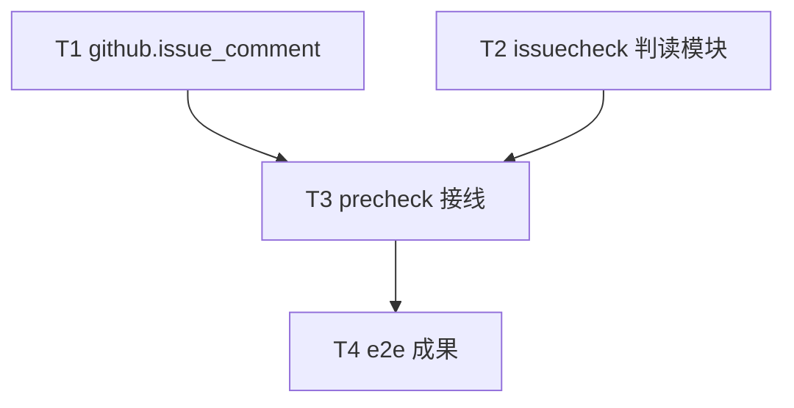

# 0043 · issue 进入 RFC 前自检标题/正文是否影响修法：命中冲突先打 needs-human 对齐、不直接生成 spec

<!-- 本文件由 spec 工具维护：frontmatter 为结构化源数据（含 tasks DAG），正文为组级 rust-RFC 9 段总览。 -->

## Summary

在 vigil 守夜人的**发现段**（`openagents/vigil.py` 的 `discover_and_dispatch`）里，当一个 issue 被判为 `fresh`（无 run 记录、远端无分支、无人认领）、即将派单 `orchestrator.start_rfc` 起草 spec 之前，插入一道**轻量自检 `issuecheck`**：用注入的 `backend` 判读 issue 的**标题与正文**是否存在「**会直接影响修法方向**」的内在逻辑冲突——典型五类：①标题主张的修法 ≠ 正文主张的修法；②根因分析 ≠ 建议修法；③两个互斥修法但 issue 未取舍；④「问题是 A、修的是 B」；⑤存在已知取舍但 issue 未声明是否接受。

- **命中冲突** → **不起草 spec**：改为给 issue 打 `needs-human` 标签、贴一条署名的「对齐评论」（列出冲突点 + 候选修法，请人取舍），本轮跳过派单。`needs-human` 标签成为该 issue 的**持久冻结信号**：`_dispatch_kind` 见到它即返回 `None`，后续轮次**不再重跑这道非确定判读**（同一 issue 只判一次，不复审震荡），直到人对齐后摘掉标签。
- **未命中冲突** → 照常 `start_rfc` 派单，行为逐字节不变。

新增一个纯逻辑模块 `openagents/issuecheck.py`（判读 + 结构化裁决 + 渲染对齐评论，无 IO，backend 注入、打桩可测），一个 issue 级评论出口 `github.issue_comment`（无 PR 的 issue 也能被贴评论），以及 orchestrator 的一个前置方法 `precheck_issue` 与 vigil 发现段的两处接线（派单前调 precheck、`_dispatch_kind` 跳过 `needs-human` issue）。

## Motivation

**现状（就地复述，无需外读）。** OpenAgents 是 RFC/spec 驱动的多 Agent 框架。`vigil`（守夜人，`openagents/vigil.py`）是薄调度循环：每轮 `_run_one_round` 先跑**发现段** `discover_and_dispatch`，再 `messages.poll` 推进已开 PR。发现段（`vigil.py:105-130`）对每个带约定标签的 open issue 调 `_dispatch_kind` 归类：

- `"fresh"` → `orchestrator.start_rfc(resume=False)`：无 run 记录、远端无分支、无人认领 → 建全新隔离 worktree、`begin_run`、认领打标，然后**直接调 `backend.run` 起草 spec**、提交推送、开 draft PR。
- `"resume"` → `start_rfc(resume=True)`：solving/pr=0 的孤儿 run，复用残留 worktree 续跑。
- `None` → 跳过（已在途 / 已完成 / 已被别的后端认领未过期），交 poll 推进。

起草 spec 的 prompt（`orchestrator.py` 的 `_DRAFT_RFC_TASK`）是：「为 issue #{number}「{title}」起草一份 spec……」——**它把 issue 的标题当作 spec 标题的种子、把正文当作需求全文喂给后端**。也就是说，一旦落到 `fresh` 分支，issue 就被当成**已澄清的明确需求**，直接进入 spec 草稿生成与实现，中间没有任何「这个 issue 本身是否自洽」的检查。

**为什么要改——issue 本身可能内在冲突，直接起草会把错误方向固化。** issue #111 的动机来自一个真实事故（issue #106 → PR #107，见下「铁证」）：**issue 的标题与正文主张了两个语义不同的修法**，agent 若按标题起草，会做出与正文（和最终实现）南辕北辙的 spec。这不是文案洁癖——它会**直接**污染下游一整条链：spec 标题 → 任务拆解 → 实现文件 → 验收标准 → 后续 reviewer 对 PR 的理解。人在整个自动流水线里唯一的真实检查点是**审 PR**（代码全写完才暴露方向错，是最贵的纠错点）；若 issue 一进门方向就错，纠错成本被推到最远。

**铁证（issue #106，本仓库已落地的 Spec-0041 复盘，理念 7 证据驱动）。** #106 的：

- **标题**：`已 PASS 的 PR 被反复重审：评审结论应按 commit sha 缓存，避免同码 PASS/REWORK 震荡`
- **正文主修**：`hold-merge 后已 PASS 的 PR 仍被反复重审，应冻结成 needs-human，避免继续重跑 reviewer`

这是两个能缓解同一现象、但实现语义**不同**的修法：

1. **按 commit sha 缓存评审结论**（标题）：PR 留在活跃 poll 循环里，但同一 commit 已 PASS 后复用 PASS，避免重复调 reviewer。要新增持久化字段 `reviewed_sha`、定义缓存失效（新 commit / rebase / force-push / base 前进）。
2. **hold-merge 冻结 PR**（正文）：reviewer PASS 且 `--hold merge` 时，把 PR 从活跃 poll 循环里拿出来（置 `blocked` + `needs-human`），等人合并，poll 自动跳过、不再重审。

最终 PR #107 走的是**第 2 个方向**（`hold-merge PASS 后夯住待合并`，即已合入的 Spec-0041）——**不是**标题写的 sha 缓存。如果当时 agent 老实按标题「按 commit sha 缓存评审结论」起草了 spec，就会产出一份标题、任务、文件、验收全指向缓存表的 RFC，与正文意图和最终实现完全错位。#106 侥幸靠人（正文作者）在正文里写清了真实意图才没翻车——但这依赖运气，不是机制。

**根因一句话**：接到 issue 后 agent 默认把它当明确需求直接进 spec 生成；若 issue 自身存在「标题 vs 正文冲突 / 根因 vs 修法不一致 / 互斥修法未取舍」这类**会直接影响修法方向**的内在冲突，就会把错误方向固化进 spec 与实现。缺的是一道「进 RFC 前先看 issue 自不自洽、不自洽就先跟人对齐」的轻量闸。

**边界（issue #111 明确划定，本 spec 严格遵守）。** 这道闸**只抓会直接影响实现方向**的冲突（不先对齐 agent 就可能生成错误 spec / 错误实现的那种）。**不吹毛求疵**：个别措辞不统一、非关键背景略啰嗦、不影响修法的轻微歧义——一律放行，不打扰人。过度触发（false-positive）会把健康 issue 拦下、逼人白确认，比漏判更违背设计意图（理念 5：人负责宏观把控，不该被噪声淹没）。

**为什么必须「只判一次」——本 issue 的自指教训。** 判读用的是**非确定性 LLM**（同一段文字两轮可能给不同结论），这正是 #106/Spec-0041 里「非确定 reviewer 对同码反复翻案 → PASS/REWORK 震荡」的同款风险。若每轮 poll 都对同一个未变的 issue 重跑判读，就会自造一个 issue 级的复审震荡（这轮判冲突、下轮判无冲突、评论越贴越多）。因此本 spec 从设计上就要求：**一旦判定并冻结，就用 `needs-human` 标签把结论钉死，后续轮次不再重判**——把 Spec-0041 学到的「同码只判一次」直接内建进这道闸。

## Guide-level explanation

改动后，守夜人接到一个新 issue 的体验变成：

- **issue 标题/正文在修法方向上自洽** → 和现在完全一样：`start_rfc` 派单起草 spec、开 draft PR。零感知、零回归。
- **issue 标题/正文存在会直接影响修法的冲突**（如 #106 那种标题=sha 缓存、正文=hold-merge 冻结）→ 守夜人**不起草 spec**，而是：
  1. 给该 issue 打 `needs-human` 标签；
  2. 贴一条署名评论，形如：

     > 🔀 **这个 issue 在修法方向上可能存在内在冲突，建议先对齐再进 RFC**
     >
     > 检测到的冲突点：
     > - 标题主张的修法：按 commit sha 缓存评审结论；正文主张的修法：hold-merge 后把已 PASS 的 PR 冻结成 needs-human。两者语义不同（一个保留 PR 在活跃轮询里复用缓存，一个把 PR 移出活跃轮询等人合并）。
     >
     > 候选修法（请取舍其一或说明合并方案）：
     > - A. 按 commit sha 缓存评审结论；
     > - B. hold-merge 冻结 PR。
     >
     > 我已打上 `needs-human` 暂缓自动起草。请在 issue 里确认取舍（或补充说明后摘掉 `needs-human`），我再进 RFC/spec。

  3. 本轮跳过派单。**下一轮起**，`_dispatch_kind` 看到该 issue 带 `needs-human` 就直接跳过——**不再重跑判读**，直到人处理。
- **人对齐后**（在 issue 正文里澄清取舍、然后摘掉 `needs-human` 标签）→ 下一轮该 issue 又成 `fresh` → 重跑一次判读：若已自洽则正常起草，若仍冲突则再次冻结（这是人**主动触发**的一次重判，有界、可接受）。

关键：这道闸是 vigil 发现段的一层**前置薄谓词**——命中才拦，不命中完全透明。它复用既有的「issue 级打标签 / 贴评论」原语，冻结靠既有的 `needs-human` 标签语义（原本用于 PR 卡住待人），无需新状态机、无需新持久化字段。

**它与「前门对齐」`align.py`（Spec-0020）的分工。** `align.py` 是**提 issue 之前**把人脑子里模糊的草稿复述成「要做 X / 边界 Y / 不做 Z」三段，让人确认后才建 issue（防的是「需求还没想清就落成 issue」）。本 spec 是**issue 已存在、进 RFC 之前**查 issue 自身是否自洽（防的是「issue 内部标题/正文互相打架」）。两者是意图层的两道相邻闸：align 管入口质量，issuecheck 管进 RFC 前的自洽性。

**成果可视化（理念 8）。** 这道闸的人类可见成果是**贴到 issue 上的对齐评论 + `needs-human` 标签**（GitHub 上），以及「该 issue **没有**被生成 spec / 没有开出 draft PR」这一负向事实。e2e 用浏览器把这条对齐评论（产品输出的真实文本）渲染成静态页并导航、截图、断言其列出了 #106 的两个冲突方向、建议先对齐（详见 Reference-level 的 e2e 段）。

## Reference-level explanation

### 决策 A：新增纯逻辑判读模块 `openagents/issuecheck.py`

镜像 `align.py`（Spec-0020）「草稿进、结构化出 + 纯谓词」的形态与 `reviewer.py`（RFC-0012）「backend judge → 结构化裁决」的形态，新建 `issuecheck.py`。**纯逻辑、不持任何 IO**（不碰 GitHub / argparse / stdin），backend 依赖注入、打桩可测（理念 1/10 解耦）：

- 输入：`IssueDraft(title, body)`（与 `align.Draft` 同构的冻结 dataclass）。
- 判读：`check(*, draft, backend) -> ConflictVerdict`——用一段稳定格式的判读指令 `_CHECK_TASK` 调 `backend.run`，指令要求后端**严格按标记格式**输出（对齐 `align.py` 的 `_MARK_*` 回解析套路），并在指令里**内嵌 issue #111 划定的五类冲突 + 「不吹毛求疵」边界**，让判读聚焦「会直接影响修法方向」的冲突。
- 裁决 `ConflictVerdict`（冻结 dataclass）：`has_conflict: bool`、`conflicts: tuple[str, ...]`（每条 = 一个冲突点的人话描述）、`candidate_fixes: tuple[str, ...]`（互斥的候选修法，供人取舍）。
- 渲染：`build_alignment_comment(*, verdict) -> str`——把裁决渲染成结构化 markdown 对齐评论正文（镜像 `blocknote.build` 的「给人看的结构化挂起评论」形态：标题句 + 冲突点列表 + 候选修法列表 + 「已打 needs-human，请对齐后摘标签」指引），**无签名、无 IO**，签名交给调用方。
- **解析容错与安全默认（fail-open）**：后端输出无法解析出明确「有冲突」信号时（缺标记 / 空串 / 格式跑偏），`_parse_verdict` 回落为 `has_conflict=False`（**放行**，照常起草）。取「疑无从宽」而非 reviewer 的「疑罪从严」，是因为 issue #111 明确警告过度触发的代价（拦下健康 issue、逼人白确认）比漏判更违背意图；且这道闸是**建议性**的——即便漏判，人仍会在审 PR 时兜底（见 Rationale 备选 3 与 Unresolved）。判读只在**明确输出「冲突：是」+ 至少一条冲突点**时才拦。

### 决策 B：新增 issue 级评论出口 `github.issue_comment`

`github.post_comment` 走的是 `gh pr comment <n>`（PR 专用，`github.py:379-384`），而被拦的 issue **此刻还没有 PR**。补一个对称的 issue 级出口 `issue_comment(*, number, body)`，走 `gh issue comment <number> --body <body>`（与既有 `issue_add_label` / `issue_remove_label` / `issue_stamp_label` 走 `gh issue edit/view` 的 issue 级操作族并列，`github.py:444-492`）。签名复用既有 `identity.sign`（`post_signed_comment` 已用它，`identity.py:104-109`）——调用方 orchestrator 用 `github.issue_comment(number=..., body=identity.sign(body=..., agent_id=self._agent_id))` 贴署名评论（署名服务于溯源/审计，RFC-0011/0019）。

### 决策 C：orchestrator 前置方法 `precheck_issue`

orchestrator 持有 `backend` / `agent_id`，是唯一能同时「调判读 + 打标签 + 贴署名评论」的位置。新增：

```python
def precheck_issue(self, *, issue_number: int) -> bool:
    """判读 issue 是否有会直接影响修法的内在冲突；命中则冻结（打 needs-human + 贴对齐评论）
    并返回 True（表示已拦下、调用方勿再派单），否则返回 False（放行派单）。"""
    issue = github.get_issue(number=issue_number)
    verdict = issuecheck.check(
        draft=issuecheck.IssueDraft(title=issue.title, body=issue.body), backend=self._backend
    )
    if not verdict.has_conflict:
        return False
    body = issuecheck.build_alignment_comment(verdict=verdict)
    github.issue_comment(number=issue_number, body=identity.sign(body=body, agent_id=self._agent_id))
    github.issue_add_label(number=issue_number, name=github.BLOCKED_LABEL)  # needs-human
    return True
```

- 判读**在建 worktree / begin_run / 认领之前**——被拦的 issue 全程不落任何本地/远端起草痕迹（无 worktree、无 run 记录、无 spec、无 draft PR），干净可回溯。
- 打标签用既有 `github.BLOCKED_LABEL`（值即 `"needs-human"`，`github.py:67`），不新增标签常量（见 Drawbacks 关于「一词多义」的取舍与 Rationale 备选 4）。

### 决策 D：vigil 发现段接线（两处）

在 `openagents/vigil.py` 的发现段做两处最小接线：

1. **派单前调 precheck**（`discover_and_dispatch` 里、`kind == "fresh"` 且将调 `start_rfc` 之前）：

   ```python
   if not resume and self._orchestrator.precheck_issue(issue_number=issue.number):
       self._log(message=f"⏸ issue #{issue.number}：检出修法方向冲突，已打 needs-human 待对齐，跳过起草")
       continue  # 冻结，不派单
   self._orchestrator.start_rfc(issue_number=issue.number, base=base, resume=resume)
   ```

   只对 `fresh` 判读（`resume` 是已派单过、precheck 过的孤儿 run，续跑即可，不重判）。precheck 的异常纳入既有 per-issue `except (OrchestratorError, GithubError)` 隔离——判读/贴评论失败只跳过该 issue、下轮重试，绝不拖垮整轮发现（决策 8）。

2. **`_dispatch_kind` 跳过已冻结 issue**（`vigil.py:132-159`，`record is None` 分支内、返回 `"fresh"` 之前加一闸）：

   ```python
   if github.BLOCKED_LABEL in issue.labels:
       return None  # 已因修法冲突冻结、待人对齐——不再重跑非确定判读（防 issue 级复审震荡）
   ```

   这是「同一 issue 只判一次」的结构性保证：`needs-human` 在场即跳过，判读**不重跑**；人摘掉标签才重新成 `fresh` 触发重判。放在 `record is None` 分支内是安全的——有 run 记录（已有 PR）的 issue 的 `needs-human` 由 `messages.poll` 处理，`_dispatch_kind` 对它们本就返回 `None`。

### 决策 E：不引入新状态字段、不改起草 prompt

冻结全程复用既有原语：判读（backend）、贴评论（`github.issue_comment` + `identity.sign`）、打标签（`github.issue_add_label`）、跳过（`_dispatch_kind` 读 `issue.labels`）。`needs-human` 标签本身即持久信号，GitHub 是真源（vigil 每轮从 GitHub + State 重新推导，无内存状态）——**无需新增 state 字段、无需迁移**。`_DRAFT_RFC_TASK` 起草 prompt 不改（本 spec 只在派单**前**加闸，不动派单本身）。

### DAG 与文件分配

| Task | 标题 | files（单一 writer 所有权，组内互斥） | depends-on |
|---|---|---|---|
| T1 | issue 级评论出口 `github.issue_comment` | `openagents/github.py`, `tests/test_github_issue_comment.py` | — |
| T2 | issuecheck 判读模块（裁决 + 对齐评论渲染） | `openagents/issuecheck.py`, `tests/test_issuecheck.py` | — |
| T3 | precheck 接线（orchestrator 前置 + vigil 发现段闸） | `openagents/orchestrator.py`, `openagents/vigil.py`, `tests/test_orchestrator_precheck.py`, `tests/test_vigil_precheck_gate.py` | T1, T2 |
| T4 | 端到端成果测试（#106 回归 + 浏览器对齐评论断言） | `scripts/e2e-spec-0043-issue-conflict-precheck.sh`, `tests/test_issue_precheck_integration.py` | T3 |



T1、T2 无相互依赖，可并行（协同模式，各持不相交 `files`）；T3 汇合二者做接线；T4 端到端验证。

### e2e 成果脚本（PR 指路牌拾取）

**路径：`scripts/e2e-spec-0043-issue-conflict-precheck.sh`**，沿用本仓库 e2e 两段式约定（默认离线确定性验证；`OPENAGENTS_E2E_REAL=1` 时追加真实冒烟）。

**阶段 1——离线确定性（默认，全程 mock）**：ruff lint/format + pytest；核心集成用例 `tests/test_issue_precheck_integration.py`，以 **issue #106 的真实标题/正文为回归样例**（issue #111 验收建议直接指定）：

1. **冲突识别 + 冻结（核心回归）**：构造一个 `Vigil`，`github.list_issues` 桩返回一个 issue，其 title/body **逐字为 #106 的标题与正文**；`orchestrator._backend` 桩对判读指令返回「冲突：是」+ 两条冲突点（标题=sha 缓存 / 正文=hold-merge 冻结）+ 两条候选修法。跑一轮 `discover_and_dispatch` → 断言：（a）`start_rfc` **未被调用**（无 worktree、无 `begin_run`、docs/specs 下无该 issue 的新组）；（b）issue 被打上 `needs-human`；（c）恰贴**一条**署名对齐评论，正文含两个修法方向、含「候选修法」取舍、**不含**「🤖 卡住了」等 PR 失败文案。
2. **反震荡断言（本 issue 的自指铁证）**：把上一步后的 issue 标签集加上 `needs-human`，**第二次** `discover_and_dispatch` → 断言 `_dispatch_kind` 返回 `None`、判读 backend **未再被调用**（调用计数不变）、无新评论、`start_rfc` 仍未被调。即「同一 issue 只判一次，不复审震荡」。
3. **放行断言（不吹毛求疵）**：另一个 issue 的 backend 判读桩返回「冲突：否」→ `discover_and_dispatch` → 断言 `precheck_issue` 返回 False、`start_rfc` **被正常调用**、无 `needs-human`、无对齐评论（健康 issue 零打扰、零回归）。
4. **解冻断言**：把 issue 的 `needs-human` 摘掉 → 下一轮 `_dispatch_kind` 重判为 `fresh`、判读被重新调用（人触发的一次重判，有界）。

**阶段 1 浏览器成果断言（理念 8，用 Playwright / chrome-devtools MCP）**：本 feature 的人类可见产品输出是**贴到 issue 的对齐评论**（无 PR、故不进本地 `board.html`）。e2e 用步骤 1 里 `issuecheck.build_alignment_comment` 产出的**真实评论正文**（产品输出）渲染成一份最小静态 HTML（测试侧包裹，非产品代码），浏览器 `navigate` 到 `file://.../alignment-comment.html`：

- `take_snapshot` + `take_screenshot`，**断言页面文本同时出现两个修法方向**（「按 commit sha 缓存评审结论」与「hold-merge …冻结」）、出现「候选修法」取舍段、出现「needs-human / 先对齐再进 RFC」的建议——即「检出冲突、拦下起草、请人取舍」这一成果被人类可读地呈现。截图留档。
- `list_console_messages` / `list_network_requests` 断言无报错、无失败请求（纯本地静态页，不应有网络失败）。
- **降级**：若运行环境无浏览器 MCP，此步降级为对渲染出的 HTML 做文本断言（grep 两个修法方向 + 候选修法段），**不跳过**成果验证。

**阶段 2——真实冒烟（`OPENAGENTS_E2E_REAL=1`，会真实操作 issue）**：在 scratch 仓库真实建一个「标题主张 X、正文主张互斥的 Y」的 issue，带约定标签跑一轮 `vigil --once`，验证该 issue 被打上 `needs-human`、收到一条对齐评论、且**未**开出 draft PR；再对一个自洽 issue 验证正常起草。

## Drawbacks

- **判读是非确定性 LLM，可能误判**。false-positive（把健康 issue 判成冲突）会拦下正常起草、逼人白确认一次；false-negative（漏判真冲突）会让错误方向进 spec（回退到现状，人仍在审 PR 时兜底）。用「疑无从宽 fail-open」+「只在明确输出冲突时才拦」把 false-positive 压到最低（对齐 issue #111 的「不吹毛求疵」边界），代价是漏判风险偏高——这是刻意选择的偏向（见 Rationale）。
- **每个 fresh issue 多一次 backend 判读调用**（起草之前）。成本是一次额外 `backend.run`，但远低于「起草一份错误方向的 spec + 实现 + 被 reviewer 打回 / 被人推翻」的代价；且只在 fresh 分支跑一次（冻结后不重跑）。
- **`needs-human` 一词多义再被加重**。它此前已同时表示「PR 卡住待人」与「hold-merge PASS 待合并」（Spec-0041），本 spec 再叠一层「issue 修法冲突待对齐」。为保持简洁**接受**（不新增 `needs-alignment` 专用标签）——三者天然处于不同对象/阶段（无 PR 的 issue vs 已开 PR），运维按「有没有 PR」即可粗分；精细区分留作 Future。
- **解冻依赖人手摘标签**。MVP 不自动读 issue 新评论来解冻（不像 PR 侧 Spec-0032 的回评论解挂环）：人对齐后需在 issue 正文澄清并**摘掉 `needs-human`** 才重新触发判读。若人只在 issue 下评论而不摘标签，issue 会一直冻着。这是有意的极简取舍（issue 级解挂环留作 Future），在对齐评论里明确告知「摘标签以继续」。
- **判读读的是 issue 的当前标题/正文快照**。若人**编辑** issue 正文对齐但忘了摘标签，不会自动重判；反之摘了标签但没改内容，会重判出同样的冲突再次冻结。对齐动作 = 「改内容 + 摘标签」两步，需在评论里讲清。

## Rationale and alternatives

**为什么是「vigil 发现段前置薄闸 + needs-human 冻结」。** 冲突要在**进 spec 之前**拦下才有意义（进了 spec 就已固化进标题/任务/文件/验收）。vigil 发现段的 `fresh` 分支正是「issue → 起草」的唯一入口，在它之前加一层谓词是改动面最小的落点。冻结复用既有 `needs-human` 标签（本就是「待人介入」信号）+ `_dispatch_kind` 读标签跳过（本就是发现段的去重机制），三条既有原语拼出「判一次 → 冻结 → 待人 → 摘标签解冻」，**不建新状态机、不加 state 字段、不改起草 prompt**（奥卡姆，理念 1）。判读模块独立成 `issuecheck.py` 纯逻辑（backend 注入、打桩可测），与 GitHub/编排解耦（理念 10），复用 `align.py`/`reviewer.py` 已验证的「backend judge → 标记回解析 → 结构化裁决」形态。

**备选 1——把自检塞进起草 prompt（让起草 agent 自己先自检）。** 即在 `_DRAFT_RFC_TASK` 开头加一句「先检查 issue 是否有修法冲突，有就别起草、打 needs-human」。**不取**：（a）它把「拦截决策」埋进一个已经建好 worktree、begin_run、认领打标的重流程里——被拦时这些痕迹已产生，要额外回滚，比「起草前先判、判完再决定要不要建 worktree」脏得多；（b）拦截是**结构化控制流**（要么冻结要么派单），交给自由文本 prompt 里的 agent 自觉执行不可靠、不可单测；（c）判读逻辑散进 prompt 无法被 `pytest` 覆盖，违背「软约定硬化」。本 spec 把它做成发现段的**硬谓词** `precheck_issue`（返回 bool 决定控制流），可确定性测试。

**备选 2——复用「前门对齐」`align.py`（Spec-0020）而不新建模块。** `align.py` 已有「Draft 进、backend 复述出」的形态。**不取为直接复用**：align 的产物是「要做 X / 边界 Y / 不做 Z」的**复述**（帮人确认范围），语义是「重组模糊想法」；本 spec 要的是「判定标题 vs 正文是否**冲突**」的**裁决**（bool + 冲突点），语义是「一致性检查」。硬塞进 align 会让一个模块背两种不相干职责（理念 10 解耦）。但**形态刻意对齐** align（`Draft` 结构、`_MARK_*` 回解析、backend 注入、纯谓词与生成分离），降低认知与维护成本；二者并列为意图层相邻两闸（align 管建 issue 前、issuecheck 管进 RFC 前）。

**备选 3——判读容错取「疑罪从严 fail-closed」（无法解析即当有冲突、拦下）。** 对齐 `reviewer.py` 的「裁决无法解析 → 视为未通过」。**不取**：issue #111 的「注意边界」把过度触发的代价讲得很重（拦下健康 issue、逼人白确认、噪声淹没人的宏观把控）；且本闸是**建议性**的（漏判有审 PR 兜底），而 reviewer 是**合并前最后一道**质量闸（漏判直接放行坏代码），二者风险画像不同。故本 spec 取 fail-open（疑无从宽），把「宁可漏判、不可滥拦」写进解析容错。是否该给某些高风险信号（如明显的标题/正文关键词矛盾）单独 fail-closed，留作 Unresolved。

**备选 4——新增 `needs-alignment` 专用标签而非复用 `needs-human`。** 语义最干净（issue 级冲突冻结与 PR 级卡住分开）。**不取**：要新增标签常量、确保仓库存在该标签（`ensure_label`）、在 `_dispatch_kind` 与未来的解冻路径都认它——一整套新实体，换来的区分度在「issue 无 PR / PR 已开」这个天然维度上本就可粗分。为简洁复用 `needs-human`（理念 1），把专用标签留作 Future。

**备选 5——判读放在 orchestrator.start_rfc 内部最前面（而非 vigil 发现段）。** 让 `start_rfc` 一进来先判、冲突就早返回。**部分采纳**：判读**逻辑**确实落在 orchestrator（`precheck_issue`，它持 backend/agent_id）。但**控制流决策**（拦下 → `continue` 不派单）留在 vigil 发现段——因为「跳过这个 issue、继续下一个」是发现段的循环语义，且 vigil 的 `_dispatch_kind` 才是「用 needs-human 标签跳过重判」的自然落点。故拆成「orchestrator 出判读 + 冻结动作、vigil 出控制流 + 去重跳过」两半，各归其位。

## Prior art

- **本仓库「前门对齐」`align.py`（Spec-0020，issue #59）**：提 issue 前把模糊草稿复述成三段供人确认——意图层的**入口**闸。本 spec 是它的相邻兄弟：issue 已存在、进 RFC 前查自洽性。形态（Draft dataclass、`_MARK_*` 标记回解析、backend 注入、生成与谓词分离）直接借鉴 align。
- **本仓库 reviewer `reviewer.py`（RFC-0012/0018）**：「backend judge → 解析裁决 token → 结构化 `ReviewDecision`」的无状态判读范式。本 spec 的 `issuecheck.check → ConflictVerdict` 是同款范式移植到「issue 自洽性」这一新判读对象上（区别：reviewer fail-closed、issuecheck fail-open，见 Rationale 备选 3）。
- **本仓库结构化人类评论 `blocknote.py`（Spec-0041/T2 等）**：把机器裁决渲染成「给人看的结构化 markdown」（标题句 + 分段），署名后贴出。本 spec 的 `build_alignment_comment` 沿用同一形态（冲突点列表 + 候选修法列表 + 摘标签指引）。
- **issue #106 → Spec-0041（本 spec 的动机事故）**：标题「按 commit sha 缓存」vs 正文「hold-merge 冻结」的修法方向冲突，最终实现走正文方向。#106 是本 spec 的一等回归样例。
- **需求澄清先于设计的工程共识**：spec-driven-development / rfc-driven-development skill 的 Phase 1（Requirements Clarification）本就要求「先澄清再设计」；rust-lang/rfcs 的 `Unresolved questions` 段要求把未决取舍显式化。本 spec 是把「先澄清」从**人肉流程规范**下沉为**自动流水线里的一道硬闸**——用 issue #111 的话说：不该直接按 issue 标题生成 RFC，而应先标出冲突跟人对齐。

## Unresolved questions

- **判读指令的启发式边界**：用什么措辞让后端稳定地只报「会直接影响修法」的冲突、而不吹毛求疵？初版用 issue #111 的五类冲突 + 「不吹毛求疵」负面清单直接内嵌进 `_CHECK_TASK`，实测 #106 等样本后再调；是否值得让判读输出**结构化打分**（冲突强度）而非布尔，留作观察。
- **fail-open 是否对某些强信号例外**：某些冲突（如标题/正文出现明显互斥关键词）是否值得单独 fail-closed（宁可拦）？初版全局 fail-open，观察真实误判率后再定。
- **是否需要 issue 级回评论解冻环**：MVP 靠人摘 `needs-human` 解冻。是否要像 PR 侧 Spec-0032 那样读 issue 的新人类评论自动解冻（人回一条「就按方向 B」即解冻并把取舍喂进起草）？留作 Future，初版不做。
- **判读要不要也看 issue 的既有评论/关联 PR**：#106 的真实取舍其实在正文里就有；但有些 issue 的澄清在评论区。初版只读 title/body（与 `align.Draft` 同）；是否纳入评论上下文留待观察。
- **与 `align.py` 是否最终合并成一个「意图层」模块**：两者形态高度相似但职责不同（复述 vs 一致性判读）。初版并列两模块（理念 10 解耦），若后续证明公共部分够多再考虑抽公共基座。

## Future possibilities

- **issue 级解冻环**：读 issue 新人类评论自动摘 `needs-human` + 把人的取舍作为「已澄清方向」喂进 `start_rfc` 的起草 prompt（镜像 PR 侧 Spec-0032/0036 的回评论解挂 + 引用回应）。
- **`needs-alignment` 专用信号**：若「一词多义」的 `needs-human` 在真实看板使用中造成困扰，引入 issue 级专用标签/看板展示，把「修法冲突待对齐」提升为一等公民。
- **判读结构化输出**：让判读任务模板强制输出「冲突强度 + 冲突点 + 候选修法」结构化段，`issuecheck` 退化为直接取结构化字段，减少启发式解析。
- **把对齐结论回写进 spec 的 Unresolved questions**：人对齐取舍后，起草 agent 可把「曾存在 X/Y 冲突、已定为 Y」自动落进新 spec 的 `Unresolved questions`/`Rationale` 段，留下决策轨迹。
- **成果看板纳入「待对齐 issue」**：给 `results.board` 加一类「因修法冲突冻结、待人对齐」的 issue 行（当前 board 只显示有 run 的记录），让这类被拦下的 issue 也在成果页可见。

