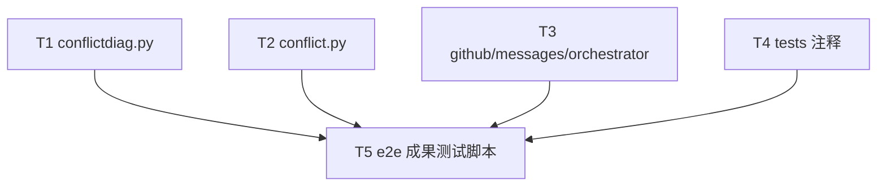

# 0044 · Spec-0037 后清理旧 rebase/indexheal 口径

<!-- 本文件由 spec 工具维护：frontmatter 为结构化源数据（含 tasks DAG），正文为组级 rust-RFC 9 段总览。 -->

## Summary

一次纯文档/注释清理。前序工作把「合并冲突推式扇出 rebase」重构成「拉式同步」并删掉了三个模块/命令：
`openagents/rebase.py`（内含 `rebase_open_prs` 扇出模块与静态 `rebase.CONFLICT_COMMENT` 兜底串）、
`openagents/indexheal.py`（确定性重渲 `OVERVIEW.md` 的旧模块）、CLI 子命令 `sync-prs`（手动扇出入口）。
但删除时留下了一批**活文档口径漂移**：`openagents/` 与 `tests/` 里的模块 docstring / 行注释仍把
**当前**实现描述成靠 `rebase_open_prs` 注入、退回 `rebase.CONFLICT_COMMENT`、走
`indexheal → conflict → 人工` 分层降级，或把已删的手动 `sync-prs` 当成活着的构造路径。本 spec 逐处把这些
注释改写成当前事实（拉式 `update_branch` 同步 + `conflictdiag.CONFLICT_COMMENT` 兜底 +
`conflict` 语义解冲突且对 `OVERVIEW.md` 用 `spec render` 确定性重渲），**不动任何运行时代码**。成果测试
= `ruff` + `pytest` 全绿 **且** 全仓 `openagents/tests` 不再 grep 到这些死符号口径。

## Motivation

**背景就地复述（单 spec 自包含）。** OpenAgents 是一个 RFC/Spec 驱动的多 Agent 框架：一个 issue 派一个
agent 解决、提 PR，PR 合并进 main 后其余还开着的 PR 需要跟上最新 main。这套「跟上 main」的机制经历过一次
架构翻修：

- **旧架构（推式扇出，已废）**：某 PR 合并后，`openagents/rebase.py` 的 `rebase_open_prs` 会主动枚举其余
  open PR、逐个 `gh pr update-branch` 把 main 推进去（扇出）；撞冲突时贴一句永不带诊断的静态兜底串
  `rebase.CONFLICT_COMMENT`（"OpenAgents 在 main 更新后尝试自动同步本 PR 分支，但存在无法自动解决的冲突……"）。
  还提供手动入口 CLI `openagents sync-prs` 触发同一扇出。对生成式索引 `docs/specs/OVERVIEW.md` 的机械冲突，
  另有独立模块 `openagents/indexheal.py` 做**确定性**重渲消解；其余真冲突则由 `openagents/conflict.py` 派
  coding agent 语义解决，解不了才回落人工——文档把这条链写成 **`indexheal`（确定性，仅 OVERVIEW）→
  `conflict`（通用，啃真冲突）→ 人工兜底**。

- **新架构（拉式同步，现状）**：合并后不再主动扇出。改为每个 PR 各自轮到时，`messages._process_coding`
  在可合并性预检里发现分支 `BEHIND`（落后 main）就调 `github.update_branch` 把 main **拉**进本分支（拉式同步）；
  撞冲突走 `conflict.resolve_branch` 派 agent 语义解冲突。`rebase.py` 连同 `rebase_open_prs`、
  `rebase.CONFLICT_COMMENT` 一起删除——静态兜底串迁到 `openagents/conflictdiag.py`，改名
  `conflictdiag.CONFLICT_COMMENT`（诊断为空时的退回文案），诊断器由 `messages._make_diagnoser` 构造、供
  merge 闸挂起评论复用。`indexheal.py` 也删除——对 `OVERVIEW.md` 的确定性重渲不再是独立模块，而是
  `conflict._RESOLVE_TASK` 的 prompt 要求 agent 自己跑 `spec render` 按合并后的 spec 源整表重渲。CLI 的
  `sync-prs` 一并移除（拉式同步下无需手动扇出入口，理念 1 奥卡姆）。

**为什么现在要清。** 代码本身已经是新架构且 `ruff`/`pytest` 全绿，但删模块时**没同步改注释**，导致下列
「活文档」仍在描述一个**已不存在**的实现（下表为本 spec 起草时的全仓实测 grep，`docs/specs/OVERVIEW.md`
等生成视图不在本 spec 范围，见 Unresolved）：

| 文件:行 | 现注释口径（死） | 死在哪 |
|---|---|---|
| `openagents/conflictdiag.py:3,14,114,133,137` | "供 merge 闸挂起评论与合并**扇出**冲突评论"、"供 `rebase_open_prs` / messages 注入"、"退回 `rebase.CONFLICT_COMMENT`" | `rebase.py`/`rebase_open_prs` 已删；兜底串已就在本模块 = `conflictdiag.CONFLICT_COMMENT` |
| `openagents/conflict.py:1,3,8,10,36` | 模块说明把 **`indexheal → conflict → 人工`** 写成当前降级链；prompt 注释"对齐 issue #48 `indexheal` 的确定性路径" | `indexheal.py` 已删，无独立 `indexheal` 模块 |
| `openagents/github.py:755,781` | `list_open_prs`/`update_branch` docstring 说"供……`rebase_open_prs` 枚举/捕获" | `rebase_open_prs` 已删；`update_branch` 现服务拉式同步 |
| `openagents/messages.py:207` | "沿用 RFC-0004 决策 8 / **`rebase_open_prs`** 风格" | 引用已删符号做血缘 |
| `openagents/orchestrator.py:86,104` | "别留给 merge 闸机械式报错（issue #48 **`indexheal`** 同源）" | 引用已删模块名 |
| `tests/test_messages_resolve.py:91` | "如手动 **`sync-prs`** / 老夹具" 当成活着的构造路径 | `sync-prs` 命令已删 |
| `tests/test_messages.py:228,1003` | "无需再桩 **`rebase_open_prs`**" | 提及已删符号 |
| `tests/test_conflict_guidance.py:1-8` | 顶部说明强调 guidance="" 时 task "逐字节同今天" | 旧回归口径，未讲清拉式同步后 `guidance + pr_number` 的 `reply-comment` 工具段 |

活文档漂移直接违反 CLAUDE.md 设计理念 4（RFC/注释是 agent 对齐代码的锚）：别的 agent 读这些注释会去找
一个不存在的 `rebase_open_prs` / `indexheal`，误判架构。清掉是低风险、纯注释的还债。

## Guide-level explanation

改完之后，任何人（或 agent）在 `openagents/` 与 `tests/` 里读到「合并后如何跟上 main」的注释，看到的都是
**一致的拉式同步叙事**：

- 想知道兜底文案 → `conflictdiag.CONFLICT_COMMENT`（不是 `rebase.CONFLICT_COMMENT`）。
- 想知道诊断器谁构造 → `messages._make_diagnoser`（不是 `rebase_open_prs`）。
- 想知道 `OVERVIEW.md` 冲突怎么解 → `conflict` 的 agent 跑 `spec render` 确定性重渲（不是独立 `indexheal` 模块）。
- 想知道有没有手动扇出命令 → 没有，拉式同步下各 PR 轮到自己时 `update_branch`（`sync-prs` 已删）。

具体到每处：把「合并扇出冲突评论」删掉、把 `rebase_open_prs` 换成 `messages._make_diagnoser` / merge 闸复用、
把 `rebase.CONFLICT_COMMENT` 换成 `conflictdiag.CONFLICT_COMMENT`；把 `conflict.py` 顶部的
`indexheal → conflict → 人工` 分层降级改写成「本模块负责语义解冲突：对生成式索引 `docs/specs/OVERVIEW.md`
用 `spec render` 确定性重渲，其余文件语义解决，失败 `merge --abort` 回落人工」；把 `github.py` 两个 docstring
里的 `rebase_open_prs` 改成拉式同步语境；把 `messages.py`/`orchestrator.py` 引用已删符号的血缘注释软化为
不指向死符号；把三处测试注释改成 Spec-0037 后口径。**没有一行运行时代码改变**，所以行为零回归、测试无需新增
断言（既有 `pytest` 已覆盖运行时行为）。

## Reference-level explanation

### 技术方案

纯文本改写，逐文件替换 docstring / 注释字符串，运行时逻辑一字不动。改写原则：

1. **只改死口径**：一处注释只有在它把**当前**实现描述成已删符号/已废链路时才改。像 `cli.py:94`
   "拉式同步重构后移除了 push 扇出（含手动 sync-prs）" 这类**正确描述"已被移除"**的历史说明保留不动
   （它没有把 sync-prs 说成活的）。
2. **就地对齐现状**，指向真实存在的符号（`conflictdiag.CONFLICT_COMMENT` / `messages._make_diagnoser` /
   `conflict` / `update_branch` 拉式同步）。
3. **保留证据链**：`issue #48` / `issue #92` 这类来源引用（理念 7）可留，但不再把已删**模块名**当成活模块。
4. Spec ID 注释规范：被改写的注释若原带 `# Spec-NNNN/T*` 前缀，保留原 Spec 血缘（这些代码归属未变），
   本次只清口径，不改归属。

### DAG + 文件分配

T1–T4 全部是互不重叠的纯注释改写，彼此无代码依赖 → **四者全并行，无 `depends-on`**；T5 是组级成果测试的
汇合校验，`depends-on: [T1,T2,T3,T4]`——「死口径 grep 归零」逻辑上要等四处清理都完成才成立，故由 T5 单一
owner 承载、四清理完成后收口。`files` 组内互斥（单一 writer 所有权，理念 6）：

| Task | 标题 | files（互斥） | scope |
|---|---|---|---|
| T1 | conflictdiag 诊断模块去 rebase 口径 | `openagents/conflictdiag.py` | 问题 1：去 `rebase_open_prs`/`rebase.CONFLICT_COMMENT`/合并扇出 |
| T2 | conflict 模块去 indexheal 降级链 | `openagents/conflict.py` | 问题 2：改写 `indexheal → conflict → 人工` 为语义解冲突叙事 |
| T3 | 邻接 runtime 注释扫尾 | `openagents/github.py`, `openagents/messages.py`, `openagents/orchestrator.py` | 全仓扫尾：github/messages/orchestrator 里残留的 `rebase_open_prs`/`indexheal` 血缘 |
| T4 | 测试注释去 sync-prs/rebase_open_prs 口径 | `tests/test_messages_resolve.py`, `tests/test_messages.py`, `tests/test_conflict_guidance.py` | 问题 3 + 扫尾：测试说明改 Spec-0037 后口径 |
| T5 | 端到端成果测试脚本（组级收口） | `scripts/e2e-spec-0044-cleanup-stale-idioms.sh` | 收口：ruff/pytest 全绿 + 三条死口径 grep 归零，跨 T1–T4 的汇合校验 |



（T1–T4 四点无连边——完全并行，协同模式下可四个 session 各认领一个，因 `files` 不相交而零冲突；四者
落地后由 T5 汇合，产出并跑通组级成果测试脚本。）

### e2e 脚本路径

`scripts/e2e-spec-0044-cleanup-stale-idioms.sh`（本 spec 交付的成果测试脚本，**由本组 T5 产出并持有**，`depends-on: [T1,T2,T3,T4]`——组级「死口径 grep 归零」是跨四个清理 Task 的汇合校验，由 T5 单一 owner 负责；脚本名对齐既有 `e2e-spec-NNNN-slug` 约定，理念 8；PR 路标会自动收录）。内容：

```bash
#!/usr/bin/env bash
set -euo pipefail
# Spec-0044/T5：文档口径清理的成果测试——lint/格式/测试全绿 + 死口径 grep 归零。
uv run --extra dev ruff check openagents tests
uv run --extra dev ruff format --check openagents tests
uv run --extra dev pytest -q

echo "== 死口径 grep 归零校验 =="
# 已删符号绝不应再作为「当前实现」出现在代码/测试里。
! grep -rn "rebase_open_prs\|rebase\.CONFLICT_COMMENT" openagents tests
# indexheal.py 已删，openagents 源里不应再出现该模块名。
! grep -rn "indexheal" openagents
# sync-prs 命令已删，测试注释里不应再把它当活着的构造路径。
! grep -rn "sync-prs" tests
echo "ALL GREEN: 无残留死口径"
```

**关于浏览器 e2e（自检工具后说明）**：本会话确实具备 `chrome-devtools` / `playwright` MCP 工具，但本 spec
是**纯注释/文档清理，无任何产品可见界面或运行时行为变化**（不新增/改动 CLI 输出、无前端、无 API 响应）。
没有可被浏览器驱动、截图、断言的成果面，故浏览器 e2e **不适用**；成果测试落在 `ruff`/`pytest` 全绿 + 死口径
grep 归零的确定性断言上（脚本可复跑、可 CI 化）。

## Drawbacks

- **纯注释改动的收益是"防误导"而非功能**，理论上可以攒到别的 PR 里顺手改。但活文档漂移会持续误导后续 agent
  对架构的判断（理念 4），单开一个小 PR 一次清干净、可 grep 验收，比"下次顺手"更可靠。
- **判断边界主观**：哪些注释算"把当前实现描述成死符号"、哪些算"正确记录已被移除"存在灰度（如
  `test_messages.py` 的"无需再桩 rebase_open_prs" 本身是正确的移除说明）。缓解：Reference-level 定了明确
  改写原则（只改把死符号当**当前**实现的处），并对每处在 T1–T4 的 scope 里点名。

## Rationale and alternatives

**本方案**：单开一个纯文档清理 spec，按文件分 4 个并行 Task，用 grep 归零做机器可验收的成果测试。

**备选 A：不单开 spec，等下次碰这些文件时顺手改。** 弃用——漂移会长期误导 agent（理念 4），且散在多个 PR
里无法一次 grep 验收，容易漏。

**备选 B：把清理并进删除 rebase/indexheal 的那个 PR（Spec-0037）里回溯补丁。** 弃用——那个 PR 已合并，回溯
改动会污染其历史；且 issue #110 本就是对该 PR 的 review 产物，独立成 issue/PR 更符合"review→单独清障"的
节奏（理念 5，PR 为交付单位）。

**备选 C：连 `docs/specs/OVERVIEW.md` 生成视图里的 `rebase_open_prs`/`sync-prs`（Spec-0009 的 done Task）
一起清。** 弃用（本 spec 范围外）——`OVERVIEW.md` 是 `spec render` 的生成物，不能手改；要清得去 amend/abandon
Spec-0009 的 T2/T4 源 Task（那属于"死代码删除后 spec 快照未同步"的另一类账），本 spec 只清 `openagents/tests`
的手写注释。列入 Unresolved。

## Prior art

- **rust-lang/rfcs** 的活文档纪律：设计文档随实现演进更新，避免陈述与代码脱节。本 spec 即在补这门课的欠账。
- OpenAgents 自身的 **living-snapshot** 原则（spec-driven-development skill 核心原则 1）：快照永远映射活代码，
  不留 legacy。手写注释是这一原则在**代码内联文档**层面的延伸——注释也不该残留已删符号。
- **Spec-0034**（`conflictdiag` 模块）与 **Spec-0028**（`conflict` 语义解冲突）：本次被清理注释的两个模块的
  设计来源；此处仅当线索指路，其关键内容已在 Motivation 就地复述完整。

## Unresolved questions

- `docs/specs/OVERVIEW.md`（及 `ARCHITECTURE.md`）作为 `spec render`/`spec graph` 的生成视图，仍展示
  Spec-0009 的 `rebase_open_prs 扇出模块`(files=`openagents/rebase.py`) / `sync-prs 命令` 两个 done Task，
  而这些文件已删——属"死代码删除后 spec 源快照未同步"。是否在本 spec 顺带 abandon Spec-0009/T2、T4？
  倾向**否**（越界，且需碰 `docs/specs/0009-*.md` 源，与本 spec 的 `openagents/tests` 文件分配不相交），
  留作独立跟进。**待用户拍板**是否扩大范围。
- `orchestrator.py` / `conflict._RESOLVE_TASK` 里对 `issue #48` 的证据引用：软化措辞时保留 issue 编号链接
  即可，还是连编号也去掉？倾向保留编号（理念 7 证据链），只去掉"活模块 `indexheal`"的暗示。

## Future possibilities

- 把"死符号不得作为当前实现出现在注释里"沉淀成 CI 关卡（一条 grep-denylist 检查），让口径漂移**无法**再
  悄悄合入（呼应 skill 的"软约定硬化"——把自觉变成 error）。denylist 维护成本需权衡，故此处仅作未来项。
- 若后续真要清 `docs/specs/OVERVIEW.md` 的 Spec-0009 死 Task，可另开 spec 用 `spec abandon` 处理，与本次
  代码注释清理形成"代码注释层 + spec 快照层"两层活文档对齐的完整闭环。

