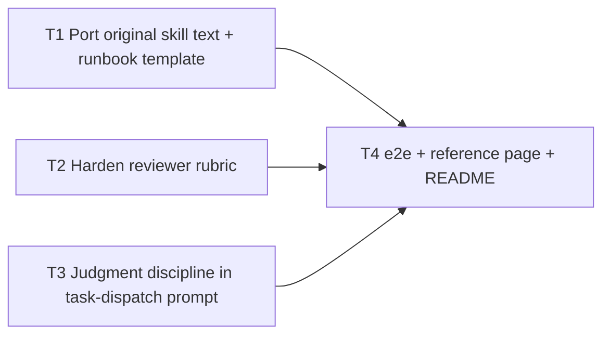

# 0044 · “Run the real app end to end and take screenshots” verification skill: UI/product behavior changes require evidence from a real run

<!-- This file is maintained by the spec tool: the frontmatter is the structured source data (including the tasks DAG), and the body is a group-level overview in the nine rust-RFC sections. -->

## Summary

Introduce a **judgment/discipline** layer into OpenAgents for “running the real app end to end and taking screenshots,” specifically to address “claiming to have run e2e / taken screenshots when neither actually happened.” This does three things: (1) **port verbatim** into the repository an anti-laziness skill that has already been repeatedly refined locally and stabilized through lessons learned (`SKILL.md` + a project-specific example runbook + a runbook template), without rewriting it; (2) **harden the core discipline** of this judgment into OpenAgents’ own **in-code dispatch/review surfaces**—the dispatch prompt passes on to the assigned agent the judgment that “changes to externally observable product behavior must be demonstrated by running the real app and collecting evidence,” and the reviewer rubric explicitly includes the **structured check** “claimed verification but no tracked evidence in the repository = REWORK,” turning “relying on a reviewer getting lucky” into “checking each rubric item”; (3) deliver a **self-demonstrating** browser end-to-end script—use a real browser to complete the skill’s prescribed “navigation → interaction → screenshot → console/network assertions” loop, producing a tracked screenshot as an example of “what qualifying evidence looks like,” so that this PR introducing a skill against fabricated evidence itself comes with evidence from a real run.

## Motivation

When OpenAgents assigns agents to resolve issues, verification of changes involving **UI / externally observable product behavior** currently relies largely on “agent self-discipline + after-the-fact investigation by the reviewer,” making it easy to end up with **“claiming to have run e2e / taken screenshots when neither actually happened.”**

**Empirical evidence (wind-palace PR #14, with the background restated here)**: The assigned agent wrote in the PR body, “Screenshots and conclusions have been posted in the comments on this PR,” but the repository had no `docs/e2e/` directory at all, no screenshots, and no trace in the PR comments. In the REWORK feedback, the reviewer explicitly pointed out that there was “**no evidence that this e2e suite had ever been run and passed**.” Only after being forced into REWORK did the agent actually run Playwright and take real screenshots. In other words, effective enforcement depended entirely on the reviewer happening to be rigorous; if the reviewer let it slide, it slipped through.

Meanwhile, the framework’s built-in automated “end-to-end testing” step (Spec-0013’s actual-run wrapper: run `bash <script>` once before marking the PR ready, and post the pass/fail result + logs as a signed comment) **only posts `⚠️ Skipped` when the RFC/spec declares no script**—this provides no verification whatsoever; without a script, that step does no useful work. Spec-0030 has already injected **conditional** browser-e2e guidance into the dispatch prompt / reviewer rubric (“if browser tools are available → prioritize designing frontend browser e2e”), but this is only a soft suggestion to “prioritize designing.” It clarifies neither **when evidence is mandatory, what qualifies as evidence, nor why tests/logs cannot substitute for it**, and it includes no **hard check** requiring rejection when verification is claimed without evidence.

What is missing is precisely this layer: **judgment (does this change require real-app evidence, and what kind of evidence?) + discipline (automated tests/backend logs must not substitute for real-app evidence; “LLMs are slow / flaky / poor return on investment” must not be used as excuses to skip it; if the real app cannot be run, honestly report a blocker instead of falsely claiming verification)**. A mature implementation of this judgment already exists (its source is local at `~/.claude/skills/end-to-end-ui-screenshots/`). This spec’s task is to **copy it into the repository unchanged**, and **harden** the discipline most effective at preventing “claimed testing that never happened” into the in-code surfaces OpenAgents injects into assigned agents, so that judgment can be inherited and checks can be enforced, instead of adding another soft convention that is easy to bypass.

## Guide-level explanation

After implementation, an agent assigned by OpenAgents to resolve an issue will go through the following chain:

- **At dispatch**: Its implementation prompt will include a passage on judgment and discipline (a **strengthened version** of Spec-0030’s conditional browser-e2e guidance): Is the behavior you are changing “externally observable product behavior”?
  - **Directly visible in the UI** (tool set / errors / status / page rendering…) → Start the real app, actually interact with it to reach that point, **capture that visual result**, and put the screenshot in a tracked evidence directory;
  - **Not visible in the UI but does change externally observable product behavior** (such as a configuration actually taking effect) → Trigger it in the real app, and submit **actual runtime log text + the real-app context that triggered it** as evidence;
  - **Purely internal implementation details** (refactoring, etc., without changing what the product does externally) → Appropriate automated tests suffice; do not apply this heavier process.
  The discipline explicitly states: automated tests / backend logs **cannot substitute for** real-app evidence; “LLMs are slow / flaky / poor return on investment” must not be used as reasons to skip it; **if the real app cannot be run, honestly report a blocker stating “not verified because of X,” and never falsely claim verification**. The prompt also points to the verbatim skill’s location in the repository (`docs/skills/end-to-end-ui-screenshots/`), so the agent can consult the full anti-laziness rationalization table and general workflow when it needs the details.

- **At review**: The reviewer agent’s rubric gains a **hard check**: if this PR claims to have verified some externally observable product behavior (wording such as “completed end-to-end verification / took screenshots / verified” appears in the PR body/comments), but **no corresponding tracked evidence can be found in the repository** (screenshot files / runtime log text), and the PR comments contain no trace of an actual run either → directly return **REWORK**, stating the reason as “claimed verification but no evidence.” This is exactly the check the reviewer performed manually in wind-palace PR #14, now made a permanent rubric item—from “getting lucky” to “mandatory checking.”

- **To see “what qualifying evidence looks like”**: The repository includes a **self-demonstrating example**—`docs/skills/end-to-end-ui-screenshots/examples/reference-app.html` is a self-contained minimal reference page; this spec’s e2e uses a real browser (playwright / chrome-devtools MCP) to go through “open the page → interact to trigger a visible state change → take a screenshot → check that the console has no errors / the network has no failed requests,” saving the screenshot in `docs/evidence/spec-0044/`. This image is both a working example of “qualifying evidence” and a way for this PR introducing a skill against fabricated evidence to land **with evidence from a real run**—demonstrating its own principles.

For **maintainers of target repositories**: Each target repository served by OpenAgents should follow the approach in `references/_runbook-template.md` to add its own runbook (ports / starting services / concrete commands for driving the UI). See `references/north-coder.md`, ported alongside the original text, for an example. Leave the general method (SKILL.md) unchanged; write project-specific commands separately for each project.

## Reference-level explanation

This feature is divided into 4 Tasks (see the DAG at the end; `files` are mutually exclusive across the group, with a single writer per Task).

**On the `.claude/` write boundary (a critical design constraint)**: This environment has an inviolable hard constraint—agents are prohibited from writing or modifying anything under `.claude/`. The issue originally specified “put the skill in `.claude/skills/end-to-end-ui-screenshots/`,” but that is not feasible for the assigned agent (which is subject to the same constraint). Spec-0030 has already established this repository’s approach: **put the methodology in the in-code surfaces; do not write to `.claude/`**. This spec therefore follows the same route and explains it explicitly:

- Port the original skill text into **tracked, agent-writable** `docs/skills/end-to-end-ui-screenshots/` (version-controlled, reviewable, and verifiable through e2e grep checks); this is the destination for “port unchanged, do not rewrite”;
- Put the layer that actually lets assigned agents **inherit the judgment** and reviewers **execute the checks** in the **in-code prompt / rubric** injected by OpenAgents (`orchestrator.py` / `reviewer.py`)—it takes effect **without depending on any writes to `.claude/`**;
- If a repository/user wants `claude` to load it directly as a project skill, “install/copy `docs/skills/end-to-end-ui-screenshots/` into `.claude/skills/`” is a **manual operation** (`cp -r docs/skills/end-to-end-ui-screenshots .claude/skills/`), documented in the README and not performed by the agent.

This faithfully delivers the original skill text requested by the issue while placing the actual gate against “claimed testing that never happened” somewhere the agent can implement it, free of the `.claude/` boundary restriction.

### Task breakdown

1. **T1 Port the original skill text + runbook template (P1, no dependencies)** — Copy `SKILL.md` (core principles + anti-laziness rationalization table + red flags + tool-independent general workflow + completion criteria) and `references/north-coder.md` (a project-specific example runbook) from `~/.claude/skills/end-to-end-ui-screenshots/` into `docs/skills/end-to-end-ui-screenshots/` **word for word**, without rewriting or removing discipline items; also add `references/_runbook-template.md` to formalize the separation between “general method (SKILL.md) vs. project-specific commands (starting services / ports / driving the UI)” as a fill-in template, making it easy for each target repository to copy the structure and add its own runbook.
2. **T2 Harden the reviewer rubric (P1, no dependencies)** — Add a **structured check** to the rubric in `reviewer.py`: if a PR claims to have verified some externally observable product behavior but has no corresponding tracked evidence (screenshots / runtime logs), and the PR comments contain no trace of an actual run → return REWORK with the reason “claimed verification but no evidence.” This makes the reviewer’s manual judgment in wind-palace PR #14 a permanent rubric item (hardening a soft convention: from “reviewer self-discipline” to “mandatory rubric check”).
3. **T3 Dispatch prompt judgment and discipline (P1, no dependencies)** — In the dispatch/implementation prompt templates in `orchestrator.py`, **strengthen** Spec-0030’s **conditional** browser-e2e guidance **into a complete set of judgment and discipline rules**: three-way classification (visible in the UI → screenshot / not visible in the UI but changes product behavior → runtime log text / purely internal → appropriate tests) + prohibition on substituting tests + prohibition on “slow/flaky/return on investment” excuses + honest reporting of blockers when the real app cannot be run, with a pointer to the original text at `docs/skills/end-to-end-ui-screenshots/` in the repository. Keep the wording conditional, with the agent checking its own capabilities (do not declare “OpenAgents detected that you have a browser”). **Do not modify `claude_code.py`, couple this to a particular MCP ecosystem, or write to `.claude/`**.
4. **T4 e2e script (offline assertions + browser self-demonstration) + reference page + README/index (P2, depends on T1/T2/T3)** — See “End-to-end verification” below.

### End-to-end verification (script path = this group’s e2e script)

**Script**: `bash scripts/e2e-spec-0044-e2e-screenshot-skill.sh`

- **Deterministic offline portion (runs by default, hermetic, no network/no real claude)**: The full `ruff check` / `ruff format --check` / `pytest -q` suite; then grep assertions—(a) `docs/skills/end-to-end-ui-screenshots/SKILL.md` exists and contains anchor strings for the core discipline (key items such as “anti-laziness,” the “rationalization” table heading, and “honestly report blockers,” demonstrating that this is a port of the original text rather than an empty shell); (b) `openagents/reviewer.py` contains wording for the “claimed verification but no evidence → REWORK” check; (c) the dispatch template in `openagents/orchestrator.py` contains wording for the three-way classification.
- **Browser self-demonstration portion (outcome testing, principle 8; run when browser MCP is available)**: The agent uses playwright / chrome-devtools MCP to drive the tracked, self-contained reference page `docs/skills/end-to-end-ui-screenshots/examples/reference-app.html` (opened via `file://`, **without touching any production ports/data**) through the loop prescribed by the skill—`navigate` to open the page → `snapshot` to obtain elements → `click`/`fill` to trigger a visible state change (such as text saying “Applied” appearing after a button click) → `wait_for` that text to appear → `take_screenshot` to capture a screenshot → `list_console_messages` to assert there are no errors, and `list_network_requests` to assert there are no failed requests → save the screenshot in tracked `docs/evidence/spec-0044/`. **RED negative-control verification**: Temporarily disable that state change in the reference page (change it so “Applied” does not appear) and run it once; `wait_for` should time out / the screenshot should show the old state, proving that the evidence process does not pass vacuously (a red/green loop); revert the negative-control scaffolding afterward and leave it out of the PR. If this environment objectively has no browser MCP / no display, follow the skill’s honesty discipline and **explicitly report the blocker “The browser self-demonstration portion was not executed because browser automation is unavailable”; do not use the offline portion as a substitute and claim it was run**.

### Dependency DAG

`T1 → T4`, `T2 → T4`, `T3 → T4`; T1 / T2 / T3 have no dependencies on one another and can run in parallel (`files` are mutually exclusive: `docs/skills/**` vs `reviewer.py` vs `orchestrator.py`, with no overlap).

## Drawbacks

- **Drift between the original skill text and its source**: `docs/skills/` contains a copy of the source at `~/.claude/skills/end-to-end-ui-screenshots/`. Future source updates will not sync automatically and will require manual re-porting; e2e can only grep for anchor strings to establish that this is “the original text rather than an empty shell,” and cannot guarantee word-for-word identity with the latest source.
- **Activation in `.claude/` is a manual step**: Because of a hard constraint, loading it directly as a project skill for the agent requires manually using `cp` to copy it into `.claude/skills/`; when it is not installed, the judgment criteria take effect only through the in-code prompt/rubric, rather than through native `claude` skill triggering (`description` keyword matching)—coverage is slightly narrower than with a native skill.
- **The reviewer’s “claim/evidence” determination relies on text heuristics**: Matching PR wording and probing tracked evidence directories leaves room for false positives (requiring evidence even for an internal-refactoring PR) or false negatives (wording that lacks the keywords); this spec incorporates a three-way classification into the discipline to reduce false positives, but cannot achieve zero errors.
- **The browser self-demonstration segment depends on browser MCP being available in the environment**: In headless / displayless / MCP-free CI, only the offline segment can run, and the browser segment degrades to “honestly report the blocker.” In that case, ensuring that this PR itself includes real screenshots requires running it once in an environment with a browser and checking the results into the repository.

## Rationale and alternatives

- **Why port the original text rather than rewrite it**: The source skill’s judgment criteria, boundaries, and anti-laziness discipline were refined through hard-earned experience (including having to ask twice, “You haven’t added a single screenshot”); rewriting could easily lose hard-won details such as the “case2 vs case3 criteria” and the “rationalization table.” Copying it word for word + checking anchor strings with grep is the simplest and most faithful approach (Principle 1, Occam).
- **Why harden the discipline into the in-code prompt/rubric rather than merely provide a skill document**: Documentation is a soft convention, easily bypassed by “claiming to have tested without actually testing”—wind-palace PR #14 is concrete evidence of that convention failing. Writing “claimed verification but no evidence = REWORK” into the reviewer rubric **hardens a soft convention** (the same idea as mutual exclusion within a `files` group turning “don’t compete to write the same file” into a validation error): it makes “no evidence” **hard to slip past review**, rather than merely “hoping the agent exercises self-discipline.”
- **Alternative one: Write the skill directly into `.claude/skills/` (the issue’s original target)**. Rejected: A hard constraint in this environment prohibits agents from writing to `.claude/`, and Spec-0030 has already established the approach of “implementing this in the in-code methodology layer”; insisting on a `.claude/` path would make the Task impossible for the agent to implement. Use “a port into tracked docs + in-code hardening + manual installation instructions” instead, preserving fidelity while remaining implementable.
- **Alternative two: Add only reviewer rubric checks, without porting the original skill text / adding a task-dispatch prompt**. Rejected: Adding only a review-side gate, without the “judgment” layer, leaves the agent unaware of **when to collect evidence and what qualifies as acceptable evidence**, making it easy to fool with “something that looks like evidence” (such as reusing old screenshots or pasting passing automated-test results); item #2 in the issue explicitly states that the skill provides judgment and the gate provides gating. The two complement each other; without judgment, a gate alone is still easy to bypass.
- **Alternative three: Write only shell e2e for this spec and skip the browser self-demonstration**. Rejected: This environment has playwright / chrome-devtools MCP, and the issue is specifically about “opposing the substitution of script-based claims for real app evidence”; if a spec introducing this discipline itself skips evidence collection in a real browser, it contradicts itself (Principle 8, outcome testing). Therefore, the design includes a self-contained, hermetic browser self-demonstration segment that uses a real browser to produce tracked screenshot examples.

## Prior art

- **The Rust RFC process** ([rust-lang/rfcs](https://github.com/rust-lang/rfcs)): The source of the nine-section overview structure used in this spec’s body.
- **This repository’s existing e2e lineage**: Spec-0008 (an “end-to-end verification” signpost in the PR body, with script paths automatically extracted from the spec), Spec-0013 (actually running scripts before marking a PR ready + recording pass/fail results and logs as a signature comment), Spec-0030 (init environment health checks + conditional browser-e2e methodology guidance). This spec supplies the “judgment/discipline + hard checks” layer missing from Spec-0030’s soft guidance, complementing Spec-0013’s actual-execution gate: 0013 runs “the declared scripts,” while this spec addresses “whether evidence should exist and whether to send the PR back when it is missing.”
- **Industry practice**: Including “how to verify / screenshots as evidence” in PR review checklists is common code review practice (the "How to test" section in GitHub PR templates, frontend PR guidelines requiring screenshots); the distinction is that this feature turns that manual checklist item into a structured check in the reviewer agent’s rubric.

## Unresolved questions

- **The specific heuristic boundaries for the reviewer’s “claim/evidence” determination**: Which PR wording counts as “claiming verification,” and which paths are probed for “tracked evidence” (`docs/evidence/**`? `docs/e2e/**`? Screenshot extensions?), require a sufficient but not overfitted set of rules to be defined during T2 implementation, to avoid false positives for purely internal-refactoring PRs—initial recommendation: trigger this check only when the PR explicitly uses wording such as “end-to-end/e2e/screenshots/UI verified.”
- **The mechanism for syncing the original skill text with the source repository**: Provisionally, manual re-porting + e2e grep anchors; whether a script is needed to check consistency between the source and the repository copy is deferred until a later need arises (YAGNI).
- **Automatic installation into `.claude/skills/`**: Whether to provide a `make install-skills` / init step to sync `docs/skills/**` into `.claude/skills/`—hard constraints prevent an agent from executing it; whether it is worth providing as a manual command remains to be confirmed.

## Future possibilities

- Have the reviewer consume Spec-0013’s actual-execution comments + this spec’s evidence detection to automatically label PRs with a structured “evidence complete / evidence missing” status that both humans and agents can assess at a glance.
- Turn the browser self-demonstration segment into a reusable “evidence capture” utility (navigation → interaction → screenshots → console/network assertions → check into the repository, all in one flow), so that each target repository’s runbook need only supply “the command to start the service + the driving steps” to reuse the complete evidence-collection loop.
- Converge with future evidence gates (the #104 / PR #105 lineage): the judgment layer (this spec) produces structured expectations for “what kind of evidence should exist,” and the gating layer uses them to enforce a hard gate before merge, forming a complete “judgment → evidence collection → gating” chain.
