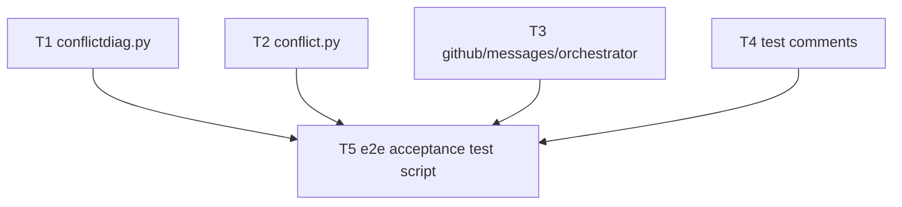

# 0045 · Clean Up Stale rebase/indexheal Descriptions After Spec-0037

<!-- This file is maintained by the spec tool: the frontmatter is the structured source data (including the tasks DAG), and the body is a group-level overview in the nine-section rust-RFC format. -->

## Summary

A cleanup limited to documentation and comments. Earlier work refactored “push-based fan-out rebase for merge conflicts” into “pull-based synchronization” and deleted three modules/commands:
`openagents/rebase.py` (containing the `rebase_open_prs` fan-out module and the static `rebase.CONFLICT_COMMENT` fallback string),
`openagents/indexheal.py` (the old module for deterministically re-rendering `OVERVIEW.md`), and the CLI subcommand `sync-prs` (the manual fan-out entry point).
However, those deletions left behind **drift in live documentation**: module docstrings and inline comments in `openagents/` and `tests/` still describe the
**current** implementation as relying on injection by `rebase_open_prs`, falling back to `rebase.CONFLICT_COMMENT`, using
the layered fallback chain `indexheal → conflict → manual intervention`, or treating the deleted manual `sync-prs` as an available construction path. This spec rewrites each of these
comments to reflect the current facts (pull-based `update_branch` synchronization + the `conflictdiag.CONFLICT_COMMENT` fallback +
semantic conflict resolution by `conflict`, with deterministic re-rendering of `OVERVIEW.md` using `spec render`), **without changing any runtime code**. Acceptance testing
= `ruff` + `pytest` both fully passing **and** no grep matches for these descriptions involving dead symbols anywhere in the repository's `openagents/tests`.

## Motivation

**Background restated here to make this spec self-contained.** OpenAgents is an RFC/Spec-driven multi-agent framework: an issue is assigned to an
agent to resolve and submit a PR; after that PR merges into main, the remaining open PRs need to catch up with the latest main. This mechanism for “catching up with main” has undergone an
architectural overhaul:

- **Old architecture (push-based fan-out, retired)**: After a PR merged, `rebase_open_prs` in `openagents/rebase.py` would proactively enumerate the other
  open PRs and run `gh pr update-branch` on each to push main into them (fan-out); on a conflict, it would post a static fallback string that never included diagnostics,
  `rebase.CONFLICT_COMMENT` (“OpenAgents attempted to automatically synchronize this PR branch after main was updated, but there are conflicts that cannot be resolved automatically…”).
  It also provided the manual CLI entry point `openagents sync-prs` to trigger the same fan-out. For mechanical conflicts in the generated index `docs/specs/OVERVIEW.md`,
  a separate module, `openagents/indexheal.py`, performed **deterministic** re-rendering to resolve them; other substantive conflicts were handled by `openagents/conflict.py`, which dispatched
  a coding agent to resolve them semantically, falling back to manual intervention only if that failed—the documentation described this chain as **`indexheal` (deterministic, OVERVIEW only) →
  `conflict` (general-purpose, tackles substantive conflicts) → manual fallback**.

- **New architecture (pull-based synchronization, current state)**: Merges no longer trigger proactive fan-out. Instead, when each PR's own turn comes, if `messages._process_coding`
  finds that its branch is `BEHIND` (behind main) during the mergeability precheck, it calls `github.update_branch` to **pull** main into that branch (pull-based synchronization);
  conflicts go through `conflict.resolve_branch`, which dispatches an agent to resolve them semantically. `rebase.py` was deleted along with `rebase_open_prs` and
  `rebase.CONFLICT_COMMENT`—the static fallback string moved to `openagents/conflictdiag.py` and was renamed
  `conflictdiag.CONFLICT_COMMENT` (the fallback message when diagnostics are empty); the diagnoser is constructed by `messages._make_diagnoser` and reused
  for merge-gate suspension comments. `indexheal.py` was also deleted—deterministic re-rendering of `OVERVIEW.md` is no longer a separate module; instead,
  the prompt in `conflict._RESOLVE_TASK` requires the agent itself to run `spec render` to re-render the entire table from the merged spec sources. The CLI's
  `sync-prs` was removed as well (pull-based synchronization needs no manual fan-out entry point; principle 1, Occam).

**Why clean this up now.** The code already implements the new architecture, and `ruff`/`pytest` both pass in full, but the module deletions **were not accompanied by comment updates**, leaving the following
“live documentation” describing an implementation that **no longer exists** (the table below comes from an actual repository-wide grep when this spec was drafted; generated views such as `docs/specs/OVERVIEW.md`
are outside this spec's scope; see Unresolved):

| File:line | Current comment wording (obsolete) | What makes it obsolete |
|---|---|---|
| `openagents/conflictdiag.py:3,14,114,133,137` | “For merge-gate suspension comments and merge **fan-out** conflict comments,” “for injection by `rebase_open_prs` / messages,” “fall back to `rebase.CONFLICT_COMMENT`” | `rebase.py`/`rebase_open_prs` have been deleted; the fallback string is already in this module = `conflictdiag.CONFLICT_COMMENT` |
| `openagents/conflict.py:1,3,8,10,36` | The module description presents **`indexheal → conflict → manual intervention`** as the current fallback chain; a prompt comment says “align with the deterministic path in issue #48 `indexheal`” | `indexheal.py` has been deleted; there is no separate `indexheal` module |
| `openagents/github.py:755,781` | The `list_open_prs`/`update_branch` docstrings say “for … `rebase_open_prs` to enumerate/catch” | `rebase_open_prs` has been deleted; `update_branch` now serves pull-based synchronization |
| `openagents/messages.py:207` | “Follow the style of RFC-0004 decision 8 / **`rebase_open_prs`**” | Cites a deleted symbol as provenance |
| `openagents/orchestrator.py:86,104` | “Do not leave it to the merge gate to mechanically report an error (same origin as issue #48 **`indexheal`**)” | References a deleted module name |
| `tests/test_messages_resolve.py:91` | Treats “such as manual **`sync-prs`** / old fixtures” as an available construction path | The `sync-prs` command has been deleted |
| `tests/test_messages.py:228,1003` | “No longer need to stub **`rebase_open_prs`**” | Mentions a deleted symbol |
| `tests/test_conflict_guidance.py:1-8` | The opening description emphasizes that when guidance="", the task is “byte-for-byte identical to today's” | Old regression wording that does not clearly explain the `reply-comment` tool section for `guidance + pr_number` after pull-based synchronization |

Drift in live documentation directly violates design principle 4 in CLAUDE.md (RFCs/comments are anchors for agents to align with the code): other agents reading these comments will look for
a nonexistent `rebase_open_prs` / `indexheal` and misunderstand the architecture. Removing this drift is low-risk debt repayment limited to comments.

## Guide-level explanation

After the changes, anyone (or any agent) reading comments in `openagents/` and `tests/` about “how to catch up with main after a merge” will see
**a consistent account of pull-based synchronization**:

- Where is the fallback message? → `conflictdiag.CONFLICT_COMMENT` (not `rebase.CONFLICT_COMMENT`).
- Who constructs the diagnoser? → `messages._make_diagnoser` (not `rebase_open_prs`).
- How are `OVERVIEW.md` conflicts resolved? → The agent dispatched by `conflict` runs `spec render` for deterministic re-rendering (not a separate `indexheal` module).
- Is there a manual fan-out command? → No. With pull-based synchronization, each PR uses `update_branch` when its turn comes (`sync-prs` has been deleted).

At each affected location: remove “merge fan-out conflict comments,” replace `rebase_open_prs` with `messages._make_diagnoser` / reuse by the merge gate,
and replace `rebase.CONFLICT_COMMENT` with `conflictdiag.CONFLICT_COMMENT`; rewrite the
`indexheal → conflict → manual intervention` layered fallback description at the top of `conflict.py` as “this module handles semantic conflict resolution: for the generated index `docs/specs/OVERVIEW.md`,
use `spec render` for deterministic re-rendering; resolve other files semantically; on failure, run `merge --abort` and fall back to manual intervention”; update the two docstrings in `github.py`
that mention `rebase_open_prs` to describe pull-based synchronization; soften the provenance comments in `messages.py`/`orchestrator.py` that reference deleted symbols so that they
no longer point to dead symbols; update the three sets of test comments to reflect the post-Spec-0037 state. **Not a single line of runtime code changes**, so there are no behavioral regressions, and the tests need no new
assertions (the existing `pytest` suite already covers runtime behavior).

## Reference-level explanation

### Technical approach

Text-only edits: replace docstrings / comment strings file by file, leaving runtime logic completely unchanged. Editing principles:

1. **Change only obsolete descriptions**: change a comment only when it describes the **current** implementation in terms of deleted symbols or retired paths. Historical explanations such as `cli.py:94`,
   “The pull-based synchronization refactor removed push fan-out (including manual sync-prs),” which **correctly describe something as “removed,”** remain unchanged
   (they do not describe sync-prs as still available).
2. **Align each location with the current state**, pointing to symbols that actually exist (`conflictdiag.CONFLICT_COMMENT` / `messages._make_diagnoser` /
   `conflict` / `update_branch` pull-based synchronization).
3. **Preserve the evidence chain**: source references such as `issue #48` / `issue #92` (principle 7) may remain, but deleted **module names** must no longer be treated as live modules.
4. Spec ID comment convention: if a rewritten comment originally has a `# Spec-NNNN/T*` prefix, preserve its original Spec provenance (ownership of this code has not changed);
   this cleanup changes only the wording, not ownership.

### DAG + file allocation

T1–T4 are all non-overlapping, comment-only edits with no code dependencies on one another → **all four run in parallel, with no `depends-on`**; T5 is the
converging check for group-level acceptance testing, with `depends-on: [T1,T2,T3,T4]`—logically, “zero grep matches for obsolete descriptions” can hold only after all four cleanups are complete, so T5 has a single
owner and closes out the work after the four cleanups finish. `files` are mutually exclusive within the group (single-writer ownership, principle 6):

| Task | Title | files (mutually exclusive) | scope |
|---|---|---|---|
| T1 | Remove rebase descriptions from the conflictdiag diagnostic module | `openagents/conflictdiag.py` | Problem 1: remove `rebase_open_prs`/`rebase.CONFLICT_COMMENT`/merge fan-out |
| T2 | Remove the indexheal fallback chain from the conflict module | `openagents/conflict.py` | Problem 2: rewrite `indexheal → conflict → manual intervention` as an account of semantic conflict resolution |
| T3 | Clean up adjacent runtime comments | `openagents/github.py`, `openagents/messages.py`, `openagents/orchestrator.py` | Repository-wide cleanup: remaining `rebase_open_prs`/`indexheal` provenance references in github/messages/orchestrator |
| T4 | Remove sync-prs/rebase_open_prs descriptions from test comments | `tests/test_messages_resolve.py`, `tests/test_messages.py`, `tests/test_conflict_guidance.py` | Problem 3 + cleanup: update test descriptions to reflect the post-Spec-0037 state |
| T5 | End-to-end acceptance test script (group-level closeout) | `scripts/e2e-spec-0045-cleanup-stale-idioms.sh` | Closeout: ruff/pytest fully passing + zero matches from three greps for obsolete descriptions; converging check across T1–T4 |



(The four nodes T1–T4 have no edges between them—fully parallel. In collaboration mode, four sessions can each claim one task, with zero conflicts because their `files` do not overlap; after all four
are implemented, T5 brings them together to produce and successfully run the group-level acceptance test script.)


### e2e script path

`scripts/e2e-spec-0045-cleanup-stale-idioms.sh` (the outcome test script delivered by this spec, **produced and owned by this group's T5**, `depends-on: [T1,T2,T3,T4]`—the group-level “zero grep matches for obsolete descriptions” check is a convergence check across the four cleanup Tasks, with T5 as its sole owner; the script name follows the existing `e2e-spec-NNNN-slug` convention, Principle 8; the PR signposts will include it automatically). Contents:

```bash
#!/usr/bin/env bash
set -euo pipefail
# Spec-0045/T5: Outcome test for documentation cleanup—all lint/format/test checks pass + zero grep matches for obsolete descriptions.
uv run --extra dev ruff check openagents tests
uv run --extra dev ruff format --check openagents tests
uv run --extra dev pytest -q

echo "== Verify zero grep matches for obsolete descriptions =="
# Deleted symbols must never appear in code/tests as part of the "current implementation."
! grep -rn "rebase_open_prs\|rebase\.CONFLICT_COMMENT" openagents tests
# indexheal.py has been deleted; this module name should no longer appear in the openagents source.
! grep -rn "indexheal" openagents
# The sync-prs command has been deleted; test comments should no longer treat it as an active construction path.
! grep -rn "sync-prs" tests
echo "ALL GREEN: No obsolete descriptions remain"
```

**Regarding browser e2e (explanation after checking the available tools)**: This session does have `chrome-devtools` / `playwright` MCP tools, but this spec
is **strictly comment/documentation cleanup, with no changes to any product-visible interface or runtime behavior** (no CLI output added or changed, no frontend, no API responses).
There is no delivered surface that a browser can drive, capture in screenshots, or assert against, so browser e2e is **not applicable**; outcome testing rests on the deterministic assertions
that all `ruff`/`pytest` checks pass and grep finds zero obsolete descriptions (the script can be rerun and integrated into CI).

## Drawbacks

- **The benefit of comment-only changes is “preventing misleading information,” rather than functionality**, so in theory they could be saved for another PR and handled along the way. However, drift in living documentation will continue to mislead subsequent agents
  about the architecture (Principle 4). A small, dedicated PR that cleans everything up at once and can be accepted through grep checks is more reliable than “doing it next time.”
- **The boundary is subjective**: There are gray areas between comments that “describe the current implementation in terms of obsolete symbols” and those that “correctly record a removal” (for example,
  “no longer need to stub rebase_open_prs” in `test_messages.py` is itself a correct removal note). Mitigation: Reference-level establishes explicit
  rewriting principles (change only places that treat obsolete symbols as the **current** implementation), and each location is explicitly named in the scope of T1–T4.

## Rationale and alternatives

**This proposal**: Create a dedicated documentation-only cleanup spec, divide it by file into 4 parallel Tasks, and use zero grep matches as the machine-verifiable outcome test.

**Alternative A: Do not create a separate spec; make the changes the next time these files are touched.** Rejected—the drift would mislead agents for a long time (Principle 4), and changes scattered across multiple PRs
could not be accepted with a single grep check, making omissions likely.

**Alternative B: Fold the cleanup retroactively into the PR that deleted rebase/indexheal (Spec-0037).** Rejected—that PR has already been merged, and retroactive
changes would muddy its history; moreover, issue #110 itself resulted from review of that PR, so a separate issue/PR better fits the
“review → separate cleanup” workflow (Principle 5: the PR is the unit of delivery).

**Alternative C: Also clean up `rebase_open_prs`/`sync-prs` in the generated view `docs/specs/OVERVIEW.md` (done Tasks from Spec-0009).**
Rejected (outside this spec's scope)—`OVERVIEW.md` is generated by `spec render` and cannot be edited manually; cleaning it up would require amending/abandoning
the source Tasks T2/T4 in Spec-0009 (a separate category of debt: “spec snapshots not synchronized after dead code removal”). This spec cleans up only handwritten comments in `openagents/tests`.
Listed under Unresolved.

## Prior art

- The living-documentation discipline of **rust-lang/rfcs**: Update design documents as the implementation evolves so that statements do not diverge from the code. This spec addresses accumulated debt in that practice.
- OpenAgents' own **living-snapshot** principle (core principle 1 of the spec-driven-development skill): Snapshots always map to live code,
  leaving no legacy behind. Handwritten comments extend this principle to **inline code documentation**—comments should not retain deleted symbols either.
- **Spec-0034** (the `conflictdiag` module) and **Spec-0028** (`conflict` semantic conflict resolution): The design sources for the two modules whose comments
  are being cleaned up here; they serve only as pointers here, as their key content has already been restated in full in Motivation.

## Unresolved questions

- As generated views from `spec render`/`spec graph`, `docs/specs/OVERVIEW.md` (and `ARCHITECTURE.md`) still display
  the two done Tasks from Spec-0009, `rebase_open_prs fan-out module` (files=`openagents/rebase.py`) / `sync-prs command`,
  even though those files have been deleted—this is a case of “spec source snapshots not synchronized after dead code removal.” Should this spec also abandon Spec-0009/T2 and T4?
  The preference is **no** (outside the scope, and it requires touching the `docs/specs/0009-*.md` sources, which do not overlap with this spec's file assignments in `openagents/tests`),
  leaving it for separate follow-up. **Awaiting the user's decision** on whether to expand the scope.
- Evidence references to `issue #48` in `orchestrator.py` / `conflict._RESOLVE_TASK`: When softening the wording, is retaining the linked issue number
  sufficient, or should the number also be removed? The preference is to retain the number (Principle 7: the evidence chain) and remove only the implication that “`indexheal` is a live module.”

## Future possibilities

- Turn “obsolete symbols must not appear in comments as part of the current implementation” into a CI gate (a grep-denylist check), making it **impossible** for descriptive drift
  to slip into a merge again (echoing the skill's “hardening soft conventions”—turning voluntary compliance into an error). The maintenance cost of the denylist requires consideration, so this remains a future item.
- If the obsolete Spec-0009 Tasks in `docs/specs/OVERVIEW.md` are eventually cleaned up, a separate spec can use `spec abandon` to handle them, completing
  alignment of living documentation across both the “code comment layer + spec snapshot layer” together with this cleanup of code comments.
