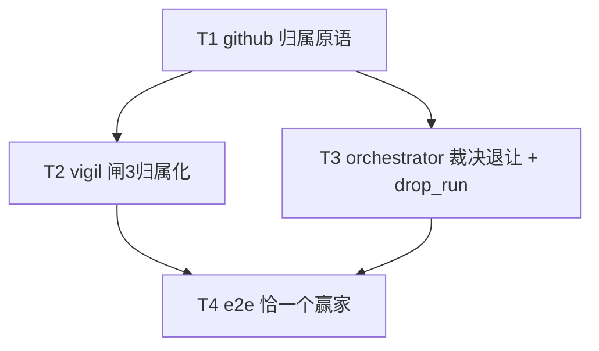

# 0046 · vigil 认领治本：归属认领标签 + 认领后二次确认退让

<!-- 本文件由 spec 工具维护：frontmatter 为结构化源数据（含 tasks DAG），正文为组级 rust-RFC 9 段总览。 -->

## Summary

把 vigil 多后端派单去重的「认领标签」从**无归属的固定标签**（`openagents-dispatching`）升级为**带 agent 归属的动态标签**（`openagents-dispatching:<agent_id>`），并给认领动作加一道 **read-after-write 二次确认**：认领方打完自己的归属标签后**重读**该 issue 的全部认领归属，若发现存在他方的未过期认领，用**确定性裁决规则**（认领 `labeled` 事件时戳最早者赢，平局按 `agent_id` 字典序）判定唯一赢家——输方**主动退让**（摘自己的标签、删本地 solving 记录、放弃本轮起草）。两件事合起来治本 issue #119 的两个结构性缺陷：

1. **归属**让「谁的认领」可判定——`issue_stamp_label` 的 remove-then-add 从此只动**自己的**标签，「互撕对方标签」结构性消失；
2. **二次确认 + 退让**让秒级 check-then-claim 窗口内的**双重认领**能事后收敛到恰一个赢家，不再走到「各自起草、各自开 PR 撞车」。

不引入外部锁服务 / DB，不追求完整分布式一致性（奥卡姆）：用「乐观写入 + 共享时间线裁决 + 输方退让」把「双开撞车」压到近零并可自愈。

## Motivation

**现状（就地复述，无需外读）。** OpenAgents 的 `vigil`（守夜人，`openagents/vigil.py`）是薄调度循环：每轮列出带 `openagents` 发现标签的 open issue，对每个 issue 调 `_dispatch_kind` 归类 `fresh` / `resume` / `None`（跳过），`fresh` 进 `orchestrator.start_rfc` 起草 spec、开 draft PR。每个后端的运行状态存在**各自本地**的 `.openagents/state.json`，彼此不可见；跨后端唯一共享事实源是 GitHub（issue / 标签 / 分支 / PR）。

**前序方案（Spec-0039，就地复述其机制与自认的边界）。** 为堵「两后端同时判 `fresh` → 各自起草分钟级 → 双 PR 撞车」，Spec-0039 引入第 4 个流程标签 `openagents-dispatching`（`openagents/github.py:72` 的 `DISPATCH_LABEL`，并入 `PROCESS_LABELS` 由 `ensure_prerequisites` 预建）作为发现段第 3 道去重闸：

- **读侧**：`_dispatch_kind` 在「本地无记录 + 远端无分支」之后检查 `DISPATCH_LABEL in issue.labels`（`openagents/vigil.py:161`）——带标签且未过期 → 跳过（别人在干）；标签龄 > `CLAIM_EXPIRY_SECONDS`（默认 3600s，`vigil.py:40`）且远端无分支 → 判僵尸认领，视同 `fresh` 回收。
- **写侧**：`start_rfc` 的 fresh 路径在 `begin_run` 之后、耗时起草之前调 `_claim_issue`（`openagents/orchestrator.py:324-333`）→ `github.issue_stamp_label`（`github.py:484-493`）**remove-then-add** 盖标签（先摘再打，制造全新 `labeled` 事件以刷新认领年龄）；draft PR 开出后 `_release_claim` 摘标签。resume 路径也重新 stamp（`orchestrator.py:236`）。
- **自认边界**：Spec-0039 明确写着「GitHub 标签不是原子 CAS……窗口从分钟级压到秒级、概率大幅下降但非零；接受这一残余概率」。

**两个结构性根因（issue #119，已核对代码）。**

1. **check-then-claim 非原子**：`_dispatch_kind` 读标签（`vigil.py:161`）与 `_claim_issue` 写标签（`orchestrator.py:333`）之间隔着 `workspace.prepare` + `begin_run`（秒级）。两后端可在「一方写上标签之前」都读到「无标签」而双双判 `fresh`——之后**没有任何机制让其中一方发现并退出**，双方各自起草到底、双 PR 撞车。
2. **认领标签无归属**：标签名固定，不编码是谁认领的。后端无法区分「别人的认领」与「自己的认领」，于是 `issue_stamp_label` 的 remove-then-add 会**无差别撕掉对方的标签**再贴上自己的；对方下一轮又撕回来。实例：本仓库 issue #116 时间线上，`pcj-sudo` 与 `Drifting12345` 两个后端在 06:25–06:33 间对该标签加/去 8 次（`gh api repos/Curry09/OpenAgents/issues/116/timeline` 可复核）。

**姊妹止血 issue（#118，关系就地复述）。** #118 针对互撕的**放大器**做最小止血：两后端双双 `begin_run` 进入 `solving/pr=0` 后，每轮 discover 都走 `resume`，而 resume 路径仍调 `_claim_issue` 重新 stamp——删掉 resume 路径的认领调用即可止住「进 solving 后无限互撕」。但止血**不消除**首次的秒级双 `fresh` 窗口，也不给标签加归属。本 spec 是**治本**：归属让互撕在任何路径下都不可能（stamp 只动自己的标签），二次确认让双 `fresh` 收敛到一个赢家。两者都动 `orchestrator.py` 一带；#118 若先落地，本 spec 的 T3 与其天然相容（resume 不认领的语义在本 spec 中保持，见 Reference-level）；若未落地，本 spec 一并落实该语义。

**为什么现在改。** 互撕已在真实双后端环境反复发生（#116 是实锤时间线），且双开撞车意味着两份分钟级起草算力白烧 + 人工收拾重复 PR。Spec-0039 的「概率压缩」已到位但天花板明确——剩下的两个缺陷都是结构性的，加多少概率补丁都无法收敛，必须上归属与裁决。

## Guide-level explanation

对使用者透明，只改变多后端并发时的行为。认领标签从一个固定名字变成**每个 agent 一个**：`openagents-dispatching:<agent_id>`（`agent_id` 即 RFC-0011 的本实例身份，`identity.resolve_agent_id`，env `OPENAGENTS_AGENT_ID` > state 落盘值 > 首次生成）。

**单后端场景**：行为与今天一致——打上自己的归属标签、起草、开 PR、摘掉。多出的只有认领后一次「重读确认」（读到的只有自己 → 继续）。

**两后端抢同一新 issue 的新时序**（A、B 几乎同时判 `fresh`，落进秒级窗口）：

1. A、B 都读到「本地无记录 + 远端无分支 + 无他方未过期认领」→ 都判 `fresh`，都进 `start_rfc`。
2. A 打 `dispatching:A`，B 打 `dispatching:B`——**互不干扰**（各自 stamp 只 remove 自己名下的标签，对方的时戳不被扰动）。
3. 双方各自**重读**该 issue 的认领归属，都看到 `{A, B}` 两个认领 → 用同一把确定性尺子裁决：比较两个标签在 issue 时间线上最近一次 `labeled` 事件的 `created_at`，**最早者赢**；同秒平局按 `agent_id` 字典序小者赢。GitHub 时间线是跨后端共享的时钟，双方看到同样的事件、算出同一个赢家。
4. 输方（设为 B）**主动退让**：摘掉 `dispatching:B`、删掉本地刚落的 solving 记录、放弃本轮起草（一条日志说明让给了谁）；下一轮 B 的发现段读到「他方未过期认领」正常跳过。赢方 A 浑然不觉，继续起草到开出 draft PR、摘自己的标签。
5. 结果：恰一个后端起草，恰一个 draft PR——退让发生在耗时起草**之前**，输方几乎零浪费。

**僵尸认领的回收**（继承 Spec-0039 语义，按归属细化）：发现段读到「他方认领 + 远端无分支 + 标签龄 > 阈值」→ 判僵尸，视同 `fresh` 回收；认领时顺手摘掉已判过期的他方遗骸标签。**自己的**残留认领（本地 state 丢了但标签还在）直接视同 `fresh` 重新认领——自己的坑自己收，不用等过期。

**遗留兼容**：未升级的旧后端仍打裸 `openagents-dispatching`。新后端把裸标签当「归属未知的他方认领」尊重（未过期跳过、过期回收），绝不主动撕它；混跑期行为不劣于今天。

**成果可视化（理念 8）**：既有 `oa board`（`openagents/results.py`）把本地 State 渲成 `board.html`。治本成功的可见成果是：赢方看板对 issue #N 恰有一条 run，**退让方看板没有该 issue 的 run**（solving 记录已被退让清理），且 issue 时间线上不再出现加/去反复互撕的锯齿。e2e 用浏览器导航两块看板断言 + 截图（无浏览器环境降级为 HTML 文本断言，见 Reference-level）。

## Reference-level explanation

### 1. github 层：归属标签原语（`openagents/github.py`）

- **`DISPATCH_LABEL_PREFIX = "openagents-dispatching:"`**：归属标签前缀。`claim_label_for(agent_id) -> str` 生成本 agent 的认领标签名；GitHub 标签上限 50 字符，前缀占 23，`agent_id` 超过 27 字符时**确定性截断**（取前 27；`agent_id` 字符集 `[A-Za-z0-9_-]` 由 identity 层保证，截断在生成与解析两侧走同一函数，故归属判定自洽）。
- **`parse_dispatch_claims(labels) -> list[Claim]`**：从 `issue.labels` 解析全部认领。`Claim = (owner: str | None, label_name: str)`——前缀匹配的取归属 `owner`；裸 `DISPATCH_LABEL`（遗留）解析为 `owner=None`（归属未知，一律按他方对待）。
- **`DISPATCH_LABEL` 保留为遗留识别常量，但从 `PROCESS_LABELS` 移除**：动态归属标签无法预建全量，改为**认领时 on-demand `ensure_label`**（既有 `ensure_label` 幂等吞 "already exists"，`github.py:294`）；`ensure_prerequisites` 不再预建裸认领标签（新后端不再产生它）。
- **零改动复用**：`issue_stamp_label(number, name)` / `issue_remove_label` / `issue_label_age_seconds(number, name)` 均已按 `name` 参数化（Spec-0039 引入），归属标签直接传新名字即可——remove-then-add 撕的从此只是**自己名下**的标签。

### 2. vigil 发现段：认领闸归属化（`openagents/vigil.py`）

`_dispatch_kind` 第 3 道闸从「有无裸标签」改为「按归属分流」（伪码，`me = agent_id`）：

```
claims = parse_dispatch_claims(issue.labels)
others = [c for c in claims if c.owner != me]        # 含裸遗留（owner=None）
if any(not _claim_expired(issue, c) for c in others):
    return None            # 存在他方未过期认领 → 尊重、跳过
return "fresh"              # 无认领 / 只有自己的残留 / 他方全过期（僵尸）→ 认领（回收）
```

- `_claim_expired` 复用既有实现，唯一变化是按**具体标签名**查时间线年龄（`issue_label_age_seconds(name=c.label_name)`）；时间线查询失败 / 取不到时戳仍保守判「未过期」（宁可占坑多留一轮也不误抢，语义与 Spec-0039 一致，`vigil.py:169-190`）。
- **自己的残留认领**（`owner == me`，如本地 state 丢失后重扫）不阻塞：直接 `fresh` 重新认领，stamp 会刷新自己的时戳。
- `resume` 分支（本地 `solving/pr=0`）判定先于认领闸、语义不变。

### 3. orchestrator：归属认领 + 二次确认退让（`openagents/orchestrator.py`）

`_claim_issue` 从「盖章即返回」升级为「盖章 → 重读 → 裁决 → 赢则继续 / 输则退让」：

```
label_me = claim_label_for(me)
ensure_label(name=label_me)                       # 动态标签 on-demand 自举（幂等）
issue_stamp_label(number=N, name=label_me)        # 只动自己的标签
issue2 = get_issue(number=N)                      # ← read-after-write 二次确认
rivals = [c for c in parse_dispatch_claims(issue2.labels) if c.owner != me]
for c in rivals if expired(c): issue_remove_label(c.label_name)   # 清过期遗骸
live = [c for c in rivals if not expired(c)]
if live and not _wins(me=label_me, rivals=live):  # 确定性裁决
    issue_remove_label(label_me)                  # 退让①：摘自己的标签
    state.drop_run(issue_number=N)                # 退让②：删本地 solving 记录
    raise ClaimYielded(...)                       # 退让③：中止本轮起草
```

- **裁决规则 `_wins`**：对每个在场认领（含自己）取其标签最近一次 `labeled` 事件的 `created_at`（`issue_label_age_seconds` 换算或直接比时戳），**最早者赢**；同秒平局按标签名（即 `agent_id`）字典序小者赢。裸遗留标签（owner=None）参与裁决时按其时戳比较——若它更早，本方退让（它随后被开 PR 或过期回收收尾）。**取不到某在场认领的时戳时保守判自己输**（退让代价只是本轮不起草，误继续的代价是双开）。
- **收敛论证**：时间线是共享时钟，双方读到相同事件集时裁决必一致 → 恰一个赢家。stamp 只动自己的标签 → 裁决输入（对方的 `labeled` 时戳）不会被自己的写入扰动，规则单调稳定。若因 API 最终一致性一方重读时**还看不到**对方的标签：看得到的一方退让、看不到的一方继续，结果仍是恰一个赢家；双方都看不到对方才会双开——窗口从「秒级 prepare」进一步压到「一次标签写入的读一致时延」，且此残余情形无互撕（各自标签共存到 PR 开出，靠闸 2 / 过期回收自愈，兜底见 Drawbacks）。
- **`ClaimYielded`**：`OrchestratorError` 子类。`start_rfc` 的 fresh 路径让它自然上抛，vigil 发现段既有 per-issue `except (OrchestratorError, GithubError)` 隔离接住 → 记日志「让给 <owner>」、跳过该 issue、不拖垮整轮（决策 8 语义零改动）。
- **写点不变**：认领仍在 `begin_run` 之后、`backend.run` 之前（Spec-0039 的折中：本地可 resume + 退让发生在耗时起草前）。
- **resume 路径不认领、不裁决**：孤儿 run 意味着本后端早已认领过且本地在推进，重新 stamp 毫无收益（这正是 #118 的止血点，就地采纳）：删除 resume 分支的 `_claim_issue` 调用（`orchestrator.py:236`）。若 #118 已先落地则此处为空操作，天然相容。
- **`_release_claim` 摘自己的归属标签**，并顺带幂等摘裸遗留 `DISPATCH_LABEL`（能走到开 PR 说明本方是赢家，清走旧世界残留保持 issue 干净）；仍是「主交付已完成、旁路尽力而为」——只吞 `GithubError`。
- **退让不清 worktree**：`workspace.prepare` 本就幂等清理残留 worktree（`workspace.py:41-46`），同 issue 未来任何一次 fresh 认领都会重建；残留只占磁盘、不产生行为分叉，不为此新增原语（奥卡姆）。

### 4. State 层：退让清理原语（`openagents/state.py`）

新增 `drop_run(*, issue_number: int) -> None`：删除该 issue 的 run 记录（幂等，记录不存在即 no-op）。退让后本地不留 `solving/pr=0` 孤儿——否则下一轮会被误判 `resume` 把刚让出去的 issue 又捡回来。仅退让路径调用，不影响既有状态机；若既有测试的 State 替身需补该方法，同步更新（Spec-0031 的教训：动 State 接口必须顾及全部在用替身）。

### 5. DAG 与文件分配

| Task | 标题 | files（单一 writer 所有权，组内互斥） | depends-on |
|---|---|---|---|
| T1 | github 归属认领原语层 | `openagents/github.py`, `tests/test_github_owned_claim.py` | — |
| T2 | vigil 认领闸归属化 | `openagents/vigil.py`, `tests/test_vigil_owned_claim.py` | T1 |
| T3 | orchestrator 二次确认退让 + State.drop_run | `openagents/orchestrator.py`, `openagents/state.py`, `tests/test_orchestrator_yield.py` | T1 |
| T4 | 端到端「恰一个赢家」成果测试 | `scripts/e2e-spec-0046-claim-ownership-yield.sh`, `tests/test_claim_yield_integration.py` | T2, T3 |



T2、T3 只依赖 T1，可并行（协同模式，files 互斥）。

### 6. e2e 成果脚本（PR 指路牌拾取）

**路径：`scripts/e2e-spec-0046-claim-ownership-yield.sh`**。驱动一次真实的「两后端秒级窗口双认领」并断言收敛成果：

1. **准备**：scratch GitHub 仓库 + 带 `openagents` 标签的新 issue #N；两份独立 `state.json` + 两个显式 `OPENAGENTS_AGENT_ID`（`agent-a` / `agent-b`）。
2. **坐实双认领窗口**：stub 慢起草后端；让 A、B 都完成「判 fresh + stamp 自己的归属标签」再各自进入二次确认（顺序编排使双方重读时都能看到对方——最坏窗口）。
3. **后端断言（证据驱动，理念 7）**：恰一个后端走完起草（远端 `openagents/issue-N` 分支与 draft PR **恰好一个**）；输方留下退让日志、其 `state.json` **无**该 issue 记录（`drop_run` 生效）；issue 时间线上 `dispatching:agent-a` / `dispatching:agent-b` 的 `labeled`/`unlabeled` 事件呈「双打 → 输方摘 → 赢方 PR 后摘」的收敛序列，**无反复加/去锯齿**；全程无人撕他方标签（每个 `unlabeled` 事件的 actor 等于标签归属者本人或赢家的收尾清理）。
4. **浏览器成果断言（理念 8）**：`oa board` 渲出 A、B 两份 `board.html`，浏览器（Playwright / chrome-devtools MCP，若执行环境具备）分别导航，断言赢方看板恰一行 issue #N、退让方看板无该行，截图留档，console/network 无报错；**无浏览器工具时降级**为对两份 HTML 的文本断言（grep `#N` 行数），不跳过成果验证。
5. **子用例**：a) 僵尸回收——预置一个时戳回拨的他方归属标签且无分支，断言超阈值判 `fresh` 且遗骸被摘；b) 遗留兼容——预置裸 `openagents-dispatching`，断言未过期时被尊重跳过、过期时被回收，且新后端从不主动撕未过期裸标签；c) resume 不认领——本地 `solving/pr=0` 后多轮 discover 不产生任何新的 `labeled`/`unlabeled` 事件。

## Drawbacks

- **仍非严格归零**：二次确认依赖 GitHub API 读一致性——双方重读都恰好看不到对方标签的极端情形下仍会双开（此时无互撕，双标签共存，靠闸 2 / draft PR 去重信号与人工收尾）。本方案把窗口从「秒级 prepare」压到「一次写入的读一致时延」，接受此残余（反向约束：不做完整分布式一致性）。
- **动态标签会在仓库标签列表里累积**：每个 agent 一个标签，长期混用多后端会攒出若干 `dispatching:*` 标签（GitHub 标签是仓库级实体，摘掉 issue 上的标签不删仓库标签）。数量与后端数同阶、可人工清理，但确是可见的脏。
- **认领路径 gh 调用增多**：新增 on-demand `ensure_label` 一次、read-after-write 重读一次，冲突时每个在场认领各一次时间线查询。仅发生在派单瞬间（每 issue 一次）与罕见冲突时，常态扫描零新增；但对 GitHub API 的依赖面确实变宽。
- **裁决精度受时间线秒级时戳限制**：同秒并发靠 `agent_id` 字典序决胜——规则确定但「先来后到」在秒内是名义上的；接受（决胜只需一致，不需公平）。
- **认领协议复杂度上移**：从「打个标签」变成「自举 → 盖章 → 重读 → 裁决 → 退让」的小协议，`_claim_issue` 从 3 行变成一段需要单测覆盖的逻辑；这是治本换来的必要复杂度，收在 orchestrator 单点。

## Rationale and alternatives

**为什么是「归属 + 二次确认」组合（issue #119 建议 1+2）。** 归属解决「判定」：没有归属，任何后端读到标签都无法回答「这是不是我的」，互撕与误回收都源于此；有了归属，stamp/release 的作用域天然收窄到自己名下，互撕**结构性消失**而非概率降低。二次确认解决「收敛」：非原子 check-then-claim 决定了双认领必然偶发，与其加锁（违背反向约束）不如承认它、用共享时钟把它**事后**收敛到一个赢家——乐观并发控制的经典形态（先写、后验证、冲突方回滚），且退让发生在耗时起草之前，回滚代价近零。两者正交且都最小：只动标签命名、一次重读、一条删除记录的 State 原语。

**备选 1——只做归属、不做二次确认。** 互撕消失（#118 层面根治），但秒级窗口内的双 `fresh` 仍各自起草到底、双 PR 撞车——issue #119 的第一根因原样保留。改动更小但只治半个病，**不取**。

**备选 2——归属凭证用「标签 + 署名认领评论」而非动态标签。** 固定标签保留、归属写进一条带 `identity.sign` 签名的认领评论。优点：仓库标签列表不累积、时戳与归属同载于一条评论。缺点：读归属需拉 issue 评论列表（发现段每 issue 多一次 API；`issue.labels` 快检的零额外请求特性丢失），且「标签在、评论没写上/被删」的半态需额外自愈规则。动态标签把归属编码进 `issue.labels` 本身，读侧零新增请求，**取动态标签**。

**备选 3——用 issue assignee 做归属认领。** assignee 天然带归属且跨后端可见。但 assignee 必须是仓库协作者账号（agent_id 不是 GitHub 账号，多后端可能共用一个 bot 账号导致归属再度不可判定），且语义面向人类协作；Spec-0039 亦以同样理由弃过它，**不取**。

**备选 4——git ref 做真 CAS（`git push origin HEAD:refs/claims/issue-N`）。** git 引用更新在服务端是原子的：两个后端同时 push 同名新 ref，恰一个成功、另一个被拒——这是本问题域里唯一能拿到**真原子性**的免外部依赖方案。但它把认领信号搬出「issue 标签」这个既有可观测面（人在 issue 页看不到认领态），需要新的 ref 生命周期管理（清理、过期），与 `PROCESS_LABELS`/时间线年龄/看板整套既有骨架脱钩重建——为消灭一个已被压到读一致时延的残余窗口付出整个信号面迁移，违背奥卡姆，**不取**；若实测残余双开仍不可接受，它是明确的升级路径（见 Future）。

**备选 5——PR 层兜底去重（issue 建议 3）。** 按 issue 号检测重复 draft PR、自动关掉较晚/较空的一个。它不阻止重复起草（算力已烧掉），只收拾结果，且「关谁」的裁决又需要一套规则；作为最后防线价值真实但独立于本组（可单独成 spec），**本组不做**，记入 Future。

## Prior art

- **乐观并发控制（OCC）**：先写后验证、冲突方回滚重来——本方案的「stamp → 重读 → 裁决 → 退让」即 OCC 在「无 CAS 只有最终一致读」环境下的移植，回滚代价被刻意安排在耗时起草之前。
- **分布式租约（etcd lease / Redis `SET NX PX`）**：「带归属的占用 + 过期回收」是 lease 的两要素；Spec-0039 只有过期没有归属，本 spec 补齐归属，仍刻意不追求原子获取（反向约束）。
- **确定性平局决胜**：以共享可见的全序（时间线时戳）+ 固定字典序打破对称，是 Lamport 时钟裁决与 leader election 中 lowest-id-wins 的常见组合——各方独立计算得到同一赢家，无需通信轮。
- **本仓库先例**：Spec-0039（认领标签 + 过期回收，本 spec 的直接前身，其机制已在 Motivation 就地复述）；RFC-0011 `identity`（`agent_id` 解析与评论署名——归属标签复用同一身份源）；Spec-0032 的幂等标签摘除与 `ensure_label` 自举骨架（`_is_label_absent` / 吞 "already exists"）。
- **GitHub Actions `concurrency` group**：平台对「同 key 并发任务恰留一个」的原生答案（后到者顶掉/排队先到者）。它印证了「按 key 收敛到单执行者」的需求普遍性，但其裁决发生在平台内部原子层，与本方案所处的「只有最终一致 API」环境不同。

## Unresolved questions

- **`agent_id` 超长截断**：50 字符标签上限下截到前 27 字符——两个前缀相同的超长 id 会归属混淆。uuid 短串与人工命名习惯下概率极低；是否需要「截断 + 尾部短哈希」加固，初版先不做、出现即升级。
- **裸遗留标签的退役时点**：混跑期新后端尊重裸标签；全量后端升级后，`DISPATCH_LABEL` 常量与兼容分支何时删除（跟随下一次大版本？），留给实施后观察。
- **与 #118 的合并评估**：若止血 PR 先合入，本组 T3 的「resume 不认领」为空操作、直接叠加；若本组先合入，#118 可关闭（其修法已被 T3 覆盖）。两者同时在途时按 Spec-0043 冲突自检交人裁定先后——本 spec 默认自己后落地。
- **退让方的可观测性**：退让目前只留 stderr 日志 + 无 state 记录。是否要在看板上呈现「让过哪些 issue」（需要 State 新增记录面，违背最小化）？初版不做，靠日志与 issue 时间线追溯。
- **e2e 浏览器步骤的环境依赖**：与 Spec-0039 T4 相同——执行环境无浏览器工具时降级 HTML 文本断言，已在 Reference-level 写明；CI 是否常备浏览器仍未定。

## Future possibilities

- **PR 层重复 draft 去重**（备选 5）：按 issue 号扫重复 draft PR、按「更早开出/更完整」保留一个，作为最后防线独立成组。
- **git ref CAS 升级路径**（备选 4）：若实测「双方重读均不见对方」的残余双开仍发生，把认领底层换成原子 ref push，`_claim_issue` 对上层接口不变。
- **通用跨后端认领原语**：把「归属标签 + 过期 + 裁决退让」抽象成可复用协议，供未来「多后端争抢同一 GitHub 对象」的场景（如争抢同一 PR 的 poll 推进权）复用。
- **认领可观测性**：统计「认领→开 PR」时长、退让次数、僵尸回收次数，反哺过期阈值 `CLAIM_EXPIRY_SECONDS` 的自适应取值，并在看板呈现认领事件流。

