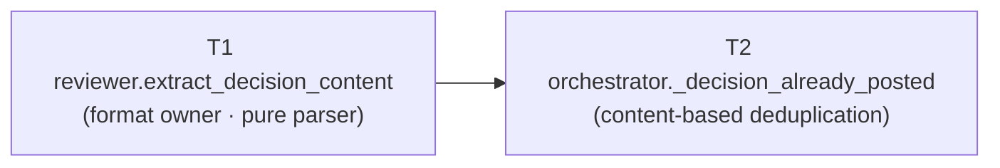

# 0047 · Deduplicate review decisions by “substantive content” (post the same verdict when the reasons differ)

> Historical labels are translated here for readability. See the [original text](../specs-zh-CN/0047-review-dedup-by-content.md) for exact historical values.

<!-- This file is maintained by the spec tool: frontmatter is the structured source data (including the tasks DAG); the body is a group-level overview in the nine rust-RFC sections. -->

## Summary

Refine the granularity of deduplication when posting review decisions back to a PR, from **“same verdict (PASS / REWORK) = duplicate”** to **“same verdict and same feedback content = duplicate.”** Currently, `orchestrator._decision_already_posted` checks for duplicates using only three lines: “heading + `- Type: ` + `- Verdict: `.” This effectively means “as long as the previous decision of the same kind was also REWORK, this round’s REWORK is considered a duplicate and is skipped.” As a result, when a PR accumulates multiple rounds of code REWORK with **different reasons** before receiving `needs-human`, people can see only the **first round’s** decision plus the final “🤖 Stuck” message in the comments; the actual issues being addressed or newly exposed in each intermediate round are all swallowed. This feature adds the **normalized body of the “feedback summary”** to the matching criteria for deduplication: a decision is a duplicate only when both its verdict **and** feedback are identical (continuing to prevent the “33 identical PASS comments” spam on PR #61). If the verdict is the same but the reasons differ, the decision is posted (people need to see how each round evolves). The changes are split into two Tasks: a pure parser in reviewer (the owner of the format) and the orchestrator deduplication policy, with disjoint `files`.

## Motivation

**Reproducing the root cause (issue #116 / Drifting12345/LLMwiki4rolePlay PR #6, restated here in full so readers do not need to consult another spec).** On every round (each poll interval, as long as the record remains in the coding/rfc-review phase), the OpenAgents review gate reruns reviewer and posts its decision back to the PR as a signed comment through `orchestrator._post_review_decision`, restoring human visibility into the review gate (RFC-0018, principle 8). Before posting, `_decision_already_posted` performs deduplication (Spec-0022/T3) to **avoid spamming the same decision every round**.

The problem is that **the deduplication granularity is too coarse**. `_decision_already_posted` (`openagents/orchestrator.py:561`) extracts three lines from the current output of `reviewer.render_decision` as matching criteria—the heading `## Review gate verdict`, the kind line `- Type: {rfc/code}`, and the verdict line `- Verdict: {✅ PASS / ❌ REWORK / ⚠️ Invalid review}`—then finds the **most recent decision comment of the same kind** on the PR. If that comment contains the **same verdict line**, it is considered a “duplicate” and skipped. These Chinese strings are the legacy literals used for matching. The docstring explicitly says it does **“not compare vote counts/feedback wording byte for byte.”** The body rendered by `render_decision` (`openagents/reviewer.py:190`) is:

```
## Review gate verdict
- Type: Code
- Verdict: ❌ REWORK
- Votes: 0 of 3 PASS
- Vote breakdown: REWORK / REWORK / REWORK
- Feedback summary:
```
(This is the aggregated feedback: ISSUES / where each acceptance criterion is blocked.)
```
```

Deduplication looks only at the “kind + verdict” lines → **when two consecutive rounds are both code REWORK, even if the second round’s ISSUES / reasons are completely different from the first round’s, the “feedback summary” block is ignored entirely**, and the decision is skipped under “same verdict = duplicate.”

**Example (PR #6, where `needs-human` is applied after 3 rounds of code REWORK by default, with different reasons in each round):** At `13:18`, there was a code REWORK with the reasons “EntityWithContent inheritance mismatch / missing chapter-scene pattern / `_validate_specs` CWD bug”; the suspension message at `13:34` contained another REWORK with **completely different** reasons: “`_validate_specs:65` crash bug + zero implementation across 8 tasks.” The **standalone decision comment for the intermediate round was missing**—because, like the first round, it was REWORK, so deduplication swallowed it. People could see only the first round’s reasons; the issues actually being resolved or newly exposed in subsequent rounds were silently swallowed, obscuring how the blockers evolved.

**Why deduplication was introduced in the first place (a constraint to preserve; do not remove it).** Spec-0022/T3 introduced this deduplication layer to stop “spam from unchanged decisions while a PR stays open for a long time”—in the example of PR #61, 14 conflicting spec files caused the code gate to return PASS on every round, producing **33 identical `## Review gate verdict ✅ PASS` comments** (using the legacy heading). That immediate mitigation was correct; its **granularity was simply too coarse**: it also treated “REWORK with changed reasons” as “the same decision.”

**The change therefore concerns granularity, not whether deduplication exists.** Expected behavior: on every review round (especially REWORK), post a standalone decision comment whenever **the feedback / content differs from the previous decision of the same kind**; deduplicate only when both the verdict **and** feedback are truly identical. This lets people watching the PR see how the blockers evolve each round without returning to the spam seen on PR #61.

## Guide-level explanation

For users (people watching the PR), behavior is strictly additive, and all changes are visible in the comments:

| Scenario | Before (deduplicate by verdict) | After (deduplicate by content) |
|------|------|------|
| Two consecutive code REWORK rounds with **different reasons** | Round 2 is considered a duplicate and **swallowed** (bug) | Round 2 **is posted** as a standalone decision comment (changed reasons = people need to see them) |
| Multiple consecutive **PASS decisions with identical feedback** (PR #61) | Deduplicated; only 1 comment remains | **Still deduplicated**; only 1 comment remains (spam prevention is preserved) |
| Previous decision of the same kind was REWORK → this round is REWORK again for **the same reasons** | Deduplicated | **Still deduplicated** (truly identical, with no new information) |
| Verdict flips between PASS ↔ REWORK | Posted | Posted (unchanged) |
| Decisions from the rfc gate and code gate | Do not suppress each other (kind isolation) | Do not suppress each other (unchanged) |

Duplicate detection changes from “same verdict” to “**same verdict and same feedback**”: the **normalized body** of the “feedback summary” block is included in the matching criteria, and a decision is a duplicate only if everything matches. There are no changes to external signatures / commands / configuration; deduplication remains a **best-effort side path** (any query or parsing instability fails open to posting; an extra comment is preferable to a missing decision).

## Reference-level explanation

The implementation is divided into 2 Tasks (DAG: `T1 → T2`; disjoint `files`, with a single writer per Task). The core change expands a decision comment’s **deduplication identity** from “verdict” to “**verdict + normalized feedback**,” and keeps the format knowledge needed to extract that identity in reviewer (the owner of `render_decision`, following principle 10 on decoupling).

**T1 — Expose a pure parser for decision content in reviewer (leaf, no dependencies).**
Add a pure function in `openagents/reviewer.py` (no side effects, no dependency on github/identity, serving as the inverse of `render_decision`):

```python
@dataclass(frozen=True)
class DecisionContent:
    kind_line: str      # "- Type: Code" (legacy literal)
    verdict_line: str   # "- Verdict: ❌ REWORK" (legacy literal)
    feedback_norm: str  # Normalized feedback summary body; "" for PASS / no feedback

def extract_decision_content(*, body: str) -> DecisionContent | None:
    """Parse a decision's deduplication identity from comment markdown that may include a signature suffix.
    Non-decision comment (without the stable legacy heading `## Review gate verdict`) → None."""
```

- **Why this belongs in reviewer**: the output format of `render_decision` (heading / `- Type: ` / `- Verdict: ` / the “feedback summary” block enclosed in triple backticks) is reviewer’s domain knowledge; reviewer should also own its **inverse extraction**. The Chinese field prefixes here are legacy matching literals. Orchestrator should only consume `DecisionContent`, rather than using splitlines itself to pick apart reviewer text (currently, orchestrator parses it inline, implicitly coupling it to reviewer’s format).
- **Accept both rendered output and comment bodies**: `extract_decision_content` must handle both **plain rendered output** (the current round) and **comment.body with a signature suffix** (existing comments on the PR; `identity.post_signed_comment` appends a signature after the body) reliably. Anchor on the stable legacy heading `## Review gate verdict`, and extract the “feedback summary” block as the text “between **the first ``` and the last ```** after the legacy marker `- Feedback summary: `,” naturally excluding the trailing signature.
- **Fallback for code fences within the feedback body (issue #116 / PR #117 correction)**: `render_decision` wraps `decision.feedback` verbatim in a pair of outer fences, but the feedback body itself may contain code-fence lines (`_distill_feedback` does not strip bare ``` lines). Extracting the “first pair of fences” would mistake an internal ``` for the closing outer fence, truncating the feedback or even normalizing it to ""—two REWORK decisions with **different reasons** that both begin with fenced code would incorrectly be treated as having equal `feedback_norm` and **silently suppressed**, precisely the failure mode this spec aims to fix (fail-closed, contrary to the fail-open principle). Therefore, use the text from “the first ``` to the **last** ```” as the block body: render always wraps the feedback in the outermost fences, and the identity signature after it is an HTML comment without fences, so the last ``` must be the closing outer fence, and internal fences remain fully included in the body. **Do not “strip the signature suffix at `---`”**—feedback from multiple reviewers is joined internally with `\n\n---\n\n`, so truncating at `---` would damage multipart feedback; locating the fences is unaffected by either `---` or HTML-comment signatures.
- **Normalizing feedback_norm**: strip each line, discard empty lines, and join with `\n` (comparison insensitive to whitespace/newlines, avoiding false “different” results when wording is unchanged and only indentation/blank lines drift); PASS (`decision.feedback == ""`, for which render produces no “feedback summary” block) → `feedback_norm == ""`.
- All parameters must be keyword-only (CLAUDE.md prohibits positional arguments).

**T2 — Compare content for deduplication in orchestrator (depends on T1).**
Modify `_decision_already_posted` (`561`) in `openagents/orchestrator.py`, upgrading the deduplication identity from “three lines” to `DecisionContent`:

1. Use `reviewer.extract_decision_content(body=rendered)` to obtain the current round’s identity `cur` (if unavailable, fail open and post).
2. Use `github.list_comments` (read-only, already available) to filter decision comments of the **same kind** (`extract_decision_content` parses successfully and `kind_line == cur.kind_line`).
3. No comment of the same kind → return `False` (post).
4. Take the most recent one (lexicographic `max` of ISO 8601 `created_at`) and parse it into `prev`.
5. **Duplicate iff `prev.verdict_line == cur.verdict_line` and `prev.feedback_norm == cur.feedback_norm`**—a decision is a duplicate only when both the verdict **and** feedback are identical; same verdict but different feedback (the issue #116 scenario) → return `False` and post.
6. **Fail-open behavior remains unchanged** (retaining the Spec-0022 decision and RFC-0018 decision 2): if `list_comments` or any parsing operation raises an exception → the existing `try/except` in `_post_review_decision` falls back to posting, leaving the review gate and downstream processing unaffected.

Keep the call site of `_post_review_decision` (`533`), its best-effort semantics, and the `_progress` message unchanged (the message may be slightly adjusted to “A decision comment with the same verdict **and the same feedback** already exists; skipping repost”). **Do not change** reviewer’s `render_decision` output or github/identity.

**Dependency DAG:** `T1 → T2` (T2 consumes T1’s `extract_decision_content` / `DecisionContent`).

**File allocation (disjoint within the group, single writer):**

| Task | files | Dependencies |
|------|-------|------|
| T1 | `openagents/reviewer.py`, `tests/test_reviewer.py` | — |
| T2 | `openagents/orchestrator.py`, `tests/test_orchestrator.py` | T1 |



**End-to-end validation (principle 8 · outcome = the comments clearly show each round’s different REWORK):** e2e script `scripts/e2e-spec-0047-review-dedup-by-content.sh`, in three parts, hermetic throughout by default (no network access / no real LLM calls / no interaction with real gh):

1. **Offline deterministic validation (default)** — `ruff check` + `ruff format --check` + `uv run --extra dev pytest -q`, covering T1 (parser: rendered output / comment.body with signature / PASS with empty feedback / non-decision comment→None / normalization alignment) and T2 (post both REWORK rounds with different reasons from issue #116; deduplicate identical PASS from PR #61; deduplicate REWORK with the same reasons; post PASS↔REWORK flips; kind isolation; fail open and post when list_comments raises an error).
2. **Offline outcome rehearsal (default, browser preferred)** — Use the **real** `reviewer.render_decision` + `_decision_already_posted` to run an in-memory comment-thread scenario within the script: round1 code REWORK (reason A) → round2 code REWORK (reason B ≠ A) → round3/4 identical PASS, capture “which comments were actually posted,” and assemble the posted decision comments chronologically into static HTML representing a **simulated PR conversation**. **If browser MCP is available (Playwright / chrome-devtools, driven by the agent outside the script)**: open the HTML with `navigate` → `snapshot` + `take_screenshot` → assert that **both** REWORK decisions, “reason A” and “reason B,” are **visible**, PASS appears only once, and there are no console/network errors (exactly the outcome people watching a PR should see). **If browser MCP is unavailable, fall back** to text assertions on the HTML (grep for reason A ∧ reason B once each, and PASS only once); **do not skip outcome validation**.
3. **Real smoke test (optional, `OPENAGENTS_E2E_REAL=1`)** — Explain how to create a PR in a scratch repository with two consecutive code REWORK rounds for different reasons, then run Vigil and observe **two** different REWORK decision comments in the PR comment thread (before the change, there was only 1).

> **Self-check on “browser e2e vs. backend feature”**: this feature has no product-owned frontend; its “outcome” appears in GitHub PR comments (an external page, where real reproduction requires live credentials + running the complete orchestrator loop, making it unsuitable for a deterministic e2e script). Therefore, use the same approach as Spec-0043/T4: render **real product output** (the bodies of decision comments actually posted after deduplication) as static HTML, then use browser MCP navigation + screenshots + assertions to verify the outcome that “people watching the PR can see each round’s different REWORK”—using browser tools while preserving determinism and avoiding a dependency on live GitHub.

## Drawbacks

- The deduplication identity becomes longer (conclusion + normalized feedback), slightly increasing comparison costs (still O(number of comments) in-memory string comparisons, which are negligible).
- feedback_norm normalization only makes comparisons whitespace-insensitive; if reviewers introduce volatile values into feedback that change every round (such as timestamps / random ids), every round will be considered “different,” bringing back comment spam. The feedback currently produced by `render_decision` contains no such volatile values (Spec-0041/T3’s `_distill_feedback` already strips reviewer inner monologue/scratchpad), so the risk is low; if such values are introduced later, they must be removed during T1 normalization.
- Extraction depends on the “feedback summary + triple-backtick block” output structure of `render_decision`; if that structure changes, the T1 parser must be updated accordingly. T1 unit tests that lock down “render → extract round-trip consistency” can expose drift promptly.

## Rationale and alternatives

- **Content-based deduplication vs removing deduplication**: Choose content-based deduplication. Removing deduplication would directly bring back the spam of 33 identical PASS comments from PR #61 (a constraint imposed by the issue); only content-based deduplication satisfies both “post when the rationale changes” and “avoid spam when the content is truly identical.”
- **Including the normalized “feedback summary” body vs comparing the entire rendered output byte for byte**: Choose the former. The entire rendered output contains fields such as “Votes: X PASS votes out of N votes” and “Vote breakdown: …” that **may change slightly each round**. Byte-for-byte comparison would almost never detect duplicates because of fluctuations in these fields → bringing back comment spam. Comparing only “conclusion + normalized feedback” captures the actual intent of “do not repost the same decision.” (Whether to additionally include the vote breakdown is left as Unresolved.)
- **Placing the parser in reviewer (T1) vs inlining it in orchestrator**: Choose reviewer. The format of `render_decision` is reviewer domain knowledge, so its inverse extraction should reside in the same module (Principle 10: decoupling); orchestrator only compares `DecisionContent` values and no longer uses splitlines to pick apart reviewer wording (the current inline parsing actually creates implicit coupling to the format). The cost is one additional pure function + one small dataclass (acceptable under Principle 1, in exchange for a clear, independently testable boundary).
- **Normalization using “strip each line, then compare strings” vs hashing the feedback**: The two are equivalent; choose direct string comparison—it is readable and allows `_progress`/unit tests to directly show a diff of “exactly what differs,” without introducing a hash to save a few dozen bytes (Principle 1).
- **Comparing against “the most recent comment of the same kind” vs scanning the entire history for duplicates**: Choose the most recent comment (retaining the current behavior from Spec-0022/T3). The goal is “do not consecutively repost the same decision as the previous one”; scanning the entire history would also suppress the second A in “A→B→A,” losing visibility into how the decision evolves.
- **Posting by default when deduplication fails (fail-open) vs skipping by default**: Post by default, retaining the best-effort side-channel semantics of Spec-0022/RFC-0018—an occasional extra comment is preferable to missing a decision and impairing observability because of query/parsing instability.

## Prior art

- Spec-0022/T3 in this repository first introduced deduplication of decision comments (by conclusion), stopping the spam of 33 identical PASS comments from PR #61; this group of changes adjusts its granularity (conclusion → conclusion + feedback), reusing its fail-open best-effort framework and `_progress` bookkeeping style.
- The best-effort side-channel semantics of decision comments follow RFC-0018 (post the decision where it is produced; no gh failure may block the review gate).
- Feedback sanitization (stripping inner monologue/scratchpad, affecting only feedback used for display) follows Spec-0041/T3’s `_distill_feedback`—normalization in this group of changes adds whitespace insensitivity on top of it, without duplicating its responsibilities.
- The e2e technique of “rendering actual product output as static HTML, then using browser MCP navigation and screenshots to assert the results” follows Spec-0043/T4 (the outcome demonstration for issue conflict precheck alignment comments).
- “Deduplication by content fingerprint rather than exact matching” is a general engineering technique (for example, email/notification systems suppress duplicates using hashes of normalized bodies); here, it reduces to whitespace-insensitive normalized string comparison.

## Unresolved questions

- **Should the deduplication identity include the “vote breakdown” line** (`- Vote breakdown: REWORK / REWORK / PASS`)? The current design uses only “conclusion + feedback.” If two rounds of REWORK feedback happen to be identical after normalization, but the votes of individual reviewers differ (for example, 3 REWORK votes → 2 REWORK votes), the current design would treat the comment as a duplicate and suppress it. The preference is **not to include it** (vote breakdown changes usually accompany feedback changes, and vote breakdowns are prone to fluctuations each round, so including them would tend toward comment spam), pending review confirmation.

## Future possibilities

- If reviewers introduce structured fields into feedback in the future (such as an explicit ISSUES list / stable ids), deduplication could be upgraded from “normalized body comparison” to “comparison of differences between ISSUES sets,” and could even highlight in comments “which blockers were added/resolved this round compared with the previous round.”
- The “evolution of decisions for the same PR” could be aggregated into a single PR-level summary (appending differences each round), further reducing the number of comments while retaining visibility into that evolution (this requires weighing the tradeoff against “a separate comment for each round”; currently YAGNI).
