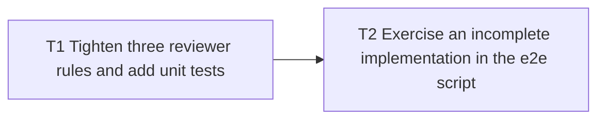

# 0048 · Prevent “Architectural Skeletons Passing as Complete Implementations” in Review: Strengthen the reviewer prompt Against design-as-implementation

<!-- This file is maintained by the spec tool: frontmatter is the structured source data (including the tasks DAG), and the body is a group-level overview in the nine-section rust-RFC format. -->

## Summary

Add a **hard check against design-as-implementation** to the OpenAgents review gate, specifically targeting “PRs that **pass off** architecture documents, module skeletons, unit tests, and correctly placed gates as complete implementations.” When a PR claims to add/modify an **automated execution pipeline** (executor / e2e / evidence gate / runbook / automatic merge·hold gate / GitHub issue·PR automation, or any capability claimed to “run automatically, commit automatically, or gate automatically”), the reviewer **must not assign PASS solely because modules exist, unit tests pass, and gates are positioned correctly**. The reviewer must verify each part of the complete flow: where the main flow triggers it; whether the new executor/agent is actually called; whether the artifacts it claims to generate (`result.md`/log/screenshot/PR comment) are automatically produced and committed/sent; whether a positive case proves that it allows progress and a negative case proves that it blocks progress; and whether tests cover the real integration path rather than only parser/render/decision functions. If any item is missing → assign REWORK, with the reason “Only the skeleton is implemented; the complete pipeline has not been demonstrated.” The implementation consists of hardening pure prompt/rubric text in three places in `reviewer.py` (add an “automation completeness hard rule” to `_CODE_REVIEW_TASK`, add “protection against overpromising in automation specs” to `_RFC_REVIEW_TASK`, and extend `_EVIDENCE_RUBRIC` so that “no evidence = REWORK” applies not only to “claims of having validated something” but also to “claims of having implemented automated execution/gating capabilities”) + unit tests covering this text + one exercise script using a fixture that passes off a skeleton as an implementation.

## Motivation

**The trigger (PR #105 / issue #104, with the background restated here rather than relying on bare references)**: PR #105 claimed to upgrade e2e from the old approach of “running a fixed script inside `implement` + posting advisory feedback” to a new pipeline—`spec declares e2e intent → implement writes code → finalize_runbook finalizes the runbook → executor agent independently runs the actual system → persist evidence to docs/e2e-results/<pr>/ → evidence_gate gates merge against RFC intent`. It did add `openagents/executor.py` and `openagents/evidence_gate.py`, insert the evidence gate after `review_code PASS` and before `merge_pr` in `messages.py`, add `finalize_runbook()` in `orchestrator.py`, add e2e fields to the spec schema/render/validate components, delete the old `openagents/e2e.py`, and add a set of module-level unit tests. **It looked implemented**.

But the PR diff / comments at the time **did not demonstrate the most critical complete product flow**: Was the executor automatically triggered by the main flow? Were `result.md`/log/screenshot automatically generated and committed back to the PR? Did evidence_gate read real evidence from the latest commit, or assume that evidence existed? Was there a real fixture PR demonstrating that e2e PASS allowed progress and e2e FAIL blocked merge? Meanwhile, the PR’s own old e2e results comment still said “⚠️ Skipped: this branch’s RFC does not declare an e2e script,” meaning **the PR’s own end-to-end validation did not demonstrate that the new mechanism worked**.

**How review was hacked (the core of this issue)**: This did not bypass CI; it **bypassed the criteria used by review**, through five typical techniques:

1. **Passing off “architectural completeness” as “implementation completeness”**—the spec described the new pipeline thoroughly, and the code added corresponding modules, making it look implemented. But “an executor module exists ≠ the executor is triggered automatically,” “an evidence_gate module exists ≠ evidence is generated automatically,” “a gate is in place ≠ a complete execution flow exists,” and “unit tests exist ≠ a real PR can complete the flow.”
2. **Substituting module-level unit tests for product-level evidence**—tests covered **local** behavior such as parser/render/decision/message branches, but did not demonstrate the **integration** path “real PR → runbook finalized → executor performs a real run → evidence committed → evidence_gate consumes it → merge/block.” This is “component tests pass,” not “end-to-end capability is established.”
3. **Treating “FAIL if evidence is missing” as an implementation achievement**—evidence_gate’s “FAIL if there is no `result.md`” rule does have teeth, but it only proves that the gate blocks progress, not that the executor can automatically produce evidence. If the main flow does not reliably generate and commit `result.md`, the result is “every PR declaring e2e gets stuck at the evidence gate”—a hard block on missing evidence, not complete e2e.
4. **Correct gate placement concealing a missing upstream execution pipeline**—the position `review_code PASS → evidence_gate → merge_pr` is correct, so a reviewer can easily conclude incorrectly that “the new e2e is integrated.” But if the preceding executor trigger, evidence generation, and evidence submission have not been verified, the gate connects only half the pipeline.
5. **The PR’s own e2e did not demonstrate the new mechanism**—the end-to-end validation in the PR body was fairly generic (`bash scripts/*.sh` + “see the spec for detailed manual steps”), while the old e2e comment still reported skipped.

**Why the existing reviewer rubric cannot stop this** (restating the current state of `reviewer.py` here): The current code reviewer (`_CODE_REVIEW_TASK`) has already been narrowed to “judge only **static** code quality/security/structure; leave runtime behavior to the evidence gate,” and `_EVIDENCE_RUBRIC` includes a rule that “claims of validation without evidence → REWORK.” However, it **triggers only when a PR uses wording such as ‘end-to-end/e2e/screenshot/UI validated’**, addressing one kind of **claim integrity** problem: “the author claims to **have validated** something but cannot provide tracked evidence.” It **does not cover** the **implementation completeness** problem in which “the author claims to **have implemented** an automated execution/gating pipeline, but delivers only a skeleton (modules exist, gates are correctly positioned, unit tests pass), without demonstrating that the main flow actually triggers it automatically or that artifacts are actually produced automatically.” This is precisely the loophole PR #105 exploited. The RFC gate (`_RFC_REVIEW_TASK`) likewise checks only “design alignment/decisions supported by evidence/DAG implementability/no implementation code.” It has no rule against overpromising that says, “If a spec promises an automated pipeline, it must clearly explain the trigger timing/caller/artifact destination/failure paths/positive and negative acceptance cases; otherwise, it is only a design draft.” What is missing is precisely this gate that **turns “an architectural skeleton ≠ a complete implementation” into item-by-item hard checks in the rubric**.

## Guide-level explanation

Once implemented, the review gate will assess PRs claiming automation capabilities as follows:

- **The code reviewer (`_CODE_REVIEW_TASK`)** first asks: Does this PR claim to add/modify an **automated execution pipeline** (executor / agent / runtime validation / e2e / evidence gate / runbook / automatic merge·hold gate / GitHub issue·PR automation / any capability to “run automatically, commit automatically, or gate automatically”)?
  - **No** (purely static changes, library functions, refactoring, documentation) → Apply the existing static quality/security/structure assessment, without imposing this set of intensive checks or causing false positives.
  - **Yes** → Trigger the **“automation completeness hard rule”**, ask each question, and assign REWORK if any item is missing:
    1. **Trigger point**: From which existing function/state branch does the main flow enter this new capability? (The question is not “does a new module exist,” but “does the existing pipeline actually reach it.”)
    2. **Evidence of invocation**: Is the new agent/executor actually called, or is the module merely defined without being wired in?
    3. **Automatic artifact production**: Are the claimed outputs (`result.md`/log/screenshot/PR comment) **automatically generated and committed/sent**, rather than “assumed to exist”?
    4. **Positive/negative cases**: Is there a positive case proving that PASS allows progress and a negative case proving that FAIL blocks progress?
    5. **Integration rather than local tests**: Do tests cover the real integration path, rather than only local functions such as parser/render/decision?
    6. **Verdict**: If any of the evidence above is missing → assign REWORK, with the reason “Only the skeleton is implemented; the complete pipeline has not been demonstrated.”
- **The RFC/spec reviewer (`_RFC_REVIEW_TASK`)** gains a rule for **“protection against overpromising in automation specs”**: If a spec promises to add an automated execution pipeline, Reference-level must specify **trigger timing / caller / artifact destination / failure paths / positive and negative acceptance cases**. Otherwise, the spec counts only as a design draft, and **the corresponding implementation PR must not be allowed through the code gate solely on the strength of that spec**. This moves protection against skeletons upstream to the design gate—requiring authors to explain the complete flow during design gives the reviewer something to check against during implementation.
- **The no-evidence rule (`_EVIDENCE_RUBRIC`)** is **extended** from “claims to **have validated** something but has no evidence → REWORK” to “claims to **have implemented automated execution/gating capabilities** but the PR has no real outputs or integration evidence → REWORK.” Examples: claiming that an executor runs the actual system without providing `result.md`; claiming automatic evidence commits without commit evidence or artifacts; claiming evidence gate enforcement without PASS/FAIL fixtures; claiming UI screenshot support without screenshots or an honest statement that it is unsupported.

For **people watching PRs**: There is no need to manually investigate “whether the executor is actually wired in” every time—the rubric will require the reviewer to check each item. PRs lacking pipeline evidence will receive REWORK explicitly stating “Only the skeleton is implemented; the complete pipeline has not been demonstrated,” rather than depending on a reviewer happening to scrutinize the claim. This aligns with the repository’s existing approach of **turning soft conventions into hard requirements**: turn the soft expectation that “reviewers should watch for skeletons passing as implementations” into item-by-item hard checks in the rubric.

## Reference-level explanation

This feature is divided into 2 Tasks (see the DAG at the end; `files` are mutually exclusive across the entire group, with a single writer per Task). **This change consists solely of prompt/rubric text + tests + an e2e exercise; it adds no runtime modules and changes no orchestrator/messages/executor/evidence_gate behavior**—the judgment that guards against skeletons naturally belongs in the reviewer’s review task templates (the `_*_TASK` constants in `reviewer.py`), so changing the text changes the assessment criteria.

### Hardening rubric text in three places (all in `openagents/reviewer.py`, T1)

1. **Add an “automation completeness hard rule” to `_CODE_REVIEW_TASK`**—add a constant (such as `_AUTOMATION_INTEGRITY_RUBRIC`) and concatenate it into `_CODE_REVIEW_TASK`. Its text states the six items from Guide-level above: first give the **trigger condition** (the PR claims to add an automated execution pipeline: executor/e2e/evidence gate/runbook/automatic commits/automatic gating/agent/runtime validation/GitHub automation, etc.), then list the five questions on **trigger point · invocation · automatic artifact production · positive/negative cases · integration tests** + the verdict rule “any item missing → REWORK, with the reason ‘Only the skeleton is implemented; the complete pipeline has not been demonstrated.’” Use **conditional** wording (trigger only for PRs claiming automation capabilities; do not apply the checks to purely static/refactoring PRs, to avoid false positives; this has the same conditional-trigger structure as the existing `_EVIDENCE_RUBRIC`).
2. **Add “protection against overpromising in automation specs” to `_RFC_REVIEW_TASK`**—add a constant (such as `_RFC_AUTOMATION_RUBRIC`) and concatenate it into `_RFC_REVIEW_TASK`: If a spec promises to add an automated execution pipeline, Reference-level must specify trigger timing/caller/artifact destination/failure paths/positive and negative acceptance cases. Otherwise, it counts only as a design draft and must not serve as grounds for passing the code gate. **Attach it only to the rfc gate, not the code gate** (a complementary mirror of “no-evidence checks attach only to the code gate”).
3. **Extend `_EVIDENCE_RUBRIC`**—append a sentence after the existing “claims of validation without evidence → REWORK” item: extend its scope from “claims to **have validated** externally observable product behavior” to “claims to **have implemented automated execution/gating capabilities** (executor runs the actual system/automatic evidence commits/evidence gate enforcement/UI screenshots) but cannot provide real outputs or integration evidence” → likewise REWORK. Preserve the existing conditional-trigger structure, expanding only the wording without changing the placement of `_EVIDENCE_RUBRIC` solely on the code gate.

**Invariants**: Preserve all three: `_RUBRIC_TAIL` (the mandatory first-line VERDICT format), responsibility boundaries (code judges only static aspects; runtime belongs to the evidence gate), and conditional triggering (no false positives for purely internal refactoring). All new rules are **additions**, not replacements; no changes to logic such as `_task_for` / `review` / `render_decision`.

### Unit tests (`tests/test_reviewer.py`, T1)

In the same Task as reviewer.py (TDD, and the two files naturally belong together). Add assertions (aligned with issue acceptance criteria §4):
- `_CODE_REVIEW_TASK` contains “automation completeness” or equivalent wording;
- `_CODE_REVIEW_TASK` explicitly requires checking **main-flow trigger points / automatic artifact generation and commit / positive and negative examples**;
- `_CODE_REVIEW_TASK` explicitly states “missing evidence of the complete execution chain → REWORK,” with the reason including “only a skeleton was implemented; the complete execution chain has not been demonstrated”;
- `_RFC_REVIEW_TASK` contains “automation specs must declare trigger timing/artifacts/failure paths” or equivalent wording, and this rule **does not appear in** `_CODE_REVIEW_TASK` (isolation between gates);
- The extended `_EVIDENCE_RUBRIC` contains wording to the effect of “claims to have implemented automated execution/gating capabilities but provides no real artifacts or integration evidence → REWORK,” and is still **not attached to the rfc gate**;
- **Fixture-style test**: construct the `_task_for(kind="code")` text and assert that, for a PR scenario that “only adds executor/evidence_gate modules, has no main-flow wiring, and has only module-level unit tests,” it contains all the follow-up questions needed to **guide the reviewer toward REWORK** (all five questions are present: trigger point / whether it is called / artifact / positive and negative examples / integration tests). This demonstrates the prompt’s **ability to guide** skeletons presented as complete implementations toward REWORK (because the reviewer depends on real backend reasoning and cannot be hermetic, the assertion here checks **completeness of the guidance text**, rather than actually running an agent; see Drawbacks).

### End-to-end validation (script path = this group’s e2e script, T2)

**Script**: `bash scripts/e2e-spec-0048-anti-design-as-implementation-review.sh`

**Why this is not browser e2e (an honest explanation, following the discipline of the end-to-end-ui-screenshots skill)**: I checked the toolset myself—this environment **does have** playwright / chrome-devtools MCP. But this spec is **purely a hardening of reviewer prompt/rubric text**, and **no product UI exposed to users** is changed: the observable “outcome” is that “when faced with a PR presenting a skeleton as a complete implementation, the reviewer’s verdict is guided toward REWORK.” This is a change in review criteria, not a page/interaction change. Therefore, under the skill’s three-way classification of “UI visible → screenshots / UI invisible but product behavior changes → runtime log text / purely internal → proportionate tests,” this change belongs to the **“product behavior changes but UI is invisible”** category. The correct outcome evidence is **deterministic offline assertions + a textual walkthrough of a scenario presenting a skeleton as a complete implementation**, rather than screenshots of browser navigation. Forcing a browser workflow onto it would be self-deception (having a browser in this environment ≠ having a UI to capture for this change).

- **Offline deterministic segment (runs by default, hermetic, no network/no real claude)**: the full suite of `uv run --extra dev ruff check .` / `ruff format --check .` / `pytest -q`; then grep anchor assertions—(a) the `_CODE_REVIEW_TASK` side of `openagents/reviewer.py` contains the keywords for the six “automation completeness” questions (trigger point / whether it is called / artifact / positive and negative examples / integration / “only a skeleton was implemented; the complete execution chain has not been demonstrated”); (b) the `_RFC_REVIEW_TASK` side contains the keywords “trigger timing / caller / artifact destination / failure path / positive and negative acceptance examples”; (c) `_EVIDENCE_RUBRIC` contains wording to the effect of “claims to have implemented automated execution/gating capabilities…no real artifacts or integration evidence → REWORK.”
- **Skeleton-as-implementation outcome walkthrough segment (outcome test, principle 8; offline, using real product code)**: use the **real** `reviewer._task_for(kind="code")` / `_task_for(kind="rfc")` to generate the full review task text that would actually be fed to the reviewer, and render it side by side with a “PR #105 reproduction scenario description” (only adds executor/evidence_gate modules, puts the gate in the right location, has only module-level unit tests, and provides no evidence of main-flow wiring) into a readable artifact (Markdown/HTML). Assert that this review task text **covers, item by item**, every gap in this skeleton-as-implementation scenario (missing trigger point / no wiring / artifacts not generated automatically / no positive or negative examples / only local testing). This demonstrates that “with this new prompt, the checklist given to the reviewer is sufficient to guide PRs like PR #105 toward REWORK.” Store the artifacts in tracked `docs/evidence/spec-0048/`. **RED negative control**: temporarily run the same assertions using “the old rubric text from before hardening”; it should **lack** these follow-up questions (red), proving that green is not a tautology—the negative-control scaffolding is reverted afterward and excluded from the PR.
- **Real smoke test (optional, `OPENAGENTS_E2E_REAL=1`)**: provide instructions for creating a PR in a scratch repository that “only adds an executor/evidence_gate skeleton, with no main-flow wiring,” running a real reviewer once (real backend), and observing a code verdict of REWORK with the reason including “only a skeleton was implemented; the complete execution chain has not been demonstrated.” Does not run by default (non-hermetic, requires real claude).

### Dependency DAG

`T1 → T2`: T2’s grep anchors and outcome walkthrough both consume the rubric text hardened by T1, so they must run after T1 is complete. The two Tasks have mutually exclusive `files` (`openagents/reviewer.py` + `tests/test_reviewer.py` vs `scripts/e2e-spec-0048-*.sh`, with no overlap).

## Drawbacks

- **Still a soft constraint at the prompt level, not a structured hard gate**: this spec writes “skeleton prevention” into rubric text that the reviewer will read; ultimately, it still depends on the reviewer agent actually following it—unlike mutual exclusion of `files` within a group, which is a mechanical `spec validate` error. It upgrades “the reviewer discovers the skeleton by chance” to “the reviewer has an itemized checklist,” significantly reducing the probability of missed detections, but cannot eliminate them (the LLM may still ignore an item). This is an inherent limit of a prompt-based gate.
- **Fixtures/walkthroughs test “completeness of the guidance text,” not “a real agent actually returns REWORK”**: the reviewer’s verdict comes from real backend (claude) reasoning and cannot be hermetic; unit tests and offline walkthroughs can only assert that the review task template **contains** all the follow-up questions sufficient to guide it toward REWORK. They cannot assert in CI that “a real agent facing a real skeleton PR will definitely output REWORK” (that requires the optional real smoke test with `OPENAGENTS_E2E_REAL=1`). The residual risk remains that “the prompt is complete, but the agent still lets it pass.”
- **The boundary for conditional triggering remains a textual heuristic**: whether to apply the intensive checks depends on matching whether a PR “claims an automated execution chain,” leaving room for false positives (requiring evidence of a complete chain from some PRs that mention executor but are actually pure refactoring) or missed detections (the author’s wording lacks the trigger keywords). This spec reduces false positives by “explicitly listing the triggering capabilities + explicitly stating that purely static changes/refactoring are not checked,” but cannot achieve zero errors.
- **The added rubric text lengthens the review prompt**: the three additions make the review task template longer, theoretically increasing exposure to length truncation (but `_RUBRIC_TAIL`’s “first line must be VERDICT” design already puts the verdict first, so truncation loses the trailing reasoning rather than the verdict itself, mitigating this risk).

## Rationale and alternatives

- **Why put this in the reviewer prompt instead of adding a new structured gating module**: the issue asks to “prevent the review’s **judgment criteria** from being bypassed,” and that judgment naturally belongs in the reviewer’s review task template. Adding a new module (such as a “static detector for complete automation chains”) would both violate Occam’s razor (principle 1) and fail to accomplish the task—determining “whether the executor is automatically triggered by the main flow” requires understanding the call graph and semantics, precisely the reviewer agent’s strength and something static rules struggle to cover exhaustively. Changing the prompt is the smallest and most directly appropriate intervention.
- **Why harden three places separately instead of combining them into one rule**: the code gate checks “whether the implementation is only a skeleton,” the rfc gate checks “whether the design overpromises,” and `_EVIDENCE_RUBRIC` checks “claims to have implemented automation but has no artifacts”—the three operate at different gates/stages (design vs implementation vs honesty of claims), with different responsibilities. Attaching them separately allows each to trigger conditionally without causing false positives for the others (consistent with the existing separation of gates: “the missing-evidence check is attached only to code, and the high-level e2e planning check is attached only to rfc”).
- **Alternative 1: make “skeleton prevention” a mechanical `spec validate` rule** (for example, “if a spec contains executor/e2e fields, it must fill in trigger-point/artifact fields”). Rejected: validate can enforce **nonempty fields**, but cannot judge whether their content actually describes a complete chain, much less whether the **implementation PR** actually wires it up—mechanical rules can prevent “fields left empty,” but cannot prevent “fields filled in while the code is a skeleton.” The latter is precisely what this issue seeks to prevent, and requires the reviewer’s semantic judgment. This could serve as a **future supplement** (see Future possibilities), rather than a replacement.
- **Alternative 2: strengthen only `_CODE_REVIEW_TASK`, leaving the rfc gate and `_EVIDENCE_RUBRIC` unchanged**. Rejected: issue §2/§3 explicitly require the rfc gate to prevent overpromising and the missing-evidence rule to extend to automation capability claims. Implementing only the code gate would omit the earlier check that “the complete chain is explained clearly at the design stage,” as well as the honesty-of-claims check for “claims to have implemented automation but has no artifacts,” which sits alongside “claims to have validated it but has no evidence.” The three complement each other; omitting any one leaves a gap.
- **Alternative 3: design browser e2e for this spec** (because the environment has playwright/chrome-devtools MCP). Rejected: this change has no visible UI surface; the observed outcome is that “the reviewer’s verdict is guided toward REWORK,” placing it in the “product behavior changes but UI is invisible” category. The correct evidence is deterministic offline assertions + a walkthrough of a skeleton-as-implementation scenario using real product code. Applying a browser workflow would be the self-deception of “having tools ≠ having a UI,” and would instead violate the honesty discipline of the end-to-end-ui-screenshots skill.

## Prior art

- **Rust RFC process** ([rust-lang/rfcs](https://github.com/rust-lang/rfcs)): the source of the nine-section overview structure used in this spec’s body.
- **This repository’s existing reviewer rubric lineage (key points restated here)**: Spec-0021 (verdict first—the first line must be `VERDICT:`, so truncating a long response loses trailing reasoning rather than the verdict); Spec-0040 (narrowing the code reviewer’s responsibilities to static judgment, assigning runtime behavior to the evidence gate, and moving “whether e2e is needed” upstream to the rfc gate); Spec-0044 (turning the reviewer’s manual check in wind-palace PR #14—“claims to have validated some externally exposed product behavior but has no tracked evidence → REWORK”—into a permanent, conditionally triggered `_EVIDENCE_RUBRIC`). This spec is a **sister rule** to Spec-0044’s “honesty of claims” check: 0044 addresses “claims to have **validated** it but has no evidence,” while this spec addresses “claims to have **implemented** it but has only a skeleton.” Both “harden a soft convention into the rubric,” addressing validation honesty and implementation completeness, respectively.
- **Industry practice**: “architecture skeleton ≠ working feature” is common code review knowledge; requiring PRs to demonstrate “integration paths rather than only unit tests” and “new code really is called by existing entry points (no dead code / no unwired module)” is a common reviewer checklist item. This feature turns that item from a manual checklist into structured follow-up questions in the reviewer agent’s rubric.

## Unresolved questions

- **The set of trigger keywords for “claims to add an automated execution chain”**: which wording/change characteristics (new `*executor*`/`*gate*` modules? an e2e field in the spec? “automatic execution/automatic submission/automatic gating” in the PR body?) trigger the “hard automation completeness rule” needs to be settled during T1 implementation, with a sufficient but not overfitted set of keywords to avoid false positives for pure refactoring PRs—the initial recommendation is to align with the capability list in issue §1 (executor/agent/runtime validation, e2e/evidence gate/runbook, automatic merge/hold gates, GitHub issue/PR automation), and explicitly state that “purely static changes/refactoring are not checked.”
- **Whether the REWORK reason must use completely fixed wording**: the issue requires the reason to state “only a skeleton was implemented; the complete execution chain has not been demonstrated.” Should the reviewer be forced to output this sentence verbatim (making it easy to anchor downstream/in unit tests), or should equivalent wording be allowed? The preference is to require the rubric to **explicitly list** this sentence as suggested wording, without requiring it verbatim (a tradeoff between freedom in reviewer output and the ability to anchor assertions), leaving final wording to T1.

## Future possibilities

- **Strengthen mechanical pre-validation**: Add a structured check to `spec validate`: “If a spec declares e2e/automation fields, Reference-level must contain non-empty descriptions of trigger points/artifacts/failure paths.” Use this as a **preliminary coarse filter** before this spec’s prompt-level assessment (mechanically block empty fields first; once fields are populated, rely on the reviewer to judge whether their contents are truthful), layering the two checks.
- **Skeleton detector (static)**: In the future, add lightweight static analysis that flags “dead modules among newly added modules that are not imported/called by any existing entry point.” Turn the most typical cases of skeletons masquerading as implementations, such as “an executor module exists but is not wired up,” into machine-readable signals for the reviewer, reducing the reviewer’s assessment burden.
- **Joint retrospective with the evidence gate**: This spec guards precisely against “automation pipeline PRs like PR #105 masquerading as complete implementations.” Once the evidence gate (the Spec-0040 lineage) has processed enough real PR samples, collect cases of “which skeletons masquerading as implementations ultimately still slipped past the rubric” and feed them back into iterations on the rubric’s keywords and follow-up questions.
