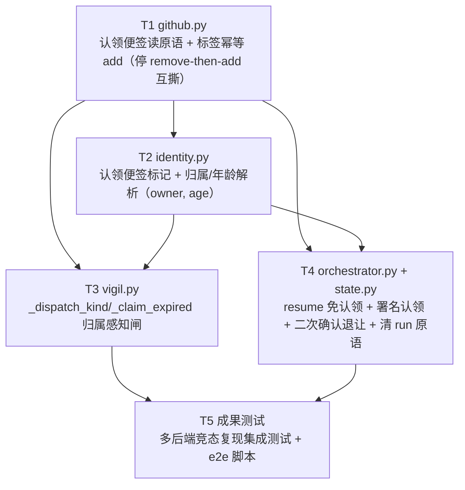

# 0048 · vigil 多后端派单认领去互撕：resume 免认领 + 认领带归属 + 二次确认退让

<!-- 本文件由 spec 工具维护：frontmatter 为结构化源数据（含 tasks DAG），正文为组级 rust-RFC 9 段总览。 -->

## Summary

多台机器同时对同一仓库跑 vigil 时，同一 issue 上的认领标签 `openagents-dispatching`
会被两个后端反复加/去、来回互撕数分钟，直到某方先开出 draft PR 才停。本 spec 分两层根治：
**（止血）** 让 `resume` 路径不再重复认领——认领只在 `fresh` 首次派单打一次；
**（治本）** 给认领**编码 agent 归属**（在既有固定标签之上，追加一条带隐藏签名的「认领评论」作归属凭证），
并在认领后做一次 **read-after-write 二次确认**：若发现 issue 已被别的 agent 更晚认领，本后端**主动退让**
（放弃本轮起草、清掉本地 solving 记录）。结果是：同一 issue 在任一时刻只被**一个**后端有效认领，
其它后端能识别「这是别人的认领」并退让；后端只回收/刷新**自己的**认领、绝不无差别撕掉别人的——
不引入任何外部锁服务 / DB（奥卡姆，理念 1），不追求完整分布式一致性。

## Motivation

**现状（就地复述，不靠裸引用承载）。** vigil 是 OpenAgents 的无人值守守夜循环：每轮 `discover`
扫仓库上带 `openagents` 标签的 issue，对每个 issue 由 `_dispatch_kind`（`openagents/vigil.py:139`）
判定 `fresh` / `resume` / 跳过，然后 `Orchestrator.start_rfc`（`openagents/orchestrator.py:212`）
建隔离 worktree、调后端起草 spec、推分支、开 draft PR。为把「多后端对同一 issue 重复派单」的窗口
从**分钟级**（一次起草几分钟）压到**秒级**，前一轮工作（认领标签方案）引入了第 4 个流程标签
`openagents-dispatching`（`openagents/github.py:72`）：某后端判 `fresh` 决定派单时给 issue 打上它，
其它后端在发现段读到「已带该标签且未过期」即跳过（`vigil.py:161`）；为回收「领了没人干」的死后端占坑，
带一个基于标签时间线年龄的过期回收（`_claim_expired`，`vigil.py:169`，超 `CLAIM_EXPIRY_SECONDS` 判僵尸）。
该方案的 spec 自述**只压概率、不做完整分布式一致性**。

**为什么要改——三层缺陷叠加，把「抢分支」变成了更刺眼、且停不下来的「反复抢标签」。**

1. **check-then-claim 非原子（秒级残留窗口）。** `_dispatch_kind` 读标签（`vigil.py:161`）与
   `_claim_issue` 写标签（`orchestrator.py:333`）之间有时间差；GitHub 标签不是 CAS，两后端在
   「一方写上标签之前」都读到「无标签」→ 双双判 `fresh` → 各自 `begin_run`，各自**本地**
   `state.json` 变成 `solving/pr_number=0`（本地状态互不可见）。这是前一轮已承认、只做概率性压缩的窗口。

2. **resume 绕过认领闸却仍重复认领（致命放大器）。** 两边进 solving 后，每轮 `discover`
   `_dispatch_kind` 命中 `record.status == STATUS_SOLVING and record.pr_number == 0` → 返回
   `"resume"`（`vigil.py:165-166`）；而认领闸只在 `record is None` 分支（`vigil.py:152-164`）——
   **resume 完全绕过去重判定**。更糟：`start_rfc` 的 resume 分支**仍调 `_claim_issue`**
   （`orchestrator.py:236`）。于是两个都在 solving 的后端**每轮都重新认领**。

3. **认领标签无归属 + stamp 是 remove-then-add（互撕的直接原因）。** 标签名固定
   `openagents-dispatching`，**不编码是哪个 agent 认领**；`_claim_issue` → `issue_stamp_label`
   是 remove-then-add（`openagents/github.py:492-493`，为刷新过期时戳而先删后加），remove
   **无差别抹掉 issue 上的标签、不管是谁打的** → 两后端每轮互相撕掉对方标签、贴自己的，无限抖动，
   直到某方先 push 分支 + 开 PR（分支/PR 本身成为去重信号，认领闸之外的另一道闸接管）。

一句话：认领标签本是给 `fresh` 判定用的去重信号，却管不住「已各自进入 solving 的两个后端」，
反被它们的 remove-then-add 反复对撕。**实证时间线**（本仓库 issue #116，两个后端账号 `pcj-sudo` /
`Drifting12345`；来源 `gh api repos/Curry09/OpenAgents/issues/116/timeline`）：

```
06:25:44  pcj-sudo    加 dispatching     ← pcj 认领
06:25:45  Drifting    去 dispatching     ← 1 秒后 Drifting 撕掉别人的认领
06:25:49  Drifting    加 dispatching     ← 换成自己认领
06:29:27  Drifting    去 dispatching
06:29:30  Drifting    加 dispatching
06:32:12  pcj-sudo    去 dispatching     ← pcj 又来撕
06:33:40  Drifting    加 dispatching
```

**期望行为（验收目标）。**
- 两后端进入 solving 后，不再对认领标签反复加/去互撕。
- 同一 issue 在任一时刻只被**一个**后端有效认领；其它后端识别「这是别人的认领」并退让。
- 秒级残留窗口内的双重认领能被**事后检测**并让一方主动退出，不至于走到「各自开 PR 撞车」。
- **反向约束**：`fresh` 首次认领仍要保留（否则退回到方案之前的分钟级重复派单）；
  不引入锁服务 / DB，不追求完整分布式一致性（奥卡姆，理念 1）。

## Guide-level explanation

把认领理解成「在 issue 上按门铃并留一张**署名便签**」，而不是「抢一块无名的牌子」。

- **谁按了铃 + 是谁按的。** 认领仍先打固定标签 `openagents-dispatching`（便宜的「有人在认领」信号，
  随 issue 一起被拉下来、零额外 API），**再在 issue 上贴一条带隐藏签名的「认领便签」评论**
  （`<!-- openagents:claim --> <!-- openagents:agent=<id> -->`）记下**是哪个 agent、什么时候**认领的。
  归属与新鲜度都从「最近一条认领便签」读出——一次读，既知道「是不是我的」，也知道「过没过期」。

- **只动自己的便签，不撕别人的。** 认领刷新不再 remove-then-add 那个无名标签，而是**再贴一条自己的
  新便签**（产生新的时戳）。标签只做幂等 `add`（在就不动）。因此**没有任何一方会去删掉对方的东西**——
  互撕的物理来源被移除。

- **看见别人的便签就退。** 发现段判定：若最近一条认领便签是**别人的**且未过期 → 本后端跳过（不派单）；
  只有便签**是自己的**、或已**过期**（僵尸认领，超 `CLAIM_EXPIRY_SECONDS`）、或**根本没有有效便签**
  时才认领起草。

- **认领后再回头看一眼（二次确认）。** 因为「读—写」非原子，两后端可能几乎同时贴便签。所以贴完自己的
  便签后**重读一次最近便签**：如果最上面那张已经是**别人更晚**贴的，说明我抢慢了 → **主动退让**：
  放弃本轮起草、把本地刚落的 `solving/pr=0` 记录清掉（这样下一轮我会重新变回「看见别人的认领 → 跳过」，
  而不是走 resume 续跑）。评论按 `created_at` 严格有序，最上面一张唯一 → **恰好一个赢家**，其余退让。

- **resume 不再认领。** 一旦我本地已在推进（`solving`），说明认领早已在 `fresh` 首次派单时打过，
  `resume` 意味「我在断点续跑」，**无需也不应重新认领**——从根上止住「两个都在 solving 的后端每轮互撕」。

对使用者/运维：行为上，两台机器同跑同一仓库时，issue 时间线不再出现分钟级的 labeled/unlabeled 抖动；
最多在开跑瞬间看到两条认领便签，随即其中一台打印「检出他方更晚认领，主动退让」并安静退出，另一台开出唯一 draft PR。

## Reference-level explanation

### 技术方案（对照三层缺陷逐层落）

**① 止血 — resume 免认领（对应缺陷 2）。** 删除 `start_rfc` resume 分支里的
`self._claim_issue(...)`（`orchestrator.py:236`）。认领只在 `fresh` 分支首次派单打一次
（`orchestrator.py:244` 保留）。复核 `_release_claim`（`orchestrator.py:335-346`）在「resume 不认领」后
仍自洽（幂等、尽力而为、残留标签无害，不受影响）。此改**不消除**残留窗口①，只止住「进 solving 后反复互撕」。

**② 归属凭证 — 署名认领便签（对应缺陷 3）。** 认领 = 幂等 `add` 固定标签 + 追加一条带**两段隐藏标记**
的 issue 评论：`<!-- openagents:claim -->`（区分「认领便签」与 precheck 对齐评论等其它署名机器评论）
+ 既有 `<!-- openagents:agent=<id> -->` 签名（复用 `identity.sign` / `parse_agent_id`）。
「认领归属 + 年龄」由一个纯解析函数从 issue 评论列表算出：过滤含 claim 标记的评论 → `parse_agent_id`
取 owner → 按 `created_at` 取最新一条 → 返回 `(owner_agent_id, age_seconds)`。
`issue_stamp_label` 的 remove-then-add **不再用于跨后端刷新**（改为「幂等 add 标签 + 贴新便签刷新时戳」），
从而**根除无差别撕别人标签**。过期判定从「标签时间线年龄」迁移到「最近认领便签年龄」（同一 `now - created_at`
语义、跨后端共享时钟，取不到证据时保守判「未过期」，宁可占坑多留一轮也不误回收活后端）。

**③ 二次确认退让 — read-after-write（对应缺陷 1，把非原子 CAS 逼近一次有效认领）。**
`_claim_issue` 贴完**自己的**认领便签后，**重读**最近认领便签：若 owner 是**别的 agent**（对方更晚贴、
或存在他方认领覆盖）→ 抛 `ClaimLost`（`OrchestratorError` 子类）。`start_rfc` 捕获后**退让**：
调用一个新的 state 原语清掉本轮刚 `begin_run` 落下的 `solving/pr=0` 记录（使本后端下一轮回到「record is None
→ 看见他方有效认领 → 跳过」，而**不是** resume 续跑），并把 `ClaimLost` 交给 vigil 发现段既有的
per-issue `except (OrchestratorError, GithubError)` 兜住（`vigil.py:134`）——只跳过该 issue、
下轮重试，绝不拖垮整轮（决策 8）。因评论 `created_at` 严格有序，最新便签唯一 → **恰好一个赢家**、其余退让。

**发现段闸的归属化（`_dispatch_kind` / `_claim_expired`，`vigil.py`）。** `record is None` 分支的认领闸
改为**归属感知**：issue 带 `openagents-dispatching` 标签时（便宜的粗信号，已随 issue 拉下）才读认领便签
（罕见路径、不拖慢常态扫描，与今日 `_claim_expired` 同频）——最近便签是**他人**且未过期 → `None`（退让/跳过）；
已过期（僵尸）或无有效便签 → 落到 `fresh` 回收重认领；是**自己**的僵尸残留 → 亦视 `fresh` 重认领。
`resume` 分支（`record.status==SOLVING and pr_number==0`）**先于** `record is None` 判定、语义完全不受认领闸影响。

### 模块 / DAG / 文件分配



| Task | 拥有文件（互斥） | 关键交付 |
|---|---|---|
| T1 | `openagents/github.py`, `tests/test_github_claim_label.py` | `list_issue_comments` 读原语；认领标签改幂等 `add`（不再 remove-then-add 无差别撕） |
| T2 | `openagents/identity.py`, `tests/test_identity_claim.py` | 认领便签 `claim` 标记常量 + `latest_claim(comments)->（owner_agent_id, age_seconds）\|None` 纯解析 |
| T3 | `openagents/vigil.py`, `tests/test_vigil_claim.py` | `_dispatch_kind`/`_claim_expired` 归属感知（尊重他人认领、只回收过期/无主） |
| T4 | `openagents/orchestrator.py`, `openagents/state.py`, `tests/test_orchestrator_claim.py` | resume 免认领；`_claim_issue` 贴署名便签 + read-after-write `ClaimLost` 退让；state 新增清 run 原语 |
| T5 | `scripts/e2e-spec-0048-vigil-claim-ownership.sh`, `tests/test_claim_dedup_integration.py` | 成果测试：两后端同 issue 竞态复现 → 断言无互撕 + 唯一赢家 + resume 零新认领事件 |

文件跨 Task 互斥（理念 6 单一 writer）：`github.py`(T1) / `identity.py`(T2) / `vigil.py`(T3) /
`orchestrator.py`+`state.py`(T4) / 脚本+集成测试(T5) 无重叠。

### 成果测试（理念 8）与 e2e 脚本

**浏览器 e2e 适用性自检：不适用。** 本 feature 是后端 GitHub 标签/评论并发时序问题，
**无任何产品前端界面可驱动**（无导航/交互/截图可断言的视觉成果）。因此成果测试形态为
**确定性并发复现**（pytest 集成测试 + 一条 shell e2e 脚本跑它并打印证据），而非浏览器 e2e。

- **集成测试** `tests/test_claim_dedup_integration.py`：用内存假 GitHub（标签集合 + 评论账本，
  记录每次 labeled/unlabeled/comment 事件）驱动**两个** `Orchestrator`+`State` 实例（两个 agent_id）
  对**同一** issue 竞态，断言：
  1. 二者几乎同时判 `fresh` 起草 → 恰好**一个**成功开 draft PR，另一个抛 `ClaimLost` 退让并清空本地 solving；
  2. 全程**零 unlabeled 事件**（不再无差别撕标签）；便签评论只增不删；
  3. 两者都进入 `solving/pr=0` 的场景下多轮 `_dispatch_kind` 走 resume → **不产生任何新的 labeled/comment 认领事件**；
  4. 僵尸认领（便签年龄 > `CLAIM_EXPIRY_SECONDS`）能被他方回收重认领。
- **e2e 脚本** `scripts/e2e-spec-0048-vigil-claim-ownership.sh`：`ruff` + 定向 `pytest`
  上述集成测试 + `spec validate`，把「无 unlabeled 互撕事件 / 唯一赢家 / resume 零新事件」三条断言的
  通过输出作为可复现证据（被 PR 指路牌自动收录）。

## Drawbacks

- **多一条 issue 评论。** 每次 `fresh` 认领（及僵尸回收）会在 issue 上留一条隐藏签名的认领便签，
  刷新认领也追加新便签——issue 评论区会多出机器噪声（虽被 `<!-- ... -->` 隐藏、GitHub 不渲染，但
  `gh` raw body 可见）。缓解：便签简短、带 claim 标记可被过滤；且 resume 免认领后刷新频次大幅下降。
- **发现段多一次读评论 API。** 认领闸判归属时需读该 issue 评论（仅在 issue 已带认领标签的罕见路径，
  与今日 `_claim_expired` 同频），比纯读标签多一次 `gh` 调用；常态「无标签直接 fresh」路径零变化。
- **仍不是真 CAS。** read-after-write 退让把双重认领概率进一步压低、并保证「便签有序 → 唯一赢家」，
  但两后端在贴便签前的极窄窗口理论上仍可能都未见对方便签而双双起草（末位由 `created_at` 定胜负后退让化解）；
  不追求完整分布式一致性是本 spec 的显式取舍（理念 1）。
- **过期回收数据源迁移。** 过期判定从标签时间线年龄改为便签年龄，需保证「首次认领」「僵尸回收」
  两种情形便签年龄都良定义（贴新便签即产生新 `created_at`），否则回收逻辑退化。

## Rationale and alternatives

**为何选「固定标签(粗信号) + 署名便签(归属凭证) + 二次确认退让」。** 它在**不引入锁服务/DB**
（奥卡姆）的前提下同时解掉三层缺陷：便签给了标签所缺的**归属**（缺陷 3），「只贴自己便签、幂等 add 标签」
根除**无差别 remove 互撕**（缺陷 3 的物理来源），read-after-write 退让把**非原子窗口**（缺陷 1）
逼近一次有效认领，resume 免认领止住**放大器**（缺陷 2）。复用既有 `identity` 署名/解析原语，新增面极小。

**备选 A：动态归属标签 `dispatching:<agent_id>`（issue 建议修法 2·1 的标签变体）。**
每个 agent 用自己的标签认领，只回收/刷新自己的。优点：归属留在标签层、发现段仍只读标签、无需读评论。
缺点：需为每个 agent **动态创建 label**（`ensure_prerequisites` 的幂等自举只预建固定的 4 个流程标签），
标签会随 agent 增殖污染仓库标签空间，且「过期回收别家标签」又要跨 agent 删标签、退回互删风险；
时戳仍需 remove-then-add 自家标签。**取舍**：评论账本天然 append-only、有序、自带 `created_at` 与作者，
比动态标签更契合「只增不删 + 唯一赢家」的需求，故不选 A。

**备选 B：只做阶段一止血（resume 免认领），不做归属/退让。** 最小改，能止住「进 solving 后互撕」。
缺点：残留窗口①与「无归属标签仍会被 fresh 首认领时的 remove-then-add 撕一次」未解，仍可能偶发各自开 PR。
**取舍**：issue 明确倾向「阶段一止血 → 阶段二 1+2 组合治本」，只做 B 达不到「同一 issue 任一时刻单一有效认领」
的期望行为，故 B 仅作为 T4 的第一步、不作为终态。

**备选 C：PR 层兜底去重（按 issue 号检测重复 draft PR、自动关较晚/较空者）作为主线。**
issue 建议修法 2·3。缺点：是「最后防线、不替代 1/2」，且自动关别人的 PR 破坏性更大、判定「较空」易误伤。
**取舍**：本 spec 以「认领层根治」为主线，PR 层兜底列入 Future possibilities，不作为主交付。

## Prior art

- **rust-lang/rfcs 的 RFC 形态**（本 spec 9 段结构本身，https://github.com/rust-lang/rfcs）。
- **乐观并发控制 / read-after-write**：本设计的「贴便签→重读→末位退让」等价于无锁乐观 CAS 的
  「compare-and-retreat」，是无中心协调者场景的常见弱一致手法（对比 DB 的 `SELECT ... FOR UPDATE` 悲观锁，
  这里刻意选乐观以避免引入锁服务）。
- **本仓库前序认领标签方案**（第 4 个流程标签 + 过期回收）是本 spec 的直接改造对象——现状与其缺陷已在
  Motivation 就地复述完整，本节仅作线索，不承载理解本 spec 所需的任何必要信息。

## Unresolved questions

- **`CLAIM_EXPIRY_SECONDS` 是否需要因「便签年龄」语义微调？** 迁移数据源后过期阈值是否仍取原值，
  留待实现时用集成测试标定（T5）。
- **认领便签是否需要在开出 draft PR 后清理/归档？** 当前 `_release_claim` 只摘标签；便签留存有审计价值
  但增噪声，是否加一条「已开 PR」收尾便签或折叠旧便签，待评审确认。
- **两后端便签 `created_at` 撞同一秒的 tie-break。** 概率极低；是否需要 `agent_id` 字典序等确定性
  tie-break，还是交给 PR 层兜底（Future possibilities），待评审取舍。

## Future possibilities

- **PR 层兜底去重（备选 C 落地）**：偶发双开时按 issue 号检测重复 draft PR、自动关掉较晚/较空的一个，
  作为认领层之外的最后一道防线（不替代本 spec 的归属+退让）。
- **认领便签折叠/清理**：开 PR 后归档历史认领便签，降低 issue 评论噪声。
- **把「认领」抽象成可复用的轻量租约原语**：若未来更多跨后端资源（分支、worktree、评审配额）也需
  去重，可把「署名便签 + 二次确认退让」提炼成通用租约模块。

