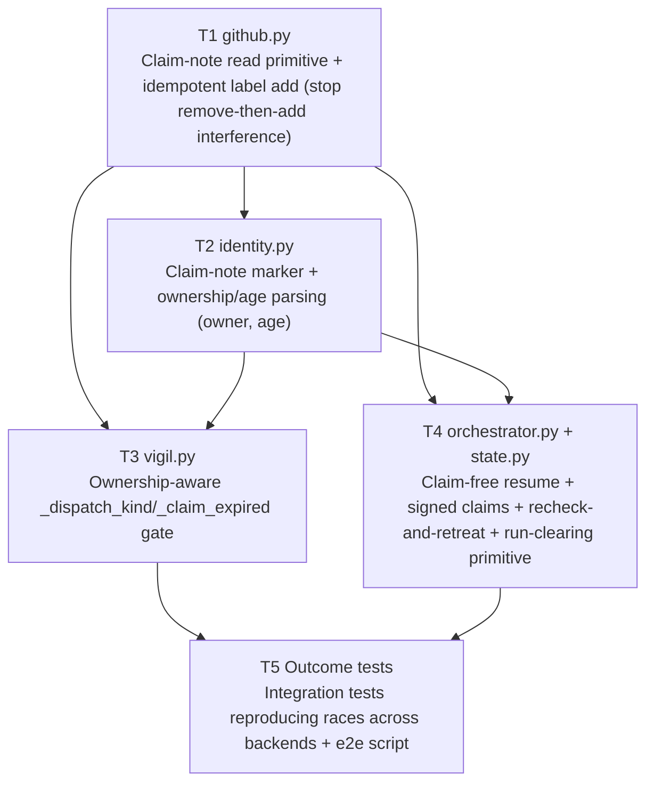

# 0049 · vigil multi-backend dispatch claims without mutual interference: no claims on resume + claim ownership + confirmation and yielding

<!-- This file is maintained by the spec tool: frontmatter is the structured source data (including the tasks DAG), and the body is a group-level overview in the nine rust-RFC sections. -->

## Summary

When multiple machines run vigil against the same repository simultaneously, two backends repeatedly add and remove the claim label `openagents-dispatching`
on the same issue, overwriting each other's claims for minutes until one of them opens a draft PR. This spec addresses the root causes in two layers:
**(Immediate mitigation)** Stop claiming again on the `resume` path—claim only once, on the initial `fresh` dispatch;
**(Root-cause fix)** **Encode agent ownership** in claims (in addition to the existing fixed label, append a “claim comment” with a hidden signature as proof of ownership),
and perform a **read-after-write confirmation** after claiming: if the issue has subsequently been claimed by another agent, this backend **actively yields**
(abandons drafting for this round and clears its local solving record). The result is that, at any given moment, the same issue is effectively claimed by only **one** backend;
other backends can recognize “this is someone else's claim” and yield. A backend reclaims/refreshes only **its own** claims and never indiscriminately removes someone else's—
without introducing any external lock service / DB (Occam's razor, Principle 1), and without pursuing full distributed consistency.

## Motivation

**Current behavior (restated here rather than left to bare references).** Vigil is OpenAgents' unattended overnight loop: each round, `discover`
scans the repository for issues labeled `openagents`. For each issue, `_dispatch_kind` (`openagents/vigil.py:139`)
determines `fresh` / `resume` / skip, and then `Orchestrator.start_rfc` (`openagents/orchestrator.py:212`)
creates an isolated worktree, invokes a backend to draft the spec, pushes the branch, and opens a draft PR. To shrink the window for “multiple backends dispatching the same issue”
from **minutes** (drafting takes several minutes) to **seconds**, the previous round of work (the claim-label approach) introduced a fourth workflow label,
`openagents-dispatching` (`openagents/github.py:72`): when a backend determines `fresh` and decides to dispatch, it applies this label to the issue;
other backends skip the issue if discovery finds “this label is already present and has not expired” (`vigil.py:161`). To reclaim slots occupied by dead backends that “claimed but did no work,”
the approach includes expiration-based reclamation using the label's age in the timeline (`_claim_expired`, `vigil.py:169`; a claim is considered a zombie
once it exceeds `CLAIM_EXPIRY_SECONDS`).
That approach's spec explicitly states that it **only reduces the probability and does not provide full distributed consistency**.

**Why change it—three overlapping defects turn “racing for a branch” into the more conspicuous and relentless “repeated racing for a label.”**

1. **Non-atomic check-then-claim (a residual window of seconds).** There is a time gap between `_dispatch_kind` reading labels (`vigil.py:161`) and
   `_claim_issue` writing a label (`orchestrator.py:333`); GitHub labels are not CAS. Both backends can read “no label”
   before either writes it → both determine `fresh` → each calls `begin_run`, and each **local**
   `state.json` becomes `solving/pr_number=0` (their local states are invisible to each other). This is the window acknowledged in the previous round, which only reduced its probability.

2. **resume bypasses the claim gate yet still claims again (the fatal amplifier).** After both sides enter solving, each round of `discover`
   has `_dispatch_kind` match `record.status == STATUS_SOLVING and record.pr_number == 0` → return
   `"resume"` (`vigil.py:165-166`); the claim gate exists only in the `record is None` branch (`vigil.py:152-164`)—
   **resume completely bypasses the deduplication check**. Worse, the resume branch of `start_rfc` **still calls `_claim_issue`**
   (`orchestrator.py:236`). As a result, the two backends in solving **claim again every round**.

3. **The claim label has no owner + stamping uses remove-then-add (the direct cause of mutual interference).** The label name is fixed,
   `openagents-dispatching`, and **does not encode which agent claimed it**; `_claim_issue` → `issue_stamp_label`
   uses remove-then-add (`openagents/github.py:492-493`, removing and then adding to refresh the expiration timestamp). The removal
   **indiscriminately erases the label on the issue, regardless of who applied it** → every round, the two backends remove each other's label and apply their own, oscillating indefinitely,
   until one pushes a branch + opens a PR first (the branch/PR itself becomes a deduplication signal, and another gate outside the claim gate takes over).

In one sentence: the claim label was intended as a deduplication signal for the `fresh` decision, but it cannot control “two backends that have each already entered solving”;
instead, their remove-then-add operations repeatedly overwrite each other's claims. **Observed timeline** (issue #116 in this repository, with backend accounts `pcj-sudo` /
`Drifting12345`; source: `gh api repos/Curry09/OpenAgents/issues/116/timeline`):

```
06:25:44  pcj-sudo    add dispatching       ← pcj claims
06:25:45  Drifting    remove dispatching    ← 1 second later, Drifting removes someone else's claim
06:25:49  Drifting    add dispatching       ← replaces it with its own claim
06:29:27  Drifting    remove dispatching
06:29:30  Drifting    add dispatching
06:32:12  pcj-sudo    remove dispatching    ← pcj removes it again
06:33:40  Drifting    add dispatching
```

**Expected behavior (acceptance criteria).**
- After both backends enter solving, they no longer repeatedly add/remove the claim label and overwrite each other's claims.
- At any given moment, the same issue is effectively claimed by only **one** backend; other backends recognize “this is someone else's claim” and yield.
- Double claims within the residual window of seconds can be **detected after the fact**, causing one side to withdraw voluntarily before they reach “each opens a PR and collides.”
- **Constraints in the other direction**: the initial `fresh` claim must remain (otherwise duplicate dispatch returns to the minutes-long window that existed before the approach);
  introduce no lock service / DB, and do not pursue full distributed consistency (Occam's razor, Principle 1).

## Guide-level explanation

Think of a claim as “ringing the doorbell on an issue and leaving a **signed note**,” rather than “grabbing an anonymous sign.”

- **Someone rang the bell + who rang it.** Claiming still first applies the fixed label `openagents-dispatching` (a cheap “someone is claiming this” signal,
  fetched along with the issue with zero additional API calls), **then posts a “claim note” comment with a hidden signature on the issue**
  (`<!-- openagents:claim --> <!-- openagents:agent=<id> -->`) recording **which agent claimed it and when**.
  Both ownership and freshness are read from “the latest claim note”—one read tells us both “is it mine?” and “has it expired?”

- **Only touch your own notes; do not tear down someone else's.** Refreshing a claim no longer uses remove-then-add on the anonymous label; instead, **post another new note of your own**
  (creating a new timestamp). The label is only added idempotently with `add` (leave it alone if already present). Thus, **neither side deletes anything belonging to the other**—
  the physical source of the interference is removed.

- **Yield when you see someone else's note.** During discovery: if the latest claim note belongs to **someone else** and has not expired → this backend skips the issue (does not dispatch);
  claim and draft only when the note **is your own**, has **expired** (a zombie claim exceeding `CLAIM_EXPIRY_SECONDS`), or **there is no valid note at all**.

- **Look back once after claiming (confirmation).** Because “read—write” is not atomic, two backends may post notes almost simultaneously. After posting its own
  note, a backend therefore **rereads the latest note**: if the topmost note was posted **later by someone else**, it means I lost the race → **actively yield**:
  abandon drafting for this round and clear the local `solving/pr=0` record just written (so that next round I return to “see someone else's claim → skip,”
  rather than continuing through resume). Comments are strictly ordered by `created_at`, so the topmost note is unique → **exactly one winner**, with all others yielding.

- **resume no longer claims.** Once I am already making progress locally (`solving`), the claim was made during the initial `fresh` dispatch;
  `resume` means “I am continuing from a checkpoint,” so **there is no need to claim again, nor should I**—eliminating at the source the behavior where “two backends in solving overwrite each other's claims every round.”

For users/operators: when two machines run against the same repository, the issue timeline no longer shows minutes of labeled/unlabeled oscillation;
at most, two claim notes appear at startup, after which one machine prints “Detected a later claim by another agent; yielding” and exits quietly, while the other opens the sole draft PR.

## Reference-level explanation

### Technical approach (addressing the three layers of defects in turn)

**① Immediate mitigation — no claims on resume (addresses defect 2).** Remove
`self._claim_issue(...)` from the resume branch of `start_rfc` (`orchestrator.py:236`). Claim only once, on the initial dispatch in the `fresh` branch
(retain `orchestrator.py:244`). Verify that `_release_claim` (`orchestrator.py:335-346`) remains coherent after
“resume no longer claims” (idempotent, best-effort, harmless leftover labels; unaffected). This change **does not eliminate** residual window ①; it only stops “repeated mutual interference after entering solving.”

**② Proof of ownership — signed claim notes (addresses defect 3).** Claim = idempotently `add` the fixed label + append an issue comment with **two hidden markers**:
`<!-- openagents:claim -->` (distinguishing “claim notes” from other signed machine comments, such as precheck alignment comments)
+ the existing `<!-- openagents:agent=<id> -->` signature (reusing `identity.sign` / `parse_agent_id`).
A pure parsing function computes “claim ownership + age” from the issue's comment list: filter for comments containing the claim marker → use `parse_agent_id`
to obtain the owner → select the latest by `created_at` → return `(owner_agent_id, age_seconds)`.
The remove-then-add behavior of `issue_stamp_label` **is no longer used for refreshes across backends** (replaced by “idempotently add the label + post a new note to refresh the timestamp”),
thereby **eliminating indiscriminate removal of other agents' labels**. Expiration detection moves from “label timeline age” to “age of the latest claim note” (the same `now - created_at`
semantics, with a clock shared across backends; if evidence cannot be obtained, conservatively treat it as “not expired,” preferring to leave a slot occupied for one more round over mistakenly reclaiming it from a live backend).

**③ Confirmation and yielding — read-after-write (addresses defect 1, approximating a single effective claim despite non-atomic CAS).**
After `_claim_issue` posts **its own** claim note, it **rereads** the latest claim note: if the owner is **another agent** (the other agent posted later,
or another agent's claim has superseded it) → raise `ClaimLost` (a subclass of `OrchestratorError`). `start_rfc` catches it and **yields**:
call a new state primitive to clear the `solving/pr=0` record just written by `begin_run` in this round (so that this backend returns next round to “record is None
→ see another agent's valid claim → skip,” **rather than** continuing through resume), and pass `ClaimLost` to the existing
per-issue `except (OrchestratorError, GithubError)` handler in vigil discovery (`vigil.py:134`)—skip only this issue,
retry next round, and never bring down the entire round (Decision 8). Because comments are strictly ordered by `created_at`, the latest note is unique → **exactly one winner**, with all others yielding.

**Make the discovery gate ownership-aware (`_dispatch_kind` / `_claim_expired`, `vigil.py`).** Change the claim gate in the `record is None` branch
to be **ownership-aware**: read claim notes only when the issue has the `openagents-dispatching` label (a cheap coarse signal already fetched with the issue)
(a rare path that does not slow normal scanning, with the same frequency as today's `_claim_expired`)—if the latest note belongs to **someone else** and has not expired → `None` (yield/skip);
if expired (a zombie) or there is no valid note → fall through to `fresh` to reclaim it; a zombie remnant belonging to **this agent** → likewise treat as `fresh` and claim again.
The `resume` branch (`record.status==SOLVING and pr_number==0`) is evaluated **before** `record is None`, and its semantics are entirely unaffected by the claim gate.

### Modules / DAG / File Allocation



| Task | Owned files (exclusive) | Key deliverables |
|---|---|---|
| T1 | `openagents/github.py`, `tests/test_github_claim_label.py` | `list_issue_comments` read primitive; change claim-label operations to idempotent `add` (no more indiscriminate removal through remove-then-add) |
| T2 | `openagents/identity.py`, `tests/test_identity_claim.py` | Claim-note `claim` marker constant + pure parsing via `latest_claim(comments)->（owner_agent_id, age_seconds）\|None` |
| T3 | `openagents/vigil.py`, `tests/test_vigil_claim.py` | Ownership-aware `_dispatch_kind`/`_claim_expired` (respect others' claims; reclaim only expired/unowned claims) |
| T4 | `openagents/orchestrator.py`, `openagents/state.py`, `tests/test_orchestrator_claim.py` | Claim-free resume; `_claim_issue` posts a signed note + read-after-write `ClaimLost` retreat; add a run-clearing primitive to state |
| T5 | `scripts/e2e-spec-0049-vigil-claim-ownership.sh`, `tests/test_claim_dedup_integration.py` | Outcome tests: reproduce two backends racing on the same issue → assert no mutual label removal + a unique winner + zero new claim events on resume |

Files are exclusive across Tasks (Principle 6: single writer): `github.py`(T1) / `identity.py`(T2) / `vigil.py`(T3) /
`orchestrator.py`+`state.py`(T4) / script+integration tests(T5) do not overlap.

### Outcome Tests (Principle 8) and e2e Script

**Browser e2e applicability self-check: not applicable.** This feature concerns concurrent timing of backend GitHub label/comment operations,
with **no product frontend interface to drive** (no visual outcomes that can be asserted through navigation/interactions/screenshots). The outcome tests therefore take the form of
**deterministic concurrency reproduction** (pytest integration tests + one shell e2e script that runs them and prints evidence), rather than browser e2e.

- **Integration tests** `tests/test_claim_dedup_integration.py`: use an in-memory fake GitHub (a label set + a comment ledger,
  recording every labeled/unlabeled/comment event) to drive **two** `Orchestrator`+`State` instances (two agent_id values)
  racing on the **same** issue, and assert:
  1. Both classify it as `fresh` and begin drafting almost simultaneously → exactly **one** successfully opens a draft PR; the other raises `ClaimLost`, retreats, and clears its local solving state;
  2. **Zero unlabeled events** throughout (no more indiscriminate label removal); note comments are only added, never deleted;
  3. When both have entered `solving/pr=0`, multiple rounds of `_dispatch_kind` take the resume path → **no new labeled/comment claim events are generated**;
  4. A zombie claim (note age > `CLAIM_EXPIRY_SECONDS`) can be reclaimed and claimed anew by another agent.
- **e2e script** `scripts/e2e-spec-0049-vigil-claim-ownership.sh`: `ruff` + targeted `pytest`
  for the integration tests above + `spec validate`, using the passing output of the three assertions
  “no unlabeled mutual-removal events / unique winner / zero new events on resume” as reproducible evidence (automatically included by the PR signpost).

## Drawbacks

- **One more issue comment.** Each `fresh` claim (and zombie reclamation) leaves a claim note with a hidden signature on the issue,
  and refreshing a claim also appends a new note—adding machine-generated noise to the issue comments (although hidden by `<!-- ... -->` and not rendered by GitHub,
  it remains visible in the `gh` raw body). Mitigation: keep notes short and filterable by their claim marker; claim-free resume also greatly reduces refresh frequency.
- **One additional comment-read API call during discovery.** Determining ownership at the claim gate requires reading the issue's comments (only on the rare path
  where the issue already carries a claim label, at the same frequency as today's `_claim_expired`), adding one `gh` call compared with reading labels alone; the normal
  “no label, directly fresh” path is unchanged.
- **Still not true CAS.** Read-after-write retreat further reduces the probability of double claims and guarantees “ordered notes → a unique winner,”
  but in the extremely narrow window before the two backends post their notes, both could theoretically fail to see the other's note and both begin drafting (resolved by retreat after
  `created_at` determines the winner based on the last position);
  not pursuing full distributed consistency is an explicit tradeoff in this spec (Principle 1).
- **Migration of the data source for expiry reclamation.** Expiry determination changes from label timeline age to note age, so note age must be well-defined
  for both “initial claim” and “zombie reclamation” (posting a new note produces a new `created_at`); otherwise, the reclamation logic degrades.

## Rationale and alternatives

**Why choose “fixed label (coarse signal) + signed note (proof of ownership) + recheck-and-retreat.”** Without **introducing a lock service/DB**
(Occam's razor), it addresses three layers of defects at once: the note supplies the **ownership** missing from the label (defect 3); “post only your own note and add the label idempotently”
eliminates **indiscriminate mutual removal** (the physical source of defect 3); read-after-write retreat brings the **non-atomic window** (defect 1)
closer to a single effective claim; and claim-free resume stops the **amplifier** (defect 2). It reuses existing `identity` signing/parsing primitives, with a very small addition surface.

**Alternative A: dynamic ownership labels `dispatching:<agent_id>` (a label variant of the issue's proposed fix 2·1).**
Each agent claims with its own label and reclaims/refreshes only its own. Advantages: ownership stays at the label layer, discovery still reads only labels, and no comment reads are needed.
Disadvantages: a label must be **created dynamically for each agent** (the idempotent bootstrap in `ensure_prerequisites` pre-creates only the fixed 4 workflow labels);
labels proliferate with agents and clutter the repository's label namespace, while “reclaim another agent's expired label” again requires deleting labels across agents, returning to the risk of mutual deletion;
timestamps still require remove-then-add on the agent's own label. **Tradeoff**: the comment ledger is naturally append-only and ordered, and comes with `created_at` and an author,
making it a better fit than dynamic labels for the requirement “add only, never delete + unique winner”; therefore A is not selected.

**Alternative B: implement only the phase-one mitigation (claim-free resume), without ownership/retreat.** The smallest change, capable of stopping “mutual removal after entering solving.”
Disadvantages: residual window ① and “a label without ownership is still removed once by remove-then-add during an initial fresh claim” remain unresolved, so each backend could still occasionally open its own PR.
**Tradeoff**: the issue explicitly favors “phase-one mitigation → phase-two combination of 1+2 to address the root cause”; B alone cannot achieve the expected behavior of “a single effective claim on the same issue at any given time.”
B is therefore only the first step of T4, not the final state.

**Alternative C: make PR-level fallback deduplication the main approach (detect duplicate draft PRs by issue number and automatically close the later/less substantial one).**
The issue's proposed fix 2·3. Disadvantages: it is “the last line of defense, not a substitute for 1/2”; automatically closing someone else's PR is also more destructive, and judging which is “less substantial” can easily close the wrong one.
**Tradeoff**: this spec takes “addressing the root cause at the claim layer” as its main approach, and lists PR-level fallback under Future possibilities rather than making it a primary deliverable.

## Prior art

- **The RFC format used by rust-lang/rfcs** (the 9-section structure of this spec itself, https://github.com/rust-lang/rfcs).
- **Optimistic concurrency control / read-after-write**: this design's “post a note → reread → retreat based on the last position” is equivalent to
  “compare-and-retreat” in lock-free optimistic CAS, a common weak-consistency technique in scenarios without a central coordinator (compare the pessimistic lock of a DB's `SELECT ... FOR UPDATE`;
  optimism is deliberately chosen here to avoid introducing a lock service).
- **This repository's preceding claim-label scheme** (the 4th workflow label + expiry reclamation) is the direct target of this spec's changes—the current state and its defects have already been
  restated in full in Motivation. This section provides only a reference and carries no information essential to understanding this spec.

## Unresolved questions

- **Does `CLAIM_EXPIRY_SECONDS` need adjustment for the semantics of “note age”?** Whether the expiry threshold should retain its original value after
  migrating the data source is left for calibration through integration tests during implementation (T5).
- **Should claim notes be cleaned up/archived after a draft PR is opened?** Currently, `_release_claim` only removes the label; retaining notes has audit value
  but adds noise. Whether to add a closing “PR opened” note or collapse old notes awaits review.
- **Tie-breaking when the two backends' note `created_at` values fall within the same second.** The probability is extremely low; whether a deterministic
  tie-break such as lexicographic `agent_id` order is needed, or whether to leave it to the PR-level fallback (Future possibilities), awaits review.

## Future possibilities

- **PR-level fallback deduplication (implementing alternative C)**: when duplicate PRs are occasionally opened, detect duplicate draft PRs by issue number and automatically close the later/less substantial one,
  as the final line of defense beyond the claim layer (not a substitute for this spec's ownership+retreat).
- **Claim-note collapsing/cleanup**: archive historical claim notes after opening a PR to reduce noise in issue comments.
- **Abstract “claiming” into a reusable lightweight lease primitive**: if more resources shared across backends (branches, worktrees, review quotas) also need
  deduplication in the future, “signed note + recheck-and-retreat” can be extracted into a general-purpose lease module.
