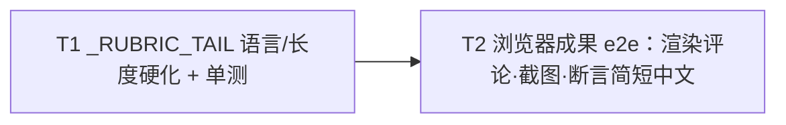

# 0050 · Review 不通过理由增强可读性：强制 reviewer 反馈输出为一段简短中文

<!-- 本文件由 spec 工具维护：frontmatter 为结构化源数据（含 tasks DAG），正文为组级 rust-RFC 9 段总览。 -->

## Summary

给评审闸的 reviewer 输出格式规约（`openagents/reviewer.py` 的 `_RUBRIC_TAIL` 常量）加一条**硬性语言/长度约束**：reviewer 回复里所有**面向人类的裁决理由**（`REASON` / `ISSUES` / `NEXT` 等裁决行之后的正文）必须用**一段简短的中文**书写——直击要害、避免长篇英文与逐行英文堆砌，让盯 PR 的人能在 GitHub 评审评论里**直接读懂并处理**。落点是 `_RUBRIC_TAIL` 一处纯 prompt 文本硬化（因它被 code / rfc 两道闸共享，改一处即两道闸同时生效）+ 把示例里的 `REASON`/`ISSUES` 示范文案显式写成简短中文 + 覆盖该文本的单测 + 一条**浏览器成果 e2e**（把真实 `render_decision` 产出的评审评论渲染成页面、截图、断言「反馈摘要」块为简短中文）。不改任何运行时行为、不动裁决解析/聚合/渲染/发帖链路。

## Motivation

**现状（背景就地复述，不靠裸引用）**：评审闸把「人眼看代码/看 spec」这一侧换成了 reviewer agent 的裁决（见本仓库 reviewer 模块）。流程是——`openagents/reviewer.py` 的 `review()` 用一段 review 任务模板调真实 backend（claude/codex 等）跑 N 个 reviewer，每个 reviewer 的自由文本 `AgentResult.summary` 先被 `_parse_verdict` 抽出首行的 `VERDICT: <PASS/REWORK/RETHINK>` token，再由 `_distill_feedback` 剥掉内心独白后，把非 PASS 的理由聚合进 `ReviewDecision.feedback`；最后 `render_decision()` 把它渲染成一段 Markdown 评论（抬头 `## 评审闸裁决`，含 `- 类型`/`- 裁决`/`- 票数`/`- 票型`，以及一个围栏包裹的 `- 反馈摘要：` 块），由 orchestrator 经 `identity.post_signed_comment` 发到 GitHub PR。**「反馈摘要」块里的文字，就是人类在 GitHub 上判断该怎么改的唯一依据。**

**问题**：reviewer 的裁决理由是真实 LLM 产出的自由文本。当前 `_RUBRIC_TAIL` 里对输出格式的约束只有两条——(1)「第一行必须是 `VERDICT: <token>`」（裁决前置，防截断，见下文 Prior art）；(2) 给了 `REASON: <一句话…>` / `ISSUES:\n- <文件:行号 + 具体问题>` 两个**中文示例**。但**整份 rubric 从没有一句明确规定 reviewer 回复该用什么语言**——中文示例只是「偏置」（bias）模型倾向中文，并非硬约束。实测结果是：reviewer 经常输出**长篇英文**的理由总结，塞进「反馈摘要」块后又长又是英文，**盯 PR 的中国用户根本读不动**，无法在 GitHub 上直接据此处理，只能再花力气翻译/精读，评审闸「把人从细节里抽离、只做宏观把控」（CLAUDE.md 设计理念）的收益被这层可读性障碍吃掉。

**为什么现有约束挡不住**：`_parse_verdict` 只关心首行 token，对理由正文的语言/长度不设限；`_distill_feedback` 只按启发式剥离第一人称过程叙述（scratchpad），**既不翻译也不裁长**——语言与篇幅是 LLM 自由文本的固有属性，代码层无法事后把英文变成中文、把长文变短。因此「理由必须是简短中文」这条约束**只能在 prompt 里下硬要求**：这正是 issue #124 的诉求原文——「需要在相应 prompt 里强化要求必须输出为一段简短的中文，这样人类才能在 github 中直接处理」。缺的就是 `_RUBRIC_TAIL` 里那一句把「用简短中文」从「示例偏置」升级为「硬性规约」。

## Guide-level explanation

落地后，reviewer 收到的输出格式规约会多一条**语言/长度硬要求**，其余判断逻辑不变：

- reviewer 仍然**第一行输出 `VERDICT: <token>`**（裁决前置不变，防截断收益保留）。
- 裁决行**之后**的所有面向人类的理由（`REASON` / `ISSUES` / `NEXT`），rubric 现在明确要求：
  - **语言**：必须用**中文**书写（无论 reviewer 内部以什么语言推理，最终给人看的理由一律译成中文）；
  - **篇幅**：**一段简短**、直击要害——`REASON` 一句话点出核对的关键验证标准；`ISSUES` 用简短中文条目（`文件:行号 + 一句话问题`），避免长篇英文论证、避免把内部推理原文照搬；
  - **目的明示**：这段理由是给「盯 PR 的人」在 GitHub 评论里**直接读懂并处理**用的，不是给模型自己看的过程记录。
- 示例文案也同步改成**简短中文示范**（PASS/REWORK 两个例子都用中文，作为「长度 + 语言」的正样板）。

对**盯 PR 的人**：REWORK 评论的「反馈摘要」块从「一大段英文」变成「一段能一眼读懂的简短中文」，看完即知卡在哪、下一步改什么，不必再翻译或通读长文。这与本仓库的 **软约定硬化** 思路一致——把「reviewer 最好用中文简短说」这条软期望，写成 rubric 里的硬性输出规约（其可机验证的操作化判据 = 成果 e2e 里对「反馈摘要」块的 **中文字符占比 ≥ 阈值 + 长度 ≤ 阈值** 断言，见 Reference-level）。

## Reference-level explanation

本 feature 分解为 2 个 Task（DAG 见文末；`files` 全组互斥，各 Task 单一 writer）。**这是一次纯 prompt 文本硬化 + 测试 + 浏览器成果 e2e 的改动，不新增任何运行时模块，不改裁决解析（`_parse_verdict`）/聚合（`review`）/渲染（`render_decision`）/发帖（orchestrator·identity）链路的行为**——「理由用简短中文」这层约束天然属于 reviewer 的输出格式规约（`_RUBRIC_TAIL`），改文本即改要求。

### 一处 prompt 文本硬化（`openagents/reviewer.py` 的 `_RUBRIC_TAIL`，T1）

`_RUBRIC_TAIL` 被 `_CODE_REVIEW_TASK` 与 `_RFC_REVIEW_TASK` **共享**（拼在两个任务模板末尾），因此改这一处即**两道闸同时生效**（DRY，奥卡姆）。改动为**追加**一条硬要求 + 把既有示例文案显式中文化，`_RUBRIC_TAIL` 现有的「第一行必须 VERDICT」不变量与其余措辞全部保留：

1. **追加语言/长度硬规则**：在「所有理由、证据、问题列表一律写在裁决行之后」之后，加入一句明确规约——「**面向人类的裁决理由（REASON/ISSUES/NEXT）必须用一段简短的中文书写**：直击要害、只讲结论与可操作的下一步，避免长篇英文、避免逐行英文堆砌、避免照搬内部推理原文。这段话是给盯 PR 的人在 GitHub 评论里直接读懂并处理用的。」措辞与既有 `_RUBRIC_TAIL` 同为「硬性」语气，与裁决前置规则并列。
2. **示例中文化 + 收短**：把 `REASON: <一句话说明核对的关键验证标准>` / `ISSUES:\n- <文件:行号 + 具体问题>` / `NEXT: <修复方向>` 三处占位维持中文并强调「一句话/简短」，作为「简短中文」的正样板（示例本已中文，此处显式绑定「简短」语义、避免被当成可长可短）。

**不变量**：`_RUBRIC_TAIL` 的「第一行必须 `VERDICT: <token>`、理由写在裁决行之后、截断丢尾部论证而非裁决」全部保留；`_parse_verdict`（只看首行 token）、`_distill_feedback`（剥 scratchpad）、`render_decision`（渲染评论）、`review`（聚合）等逻辑**零改动**。因本条约束只作用于「裁决行之后的理由正文」，与「裁决前置」正交、互不削弱。

### 单测（`tests/test_reviewer.py`，T1）

与 `reviewer.py` 同 Task（两文件天然一组，TDD）。新增断言：
- `_RUBRIC_TAIL` 文本含「简短」+「中文」+ 面向 REASON/ISSUES/NEXT 的语言约束字样（如「面向人类的裁决理由…必须用一段简短的中文」）；
- 该约束**同时出现在** `_task_for(kind="code")` 与 `_task_for(kind="rfc")` 生成的完整任务文本里（证明共享 tail 使两道闸都被覆盖）；
- 既有不变量单测仍绿：裁决前置（首行 `VERDICT:`）、`_parse_verdict` 首行优先/裸 token 回退、`render_decision` 的 PASS/REWORK/评审无效三态渲染、`_distill_feedback` 行为——均不受本次文本追加影响。

### 端到端验证（脚本路径 = 本组 e2e 脚本，T2）

**脚本**：`bash scripts/e2e-spec-0050-review-reason-chinese-readability.sh`

**为什么用浏览器 e2e（诚实自检工具集）**：本环境**具备** playwright / chrome-devtools MCP。与「纯 reviewer 判断标准变化、无 UI 可见面」的改动不同，**本 feature 的成果恰恰是「渲染出来的评论文字的可读性」**——issue 原文「这样人类才能在 github 中直接处理」，成果就落在 GitHub PR 评论这个**浏览器可见界面**上：「反馈摘要」块是不是简短中文，是一个**渲染/视觉属性**，正适合用「渲染页面 + 截图 + 文本断言」验证。故本组按 end-to-end-ui-screenshots skill 的纪律，**优先设计浏览器成果 e2e**，而非仅声明 shell 断言。

**诚实分层（关键约束：真实理由文本由真 LLM 产出，不可 hermetic）**：reviewer 的理由是真实 backend 推理产物，CI 内不可跑真 claude。因此把「可读性」的验证拆成两层，各测其可测的部分：

- **离线确定性段（默认执行，hermetic，无网络/无真 claude）**：
  1. `uv run --extra dev ruff check .` / `ruff format --check .` / `pytest -q` 全套；
  2. grep 锚点断言 `openagents/reviewer.py` 的 `_RUBRIC_TAIL` 含 T1 的语言/长度硬规则关键字（「简短」「中文」「REASON/ISSUES/NEXT」）；
  3. **浏览器渲染成果演练（成果测试，理念 8）**：用一个「reviewer 遵守新 prompt 后应产出」的**代表性简短中文 feedback fixture** 喂真实的 `reviewer.render_decision(kind="code")`，得到真实评论 Markdown → 渲染成 GitHub 风格 HTML 页 → 用 playwright `browser_navigate` 打开该本地页 → `browser_take_screenshot` 存 tracked `docs/evidence/spec-0050/` → `browser_evaluate` 抽出「反馈摘要」块文本，**断言：中文（CJK）字符占比 ≥ 阈值 且 总长度 ≤ 阈值**（这就是「简短中文」的机器可验证操作化判据）；同时检查 console 无报错、页面成功加载。**RED 反证对照**：再用一个「旧式长篇英文 feedback fixture」跑同一断言，应**判不通过**（CJK 占比低/超长），对照截图一并存证，证明绿不是恒真。**诚实标注**：本段 feedback 内容是 fixture，验证的是「render 路径 + 浏览器可读性判据」这条链路与「简短中文」判据本身；**理由内容的真实性由下方 REAL 段验证**。
- **真实成果段（可选，`OPENAGENTS_E2E_REAL=1`，非默认）**：在 scratch 仓库造一个「有明显缺陷」的 PR，跑一次**真 reviewer**（真 backend）拿到真实 REWORK feedback → `render_decision` → 经 orchestrator/identity 贴到真实 GitHub PR → 用 playwright `browser_navigate` 打开该 PR 页、定位 `## 评审闸裁决` 评论、截图存证、`browser_evaluate` 抽「反馈摘要」文本断言 CJK 占比 + 长度。这才是端到端真实成果（真 LLM 在新 prompt 下是否真的产出简短中文）。默认不执行（非 hermetic、需真 claude + 真 GitHub）。

### 依赖 DAG

`T1 → T2`：T2 的 grep 锚点、render 演练与断言都消费 T1 硬化后的 `_RUBRIC_TAIL` 文本，必须在 T1 完成后跑。两 Task 的 `files` 互斥（`openagents/reviewer.py` + `tests/test_reviewer.py` vs `scripts/e2e-spec-0050-review-reason-chinese-readability.sh`，无重叠；`docs/evidence/spec-0050/` 是 T2 脚本运行期产物，非源文件所有权）。

## Drawbacks

- **仍是 prompt 层软约束，非结构化硬闸**：本 spec 把「理由用简短中文」写成 reviewer 会读到的 rubric 文本，最终仍依赖 reviewer agent 真的照做——不像 `files` 组内互斥那样是 `spec validate` 的机械 error。它把「靠中文示例偏置」提升为「明确硬要求 + 示范样板」，显著提高中文简短理由的产出概率，但无法零违反（LLM 仍可能偶尔长篇/英文）。这是 prompt-based 约束的固有上限。
- **代码层无法事后纠正语言/长度**：`_distill_feedback` 只能剥 scratchpad，不能翻译或压缩；若 reviewer 仍输出长英文，评论里就仍是长英文——本 spec 不引入「英文→中文」翻译后处理（那是更大的 feature，含额外 LLM 调用，见 Rationale/Future）。默认路径下 CI 也验不了真实 LLM 输出，只能验「prompt 含要求 + render 路径 + 可读性判据」；真实产出的达成度靠可选 REAL 段抽验。
- **「简短」的量化阈值是启发式**：成果 e2e 用「CJK 占比 ≥ X% 且 长度 ≤ N 字符」操作化「简短中文」，阈值取值是经验性的，可能对某些合理的稍长中文理由误判（偏严）或对夹带少量英文术语的中文误判（偏松）。本 spec 用「占比而非全中文」缓解术语夹带，用「对照 RED 长英文样本」校准阈值，但无法做到零误差。
- **新增 rubric 文本拉长 review prompt**：追加一句语言/长度规则会让共享 tail 略长，理论上增加被长度截断的面；但 `_RUBRIC_TAIL` 的「首行必须 VERDICT」设计已把裁决前置，截断丢的是尾部论证而非裁决本身，且本次仅追加一句、增量极小，风险可忽略。

## Rationale and alternatives

- **为什么落在 `_RUBRIC_TAIL` 而非各任务模板**：语言/长度约束对 code 闸与 rfc 闸**同等适用**（两者的理由都要给人读），而 `_RUBRIC_TAIL` 正是两者共享的输出格式尾巴——改一处即两道闸同时覆盖，符合 DRY 与奥卡姆（理念 1）。若分别改 `_CODE_REVIEW_TASK`/`_RFC_REVIEW_TASK` 会重复且易漂移。
- **为什么用「追加 + 示例中文化」而非重写规约**：issue 诉求是「强化要求」，最小改动即在既有裁决前置规约后**并列追加**一条语言/长度规则，不动任何既有不变量，风险最低、回归面最小。
- **备选一：加一个「英文→简短中文」的 feedback 后处理翻译层**（在 `_distill_feedback` 后或 `render_decision` 前，对英文 feedback 调一次 LLM 译成简短中文）。否决为 MVP：违反奥卡姆——引入额外 LLM 调用、成本/延迟/失败面，且把「理由本就该用中文产出」的责任从产出端后移到清洗端，治标不治本；prompt 硬化能从源头解决，无需新链路。可作为**未来增强**（见 Future possibilities）用于兜底仍旧英文的残余情况。
- **备选二：把「简短中文」做成 `spec validate` / render 期的机械硬闸**（如 `render_decision` 检测 feedback 非中文/超长就拒绝或截断）。否决：`render_decision` 拿到的是既成事实的 LLM 文本，机械截断会切碎语义、机械拒绝会让评论发不出——都比「一段读得懂但偏长的理由」更糟；语言/长度是产出端属性，唯一根治点是 prompt。可把「占比/长度断言」保留在**成果 e2e 的观测**里（本 spec 已如此），而非塞进产品渲染路径。
- **备选三：只改示例文案（把示例写成简短中文），不加显式硬规则**。否决：现状示例本就是中文却仍被无视（reviewer 仍出长英文），证明「示例偏置」不足以硬约束；必须加一句明确的语言/长度硬要求才有牙。
- **备选四：不设计浏览器 e2e，仅用 shell grep 断言 rubric 文本**（因真实理由不可 hermetic）。否决：本 feature 的成果恰是「GitHub 评论文字的可读性」这一浏览器可见属性，环境又具备 playwright/chrome-devtools MCP，按 end-to-end-ui-screenshots skill 应优先浏览器成果验证；仅 grep 会漏掉「render 出来的评论到底读不读得懂」这层成果观测。故采用「浏览器渲染 + 截图 + CJK/长度断言 + RED 反证」，并诚实分层（fixture 演示判据 / REAL 段验真实产出）。

## Prior art

- **Rust RFC 流程**（[rust-lang/rfcs](https://github.com/rust-lang/rfcs)）：本 spec 正文即 9 段总览形态来源。
- **本仓库既有 reviewer 输出规约谱系（就地复述关键点）**：Spec-0021（裁决前置——`_RUBRIC_TAIL` 规定首行必须 `VERDICT:`，长回复截断丢的是尾部论证而非裁决；本 spec 的语言/长度规则并列追加在其后，正交不冲突）；Spec-0041（`_distill_feedback` 从 reviewer summary 剥离内心独白/scratchpad，只保留可操作反馈——它做「删过程叙述」，本 spec 做「限语言/长度」，两者互补但都无法翻译或压缩语义，故语言约束仍须回到 prompt）；Spec-0047（`render_decision` 与 `extract_decision_content` 互为正逆，把裁决渲染成含「反馈摘要」块的评论——本 spec 的成果 e2e 正是渲染该块并断言其可读性）；Spec-0048（同为「reviewer prompt/rubric 纯文本硬化 + 单测 + e2e 演练」形态的先例，本 spec 沿用其 T1/T2 结构与诚实 e2e 分层写法）。
- **业界实践**：面向人类的评审反馈应「用读者的语言、简短可操作」是 code review 常识；把「回复语言 + 篇幅」写进 review 提示词的输出格式规约，是让 LLM reviewer 产出对目标读者友好的标准做法。本 feature 把这条从隐性期望固化成 `_RUBRIC_TAIL` 的显性硬要求。

## Unresolved questions

- **「简短」的量化阈值取值**：成果 e2e 的「CJK 占比 ≥ X% 且 长度 ≤ N 字符」中 X、N 的具体值，需在 T2 实现时用「代表性简短中文样本（应通过）+ RED 长英文样本（应不通过）」校准，取一个够区分两者又不误伤合理中文理由的值——初版建议 CJK 占比 ≥ 50%、单条反馈摘要 ≤ 300 字符左右，留 T2 定稿。
- **是否强制逐字话术**：rubric 是否要求 reviewer 逐字输出某个固定引导句（便于单测/下游锚定），还是只要求「简短中文」的语义约束 + 示例样板——倾向后者（保留 reviewer 表达自由度，避免机械复读），单测锚定「简短」「中文」「REASON/ISSUES/NEXT」关键字而非整句，留 T1 定稿。

## Future possibilities

- **英文兜底翻译层**：若上线后仍有一定比例的英文理由漏出（可由 REAL 段 e2e 或线上评论抽样度量），可在 `_distill_feedback` 后加一个**条件式**兜底——仅当检测到 feedback 中文占比过低时，对该段调一次轻量翻译/精简，把「长英文」转成「简短中文」，作为 prompt 硬化之外的第二道保障（默认关闭，按需开启）。
- **可读性度量固化为观测信号**：把成果 e2e 里的「CJK 占比 + 长度」判据抽成一个可复用的观测函数，用于线上/回归监控评审评论的可读性达标率，反哺 rubric 措辞与阈值迭代。
- **多语言适配**：若未来团队含非中文成员，可把「回复语言」从硬编码中文改为按项目配置（`OPENAGENTS_REVIEW_LANG` 之类），让 `_RUBRIC_TAIL` 动态注入目标语言——本 spec 先按仓库现状（中文团队，CLAUDE.md 默认中文）固定为中文，配置化留作演进。

