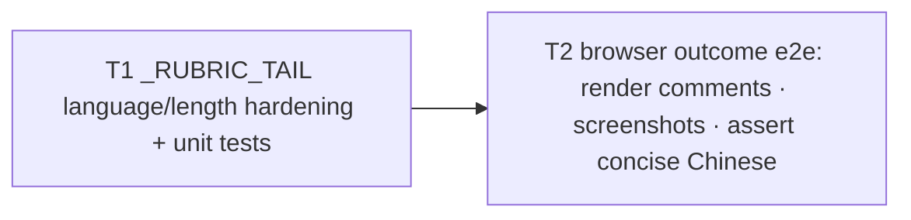

# 0050 · Make Review Rejection Reasons More Readable: Require reviewer Feedback to Be a Single Short Paragraph in Chinese

<!-- This file is maintained by the spec tool: the frontmatter is structured source data (including the tasks DAG), and the body is a group-level overview in the nine-section rust-RFC format. -->

## Summary

Add a **mandatory language/length constraint** to the review gate's reviewer output-format specification (the `_RUBRIC_TAIL` constant in `openagents/reviewer.py`): all **human-facing verdict reasons** in reviewer replies (the body following verdict-related lines such as `REASON` / `ISSUES` / `NEXT`) must be written as **a single short paragraph in Chinese**—get straight to the point and avoid lengthy English text or line after line of English, so that people monitoring PRs can **understand and act on the feedback directly** in GitHub review comments. The implementation consists of hardening the prompt text in just `_RUBRIC_TAIL` (because it is shared by the code / rfc gates, changing it once takes effect in both gates) + explicitly making the sample `REASON`/`ISSUES` wording short Chinese examples + unit tests covering this text + one **browser-based outcome e2e** (render a review comment produced by the real `render_decision` into a page, take screenshots, and assert that the “Feedback summary” block is short Chinese text). Do not change any runtime behavior or alter the verdict parsing/aggregation/rendering/posting pipeline.

## Motivation

**Current state (background restated here rather than relying on a bare reference)**: The review gate replaces the “human eyes reviewing code/specs” side of the process with verdicts from reviewer agents (see this repository's reviewer module). The flow is as follows: `review()` in `openagents/reviewer.py` uses a review task template to invoke a real backend (claude/codex, etc.) and run N reviewers. For each reviewer's free-form `AgentResult.summary`, `_parse_verdict` first extracts the `VERDICT: <PASS/REWORK/RETHINK>` token from the first line; `_distill_feedback` then strips internal monologue, and non-PASS reasons are aggregated into `ReviewDecision.feedback`. Finally, `render_decision()` renders this into a Markdown comment (headed `## Review gate verdict`, containing `- Type`/`- Verdict`/`- Vote count`/`- Vote breakdown`, and a `- Feedback summary:` block enclosed in a fence), which the orchestrator posts to the GitHub PR through `identity.post_signed_comment`. **The text in the “Feedback summary” block is the sole basis humans have on GitHub for deciding what to change.**

**Problem**: Reviewers' verdict reasons are free-form text produced by real LLMs. Currently, `_RUBRIC_TAIL` imposes only two output-format constraints: (1) “The first line must be `VERDICT: <token>`” (verdict first, to protect against truncation; see Prior art below); (2) it provides two **Chinese examples**, `REASON: <one sentence…>` / `ISSUES:\n- <file:line number + specific issue>`. But **nowhere in the entire rubric is there an explicit requirement specifying the language of reviewer replies**—the Chinese examples merely bias the model toward Chinese; they are not a hard constraint. In practice, reviewers frequently produce **lengthy English** summaries of their reasons. Once placed in the “Feedback summary” block, this text is both long and in English, and **Chinese users monitoring PRs simply cannot work through it**. They cannot act on it directly in GitHub and must spend additional effort translating or reading it closely. This readability barrier consumes the benefit of the review gate's goal of “freeing people from the details so they only need to exercise high-level oversight” (the design philosophy in CLAUDE.md).

**Why the existing constraints cannot prevent this**: `_parse_verdict` only cares about the first-line token and imposes no language/length limits on the reason body; `_distill_feedback` only uses heuristics to strip first-person process narration (scratchpad), and **neither translates nor shortens it**—language and length are inherent properties of the LLM's free-form text, and the code cannot subsequently turn English into Chinese or long text into short text. Therefore, the constraint “reasons must be short Chinese text” **can only be imposed as a hard requirement in the prompt**. This is precisely the original request in issue #124: “The corresponding prompt needs to reinforce the requirement that output must be a single short paragraph in Chinese, so that humans can act on it directly in github.” What is missing is that one sentence in `_RUBRIC_TAIL` that upgrades “use short Chinese text” from an “example-based bias” to a “mandatory specification.”

## Guide-level explanation

After implementation, the output-format specification received by reviewers will include one additional **mandatory language/length requirement**; all other judgment logic remains unchanged:

- The reviewer still **outputs `VERDICT: <token>` on the first line** (the verdict-first rule remains unchanged, retaining its protection against truncation).
- For all human-facing reasons **after** the verdict line (`REASON` / `ISSUES` / `NEXT`), the rubric now explicitly requires:
  - **Language**: They must be written in **Chinese** (regardless of the language the reviewer uses for internal reasoning, all final reasons shown to humans must be translated into Chinese).
  - **Length**: **A single short paragraph**, straight to the point—`REASON` states the key verification criterion checked in one sentence; `ISSUES` uses short Chinese items (`file:line number + a one-sentence description of the issue`), avoiding lengthy English arguments and verbatim reproduction of internal reasoning.
  - **Explicit purpose**: These reasons are intended for “people monitoring PRs” to **understand and act on directly** in GitHub comments, rather than serving as a process log for the model itself.
- The example wording is also updated to provide **short Chinese examples** (both the PASS and REWORK examples use Chinese, serving as positive examples of both length and language).

For **people monitoring PRs**: The “Feedback summary” block in a REWORK comment changes from “a large block of English” to “a short paragraph in Chinese that can be understood at a glance.” After reading it, they immediately know what is blocking progress and what to change next, without having to translate or read through lengthy text. This is consistent with the repository's approach of **turning soft conventions into hard requirements**—taking the soft expectation that “reviewers should preferably speak briefly in Chinese” and writing it into the rubric as a mandatory output specification (its machine-verifiable operational criteria are the assertions that **the proportion of Chinese characters ≥ a threshold + length ≤ a threshold** in the “Feedback summary” block in the outcome e2e; see Reference-level).

## Reference-level explanation

This feature is divided into 2 Tasks (see the DAG at the end; `files` are mutually exclusive across the group, and each Task has a single writer). **This change consists solely of prompt-text hardening + tests + a browser-based outcome e2e. It adds no runtime modules and changes no behavior in the verdict parsing (`_parse_verdict`)/aggregation (`review`)/rendering (`render_decision`)/posting (orchestrator·identity) pipeline**—the constraint “reasons use short Chinese text” naturally belongs in the reviewer's output-format specification (`_RUBRIC_TAIL`); changing the text changes the requirement.

### Harden the Prompt Text in One Place (`_RUBRIC_TAIL` in `openagents/reviewer.py`, T1)

`_RUBRIC_TAIL` is **shared** by `_CODE_REVIEW_TASK` and `_RFC_REVIEW_TASK` (appended to both task templates), so changing this one location **takes effect in both gates simultaneously** (DRY, Occam). The change **appends** one mandatory requirement + explicitly makes the existing example wording Chinese, while preserving `_RUBRIC_TAIL`'s existing “first line must be VERDICT” invariant and all other wording:

1. **Append a mandatory language/length rule**: After “All reasons, evidence, and issue lists must be written after the verdict line,” add an explicit specification: “**Human-facing verdict reasons (REASON/ISSUES/NEXT) must be written as a single short paragraph in Chinese**: get straight to the point, state only conclusions and actionable next steps, avoid lengthy English text, avoid line after line of English, and avoid copying internal reasoning verbatim. This text is intended for people monitoring PRs to understand and act on directly in GitHub comments.” Use the same mandatory tone as the existing `_RUBRIC_TAIL`, placing this rule alongside the verdict-first rule.
2. **Make examples Chinese + shorten them**: Keep the three placeholders `REASON: <one sentence explaining the key verification criterion checked>` / `ISSUES:\n- <file:line number + specific issue>` / `NEXT: <direction for the fix>` in Chinese and emphasize “one sentence/short,” making them positive examples of “short Chinese text” (the examples are already Chinese; this explicitly ties them to brevity so they are not interpreted as allowing arbitrary length).

**Invariants**: Preserve all of `_RUBRIC_TAIL`'s requirements that “the first line must be `VERDICT: <token>`, reasons are written after the verdict line, and truncation loses the trailing argument rather than the verdict”; make **zero changes** to logic such as `_parse_verdict` (only examines the first-line token), `_distill_feedback` (strips scratchpad), `render_decision` (renders comments), and `review` (aggregates). Because this constraint applies only to “the reason body after the verdict line,” it is orthogonal to “verdict first,” and neither weakens the other.

### Unit Tests (`tests/test_reviewer.py`, T1)

In the same Task as `reviewer.py` (the two files naturally form one group, TDD). Add assertions that:
- The `_RUBRIC_TAIL` text contains “short” + “Chinese” + wording imposing a language constraint on REASON/ISSUES/NEXT (such as “Human-facing verdict reasons…must be written as a single short paragraph in Chinese”).
- This constraint **appears in both** the complete task text generated by `_task_for(kind="code")` and that generated by `_task_for(kind="rfc")` (proving that the shared tail covers both gates).
- Existing invariant unit tests remain green: verdict first (first-line `VERDICT:`), `_parse_verdict` first-line precedence/bare-token fallback, `render_decision` rendering of the three states PASS/REWORK/invalid review, and `_distill_feedback` behavior—all remain unaffected by this text addition.

### End-to-End Validation (Script Path = This Group's e2e Script, T2)

**Script**: `bash scripts/e2e-spec-0050-review-reason-chinese-readability.sh`

**Why use a browser e2e (honest self-check of the toolset)**: This environment **has** playwright / chrome-devtools MCP. Unlike changes that “only modify reviewer judgment criteria and have no visible UI surface,” **the outcome of this feature is precisely “the readability of the rendered comment text”**—the issue's original wording is “so that humans can act on it directly in github,” and the outcome resides in the **browser-visible interface** of a GitHub PR comment. Whether the “Feedback summary” block is short Chinese text is a **rendering/visual property**, well suited to validation through “page rendering + screenshots + text assertions.” Therefore, following the discipline of the end-to-end-ui-screenshots skill, this group **prioritizes designing a browser-based outcome e2e**, rather than merely declaring shell assertions.

**Honest layering (key constraint: real reason text is produced by a real LLM and cannot be hermetic)**: Reviewer reasons are the product of real backend inference, and real claude cannot run in CI. Therefore, split “readability” validation into two layers, each testing the part it can test:

- **Offline deterministic segment (runs by default, hermetic, no network/no real claude)**:
  1. Run the full suite: `uv run --extra dev ruff check .` / `ruff format --check .` / `pytest -q`.
  2. Use grep anchor assertions to verify that `_RUBRIC_TAIL` in `openagents/reviewer.py` contains the keywords from T1's mandatory language/length rule (“short,” “Chinese,” “REASON/ISSUES/NEXT”).
  3. **Browser rendering outcome exercise (outcome testing, principle 8)**: Feed a **representative short Chinese feedback fixture** of “what a reviewer should produce when following the new prompt” into the real `reviewer.render_decision(kind="code")`, obtaining real comment Markdown → render it into a GitHub-style HTML page → open that local page using playwright `browser_navigate` → use `browser_take_screenshot` to save screenshots under tracked `docs/evidence/spec-0050/` → use `browser_evaluate` to extract the “Feedback summary” block text, and **assert that the proportion of Chinese (CJK) characters ≥ a threshold and total length ≤ a threshold** (these are the machine-verifiable operational criteria for “short Chinese text”); also check that there are no console errors and that the page loads successfully. **RED negative control**: Run the same assertions again using an “old-style lengthy English feedback fixture”; it should **fail** (low CJK proportion/excessive length). Save control screenshots as evidence as well, proving that green is not a tautology. **Honest labeling**: The feedback content in this segment is a fixture, validating the “render path + browser readability criteria” pipeline and the “short Chinese text” criteria themselves; **the authenticity of the reason content is verified by the REAL segment below**.
- **Real outcome segment (optional, `OPENAGENTS_E2E_REAL=1`, not enabled by default)**: Create a PR with “an obvious defect” in a scratch repository, run a **real reviewer** (real backend) once to obtain real REWORK feedback → `render_decision` → post it to a real GitHub PR through orchestrator/identity → use playwright `browser_navigate` to open that PR page, locate the `## Review gate verdict` comment, save screenshots as evidence, and use `browser_evaluate` to extract the “Feedback summary” text and assert CJK proportion + length. This is the actual end-to-end real outcome (whether a real LLM actually produces short Chinese text under the new prompt). It does not run by default (non-hermetic, requires real claude + real GitHub).

### Dependency DAG

`T1 → T2`: T2's grep anchors, rendering exercise, and assertions all consume the hardened `_RUBRIC_TAIL` text from T1 and must run after T1 is complete. The two Tasks have mutually exclusive `files` (`openagents/reviewer.py` + `tests/test_reviewer.py` vs `scripts/e2e-spec-0050-review-reason-chinese-readability.sh`, with no overlap; `docs/evidence/spec-0050/` contains runtime artifacts from the T2 script and does not constitute source-file ownership).

## Drawbacks

- **Still a soft constraint at the prompt level, not a structured hard gate**: This spec puts “write reasons in concise Chinese” into the rubric text that the reviewer reads, but ultimately still depends on the reviewer agent actually following it—unlike mutual exclusion within a `files` group, which is a mechanical error from `spec validate`. It upgrades “bias through Chinese examples” to “an explicit hard requirement + model examples,” significantly increasing the probability of concise Chinese reasons, but cannot eliminate violations entirely (the LLM may still occasionally produce lengthy text or English). This is an inherent limit of prompt-based constraints.
- **The code cannot correct language/length after the fact**: `_distill_feedback` can only strip scratchpad content; it cannot translate or condense text. If the reviewer still produces lengthy English, the comment will still contain lengthy English—this spec does not introduce “English → Chinese” translation post-processing (that is a larger feature involving an additional LLM call; see Rationale/Future). Under the default path, CI also cannot verify actual LLM output; it can only verify “the prompt contains the requirement + the rendering path + readability criteria.” Compliance of actual output is checked through optional spot checks in the REAL section.
- **The quantitative thresholds for “concise” are heuristic**: The outcome e2e operationalizes “concise Chinese” as “CJK proportion ≥ X% and length ≤ N characters.” The threshold values are empirical and may incorrectly reject some reasonable, slightly longer Chinese reasons (too strict), or incorrectly accept Chinese containing a small amount of English terminology (too lenient). This spec accommodates embedded terminology by using “a proportion rather than entirely Chinese” and calibrates the thresholds “against a RED lengthy English sample,” but cannot eliminate all errors.
- **Additional rubric text lengthens the review prompt**: Appending one language/length rule makes the shared tail slightly longer, theoretically increasing exposure to length truncation. However, `_RUBRIC_TAIL`'s “the first line must be VERDICT” design already puts the verdict first, so truncation loses the trailing reasoning rather than the verdict itself. This change adds only one sentence, a very small increment, so the risk is negligible.

## Rationale and alternatives

- **Why place this in `_RUBRIC_TAIL` rather than individual task templates**: The language/length constraints **apply equally** to the code gate and the rfc gate (the reasons from both must be read by people), and `_RUBRIC_TAIL` is precisely their shared output-format tail—one change covers both gates, consistent with DRY and Occam's razor (principle 1). Changing `_CODE_REVIEW_TASK`/`_RFC_REVIEW_TASK` separately would duplicate the rule and invite drift.
- **Why use “append + convert examples to Chinese” rather than rewrite the specification**: The issue asks to “strengthen the requirement.” The smallest change is to **append, as a parallel requirement,** a language/length rule after the existing verdict-first specification, without changing any existing invariants, minimizing risk and the regression surface.
- **Alternative 1: Add an “English → concise Chinese” feedback translation post-processing layer** (after `_distill_feedback` or before `render_decision`, make one LLM call to translate English feedback into concise Chinese). Rejected for the MVP: it violates Occam's razor by introducing an additional LLM call, cost/latency/failure surface, and moving responsibility for “reasons should be produced in Chinese in the first place” from generation to cleanup, treating the symptom rather than the cause. Prompt hardening can address the issue at its source without a new processing path. This could serve as a **future enhancement** (see Future possibilities) to handle residual cases that remain in English.
- **Alternative 2: Make “concise Chinese” a mechanical hard gate in `spec validate` / at render time** (for example, have `render_decision` reject or truncate feedback detected as non-Chinese or too long). Rejected: `render_decision` receives LLM text that has already been produced; mechanical truncation would fragment its meaning, while mechanical rejection would prevent the comment from being posted—both are worse than “a comprehensible but somewhat lengthy reason.” Language/length are properties of generation, and the prompt is the only place to address the root cause. “Proportion/length assertions” can remain part of **observation in the outcome e2e** (as this spec already does), rather than being inserted into the product's rendering path.
- **Alternative 3: Change only the example wording (write the examples in concise Chinese), without adding an explicit hard rule**. Rejected: the current examples are already in Chinese yet are still ignored (the reviewer still produces lengthy English), demonstrating that “example bias” is insufficient to enforce a hard constraint. An explicit hard requirement for language/length must be added to give it teeth.
- **Alternative 4: Omit browser e2e and use only shell grep assertions on the rubric text** (because actual reasons cannot be hermetic). Rejected: this feature's outcome is precisely “the readability of GitHub comment text,” a browser-visible property, and the environment provides playwright/chrome-devtools MCP. Under the end-to-end-ui-screenshots skill, browser-based outcome verification should therefore take priority. Grep alone would miss the outcome observation of “whether the rendered comment is actually comprehensible.” The chosen approach is therefore “browser rendering + screenshots + CJK/length assertions + RED counterexample,” with an honest separation of layers (fixtures demonstrate the criteria / the REAL section verifies actual output).

## Prior art

- **Rust RFC process** ([rust-lang/rfcs](https://github.com/rust-lang/rfcs)): The source of this spec body's nine-section overview structure.
- **The lineage of existing reviewer output specifications in this repository (key points restated here)**: Spec-0021 (verdict first—`_RUBRIC_TAIL` requires the first line to be `VERDICT:`, so truncation of a long response loses the trailing reasoning rather than the verdict; this spec's language/length rule is appended after it as a parallel requirement, orthogonal and nonconflicting); Spec-0041 (`_distill_feedback` strips internal monologue/scratchpad content from the reviewer summary, retaining only actionable feedback—it “removes process narration,” while this spec “constrains language/length”; the two complement each other, but neither can translate or condense meaning, so language constraints must still be addressed in the prompt); Spec-0047 (`render_decision` and `extract_decision_content` are forward and inverse operations, rendering a decision as a comment containing a “Feedback summary” block—this spec's outcome e2e renders precisely that block and asserts its readability); Spec-0048 (a precedent with the same structure of “reviewer prompt/rubric plain-text hardening + unit tests + e2e exercise”; this spec follows its T1/T2 structure and its honest separation of e2e layers).
- **Industry practice**: Human-facing review feedback should be “in the reader's language, concise, and actionable”—a common principle of code review. Including “response language + length” in the output-format specification of a review prompt is standard practice for making an LLM reviewer produce output suited to its target readers. This feature turns that implicit expectation into an explicit hard requirement in `_RUBRIC_TAIL`.

## Unresolved questions

- **Values for the quantitative thresholds for “concise”**: The specific values of X and N in the outcome e2e's “CJK proportion ≥ X% and length ≤ N characters” must be calibrated during T2 implementation using “representative concise Chinese samples (should pass) + a RED lengthy English sample (should fail).” Choose values that distinguish the two sufficiently without incorrectly rejecting reasonable Chinese reasons—the initial suggestion is a CJK proportion ≥ 50% and each feedback summary ≤ approximately 300 characters, with final values left to T2.
- **Whether to mandate exact wording**: Whether the rubric should require the reviewer to output a fixed introductory sentence verbatim (to facilitate unit-test/downstream anchoring), or require only the semantic constraint of “concise Chinese” + model examples—the preference is the latter (preserving the reviewer's freedom of expression and avoiding mechanical repetition), with unit tests anchored on the keywords “concise,” “Chinese,” and “REASON/ISSUES/NEXT” rather than an entire sentence, to be finalized in T1.

## Future possibilities

- **Fallback translation layer for English**: If a certain proportion of English reasons still slips through after rollout (measurable through the REAL e2e section or sampling of live comments), a **conditional** fallback could be added after `_distill_feedback`: only when the detected proportion of Chinese in the feedback is too low, make one lightweight translation/condensation call on that passage to turn “lengthy English” into “concise Chinese,” providing a second safeguard in addition to prompt hardening (disabled by default, enabled as needed).
- **Establish readability metrics as an observation signal**: Extract the outcome e2e's “CJK proportion + length” criteria into a reusable observation function for monitoring the readability compliance rate of review comments in production/regression checks, feeding findings back into iterations on rubric wording and thresholds.
- **Multilingual adaptation**: If the team includes non-Chinese-speaking members in the future, “response language” could change from hardcoded Chinese to project-specific configuration (such as `OPENAGENTS_REVIEW_LANG`), allowing `_RUBRIC_TAIL` to inject the target language dynamically—this spec fixes it to Chinese for now based on the repository's current situation (a Chinese-speaking team, with CLAUDE.md defaulting to Chinese), leaving configuration for future evolution.
