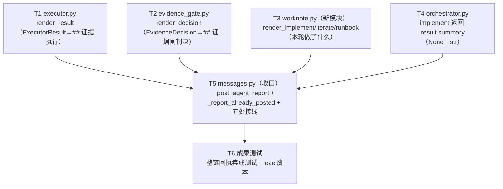

# 0050 · 统一 agent 执行后回贴 PR 评论：补齐 implement/iterate/finalize_runbook/executor/证据闸的静默步骤（可观测性收口）

<!-- 本文件由 spec 工具维护：frontmatter 为结构化源数据（含 tasks DAG），正文为组级 rust-RFC 9 段总览。 -->

## Summary

OpenAgents 的守夜编排每轮会「派一个 coding agent 去执行（`backend.run`）」若干步：实现代码、据反馈迭代、
定稿 e2e 说明书、真跑系统、判证据。**这些执行完后要不要在 PR 上回贴一条『我干了什么』的说明评论，
今天是各方法各自零散接的——有的接了（refine / reviewer 裁决 / 人类解挂后的迭代 / 解冲突 agent），
有的没接**，导致「代码 reviewer PASS → 定稿说明书 → 真跑 → 判证据」这条 e2e 链路对盯 PR 的人是**黑盒**。

本 spec 把「执行完 → 回贴说明评论」这件事**收口到编排层（`messages`）统一**：给三个缺口域各配一个
`render_*` **纯函数**（`executor.render_result` 渲 `ExecutorResult`、`evidence_gate.render_decision`
渲 `EvidenceDecision`、新增 `worknote` 模块渲 implement / iterate / runbook 定稿的「本轮做了什么」摘要），
然后在 `messages` 的三个编排收口点（`_process_rfc_review` / `_process_coding` / `_evidence_gate`）
统一走「执行完 → `render_*` → `identity.post_signed_comment`（带防刷屏去重）」。补齐 issue 审计出的
**五处静默步骤**：`implement`、`iterate(ci·review·e2e)`、`finalize_runbook`、`run_executor`、
`review_evidence`。收口后：IO（发评论）集中在 `messages` 一层，`executor` / `evidence_gate` 保持
「不碰 IO、只返结构化结果」的解耦定位（理念 10），发评论有**唯一收口**，将来新增 agent 步骤不会再漏。

## Motivation

**现状（就地复述，不靠裸引用承载必要信息）。** OpenAgents 的 `vigil` 守夜循环对每个在推进的 issue/PR
每轮 `poll` 一次，`messages.MessageLoop` 按 `RunRecord.status` 把它路由到某道闸。与本 spec 相关的编排
收口点有三个，串起一条「起草 spec → 评审 → 实现 → CI → 代码评审 → **证据闸** → 合并」的流水线：

- `_process_rfc_review`（`openagents/messages.py:418`）：spec 评审闸。reviewer 全票 PASS（或已有人工批准
  标签）→ 调 `orchestrator.implement`（`messages.py:423` / `:434`）派 agent **按 spec 写代码**、把 draft
  PR 转正。
- `_process_coding`（`messages.py:451`）：代码闸。CI 失败 → `iterate(reason="ci")`（`:496`）；CI 绿 +
  代码 reviewer PASS → 进证据闸 → 合并；reviewer 打回 → `iterate(reason="review")`（`:533`）。
- `_evidence_gate`（`messages.py:555`）：证据闸（Spec-0040）。链路 = `finalize_runbook`（派实现者把
  e2e 粗规划落成可执行 `runbook.md` 并 commit，`:574`）→ `executor.run_executor`（独立 agent 照 runbook
  真跑系统、把 `result.md` 写进 `evidence_dir`，`:578`）→ `commit_evidence`（`:586`）→
  `evidence_gate.review_evidence`（拿 RFC 意图对照证据判 PASS/FAIL，`:588`）；FAIL 且未攒满 K 轮 →
  `iterate(reason="e2e")`（`:601`），攒满 K → `_block`。

**「执行完发评论」今天已有的正例（说明这是既定约定，只是没贯彻到底）：**

| Agent 执行点 | 方法（文件:行） | 执行完发 PR 评论？ |
|---|---|---|
| 评审 spec / 代码 | `review_rfc`/`review_code`→`_review`（`orchestrator.py:539`） | ✅ 每轮 `_post_review_decision`（渲 `reviewer.render_decision` → 盖章发） |
| 精炼 spec | `refine_rfc`（`orchestrator.py:472`，`announce=True`） | ✅ `_REFINE_COMMENT`（`orchestrator.py:500`） |
| 人类解挂后迭代 | `iterate(reason="human")`（`messages.py:372`） | ✅ `_post_comment_reply`（引用原评论贴回） |
| 解合并冲突 | `conflict.resolve`（Spec-0038） | ✅ agent 自带 reply-comment 工具自回 |

**为什么要改——五处执行了却对人静默的编排步骤（issue #131 审计，以 `origin/main`＝跑 #128 的代码为准）：**

1. **`implement`（实现代码，`orchestrator.py:509`）** — 整个「按 spec 写代码」只 `backend.run` +
   `commit_and_push`（`feat: implement …`）+ `mark_ready`，返回 `None`；旧的一次性 smoke 自述已退役，
   **无 agent 自述**——实现了哪些内容、自测结果如何，盯 PR 的人看不到。
2. **`iterate`（`orchestrator.py:694`）的 `ci`/`review`/`e2e` 三种反馈迭代** — 据 CI 日志 / reviewer 反馈 /
   证据闸反馈改代码，`commit_and_push`（`fix: address {reason} feedback …`）后**不说改了啥**；`iterate`
   已经 `return result.summary`（`AgentResult.summary` 数据现成），但这三个收口点把它丢掉了（只有
   `reason="human"` 那条被 `messages._post_comment_reply` 贴了出来）。
3. **`finalize_runbook`（定稿说明书，`orchestrator.py:624`）** — 派 agent 把 e2e 粗规划落成 `runbook.md`、
   `commit_and_push`（`test: finalize e2e runbook …`），产出 durable 的说明书文件，却**无评论**。
4. **`run_executor`（真跑系统，`executor.py:94`）** — 独立 agent 照 runbook 真跑、把 `result.md`
   （`outcome`/`form`/`notes`）写进磁盘，**无评论**；证据只落磁盘，人在 PR 上看不到「真跑了没、跑成啥样」。
5. **`review_evidence`（证据闸判决，`evidence_gate.py:80`）** — 每轮判完只 `return EvidenceDecision`
   （`passed`/`feedback`）；FAIL 时静默 `iterate(reason="e2e")`，只有攒满 K 轮 `_block` 才发一次评论。

**触发案例（实证）。** PR #128 卡死排查：证据闸链路（上面 3+4+5 叠加）**跑了 28 分钟、6 个 commit、
全程对人静默**，只在终局升级挂起时发一条 FAIL 快照评论。人无法在过程中判断「是卡住了还是在正常推进」——
这正是理念 8（可观测性：人盯 PR 即知进展）被击穿的地方。

**期望行为（验收目标）。**
- 凡是派 agent 执行（`backend.run`）并产生 durable 产物的编排步骤，执行完都在 PR 上回贴**一条**署名说明评论。
- 上述五处静默步骤全部补齐；已有正例（refine / reviewer / human-iterate / 解冲突）行为不变、不重复贴。
- 发评论逻辑**收口到编排层（`messages`）唯一出口**，不再散落各模块；`executor` / `evidence_gate`
  仍不 import `identity`、不碰 IO（理念 10）。
- 幂等/防刷屏：同一步骤同内容在重复 poll 时不重复贴（参照既有 `_decision_already_posted` 的去重）。

## Guide-level explanation

把编排层想成一条流水线，每个「派 agent 干活」的工位干完活都要在 PR 上**打一张署名的工单回执**，
让盯 PR 的人不用进服务器看磁盘，光看 PR 评论流就知道每步进展。今天有些工位打了回执（评审、精炼、
人类回复、解冲突），有些没打（实现、迭代、定稿说明书、真跑、判证据）——本 spec 把没打的补齐，
并且把「打回执」这个动作从「每个工位自己想着打」改成「**统一在流水线控制台（`messages`）打**」。

- **回执长什么样（`render_*` 纯函数）。** 每类工单配一个把结构化结果渲染成 Markdown 的纯函数，
  仿现成的 `reviewer.render_decision`（它把裁决渲成「## 评审闸裁决 / 类型 / 裁决 / 票数」那段评论）：
  - `executor.render_result(result)` → 「## 证据执行」+ 真跑的 `outcome`（passed/failed/skipped）/ `form` / `notes`；
  - `evidence_gate.render_decision(decision)` → 「## 证据闸判决」+ `passed` / `feedback`；
  - `worknote.render_implement(summary)` → 「## 实现自述」+ agent 的 `AgentResult.summary`；
  - `worknote.render_iterate(reason, summary)` → 「## 迭代自述（ci/review/e2e）」+ summary；
  - `worknote.render_runbook(form, runbook_path)` → 「## 说明书定稿」+ 形态与 runbook 路径。

  这些函数**只拼字符串、无副作用、不 import github/identity**——渲染是每个域自己的知识
  （票数/证据结论/本轮摘要），发评论不是。

- **回执在哪打（收口到 `messages`）。** 控制台在每个工位执行完后，调对应 `render_*` 拿到回执正文，
  再走**唯一出口** `messages._post_agent_report(pr_number, body)`：它盖上本实例签名
  （`identity.post_signed_comment`）贴到 PR。IO 集中在这一层，`executor` / `evidence_gate` 谁都不用去
  `import identity`。

- **不刷屏（去重）。** 每张回执以它的标题行（`## 证据执行` 等）为稳定锚点；`_post_agent_report` 贴前先看
  PR 上**最近一条同标题回执**，若正文规范化后与本轮完全相同就跳过——参照既有 `_decision_already_posted`
  的做法（它止住了 PR #61 那种「33 条相同 PASS 裁决」刷屏）。去重是**尽力而为旁路**：查询/比对抖动一律
  fail-open 照发，宁可多发一条也不因抖动漏发回执、损害可观测性。

- **发评论绝不阻断编排。** 和现成的 `_post_review_decision` 一样，`_post_agent_report` 把
  `post_signed_comment` 包在 `try/except` 里——任何 `gh` 故障只记 `_progress`、不上抛，绝不阻断
  实现/迭代/证据闸/合并这条主干（理念 8 的可观测性是**增益**，不能反过来成为主干的故障点）。

对使用者/运维：行为上，一个正在推进的 PR，评论流会**按发生顺序**出现「实现自述 → （CI 失败则）迭代自述(ci)
→ （reviewer 打回则）迭代自述(review) → 说明书定稿 → 证据执行 → 证据闸判决 →（FAIL 则）迭代自述(e2e) → …」
这样一串署名回执；#128 那种「28 分钟黑盒、只在终局看到一张 FAIL 快照」不再发生。

## Reference-level explanation

### 技术方案（三个 `render_*` 域 + 一个 `messages` 收口 + 五个接线点）

**① `render_*` 纯函数（各归其域，理念 10）。** 三处新增，均仿 `reviewer.render_decision`（纯字符串、
无副作用、只依赖本模块自己的结构化类型，不 import github/identity）：

- `openagents/executor.py`：`render_result(*, result: ExecutorResult) -> str`。以稳定标题 `## 证据执行`
  开头，渲 `result.outcome`（`passed`/`failed`/`skipped` 中文化）、`result.form`、`result.notes`。
- `openagents/evidence_gate.py`：`render_decision(*, decision: EvidenceDecision) -> str`。标题
  `## 证据闸判决`，渲 `decision.passed`（✅/❌）+ `decision.feedback`（非空时附代码块，仿 render_decision 的
  「反馈摘要」块）。
- `openagents/worknote.py`（**新模块**，仿 `blocknote.py` / `replynote.py` 的小型渲染模块惯例）：
  - `render_implement(*, summary: str) -> str` → `## 实现自述`；
  - `render_iterate(*, reason: str, summary: str) -> str` → `## 迭代自述（<reason 中文化>）`；
  - `render_runbook(*, form: str, runbook_path: str) -> str` → `## 说明书定稿`。
  三者只吃**基元参数**（str），不依赖 orchestrator/handle 类型，避免反向 import；`summary` 为空时回落
  占位「（无摘要）」（与 `_REFINE_COMMENT` 现状一致）。

**② `messages` 收口（唯一 IO 出口 + 去重）。** 在 `openagents/messages.py` 新增两个私有方法：

- `_post_agent_report(self, *, pr_number: int, body: str) -> None`：贴前调 `_report_already_posted`
  去重（异常 fail-open），再 `identity.post_signed_comment(pr_number=..., body=body, agent_id=self._agent_id)`，
  整段包 `try/except`、失败只 `_progress`（**逐字节镜像** `orchestrator._post_review_decision` 的骨架）。
- `_report_already_posted(self, *, pr_number: int, body: str) -> bool`：取 `body` 首行（`## …` 标题）为
  锚点，在 `github.list_comments(pr_number=...)` 里筛出**同标题**的回执评论，按 `created_at` 取最近一条，
  正文规范化（逐行 strip、去空行、去 identity 追加的签名尾巴）后与本轮相等即判重复（仿
  `_decision_already_posted` 的「最近一条同类、结论+反馈都相同才跳过」，只是锚点从 reviewer 的
  `DecisionContent` 简化为「标题行 + 规范化全文」——回执无票数语义，不需 reviewer 那套结构化反解）。

**③ 五个接线点（把静默步骤接上收口）。** 均为「拿到执行结果 → `render_*` → `_post_agent_report`」，
改动最小、不动各步骤的编排语义（不改 e2e 是否跑通、不改闸的判定/合并/挂起）：

| # | 收口点（方法:行） | 现状 | 接线 |
|---|---|---|---|
| 1 | `_process_rfc_review`（`messages.py:423`/`:434`）| `implement` 返回 `None` | 令 `orchestrator.implement` 返回 `result.summary`（`None`→`str`，与 `iterate`/`refine_rfc` 同款）；收口点 `render_implement` → 贴 |
| 2 | `_process_coding`（`messages.py:496`/`:533`）| `iterate(ci/review)` 丢弃 summary | 捕获 `iterate` 返回的 summary → `render_iterate(reason, summary)` → 贴 |
| 3 | `_evidence_gate`（`messages.py:574`）| `finalize_runbook` 无评论 | `handle` 非 None 时 `render_runbook(handle.form?, handle.runbook_path)` → 贴（form 由 plan 提供，见下方 Unresolved） |
| 4 | `_evidence_gate`（`messages.py:578`）| `run_executor` 返回值被丢 | 捕获 `ExecutorResult` → `render_result(result)` → 贴 |
| 5 | `_evidence_gate`（`messages.py:588`/`:601`）| `review_evidence` 每轮判决无评论 | 判决后 `render_decision(decision)` → 贴（PASS/FAIL 都贴，FAIL 的 `iterate(e2e)` 另贴迭代自述）|

已有正例**保持不变、不双贴**：`reason="human"` 仍只走 `_post_comment_reply`（`messages.py:372`，
引用原评论的针对性回应），不再叠加 `render_iterate`；`refine_rfc`/`review` 裁决沿用各自现成评论。

### 模块 / DAG / 文件分配

| Task | 拥有文件（互斥） | 关键交付 |
|---|---|---|
| T1 | `openagents/executor.py`, `tests/test_executor.py` | `render_result` 纯函数（不碰 IO，保持 executor 只返结构化结果） |
| T2 | `openagents/evidence_gate.py`, `tests/test_evidence_gate.py` | `render_decision` 纯函数（同上，evidence_gate 不 import identity） |
| T3 | `openagents/worknote.py`, `tests/test_worknote.py` | 新模块：implement/iterate/runbook 的「本轮做了什么」渲染（基元入参、无反向 import） |
| T4 | `openagents/orchestrator.py`, `tests/test_orchestrator.py` | `implement` 返回 `result.summary`（`None`→`str`），使收口点拿得到摘要 |
| T5 | `openagents/messages.py`, `tests/test_messages.py`, `tests/test_messages_agent_report.py` | 收口：`_post_agent_report`（唯一 IO 出口 + 签名 + 尽力而为）+ `_report_already_posted`（防刷屏）+ 五处接线；并更新既有 messages 环测试替身 |
| T6 | `scripts/e2e-spec-0050-unify-agent-run-report.sh`, `tests/test_agent_report_integration.py` | 成果测试：假 GitHub 评论账本驱动整条 coding→证据链，断言五处收口各贴一条、重复 poll 不刷屏 |

文件跨 Task 互斥（理念 6 单一 writer）：`executor.py`(T1) / `evidence_gate.py`(T2) / `worknote.py`(T3) /
`orchestrator.py`(T4) / `messages.py`+既有 messages 测试(T5) / 脚本+集成测试(T6) 无重叠。T5 因是唯一改
`messages.py` 者，一并接管既有 `tests/test_messages.py`——`implement` 返回值由 `None` 变 `str`、且收口点
新增回贴，会触及既有 messages 环测试的替身（`_FakeOrchestrator.implement` 需返回 str、断言需容纳新回执），
按理念 6 归到 T5 独占（不与他 Task 争写；参考 Spec-0031「Task 触及共享 prod 代码须同步更新既有测试替身」）。

### 成果测试（理念 8）与 e2e 脚本

**浏览器 e2e 适用性自检：不适用。** 本 feature 的「成果」是 **GitHub PR 上的机器评论流**（可观测性），
本仓库**无任何产品前端界面可驱动**（无导航/交互/截图可断言的视觉成果），且真发评论需真 GitHub。因此
成果测试形态为**确定性集成复现**（pytest 驱动整条链 + 一条 shell e2e 脚本跑它并打印证据），而非浏览器 e2e。

- **集成测试** `tests/test_agent_report_integration.py`：用**内存假 GitHub**（评论账本：记录每条 `post_comment`
  的 body + `created_at`，`list_comments` 回读）+ 假 backend（`AgentResult(changed, summary)` 可编排）
  驱动 `MessageLoop` 走完「rfc-pass → implement → CI 失败→iterate(ci) → CI 绿→review 打回→iterate(review)
  → 证据闸：finalize_runbook→run_executor→review_evidence FAIL→iterate(e2e)」，断言：
  1. **五处收口各留一条署名回执**：PR 上出现 `## 实现自述` / `## 迭代自述（ci）`/`（review）`/`（e2e）` /
     `## 说明书定稿` / `## 证据执行` / `## 证据闸判决`，各带 `<!-- openagents:agent=… -->` 签名；
  2. **已有正例不双贴**：`reason="human"` 路径仍只出 `_post_comment_reply` 那条，无叠加的迭代自述；
  3. **防刷屏**：对同一步骤重复 poll（内容不变）→ `_report_already_posted` 命中、**不新增**评论；
  4. **发评论不阻断编排**：让假 `post_comment` 抛错，断言链路仍推进到合并/挂起、仅 `_progress` 告警。
- **e2e 脚本** `scripts/e2e-spec-0050-unify-agent-run-report.sh`：跑 `ruff check` + `ruff format --check`
  + 定向 `pytest`（上述集成测试 + T1–T4 单测）+ `spec validate`，把「五处收口各一条回执 / 重复 poll 不刷屏 /
  发评论故障不阻断」三条断言的通过输出作为可复现证据（被 PR 指路牌自动收录）。

## Drawbacks

- **PR 评论增多。** 补齐五处后，一个正常推进的 PR 评论流会明显变长（实现 1 条 + 每轮迭代 1 条 +
  证据闸每轮 3 条：说明书/执行/判决）。缓解：① 防刷屏去重压掉「同步同内容」重复；② 回执简短、标题化，
  盯 PR 的人可按 `## …` 标题快速略读；③ 这正是理念 8 要的「过程可见」——噪声与可观测性的取舍偏向后者。
- **每收口点多一次（可能两次）`gh` 调用。** 每条回执一次 `post_comment`，去重再读一次 `list_comments`。
  但都在「本就要派 agent 跑几十秒~几分钟」的重步骤之后，相对开销可忽略；且全为尽力而为旁路，抖动不阻断主干。
- **`implement` 返回类型变更（`None`→`str`）是跨调用方改动。** `cli.py` 的 `implement` 调用忽略返回值
  不受影响；但既有 `messages` 环测试里 `_FakeOrchestrator.implement` 若断言/返回 `None` 需同步更新
  （已在 T5 文件归属里显式接管，见 Reference-level；对应 Spec-0031 教训）。
- **仍是「事后回执」，非实时流。** 回执在每步**执行完**才贴，一步内部若跑很久（如 executor 真跑），
  过程中人仍看不到该步的中途进展；本 spec 只把「步与步之间」变透明，不做步内实时日志流（见 Future）。

## Rationale and alternatives

**为何选「各域 `render_*` 纯函数 + `messages` 唯一收口」。** 它同时满足两个理念：**理念 8**（每步可见）——
补齐所有静默步骤；**理念 10**（解耦）——渲染知识留在各域（executor 懂自己的 outcome、evidence_gate 懂
自己的判决、worknote 懂「本轮摘要」），而**发评论这个 IO 只有 `messages` 一个出口**。好处是
`executor`/`evidence_gate` 不必人手 import identity、不碰 github，保持「只吃 backend 协议、只返结构化结果」
的可测纯度；新增 agent 步骤时，只要在 `messages` 收口点加一行接线，不会再像今天这样「零散自接、接漏一个」。
复用既有 `identity.post_signed_comment`（唯一发评论出口）与 `_decision_already_posted`（去重范式），新增面极小。

**备选 A：每个模块自己 import identity、执行完自己发评论（延续现状路子，只是补齐）。** 最直接。
缺点：正是 issue 诊断的**病根**——「发评论散落各处」。executor / evidence_gate 会被迫 import identity/github、
从「纯计算模块」退化成「带 IO 的模块」，破坏理念 10 的解耦，也让「哪些步骤发了评论」再次无处集中审计、
将来必然再漏。**取舍**：收口到 `messages` 一层，把「发评论」从 N 个模块的自觉收敛成 1 个出口的约定，故不选 A。

**备选 B：让每个 agent 自己带 reply-comment 工具、执行完自回（仿解冲突 agent，Spec-0038）。** 把回执交给
agent 自己在会话里发。优点：无需编排层接线，天然「谁干谁说」。缺点：① 依赖每个 agent 都可靠地调工具、
不可控（agent 可能忘了发、发得不规范）；② 回执格式不统一、无法机器去重；③ 对 `run_executor`/`review_evidence`
这类「结构化结果由框架判定」的步骤，结论其实在框架手里（`ExecutorResult`/`EvidenceDecision`），让 agent
复述反而失真。**取舍**：解冲突场景 agent 自回是因为「回应人类具体评论」需要 agent 的语境；而本 spec 的五处
是「框架已有结构化结果、要稳定统一地播报」，用框架渲染 + 收口更可控，故 B 仅适配解冲突、不作为本 spec 主线。

**备选 C：把回执渲染也塞进 `messages`（不新增 `worknote`、不在 executor/evidence_gate 加 `render_*`）。**
省一个模块和两处域内函数。缺点：渲染需要 `ExecutorResult`/`EvidenceDecision` 的字段语义，塞进 `messages`
等于让编排层反向耦合各域的数据格式（今天 `reviewer.render_decision` 明确不这么做——票数语义归 reviewer）。
**取舍**：渲染归域、发送归 messages 才是既有 `render_decision`+`_post_review_decision` 的分工范式，照抄它
最一致，故不选 C。

## Prior art

- **rust-lang/rfcs 的 RFC 形态**（本 spec 9 段结构本身，https://github.com/rust-lang/rfcs）。
- **本仓库既有的「渲染归域、发送归编排、尽力而为旁路」范式**（RFC-0018 的 `reviewer.render_decision` +
  `orchestrator._post_review_decision`，注释见 `orchestrator.py:539-596`）——本 spec 是把这套已验证的分工
  从「评审裁决」一处推广到「五处静默步骤」；现状与其分工已在 Motivation/Reference-level 就地复述完整，
  本条仅作线索，不承载理解本 spec 所需的必要信息。
- **本仓库既有的防刷屏去重**（Spec-0022/T3 → Spec-0047/T2 的 `_decision_already_posted`：最近一条同类
  评论「结论+反馈都相同才跳过」，止住 PR #61 的 33 条相同 PASS）——本 spec 的 `_report_already_posted`
  是它的简化同构（锚点从结构化 `DecisionContent` 简化为「标题行 + 规范化全文」）。
- **小型渲染模块惯例**：`blocknote.py`（挂起结构化评论）/ `replynote.py`（引用回复评论）——新增
  `worknote.py` 沿用同款「纯拼字符串、被 messages 调用」的定位。

## Unresolved questions

- **`finalize_runbook` 的 `form` 从哪取给回执？** `RunbookHandle`（`orchestrator.py` 返回）当前暴露
  `worktree`/`runbook_path`/`evidence_dir`/`intent`，`form`（e2e 形态，来自 `_e2e_plan`）未在 handle 上。
  回执要展示 form 时，需 T4 在 `RunbookHandle` 补一个 `form` 字段，或 T5 只用 `runbook_path`
  不展示 form。倾向前者（信息更全），待评审确认是否值得动 handle。
- **回执签名与「人类解挂读侧」的交互。** 回执经 `identity.post_signed_comment` 带 `<!-- openagents:agent=… -->`
  签名，理应被解挂读侧 `new_human_comments` 按签名滤掉（不自触发解挂）；需在 T5/T6 验证新增回执不会被
  误当成「人类新评论」而触发解挂环（既有机制按签名过滤，预期天然安全，但要测到）。
- **`_report_already_posted` 的锚点粒度。** 以「标题行」为锚点时，`迭代自述（ci）` 与 `迭代自述（review）`
  标题不同、天然分桶；但同 reason 连续两轮内容不同的迭代自述应当**照发**（理由各异），这与
  `_decision_already_posted`「结论同+反馈不同则照发」一致——需确认规范化正文比较能正确放行「同标题但正文不同」。

## Future possibilities

- **步内实时进展流**：对 `run_executor` 这类耗时步骤，把 agent 的中途输出以「进度评论/编辑同一条评论」
  的方式流式贴出，让步内也可见（本 spec 只做步间可见）。
- **回执折叠/汇总**：PR 收尾时把一串过程回执折叠成一条「本次交付小结」，降低长 PR 的评论噪声。
- **把「执行完→回执」抽象成编排装饰器**：若将来 `messages` 收口点继续增多，可把「跑 agent → render → 收口贴」
  提炼成一个统一包装（如 `_run_and_report(step, render_fn, …)`），从结构上杜绝「新增步骤忘接回执」。
- **回执驱动的前端成果视图**：把这些结构化回执（执行/判决/自述）喂给未来的成果前端（理念 8 的可视化收口），
  让盯 PR 从「读评论」升级为「看进度看板」。

