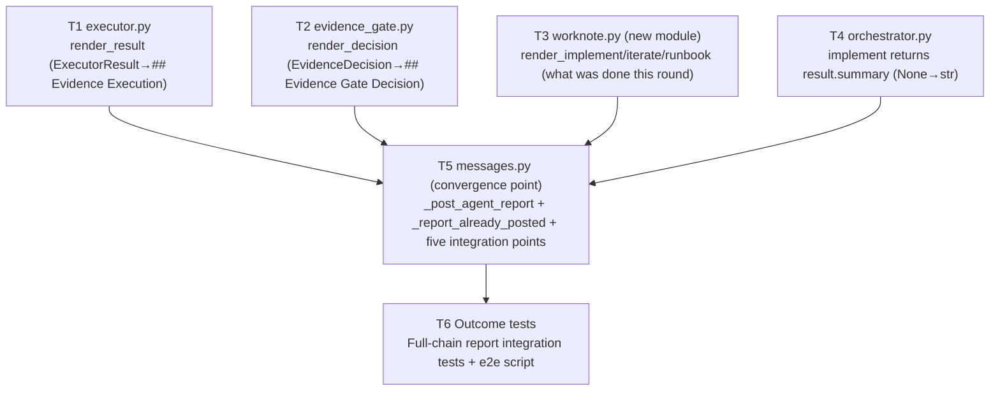

# 0051 · Standardize PR comments after agent execution: cover silent steps in implement/iterate/finalize_runbook/executor/the evidence gate (centralizing observability)

<!-- This file is maintained by the spec tool: frontmatter is the structured source data (including the tasks DAG); the body is a group-level overview in nine rust-RFC sections. -->

## Summary

In each round, OpenAgents' Vigil orchestration “dispatches a coding agent to execute (`backend.run`)” several steps: implement code, iterate on feedback,
finalize the e2e runbook, actually run the system, and evaluate evidence. **Whether to post a “what I did” explanatory comment on the PR after these executions
is currently handled piecemeal by individual methods—some do it (refine / reviewer decisions / iteration after a human unblocks a run / conflict-resolution agents),
and some do not**, making the e2e chain “code reviewer PASS → finalize runbook → actual execution → evaluate evidence” a **black box** for people watching the PR.

This spec **centralizes “execution complete → post an explanatory comment” in the orchestration layer (`messages`)**: each of the three areas with gaps gets a
`render_*` **pure function** (`executor.render_result` renders `ExecutorResult`, `evidence_gate.render_decision`
renders `EvidenceDecision`, and a new `worknote` module renders “what was done this round” summaries for implement / iterate / runbook finalization).
Then the three orchestration convergence points in `messages` (`_process_rfc_review` / `_process_coding` / `_evidence_gate`)
uniformly follow “execution complete → `render_*` → `identity.post_signed_comment` (with deduplication to prevent comment spam).” This covers the
**five silent steps** identified by the issue audit: `implement`, `iterate(ci·review·e2e)`, `finalize_runbook`, `run_executor`,
and `review_evidence`. After centralization: IO (posting comments) is concentrated in the `messages` layer, while `executor` / `evidence_gate` retain
their decoupled role of “no IO, only returning structured results” (Principle 10). Comment posting has a **single convergence point**, so newly added agent steps will no longer be missed.

## Motivation

**Current state (restated here, without relying on bare references to carry necessary information).** OpenAgents' `vigil` Vigil loop
performs one `poll` per round for each issue/PR being advanced, and `messages.MessageLoop` routes it to a gate according to `RunRecord.status`. The three orchestration
convergence points relevant to this spec connect a pipeline of “draft spec → review → implement → CI → code review → **evidence gate** → merge”:

- `_process_rfc_review` (`openagents/messages.py:418`): the spec review gate. Unanimous reviewer PASS (or an existing human approval
  label) → call `orchestrator.implement` (`messages.py:423` / `:434`) to dispatch an agent to **write code according to the spec** and mark the draft
  PR ready.
- `_process_coding` (`messages.py:451`): the code gate. CI failure → `iterate(reason="ci")` (`:496`); green CI +
  code reviewer PASS → enter the evidence gate → merge; reviewer rejection → `iterate(reason="review")` (`:533`).
- `_evidence_gate` (`messages.py:555`): the evidence gate (Spec-0040). Chain = `finalize_runbook` (dispatch the implementer to turn
  the rough e2e plan into an executable `runbook.md` and commit it, `:574`) → `executor.run_executor` (an independent agent follows the runbook
  to actually run the system and writes `result.md` into `evidence_dir`, `:578`) → `commit_evidence` (`:586`) →
  `evidence_gate.review_evidence` (compare the evidence against the RFC's intent to decide PASS/FAIL, `:588`); FAIL before K rounds have accumulated →
  `iterate(reason="e2e")` (`:601`); once K rounds have accumulated → `_block`.

**Existing positive examples of “post a comment after execution” (showing that this is an established convention that has simply not been applied throughout):**

| Agent execution point | Method (file:line) | Posts a PR comment after execution? |
|---|---|---|
| Review spec / code | `review_rfc`/`review_code`→`_review` (`orchestrator.py:539`) | ✅ `_post_review_decision` every round (render with `reviewer.render_decision` → sign and post) |
| Refine spec | `refine_rfc` (`orchestrator.py:472`, `announce=True`) | ✅ `_REFINE_COMMENT` (`orchestrator.py:500`) |
| Iterate after a human unblocks the run | `iterate(reason="human")` (`messages.py:372`) | ✅ `_post_comment_reply` (reply quoting the original comment) |
| Resolve merge conflicts | `conflict.resolve` (Spec-0038) | ✅ The agent replies itself using its built-in reply-comment tool |

**Why change this—five orchestration steps that execute but remain silent to humans (audit in issue #131, using `origin/main`, the code running #128, as the reference):**

1. **`implement` (implement code, `orchestrator.py:509`)** — The entire “write code according to the spec” process only performs `backend.run` +
   `commit_and_push` (`feat: implement …`) + `mark_ready`, then returns `None`; the old one-off smoke-test self-report has been retired,
   leaving **no agent self-report**—people watching the PR cannot see what was implemented or the self-test results.
2. **The three feedback iteration types `ci`/`review`/`e2e` in `iterate` (`orchestrator.py:694`)** — The agent changes code based on CI logs / reviewer feedback /
   evidence-gate feedback, then **does not say what changed** after `commit_and_push` (`fix: address {reason} feedback …`); `iterate`
   already does `return result.summary` (`AgentResult.summary` is readily available), but these three convergence points discard it (only
   the `reason="human"` path posts it through `messages._post_comment_reply`).
3. **`finalize_runbook` (finalize the runbook, `orchestrator.py:624`)** — Dispatch an agent to turn the rough e2e plan into `runbook.md`,
   then `commit_and_push` (`test: finalize e2e runbook …`), producing a durable runbook file but **no comment**.
4. **`run_executor` (actually run the system, `executor.py:94`)** — An independent agent follows the runbook to actually run the system and writes `result.md`
   (`outcome`/`form`/`notes`) to disk, with **no comment**; evidence is stored only on disk, so people on the PR cannot see “whether it actually ran and how it went.”
5. **`review_evidence` (evidence-gate decision, `evidence_gate.py:80`)** — Each round only does `return EvidenceDecision`
   (`passed`/`feedback`) after evaluation; on FAIL, it silently calls `iterate(reason="e2e")`, posting a comment only when K rounds have accumulated and `_block` is invoked.

**Triggering case (empirical evidence).** Investigation of a stalled PR #128: the evidence-gate chain (the combination of 3+4+5 above) **ran for 28 minutes, produced 6 commits,
and remained silent to humans throughout**, posting a single FAIL snapshot comment only when it finally escalated to a blocked state. During execution, people could not tell “whether it was stuck or progressing normally”—
this is precisely where Principle 8 (observability: people can understand progress just by watching the PR) broke down.

**Expected behavior (acceptance criteria).**
- Every orchestration step that dispatches an agent (`backend.run`) and produces a durable artifact posts **one** signed explanatory comment on the PR after execution.
- All five silent steps above are covered; the existing positive examples (refine / reviewer / human-iterate / conflict resolution) retain their behavior without duplicate posts.
- Comment-posting logic **converges on a single exit point in the orchestration layer (`messages`)**, rather than being scattered across modules; `executor` / `evidence_gate`
  still do not import `identity` or perform IO (Principle 10).
- Idempotency / spam prevention: repeated polls do not post the same content again for the same step (following the existing `_decision_already_posted` deduplication).

## Guide-level explanation

Think of the orchestration layer as a pipeline: every station that “dispatches an agent to do work” must **issue a signed work receipt** on the PR when it finishes,
so people watching the PR can understand each step's progress from the PR comment stream alone, without logging into the server to inspect the disk. Today, some stations issue receipts (review, refinement,
human replies, conflict resolution), while others do not (implementation, iteration, runbook finalization, actual execution, evidence evaluation)—this spec fills those gaps
and changes “issuing receipts” from “each station must remember to do it itself” to “**do it centrally at the pipeline control console (`messages`)**.”

- **What a receipt looks like (`render_*` pure functions).** Each type of work gets a pure function that renders structured results as Markdown,
  following the existing `reviewer.render_decision` (which renders a decision into the comment section “## Review Gate Decision / Type / Decision / Vote Count”):
  - `executor.render_result(result)` → “## Evidence Execution” + the actual run's `outcome` (passed/failed/skipped) / `form` / `notes`;
  - `evidence_gate.render_decision(decision)` → “## Evidence Gate Decision” + `passed` / `feedback`;
  - `worknote.render_implement(summary)` → “## Implementation Self-Report” + the agent's `AgentResult.summary`;
  - `worknote.render_iterate(reason, summary)` → “## Iteration Self-Report (ci/review/e2e)” + summary;
  - `worknote.render_runbook(form, runbook_path)` → “## Runbook Finalization” + form and runbook path.

  These functions **only assemble strings, have no side effects, and do not import github/identity**—rendering uses knowledge specific to each domain
  (vote counts / evidence conclusions / this round's summary); posting comments does not.

- **Where receipts are issued (centralized in `messages`).** After each station finishes execution, the console calls the corresponding `render_*` to obtain the receipt body,
  then uses the **single exit point** `messages._post_agent_report(pr_number, body)`: it adds this instance's signature
  (`identity.post_signed_comment`) and posts to the PR. IO is concentrated in this layer; neither `executor` nor `evidence_gate` needs to
  `import identity`.

- **Preventing spam (deduplication).** Each receipt uses its heading line (`## Evidence Execution`, etc.) as a stable anchor; before posting, `_post_agent_report` checks
  the **most recent receipt with the same heading** on the PR and skips posting if its normalized body is exactly the same as this round's—following the existing `_decision_already_posted`
  approach (which stopped comment spam like the “33 identical PASS decisions” on PR #61). Deduplication is a **best-effort auxiliary path**: any query/comparison instability
  must fail open and allow posting. An extra comment is preferable to missing a receipt because of transient instability and impairing observability.

- **Comment posting must never block orchestration.** Like the existing `_post_review_decision`, `_post_agent_report` wraps
  `post_signed_comment` in `try/except`—any `gh` failure is only recorded through `_progress`, never propagated, and must never block
  the main implementation/iteration/evidence-gate/merge flow (the observability in Principle 8 is an **enhancement** and must not itself become a failure point in the main flow).

For users/operators: on a PR being actively advanced, the comment stream will show signed receipts **in the order they occur**:
“Implementation Self-Report → (if CI fails) Iteration Self-Report (ci)
→ (if the reviewer rejects it) Iteration Self-Report (review) → Runbook Finalization → Evidence Execution → Evidence Gate Decision → (on FAIL) Iteration Self-Report (e2e) → …”.
Situations like #128's “28-minute black box, with only a FAIL snapshot visible at the end” will no longer occur.

## Reference-level explanation

### Technical approach (three `render_*` domains + one `messages` convergence point + five integration points)

**① Pure `render_*` functions (each in its own domain, Principle 10).** Add functions in three places, all modeled on `reviewer.render_decision` (pure strings,
no side effects, dependent only on their own module's structured types, with no imports of github/identity):

- `openagents/executor.py`: `render_result(*, result: ExecutorResult) -> str`. Start with the stable heading `## Evidence Execution`
  and render `result.outcome` (`passed`/`failed`/`skipped` localized into Chinese), `result.form`, and `result.notes`.
- `openagents/evidence_gate.py`: `render_decision(*, decision: EvidenceDecision) -> str`. Use the heading
  `## Evidence Gate Decision` and render `decision.passed` (✅/❌) + `decision.feedback` (append a code block when nonempty, modeled on the
  “Feedback Summary” block in render_decision).
- `openagents/worknote.py` (**new module**, following the convention of small rendering modules such as `blocknote.py` / `replynote.py`):
  - `render_implement(*, summary: str) -> str` → `## Implementation Report`;
  - `render_iterate(*, reason: str, summary: str) -> str` → `## Iteration Report (<reason localized into Chinese>)`;
  - `render_runbook(*, form: str, runbook_path: str) -> str` → `## Runbook Finalized`.
  All three accept only **primitive parameters** (str), with no dependencies on orchestrator/handle types, to avoid reverse imports; when `summary` is empty, fall back to
  the placeholder “(No summary)” (consistent with the current `_REFINE_COMMENT`).

**② Convergence in `messages` (single I/O outlet + deduplication).** Add two private methods in `openagents/messages.py`:

- `_post_agent_report(self, *, pr_number: int, body: str) -> None`: Call `_report_already_posted`
  before posting to deduplicate (fail-open on exceptions), then call `identity.post_signed_comment(pr_number=..., body=body, agent_id=self._agent_id)`;
  wrap the entire block in `try/except`, and on failure call only `_progress` (**mirror the skeleton of `orchestrator._post_review_decision` byte for byte**).
- `_report_already_posted(self, *, pr_number: int, body: str) -> bool`: Use the first line of `body` (the `## …` heading) as
  the anchor, filter report comments with **the same heading** from `github.list_comments(pr_number=...)`, select the most recent by `created_at`,
  and normalize the body (strip each line, remove blank lines, and remove the signature suffix appended by identity). Treat it as a duplicate if it equals this round's body after normalization (modeled on
  `_decision_already_posted`: “skip only when the latest comment of the same kind has both the same conclusion and the same feedback,” except that the anchor is simplified from the reviewer's
  `DecisionContent` to “heading line + normalized full text”—reports have no vote-count semantics, so they do not need the reviewer's structured parsing).

**③ Five integration points (connect silent steps to the convergence point).** All follow “obtain execution result → `render_*` → `_post_agent_report`,”
with minimal changes and no changes to the orchestration semantics of any step (no changes to whether e2e passes, or to the gate's decision/merge/suspension behavior):

| # | Convergence point (method:line) | Current behavior | Integration |
|---|---|---|---|
| 1 | `_process_rfc_review` (`messages.py:423`/`:434`) | `implement` returns `None` | Make `orchestrator.implement` return `result.summary` (`None`→`str`, as with `iterate`/`refine_rfc`); at the convergence point, `render_implement` → post |
| 2 | `_process_coding` (`messages.py:496`/`:533`) | `iterate(ci/review)` discards the summary | Capture the summary returned by `iterate` → `render_iterate(reason, summary)` → post |
| 3 | `_evidence_gate` (`messages.py:574`) | `finalize_runbook` produces no comment | When `handle` is not None, `render_runbook(handle.form?, handle.runbook_path)` → post (form is supplied by the plan; see Unresolved below) |
| 4 | `_evidence_gate` (`messages.py:578`) | The return value of `run_executor` is discarded | Capture `ExecutorResult` → `render_result(result)` → post |
| 5 | `_evidence_gate` (`messages.py:588`/`:601`) | `review_evidence` produces no comment for each round's decision | After the decision, `render_decision(decision)` → post (post for both PASS/FAIL; for FAIL, `iterate(e2e)` also posts a separate iteration report) |

Existing positive examples **remain unchanged, with no duplicate posts**: `reason="human"` still goes only through `_post_comment_reply` (`messages.py:372`,
a targeted response quoting the original comment), without an additional `render_iterate`; `refine_rfc`/`review` decisions continue to use their existing comments.

### Modules / DAG / file allocation

| Task | Owned files (mutually exclusive) | Key deliverables |
|---|---|---|
| T1 | `openagents/executor.py`, `tests/test_executor.py` | Pure `render_result` function (no I/O; keep executor returning only structured results) |
| T2 | `openagents/evidence_gate.py`, `tests/test_evidence_gate.py` | Pure `render_decision` function (same as above; evidence_gate does not import identity) |
| T3 | `openagents/worknote.py`, `tests/test_worknote.py` | New module: “what was done this round” rendering for implement/iterate/runbook (primitive inputs, no reverse imports) |
| T4 | `openagents/orchestrator.py`, `tests/test_orchestrator.py` | `implement` returns `result.summary` (`None`→`str`), making the summary available at the convergence point |
| T5 | `openagents/messages.py`, `tests/test_messages.py`, `tests/test_messages_agent_report.py` | Convergence: `_post_agent_report` (single I/O outlet + signature + best effort) + `_report_already_posted` (prevent comment spam) + five integration points; also update existing messages-loop test doubles |
| T6 | `scripts/e2e-spec-0051-unify-agent-run-report.sh`, `tests/test_agent_report_integration.py` | Outcome tests: use a fake GitHub comment ledger to drive the entire coding→evidence chain, asserting that each of the five convergence points posts one report and repeated polls do not spam comments |

Files are mutually exclusive across Tasks (Principle 6, single writer): `executor.py`(T1) / `evidence_gate.py`(T2) / `worknote.py`(T3) /
`orchestrator.py`(T4) / `messages.py`+existing messages tests(T5) / script+integration tests(T6) do not overlap. Because T5 is the only task modifying
`messages.py`, it also takes ownership of the existing `tests/test_messages.py`—changing the return value of `implement` from `None` to `str`, and adding
report comments at the convergence points, will affect the test doubles in the existing messages-loop tests (`_FakeOrchestrator.implement` must return str, and assertions must accommodate the new reports).
Under Principle 6, these belong exclusively to T5 (no competing writes with other Tasks; see Spec-0031, “Tasks that touch shared prod code must also update existing test doubles”).

### Outcome tests (Principle 8) and e2e script

**Browser e2e applicability self-check: not applicable.** The “outcome” of this feature is **a stream of machine comments on GitHub PRs** (observability).
This repository **has no product frontend UI to drive** (no visual outcome with navigation/interactions/screenshots to assert), and actually posting comments requires real GitHub. Therefore,
the outcome tests take the form of **deterministic integration reproduction** (pytest drives the entire chain + a shell e2e script runs it and prints evidence), rather than browser e2e.

- **Integration test** `tests/test_agent_report_integration.py`: Use an **in-memory fake GitHub** (a comment ledger: record the body + `created_at` of every `post_comment`,
  and read them back through `list_comments`) + a fake backend (with configurable `AgentResult(changed, summary)` behavior)
  to drive `MessageLoop` through “rfc-pass → implement → CI fails→iterate(ci) → CI green→review rejects→iterate(review)
  → evidence gate: finalize_runbook→run_executor→review_evidence FAIL→iterate(e2e),” asserting:
  1. **Each of the five convergence points leaves one signed report**: The PR contains `## Implementation Report` / `## Iteration Report (ci)`/`(review)`/`(e2e)` /
     `## Runbook Finalized` / `## Evidence Execution` / `## Evidence Gate Decision`, each with an `<!-- openagents:agent=… -->` signature;
  2. **No duplicate posts for existing positive examples**: The `reason="human"` path still produces only the `_post_comment_reply` comment, without an additional iteration report;
  3. **Spam prevention**: Repeated polls for the same step (with unchanged content) → `_report_already_posted` matches, and **no new** comments are added;
  4. **Posting comments does not block orchestration**: Make the fake `post_comment` raise an error, and assert that the chain still advances to merge/suspension, with warnings only through `_progress`.
- **e2e script** `scripts/e2e-spec-0051-unify-agent-run-report.sh`: Run `ruff check` + `ruff format --check`
  + targeted `pytest` (the integration test above + T1–T4 unit tests) + `spec validate`, and use the passing output for the three assertions—“one report at each of the five convergence points / repeated polls do not spam comments /
  comment-posting failures do not block execution”—as reproducible evidence (automatically included by the PR signpost).

## Drawbacks

- **More PR comments.** Once all five gaps are filled, the comment stream on a normally progressing PR will become noticeably longer (1 for implementation + 1 per iteration +
  3 per evidence gate round: runbook/execution/decision). Mitigations: ① Anti-spam deduplication suppresses duplicates with “the same content in the same round”; ② Reports are brief and organized under headings,
  so people following the PR can skim quickly by `## …` heading; ③ This is precisely the “process visibility” required by Principle 8—the tradeoff between noise and observability favors the latter.
- **One extra (possibly two) `gh` calls at each reporting point.** Each report requires one `post_comment`, and deduplication requires another read via `list_comments`.
  However, these all follow substantial steps that “already require dispatching an agent to run for tens of seconds to several minutes,” so the relative overhead is negligible; all are best-effort side paths, and transient failures do not block the main flow.
- **The change to the return type of `implement` (`None`→`str`) affects callers across the codebase.** The `implement` call in `cli.py` ignores the return value
  and is unaffected; however, if `_FakeOrchestrator.implement` in existing `messages` loop tests asserts or returns `None`, it must be updated accordingly
  (explicitly covered by T5's file ownership, see Reference-level; this addresses the lesson from Spec-0031).
- **These are still “after-the-fact reports,” not a real-time stream.** Reports are posted only **after execution finishes** for each step. If a step takes a long time internally (such as an actual executor run),
  people still cannot see intermediate progress within that step; this spec only makes the transitions “between steps” transparent and does not provide a real-time log stream within a step (see Future).

## Rationale and alternatives

**Why choose “pure `render_*` functions in each domain + `messages` as the sole reporting point.”** This satisfies two principles at once: **Principle 8** (visibility at every step)—
fill in all silent steps; **Principle 10** (decoupling)—rendering knowledge stays in each domain (executor understands its own outcome, evidence_gate understands
its own decision, and worknote understands the “summary of this round”), while **`messages` is the sole outlet for the IO of posting comments**. The benefit is that
`executor`/`evidence_gate` do not each need to import identity or interact with github, preserving their testable purity of “consuming only the backend protocol and returning only structured results”;
when adding an agent step, only one line of wiring is needed at the reporting point in `messages`, avoiding today's situation of “scattered individual wiring with one connection missed.”
Reusing the existing `identity.post_signed_comment` (the sole outlet for posting comments) and `_decision_already_posted` (the deduplication pattern) keeps the new surface area minimal.

**Alternative A: Each module imports identity and posts its own comment after execution (continuing the current approach, just filling the gaps).** The most direct approach.
Disadvantage: This is exactly the **root cause** diagnosed in the issue—“comment posting is scattered throughout the codebase.” executor / evidence_gate would be forced to import identity/github,
degrading from “pure computation modules” to “modules with IO,” breaking the decoupling required by Principle 10 and again leaving no central place to audit “which steps posted comments”;
future omissions would be inevitable. **Tradeoff**: Centralize this in the `messages` layer, turning “posting comments” from a matter of diligence in N modules into a convention at 1 outlet, so A is not selected.

**Alternative B: Give each agent its own reply-comment tool and let it reply after execution (following the conflict-resolution agent, Spec-0038).** Let
the agent post the report itself within its session. Advantage: No orchestration-layer wiring is needed; naturally, “whoever does the work reports it.” Disadvantages: ① It relies on every agent reliably calling the tool,
which is not controllable (an agent may forget to post or post in a nonstandard format); ② Report formats are inconsistent and cannot be deduplicated mechanically; ③ For steps such as `run_executor`/`review_evidence`,
where “the framework determines the structured result,” the conclusion is actually held by the framework (`ExecutorResult`/`EvidenceDecision`); asking the agent
to restate it may introduce distortion. **Tradeoff**: In conflict resolution, the agent replies itself because “responding to a specific human comment” requires the agent's context; the five locations in this spec,
however, involve “structured results the framework already has and needs to report reliably and consistently.” Framework rendering + centralized reporting is more controllable, so B is suitable only for conflict resolution and is not the main approach for this spec.

**Alternative C: Put report rendering into `messages` as well (do not add `worknote` or add `render_*` to executor/evidence_gate).**
This saves one module and two domain-local functions. Disadvantage: Rendering requires understanding the field semantics of `ExecutorResult`/`EvidenceDecision`; putting it into `messages`
would make the orchestration layer depend in reverse on each domain's data format (the existing `reviewer.render_decision` explicitly avoids this—vote semantics belong to reviewer).
**Tradeoff**: Keeping rendering in the domain and sending in messages follows the existing division of responsibilities between `render_decision`+`_post_review_decision`. Following that pattern
is the most consistent choice, so C is not selected.

## Prior art

- **The RFC format of rust-lang/rfcs** (the nine-section structure of this spec itself, https://github.com/rust-lang/rfcs).
- **This repository's existing pattern of “domain-owned rendering, orchestration-owned sending, and best-effort side paths”** (RFC-0018's `reviewer.render_decision` +
  `orchestrator._post_review_decision`; see the comments at `orchestrator.py:539-596`)—this spec extends that proven division of responsibilities
  from the single location of “review decisions” to “five silent steps”; the current state and its division of responsibilities are already fully restated in place in Motivation/Reference-level.
  This entry serves only as a pointer and carries no information essential to understanding this spec.
- **This repository's existing anti-spam deduplication** (`_decision_already_posted` from Spec-0022/T3 → Spec-0047/T2: for the latest comment of the same type,
  “skip only if both the conclusion and feedback are identical,” stopping the 33 identical PASS comments on PR #61)—this spec's `_report_already_posted`
  is a simplified counterpart with the same structure (the anchor is simplified from structured `DecisionContent` to “heading line + normalized full text”).
- **The convention of small rendering modules**: `blocknote.py` (structured suspension comments) / `replynote.py` (quoted reply comments)—the new
  `worknote.py` follows the same role of “pure string construction, called by messages.”

## Unresolved questions

- **Where should the report get the `form` for `finalize_runbook`?** `RunbookHandle` (returned by `orchestrator.py`) currently exposes
  `worktree`/`runbook_path`/`evidence_dir`/`intent`; `form` (the e2e form, from `_e2e_plan`) is not on the handle.
  To display form in the report, T4 needs to add a `form` field to `RunbookHandle`, or T5 can use only `runbook_path`
  without displaying form. The preference is the former (more complete information), pending review confirmation on whether changing the handle is worthwhile.
- **Interaction between report signatures and the “human-triggered resumption read path.”** Reports carry the `<!-- openagents:agent=… -->`
  signature through `identity.post_signed_comment` and should therefore be filtered out by signature in `new_human_comments` on the resumption read path (so they do not trigger resumption themselves);
  T5/T6 must verify that the new reports are not mistaken for “new human comments” and trigger a resumption loop (the existing mechanism filters by signature, so this is expected to be inherently safe, but it must be tested).
- **Anchor granularity for `_report_already_posted`.** When the “heading line” is used as the anchor, `Iteration self-report (ci)` and `Iteration self-report (review)`
  have different headings and naturally fall into separate buckets; however, iteration self-reports with the same reason but different content in two consecutive rounds should **still be posted** (their rationales differ). This is consistent with
  `_decision_already_posted`'s rule of “post if the conclusion is the same but the feedback differs”—we need to confirm that normalized body comparison correctly allows “the same heading but different body text.”

## Future possibilities

- **Real-time progress streams within steps**: For time-consuming steps such as `run_executor`, stream the agent's intermediate output as “progress comments/edits to the same comment,”
  making progress within a step visible as well (this spec provides visibility only between steps).
- **Report collapsing/aggregation**: When a PR wraps up, collapse a series of process reports into a single “delivery summary” to reduce comment noise on long PRs.
- **Abstract “execution finishes → report” into an orchestration decorator**: If reporting points in `messages` continue to multiply, extract “run agent → render → post centrally”
  into a unified wrapper (such as `_run_and_report(step, render_fn, …)`), structurally preventing “forgetting to wire up reporting for a new step.”
- **A report-driven frontend results view**: Feed these structured reports (execution/decision/self-report) into a future results frontend (the centralized visualization called for by Principle 8),
  turning PR monitoring from “reading comments” into “viewing a progress board.”
