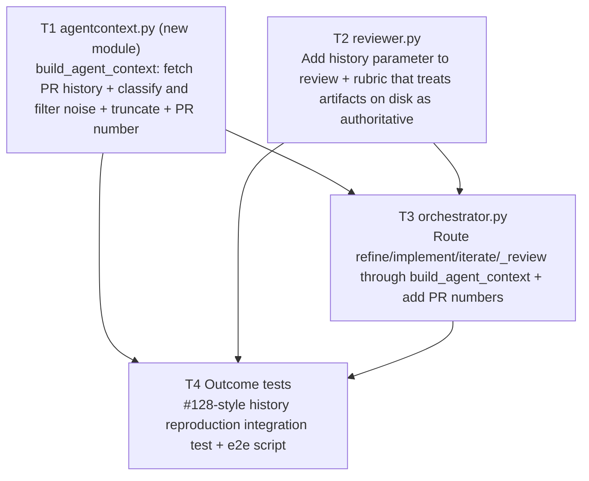

# 0052 · Unified agent context injection: include the PR number at every dispatch entry point + inject this PR's conversation history

> Historical labels are translated here for readability. See the [original text](../specs-zh-CN/0052-unified-agent-context-injection.md) for exact historical values.

<!-- This file is maintained by the spec tool: frontmatter is the structured source data (including the tasks DAG), and the body is a group-level overview in the nine-section rust-RFC format. -->

## Summary

The context OpenAgents supplies each time it dispatches an agent (to draft/refine a spec, implement, iterate, or review) is currently both **inconsistent**
and **incomplete**: some entry points include the PR number in the prompt, while others do not; no agent can see **this PR's conversation history**
(review decisions from previous rounds, the author's replies across rounds, and human comments). This spec extracts a unified entry point,
`build_agent_context(pr_number, extra_detail)`, responsible for two things: **①** ensuring that the PR number enters the prompt
(filling the two gaps in `refine_rfc` / `implement`); **②** fetching this PR's conversation history, rendering it by author identity + round,
filtering noise, truncating it, and injecting it into `context`, so every agent can see “what has happened on this PR so far.” All agent dispatch
entry points (the orchestrator's `refine_rfc` / `implement` / `iterate` + the reviewer review gate) use this entry point, eliminating
divergent context assembly in individual templates. The reviewer receives special treatment: history is injected, while the rubric explicitly states that “artifacts on disk are authoritative;
comments are for reference only,” giving it access to previous rounds' feedback and human guidance while preserving its value as an “independent reader of the repository's actual state, unconvinced by mere claims.”

## Motivation

**Current state (restated here, without relying on bare references).** Every coding agent in OpenAgents is dispatched through the unified backend,
`ClaudeCodeBackend.run(work_dir, task, context)`. The backend assembles each prompt as
`_GUARDRAIL + "Task:" + task + "Context:" + context` (`_build_prompt` at `openagents/backends/claude_code.py:66-72`).
Here, `task` (what to do) and `context` (background) are assembled independently by each caller, creating two kinds of gaps.

**Gap one: inconsistent PR number injection.** Each dispatch entry point makes its own choice about whether to include the PR number in the prompt:

| Entry point | Code location | PR number in prompt? |
|---|---|---|
| reviewer (spec/code gate) | `reviewer.py:353-359` `_task_for` → `_RFC_REVIEW_TASK` / `_CODE_REVIEW_TASK` (`.format(pr_number=…)`) | ✅ |
| iterate (code iteration: ci/review/e2e) | `orchestrator.py:713` `_ITERATE_TASK.format(pr_number=…)` | ✅ |
| iterate (human unblocking: human) | `orchestrator.py:711` `_HUMAN_UNBLOCK_TASK.format(pr_number=…)` | ✅ |
| **refine_rfc (spec refinement)** | `orchestrator.py:487` `_REFINE_RFC_TASK.format(detail=…)`; the template (`:94-98`) only says “this issue's spec” | ❌ No PR number |
| **implement (implementation)** | `orchestrator.py:517` `_IMPLEMENT_TASK.format(number=record.issue_number)` (`:100-109`) | ❌ Uses the issue number rather than the PR number |

Today, locating the correct PR falls back to “the agent is placed in that PR's isolated worktree (`work_dir=worktree`),” which works;
however, without a PR number in the prompt, the agent cannot inspect PR metadata / comment threads when needed (it has `gh` but does not know the number), and logs and
self-verification are harder to trace to a specific PR.

**Gap two: this PR's conversation history is never injected.** No agent's `context` **contains the PR comment thread**:
- The reviewer receives `context=""` directly (`backend.run(..., context="")` at `reviewer.py:369,373`), and its templates explicitly state
  that it “does not share context with the drafter/author” (`_RFC_REVIEW_TASK:71` / `_CODE_REVIEW_TASK:120`);
- The problem-solving agent's `context` contains only **one round** of feedback: `refine_rfc` passes `context=detail` (the reviewer's feedback for the current round),
  `iterate` passes `context=detail` (the current round's CI/comment/human feedback), and `implement` passes `context=""`. It cannot see previous
  reviews, the author's replies across rounds, or other human comments.

**Why change this—evidence from the stall on #128.** This issue was triggered by a stall on PR #128 in this repository: the e2e/evidence gate starts a **fresh
process** each round with `context=""`. It cannot see the author's explanation in the comment thread that “`result.md` has been changed to PASS”; it only reads the actual file contents,
which are still `skipped` → repeatedly returns FAIL → accumulates K rounds → `needs-human`. Although “trust only files on disk, not verbal claims” was
**correct in this particular case** (the author had indeed failed to make the actual change), more generally, both the reviewer and the problem-solving agent **cannot incorporate clarifications from previous rounds, established
consensus, or additional human judgments into the current round**, resulting in repeatedly raising the same kinds of **already clarified** issues, ignoring guidance humans provide in the comments,
and having **no memory** across rounds.

**Expected behavior (acceptance criteria).**
1. Every agent dispatch entry point includes the PR number in the task text (filling the gaps in `refine_rfc` / `implement`), establishing a consistent convention
   and no longer relying on “happening to be in the right worktree” to locate the PR.
2. Inject this PR's conversation history (truncated / filtered for noise as needed, **including at least** review decisions from previous rounds + author replies + human comments, with **author identity and
   round**) into `context`, so every agent can see “what has happened on this PR so far.”
3. Preserve the reviewer's value as an “independent reader of the repository's actual state, unconvinced by mere claims” (the reason it could **correctly** return FAIL on #128),
   while making it aware of previous rounds' feedback / human guidance—inject history, but explicitly state in the rubric that “artifacts on disk are authoritative; comments are for reference only.”
4. **Constraints on scope**: do not overturn the deliberate isolation under which the reviewer and drafter “do not share draft context” (the tradeoff
   documented in the top-of-file comments at `reviewer.py:1-13`). This spec adds only the layer of “visible historical comments”; it does not let the reviewer and author share private draft state.
   Do not introduce new state fields / configuration files / external dependencies (Occam's razor, principle 1).

## Guide-level explanation

Think of this change as “giving every agent reporting for work a **standard handoff sheet**,” rather than having each role assemble one ad hoc.

- **What the handoff sheet looks like.** A new pure function, `build_agent_context(pr_number, extra_detail)`, produces
  `context` text with three fixed parts: **①** a line saying “This PR is #N” to include the PR number in the context; **②** “Conversation history for this PR
  (for background reference)”—in chronological order, each entry labeled with **author + round/time**, including review-gate decisions from previous rounds, the author's replies
  and explanations across rounds, and human comments; **③** “Specific feedback for this round”—the `extra_detail` the caller originally intended to pass (the reviewer's current feedback /
  a single human comment / CI logs, etc.). If the history block is too long, compress it by “keeping the most recent entries + truncating to a length limit.”

- **Who issues the sheet.** The orchestrator is the only place with both `pr_number` and GitHub read capabilities, so it calls
  `build_agent_context` to assemble `context` in the three atomic operations `refine_rfc` / `implement` / `iterate`; it also assembles history
  in the review gate `_review` and passes it to the reviewer as an argument. **The messages routing layer remains unchanged** (it continues to pass only a single round's `detail`
  to the orchestrator; history injection is centralized in the orchestrator, preserving decoupling under principle 10).

- **Everyone now gets the PR number.** The `refine_rfc` task template gains the PR number (today it only says “this issue's spec”);
  the `implement` task template changes “issue #N” to **also** include the PR number (today it incorrectly uses the issue number). Since `build_agent_context`
  also repeats the PR number in context, an agent can obtain the number from either task or context and use `gh pr view` to inspect the PR.

- **The reviewer remains an “independent pair of eyes,” but no longer loses its memory.** The reviewer now receives the same history (previous decisions + author
  replies + human comments), but its rubric explicitly gains a rule: **“Artifacts on disk are authoritative; comments are for background reference only—do not
  approve merely because the author claims ‘fixed’ in a comment; use the actual files/diff in the repository as the sole basis for the decision.”** Thus, in a case like #128, where “the author says it was changed,
  but the file still says skipped,” the reviewer can both **see** the author's explanation (no longer blindly raising the same already clarified statement repeatedly)
  and still return FAIL **based on the file** (preserving its value in catching real problems); human guidance in the comments also enters its view.
  The reviewer module itself still depends only on “a string + the `AgentBackend` protocol” and does not touch GitHub/state (history is assembled by the orchestrator
  and passed in), preserving its decoupled, hermetic, unit-testable role.

- **Noise filtering.** The agent's own **claim notes** (`<!-- openagents:claim -->`), pure machine-generated signposts pointing to PR body summaries, and similar
  machine noise are filtered out of history; **review-gate decision** comments and **human comments** are retained (they are precisely the history agents need to see). The author's
  refine explanation, “Updated the spec based on review feedback,” is also retained (representing the author's replies across rounds).

## Reference-level explanation

### Technical approach

**New module `openagents/agentcontext.py` (T1, sole writer).** A thin module that does not touch git/state and depends only on `github` read primitives
+ `identity` parsing primitives, exporting a pure / nearly pure function:

```
build_agent_context(*, pr_number: int, extra_detail: str) -> str
```

Flow:
1. `comments = github.list_comments(pr_number=pr_number)` (already exists; returns `list[Comment]`, each containing
   `author / body / created_at`, `github.py:353,107-118`).
2. **Classification and noise filtering** (pure function `_render_history`):
   - **Keep**: review-gate decision comments (whose bodies contain the heading `## Review gate verdict`; `reviewer.extract_decision_content`
     can be reused to identify them, `reviewer.py:292`), the author's refine explanations (`_REFINE_COMMENT`, “🤖 Updated the spec based on review feedback”),
     and all **human comments** (`identity.parse_agent_id(body) is None`, `identity.py:80`).
   - **Filter out**: claim notes (whose bodies contain `identity`'s `<!-- openagents:claim -->` marker, `identity.py:39`),
     and other purely noisy machine comments.
   - Sort entries in ascending order by `created_at` (ISO 8601 lexicographic order is chronological order), and render each as `【Round k · <author> · <created_at>】\n<body summary>`,
     stripping hidden HTML comment signatures from the body (to prevent signature noise from contaminating it).
3. **Truncation**: when the history block exceeds the length limit `_HISTORY_MAX_CHARS`, **keep the most recent entries** and add a note at the beginning saying “(N earlier
   history entries omitted)”—the most recent clarifications / consensus are most relevant (the same idea of “controlling the length inserted into
   the prompt” used by `claude_code._SUMMARY_MAX_LEN`).
4. Assemble and return: `f"This is PR #{pr_number}.\n\n## PR conversation history (background)\n{history}\n\n## Current feedback\n{extra_detail}"`;
   gracefully handle empty history / empty `extra_detail` independently (without producing empty heading blocks).

**Centralize in the orchestrator (T3, sole writer of `orchestrator.py`).** Route `context` assembly at all three dispatch entry points through
`agentcontext.build_agent_context`, and fill the two PR number gaps:
- `refine_rfc` (`orchestrator.py:472-506`): add `{pr_number}` to the `_REFINE_RFC_TASK` template;
  `context=agentcontext.build_agent_context(pr_number=pr_number, extra_detail=detail)`.
- `implement` (`orchestrator.py:509-533`): change “issue #N” in the `_IMPLEMENT_TASK` template to include `{pr_number}`
  (retaining the issue number as a clue is also acceptable, but the PR number must be included); `context=build_agent_context(pr_number=pr_number, extra_detail="")`.
- `iterate` (`orchestrator.py:694-721`): the task templates already include the PR number; only replace `context=detail` with
  `context=build_agent_context(pr_number=pr_number, extra_detail=detail)` (apply the same change to both the human and ci/review/e2e paths).
- `_review` (`orchestrator.py:549-567`): before calling the reviewer, set `history=build_agent_context(pr_number=pr_number, extra_detail="")`,
  and pass it as a new argument to `reviewer.review(..., history=history)`.
- `start_rfc` (drafting) **remains unchanged**: when drafting a draft PR, the PR has not yet been opened and there is no history to inject; retain `context=issue.body` (zero regressions).

**Add history to the reviewer + rubric constraints (T2, sole writer of `reviewer.py`).** Add a `history: str = ""` parameter to `reviewer.review` and the internal
`_run_reviewers` (defaulting to an empty string → zero regressions for existing calls/tests), and pass `history` through
`backend.run(..., context=history)` (today it is always `""`); also add a permanent rubric rule
`_HISTORY_PRIMACY_RUBRIC` alongside `_RUBRIC_TAIL`: **“You will see this PR's conversation history (previous rounds' decisions / author replies / human comments) as background;
however, decisions must be based solely on artifacts on disk in the repository (files, diffs, evidence from actual runs). Comments are for reference only—an author's comment claiming
‘fixed / changed to PASS’ is not grounds for approval; verify the actual file contents.”** Append it to both review task templates. The reviewer still depends only on
`AgentBackend` + the supplied string, and does not import github/agentcontext (preserving decoupling under principle 10).

### Modules / DAG / File Allocation



| Task | Owned files (exclusive) | Key deliverables |
|---|---|---|
| T1 | `openagents/agentcontext.py`, `tests/test_agentcontext.py` | `build_agent_context(pr_number, extra_detail)`: fetch history with `github.list_comments` → classify and filter noise (retain verdicts/author replies/human comments; filter claim notes + signature noise) → render by author + round → truncate → append PR number |
| T2 | `openagents/reviewer.py`, `tests/test_reviewer_history.py` | Add `history: str = ""` to `review` / `_run_reviewers` (empty default, zero regressions) → `backend.run(context=history)`; add `_HISTORY_PRIMACY_RUBRIC`, “Artifacts on disk are authoritative; comments are for reference only,” to both templates |
| T3 | `openagents/orchestrator.py`, `tests/test_orchestrator_context.py` | Add PR numbers to the `refine_rfc`/`implement` templates; route `context` for all four entry points through `build_agent_context`; have `_review` assemble history and pass it to `reviewer.review(history=…)`; leave `start_rfc` unchanged |
| T4 | `scripts/e2e-spec-0052-agent-context-injection.sh`, `tests/test_agent_context_integration.py` | Outcome tests: reproduce #128-style history using an in-memory fake github comment ledger (FAIL verdicts from previous rounds + the author's “Updated to PASS” + human comments); assert that the PR number + all three history categories enter prompt/context, claim notes are filtered out, and the reviewer receives history + rubric; the e2e script runs ruff+pytest+spec validate and prints evidence |

Files are exclusive across Tasks (Principle 6, single writer): `agentcontext.py`(T1) / `reviewer.py`(T2) / `orchestrator.py`(T3) /
scripts + integration tests(T4) do not overlap; each Task has its own independent new test file. Existing `test_orchestrator.py` / `test_reviewer.py`
remain green because the new parameters have defaults (neither file is owned by any Task, and neither needs changes).

### Outcome Tests (Principle 8) and e2e Script

**Browser e2e applicability self-check: not applicable.** This feature changes **backend prompt/context assembly**—the text fed to
cli-agent subprocesses—and has **no product frontend interface to drive** (no visual outcomes that can be asserted through navigation/interactions/screenshots). Although this session
has Playwright / Chrome DevTools MCP tools, this change has no UI surface to capture in screenshots; under the evidence-based judgment discipline, it belongs to the category “not visible in the UI
but changes the product's externally observable behavior.” The outcome tests therefore take the form of **deterministic text reproduction** (pytest integration tests + one shell e2e script that runs them
and prints evidence), rather than browser e2e.

- **Integration test** `tests/test_agent_context_integration.py`: use an in-memory fake `github` (comment ledger) to reproduce PR #128-style
  history—reviewer FAIL verdict comments from previous rounds, an explanatory author comment saying “🤖 Changed result.md to PASS,” one human comment, and one
  agent claim note as noise. Assert:
  1. The context produced by `build_agent_context(pr_number, extra_detail="Feedback X for this round")` **contains the PR number**, **contains** the above
     previous verdicts / author replies / human comments (annotated with author and round), **and contains** feedback X for this round;
  2. Claim notes / hidden signature noise are **filtered out** and do not appear in context;
  3. Drive the orchestrator's `refine_rfc`/`implement`/`iterate` with a fake backend that captures prompts: the **task contains the PR number**
     and **context contains history** when dispatched to the backend (closing the two PR-number gaps + injecting history at every entry point);
  4. On the reviewer side: `reviewer.review(history=…)` sends history into the context of `backend.run`, and the review task template contains
     the “Artifacts on disk are authoritative; comments are for reference only” rubric (making history visible while preserving independence).
- **e2e script** `scripts/e2e-spec-0052-agent-context-injection.sh`: run `ruff check` + `ruff format --check`
  + targeted `pytest` (the integration test above + T1/T2/T3 unit tests) + `spec validate`, and use passing assertion output for “PR number enters prompt / all three history categories enter
  context / noise is filtered out / reviewer receives history and the rubric takes effect” as reproducible evidence (automatically included by the PR signpost).

## Drawbacks

- **Longer prompts and higher costs.** Injecting history lengthens every prompt; accumulated history on PRs with multiple rounds can significantly increase token consumption and
  latency. Mitigation: `_HISTORY_MAX_CHARS` truncation + retaining only the most recent several comments + noise filtering; however, this is still larger than today's `context=""`/single-round detail.
- **Risk of diluting reviewer independence.** Showing history to the reviewer could theoretically allow the author's claims to bias it slightly (#128 was judged correctly precisely because the reviewer “trusted only
  the files”). Mitigation relies on the strict constraint in `_HISTORY_PRIMACY_RUBRIC`, but this is a soft constraint at the prompt level, not a structural guarantee—
  the reviewer may still occasionally be influenced by comments (see Unresolved questions on “whether to give the reviewer a more limited history view”).
- **One additional comment-read API call per dispatch.** Each orchestrator entry point now requires one `github.list_comments` call; for frequent polling by multiple agents,
  this adds an extra `gh` invocation (mitigation: reading comments is already a lightweight call, and RFC-0010 already provides transient retries as a fallback).
- **Noise-filtering heuristics may incorrectly exclude or retain comments.** “Which comments count as noise” is determined heuristically (classification by claim markers/signatures/verdict headers); as the rules evolve,
  they may filter out useful comments or let noise through. Lock down the expected classification of several typical comment categories in integration tests to prevent regressions.

## Rationale and alternatives

**Why choose “a unified `build_agent_context` entry point + reviewer injection through a parameter.”** It uses **one pure function + one central integration point in the orchestrator**
to close both types of gaps: consistent PR numbers (adding them to two templates + repeating them in context) and history injection (assembled once and reused by four entry points),
eliminating divergence from “each template assembling its own context”—exactly direction 1 suggested by the issue. Placing history **assembly** in the orchestrator (the only place that holds pr_number
+ github), while the reviewer only **receives a string**, routes all entry points through the same function without breaking the reviewer's hermetic decoupling of “depending only on
AgentBackend + strings” (Principle 10). Reusing existing `github.list_comments` / `identity`
signature parsing (direction 2 suggested by the issue) keeps the added surface minimal and introduces no state/configuration/external dependencies (Principle 1).

**Alternative A: Have the reviewer directly import `agentcontext`/`github` and fetch history itself.** This eliminates passing a parameter from the orchestrator.
**Tradeoff**: It breaks the reviewer module's intended role of “depending only on the AgentBackend protocol and supporting hermetic unit tests” (the explicit decoupling constraint at `reviewer.py:10-12`),
coupling the reviewer to git/github/the network and requiring github stubs in unit tests—violating Principle 10, so it is rejected. Passing a parameter keeps the
reviewer functional in style and centralizes github reads in the orchestrator, fitting the existing architecture better.

**Alternative B: Move history injection down into the backend's `_build_prompt` (`claude_code.py`), transparently to all callers.** The backend would automatically
append history to every prompt. **Tradeoff**: A backend adapter should not hold pr_number / know about github (today it only assembles strings and is a pure adapter layer).
Moving injection down would couple the backend to business logic and the network, and require special handling for the `start_rfc` drafting stage, when there is no PR—violating layering. Therefore, injection stays in the business layer
(orchestrator), and the backend remains a thin adapter.

**Alternative C: Add only PR numbers, without injecting history (split into two issues).** The smallest change. **Tradeoff**: The issue explicitly states that “both should be addressed together,”
and the direct cause of #128 getting stuck was **missing history**, rather than a missing PR number. Doing only half would fail to meet the expectation of “memory across rounds,” so C serves only as
a risk fallback (if history injection causes cost/independence problems, consistent PR numbers can land first), not the final state.

**Alternative D: Inject different levels of history into the reviewer and the problem-solving agent (the reviewer sees only human comments + verdict summaries; the problem-solving agent sees
everything).** More fine-grained protection of independence. **Tradeoff**: This adds two rendering paths and configuration. Start with the simplest approach, “the same history + a strict reviewer rubric constraint”;
differentiate only if empirical testing shows reviewer bias (listed under Unresolved questions), prioritizing Occam's razor.

## Prior art

- **The rust-lang/rfcs RFC format** (the nine-section structure of this spec itself, https://github.com/rust-lang/rfcs).
- **Conversational memory / session history injection** is standard practice for interactive coding agents (benchmarked against Cursor / Windsurf; see the commercial positioning in CLAUDE.md):
  messages from previous rounds in the same session/thread are fed back into context by role + order, providing memory across rounds. This spec uses the “PR comment
  thread” as the source of that session history, a natural application of this common technique within the architecture of “PR/comments as the message bus” (CLAUDE.md Principle 2).
- **Existing choices in this repository**: the reviewer's deliberate isolation of “not sharing context with the drafter” (the header comment at `reviewer.py:1-13`), `identity`'s
  signature/claim-note provenance tracking (`identity.py`), and RFC-0010's gh transient retries—this spec reuses/respects these existing primitives.
  The current behavior and constraints have already been restated in place in Motivation/Reference-level; this section provides pointers only and carries no information required to understand this spec.

## Unresolved questions

- **The value of `_HISTORY_MAX_CHARS` and the truncation strategy.** The optimal number of recent comments / amount of text to retain will be calibrated with integration tests during implementation;
  whether weighting by comment type is needed (prioritizing retention of human comments) remains for review.
- **Whether the reviewer needs a more limited history view (Alternative D).** Whether “the same history + a strict rubric constraint” is sufficient to preserve independence,
  or whether the reviewer should receive only “human comments + verdict summaries,” with the author's self-defense omitted, will be decided after empirical testing of reviewer behavior during implementation.
- **Whether history needs LLM summarization rather than mechanical truncation.** On long PRs, mechanical truncation may lose key agreements from intermediate rounds; whether to introduce a lightweight
  summarization step (cost vs. fidelity) remains for review—v1 will use mechanical truncation first.
- **Noise-filtering boundaries.** Beyond claim notes, whether machine comments such as PR-body signposts (e2e signpost / digest) and conflict-resolution replies should also
  be filtered requires fixing expectations for each category in integration tests to prevent rule drift.

## Future possibilities

- **Factor history injection into a reusable “session context” primitive**: If more scenarios (cross-PR associations, issue threads) need history fed back into context in the future,
  `build_agent_context` could be generalized into a common module that retrieves history by “thread id.”
- **Role-specific history views** (implementing alternative D): Customize the amount of history provided to the reviewer / problem-solving agent / refinement agent.
- **LLM summary-based history compression**: For long threads, replace mechanical truncation with a single lightweight summary to improve the fidelity of multi-turn memory while keeping costs manageable.
- **Turn “artifacts written to disk are authoritative” from a soft rubric constraint into a hard constraint**: Explore structurally requiring reviewer verdicts to cite file/diff evidence
  (such as requiring a verdict to include a `git diff` excerpt), turning “comments are for reference only” from a matter of self-discipline into a constraint that is harder to violate (echoing the principle of making soft conventions hard constraints).
