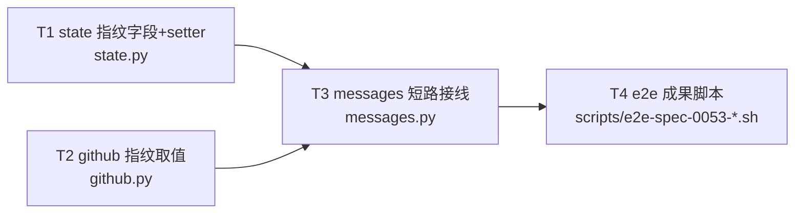

# 0053 · 代码评审闸每轮重审：代码状态未变时复用上轮 PASS（对照 k8s Tide sticky approve / tree-hash）

<!-- 本文件由 spec 工具维护：frontmatter 为结构化源数据（含 tasks DAG），正文为组级 rust-RFC 9 段总览。 -->

## Summary

给守夜人 poll 循环里的**代码评审闸**引入一个「PR 净改动指纹」短路：reviewer 全票 PASS 时，把当轮 PR 相对其 base 的净 diff 指纹落进 run state；下一轮进入 `review_code` 前先算一次指纹，**与上次 PASS 的指纹一致就直接复用上轮 PASS、跳过重审**，不一致才照常重审并更新指纹。这利用了一条我们此前没利用的不变式——「审过的代码，在代码状态没变时依然有效」——止住「base 前进（`BEHIND` → `update_branch` 拉 main → CI 重跑 → 下一轮 CI 绿）→ 又白跑一遍 N 个 reviewer」的同码空转重审。指纹取「PR 净 diff（`gh pr diff` 的 base…head 三点语义）」而非「PR head tree SHA」，因为 `update_branch` 会把 main 并进 PR head、连带改掉 head tree，唯有净 diff 在「只是 base 前进、PR 自身未改」时保持不变。设计直接对照 Kubernetes Tide/Prow 的 sticky `approve` 标签与 `lgtm` 的 `store_tree_hash` 机制。

## Motivation

### 现状（就地复述，读本段即懂问题，无需翻别的 spec）

守夜人每个 poll 间隔对每个 open PR 跑一遍状态机。处于 coding 阶段的 run 落到 `messages._process_coding`（`openagents/messages.py:549`），它这样推进代码评审闸（RFC-0012 决策 1）：

1. `github.mergeability(pr_number)` 取 `mergeable` / `mergeStateStatus` 两个 GitHub 原值做可合并性预检（Spec-0022）。
   - `DIRTY` / `CONFLICTING` → 真冲突，走 agent 解冲突 / `_block`。
   - `UNKNOWN` → GitHub 异步没算完，本轮不动，下轮重查。
   - **`BEHIND`（落后 main 但无文本冲突）→ 调 `github.update_branch(pr_number)`**：GitHub 服务端把最新 main **merge 进** PR 分支（默认非 rebase，产生一个 merge commit），触发该 PR 的 CI 在「集成后代码」上重跑；本轮不评审，返回 `synced`，下一轮以集成态推进。
2. CI 失败 → `iterate(reason="ci")`；CI 进行中 → 本轮不动。
3. **CI 全绿 → 无条件 `decision = self._orchestrator.review_code(pr_number)`（`openagents/messages.py:604`）**，起 N 个 reviewer 后端进程评审 PR 的代码 diff，聚合成 `ReviewDecision(passed=...)`。PASS → 过证据闸（Spec-0040）→ merge 闸夯住（Spec-0041）；非 PASS → `iterate` 或超 K 挂起。

问题出在第 3 步的「无条件」：**只要 run 还在 coding 阶段且 CI 绿，每一轮 poll 都从头重跑一遍 N 个 reviewer**，没有「上一轮已 PASS 且代码没变则复用」的短路。

### 为什么要改

典型触发路径把这个浪费放大：一个 PR 落后于 main 但无文本冲突（`BEHIND`）→ `update_branch` 拉最新 main 进来 → 触发 CI 重跑 → 下一轮 CI 绿 → **又重跑一遍 `review_code`**。但这一步里 **PR 自身的代码相对 base 一个字节都没改**（只是 base 前进、main 的改动被 merge 进来），上一轮 reviewer 的「全票 PASS」判断在**代码状态未变时依然成立**。后果：

- 每轮无条件重审 → 白白多起 N 个 reviewer 后端进程，浪费 token / 墙钟。
- base 每动一次（别的 PR 合入 → 本 PR 变 `BEHIND` → `update_branch`）就重审一次；PR 越晚合、并行 PR 越多，重审次数越多。
- 我们只有 RFC 闸的 `rfc-approved` 是 sticky 标签；**代码闸没有任何持久化的 PASS 状态**，等于每轮从零信任。

「审过的代码，在代码状态没变时依然有效」这个不变式我们完全没利用。本 spec 就是把它做进机制。

### 证据 —— Kubernetes 的做法（对照，已核对来源正文）

Kubernetes 的 Tide/Prow 恰好把这个不变式做进了合并机制：

- **`approve` 标签 sticky**：base 前进 / 落后都不掉标签，approver 无需在 base 移动后重签。
- **`lgtm` 只在 PR 自身 commit 变化时才被摘**；开启 `store_tree_hash` 后，Prow 把加 `lgtm` 时的 **git tree hash** 记进评论，后续 push 若 tree hash 未变则**连改动都不掉 `lgtm`**——base 移动完全不触发重审。
- Tide 用「PR + 最新 base 的临时 merge commit」批量测试，保证在最新集成态上测过，而**不重跑人工评审**（评审与集成测试是两个维度）。

来源（均为真实可访问页面）：
- Tide 组件文档 — https://docs.prow.k8s.io/docs/components/core/tide/
- `lgtm` 掉标签行为 / `store_tree_hash` — https://github.com/kubernetes/test-infra/issues/10578
- decouple `lgtm`/`approve` 的用意 — https://groups.google.com/g/kubernetes-dev/c/1pmyXLmYW_E

我们的映射：**reviewer 全票 PASS ≈ sticky `approve`（代码没变就别重签）**，**证据闸 + CI ≈ Tide 的集成态批测（永远在最新集成态上跑，不短路）**。

## Guide-level explanation

从「代码闸多了一层短路」的视角看，改动前后的一轮 poll 是这样的：

**改动前**（`_process_coding` 3c，CI 全绿后）：

```
CI 全绿 → review_code(pr)  # 每轮都起 N 个 reviewer，无条件
        → PASS → 证据闸 → merge 闸
```

**改动后**：

```
CI 全绿 → fp = github.code_fingerprint(pr)          # 算 PR 净 diff 指纹（一次 gh pr diff）
        → if fp 非空 and fp == record.code_passed_fingerprint:
              复用上轮 PASS（sticky），跳过 review_code，_progress 记一行「指纹未变，复用 PASS」
          else:
              review_code(pr)                        # 照常起 N 个 reviewer
              PASS → state.set_code_fingerprint(fp)  # 落盘本轮 PASS 的指纹
        → （无论走哪条）PASS 后照常：证据闸 → merge 闸
```

几个使用者视角的直觉：

- **base 前进不再触发重审。** 别的 PR 合入 → 本 PR 变 `BEHIND` → `update_branch` 把 main merge 进来 → CI 重跑绿 → 这一轮算出的 `code_fingerprint` **与上次 PASS 时相同**（PR 相对 base 的净改动没变），于是直接复用 PASS。省下 N 个 reviewer 进程。
- **`iterate` 追加 commit 会改指纹 → 自然触发重审。** 写码 agent 据 CI / REWORK 反馈改了代码，PR 净 diff 变了，指纹与上次 PASS 不一致 → 照常重审。无需为「代码真变了」写任何特判——指纹不等自然覆盖。
- **证据闸 / CI 永远照跑，不受短路影响。** 短路只跳过 reviewer（人工评审的类比），证据闸和 CI 测的是「PR + 最新 base」的集成态（另一个维度），继续每轮跑。这与 k8s「sticky approve 但 Tide 仍在最新 merge commit 上批测」一一对应。
- **不确定就重审（fail-safe 方向）。** 指纹算不出来（`gh pr diff` 失败 / 空）→ 指纹为空串 → `fp 非空` 条件不成立 → 落回照常 `review_code`。短路只在「可证明代码逐字节相同」时省工，任何含糊都走完整评审——省的是确定安全的那部分。
- **首轮无历史指纹。** 新 PR 第一次到代码闸时 `code_passed_fingerprint == ""`，短路不命中，照常评审，PASS 后落盘。从第二轮起才可能复用。

## Reference-level explanation

### 指纹取什么：PR 净 diff（`gh pr diff`），不是 head tree SHA

指纹要满足一个硬约束：**「只是 base 前进、PR 自身未改」时必须不变**，否则短路命中不了本 spec 要优化的那个场景（这正是 `update_branch` 引发的重审）。

- **PR head tree SHA（否决）。** `update_branch` 默认把 main **merge 进** PR head（`openagents/github.py:749`，非 rebase）→ PR head OID 变、连带 head tree 也变（现在含 main 的改动）。于是 head-tree-SHA 指纹会被**恰恰是本 spec 想优化的那次 `update_branch` 本身**改掉 → 短路永远命中不了目标场景。故 head tree SHA 直接出局，不是「简单但略差」，而是「测不到点」。
- **PR 净 diff（采纳）。** GitHub 的 `gh pr diff <n>` 返回的是 PR 相对其 base 的 **base…head 三点语义 unified diff**（GitHub 侧计算的「这个 PR 在 base 之上加了什么」）。`update_branch` 把 main merge 进 head 后，base…head 的净 diff **仍只是 PR 自身的改动**（main 的改动既进了 base 也进了 head，相消）——在「无冲突地 merge 最新 main」时保持不变。这正是要的不变式，与 k8s `lgtm` 的 tree-hash 同构（都锚在「PR 自身贡献」而非「含 base 的完整树」）。

**指纹实现**：在 `openagents/github.py` 新增薄封装 `code_fingerprint(*, pr_number: int) -> str`——跑 `gh pr diff <n>`，对输出做 `sha256` 取 hexdigest 返回；`gh` 故障 / 空输出时返回 `""`（fail-open，调用方据空串落回照常评审）。理念 10：github 层只做「取 diff + 定长哈希」，不含任何「要不要短路」的业务判定。

### 短路状态：`RunRecord.code_passed_fingerprint`

在 `openagents/state.py` 的 `RunRecord` 加一个字段（镜像既有 `block_gate` / `block_watermark` / `unblock_detail` 的加法）：

```python
# Spec-0053/T1：上一次 reviewer 全票 PASS 时 PR 净 diff 的指纹（sha256(gh pr diff)）。
# 默认 "" 使 RunRecord(**旧记录) 不报错（向后兼容缺该键的旧 state.json）。代码闸每轮据它短路：
# 本轮 code_fingerprint 与它相等 → 复用上轮 PASS、跳过重审；不等 → 照常重审、PASS 后更新它。
# 与 block_* / merge_attempts / closed_at 互不干扰。
code_passed_fingerprint: str = ""
```

配套 `State.set_code_fingerprint(*, issue_number: int, fingerprint: str)`——逐字节仿 `set_block_gate`（按 issue 定位 run、只改单字段、整体落盘）。`fingerprint=""` 即清除（虽然本设计不主动清，留作对称）。

### 短路接线：`messages._process_coding` 的 3c 段

把 `openagents/messages.py:604` 的无条件 `decision = self._orchestrator.review_code(...)` 改成短路结构。核心是把「是否 PASS」抽成一个布尔 `passed`，让 sticky 分支和真评审分支汇流到同一段下游（证据闸 + merge），下游一字不改：

```python
# 3c. CI 全绿 → 代码闸。Spec-0053/T3：先算 PR 净 diff 指纹做 sticky 短路。
fingerprint = github.code_fingerprint(pr_number=pr_number)
if fingerprint and fingerprint == record.code_passed_fingerprint:
    # 代码状态未变（k8s sticky approve / tree-hash 不变式）→ 复用上轮 PASS，跳过重审。
    self._progress(message=f"↩ PR #{pr_number} 代码指纹未变，复用上轮 PASS，跳过重审")
    passed = True
else:
    decision = self._orchestrator.review_code(pr_number=pr_number)
    passed = decision.passed
    if passed:
        # 全票 PASS → 落盘本轮指纹，下一轮同码即可短路。
        self._state.set_code_fingerprint(issue_number=record.issue_number, fingerprint=fingerprint)
if passed:
    # …证据闸 + merge 闸（Spec-0040 / 0041），逐字节保持现状…
else:
    # …iterate / 超 K 挂起（decision 承载反馈），逐字节保持现状…
```

要点：

- **只短路 reviewer，不短路证据闸 / CI**：sticky 命中时仍进 `_evidence_gate` 与 merge 闸；CI 的 fail/pending 分支在 3c 之前，天然不受影响（边界与 k8s 一致：集成态批测继续跑）。
- **fail-open**：`fingerprint` 为空串（`gh pr diff` 抖动 / 失败）→ `if fingerprint and …` 短路，落回真评审。sticky 永不基于「算不出指纹」做跳过。
- **只在 PASS 时落盘指纹**：REWORK 轮不写，故保留的仍是最后一次 PASS 的指纹；下一轮 `iterate` 改了码 → 指纹不等 → 重审，闭环自洽。
- **无需为 `iterate` / merge 加特判**：追加 commit 改净 diff → 指纹自然不等；这是本设计「用指纹而非事件」的简洁性红利（理念 1 奥卡姆）。

### DAG 与文件分配



| Task | 拥有文件（互斥） | 依赖 | 说明 |
|------|------------------|------|------|
| T1 | `openagents/state.py`, `tests/test_state_code_fingerprint.py` | — | `RunRecord.code_passed_fingerprint` 字段 + `set_code_fingerprint` setter + 向后兼容（旧 state.json 缺键） |
| T2 | `openagents/github.py`, `tests/test_github_code_fingerprint.py` | — | `code_fingerprint(pr_number)`：`sha256(gh pr diff)`，故障/空 → `""` |
| T3 | `openagents/messages.py`, `tests/test_messages_review_sticky.py` | T1, T2 | `_process_coding` 3c 短路接线：指纹一致复用 PASS、不一致重审并落盘；fail-open |
| T4 | `scripts/e2e-spec-0053-review-sticky-pass.sh` | T3 | 成果脚本：`BEHIND→update_branch→CI 绿→连跑两轮`，断言 reviewer 只被调一次 |

T1 与 T2 无相互依赖，可并行（协同模式，文件互斥）。所有文件在组内两两不相交（理念 6 单一 writer 所有权）。

### e2e 成果脚本（理念 8）与浏览器 e2e 自检

**e2e 脚本路径**：`scripts/e2e-spec-0053-review-sticky-pass.sh`（沿用本仓既有 `scripts/e2e-spec-NNNN-*.sh` 约定，被 PR 证据路标 Spec-0008 拾取）。

脚本以「成果」为中心断言短路真的发生：构造一条已 PASS 一次的 run（`code_passed_fingerprint` 已落盘），用 stub 的 `github.code_fingerprint` 返回与上次相同的指纹 + 计数版 `orchestrator.review_code`，驱动 `_process_coding` 连跑两轮，**断言 reviewer 只被调用一次**（第二轮走 sticky）；再翻转 stub 指纹（模拟 `iterate` 改码）跑第三轮，**断言 reviewer 再被调一次**（指纹变 → 重审）。即以「reviewer 调用次数」这一可观测成果验证短路语义，而非只跑单元断言。

**浏览器 e2e 自检**：我具备浏览器工具（playwright / chrome-devtools MCP）。但本 feature **没有 product-facing 的前端界面**——它是守夜人 poll 循环内部的编排短路，唯一可观测成果是「代码未变时不再起 reviewer 进程」，这不经任何 HTTP 前端 / 看板渲染（本仓 `results.py` 是 CLI/markdown 看板，也不呈现「本轮是否复用 PASS」）。因此按理念 8 与任务的 product-facing 条件，浏览器 e2e **不适用**；成果证据用上述 CLI/pytest 驱动的 shell 脚本以「reviewer 调用计数」断言，是此内部行为的正确观测面。

## Drawbacks

- **多一个持久化状态维度**：`code_passed_fingerprint` 是 run state 又一个字段，增加了状态机的表面积（虽然加法与既有 `block_*` 同构、成本很小）。
- **每轮多一次 `gh pr diff` 往返**：短路命中前要先算指纹，等于每个 coding-阶段 poll 多一次 `gh` 调用。但它替换掉的是「起 N 个 reviewer 后端进程」，净成本远低于重审；且 `gh pr diff` 走既有瞬时重试。
- **指纹口径与 reviewer 实际所看未必逐字节对齐的风险**：reviewer 看的是 PR 的代码 diff；`gh pr diff` 是 GitHub 计算的 base…head 净 diff。二者语义一致，但若将来 reviewer 改成看别的输入（如含未提交改动、或看完整树），指纹口径需同步，否则可能「指纹说没变、reviewer 实际会看到不同输入」。当前二者都锚在「PR 相对 base 的净改动」，一致。
- **sticky 的信任假设**：一旦 PASS 落盘指纹，同指纹的后续轮次无条件复用，不再有 reviewer 复核。若「相同净 diff 在不同集成态下语义不同」（例如 PR 未改、但 main 引入了让 PR 代码含义变化的隐性耦合），reviewer 不会重看——但这类语义漂移正是**证据闸 / CI 在最新集成态上跑**要抓的（评审看代码本身、集成测试看跑起来对不对），两维度互补，故此风险由证据闸兜底、可接受。

## Rationale and alternatives

**为什么是「PR 净 diff 指纹 + 只短路 reviewer + fail-open」这套**：它用一个不变式（同 diff → 同 PASS）覆盖所有触发场景，无需为 `update_branch` / `iterate` / merge 分别写事件特判（理念 1 奥卡姆）；短路方向只在「可证明相同」时省工、含糊即全审，安全侧偏保守；且与 k8s 成熟机制（sticky approve + tree-hash + 集成态批测）逐点对齐，有真实先例背书（理念 7 证据驱动）。

考虑过的备选：

1. **指纹取 PR head tree SHA（否决）。** 更简单（一次 `gh pr view --json headRefOid` + 一次 `git rev-parse HEAD^{tree}`），但 `update_branch` merge main 进 head 会改掉 head tree，**恰恰在本 spec 要优化的场景里指纹就变了**，短路命中不了目标 → 功能性不达标。这是采纳净 diff 而非 tree SHA 的决定性理由。

2. **用一个 sticky 标签（如 `code-approved`）替代 state 字段（部分否决）。** 更贴近 k8s 的「标签即状态」，人也能在 GitHub 上直接看到。但：本仓的评审结论已有结构化评论回贴（Spec-0047），标签不承载指纹（GitHub 标签是布尔、存不下 sha256）；要判「代码是否变」仍需把指纹存在别处。故标签解决不了核心的「存指纹」需求，反而多一层。指纹存 state（既有持久化层）更直接；可观测性由既有 PASS 评论 + `_progress` 日志覆盖。（把「让人看到 sticky 状态」列入 Future possibilities。）

3. **排除生成物（`docs/specs/OVERVIEW.md` / `ARCHITECTURE.md`）后再算 diff 指纹（暂不采纳，降级为 Unresolved）。** issue 担心 OVERVIEW 重渲被误判为变化。但在本 spec 的核心触发路径（`update_branch` 拉 main）里没人会重渲 OVERVIEW，`gh pr diff` 天然稳定；OVERVIEW 只在 spec 源变时才重渲，而那本就是值得重审的真代码改动。加 pathspec 排除要解析 diff、多一层，先不做（理念 1）；留作 Unresolved 观察。

4. **按 commit SHA 而非 diff 判变（否决）。** `update_branch` 改 head commit SHA，故 commit SHA 与 tree SHA 同病——测不到「只是 base 前进」的场景。

## Prior art

- **Kubernetes Tide/Prow**（本 spec 的直接对照，来源已在 Motivation 核对）：sticky `approve` 标签（base 移动不掉、不重签）、`lgtm` + `store_tree_hash`（tree hash 不变则 push 也不掉 lgtm）、Tide 用 PR+最新 base 的临时 merge commit 批测而不重跑人工评审。我们的映射：净 diff 指纹 ≈ tree hash，reviewer PASS ≈ approve，证据闸/CI ≈ Tide 集成批测。
  - https://docs.prow.k8s.io/docs/components/core/tide/
  - https://github.com/kubernetes/test-infra/issues/10578
  - https://groups.google.com/g/kubernetes-dev/c/1pmyXLmYW_E
- **git 自身的 tree/内容寻址**：git 用 tree SHA 做内容指纹本就是「内容不变则 hash 不变」的范式；本设计把它下沉到「PR 净贡献」这个粒度。
- **OpenAgents 内部先例**：`rfc-approved` 已是 sticky 标签（RFC 闸），本 spec 相当于把「代码闸」补齐成同款 sticky 语义；评审去重（Spec-0047「同 kind 同结论且同反馈才跳过重发」）已在「评论层」做过一次「状态没变就别重复」的判断，本 spec 在「评审执行层」做同类短路。

## Unresolved questions

1. **要不要排除生成物再算指纹？**（issue 待确认之一）当前设计取 `gh pr diff` 全量哈希、**不**排除 `docs/specs/OVERVIEW.md` / `ARCHITECTURE.md`。判断：核心触发路径（`update_branch`）下这些生成物不会在 base 移动时被重渲，`gh pr diff` 天然稳定，故不需要排除（理念 1 少加一层）。**留观**：若实测出现「仅生成物 diff 抖动导致的误重审」，再加 pathspec 排除（`:(exclude)docs/specs/OVERVIEW.md`）——届时另起小 Task 或并入本组。倾向：先不做。

2. **sticky 会不会给恶意改动开口（是否需要 k8s `store_tree_hash` 式安全门）？**（issue 待确认之二）我们的 agent 跑在隔离 worktree、无外部不可信贡献者，安全模型比 k8s 宽（k8s 要防「lgtm 后偷偷 force-push 换掉代码」）。判断：**直接 sticky，不加额外安全门**——`fail-open`（算不出指纹就全审）已覆盖「状态不明」；恶意 force-push 这类威胁在本项目的信任边界外。倾向：接受直接 sticky。

3. **指纹口径要不要与 reviewer 的实际输入做一次显式对齐校验？** 目前二者都锚在「PR 相对 base 的净 diff」，一致。若将来 reviewer 输入口径变化，需同步 `code_fingerprint` 的取值口径。是否加一个「口径一致性」的测试/断言把它硬化（软约定硬化）待定。

## Future possibilities

- **把 sticky 状态显性化到 GitHub**：加一个 `code-approved` sticky 标签（或在 PASS 评论里明示「本 PASS 在代码指纹 `abc123…` 上有效」），让人在 GitHub 上直接看到「代码闸已通过、base 移动不影响」，进一步贴近 k8s 的标签即状态。
- **指纹升级为 tree-hash 级 store**：若引入批量合并 / Tide 式集成批测，可把指纹从「PR 净 diff」升级为记录「PASS 时的 base + head 组合」，支持「在集成态维度也能复用部分结果」。
- **生成物排除通用化**：把「哪些是生成物、算指纹时排除」抽成一处配置（与 `spec render` 的生成物清单同源），供本 spec 及未来任何「按内容判变」的短路复用。
- **短路可观测性看板化**：在成果看板上统计「本 run 省下多少次重审 / 多少 reviewer 进程」，量化本优化的收益（理念 8 以成果为中心）。

