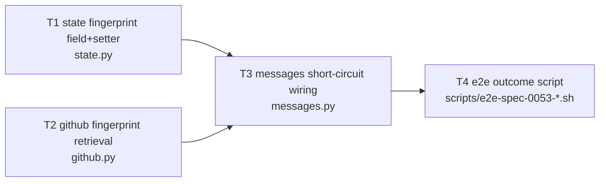

# 0053 · Re-review at the code review gate on every round: reuse the previous PASS when the code state is unchanged (with reference to k8s Tide sticky approve / tree-hash)

<!-- This file is maintained by the spec tool: the frontmatter is structured source data (including the tasks DAG), and the body is a group-level overview in the nine rust-RFC sections. -->

## Summary

Introduce a “PR net-change fingerprint” short circuit into the **code review gate** in Vigil’s poll loop: when all reviewers vote PASS, persist a fingerprint of that round’s PR net diff relative to its base in the run state; before entering `review_code` in the next round, compute the fingerprint once, and **if it matches the fingerprint from the last PASS, reuse that PASS directly and skip re-review**. Only re-review as usual and update the fingerprint when it differs. This uses an invariant we have not previously used—“a review of code remains valid while the code state is unchanged”—to stop redundant re-reviews of identical code along the path “base advances (`BEHIND` → `update_branch` pulls in main → CI reruns → CI is green in the next round) → run N reviewers again for nothing.” The fingerprint uses the “PR net diff (the three-dot base…head semantics of `gh pr diff`)” rather than the “PR head tree SHA,” because `update_branch` merges main into the PR head and changes the head tree along with it; only the net diff remains unchanged when “only the base advances and the PR itself is unchanged.” The design directly references Kubernetes Tide/Prow’s sticky `approve` label and the `store_tree_hash` mechanism for `lgtm`.

## Motivation

### Current behavior (restated here so this section explains the problem without requiring another spec)

At each poll interval, Vigil runs the state machine once for each open PR. A run in the coding phase reaches `messages._process_coding` (`openagents/messages.py:549`), which advances the code review gate as follows (RFC-0012 decision 1):

1. `github.mergeability(pr_number)` retrieves the two raw GitHub values `mergeable` / `mergeStateStatus` for a mergeability precheck (Spec-0022).
   - `DIRTY` / `CONFLICTING` → a real conflict; route to agent conflict resolution / `_block`.
   - `UNKNOWN` → GitHub has not finished its asynchronous calculation; take no action this round and check again next round.
   - **`BEHIND` (behind main but without text conflicts) → call `github.update_branch(pr_number)`**: GitHub merges the latest main **into** the PR branch on the server (by default, this is not a rebase and creates a merge commit), triggering the PR’s CI to rerun on the “integrated code”; do not review this round, return `synced`, and proceed with the integrated state next round.
2. CI fails → `iterate(reason="ci")`; CI is in progress → take no action this round.
3. **All CI checks are green → unconditionally call `decision = self._orchestrator.review_code(pr_number)` (`openagents/messages.py:604`)**, starting N reviewer backend processes to review the PR’s code diff and aggregating their results into `ReviewDecision(passed=...)`. PASS → pass through the evidence gate (Spec-0040) → remain held at the merge gate (Spec-0041); non-PASS → `iterate`, or suspend after exceeding K.

The problem is the “unconditionally” in step 3: **as long as the run remains in the coding phase and CI is green, every poll round starts all N reviewers again from scratch**, with no short circuit to “reuse the previous round’s PASS if the code is unchanged.”

### Why change this

A typical trigger path amplifies this waste: a PR is behind main but has no text conflicts (`BEHIND`) → `update_branch` pulls in the latest main → CI reruns → CI is green next round → **run `review_code` again**. Yet in this step, **not a single byte of the PR’s own code relative to its base has changed** (only the base has advanced, and main’s changes have been merged in), so the previous round’s unanimous reviewer PASS **remains valid while the code state is unchanged**. The consequences:

- Unconditional re-review every round → start N additional reviewer backend processes for nothing, wasting tokens / wall-clock time.
- Every base movement (another PR merges → this PR becomes `BEHIND` → `update_branch`) causes another re-review; the later the PR merges and the more PRs run in parallel, the more re-reviews occur.
- Only the RFC gate’s `rfc-approved` is a sticky label; **the code gate has no persisted PASS state at all**, effectively starting from zero trust every round.

We have made no use at all of the invariant “a review of code remains valid while the code state is unchanged.” This spec builds it into the mechanism.

### Evidence — Kubernetes’ approach (for comparison; checked against the source text)

Kubernetes’ Tide/Prow incorporates precisely this invariant into its merge mechanism:

- **The `approve` label is sticky**: it stays in place whether the base advances or the PR falls behind; approvers do not need to sign off again after the base moves.
- **`lgtm` is removed only when the PR’s own commits change**; with `store_tree_hash` enabled, Prow records the **git tree hash** at the time `lgtm` is added in a comment. If the tree hash is unchanged on a subsequent push, **even a change does not remove `lgtm`**—base movement never triggers re-review.
- Tide batch-tests “temporary merge commits combining PRs + the latest base,” ensuring testing against the latest integrated state **without rerunning human review** (review and integration testing are separate dimensions).

Sources (all are real, accessible pages):
- Tide component documentation — https://docs.prow.k8s.io/docs/components/core/tide/
- `lgtm` label removal behavior / `store_tree_hash` — https://github.com/kubernetes/test-infra/issues/10578
- The rationale for decoupling `lgtm`/`approve` — https://groups.google.com/g/kubernetes-dev/c/1pmyXLmYW_E

Our mapping: **unanimous reviewer PASS ≈ sticky `approve` (no need to sign off again when the code is unchanged)**, and **evidence gate + CI ≈ Tide’s integration-state batch testing (always run against the latest integrated state, with no short circuit)**.

## Guide-level explanation

Viewed as “adding a short circuit to the code gate,” a poll round before and after the change looks like this:

**Before** (`_process_coding` 3c, after all CI checks are green):

```
All CI checks green → review_code(pr)  # Start N reviewers every round, unconditionally
                    → PASS → evidence gate → merge gate
```

**After**:

```
All CI checks green → fp = github.code_fingerprint(pr)          # Compute the PR net-diff fingerprint (one gh pr diff)
                    → if fp is nonempty and fp == record.code_passed_fingerprint:
                          Reuse the previous PASS (sticky), skip review_code, and log “Fingerprint unchanged; reusing PASS” via _progress
                      else:
                          review_code(pr)                        # Start N reviewers as usual
                          PASS → state.set_code_fingerprint(fp)  # Persist the fingerprint for this round’s PASS
                    → (Either path) After PASS, proceed as usual: evidence gate → merge gate
```

A few intuitions from the user’s perspective:

- **Base advancement no longer triggers re-review.** Another PR merges → this PR becomes `BEHIND` → `update_branch` merges main in → CI reruns and turns green → the `code_fingerprint` computed this round **matches the one from the last PASS** (the PR’s net changes relative to its base are unchanged), so PASS is reused directly. This saves N reviewer processes.
- **A commit appended by `iterate` changes the fingerprint → naturally triggers re-review.** The coding agent changes code in response to CI / REWORK feedback, changing the PR’s net diff; the fingerprint differs from the last PASS → re-review as usual. No special case is needed for “the code really changed”—fingerprint inequality naturally covers it.
- **The evidence gate / CI always run as usual, unaffected by the short circuit.** The short circuit skips only reviewers (the analogue of human review); the evidence gate and CI test the integrated state of “PR + latest base” (a separate dimension), and continue running every round. This corresponds directly to k8s’ “sticky approve, while Tide still batch-tests the latest merge commit.”
- **When uncertain, re-review (the fail-safe direction).** The fingerprint cannot be computed (`gh pr diff` fails / is empty) → the fingerprint is an empty string → the `fp is nonempty` condition fails → fall back to `review_code` as usual. The short circuit saves work only when “the code is provably identical byte for byte”; any ambiguity takes the full review path—the savings are limited to the portion known to be safe.
- **The first round has no historical fingerprint.** When a new PR first reaches the code gate, `code_passed_fingerprint == ""`, so the short circuit does not match; review proceeds as usual, and the fingerprint is persisted after PASS. Reuse becomes possible only from the second round onward.

## Reference-level explanation

### What to fingerprint: the PR net diff (`gh pr diff`), not the head tree SHA

The fingerprint must satisfy one hard constraint: **it must remain unchanged when “only the base advances and the PR itself is unchanged”**. Otherwise, the short circuit cannot match the scenario this spec aims to optimize (precisely the re-review caused by `update_branch`).

- **PR head tree SHA (rejected).** By default, `update_branch` **merges** main **into** the PR head (`openagents/github.py:749`, not a rebase) → the PR head OID changes, and the head tree changes along with it (it now includes main’s changes). Thus, a head-tree-SHA fingerprint would be changed by **the very `update_branch` operation this spec aims to optimize** → the short circuit could never match the target scenario. The head tree SHA is therefore ruled out outright; it is not “simple but slightly worse,” but “unable to measure what matters.”
- **PR net diff (adopted).** GitHub’s `gh pr diff <n>` returns a **unified diff with three-dot semantics (`base...head`)** of the PR relative to its base (GitHub’s calculation of “what this PR adds on top of the base”)—this is the comparison basis consistently used by both GitHub PR “Files changed” and `gh pr diff`, not the two-dot `base..head` comparison. Why this comparison remains unchanged after `update_branch` follows rigorously from the definition of a three-dot diff: `base...head` ≡ `diff(merge-base(base, head), head)` (git’s three-dot semantics). After `update_branch` **merges** main (the base tip) **into** head, base becomes an ancestor of head, so `merge-base(base, head)` advances to the base tip; relative to this new merge-base, head’s net contribution **still consists only of the PR’s own changes** (main’s changes are present in both the new merge-base and head, so they cancel out). Thus, when “the latest main is merged without conflicts,” `base...head` remains identical byte for byte—exactly the required invariant, isomorphic to the tree-hash mechanism of k8s `lgtm` (both anchor on “the PR’s own contribution” rather than “the complete tree including the base”).
  - **Evidence (the three-dot diff comparison basis; sources are listed, but web access was restricted in this session, preventing online re-verification; all are stable official documentation)**:
    - GitHub PRs use three-dot comparisons — https://docs.github.com/en/pull-requests/collaborating-with-pull-requests/proposing-changes-to-your-work-with-pull-requests/about-comparing-branches-in-pull-requests
    - git’s three-dot semantics `A...B` = the difference from `merge-base(A,B)` to `B` — https://git-scm.com/docs/git-diff ("git diff A...B" is equivalent to "git diff `$(git merge-base A B)` B")
    - `gh pr diff` displays a PR’s changeset — https://cli.github.com/manual/gh_pr_diff

**Fingerprint implementation**: add a thin wrapper, `code_fingerprint(*, pr_number: int) -> str`, in `openagents/github.py`—run `gh pr diff <n>`, compute the `sha256` of its output, and return the hexdigest; return `""` if `gh` fails / produces empty output (fail-open; the caller uses the empty string to fall back to normal review). Principle 10: the github layer only “fetches the diff + computes a fixed-length hash” and contains no business decision about “whether to short-circuit.”

### Short-circuit state: `RunRecord.code_passed_fingerprint`

Add a field to `RunRecord` in `openagents/state.py` (mirroring the existing additions of `block_gate` / `block_watermark` / `unblock_detail`):

```python
# Spec-0053/T1: Fingerprint of the PR's net diff when the reviewers last unanimously returned PASS (sha256(gh pr diff)).
# Defaulting to "" prevents RunRecord(**old_record) from raising an error (backward compatibility with old state.json files missing this key). The code gate uses it each round to short-circuit:
# This round's code_fingerprint matches it → reuse the previous PASS and skip re-review; otherwise → review as usual and update it after PASS.
# Independent of block_* / merge_attempts / closed_at.
code_passed_fingerprint: str = ""
```

Add the corresponding `State.set_code_fingerprint(*, issue_number: int, fingerprint: str)`—follow `set_block_gate` byte for byte (locate the run by issue, change only one field, and persist the entire state). `fingerprint=""` clears it (although this design does not actively clear it, this is retained for symmetry).

### Short-circuit wiring: section 3c of `messages._process_coding`

Replace the unconditional `decision = self._orchestrator.review_code(...)` at `openagents/messages.py:604` with a short-circuit structure. The key is to extract “whether it passed” into a boolean `passed`, allowing the sticky branch and the actual review branch to converge on the same downstream section (evidence gate + merge), with that downstream section unchanged down to the last character:

```python
# 3c. CI all green → code gate. Spec-0053/T3: first compute the PR net diff fingerprint for the sticky short-circuit.
fingerprint = github.code_fingerprint(pr_number=pr_number)
if fingerprint and fingerprint == record.code_passed_fingerprint:
    # Code state unchanged (k8s sticky approve / tree-hash invariant) → reuse the previous PASS and skip re-review.
    self._progress(message=f"↩ PR #{pr_number} code fingerprint unchanged, reusing the previous PASS and skipping re-review")
    passed = True
else:
    decision = self._orchestrator.review_code(pr_number=pr_number)
    passed = decision.passed
    if passed:
        # Unanimous PASS → persist this round's fingerprint so the same code can short-circuit next round.
        self._state.set_code_fingerprint(issue_number=record.issue_number, fingerprint=fingerprint)
if passed:
    # …evidence gate + merge gate (Spec-0040 / 0041), preserve the current implementation byte for byte…
else:
    # …iterate / suspend after exceeding K (decision carries feedback), preserve the current implementation byte for byte…
```

Key points:

- **Short-circuit only the reviewer, not the evidence gate / CI**: a sticky hit still enters `_evidence_gate` and the merge gate; CI's fail/pending branches precede 3c and are naturally unaffected (the boundary is consistent with k8s: batch testing against the integrated state continues).
- **fail-open**: if `fingerprint` is an empty string (`gh pr diff` is flaky / fails), `if fingerprint and …` short-circuits and falls back to an actual review. Sticky never skips a review on the basis of “the fingerprint could not be computed.”
- **Persist the fingerprint only on PASS**: REWORK rounds do not write it, so the retained fingerprint is still that of the last PASS; if `iterate` changes the code in the next round → the fingerprint differs → re-review, making the loop self-consistent.
- **No special cases are needed for `iterate` / merge**: an additional commit changes the net diff → the fingerprint naturally differs; this is the simplicity benefit of this design's use of “fingerprints rather than events” (Principle 1, Occam's razor).

### DAG and file allocation



| Task | Owned files (mutually exclusive) | Dependencies | Description |
|------|------------------|------|------|
| T1 | `openagents/state.py`, `tests/test_state_code_fingerprint.py` | — | `RunRecord.code_passed_fingerprint` field + `set_code_fingerprint` setter + backward compatibility (old state.json missing the key) |
| T2 | `openagents/github.py`, `tests/test_github_code_fingerprint.py` | — | `code_fingerprint(pr_number)`: `sha256(gh pr diff)`, failure/empty → `""` |
| T3 | `openagents/messages.py`, `tests/test_messages_review_sticky.py` | T1, T2 | `_process_coding` 3c short-circuit wiring: reuse PASS when fingerprints match; re-review and persist when they differ; fail-open |
| T4 | `scripts/e2e-spec-0053-review-sticky-pass.sh` | T3 | Outcome script: `BEHIND→update_branch→CI green→run two consecutive rounds`, assert that the reviewer is called only once |

T1 and T2 have no mutual dependencies and can run in parallel (collaborative mode, mutually exclusive files). All file allocations within the group are pairwise disjoint (Principle 6, single-writer ownership).

### e2e outcome script (Principle 8) and browser e2e self-check

**e2e script path**: `scripts/e2e-spec-0053-review-sticky-pass.sh` (following this repository's existing `scripts/e2e-spec-NNNN-*.sh` convention, picked up by the PR evidence signposts in Spec-0008).

The script centers on the “outcome” to assert that short-circuiting actually occurs: construct a run that has passed once (`code_passed_fingerprint` has been persisted), use a stubbed `github.code_fingerprint` that returns the same fingerprint as last time + a counting version of `orchestrator.review_code`, drive `_process_coding` through two consecutive rounds, and **assert that the reviewer is called only once** (the second round takes the sticky path); then change the stub fingerprint (simulating a code change by `iterate`) and run a third round, and **assert that the reviewer is called once more** (fingerprint changed → re-review). This verifies the short-circuit semantics through the observable outcome of “reviewer call count,” rather than merely running unit assertions.

**Test boundary (explicit declaration, layered evidence)**: T4 feeds “matching fingerprint / changed fingerprint” through a stubbed `code_fingerprint`, verifying **orchestration-layer short-circuit semantics** (reuse PASS for unchanged code, re-review changed code, fail-open for an empty fingerprint). It does **not** actually execute a real `update_branch` to observe whether “`gh pr diff` really remains unchanged after merging main into head.” Reason: a real `update_branch` requires a live GitHub server-side PR state (this repository's e2e tests use CLI/pytest and have no live GitHub lane), which is costly and unstable; meanwhile, “the `base...head` three-dot diff remains unchanged after a conflict-free merge of base” is a **premise** rigorously derived above at the Reference-level from the definition of three-dot semantics and supported by official documentation, not runtime behavior that needs to be reverified in every e2e run. The two are layered: T4 anchors “given the invariant of the fingerprint definition → our short-circuiting is correct,” while the invariant itself is anchored in “GitHub/git three-dot semantics.” For strengthening this boundary, see Unresolved 3.

**Browser e2e self-check**: I have browser tools (playwright / chrome-devtools MCP). However, this feature **has no product-facing frontend interface**—it is an orchestration short-circuit inside the Vigil poll loop, and its only observable outcome is “the reviewer process is no longer started when the code is unchanged.” This does not pass through any HTTP frontend / dashboard rendering (this repository's `results.py` is a CLI/markdown dashboard and also does not show “whether PASS was reused this round”). Therefore, under Principle 8 and the task's product-facing condition, browser e2e is **not applicable**; outcome evidence is provided by the CLI/pytest-driven shell script above, asserting the “reviewer call count,” which is the correct observation surface for this internal behavior.

## Drawbacks

- **One more dimension of persistent state**: `code_passed_fingerprint` is another field in the run state, increasing the state machine's surface area (although the addition is structurally identical to the existing `block_*` fields and costs very little).
- **One additional `gh pr diff` round trip per round**: the fingerprint must be computed before a short-circuit hit, amounting to one additional `gh` call for every poll in the coding stage. But what it replaces is “starting N reviewer backend processes,” so its net cost is far lower than re-review; also, `gh pr diff` uses the existing transient retries.
- **Risk that the fingerprint definition may not align byte for byte with what the reviewer actually sees**: the reviewer looks at the PR's code diff; `gh pr diff` is the base…head net diff computed by GitHub. The two are semantically consistent, but if the reviewer later switches to other inputs (such as including uncommitted changes or examining the entire tree), the fingerprint definition must change accordingly; otherwise, “the fingerprint says nothing changed, but the reviewer would actually see different inputs.” Currently, both are anchored in “the PR's net changes relative to base” and are consistent.
- **The trust assumption behind sticky behavior**: once a PASS fingerprint is persisted, subsequent rounds with the same fingerprint reuse it unconditionally, with no further reviewer verification. If “the same net diff has different semantics in different integrated states” (for example, the PR is unchanged, but main introduces implicit coupling that changes the meaning of the PR's code), the reviewer will not look again—but this kind of semantic drift is precisely what **the evidence gate / CI running against the latest integrated state** is intended to catch (review examines the code itself; integration tests check whether it behaves correctly when run). The two dimensions complement each other, so the evidence gate covers this risk, making it acceptable.

## Rationale and alternatives

**Why this combination of “PR net diff fingerprint + short-circuit only the reviewer + fail-open”**: it uses one invariant (same diff → same PASS) to cover all triggering scenarios, with no need for separate event-specific cases for `update_branch` / `iterate` / merge (Principle 1, Occam's razor); the short-circuit saves work only when sameness can be proven and performs a full review whenever there is ambiguity, taking a conservative approach to safety; it also aligns point for point with mature k8s mechanisms (sticky approve + tree-hash + batch testing against the integrated state), with real precedent to support it (Principle 7, evidence-driven).

Alternatives considered:

1. **Use the PR head tree SHA as the fingerprint (rejected).** Simpler (one `gh pr view --json headRefOid` + one `git rev-parse HEAD^{tree}`), but when `update_branch` merges main into head, the head tree changes, so **the fingerprint changes in precisely the scenario this spec aims to optimize**, preventing a short-circuit hit in the target case → fails to meet the functional requirement. This is the decisive reason for adopting the net diff instead of the tree SHA.

2. **Use a sticky label (such as `code-approved`) instead of a state field (partially rejected).** This is closer to k8s's “labels as state,” and people can see it directly on GitHub. However, this repository already posts review conclusions as structured comments (Spec-0047), and a label does not carry a fingerprint (GitHub labels are boolean and cannot store a sha256); determining “whether the code changed” still requires storing the fingerprint elsewhere. A label therefore cannot address the core requirement of “storing the fingerprint” and instead adds another layer. Storing the fingerprint in state (the existing persistence layer) is more direct; observability is covered by the existing PASS comments + `_progress` logs. (“Making sticky state visible to people” is listed under Future possibilities.)

3. **Exclude generated artifacts (`docs/specs/OVERVIEW.md` / `ARCHITECTURE.md`) before computing the diff fingerprint (not adopted for now, moved to Unresolved).** The issue raises a concern that rerendering OVERVIEW could be misclassified as a change. But in this spec's core triggering path (`update_branch` pulls main), nobody rerenders OVERVIEW, and `gh pr diff` is naturally stable; OVERVIEW is rerendered only when the spec source changes, which is itself a real code change worth re-reviewing. Adding pathspec exclusions would require parsing the diff and add another layer, so this is deferred (Principle 1); retained as Unresolved for observation.

4. **Detect changes by commit SHA instead of diff (rejected).** `update_branch` changes the head commit SHA, so commit SHA has the same problem as tree SHA—it cannot identify the case where “only base has advanced.”

## Prior art

- **Kubernetes Tide/Prow** (the direct comparison for this spec; sources already checked in Motivation): a sticky `approve` label (not removed when base moves, with no need to approve again), `lgtm` + `store_tree_hash` (a push does not remove lgtm if the tree hash is unchanged), and Tide batch-testing temporary merge commits combining PRs with the latest base without rerunning human review. Our mapping: net diff fingerprint ≈ tree hash, reviewer PASS ≈ approve, evidence gate/CI ≈ Tide integration batch testing.
  - https://docs.prow.k8s.io/docs/components/core/tide/
  - https://github.com/kubernetes/test-infra/issues/10578
  - https://groups.google.com/g/kubernetes-dev/c/1pmyXLmYW_E
- **git's own tree/content addressing**: git's use of tree SHAs as content fingerprints already follows the paradigm of “unchanged content means an unchanged hash”; this design applies it at the granularity of a “PR's net contribution.”
- **Internal OpenAgents precedents**: `rfc-approved` is already a sticky label (the RFC gate); this spec effectively completes the “code gate” with the same sticky semantics. Review deduplication (Spec-0047: “skip reposting only when the kind, conclusion, and feedback are all identical”) already implements a “do not repeat if the state has not changed” check at the “comment layer”; this spec implements a similar short circuit at the “review execution layer.”

## Unresolved questions

1. **Should generated artifacts be excluded before computing the fingerprint?** (One of the issues awaiting confirmation.) The current design hashes the full output of `gh pr diff` and does **not** exclude `docs/specs/OVERVIEW.md` / `ARCHITECTURE.md`. Assessment: along the core trigger path (`update_branch`), these generated artifacts are not re-rendered when base moves, so `gh pr diff` is naturally stable and exclusion is unnecessary (Principle 1: avoid adding another layer). **Monitor**: if actual testing reveals “unnecessary re-reviews caused solely by fluctuations in generated-artifact diffs,” add a pathspec exclusion (`:(exclude)docs/specs/OVERVIEW.md`) then—either as a separate small Task or as part of this group. Leaning: do not implement this yet.

2. **Could sticky behavior create an opening for malicious changes (is a security gate like k8s `store_tree_hash` needed)?** (The second issue awaiting confirmation.) Our agents run in isolated worktrees, with no external untrusted contributors, so the security model is more permissive than k8s (which must guard against “secretly force-pushing replacement code after lgtm”). Assessment: **use sticky behavior directly, without an additional security gate**—`fail-open` (run the full review if the fingerprint cannot be computed) already covers “unknown state”; threats such as malicious force-pushes fall outside this project's trust boundary. Leaning: accept direct sticky behavior.

3. **Should the fingerprint's definition be explicitly checked for alignment with the reviewer's actual input, and should a live `update_branch` integration test be run for the three-dot invariant?** Currently, both the fingerprint and reviewer input are anchored to “the PR's net diff relative to base,” so they are aligned. If the definition of reviewer input changes in the future, the definition used to compute `code_fingerprint` must change with it. Whether to add a “definition consistency” assertion to enforce this (turning a convention into an enforced constraint) remains undecided. In addition, T4 uses stub fingerprints to verify short-circuit semantics and treats “`gh pr diff` remains unchanged after merging main into head” as a premise already supported by three-dot semantics + official documentation (see Reference-level and e2e test boundaries); it has **not** rerun a real `update_branch` to verify this invariant. Assessment: this repository has no live GitHub e2e lane, and introducing a dependency on a live server for an invariant strictly implied by git's three-dot semantics is not worth the cost, so do not do this yet. **Monitor**: if a live GitHub e2e lane is introduced in the future, an integration assertion that “fingerprints are equal before and after a real `update_branch`” can be added to include the premise itself in the executable evidence. Leaning: rely on documentation support + derivation from the definition for now; do not add a live integration test.

## Future possibilities

- **Make sticky state explicit on GitHub**: add a sticky `code-approved` label (or explicitly state in the PASS comment that “this PASS is valid for code fingerprint `abc123…`”), so people can see directly on GitHub that “the code gate has passed, and base movement does not affect it,” bringing this closer to k8s's use of labels as state.
- **Upgrade fingerprints to tree-hash-level storage**: if batch merging / Tide-style integration batch testing is introduced, upgrade the fingerprint from “the PR's net diff” to a record of “the base + head combination at PASS time,” supporting “reuse of some results at the integration-state level as well.”
- **Generalize generated-artifact exclusion**: extract “which files are generated artifacts and should be excluded when computing fingerprints” into a single configuration (sharing its source with the generated-artifact list used by `spec render`), for reuse by this spec and any future short circuit that “detects changes by content.”
- **Add short-circuit observability to the outcomes dashboard**: report “how many re-reviews / reviewer processes this run saved” on the outcomes dashboard to quantify the benefits of this optimization (Principle 8: focus on outcomes).
