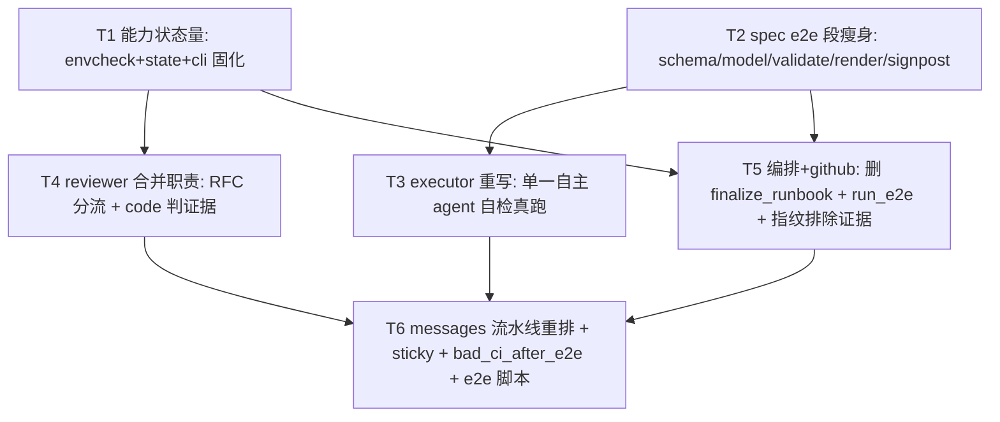

# 0054 · e2e v2：能力感知 + 说明书直喂 + 合并 review（重设计 0040）

<!-- 本文件由 spec 工具维护：frontmatter 为结构化源数据（含 tasks DAG），正文为组级 rust-RFC 9 段总览。 -->

## Summary

把 OpenAgents 的 e2e 从 Spec-0040 的「`form` 枚举分派 + `finalize_runbook` 定稿 + 独立证据闸
（`evidence_gate`）」这套三层机械脚手架，重设计成一条**能力感知、说明书直喂、合并 review** 的流水线：

```
① 守夜进程启动    envcheck 扫一遍 → 固化「浏览器能力状态量」ui-capable 进 state.json
② 写 RFC(spec)   e2e 段 = intent(验什么) + prose 测法(怎么测)，无 form、无精确命令；
                  RFC 起草/评审据 ui-capable 决定「要不要求真实截图」
③ implement       写功能代码（现状不变）
④ executor        独立 agent 拿 RFC 那段 prose 测法直接跑，运行时自检工具（有 browser_* 就开前端
                  截图、没有就如实降级报告），把截图 + result.md 声明写进 docs/e2e-results/<pr>/
⑤ 合并 review     现有 review_code 同时判「代码 diff + 证据（reviewer 用 Read 亲眼看截图）」——
                  运行时行为由 reviewer 判，不再有独立证据闸
```

砍掉 `finalize_runbook`、`form` 枚举与 `_run_by_form` 分派、独立的 `evidence_gate` 模块与
`review_evidence`、`iterate(reason=e2e)`/`_block(gate=e2e)` 专属回合预算。流水线在 `_process_coding`
里的顺序是 **mergeability → CI → executor → review → merge**（executor 在 CI 之后、review 之前，
因为证据是 review 的对象之一），配一道**源码指纹（排除 `docs/e2e-results/`）幂等闸**避免证据 commit
自我刷屏、复用 Spec-0053 的 **sticky 复用**（源码没变就不重跑 executor、不重 review、CI 绿即直接
合），并对「纯 docs 证据 commit 意外把 CI 弄红」这一异常单打 `bad_ci_after_e2e` 标签 + `_block` 挂起。

本组（Spec-0054）落**核心重写**；删除 0040 遗留死码（`evidence_gate.py` 等）与存量 spec 的 e2e 块
迁移收进后继清扫组（见 Unresolved）。

## Motivation

**背景（就地复述，不靠裸引用）。** OpenAgents 是 spec/RFC 驱动的多 agent 框架：守夜人
`messages.Messages.poll` 每隔一段时间扫所有 open 的 run，按阶段路由。一个 issue 的典型生命：
`solving`→起 RFC 草稿 PR→`rfc-review`→RFC 获批→`implement` 写码转正→`pr-open`→`_process_coding`
每轮查 CI/mergeability、CI 绿则 `review_code`（N 个独立 reviewer 投票），全票 PASS 则合并（或
`hold.at_merge` 停「待人合」），非 PASS 则 `iterate`/攒满 K 轮 `_block` 挂起。e2e 就嵌在这条链路里。

**Spec-0040 现状（本组要替换的对象）。** 0040 把 e2e 设计成：spec 声明 `e2e{form∈ui|api|cli|backend,
intent, acceptance[]}` 粗规划 → 代码后 `orchestrator.finalize_runbook` 派实现者把粗规划定稿成
`docs/e2e-results/<pr>/runbook.md` → `executor.run_executor` 按 `form` 分派（`_run_by_form`）派独立
agent 真跑 → `evidence_gate.review_evidence` 拿意图对照 `result.md` 判 PASS/FAIL 门控合并。逐行核对
现有代码后，这套设计有四个结构性问题：

1. **招牌能力 `ui` 从未实现，还会拖死 UI PR。** `executor._run_by_form`（`executor.py:150`）对
   `form==ui` **无条件返回 `skipped`**（Phase 2 留白），但 `run_executor` 仍把这份 skipped 结果写进
   `result.md`；`evidence_gate.review_evidence`（`evidence_gate.py:118`）见 `result.md` 存在→不触发
   「缺证据硬 FAIL」→派 agent 拿 skipped 证据对照 UI 意图→判 FAIL→`iterate(e2e)`→攒满 K→`_block`。
   **老实声明 `form: ui` 的前端 PR 在 Phase 1 下永远过不了、只能被挂起**——唯一出路是人肉把 `form`
   降级成 `cli`（仓库里唯一一次真实证据闸产出 `docs/e2e-results/128/` 正是这么干的，跑的是离线
   `ruff+pytest+grep`，浏览器截图「可选、缺失不 FAIL」）。招牌的「真跑 UI」能力从未被行使。
2. **两套证据机制冗余。** 0040 的运行时证据落 `docs/e2e-results/<pr>/`；Spec-0044 又引入一套**手工**
   「跑真 app 截图」skill，证据落 `docs/evidence/spec-NNNN/`，且把「宣称验证过但无 tracked 证据=REWORK」
   塞进**代码 reviewer** 的 rubric（`reviewer.py`）。于是有两个证据目录、两个消费者查不同目录，且
   0044 让代码 reviewer 查运行时证据，与 0040/T4「代码 reviewer 不判运行时行为」直接张力。
3. **`form` 分派 + `finalize_runbook` 是过度设计。** `form` 枚举、`_parse_form` 正则、`_run_by_form`
   分派、外加一个「代码后另起草 runbook」的 `finalize_runbook` 步骤，是把「给 agent 一段测法让它跑」
   这件简单事拆成三层机械脚手架。历史上（老 `scripts/e2e-*.sh` 时代）**具体命令一贯是代码实现完才由
   实现者写**（RFC 只含指路牌 + 验收标准，不含命令），说明「命令定在代码后」是反复的正确选择——但把它
   打包成 runbook 文件是多余的中间物。
4. **独立证据闸与「合并 review」诉求相悖。** 运行时行为验收本应是 review 的一部分；单拆一个
   `evidence_gate` 模块 + `review_evidence` + 专属回合预算，增加了状态机复杂度却没有本质收益——
   reviewer 本就是满配 claude-code agent（`backends/claude_code.py:159` 起 `claude -p` **无
   `--allowedTools` 限制**），其 `Read` 工具能读 PNG 并可视化喂给多模态模型，**完全能亲眼看截图判**。

**核心转变。** 「按 form 分派 + 定稿 runbook + 独立证据闸」→「**能力状态量决定测法要求 → prose 测法
直喂独立 executor 自检真跑 → 合进现有 review 一次判代码+证据（亲眼看图）**」。四个问题同根于：把简单
的「跑 + 看」过度机械化，且没让能力探测贯穿「要不要验」的决策。本组用一个固化能力状态量 + 一个自主
executor + 现有 reviewer 的复用，把这套压扁。

## Guide-level explanation

以一个真实例子走一遍：issue #142「给成果看板 `board.html` 加按状态筛选 run 的下拉框」（UI 改动）。

**① 守夜启动固化能力。** `openagents vigil` 起循环那一刻，`envcheck` 扫本机：`playwright` 在
`~/.claude.json` 注册 + 权限 `bypassPermissions` → 固化 `ui-capable=true` 进 `state.json` 顶层
（和 `agent_id` 平级）。整个会话只在 ③ 读一次。

**② 起草含 prose 测法的 spec。** start_rfc 派 agent 起草 spec、开 draft PR、转 `rfc-review`。起草时
**读 `ui-capable`**：=true 且是 UI 改动 → e2e 段写成要求截图的形态（只有 `intent` + prose `method`，
**无 form、无精确命令**）：

```yaml
e2e:
  intent: 看板能按状态筛选——选中某状态后只剩该状态的 run，其余隐藏。
  method: |
    1. 起本地看板；2. 确认下拉框在、默认显示全部；
    3. 选「done」→ 截图确认列表只剩 done 的 run；4. 选「全部」→ 截图确认恢复。
    要求：UI 可见改动，必须有真实导航后的截图为证。
```

**③ RFC 评审闸判「要不要验、测法对不对」。** `review_rfc` 的 rubric **也读 `ui-capable`**（与起草
共用一个「读 ui-capable → 分流标准」函数，杜绝两头漂移）：`ui-capable=true` 且 UI 改动却没写像样的
截图测法 → REWORK；写了且覆盖意图 → PASS → 打 `spec-approved` → `implement`。

**④ implement。** 与现状一致，派 agent 写码、转正 PR、`pr-open`。**implement 不再跑任何 e2e。**

**⑤ 每轮 poll 的 coding 阶段**（核心，`_process_coding`）。门顺序：**① mergeability 预检 → ② CI（绿）
→ ③ executor 跑 e2e → ④ review_code → ⑤ merge**。

- **③ executor**：CI 绿后，另起一个独立 executor agent（运动员≠裁判），输入**直接是 spec 那段
  `method` prose 测法**（不再有中间 runbook）。它**自检工具**：有 `browser_*` → 真开看板导航、选
  「done」、`browser_take_screenshot`。若发现筛选没生效（截图显示列表没变），把**截图 + 一句话
  `result.md` 声明**（「结论 FAILED：选 done 后列表未变，见 step3.png」）写进 `docs/e2e-results/142/`、
  commit。executor **只跑只报，不做判决**。
- **④ review_code**：N 个 reviewer（满配 claude-code，`Read` 能看 PNG）各自读 `git diff` + **用
  `Read` 打开截图真看到画面** + 读 `result.md` 声明 + 对照 intent，一起判。看到「代码有筛选逻辑但
  截图显示没生效」→ REWORK（一段简短中文）。**没有独立证据闸——就这一个 review 同时判了代码和 e2e，
  运行时行为 reviewer 现在管**（反转 0040/T4）。REWORK → `iterate(reason="review")` → 下一轮。
- **下一轮**：`iterate` 修筛选逻辑 → CI 再绿 → executor **重跑**（源码指纹变了，测的是最新版）→ 截图
  显示筛选生效、`result.md` 结论 PASSED → review 全票 PASS → merge（或 hold.at_merge 停「待人合」）。

**证据 commit 后的收敛（sticky）。** executor 那次 commit 是纯 docs，会让 GitHub CI 在其上重跑一次。
下一轮：**源码指纹（排除 `docs/e2e-results/`）没变 → executor 跳过、review sticky 复用上轮 PASS
（都不重跑，复用 Spec-0053 机制）→ 等证据 commit 的 CI 绿即直接 merge，不再 review**（重 review 同码
有翻盘风险，正是 0053/0041 要防的复审震荡）。若该次 CI 意外变红（源码之前明明绿+过审）→ 打
`bad_ci_after_e2e` 独立诊断标签 + `_block`（needs-human，`blocked` 状态夯住不空转），**不当普通 CI
fail 打回 iterate**（源码没错）；人解挂后回 `pr-open`，sticky 直接合。

**降级与边界。** 若守夜跑在 headless CI 机（`ui-capable=false`）：② 起草时测法就不要求截图、写离线断言
形态或注明无浏览器；⑤ executor 自检无 `browser_*` → 如实报「无浏览器、UI 截图不可得」；review **软判**
（不因缺截图 REWORK，就着能拿到的证据判）。纯 docs PR：测法段写「无运行时行为可验」，executor 不折腾、
reviewer 认同即放行。**每个 PR 都走这段 e2e**，但内容按改动性质可退化到 N/A。

## Reference-level explanation

### 机制 1：能力状态量（单一真相源，只在 RFC-authoring 读）

- `envcheck` 扩出结构化能力：现有 `detect_browser_mcp()` + `effective_permission_mode()` 组合成
  `ui_capable() -> bool`（browser MCP 在册 ∧ `bypassPermissions`）。
- **启动固化**：`cli` 的守夜/单步入口（`vigil` / `poll` / `init`）在起 `Messages`/`Orchestrator` 前
  调 `envcheck.ui_capable()` 写进 `state.json` 顶层键 `ui_capable`（新增 `State.set_ui_capable` /
  `State.get_ui_capable`，与 `agent_id` 平级，每次启动重写——环境变了下次启动即更新）。
- **只在两处读**：起草 spec 的 prompt（`orchestrator` 起草测法段）+ RFC 评审 rubric（`reviewer` 的
  `_RFC_REVIEW_TASK`）。**执行时不读**（executor 运行时自检工具，见机制 3）。两处共用同一「据
  `ui_capable` 选测法标准」的分流文案，保证起草与评审标准一致。

### 机制 2：spec e2e 段瘦身（intent + prose 测法，砍 form）

- `spec/schema.py` + `model.py`：`e2e` 块从 `{form, intent, acceptance[]}` 改为
  `{intent: str, method: str}`（`method` 为 prose 测法）。`form` 枚举 `E2E_FORM_VALUES` 退役。
- `validate`：`e2e` 存在时 `intent` 非空、`method` 非空即合法（向后兼容无 e2e 块的组）。
- `render`（OVERVIEW）+ `signpost`（PR 正文指路牌）改渲 `intent + method`。
- 存量 spec 的旧 `e2e{form,...}` 块迁移到新格式——收进后继清扫组（Unresolved）。

### 机制 3：executor 重写（单一自主 agent + 输出路径约定）

- `executor.run_executor(*, backend, work_dir, method, evidence_dir, pr_number, ui_intent)` ——
  **删掉 `form` 形参、`_parse_form`、`_run_by_form`**。直接把 spec 的 `method` prose 测法 + intent
  塞进一段任务 prompt 派独立 agent：要求它**运行时自检手里有没有 `browser_*` 工具**——有则真开浏览器
  导航/交互/截图存进 `evidence_dir`；无则用命令行/HTTP 等能用的方式真跑，或如实报「无法真跑/环境不
  具备」。末行仍给 `OUTCOME: PASSED|FAILED`（供 messages 渲报告，**不做门控判决**）。
- 契约不变：绝不抛错（异常映射 failed）；无论何结果把 `result.md`（一句话声明 + 观察）写进
  `evidence_dir`；截图等附件由 agent 自己落 `evidence_dir`。
- `OUTCOME_SKIPPED` / `_UI_FORM` / `_RUNTIME_FORMS` / `_UI_PHASE2_NOTE` 等 form 相关常量删除。

### 机制 4：reviewer 合并职责（RFC 分流 + code 判运行时行为）

- `_RFC_REVIEW_TASK`：加「据 `ui_capable` 分流的截法要求」（capability 由 `orchestrator` 透传，
  reviewer 保持只依赖 `AgentBackend` + 传入参数的解耦）。
- `_CODE_REVIEW_TASK`：**反转 0040/T4**——从「运行时行为由证据闸负责、你不判」改为「**读
  `docs/e2e-results/<pr>/` 的证据（`result.md` + 用 `Read` 打开截图亲眼看），对照 spec intent 判运行时
  行为是否达成；executor 声明达成但截图对不上→REWORK**」。Spec-0044 的「宣称验证过但无 tracked 证据=
  REWORK」并入这条、指向统一的 `docs/e2e-results/<pr>/`。
- `reviewer.review` 增 `ui_capable: bool`（RFC 闸用）与「证据目录可读」的语义；聚合/解析不变。

### 机制 5：编排与流水线（_process_coding 重排 + 幂等 + sticky + bad_ci_after_e2e）

`orchestrator`：**删 `finalize_runbook`**；`_e2e_plan` 读新 `e2e{intent,method}`；新增
`run_e2e(*, pr_number)`——ensure worktree → 算源码指纹（`github.code_fingerprint` 排除
`docs/e2e-results/`）→ 与 `record.e2e_ran_fingerprint`（新 state 字段）比对：变了才 `executor.run_executor`
+ commit 证据、更新指纹；没变则复用（返回「skipped-reuse」）。把 `ui_capable` 透传给 reviewer/起草。

`github.code_fingerprint`：加「排除 `docs/e2e-results/` 路径」——证据 commit 不改源码指纹。

`messages._process_coding` 新顺序（每轮 poll）：

```
① mergeability 预检（不变；冲突→解/ _block(merge)）
② CI 检查（不变；fail→iterate(ci)；pending→等）
   —— CI 绿 ——
③ orchestrator.run_e2e：源码指纹变→executor 真跑+commit 证据；没变→跳过复用
④ review_code（读 diff + docs/e2e-results/<pr>/ 证据+截图）
     ├ 指纹与上轮 PASS 一致（Spec-0053 sticky）→ 复用 PASS、跳过 ③④ 重跑
     ├ REWORK → iterate(reason="review") → 下一轮
     └ PASS → ⑤
⑤ hold-merge 冻结 / merge_pr → done
```

- **证据 commit 后一轮**：源码指纹未变 → ③ 跳过 executor、④ sticky 复用 PASS → 只等证据 commit 的
  CI；绿→直接 merge，红→`_block(gate="bad-ci-after-e2e")` + 额外打 `bad_ci_after_e2e` GitHub 标签。
- **删** `_evidence_gate`、`iterate(reason="e2e")`、`_block(gate="e2e")` 专属分支；e2e FAIL 经普通
  `review_code` 的 REWORK/iterate 走（复用现成 `rounds`/`MAX_ROUNDS`）。
- `bad_ci_after_e2e` 走现成 `_block` 机制：`STATUS_BLOCKED`（不在 `_OPEN_STATUSES`→poll 跳过，夯住
  不空转）+ `needs-human`（`BLOCKED_LABEL`）+ `block_gate="bad-ci-after-e2e"`（解挂路由回 `pr-open`
  → sticky 直接合）+ 额外 `bad_ci_after_e2e` 诊断标签（区分「证据 commit 弄红 CI」与别的 blocked 原因）。

### 状态机影响

不新增 status。新增 state 字段：`ui_capable`（顶层，非 per-run）、`e2e_ran_fingerprint`（per-run，
executor 幂等用）。`block_gate` 取值集加 `"bad-ci-after-e2e"`。`BLOCKED_LABEL` 之外新增 GitHub 标签
`bad_ci_after_e2e`（诊断，不参与解挂判定）。

### DAG 与文件分配



| Task | 拥有文件（互斥） | depends-on |
|---|---|---|
| T1 | `openagents/envcheck.py`, `openagents/state.py`, `openagents/cli.py`, `tests/test_envcheck.py`, `tests/test_state.py`, `tests/test_cli.py` | — |
| T2 | `openagents/spec/schema.py`, `openagents/spec/model.py`, `openagents/spec/validate.py`, `openagents/spec/render.py`, `openagents/spec/signpost.py`, `tests/test_spec_model.py`, `tests/test_spec_validate.py`, `tests/test_spec_render.py`, `tests/test_spec_signpost.py` | — |
| T3 | `openagents/executor.py`, `tests/test_executor.py` | T2 |
| T4 | `openagents/reviewer.py`, `tests/test_reviewer.py` | T1 |
| T5 | `openagents/orchestrator.py`, `openagents/github.py`, `tests/test_orchestrator.py`, `tests/test_github.py` | T1, T2 |
| T6 | `openagents/messages.py`, `tests/test_messages.py`, `scripts/e2e-spec-0054-e2e-v2-capability-aware.sh` | T3, T4, T5 |

（T1/T2 为并行叶子；`evidence_gate.py` 的**删除**与存量 spec e2e 块迁移收进后继清扫组，避免本组 T6 与
清扫组抢 `evidence_gate.py`——本组 T6 只**停止调用** `evidence_gate`，删文件留清扫组。）

### 接口契约

- `envcheck.ui_capable() -> bool`；`State.set_ui_capable(*, value)` / `State.get_ui_capable() -> bool`。
- `executor.run_executor(*, backend, work_dir, method, evidence_dir, pr_number, ui_intent) -> ExecutorResult`
  （`ExecutorResult{outcome: passed|failed, notes}`，删 `form`）。
- `orchestrator.run_e2e(*, pr_number) -> E2ERunResult | None`（None=无 e2e 段空过；含
  `reused: bool` 表 sticky 跳过）。
- `github.code_fingerprint(*, pr_number, exclude_paths=("docs/e2e-results/",)) -> str`。
- `reviewer.review(*, backend, work_dir, kind, pr_number, n, history, ui_capable=False) -> ReviewDecision`。

### 本组自身 e2e 粗规划

- **intent**：证明 e2e v2 链路真的有牙——executor 自检真跑、证据进 review、源码指纹幂等+sticky 收敛、
  bad_ci_after_e2e 夯住。
- **method**（离线确定性 dogfood，本组是纯后端编排无前端可导航）：造 fixture PR/worktree + prose 测法，
  跑 `run_e2e` 断言证据落 `docs/e2e-results/<pr>/`、源码没变则复用不重跑；喂「达成/未达成」证据给
  `review_code`（假 backend）断言 PASS 放行 / REWORK 不合；构造「证据 commit 后 CI 红」断言走
  `_block(bad-ci-after-e2e)` + 双标签 + `blocked` 状态。
- 脚本：`scripts/e2e-spec-0054-e2e-v2-capability-aware.sh`（离线段：ruff + pytest + grep 锚点）。

## Drawbacks

- **无浏览器机器上 UI 硬闸缺失。** `ui-capable=false` 时 UI 类改动只剩 reviewer 软判（看 executor 的
  「没跑成」报告自行定），没有机械硬门——headless/纯 CI 守夜环境下 UI 行为验证实质缺失（取舍：不误挡，
  但也不硬保。见 Rationale）。
- **每个 PR 都跑 e2e。** 即使纯 docs/重构也走一遍 executor（虽可退化 N/A），比 0040「无 e2e 块空过」多
  一次 agent 调用的开销。
- **executor 自证残余风险。** executor 只被 prompt 要求「真跑」，末行自报 `OUTCOME`；框架层面不能机械
  保证它真跑了。牙在「executor 产证据 + reviewer 独立看截图核对」的交叉牵制，非机械可证。
- **merge 比证据生成晚一轮。** 证据 commit 后要等其 CI 绿才合（sticky 那轮），稳态多一次 poll。
- **能力是每启动快照。** 跨机器/跨会话（起草在本机、执行在服务器）以执行环境启动快照为准；单机 MVP 无此
  错位，但分布式时需注意（见 Future）。

## Rationale and alternatives

**为什么这样设计。** 四个问题同根于「把简单的跑+看过度机械化，且能力探测没贯穿要不要验的决策」。用一个
固化能力状态量（贯穿 RFC 阶段的测法要求）+ 一个自主 executor（运行时自检、不分 form）+ 复用现有 reviewer
（能看图，合并判代码+证据），把三层脚手架压扁，复用 Spec-0053 sticky 与现成 `iterate`/`_block`/`rounds`
使状态机几乎不动（奥卡姆，理念 1）。executor 放在 CI 后、review 前，是因为**证据是 review 的对象之一**
（review 必须在 e2e 之后），而 CI 前跑会在没过 CI 的代码上白跑浏览器。

**备选 1：保留 0040 的 form 机制，只补 `ui` 分支真跑。** 最小改动，但没解决「两套证据目录冗余、独立
证据闸与合并 review 相悖、finalize_runbook 冗余」三个根——只补上 ui 仍是四层脚手架。否决。

**备选 2：保留独立证据闸（0040 的选择），executor 后单独 `review_evidence`。** 顺序不拖轮，但**再拆
一个模块 + 专属回合预算**，与「合并 review」诉求相悖，且 reviewer 本就能看图、无需第二个 agent 角色。
否决——合进 `review_code` 更省（理念 1/10）。

**备选 3：executor 放在 CI 之前跑。** 能让证据 commit 赶在 CI 前、CI 一次判含证据的树、免 sticky 那轮。
但会在**没过 CI 的代码**上白跑最贵的浏览器 e2e，且合进去的证据 commit 反而没被 CI/review 单独覆盖。
否决——宁可多一轮 sticky（有 `paths-ignore: docs/e2e-results/**` 可选优化免这轮）。

## Prior art

- **Spec-0040**（直接前身）：说明书驱动 + 独立执行 + 证据评审门控。本组保留「独立执行 + 证据固化 +
  merge 前门控」的骨，砍掉 form/runbook/独立证据闸的机械外壳，关键内容已在 Motivation 就地复述。
- **Spec-0030**：init 环境体检 `envcheck`（检测 browser MCP + 权限模式）+「有浏览器工具就优先设计前端
  e2e」的软引导。本组把它从「init 一次性打印 + 软 prompt」升级为「启动固化状态量 + RFC 阶段确定性分流」。
- **Spec-0044**：「跑真 app 截图」纪律 skill + 「宣称验证过但无证据=REWORK」。本组把它并进统一的
  `docs/e2e-results/<pr>/` 与合并后的 code reviewer rubric（消除两套证据目录）。
- **Spec-0053**：代码闸「PR 净 diff 指纹」sticky 复用（对照 k8s Tide sticky approve / tree-hash）。本组
  复用其指纹机制做「源码指纹（排除证据目录）幂等 + sticky」。
- **Spec-0041**：hold-merge 冻结消除同码复审震荡——本组「证据 commit 后不重 review、sticky 直接合」同源。
- 多模态 code review：claude-code `Read` 工具读图（PNG/JPG 可视化喂模型），是 reviewer 亲眼看截图的能力面。

## Unresolved questions

- **0040 死码删除 + 存量 spec e2e 块迁移**：`evidence_gate.py` 删除、`docs/evidence/` 合并进
  `docs/e2e-results/`、存量 spec 的旧 `e2e{form,...}` 迁移到新 `{intent,method}`、0029 pending 的
  RFC-NNNN 遗留注释清扫——收进**后继清扫组 Spec-0055**（依赖本组），避免与本组 T6 抢 `evidence_gate.py`。
- **`scripts/e2e-*.sh`（32 个开发期 dogfood 脚本）去留**：与运行时 e2e 是两回事（CI 期离线自测）。倾向
  **保留**（现在还绿、是 CI dogfood），仅在文档/命名上厘清它与 runbook/executor 的区别——放清扫组定夺。
- **CI `paths-ignore: docs/e2e-results/**`**：能免掉 sticky 那轮 CI 重跑，是可选优化；本组先不依赖它、
  用 sticky + bad_ci_after_e2e 兜底，待实测决定是否加。

## Future possibilities

- **`api` 形态富化**：executor 对起好的服务发 HTTP 断言（现在 prose 测法已能表达，工具面待补）。
- **证据看板**：把 `docs/e2e-results/<pr>/` 的截图/声明渲进前端成果看板，让人面向成果审阅（理念 8）。
- **跨机器能力真相源**：分布式（起草在本机、守夜在服务器）时，把执行环境能力做成两边都读的单一源，
  避免测法要求与执行能力错位（本组单机 MVP 用启动快照即可）。
- **runbook 自动生成的反向**：本组已省掉 runbook；若将来要留可 diff 的测法定稿，可让 executor 把它实际
  跑的步骤回写成 tracked 记录（而非事先定稿）。

