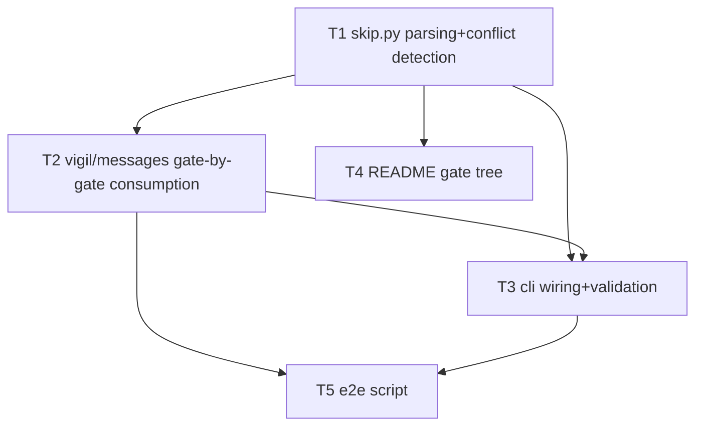

# 0054 · vigil per-gate bypass switch: --skip disables any pipeline gate on demand + README gate tree

<!-- This file is maintained by the spec tool: the frontmatter is the structured source data (including the tasks DAG), and the body is a group-level overview in the nine-section rust-RFC format. -->

## Summary

Add a temporary command-line switch `--skip <gates>` to `openagents vigil`, symmetric with the existing `--hold`: parse comma-separated gate names into an immutable `Skip` value object (pure parsing, no IO whatsoever), allowing **pipeline gates with actual pass-through semantics** in the autonomous loop—issue self-check / spec review / code review / CI wait / evidence gate (tokens: `issue` / `spec` / `code` / `ci` / `evidence`, plus `all`, which expands to all of them)—to be **treated as PASS and allowed through directly** on demand. The mergeability precheck gate is **deliberately excluded from `--skip`**: it is merely an optimization that “returns early on DIRTY/CONFLICTING to save work”; skipping it cannot make a conflicting PR mergeable, so it has no pass-through semantics (see alternative 4 in Rationale). The `merge` token therefore belongs exclusively to `--hold` (hold before merging). By default, omitting `--skip` = all gates enabled, with behavior unchanged byte for byte (zero regressions). Also introduce a hard constraint: if `--hold` and `--skip` express contradictory intentions for the same gate (such as `--hold spec --skip spec`), report an error immediately rather than silently accepting them. Finally, document all gates as a **tree** in the README so readers can immediately see where gates exist, which can be disabled through the CLI, and which are hard gates in GitHub branch protection that cannot be disabled through the CLI.

## Motivation

**Current state (restated here, without relying on cross-spec references).** OpenAgents’ Vigil (`openagents vigil`) is a thin scheduling loop: each round first scans issues carrying discovery labels during the **discovery phase** and determines whether to dispatch drafting work (`Vigil.discover_and_dispatch`); then, during the **watch phase**, it polls PRs for each in-flight run and advances them through a series of gates according to their stage (`Messages.poll` → `_process_rfc_review` / `_process_coding`). This pipeline currently has **6 mandatory gates reachable through the CLI**, all executed unconditionally:

1. **Issue self-check gate**—before drafting, `orchestrator.precheck_issue` determines whether the issue itself contains internal contradictions that would directly affect the direction of the fix; if so, the issue is frozen (apply needs-human + post an alignment comment), and the discovery phase does not dispatch work.
2. **Spec review gate**—the draft PR carries the spec, and `_process_rfc_review` calls `orchestrator.review_rfc` to review it; only PASS results in applying the `rfc-approved` label and entering implementation.
3. **Mergeability precheck gate**—at the start of `_process_coding`, check `github.mergeability` first; DIRTY/CONFLICTING PRs need not even wait for CI, and the earlier the short circuit, the more work it saves.
4. **CI wait gate**—`_process_coding` checks `github.check_status`: failure → feed logs back for iteration; in progress → do not review this round, wait for the next round.
5. **Code review gate**—after all CI checks are green, `_process_coding` calls `orchestrator.review_code` to review the code; proceed only on PASS.
6. **Evidence gate**—after code review passes and before merging, `_evidence_gate` uses an independent executor to actually run the system according to the finalized specification, comparing the RFC’s intent against the evidence to gate merging.

Today, there are only two kinds of controls for this pipeline, neither of which can “temporarily disable an entire gate”:

- **`--hold spec|merge`**—the **stricter** direction: make the pipeline **stop and wait for a human** at the spec gate / merge (hold before merging). It is pure parsing logic (`openagents/hold.py`: parse a comma-separated string into an immutable `Hold(at_spec, at_merge)`, with no IO and immediate errors for unknown tokens), parsed by the CLI, passed through each round via `vigil.run(hold=...)` to `messages.poll(hold=...)`, and used at the spec / merge gates to choose between “stop” and “proceed as usual.”
- **`OPENAGENTS_*` environment variables**—adjust only **counts/rounds** (such as `OPENAGENTS_MAX_ROUNDS`, the maximum number of review rounds per gate), without changing “whether a gate is enabled.”

What is missing is a symmetric switch in the **more permissive** direction: temporarily **disable an entire gate (or several gates), treating it as PASS and allowing progress**. Real scenarios repeatedly need this: a spec has already been reviewed by a human offline, and Vigil should proceed directly to implementation (disable the spec gate); local manual verification is complete, and CI is queued for too long, so review should proceed first (disable the ci gate); in an environment without browser MCP, the evidence gate always returns skip, and explicit pass-through is preferable to spinning idle each round (disable the evidence gate); a demonstration or teaching session should take an issue all the way through (`all`). Today, achieving any of these requires modifying code or cobbling together env settings, making the behavior neither discoverable nor traceable.

This spec fills that gap with a minimal implementation **isomorphic** to `--hold`, while also documenting the currently source-only knowledge of “where the gates are and which can be disabled” as a tree in the README, so people viewing the system at a high level (CLAUDE.md principles 2/8) can understand it at a glance.

## Guide-level explanation

For users, `--skip` is a mirror of `--hold`: `--hold` tells a gate “stop and wait for me,” while `--skip` tells a gate “let me through.” Usage:

```bash
# Default: all gates enabled, behavior identical to today byte for byte (zero regressions)
openagents vigil

# The spec has already been reviewed by a human offline → disable the spec review gate so Vigil proceeds directly to implementation
openagents vigil --skip spec

# Local manual verification is complete and CI is queued for too long → disable the CI wait gate + code review gate to advance the PR to the evidence gate first
openagents vigil --skip ci,code

# Demonstrate an issue going all the way through: disable all 5 skippable gates
openagents vigil --skip all

# Combine with --hold (operating on different gates, so valid): hold before merging to wait for a human, but bypass the CI wait gate
openagents vigil --hold merge --skip ci

# Contradiction: the same gate is asked both to stop and to allow progress → error immediately, never silently accept
openagents vigil --hold spec --skip spec
#   error: --hold and --skip express contradictory intentions for the same gate 'spec' (stop and wait for a human vs bypass and allow progress); choose one
```

Valid gate tokens (5 gates with pass-through semantics; the mergeability precheck gate is excluded, as explained below):

| token | Gate | Behavior with `--skip` |
|---|---|---|
| `issue` | Issue self-check gate | Do not assess consistency before drafting; allow the issue through directly for dispatch |
| `spec` | Spec review gate | Do not invoke a reviewer to review the spec; treat the draft PR as approved and proceed directly to implementation |
| `code` | Code review gate | Do not invoke a reviewer to review the code; treat it as PASS and enter the evidence gate |
| `ci` | CI wait gate | Do not check/wait for CI status; treat it as green and continue |
| `evidence` | Evidence gate | Do not perform independent evidence collection; treat it as PASS and proceed to merging |
| `all` | All of the above | Allow progress through all 5 gates at once |

> **Why is there no `merge` (mergeability precheck gate)?** This precheck’s sole purpose is to return early for DIRTY/CONFLICTING PRs to save work—“skipping” it cannot make a conflicting PR mergeable; it only makes Vigil wait for CI unnecessarily and ultimately fail at the actual merge, with no “pass-through” effect whatsoever. In addition, the `merge` token is already used by `--hold merge` (hold before merging), and the two operate at opposite ends of the pipeline without inherently conflicting. Reusing the same token for `--skip merge` would instead cause contradiction detection to falsely reject a valid combination. Therefore, `merge` belongs exclusively to `--hold` and is excluded from `--skip` (see alternative 4 in Rationale for details).

Every disabled gate is treated as **PASS, allowing progress**—that is, “act as if it passed,” rather than “stop” (which is the semantics of `--hold`). As with `--hold`, unknown tokens (such as the typo `spc`) **produce an immediate error listing the valid values**, never silently removing oversight. `--skip` is a **temporary command-line flag**: it is not written to disk and does not change any persistent state. To restore all gates, simply omit it on the next invocation.

**README gate tree.** In addition to the CLI, this spec adds a tree to the README showing “how many gates the autonomous loop actually has, which stage each belongs to, which can be disabled from the CLI through `--skip`/`--hold`, and which are hard gates in GitHub branch protection,” for example (illustrative; the final version is determined by T4):

```
vigil autonomous loop gates
├─ Discovery phase
│  └─ Issue self-check gate .... Can disable: --skip issue
├─ Watch phase (advance by stage on each poll round)
│  ├─ Spec review gate ......... Can disable: --skip spec   | Can hold: --hold spec
│  ├─ Mergeability precheck .... Cannot --skip (only returns early to save work; pass-through is meaningless)
│  ├─ CI wait gate ............. Can disable: --skip ci
│  ├─ Code review gate ......... Can disable: --skip code
│  ├─ Evidence gate ............ Can disable: --skip evidence
│  └─ Hold before merging ...... Can hold: --hold merge
└─ GitHub branch protection hard gates (cannot disable through the CLI; must change repository settings)
   └─ lint / test / commitlint / spec-validate (required PR checks)
```

## Reference-level explanation

### Technical approach (isomorphic to `--hold`, pure parsing + consumption at each gate)

**① Parsing layer—add `openagents/skip.py` (mirroring `hold.py`).** Pure parsing logic, with no argparse, no IO, and no GitHub dependencies (CLAUDE.md principles 1, Occam / 10, decoupling):

- Define the 5 valid gate token constants `_GATE_ISSUE/_GATE_SPEC/_GATE_CODE/_GATE_CI/_GATE_EVIDENCE` and the aggregate `all` in one place, forming `_VALID_GATES`—shared by parsing and error messages to prevent literal drift. **Deliberately exclude `_GATE_MERGE`**: the mergeability precheck has no pass-through semantics, and the `merge` token belongs to `--hold` (see alternative 4 in Rationale).
- `@dataclass(frozen=True) Skip`, carrying 5 Boolean intentions `at_issue / at_spec / at_code / at_ci / at_evidence` (all `False` by default), and providing semantics that are convenient to read at consumption points. Module-level `NONE = Skip()` serves as the default “disable nothing” instance (equivalent to the current state with all gates enabled).
- `parse_skip(*, raw: str | None) -> Skip`: `None`/empty string → `NONE`; comma-separated values (tolerating whitespace/case differences) → set the corresponding Booleans; `all` → set all 5; unknown tokens (including `merge`—it is not a valid skip token) → `raise ValueError` and list valid values (following exactly the same error-reporting discipline as `parse_hold`, byte for byte).
- **Contradiction detection** (the only new semantics in this spec): `reconcile_hold_skip(*, hold: Hold, skip: Skip) -> None` (a pure function that immediately executes `raise ValueError` on a match). The criterion is “a nonempty intersection of tokens shared by both sides”: `Hold` has `at_spec/at_merge`, while `Skip` has no `at_merge`—so the only token on which they can intersect is `spec`, and only `hold.at_spec` and `skip.at_spec` need to be compared. If the spec gate is simultaneously asked to “stop and wait for a human” and “bypass and allow progress,” that is a contradiction; report a clear one-line message (naming the gate + both intentions), never silently accept it. (`--hold merge` is valid with any `--skip` combination—skip does not include merge, so there is inherently no conflict.) **Turn a soft convention into a hard constraint** (skill quality criterion): turn “do not both hold and skip the same gate” from a warning in prose into a pure function that will `raise`, making it **impossible for this to slip through silently** at the CLI entry point.

**② Consumption layer—pass `Skip` through each round to the decision point for every gate (reusing the pass-through plumbing already established for `--hold`).**

- Add the keyword parameter `skip: Skip = NONE` to `Vigil.run(...)` (alongside `hold`), passing it through each round: in the discovery phase, `discover_and_dispatch` checks `skip.at_issue` before calling `precheck_issue`—if true, skip the assessment and allow dispatch directly (issue self-check gate PASS); in the watch phase, pass `skip` down to `messages.poll(skip=...)`.
- `Messages.poll(*, skip: Skip = NONE)` passes `skip` down to `_process_rfc_review` / `_process_coding`, inserting “skip means PASS” short circuits at 4 decision points, **alongside the existing `hold` short circuits and mirroring their implementation**:
  - `spec`: in `_process_rfc_review`, if `skip.at_spec` → take the existing PASS branch (apply the `rfc-approved` label + `_report_implement`), equivalent to “unanimous PASS from reviewers,” without calling `review_rfc`.
  - `ci`: if `skip.at_ci` → skip the fail/pending branches of `github.check_status` and continue as if green.
  - `code`: after CI is green, if `skip.at_code` → skip `review_code`, treat it as `decision.passed`, and enter the evidence gate.
  - `evidence`: if `skip.at_evidence` → skip `_evidence_gate`, treating it as returning `None` (allow progress to merging / the `--hold merge` hold point).
  - The `github.mergeability` DIRTY/CONFLICTING early return at the start of `_process_coding` **continues to execute as usual, unaffected by `skip`** (there is no corresponding skip token).

**③ CLI layer—`openagents/cli.py`.** Add `--skip` to the `vigil` subcommand (`metavar`/`help` symmetric with `--hold`); `_cmd_vigil` first obtains `Skip` with `parse_skip(raw=args.skip)`, then validates contradictions with `reconcile_hold_skip(hold=hold, skip=skip)` (invalid values/contradictions are converted from `ValueError` into a clean one-line message through `_run`’s existing exception channel, without a traceback), and finally calls `run(..., hold=hold, skip=skip)`.

**Zero-regression guarantee.** All new parameters default to `NONE`/all `False`; when `--skip` is omitted, the decision path at every gate is identical to today byte for byte (the new short-circuit conditions are always false). Existing `vigil.run` / `messages.poll` callers and test fixtures are unaffected because of the defaults.


### DAG + File Allocation

| Task | Title | files (mutually exclusive) | depends-on |
|---|---|---|---|
| T1 | skip parsing module + conflict detection | `openagents/skip.py`, `tests/test_skip.py` | — |
| T2 | Gate-by-gate consumption: pass Skip through to 5 gates | `openagents/vigil.py`, `openagents/messages.py`, `tests/test_messages_skip.py` | T1 |
| T3 | CLI wiring for `--skip` + hold/skip conflict validation | `openagents/cli.py`, `tests/test_cli_skip.py` | T1, T2 |
| T4 | README gate tree | `README.md` | T1 |
| T5 | Outcome test e2e script (offline gate-control timeline) | `scripts/e2e-spec-0054-vigil-skip-gate.sh` | T2, T3 |



The `files` sets of all Tasks are pairwise disjoint (single-writer ownership in collaboration mode, Principle 6): `skip.py` belongs to T1, the two consumer files `vigil.py`/`messages.py` belong to T2, `cli.py` belongs to T3, `README.md` belongs to T4, and the e2e script belongs to T5; each test file belongs to its respective Task, and all are new files with no overlap with existing fixtures.

### e2e Script Path

`scripts/e2e-spec-0054-vigil-skip-gate.sh` (T5). **Explanation of the outcome test format (Principle 8):** This change concerns only internal CLI/pipeline control flow, with **no frontend and no user-facing browser behavior**, and the environment in which this spec was drafted **has no browser MCP (Playwright / Chrome DevTools)**—confirmed by the agent's inspection of its tool list—so the outcome test uses a **CLI/offline format**, with no browser navigation/screenshot e2e tests (structurally equivalent to the existing `--hold` script, `scripts/e2e-spec-0020-hold-gate.sh`, runnable in CI, and repeatable). The script has two parts: (1) Offline deterministic verification: `ruff check` + `ruff format --check` + `pytest -q` (mocked throughout, covering skip parsing / conflict detection / PASS short-circuiting at each gate / CLI wiring); (2) An offline gate-control timeline demonstration: use stubbed orchestrator/state + an in-memory label set to simulate GitHub, drive `Messages.poll(skip=spec)` offline to assert that “the spec gate is treated as PASS, proceeding directly to implementation,” and demonstrate that `--hold spec --skip spec` produces an error.

## Drawbacks

- **Another weapon for “turning off oversight.”** `--skip` lets people temporarily disable safety gates such as review/evidence; misuse (especially `--skip all`) can let unchecked changes proceed all the way to merging. Mitigation: it is a temporary flag that is not persisted to disk (omitting it in the next round restores all gates); the disabled gates are only soft gates accessible through the CLI, while hard gates in GitHub branch protection (lint/test/commitlint/spec-validate) still block changes. The README tree makes this boundary clear.
- **The gate set now has two sources of truth.** The gate list exists both in code (at each consumption point) and in the README tree, and they may drift. Mitigation: the README tree is human-readable documentation, so some inherent lag is acceptable; token constants are defined in a single place in `skip.py`, shared by the CLI, parsing, and error messages.
- **The token sets for `--skip` and `--hold` are asymmetric** (`--hold` has `merge`, while `--skip` does not), requiring people to remember the exception that “the precheck cannot be skipped.” Mitigation: the README tree explicitly marks the mergeability precheck gate as “cannot --skip,” with a one-line explanation of why (the precheck only saves work; bypassing it serves no purpose), placing this exception in plain sight rather than hiding it in code.

## Rationale and alternatives

**Why this design.** Strict structural equivalence with `--hold` yields the smallest change: the parsing layer copies `hold.py`'s frozen dataclass + `parse_*` + token constants defined in one place + error-reporting discipline; the consumption layer reuses the existing `vigil.run(...) → messages.poll(...)` pipeline that passes `--hold` through each round, adding a parallel “skip means PASS” short-circuit at each gate's decision point. There is only one new semantic element—hold/skip conflict detection—and it is implemented as a pure function that can `raise` (turning a soft convention into an enforced rule), rather than a warning in prose. Zero regressions are guaranteed by “default `NONE` / short-circuit condition always false.”

**Alternative 1 (the opposite of the adopted approach): do not add a CLI flag; add only `OPENAGENTS_SKIP_*` environment variables.** This would be consistent with existing `OPENAGENTS_*` controls and require no argparse changes. Rejected: environment variables are hard to discover, hard to trace retrospectively, and prone to lingering and contaminating subsequent runs; `--hold` has already established the precedent of “use command-line flags for intent gates, passed explicitly each round,” and symmetry matters more.

**Alternative 2: make skip a persistent configuration stored on disk (state / YAML).** This could remember across processes that “this repository always has the evidence gate disabled.” Rejected: it contradicts the intended role of a “temporary bypass,” and a persisted switch for disabling oversight is far more dangerous than a temporary flag (people forget it remains enabled); if a gate truly needs to be disabled long term, branch protection or the spec should be changed, rather than hiding the setting in local state.

**Alternative 3: make disabled gates “stop and wait for a person” rather than “PASS and proceed” (reuse `--hold` semantics without adding a flag).** Rejected: this is precisely the stricter direction already provided by `--hold`; this issue calls for the more permissive direction (letting changes through), which has the opposite semantics. Forcing it into `--hold` would give one flag two meanings. Therefore, `--skip` must be a separate, symmetric flag.

**Alternative 4 (original design, rejected): let `--skip merge` also disable the “mergeability precheck gate,” so that `--skip` covers all 6 gates.** Rejected for two reasons: (1) **No meaningful pass-through semantics**—the precheck merely exits early for DIRTY/CONFLICTING PRs to save work; treating it as “PASS and proceed” cannot make a conflicting PR mergeable. It only makes Vigil wait for CI and perform reviews needlessly, before ultimately failing at the actual merge. Unlike the other 5 gates, it cannot “let through a change that would otherwise be blocked,” so skipping it produces no effect an operator would want. (2) **Token semantics collide**—`merge` is already used by `--hold merge` (“hold before merging” at the **end** of the pipeline), whereas skip-merge refers to the precheck at the **beginning** of the pipeline. The two operate at opposite ends and do not inherently conflict; if `--skip merge` reused the same token, detecting conflicts by “token intersection” would incorrectly report the **valid** combination `--hold merge --skip merge` as a conflict. Taken together, `--skip` covers only the 5 gates with meaningful pass-through semantics, and the `merge` token belongs exclusively to `--hold`—a smaller set (Occam's razor), no false positives in conflict detection, and cleaner semantics. (If the mergeability precheck truly needs a CLI bypass in the future, it should use a separate, precise token such as `mergeable`, rather than reusing `merge`.)

## Prior art

- **This repository's `openagents/hold.py` (Spec-0020)**—the frozen `Hold` value object for `--hold` + `parse_hold` + token constants defined in one place + immediate errors for unknown tokens + passing values through each round form the pattern directly mirrored by this spec.
- **Rust RFC format** ([rust-lang/rfcs](https://github.com/rust-lang/rfcs))—the source of this overview's 9-section structure.
- **General CLI conventions**—flags such as `pytest --no-header`/`git commit --no-verify`/`make -k` that “temporarily bypass a default check” provide established precedents: bypass switches are not persisted to disk, apply only to the current invocation, and coexist symmetrically with “stricter” switches.

## Unresolved questions

- Should `--skip all` (and any skip that takes effect) emit an additional conspicuous log message/warning at runtime (stating “gate X was allowed through by --skip this round”)? The inclination is yes—the skipped gates follow existing PASS branches and emit normal events, so the logs do not reveal that “this gate was manually skipped.” Leaving a record can fill this observability gap. This is an implementation detail, deferred to Phase 3 for confirmation with a person, and does not block this spec.
- The mergeability precheck gate currently offers no CLI bypass at all (see Rationale, Alternative 4). If a real scenario arises in the future where someone “knows there are conflicts but still wants to proceed to CI,” a separate, precise token `mergeable` should be added to `--skip` (rather than reusing `merge`, which already belongs to `--hold`). There is no current need for this; it remains under observation.

## Future possibilities

- If more CLI-accessible gates appear in the future (such as security scans or license checks), the `Skip` token set and README tree can be extended smoothly (constants defined in one place + a new boolean field + a short-circuit at a new consumption point).
- The runtime owner-checking idea from issue #71 could be borrowed: declare “which gates may be bypassed with `--skip`” in schema/frontmatter as well, so that attempts to disable “hard gates that cannot be turned off” are rejected during parsing (further turning soft conventions into enforced rules).
- Once the README gate tree stabilizes, consider generating it automatically from consumption points using a tool such as `spec graph`, eliminating the risk of drift between code and documentation as dual sources of truth.
