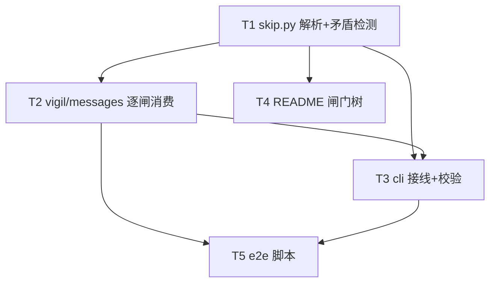

# 0054 · vigil 逐闸旁路开关：--skip 按需关闭任一流水线闸门 + README 闸门树

<!-- 本文件由 spec 工具维护：frontmatter 为结构化源数据（含 tasks DAG），正文为组级 rust-RFC 9 段总览。 -->

## Summary

给 `openagents vigil` 增加一个与既有 `--hold` 对称的临时命令行开关 `--skip <gates>`：把逗号分隔的闸门名解析成一个不可变 `Skip` 值对象（纯解析、无任何 IO），可按需把自主环里 **CLI 可达的任一流水线闸门**——issue 自检 / spec 评审 / 代码评审 / CI 等待 / 证据闸 / 可合并性预检（token：`issue` / `spec` / `code` / `ci` / `evidence` / `merge`，外加展开为全部的 `all`）——**视为 PASS 直接放行**。默认不传 `--skip` = 全闸开启，行为逐字节不变（零回归）。同时新增一条硬约束：`--hold` 与 `--skip` 若对同一道闸给出矛盾意图（如 `--hold spec --skip spec`）立即报错而非静默。最后把全部闸门以**树形**写进 README，让人一眼看清哪里有闸、哪些可经 CLI 关、哪些是 GitHub 分支保护里不可经 CLI 关的硬闸。

## Motivation

**现状（就地复述，不靠跨 spec 引用）。** OpenAgents 的守夜人（`openagents vigil`）是一个薄调度循环：每轮先在**发现段**扫描带发现标签的 issue、判读是否派单起草（`Vigil.discover_and_dispatch`），再在**守候段**对每个在途 run 轮询 PR、按阶段把它推过一串闸门（`Messages.poll` → `_process_rfc_review` / `_process_coding`）。这条流水线上目前有 **6 道 CLI 可达的强制闸**，全部无条件执行：

1. **issue 自检闸**——起草前 `orchestrator.precheck_issue` 判读 issue 本身是否有会直接影响修法方向的内在冲突；命中则冻结 issue（打 needs-human + 贴对齐评论）、发现段不派单。
2. **spec 评审闸**——draft PR 承载 spec，`_process_rfc_review` 调 `orchestrator.review_rfc` 评审；PASS 才打 `rfc-approved` 标签并进入实现。
3. **可合并性预检闸**——`_process_coding` 开头先查 `github.mergeability`，DIRTY/CONFLICTING 的 PR 连 CI 都不必等，越早短路越省。
4. **CI 等待闸**——`_process_coding` 查 `github.check_status`：失败→喂日志迭代，进行中→本轮不评审等下一轮。
5. **代码评审闸**——CI 全绿后 `_process_coding` 调 `orchestrator.review_code` 评审代码；PASS 才继续。
6. **证据闸**——代码评审 PASS 后、合并前，`_evidence_gate` 由独立 executor 照定稿说明书真跑系统、拿 RFC 意图对照证据门控合并。

调节这条流水线今天只有两类旋钮，都不能「临时整闸关闭」某一道：

- **`--hold spec|merge`**——**更严**的方向：让流水线在 spec 闸 / merge（合并前夯住）**停下等人**。它是一段纯解析逻辑（`openagents/hold.py`：把逗号分隔串解析成不可变 `Hold(at_spec, at_merge)`，无 IO、未知 token 立即报错），由 CLI 解析、经 `vigil.run(hold=...)` 逐轮透传给 `messages.poll(hold=...)`，在 spec / merge 两处闸据 `hold` 选择「停或照常」。
- **`OPENAGENTS_*` 环境变量**——只调**数量/轮次**（如 `OPENAGENTS_MAX_ROUNDS` 每闸最大评审回合数），不改「闸开不开」。

于是缺了一个对称的、**更松**方向的开关：临时把某一道（或几道）闸**整个关掉、当作 PASS 放行**。真实场景反复需要它：spec 已离线人评过、想让 vigil 直接进实现（关 spec 闸）；本地已手验、CI 排队太久想先推进评审（关 ci 闸）；无 browser MCP 的环境里证据闸恒 skip、想显式放行而非每轮空转（关 evidence 闸）；演示/教学时想让某个 issue 一路走到底（`all`）。今天要达到这些只能改代码或凑 env，既不可发现也不可回溯。

本 spec 用与 `--hold` **同构**的最小实现补上这个缺口，并顺带把「哪里有闸、哪些可关」这件今天只存在于源码里的隐性知识，以树形写进 README，让站在宏观位置的人（CLAUDE.md 理念 2/8）一眼看懂。

## Guide-level explanation

对人来说，`--skip` 就是 `--hold` 的一面镜子：`--hold` 让某道闸「停下等我」，`--skip` 让某道闸「别拦我、放行」。用法：

```bash
# 默认：全闸开启，行为与今天逐字节一致（零回归）
openagents vigil

# spec 已离线人评过 → 关 spec 评审闸，让 vigil 直接进实现
openagents vigil --skip spec

# 本地已手验、CI 排队太久 → 关 CI 等待闸 + 代码评审闸，先把 PR 推到证据闸
openagents vigil --skip ci,code

# 演示某个 issue 一路走到底：关掉全部 6 道 CLI 可达闸
openagents vigil --skip all

# 与 --hold 并用（作用在不同闸上，合法）：spec 停下等人，但可合并性预检放行
openagents vigil --hold spec --skip merge

# 矛盾：同一道闸既要停又要放 → 立即报错、绝不静默
openagents vigil --hold spec --skip spec
#   error: --hold 与 --skip 对同一闸门 'spec' 给出矛盾意图（停下等人 vs 放行跳过）；请二选一
```

合法闸门 token（对应上文 6 道闸）：

| token | 闸门 | `--skip` 后的行为 |
|---|---|---|
| `issue` | issue 自检闸 | 起草前不判读自洽性，issue 直接放行派单 |
| `spec` | spec 评审闸 | 不调 reviewer 评 spec，draft PR 视为已批、直接进实现 |
| `code` | 代码评审闸 | 不调 reviewer 评代码，视为 PASS、进证据闸 |
| `ci` | CI 等待闸 | 不查/不等 CI 状态，当作已绿、继续推进 |
| `evidence` | 证据闸 | 不跑独立取证，视为 PASS、进合并 |
| `merge` | 可合并性预检闸 | 不做 DIRTY/CONFLICTING 短路，交由后续正常流程 |
| `all` | 上述全部 | 6 道一次全放行 |

被关的闸一律视为 **PASS 放行**——即「就当它通过了」，而不是「停下」（那是 `--hold` 的语义）。未知 token（拼错如 `spc`）与 `--hold` 一样**立即报错并列出合法取值**，绝不静默丢监督。`--skip` 是**临时命令行 flag**、不落盘、不改任何持久状态：想恢复全闸只要下轮不带它。

**README 闸门树。** 除 CLI，本 spec 把「自主环里到底有几道闸、各在哪个阶段、哪些可经 `--skip`/`--hold` 从 CLI 关、哪些是 GitHub 分支保护里的硬闸」画成一棵树写进 README，例如（示意，最终以 T4 落稿为准）：

```
vigil 自主环闸门
├─ 发现段
│  └─ issue 自检闸 ............ 可关: --skip issue
├─ 守候段（每轮 poll 按阶段推进）
│  ├─ spec 评审闸 ............. 可关: --skip spec   | 可停: --hold spec
│  ├─ 可合并性预检闸 .......... 可关: --skip merge
│  ├─ CI 等待闸 .............. 可关: --skip ci
│  ├─ 代码评审闸 ............. 可关: --skip code
│  ├─ 证据闸 ................. 可关: --skip evidence
│  └─ 合并前夯住 ............. 可停: --hold merge
└─ GitHub 分支保护硬闸（CLI 不可关，须在仓库设置里改）
   └─ lint / test / commitlint / spec-validate（PR 必过检查）
```

## Reference-level explanation

### 技术方案（与 `--hold` 同构，纯解析 + 逐点消费）

**① 解析层——新增 `openagents/skip.py`（镜像 `hold.py`）。** 一段纯解析逻辑，无 argparse、无 IO、无 GitHub 依赖（CLAUDE.md 理念 1 奥卡姆 / 10 解耦）：

- 单点定义 6 个合法闸门 token 常量 `_GATE_ISSUE/_GATE_SPEC/_GATE_CODE/_GATE_CI/_GATE_EVIDENCE/_GATE_MERGE` 与聚合 `all`，组成 `_VALID_GATES`——解析与报错信息共用，杜绝字面量漂移。
- `@dataclass(frozen=True) Skip`，携带 6 个布尔意图 `at_issue / at_spec / at_code / at_ci / at_evidence / at_merge`（默认全 `False`），并提供便于消费点读取的语义。模块级 `NONE = Skip()` 作「全不关」默认实例（等价现状全闸开启）。
- `parse_skip(*, raw: str | None) -> Skip`：`None`/空串 → `NONE`；逗号分隔（容忍空格/大小写）→ 对应布尔置位；`all` → 6 个全置位；未知 token → `raise ValueError` 并列出合法取值（与 `parse_hold` 逐字节同款报错纪律）。
- **矛盾检测**（本 spec 唯一的新语义）：`reconcile_hold_skip(*, hold: Hold, skip: Skip) -> None`（纯函数，命中即 `raise ValueError`）。判据取「两侧共享 token 的交集非空」：`Hold` 只有 `at_spec/at_merge` 两个意图，与 `Skip` 的 `at_spec/at_merge` 逐一比对——同一道闸若被同时要求「停下等人」与「放行跳过」即矛盾，报一行清楚提示（点名闸名 + 两种意图），绝不静默。**软约定硬化**（技能质量条）：把「别对同一闸既 hold 又 skip」从一句正文告诫，落成一个会 `raise` 的纯函数，让它在 CLI 入口**根本无法悄悄通过**。

**② 消费层——把 `Skip` 逐轮透传给每道闸的判定点（复用 `--hold` 已铺好的透传管线）。**

- `Vigil.run(...)` 新增关键字参数 `skip: Skip = NONE`（与 `hold` 并列），逐轮透传：发现段 `discover_and_dispatch` 在调 `precheck_issue` 前判 `skip.at_issue`——为真则跳过判读、直接放行派单（issue 自检闸 PASS）；守候段把 `skip` 下传 `messages.poll(skip=...)`。
- `Messages.poll(*, skip: Skip = NONE)` 把 `skip` 下传 `_process_rfc_review` / `_process_coding`，在 5 个判定点插入「skip 即 PASS」短路，**位置与既有 `hold` 短路并列、镜像其写法**：
  - `spec`：`_process_rfc_review` 中若 `skip.at_spec` → 走既有 PASS 分支（打 `rfc-approved` 标签 + `_report_implement`），等价「reviewer 全票 PASS」，不调 `review_rfc`。
  - `merge`：`_process_coding` 开头若 `skip.at_merge` → 跳过 `github.mergeability` 的 DIRTY/CONFLICTING 短路。
  - `ci`：若 `skip.at_ci` → 跳过 `github.check_status` 的 fail/pending 分支，当作绿灯继续。
  - `code`：CI 绿后若 `skip.at_code` → 跳过 `review_code`，视为 `decision.passed`，进证据闸。
  - `evidence`：若 `skip.at_evidence` → 跳过 `_evidence_gate`，视为其返回 `None`（放行到合并/merge 闸）。

**③ CLI 层——`openagents/cli.py`。** 给 `vigil` 子命令加 `--skip`（`metavar`/`help` 与 `--hold` 对称）；`_cmd_vigil` 先 `parse_skip(raw=args.skip)` 得 `Skip`、再 `reconcile_hold_skip(hold=hold, skip=skip)` 校验矛盾（非法值/矛盾由 `ValueError` 经 `_run` 既有异常通道转成干净一行提示、不 traceback），最后 `run(..., hold=hold, skip=skip)`。

**零回归保证。** 所有新参数默认 `NONE`/全 `False`；不传 `--skip` 时每道闸的判定路径与今天逐字节一致（新短路条件恒为假）。已有 `vigil.run` / `messages.poll` 调用方与测试夹具因默认值不受影响。

### DAG + 文件分配

| Task | 标题 | files（互斥） | depends-on |
|---|---|---|---|
| T1 | skip 解析模块 + 矛盾检测 | `openagents/skip.py`, `tests/test_skip.py` | — |
| T2 | 逐闸消费：透传 Skip 到 6 道闸 | `openagents/vigil.py`, `openagents/messages.py`, `tests/test_messages_skip.py` | T1 |
| T3 | CLI 接线 `--skip` + hold/skip 矛盾校验 | `openagents/cli.py`, `tests/test_cli_skip.py` | T1, T2 |
| T4 | README 闸门树 | `README.md` | T1 |
| T5 | 成果测试 e2e 脚本（离线闸控时间线） | `scripts/e2e-spec-0054-vigil-skip-gate.sh` | T2, T3 |



各 Task 的 `files` 集两两不相交（协同模式单一 writer 所有权，理念 6）：`skip.py` 归 T1，两个消费文件 `vigil.py`/`messages.py` 归 T2，`cli.py` 归 T3，`README.md` 归 T4，e2e 脚本归 T5；测试文件各归其 Task，均为新增、不与既有夹具重叠。

### e2e 脚本路径

`scripts/e2e-spec-0054-vigil-skip-gate.sh`（T5）。**成果测试形态说明（理念 8）：** 本改动是纯 CLI/流水线内部控制流，**无前端、无产品对外浏览器行为**，且本 spec 起草环境**不具备 browser MCP（Playwright / Chrome DevTools）**——由 agent 自检工具列表确认——故成果测试取 **CLI/离线形态**，不设计浏览器导航/截图 e2e（与既有 `--hold` 的 `scripts/e2e-spec-0020-hold-gate.sh` 同构、可 CI 跑、可重复）。脚本两段：(1) 离线确定性验证：`ruff check` + `ruff format --check` + `pytest -q`（全程 mock，覆盖 skip 解析 / 矛盾检测 / 各闸 PASS 短路 / CLI 接线）；(2) 离线闸控时间线演示：用打桩 orchestrator/state + 内存 label 集合模拟 GitHub，离线驱动 `Messages.poll(skip=spec)` 断言「spec 闸被当作 PASS、直接进实现」，并演示 `--hold spec --skip spec` 报错。

## Drawbacks

- **多了一把「关监督」的枪。** `--skip` 让人可以临时关掉评审/证据等安全闸，误用（尤其 `--skip all`）会让未经把关的改动一路合并。缓解：它是不落盘的临时 flag（下轮不带即恢复全闸）；被关的闸只是 CLI 可达的软闸，GitHub 分支保护里的硬闸（lint/test/commitlint/spec-validate）仍拦得住，README 树把这条边界画清楚。
- **闸门集合从此有两处真相。** 闸门列表既在代码（各消费点）又在 README 树里，可能漂移。缓解：README 树是人读文档、天然滞后可接受；token 常量在 `skip.py` 单点定义，CLI/解析/报错共用。
- **`--hold` 与 `--skip` 的 `merge` token 语义并不完全等同**（hold=合并前夯住；skip=可合并性预检放行），共用一个 token 对新用户可能略绕。缓解：矛盾检测按 token 交集报错已足够安全；README 树分别标注「可停/可关」消除歧义。

## Rationale and alternatives

**为什么这样设计。** 与 `--hold` 严格同构是最小改动：解析层照抄 `hold.py` 的 frozen dataclass + `parse_*` + 单点 token 常量 + 报错纪律；消费层复用 `--hold` 已经铺好的 `vigil.run(...) → messages.poll(...)` 逐轮透传管线，只在各闸判定点并列插一个「skip 即 PASS」短路。新语义只有一处——hold/skip 矛盾检测——且把它做成会 `raise` 的纯函数（软约定硬化），而非正文告诫。零回归由「默认 `NONE` / 短路恒假」保证。

**备选 1（采纳的反面）：不做 CLI flag，只加 `OPENAGENTS_SKIP_*` 环境变量。** 与既有 `OPENAGENTS_*` 旋钮一致，无需动 argparse。否决：env 不可发现、不可回溯、易残留污染后续运行；`--hold` 已确立「意图闸门用命令行 flag、逐轮显式传入」的先例，对称性更重要。

**备选 2：把 skip 做成落盘的持久配置（state / YAML）。** 可跨进程记住「这个仓库永远关 evidence 闸」。否决：违背「临时旁路」的定位，且落盘的关监督开关比临时 flag 危险得多（忘了它一直开着）；真需要长期关某闸应改分支保护或 spec，而非藏在本地状态里。

**备选 3：让被关的闸「停下等人」而非「PASS 放行」（即复用 `--hold` 语义、不新增 flag）。** 否决：这恰是 `--hold` 已有的更严方向；本 issue 要的是更松方向（放行），语义相反，硬塞进 `--hold` 会让一个 flag 两义。因此 `--skip` 必须是独立、对称的 flag。

**备选 4：矛盾检测按「语义等价」而非「token 交集」判定**（如认为 hold-merge 与 skip-merge 不冲突，因语义不同）。否决：token 交集判据更简单、更安全（宁可误报让人二选一，也不放过一个可能自相矛盾的调用），且与 issue 约束「同一闸的矛盾表达应报错」字面一致。

## Prior art

- **本仓 `openagents/hold.py`（Spec-0020）**——`--hold` 的 frozen `Hold` 值对象 + `parse_hold` + 单点 token 常量 + 未知 token 立即报错 + 逐轮透传，是本 spec 直接镜像的范式。
- **Rust RFC 形态**（[rust-lang/rfcs](https://github.com/rust-lang/rfcs)）——本总览的 9 段结构来源。
- **通用 CLI 惯例**——`pytest --no-header`/`git commit --no-verify`/`make -k` 等「临时旁路某道默认检查」的 flag 是成熟先例：旁路开关不落盘、只作用于本次调用、与「更严」的开关对称并存。

## Unresolved questions

- `--skip all` 是否要在运行时额外打一条显眼日志/警示（提示「本轮全部安全闸已关」）？倾向要，但属实现细节，留待 Phase 3 与人确认，不阻塞本 spec。
- `merge` token 是否应拆成两个更精确的名字（如 `mergeable` 给预检、保留 `merge` 只给 hold）以消除 hold/skip 共用 token 的语义微差？当前倾向不拆（保持与 issue 列举的闸名一致、集合最小），记为待观察。

## Future possibilities

- 若未来出现更多 CLI 可达闸（如安全扫描、许可证检查），`Skip` 的 token 集与 README 树可平滑扩展（单点常量 + 新增布尔位 + 新增消费点短路）。
- 可把 issue #71 的运行期 owner 检查思路借来：把「哪些闸允许被 `--skip`」也做成 schema/frontmatter 声明，让「不可关的硬闸」在解析期即拒绝（进一步软约定硬化）。
- README 闸门树若稳定，可考虑由 `spec graph` 之类工具从消费点自动生成，消除代码/文档双真相的漂移风险。

