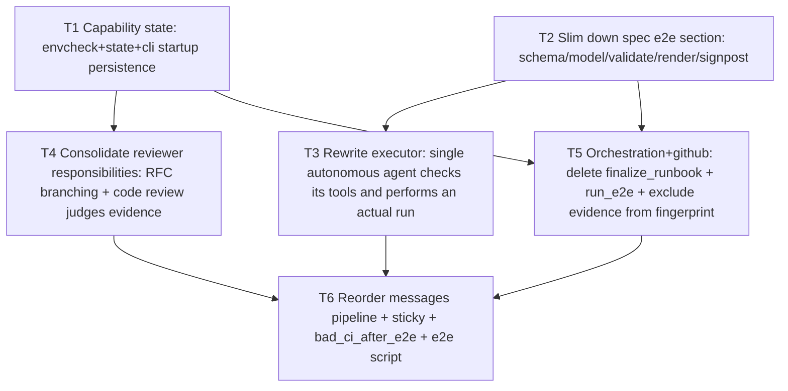

# 0055 · e2e v2: Capability Awareness + Direct Test Instructions + Combined Review (Redesign of 0040)

<!-- This file is maintained by the spec tool: frontmatter is the structured source data (including the tasks DAG); the body is a group-level overview in the nine-section rust-RFC format. -->

## Summary

Redesign OpenAgents e2e from Spec-0040's three layers of mechanical scaffolding—`form` enum dispatch + `finalize_runbook` finalization + a separate evidence gate
(`evidence_gate`)—into a **capability-aware pipeline that feeds test instructions directly to the executor and combines review**:

```
① Vigil process starts    envcheck scans once → persist the “browser capability state variable” ui-capable in state.json
② Write RFC(spec)         e2e section = intent(what to verify) + prose test method(how to test), no form or exact commands;
                          RFC drafting/review uses ui-capable to decide “whether to require real screenshots”
③ implement               Write feature code (unchanged)
④ executor                An independent agent directly runs the prose test method from the RFC, checking its tools at runtime
                          (if browser_* is available, open the frontend and take screenshots; otherwise, report the fallback honestly),
                          and writes screenshots + a result.md statement to docs/e2e-results/<pr>/
⑤ Combined review         Existing review_code assesses both “code diff + evidence (reviewer uses Read to inspect screenshots firsthand)”—
                          the reviewer judges runtime behavior; there is no longer a separate evidence gate
```

Remove `finalize_runbook`, the `form` enum and `_run_by_form` dispatch, the separate `evidence_gate` module and
`review_evidence`, and the dedicated round budgets for `iterate(reason=e2e)`/`_block(gate=e2e)`. The pipeline order in `_process_coding`
is **mergeability → CI → executor → review → merge** (executor comes after CI and before review,
because evidence is one of the objects of review). Add a **source fingerprint idempotency gate (excluding `docs/e2e-results/`)** to prevent evidence commits
from repeatedly triggering themselves, reuse Spec-0053's **sticky reuse** mechanism (if the source has not changed, do not rerun executor or review; merge directly once
CI is green), and handle the exceptional case where “a docs-only evidence commit unexpectedly turns CI red” by applying a separate `bad_ci_after_e2e` label + suspending with `_block`.

This group (Spec-0055) delivers the **core rewrite**; deletion of dead code left over from 0040 (`evidence_gate.py`, etc.) and migration of e2e blocks
in existing specs are deferred to a subsequent cleanup group (see Unresolved).

## Motivation

**Background (restated here, without relying on bare references).** OpenAgents is a spec/RFC-driven multi-agent framework: the Vigil
`messages.Messages.poll` periodically scans all open runs and routes them by phase. A typical issue lifecycle is:
`solving` → create an RFC draft PR → `rfc-review` → RFC approved → `implement` writes code and marks the PR ready → `pr-open` → `_process_coding`
checks CI/mergeability each round; once CI is green, `review_code` runs (N independent reviewers vote); unanimous PASS leads to merge (or
`hold.at_merge` stops at “awaiting human merge”), while a non-PASS leads to `iterate`/suspension with `_block` after K rounds accumulate. e2e is embedded in this chain.

**Current Spec-0040 design (what this group replaces).** 0040 designs e2e as: the spec declares `e2e{form∈ui|api|cli|backend,
intent, acceptance[]}` as a rough plan → after coding, `orchestrator.finalize_runbook` assigns the implementer to finalize that rough plan into
`docs/e2e-results/<pr>/runbook.md` → `executor.run_executor` dispatches by `form` (`_run_by_form`) and assigns an independent
agent to actually run it → `evidence_gate.review_evidence` compares `result.md` against the intent and returns PASS/FAIL to gate merging. A line-by-line inspection
of the existing code reveals four structural problems with this design:

1. **The flagship `ui` capability was never implemented, and it can stall UI PRs indefinitely.** `executor._run_by_form` (`executor.py:150`)
   **unconditionally returns `skipped`** for `form==ui` (left blank for Phase 2), but `run_executor` still writes this skipped result into
   `result.md`; `evidence_gate.review_evidence` (`evidence_gate.py:118`) sees that `result.md` exists → does not trigger
   the “hard FAIL for missing evidence” → assigns an agent to compare the skipped evidence against the UI intent → returns FAIL → `iterate(e2e)` → accumulates K rounds → `_block`.
   **Frontend PRs that honestly declare `form: ui` can never pass under Phase 1 and can only be suspended**—the only way out is to manually downgrade `form`
   to `cli` (the repository's only actual evidence-gate output, `docs/e2e-results/128/`, did exactly this, running offline
   `ruff+pytest+grep`, with browser screenshots “optional; absence does not cause FAIL”). The flagship capability to “actually run the UI” has never been exercised.
2. **Two redundant evidence mechanisms.** 0040 puts runtime evidence in `docs/e2e-results/<pr>/`; Spec-0044 introduces another **manual**
   skill for “running the real app and taking screenshots,” with evidence stored in `docs/evidence/spec-NNNN/`, and inserts “claiming verification without tracked evidence = REWORK”
   into the **code reviewer's** rubric (`reviewer.py`). This leaves two evidence directories and two consumers checking different directories, while
   0044 has code reviewers inspect runtime evidence, in direct tension with 0040/T4's rule that “code reviewers do not judge runtime behavior.”
3. **`form` dispatch + `finalize_runbook` are overengineered.** The `form` enum, `_parse_form` regex, `_run_by_form`
   dispatch, and an additional `finalize_runbook` step to “draft a separate runbook after coding” split the simple task of “give an agent a test method and let it run”
   into three layers of mechanical scaffolding. Historically (in the old `scripts/e2e-*.sh` era), **the implementer consistently wrote the concrete commands only after
   completing the implementation** (the RFC contained only pointers + acceptance criteria, without commands), showing that “deciding commands after coding” has repeatedly been the right choice—but packaging them
   into a runbook file creates an unnecessary intermediate artifact.
4. **A separate evidence gate conflicts with the goal of “combined review.”** Acceptance of runtime behavior should be part of review; splitting it into a separate
   `evidence_gate` module + `review_evidence` + dedicated round budget increases state-machine complexity without any fundamental benefit—
   the reviewer is already a fully equipped claude-code agent (`backends/claude_code.py:159` launches `claude -p` **without
   `--allowedTools` restrictions**), whose `Read` tool can read PNGs and feed them visually to the multimodal model, so it **is fully capable of inspecting screenshots firsthand and judging them**.

**Core shift.** “Dispatch by form + finalize a runbook + separate evidence gate” → “**a capability state variable determines test-method requirements → feed the prose test method
directly to an independent executor that checks its tools and actually runs it → incorporate it into existing review to assess code + evidence together (inspecting images firsthand)**.” All four problems share the same root: overmechanizing
the simple task of “run + inspect,” while failing to carry capability detection through the decision of “whether verification is required.” This group flattens the design
using one persisted capability state variable + one autonomous executor + reuse of the existing reviewers.

## Guide-level explanation

Walk through a real example: issue #142, “Add a dropdown to the results dashboard `board.html` to filter runs by status” (a UI change).

**① Persist capabilities when Vigil starts.** At the moment `openagents vigil` starts its loop, `envcheck` scans the local machine: `playwright` is
registered in `~/.claude.json` + permissions are `bypassPermissions` → persist `ui-capable=true` at the top level of `state.json`
(alongside `agent_id`). It is read only once throughout the session, at ③.

**② Draft a spec containing a prose test method.** start_rfc assigns an agent to draft the spec, open a draft PR, and transition to `rfc-review`. During drafting,
**read `ui-capable`**: if =true and this is a UI change → write the e2e section in a form that requires screenshots (only `intent` + prose `method`,
**no form or exact commands**):

```yaml
e2e:
  intent: The dashboard can filter by status—after selecting a status, only runs with that status remain; all others are hidden.
  method: |
    1. Start the local dashboard; 2. Confirm that the dropdown exists and shows all runs by default;
    3. Select “done” → take a screenshot to confirm that the list contains only done runs; 4. Select “All” → take a screenshot to confirm that the full list is restored.
    Requirement: This is a visible UI change; screenshots taken after real navigation are required as evidence.
```

**③ The RFC review gate judges “whether verification is required and whether the test method is appropriate.”** The `review_rfc` rubric **also reads `ui-capable`** (sharing
a single “read ui-capable → select criteria” function with drafting to prevent the two from drifting apart): `ui-capable=true` and a UI change without a reasonable
screenshot-based test method → REWORK; a method is provided and covers the intent → PASS → apply `spec-approved` → `implement`.

**④ implement.** As today, assign an agent to write code, mark the PR ready, and transition to `pr-open`. **implement no longer runs any e2e.**

**⑤ The coding phase of each poll round** (the core, `_process_coding`). Gate order: **① mergeability precheck → ② CI (green)
→ ③ executor runs e2e → ④ review_code → ⑤ merge**.

- **③ executor**: After CI turns green, start a separate, independent executor agent (athlete ≠ referee), with **the prose test method from the spec's
  `method` fed directly as input** (no intermediate runbook). It **checks its tools**: if `browser_*` is available → actually open and navigate the dashboard, select
  “done,” and call `browser_take_screenshot`. If it finds that filtering has not taken effect (the screenshot shows an unchanged list), write **screenshots + a one-sentence
  `result.md` statement** (“Conclusion FAILED: the list did not change after selecting done; see step3.png”) to `docs/e2e-results/142/`,
  then commit. The executor **only runs and reports; it does not adjudicate**.
- **④ review_code**: Each of N reviewers (fully equipped claude-code, with `Read` able to view PNGs) reads `git diff` + **opens screenshots with
  `Read` to actually see the rendered screen** + reads the `result.md` statement + compares against intent, then judges them together. Seeing “the code contains filtering logic, but
  the screenshot shows that it did not take effect” → REWORK (a short paragraph in Chinese). **There is no separate evidence gate—this one review judges both code and e2e;
  runtime behavior is now the reviewer's responsibility** (reversing 0040/T4). REWORK → `iterate(reason="review")` → next round.
- **Next round**: `iterate` fixes the filtering logic → CI turns green again → executor **reruns** (the source fingerprint changed, so it tests the latest version) → screenshots
  show that filtering works, and `result.md` concludes PASSED → unanimous PASS in review → merge (or hold.at_merge stops at “awaiting human merge”).

**Convergence after the evidence commit (sticky).** The executor's commit is docs-only and causes GitHub CI to run again on it.
Next round: **the source fingerprint (excluding `docs/e2e-results/`) is unchanged → skip executor and use sticky reuse of the previous round's review PASS
(neither reruns; reuse the Spec-0053 mechanism) → merge directly once the evidence commit's CI is green, without another review** (reviewing the same code again
risks reversing the verdict, precisely the repeated-review oscillation that 0053/0041 aim to prevent). If that CI run unexpectedly turns red (the source was previously green and approved) → apply
the separate diagnostic label `bad_ci_after_e2e` + `_block` (needs-human; hold firmly in the `blocked` state without spinning), **rather than sending it back to iterate as an ordinary CI
failure** (the source is not at fault); after a human unblocks it, return to `pr-open` and merge directly using sticky reuse.

**Fallbacks and boundaries.** If Vigil runs on a headless CI machine (`ui-capable=false`): at ②, drafting already avoids requiring screenshots and writes the test method
as offline assertions or notes that no browser is available; at ⑤, executor's tool check finds no `browser_*` → honestly reports “No browser available; UI screenshots cannot be obtained”; review **uses a soft assessment**
(does not return REWORK because screenshots are missing; judges using the available evidence). For a docs-only PR: the test-method section says “No runtime behavior to verify”; executor does not perform unnecessary work,
and the reviewer lets it pass if they agree. **Every PR goes through this e2e step**, but its content can reduce to N/A depending on the nature of the change.

## Reference-level explanation

### Mechanism 1: Capability state (single source of truth, read only during RFC-authoring)

- Extend `envcheck` with a structured capability: combine the existing `detect_browser_mcp()` + `effective_permission_mode()` into
  `ui_capable() -> bool` (browser MCP is registered ∧ `bypassPermissions`).
- **Persist at startup**: the Vigil/single-step entry points in `cli` (`vigil` / `poll` / `init`) call
  `envcheck.ui_capable()` before starting `Messages`/`Orchestrator` and write it to the top-level `ui_capable` key in `state.json` (add `State.set_ui_capable` /
  `State.get_ui_capable`, at the same level as `agent_id`, overwritten on every startup—environment changes take effect at the next startup).
- **Read in only two places**: the spec-drafting prompt (where `orchestrator` drafts the testing-method section) + the RFC review rubric (`reviewer`'s
  `_RFC_REVIEW_TASK`). **Not read during execution** (the executor checks its tools at runtime; see Mechanism 3). Both places share the same branching text for
  “selecting testing-method criteria based on `ui_capable`,” ensuring consistent drafting and review criteria.

### Mechanism 2: Slim down the spec e2e section (intent + prose testing method, remove form)

- `spec/schema.py` + `model.py`: change the `e2e` block from `{form, intent, acceptance[]}` to
  `{intent: str, method: str}` (`method` is a prose testing method). Retire the `form` enum `E2E_FORM_VALUES`.
- `validate`: when `e2e` is present, a nonempty `intent` and nonempty `method` are sufficient for validity (backward compatible with groups that have no e2e block).
- Change `render` (OVERVIEW) + `signpost` (the signpost in the PR body) to render `intent + method`.
- Migration of old `e2e{form,...}` blocks in existing specs to the new format is assigned to a follow-up cleanup group (Unresolved).

### Mechanism 3: Rewrite the executor (single autonomous agent + output-path convention)

- `executor.run_executor(*, backend, work_dir, method, evidence_dir, pr_number, ui_intent)` —
  **remove the `form` parameter, `_parse_form`, and `_run_by_form`**. Put the spec's prose testing method `method` + intent directly
  into a task prompt and dispatch an independent agent: require it to **check at runtime whether it has `browser_*` tools**—if so, actually open a browser,
  navigate/interact/take screenshots, and save them in `evidence_dir`; otherwise, actually run the test using available means such as the command line/HTTP, or truthfully report “unable to perform an actual run/the environment lacks the required capabilities.”
  The final line still provides `OUTCOME: PASSED|FAILED` (for messages to render the report; **not used to make a gating decision**).
- The contract remains unchanged: never raise an error (map exceptions to failed); regardless of the outcome, write `result.md` (a one-sentence statement + observations) to
  `evidence_dir`; the agent itself saves attachments such as screenshots in `evidence_dir`.
- Delete form-related constants such as `OUTCOME_SKIPPED` / `_UI_FORM` / `_RUNTIME_FORMS` / `_UI_PHASE2_NOTE`.

### Mechanism 4: Consolidate reviewer responsibilities (RFC branching + code review judges runtime behavior)

- `_RFC_REVIEW_TASK`: add “requirements for how to capture evidence, selected based on `ui_capable`” (the capability is passed through by `orchestrator`;
  reviewer remains decoupled, depending only on `AgentBackend` + supplied parameters).
- `_CODE_REVIEW_TASK`: **reverse 0040/T4**—change “the evidence gate is responsible for runtime behavior; you do not judge it” to “**read
  the evidence in `docs/e2e-results/<pr>/` (`result.md` + open screenshots with `Read` and inspect them visually), and judge whether runtime
  behavior fulfills the spec intent; if the executor claims success but the screenshots do not match → REWORK**.” Incorporate Spec-0044's “claims of verification without tracked evidence =
  REWORK” into this rule, pointing to the unified `docs/e2e-results/<pr>/`.
- Add `ui_capable: bool` (for the RFC gate) and the semantics that “the evidence directory is readable” to `reviewer.review`; aggregation/parsing remain unchanged.

### Mechanism 5: Orchestration and pipeline (reorder _process_coding + idempotency + sticky + bad_ci_after_e2e)

`orchestrator`: **delete `finalize_runbook`**; `_e2e_plan` reads the new `e2e{intent,method}`; add
`run_e2e(*, pr_number)`—ensure worktree → compute the source-code fingerprint (`github.code_fingerprint` excludes
`docs/e2e-results/`) → compare with `record.e2e_ran_fingerprint` (a new state field): only if it has changed, call `executor.run_executor`
+ commit the evidence and update the fingerprint; otherwise, reuse (return “skipped-reuse”). Pass `ui_capable` through to reviewer/drafting.

`github.code_fingerprint`: add “exclude the `docs/e2e-results/` path”—evidence commits do not change the source-code fingerprint.

New order for `messages._process_coding` (each poll cycle):

```
① mergeability precheck (unchanged; conflict → resolve / _block(merge))
② CI check (unchanged; fail → iterate(ci); pending → wait)
   —— CI green ——
③ orchestrator.run_e2e: source-code fingerprint changed → executor performs an actual run + commits evidence; unchanged → skip and reuse
④ review_code (read diff + docs/e2e-results/<pr>/ evidence + screenshots)
     ├ Fingerprint matches the previous PASS (Spec-0053 sticky) → reuse PASS, skip rerunning ③④
     ├ REWORK → iterate(reason="review") → next cycle
     └ PASS → ⑤
⑤ hold-merge freeze / merge_pr → done
```

- **The cycle after the evidence commit**: source-code fingerprint unchanged → ③ skips executor, ④ reuses PASS via sticky → only wait for
  CI on the evidence commit; green → merge directly, red → `_block(gate="bad-ci-after-e2e")` + additionally apply the `bad_ci_after_e2e` GitHub label.
- **Delete** `_evidence_gate` and the dedicated branches for `iterate(reason="e2e")` and `_block(gate="e2e")`; e2e FAIL goes through the ordinary
  `review_code` REWORK/iterate flow (reusing the existing `rounds`/`MAX_ROUNDS`).
- `bad_ci_after_e2e` uses the existing `_block` mechanism: `STATUS_BLOCKED` (not in `_OPEN_STATUSES` → poll skips it, keeping it firmly blocked
  without spinning) + `needs-human` (`BLOCKED_LABEL`) + `block_gate="bad-ci-after-e2e"` (unblocking routes back to `pr-open`
  → sticky merges directly) + an additional `bad_ci_after_e2e` diagnostic label (distinguishing “the evidence commit made CI fail” from other reasons for being blocked).

### State machine impact

No new status. New state fields: `ui_capable` (top-level, not per-run), `e2e_ran_fingerprint` (per-run,
used for executor idempotency). Add `"bad-ci-after-e2e"` to the set of `block_gate` values. Add the GitHub label
`bad_ci_after_e2e` alongside `BLOCKED_LABEL` (diagnostic; does not participate in unblocking decisions).

### DAG and file allocation



| Task | Owned files (mutually exclusive) | depends-on |
|---|---|---|
| T1 | `openagents/envcheck.py`, `openagents/state.py`, `openagents/cli.py`, `tests/test_envcheck.py`, `tests/test_state.py`, `tests/test_cli.py` | — |
| T2 | `openagents/spec/schema.py`, `openagents/spec/model.py`, `openagents/spec/validate.py`, `openagents/spec/render.py`, `openagents/spec/signpost.py`, `tests/test_spec_model.py`, `tests/test_spec_validate.py`, `tests/test_spec_render.py`, `tests/test_spec_signpost.py` | — |
| T3 | `openagents/executor.py`, `tests/test_executor.py` | T2 |
| T4 | `openagents/reviewer.py`, `tests/test_reviewer.py` | T1 |
| T5 | `openagents/orchestrator.py`, `openagents/github.py`, `tests/test_orchestrator.py`, `tests/test_github.py` | T1, T2 |
| T6 | `openagents/messages.py`, `tests/test_messages.py`, `scripts/e2e-spec-0055-e2e-v2-capability-aware.sh` | T3, T4, T5 |

(T1/T2 are parallel leaf tasks; **deletion** of `evidence_gate.py` and migration of existing spec e2e blocks are assigned to a follow-up cleanup group to prevent this group's T6 and
the cleanup group from contending over `evidence_gate.py`—this group's T6 only **stops calling** `evidence_gate`; file deletion is left to the cleanup group.)

### Interface contracts

- `envcheck.ui_capable() -> bool`; `State.set_ui_capable(*, value)` / `State.get_ui_capable() -> bool`.
- `executor.run_executor(*, backend, work_dir, method, evidence_dir, pr_number, ui_intent) -> ExecutorResult`
  (`ExecutorResult{outcome: passed|failed, notes}`, remove `form`).
- `orchestrator.run_e2e(*, pr_number) -> E2ERunResult | None` (None = no e2e section, so pass through without action; includes
  `reused: bool` to indicate a sticky skip).
- `github.code_fingerprint(*, pr_number, exclude_paths=("docs/e2e-results/",)) -> str`.
- `reviewer.review(*, backend, work_dir, kind, pr_number, n, history, ui_capable=False) -> ReviewDecision`.

### Rough e2e plan for this group itself

- **intent**: Prove that the e2e v2 pipeline really has teeth—the executor actually runs its self-checks, evidence enters review, source fingerprint idempotency + sticky converge,
  and bad_ci_after_e2e is firmly enforced.
- **method** (offline deterministic dogfood; this group is purely backend orchestration with no navigable frontend): Create a fixture PR/worktree + a prose test method,
  run `run_e2e` and assert that evidence lands in `docs/e2e-results/<pr>/` and is reused without rerunning when the source has not changed; feed “achieved/not achieved” evidence to
  `review_code` (fake backend) and assert that PASS allows merging / REWORK prevents merging; construct a case where “CI turns red after the evidence commit” and assert that it takes
  `_block(bad-ci-after-e2e)` + both labels + the `blocked` state.
- Script: `scripts/e2e-spec-0055-e2e-v2-capability-aware.sh` (offline portion: ruff + pytest + grep anchors).

## Drawbacks

- **No hard UI gate on machines without a browser.** When `ui-capable=false`, UI changes have only the reviewer's soft judgment (deciding based on the executor's
  “could not run” report), with no mechanical hard gate—UI behavior verification is effectively absent in headless/pure CI Vigil environments (tradeoff: avoid false blocking,
  but provide no hard guarantee either. See Rationale).
- **e2e runs for every PR.** Even pure docs/refactoring changes go through the executor once (though it can degrade to N/A), adding
  one agent invocation compared with 0040's “skip when there is no e2e block.”
- **Residual risk from executor self-attestation.** The executor is only instructed by its prompt to “actually run” and self-reports `OUTCOME` on the final line; the framework cannot mechanically
  guarantee that it actually ran. The teeth come from the cross-check between “executor produces evidence + reviewer independently inspects screenshots,” not from mechanical proof.
- **Merge happens one round after evidence generation.** After the evidence commit, merging must wait for its CI to go green (the sticky round), adding one poll in steady state.
- **Capabilities are a snapshot taken at each startup.** Across machines/sessions (drafting locally, executing on a server), the execution environment's startup snapshot is authoritative; the single-machine MVP has no such
  mismatch, but distributed use requires attention (see Future).

## Rationale and alternatives

**Why this design.** The four problems share a root cause: “over-mechanizing the simple act of running and inspecting, while capability detection does not carry through to the decision of whether verification is needed.” A single
persisted capability state variable (carried through the RFC-stage test-method requirements) + an autonomous executor (runtime self-checks, with no distinction by form) + reuse of the existing reviewer
(which can view images and jointly assess code + evidence) flatten three layers of scaffolding. Reusing Spec-0053 sticky and the existing `iterate`/`_block`/`rounds`
keeps the state machine almost unchanged (Occam, principle 1). The executor sits after CI and before review because **evidence is one of the objects of review**
(review must follow e2e), while running before CI would waste browser runs on code that has not passed CI.

**Alternative 1: Keep 0040's form mechanism and only make the `ui` branch actually run.** The smallest change, but it leaves three root problems unresolved: “redundant evidence directories, a separate
evidence gate at odds with combined review, and redundant finalize_runbook”—patching ui alone still leaves four layers of scaffolding. Rejected.

**Alternative 2: Keep the separate evidence gate (0040's choice), with a separate `review_evidence` after the executor.** The sequence adds no extra round, but **splits out
another module + a dedicated round budget**, contrary to the goal of “combined review”; the reviewer can already view images, so a second agent role is unnecessary.
Rejected—folding it into `review_code` is more economical (principles 1/10).

**Alternative 3: Run the executor before CI.** This lets the evidence commit precede CI, lets CI assess the tree including evidence in one pass, and avoids the sticky round.
But it wastes the most expensive browser e2e runs on **code that has not passed CI**, and the evidence commit merged in would instead lack separate CI/review coverage.
Rejected—prefer an extra sticky round (with `paths-ignore: docs/e2e-results/**` as an optional optimization to avoid that round).

## Prior art

- **Spec-0040** (direct predecessor): Instruction-driven + independent execution + evidence review gating. This group retains the skeleton of “independent execution + persisted evidence +
  gating before merge,” strips away the mechanical shell of form/runbook/separate evidence gate, and has already restated the key content in place in Motivation.
- **Spec-0030**: The init environment check `envcheck` (detecting browser MCP + permission mode) + soft guidance to “prioritize designing frontend
  e2e when browser tools are available.” This group upgrades it from “one-time init output + soft prompt” to “persisted startup state variable + deterministic routing at the RFC stage.”
- **Spec-0044**: The discipline skill for “running the real app and taking screenshots” + “claimed verification without evidence = REWORK.” This group folds these into the unified
  `docs/e2e-results/<pr>/` and the combined code reviewer rubric (eliminating the two sets of evidence directories).
- **Spec-0053**: Sticky reuse of the code gate's “PR net diff fingerprint” (cf. k8s Tide sticky approve / tree-hash). This group
  reuses its fingerprint mechanism for “source fingerprint (excluding the evidence directory) idempotency + sticky.”
- **Spec-0041**: The hold-merge freeze eliminates repeated review oscillation on unchanged code—this group's “no re-review after the evidence commit; merge directly via sticky” shares the same origin.
- Multimodal code review: The claude-code `Read` tool reads images (feeding PNG/JPG images visually to the model), providing the capability for the reviewer to inspect screenshots firsthand.

## Unresolved questions

- **0040 dead code removal + migration of existing spec e2e blocks**: Deleting `evidence_gate.py`, merging `docs/evidence/` into
  `docs/e2e-results/`, migrating existing specs' old `e2e{form,...}` to the new `{intent,method}`, and cleaning up legacy
  RFC-NNNN comments in 0029 pending—assigned to **the follow-up cleanup group Spec-0056** (which depends on this group), to avoid competing with this group's T6 over `evidence_gate.py`.
- **Whether to keep `scripts/e2e-*.sh` (32 development-time dogfood scripts)**: These are separate from runtime e2e (offline self-tests during CI). The preference is
  to **keep them** (they still pass and serve as CI dogfood), clarifying their distinction from runbook/executor only in documentation/naming—leave the decision to the cleanup group.
- **CI `paths-ignore: docs/e2e-results/**`**: This can avoid the CI rerun in the sticky round and is an optional optimization; this group does not depend on it for now,
  using sticky + bad_ci_after_e2e as the fallback, with actual testing to determine whether to add it.

## Future possibilities

- **Enriching the `api` form**: Have the executor make HTTP assertions against a running service (prose test methods can already express this; tooling support remains to be added).
- **Evidence dashboard**: Render screenshots/statements from `docs/e2e-results/<pr>/` into a frontend results dashboard so people can review the results (principle 8).
- **Cross-machine source of truth for capabilities**: In distributed use (drafting locally, Vigil on a server), make the execution environment's capabilities a single source read by both sides,
  avoiding a mismatch between test-method requirements and execution capabilities (a startup snapshot suffices for this group's single-machine MVP).
- **Reversing runbook auto-generation**: This group has already eliminated the runbook; if a diffable final record of the test method is wanted in the future, the executor could write back the steps it actually
  ran as a tracked record (rather than finalizing them in advance).
